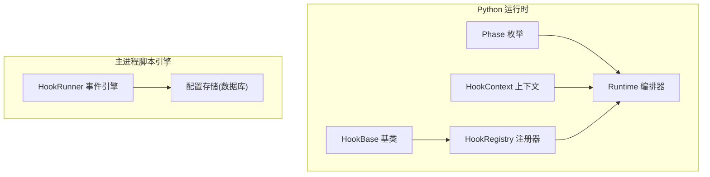
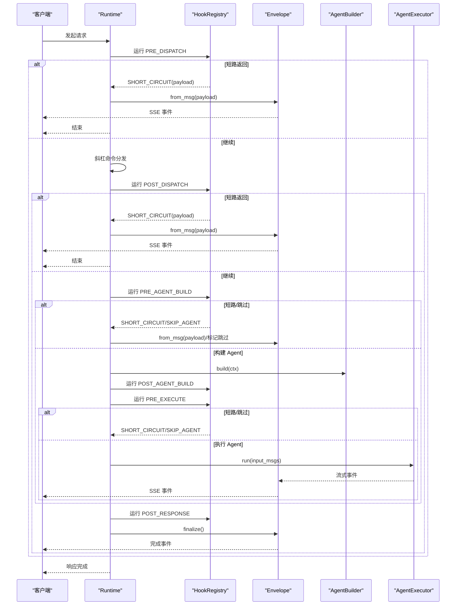
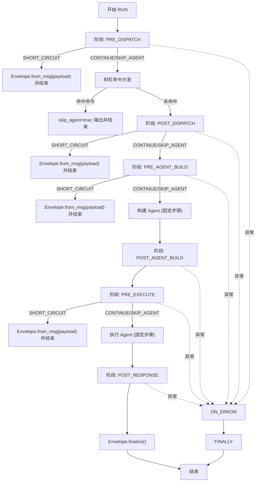
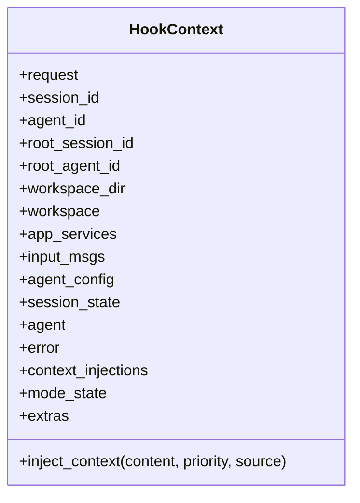
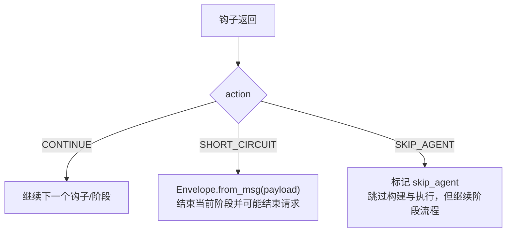
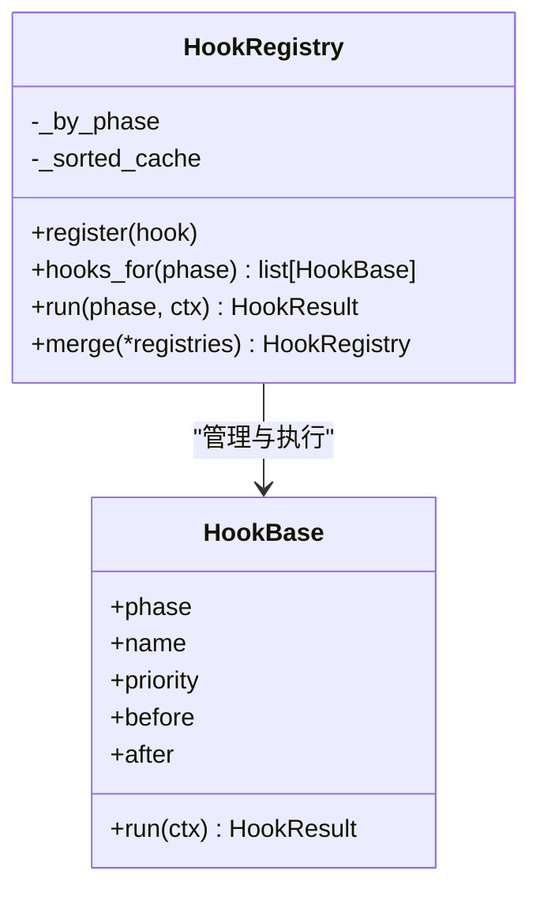
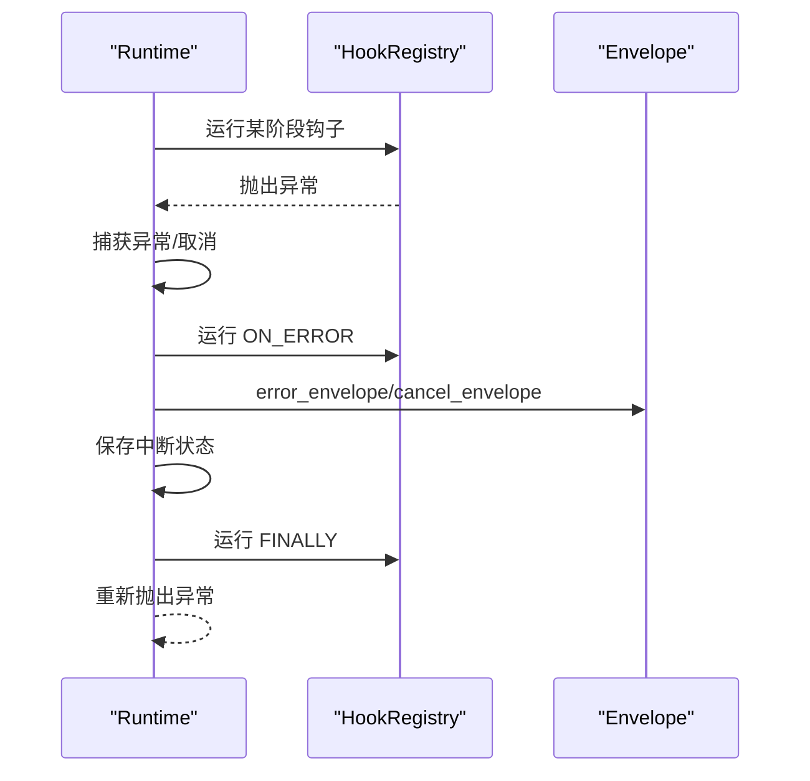
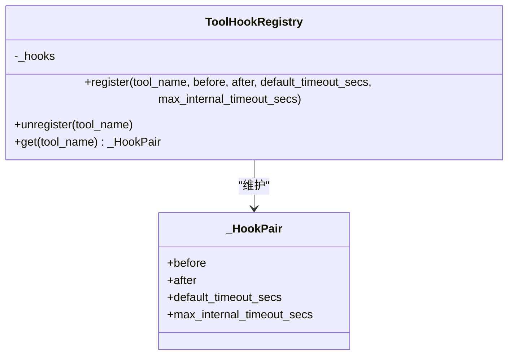
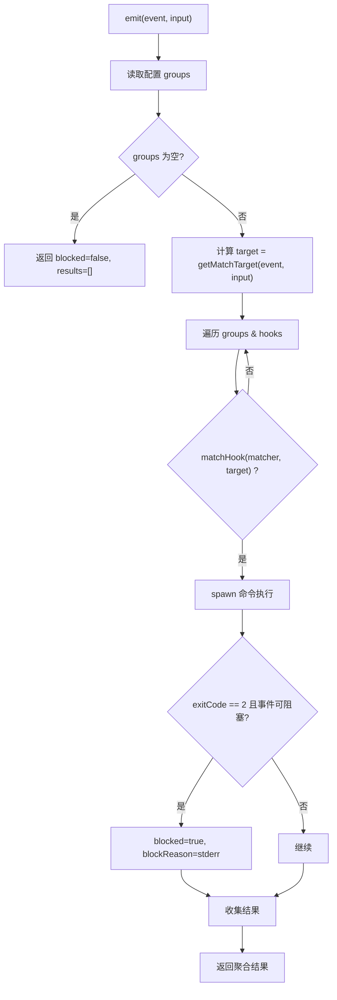
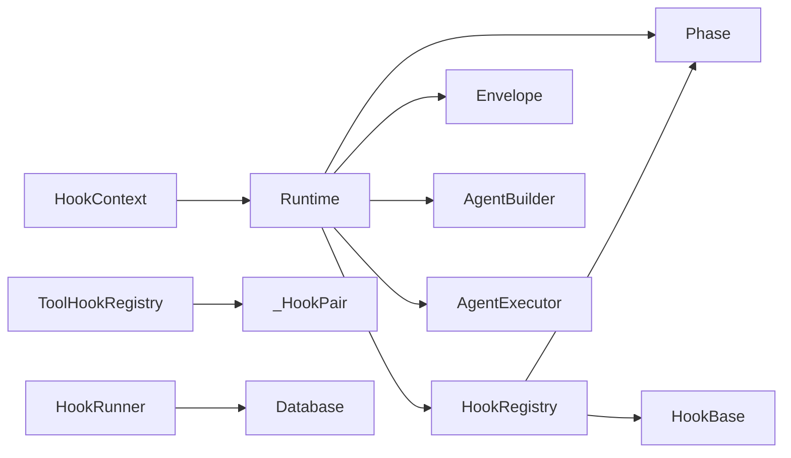

# 钩子系统

<cite>
**本文引用的文件**   
- [hooks.py](file://tongtian-tauri/src/agent/runtime/hooks.py)
- [phases.py](file://tongtian-tauri/src/agent/runtime/phases.py)
- [runtime.py](file://tongtian-tauri/src/agent/runtime/runtime.py)
- [_hooks.py](file://tongtian-tauri/src/agent/tool_calls/_hooks.py)
- [hook-runner.ts](file://tongtian-tauri/src/main/hooks/hook-runner.ts)
</cite>

## 目录
1. [简介](#简介)
2. [项目结构](#项目结构)
3. [核心组件](#核心组件)
4. [架构总览](#架构总览)
5. [详细组件分析](#详细组件分析)
6. [依赖关系分析](#依赖关系分析)
7. [性能考量](#性能考量)
8. [故障排查指南](#故障排查指南)
9. [结论](#结论)
10. [附录：扩展与最佳实践](#附录扩展与最佳实践)

## 简介
本文件系统性阐述运行时钩子系统的设计与实现，覆盖生命周期八阶段（PRE_DISPATCH、POST_DISPATCH、PRE_AGENT_BUILD、POST_AGENT_BUILD、PRE_EXECUTE、POST_RESPONSE、ON_ERROR、FINALLY）、HookContext 的作用域与数据传递机制、HookAction 控制流（CONTINUE、SHORT_CIRCUIT、SKIP_AGENT），以及钩子的注册方式、执行优先级、异常处理策略。同时提供自定义钩子开发指南、条件判断模式以及与运行时其他组件的交互范式。

## 项目结构
钩子系统由 Python 运行时层与主进程脚本引擎两部分组成：
- Python 运行时层：定义阶段枚举、上下文、基础钩子、注册器与调度；Runtime 编排八阶段生命周期。
- 主进程脚本引擎：基于事件驱动的命令式 HookRunner，支持外部脚本执行、匹配规则、阻塞语义与超时控制。

图表来源
- [phases.py:28-41](file://tongtian-tauri/src/agent/runtime/phases.py#L28-L41)
- [hooks.py:73-138](file://tongtian-tauri/src/agent/runtime/hooks.py#L73-L138)
- [hooks.py:145-161](file://tongtian-tauri/src/agent/runtime/hooks.py#L145-L161)
- [hooks.py:256-327](file://tongtian-tauri/src/agent/runtime/hooks.py#L256-L327)
- [runtime.py:32-531](file://tongtian-tauri/src/agent/runtime/runtime.py#L32-L531)
- [hook-runner.ts:146-226](file://tongtian-tauri/src/main/hooks/hook-runner.ts#L146-L226)

章节来源
- [phases.py:1-42](file://tongtian-tauri/src/agent/runtime/phases.py#L1-L42)
- [hooks.py:1-338](file://tongtian-tauri/src/agent/runtime/hooks.py#L1-L338)
- [runtime.py:1-531](file://tongtian-tauri/src/agent/runtime/runtime.py#L1-L531)
- [hook-runner.ts:1-226](file://tongtian-tauri/src/main/hooks/hook-runner.ts#L1-L226)

## 核心组件
- Phase：定义请求生命周期的八个固定阶段点，作为钩子执行的锚点。
- HookContext：跨阶段的请求级上下文，包含身份标识、工作区、会话状态、输入消息、错误对象、注入上下文等，并提供 mode_state 与 extras 两个“逃生舱”用于跨阶段或跨钩子通信。
- HookBase：钩子基类，声明 phase、name、priority、before/after 约束及 run(ctx) 异步方法。
- HookAction/HookResult：钩子返回语义与结果包装，支持 CONTINUE、SHORT_CIRCUIT、SKIP_AGENT。
- HookRegistry：按阶段注册与拓扑排序钩子，缓存排序结果，统一执行并处理短路/跳过代理逻辑。
- Runtime：编排八阶段生命周期，串联 Envelope、AgentBuilder、AgentExecutor，并在异常路径调用 ON_ERROR 与 FINALLY。
- ToolHookRegistry：工具调用级别的 before/after 钩子与超时元数据管理（与运行时钩子正交）。
- HookRunner：主进程侧的事件驱动脚本引擎，支持命令式 hook 执行、匹配规则、阻塞语义与超时控制。

章节来源
- [phases.py:28-41](file://tongtian-tauri/src/agent/runtime/phases.py#L28-L41)
- [hooks.py:46-66](file://tongtian-tauri/src/agent/runtime/hooks.py#L46-L66)
- [hooks.py:73-138](file://tongtian-tauri/src/agent/runtime/hooks.py#L73-L138)
- [hooks.py:145-161](file://tongtian-tauri/src/agent/runtime/hooks.py#L145-L161)
- [hooks.py:256-327](file://tongtian-tauri/src/agent/runtime/hooks.py#L256-L327)
- [runtime.py:32-531](file://tongtian-tauri/src/agent/runtime/runtime.py#L32-L531)
- [_hooks.py:20-77](file://tongtian-tauri/src/agent/tool_calls/_hooks.py#L20-L77)
- [hook-runner.ts:146-226](file://tongtian-tauri/src/main/hooks/hook-runner.ts#L146-L226)

## 架构总览
下图展示 Runtime 如何以八阶段为骨架编排钩子执行，并与 Envelope、AgentBuilder、AgentExecutor 协作。

图表来源
- [runtime.py:49-206](file://tongtian-tauri/src/agent/runtime/runtime.py#L49-L206)
- [hooks.py:293-312](file://tongtian-tauri/src/agent/runtime/hooks.py#L293-L312)

## 详细组件分析

### 生命周期阶段与执行顺序
- 阶段定义：PRE_DISPATCH、POST_DISPATCH、PRE_AGENT_BUILD、POST_AGENT_BUILD、PRE_EXECUTE、POST_RESPONSE、ON_ERROR、FINALLY。
- 执行顺序：Runtime.run() 严格按上述顺序调用各阶段钩子，中间穿插两个固定步骤（斜杠命令分发、Agent 构建）与一个执行步骤（AgentExecutor）。
- 异常路径：捕获 CancelledError/KeyboardInterrupt 与普通 BaseException，设置 ctx.error，进入 ON_ERROR，随后在 finally 中执行 FINALLY。

图表来源
- [phases.py:28-41](file://tongtian-tauri/src/agent/runtime/phases.py#L28-L41)
- [runtime.py:49-206](file://tongtian-tauri/src/agent/runtime/runtime.py#L49-L206)

章节来源
- [phases.py:1-42](file://tongtian-tauri/src/agent/runtime/phases.py#L1-L42)
- [runtime.py:49-206](file://tongtian-tauri/src/agent/runtime/runtime.py#L49-L206)

### HookContext：作用域与数据传递
- 作用域：每个请求创建一个 HookContext，贯穿同一请求的所有阶段。
- 关键字段：request、session_id、agent_id、root_session_id、root_agent_id、workspace_dir、workspace、app_services、input_msgs、agent_config、session_state、agent、error、context_injections。
- 逃生舱：mode_state（按模式命名空间隔离）、extras（短生命周期键值对，常用于钩子对之间临时通信）。
- 动态注入：inject_context(content, priority, source) 收集注入内容，后续由 Runtime 合并为 system 提示，使 Agent 在当前轮次可见。

图表来源
- [hooks.py:73-138](file://tongtian-tauri/src/agent/runtime/hooks.py#L73-L138)

章节来源
- [hooks.py:73-138](file://tongtian-tauri/src/agent/runtime/hooks.py#L73-L138)

### HookAction 控制流
- CONTINUE：默认行为，继续下一个钩子/阶段。
- SHORT_CIRCUIT：立即终止当前阶段，Runtime 将 payload 通过 Envelope 发出并结束该请求分支；ON_ERROR 与 FINALLY 仍会执行。
- SKIP_AGENT：仅跳过两个固定步骤（AgentBuilder.build 与 AgentExecutor.run），所有阶段钩子仍按序执行。

图表来源
- [hooks.py:46-66](file://tongtian-tauri/src/agent/runtime/hooks.py#L46-L66)
- [runtime.py:64-118](file://tongtian-tauri/src/agent/runtime/runtime.py#L64-L118)

章节来源
- [hooks.py:46-66](file://tongtian-tauri/src/agent/runtime/hooks.py#L46-L66)
- [runtime.py:64-118](file://tongtian-tauri/src/agent/runtime/runtime.py#L64-L118)

### 钩子注册与执行优先级
- 注册：HookRegistry.register(hook)，校验类型、名称与阶段合法性，按阶段维护列表并失效排序缓存。
- 排序：_topo_sort 基于 before/after 约束进行拓扑排序；平局时按 priority 升序、注册索引升序保证确定性。
- 循环检测：若存在环，抛出 HookCycleError 快速失败。
- 执行：hooks_for(phase) 返回有序列表；run(phase, ctx) 顺序执行，遇到 SHORT_CIRCUIT 立即返回；SKIP_AGENT 累积至最终 action。

图表来源
- [hooks.py:168-253](file://tongtian-tauri/src/agent/runtime/hooks.py#L168-L253)
- [hooks.py:256-327](file://tongtian-tauri/src/agent/runtime/hooks.py#L256-L327)

章节来源
- [hooks.py:168-253](file://tongtian-tauri/src/agent/runtime/hooks.py#L168-L253)
- [hooks.py:256-327](file://tongtian-tauri/src/agent/runtime/hooks.py#L256-L327)

### 异常处理策略
- 正常路径：各阶段钩子执行期间抛出的异常不会被 Registry 吞掉，直接传播到 Runtime。
- 取消路径：捕获 asyncio.CancelledError/KeyboardInterrupt，设置 ctx.error，尝试执行 ON_ERROR，保存中断状态，发送 cancel_envelope，然后重新抛出。
- 普通异常：记录日志，设置 ctx.error，执行 ON_ERROR，构造 error_envelope，然后重新抛出。
- 清理路径：finally 中先关闭 agent（如有 close），再执行 FINALLY 钩子。

图表来源
- [runtime.py:143-206](file://tongtian-tauri/src/agent/runtime/runtime.py#L143-L206)
- [hooks.py:293-312](file://tongtian-tauri/src/agent/runtime/hooks.py#L293-L312)

章节来源
- [runtime.py:143-206](file://tongtian-tauri/src/agent/runtime/runtime.py#L143-L206)

### 工具调用钩子（Tool Hooks）
- 用途：针对单个工具调用的 before/after 钩子与超时元数据。
- 数据结构：_HookPair(before, after, default_timeout_secs, max_internal_timeout_secs)。
- 注册器：ToolHookRegistry(name -> _HookPair)，支持多次注册合并字段。

图表来源
- [_hooks.py:20-77](file://tongtian-tauri/src/agent/tool_calls/_hooks.py#L20-L77)

章节来源
- [_hooks.py:1-77](file://tongtian-tauri/src/agent/tool_calls/_hooks.py#L1-L77)

### 主进程脚本钩子引擎（HookRunner）
- 事件模型：SessionStart/End、UserPromptSubmit、PreToolUse/PostToolUse/PostToolUseFailure、Stop/SubagentStart/SubagentStop、PreCompact、Notification、PermissionRequest。
- 匹配规则：支持空/*（全部）、精确匹配、“A|B”多值、正则表达式。
- 执行语义：stdin 传入 JSON；exit 0=成功；部分事件允许 exit 2=阻塞（PreToolUse/Stop/SubagentStop）。
- 超时控制：为每个命令设置超时，Windows 下使用 taskkill 终止进程树。
- 配置读写：从数据库读取/写入 hooks_json，支持全局配置。

图表来源
- [hook-runner.ts:183-216](file://tongtian-tauri/src/main/hooks/hook-runner.ts#L183-L216)
- [hook-runner.ts:45-89](file://tongtian-tauri/src/main/hooks/hook-runner.ts#L45-L89)
- [hook-runner.ts:99-142](file://tongtian-tauri/src/main/hooks/hook-runner.ts#L99-L142)

章节来源
- [hook-runner.ts:1-226](file://tongtian-tauri/src/main/hooks/hook-runner.ts#L1-L226)

## 依赖关系分析
- Runtime 依赖 phases、hooks、builder、envelope、executor 等模块，构成强内聚的编排核心。
- HookRegistry 依赖 _topo_sort 与 Phase 枚举，确保排序稳定与类型安全。
- HookContext 被 Runtime 创建并贯穿全生命周期，作为唯一数据载体。
- ToolHookRegistry 独立于运行时钩子，服务于工具调用链路。
- HookRunner 与数据库交互，负责外部脚本执行与事件触发。

图表来源
- [runtime.py:32-531](file://tongtian-tauri/src/agent/runtime/runtime.py#L32-L531)
- [hooks.py:256-327](file://tongtian-tauri/src/agent/runtime/hooks.py#L256-L327)
- [phases.py:28-41](file://tongtian-tauri/src/agent/runtime/phases.py#L28-L41)
- [_hooks.py:20-77](file://tongtian-tauri/src/agent/tool_calls/_hooks.py#L20-L77)
- [hook-runner.ts:146-226](file://tongtian-tauri/src/main/hooks/hook-runner.ts#L146-L226)

章节来源
- [runtime.py:32-531](file://tongtian-tauri/src/agent/runtime/runtime.py#L32-L531)
- [hooks.py:256-327](file://tongtian-tauri/src/agent/runtime/hooks.py#L256-L327)
- [phases.py:28-41](file://tongtian-tauri/src/agent/runtime/phases.py#L28-L41)
- [_hooks.py:20-77](file://tongtian-tauri/src/agent/tool_calls/_hooks.py#L20-L77)
- [hook-runner.ts:146-226](file://tongtian-tauri/src/main/hooks/hook-runner.ts#L146-L226)

## 性能考量
- 拓扑排序缓存：HookRegistry 对每阶段的排序结果进行缓存，注册后失效，避免重复计算。
- 确定性执行：排序依据 priority 与注册索引，保证跨运行一致。
- 短路优化：SHORT_CIRCUIT 尽早结束阶段，减少不必要钩子执行。
- 超时保护：HookRunner 对命令执行设置超时，防止外部脚本挂起影响整体吞吐。
- 取消路径最小化：ON_ERROR 与 FINALLY 尽量轻量，避免阻塞关键路径。

## 故障排查指南
- 钩子循环错误：当 before/after 约束形成环时，抛出 HookCycleError，检查钩子命名与约束声明。
- 钩子未生效：确认 register 调用是否成功、phase/name/priority 是否正确、排序缓存是否被正确失效。
- 异常未捕获：Registry 不吞异常，检查上层 Runtime 异常处理与日志输出。
- 外部脚本阻塞：检查 HookRunner 的 BLOCKABLE_EVENTS 与 exit 2 语义，确认 stderr 中的阻塞原因。
- 上下文注入无效：确认 inject_context 的 content/priority/source 是否正确，查看 Runtime 合并逻辑。

章节来源
- [hooks.py:168-253](file://tongtian-tauri/src/agent/runtime/hooks.py#L168-L253)
- [runtime.py:143-206](file://tongtian-tauri/src/agent/runtime/runtime.py#L143-L206)
- [hook-runner.ts:26-37](file://tongtian-tauri/src/main/hooks/hook-runner.ts#L26-L37)

## 结论
钩子系统通过清晰的阶段划分、稳定的上下文传递与可控的执行流，为运行时提供了强大的扩展能力。Python 运行时层聚焦生命周期编排与钩子调度，主进程脚本引擎提供灵活的外部集成与事件驱动能力。遵循本文档的扩展指南与最佳实践，可安全高效地定制业务逻辑。

## 附录：扩展与最佳实践
- 自定义运行时钩子
  - 继承 HookBase，设置 phase、name、priority、before/after。
  - 在 run(ctx) 中读取/写入 HookContext 字段，必要时使用 mode_state/extras 传递临时状态。
  - 返回 HookResult(action, payload)，合理使用 SHORT_CIRCUIT 与 SKIP_AGENT。
  - 通过 HookRegistry.register(hook) 注册。
- 条件判断
  - 运行时钩子：在 run(ctx) 中根据 ctx.request、ctx.session_id、ctx.agent_id 等字段做条件判断。
  - 主进程脚本：使用 matchHook 规则（精确、多值、正则）匹配 tool_name/source/reason 等目标字段。
- 与运行时组件交互
  - 通过 ctx.workspace、ctx.app_services 访问工作区与应用服务。
  - 通过 ctx.inject_context(...) 动态注入系统提示，供 Agent 在当前轮次消费。
  - 工具钩子：使用 ToolHookRegistry 注册 before/after 与超时元数据。
- 异常与清理
  - 在 ON_ERROR 阶段集中处理异常归一化与恢复。
  - 在 FINALLY 阶段执行幂等清理（如关闭资源、重置 ContextVars）。
- 性能与安全
  - 优先使用 SHORT_CIRCUIT 提前结束长链。
  - 外部脚本务必设置合理超时与权限限制。
  - 避免在钩子中进行重型 I/O 操作，必要时异步化。

章节来源
- [hooks.py:145-161](file://tongtian-tauri/src/agent/runtime/hooks.py#L145-L161)
- [hooks.py:256-327](file://tongtian-tauri/src/agent/runtime/hooks.py#L256-L327)
- [hook-runner.ts:45-89](file://tongtian-tauri/src/main/hooks/hook-runner.ts#L45-L89)
- [_hooks.py:20-77](file://tongtian-tauri/src/agent/tool_calls/_hooks.py#L20-L77)
- [runtime.py:492-528](file://tongtian-tauri/src/agent/runtime/runtime.py#L492-L528)