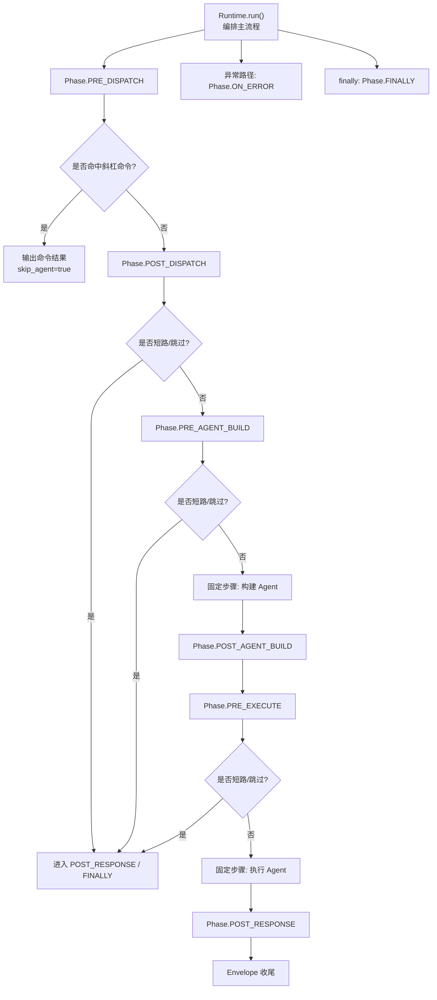
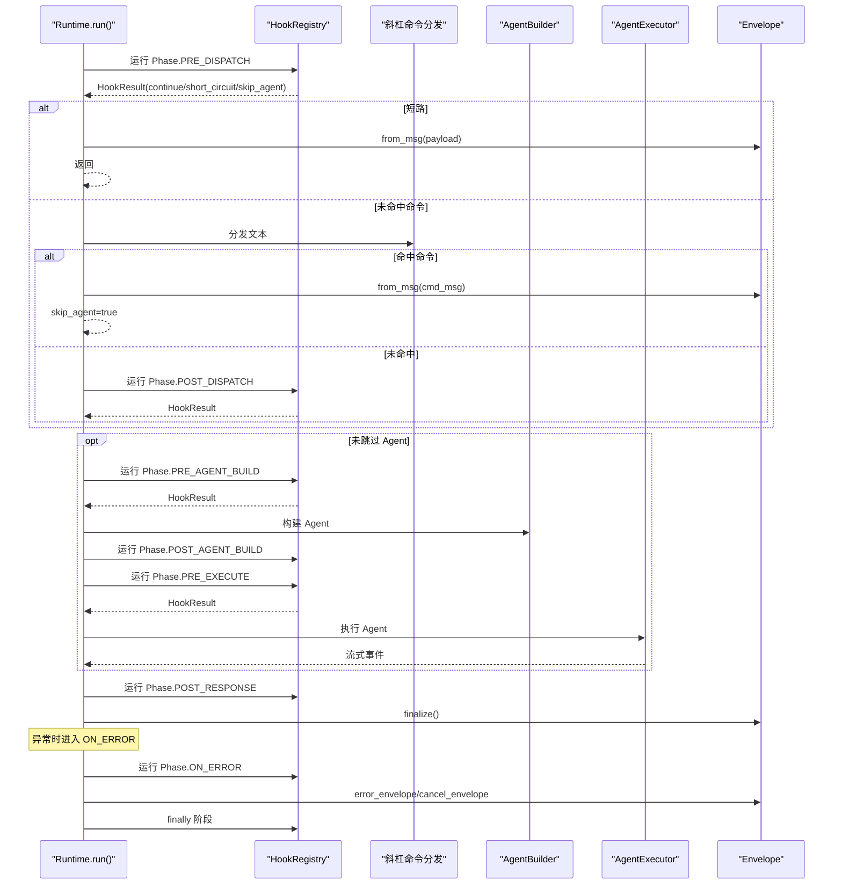
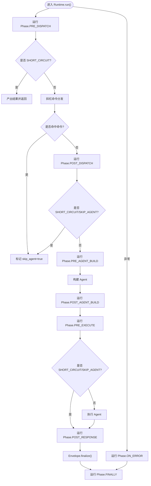
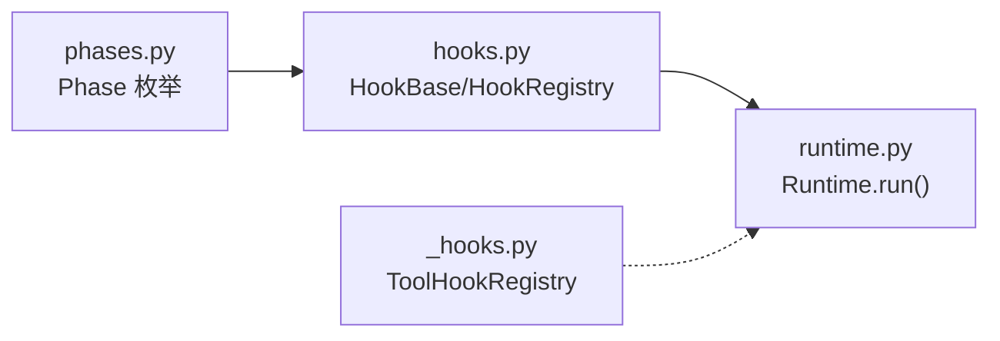

# 钩子阶段定义

<cite>
**本文引用的文件**
- [phases.py](file://tongtian-tauri/src/agent/runtime/phases.py)
- [hooks.py](file://tongtian-tauri/src/agent/runtime/hooks.py)
- [runtime.py](file://tongtian-tauri/src/agent/runtime/runtime.py)
- [_hooks.py](file://tongtian-tauri/src/agent/tool_calls/_hooks.py)
</cite>

## 目录
1. [简介](#简介)
2. [项目结构](#项目结构)
3. [核心组件](#核心组件)
4. [架构总览](#架构总览)
5. [详细组件分析](#详细组件分析)
6. [依赖关系分析](#依赖关系分析)
7. [性能考量](#性能考量)
8. [故障排查指南](#故障排查指南)
9. [结论](#结论)
10. [附录](#附录)

## 简介
本文件系统化说明运行时钩子系统所定义的 8 个生命周期阶段及其执行顺序与用途，覆盖请求处理、Agent 构建、执行、响应与错误处理的完整链路。文档同时给出每个阶段的数据上下文、可访问资源、典型使用场景，以及阶段间数据传递与状态保持的最佳实践。

## 项目结构
围绕“钩子阶段”的核心代码集中在 runtime 层：
- 阶段枚举：定义 8 个固定阶段点
- 钩子抽象：提供 HookContext、HookBase、HookRegistry 等基础设施
- 运行时编排：在 Runtime.run() 中按序触发各阶段，并处理短路、跳过 Agent、错误与清理

图示来源
- [runtime.py:60-206](file://tongtian-tauri/src/agent/runtime/runtime.py#L60-L206)

章节来源
- [phases.py:1-42](file://tongtian-tauri/src/agent/runtime/phases.py#L1-L42)
- [runtime.py:60-206](file://tongtian-tauri/src/agent/runtime/runtime.py#L60-L206)

## 核心组件
- 阶段枚举（Phase）：定义 PRE_DISPATCH、POST_DISPATCH、PRE_AGENT_BUILD、POST_AGENT_BUILD、PRE_EXECUTE、POST_RESPONSE、ON_ERROR、FINALLY 八个阶段点。
- 钩子上下文（HookContext）：跨阶段共享的请求级上下文，包含请求标识、会话/工作区信息、输入消息、已构建的 Agent、错误对象、注入上下文列表，以及 mode_state/extras 两个扩展槽位。
- 钩子动作（HookAction）：CONTINUE（继续）、SHORT_CIRCUIT（短路并立即产出结果）、SKIP_AGENT（跳过后续固定步骤但继续运行钩子）。
- 钩子基类（HookBase）：声明 phase/name/priority/before/after，并提供 run(ctx) 接口。
- 钩子注册器（HookRegistry）：按阶段注册钩子，基于 before/after 约束进行拓扑排序，缓存有序结果；run(phase, ctx) 依次执行并处理动作语义。
- 工具调用钩子（ToolHookRegistry）：面向单个工具调用的 before/after 钩子与超时元数据管理，属于工具执行层面的横切关注点，与运行时阶段钩子正交。

章节来源
- [phases.py:1-42](file://tongtian-tauri/src/agent/runtime/phases.py#L1-L42)
- [hooks.py:46-160](file://tongtian-tauri/src/agent/runtime/hooks.py#L46-L160)
- [hooks.py:168-327](file://tongtian-tauri/src/agent/runtime/hooks.py#L168-L327)
- [_hooks.py:13-77](file://tongtian-tauri/src/agent/tool_calls/_hooks.py#L13-L77)

## 架构总览
下图展示 Runtime 对 8 个阶段的编排顺序、固定步骤插入点、以及异常与清理路径。

图示来源
- [runtime.py:60-206](file://tongtian-tauri/src/agent/runtime/runtime.py#L60-L206)

## 详细组件分析

### 阶段定义与执行顺序
- PRE_DISPATCH：请求归一化与预处理，位于斜杠命令分发之前。适合做鉴权、限流、请求改写、审计入口等。
- POST_DISPATCH：斜杠命令分发结束且未匹配时的兜底阶段。适合做默认路由、提示补全或降级逻辑。
- PRE_AGENT_BUILD：会话加载与其他构建前置准备。适合注入模式上下文、预热资源、校验权限。
- POST_AGENT_BUILD：Agent 已构建完成，可注入模式上下文。适合初始化模式相关状态、注册回调。
- PRE_EXECUTE：执行前引导、提示刷新、环境栈压入。适合设置执行上下文、注入系统提示、开启监控。
- POST_RESPONSE：响应后落盘、定时任务写回等。适合持久化会话、统计上报、清理临时资源。
- ON_ERROR：异常规范化、取消信封。适合统一错误码、告警、回滚、恢复。
- FINALLY：幂等清理（关闭 MCP、重置 ContextVars 等）。适合释放外部连接、关闭句柄、清理线程/协程资源。

章节来源
- [phases.py:1-42](file://tongtian-tauri/src/agent/runtime/phases.py#L1-L42)
- [runtime.py:60-206](file://tongtian-tauri/src/agent/runtime/runtime.py#L60-L206)

### 数据上下文与可访问资源
- HookContext.request：当前请求对象，贯穿所有阶段。
- HookContext.session_id / agent_id / root_session_id / root_agent_id：会话与 Agent 标识，用于追踪与隔离。
- HookContext.workspace_dir / workspace / app_services：工作区与全局服务引用，供钩子读取或调用。
- HookContext.input_msgs：累积的用户输入消息，供后续阶段消费。
- HookContext.agent_config / session_state / agent：构建过程中逐步填充的中间态。
- HookContext.error：异常发生时由 Runtime 写入，供 ON_ERROR 阶段消费。
- HookContext.context_injections：动态注入的系统级提醒，将在执行前被组装进 Agent 上下文。
- HookContext.mode_state：按模式名隔离的私有状态，适合多模式共存时的状态隔离。
- HookContext.extras：短生命周期键值存储，适合成对的钩子之间传递临时句柄（例如在 FINALLY 中释放）。

章节来源
- [hooks.py:73-138](file://tongtian-tauri/src/agent/runtime/hooks.py#L73-L138)
- [runtime.py:143-206](file://tongtian-tauri/src/agent/runtime/runtime.py#L143-L206)

### 阶段间数据传递机制
- 通过 HookContext 字段跨阶段传递：如 input_msgs、agent、session_state、error 等。
- 通过 context_injections 收集动态注入内容，并在执行前统一装配到 Agent 上下文。
- 通过 extras 传递短期、成对的生命周期资源（例如在 PRE_* 打开资源，在 FINALLY 关闭）。
- 通过 mode_state 实现按模式的私有状态隔离，避免不同模式之间的状态污染。

最佳实践
- 将长生命周期对象放入显式字段（如 agent），将短生命周期对象放入 extras。
- 在 FINALLY 中确保 extras 中的资源被释放，保证幂等与健壮性。
- 使用 inject_context 注入系统提示，避免直接修改用户输入。

章节来源
- [hooks.py:73-138](file://tongtian-tauri/src/agent/runtime/hooks.py#L73-L138)
- [runtime.py:120-137](file://tongtian-tauri/src/agent/runtime/runtime.py#L120-L137)

### 钩子动作与短路/跳过语义
- CONTINUE：继续执行下一个钩子或阶段。
- SHORT_CIRCUIT：立即产出结果并结束当前阶段，但仍会执行 ON_ERROR（如有异常）和 FINALLY。
- SKIP_AGENT：仅跳过后续的固定步骤（构建与执行 Agent），其余钩子阶段仍按序执行。

Runtime 行为要点
- 任一阶段返回 SHORT_CIRCUIT，都会通过 Envelope.from_msg 产出结果并提前结束。
- 若 skip_agent 为真，则跳过构建与执行 Agent，直接进入 POST_RESPONSE。
- 异常路径统一进入 ON_ERROR，随后在 finally 中执行 FINALLY。

章节来源
- [hooks.py:46-66](file://tongtian-tauri/src/agent/runtime/hooks.py#L46-L66)
- [hooks.py:293-312](file://tongtian-tauri/src/agent/runtime/hooks.py#L293-L312)
- [runtime.py:60-206](file://tongtian-tauri/src/agent/runtime/runtime.py#L60-L206)

### 钩子排序与约束
- 通过 before/after 声明钩子间的相对顺序，HookRegistry 使用拓扑排序生成确定性的执行序列。
- 优先级 priority 作为打破并列的次级排序依据，结合注册顺序保证稳定性。
- 循环依赖会在启动时抛出 HookCycleError，便于快速发现配置错误。

章节来源
- [hooks.py:145-160](file://tongtian-tauri/src/agent/runtime/hooks.py#L145-L160)
- [hooks.py:168-253](file://tongtian-tauri/src/agent/runtime/hooks.py#L168-L253)

### 工具调用钩子（与运行时阶段正交）
- ToolHookRegistry 为每个工具注册 before/after 钩子与超时元数据（default_timeout_secs、max_internal_timeout_secs）。
- 该层关注单次工具调用的前后处理与超时控制，不改变运行时阶段顺序。

章节来源
- [_hooks.py:13-77](file://tongtian-tauri/src/agent/tool_calls/_hooks.py#L13-L77)

### 阶段流程图（算法视角）

图示来源
- [runtime.py:60-206](file://tongtian-tauri/src/agent/runtime/runtime.py#L60-L206)

## 依赖关系分析
- phases.py 仅提供阶段枚举，无外部依赖。
- hooks.py 依赖 phases 枚举，并通过 HookRegistry 管理钩子的注册与执行。
- runtime.py 依赖 phases 与 hooks，负责在各阶段点调用 HookRegistry.run，并处理短路、跳过、异常与清理。
- tool_calls/_hooks.py 独立于运行时阶段，服务于工具调用层的横切逻辑。

图示来源
- [phases.py:28-38](file://tongtian-tauri/src/agent/runtime/phases.py#L28-L38)
- [hooks.py:256-327](file://tongtian-tauri/src/agent/runtime/hooks.py#L256-L327)
- [runtime.py:60-206](file://tongtian-tauri/src/agent/runtime/runtime.py#L60-L206)
- [_hooks.py:36-77](file://tongtian-tauri/src/agent/tool_calls/_hooks.py#L36-L77)

章节来源
- [phases.py:1-42](file://tongtian-tauri/src/agent/runtime/phases.py#L1-L42)
- [hooks.py:256-327](file://tongtian-tauri/src/agent/runtime/hooks.py#L256-L327)
- [runtime.py:60-206](file://tongtian-tauri/src/agent/runtime/runtime.py#L60-L206)
- [_hooks.py:36-77](file://tongtian-tauri/src/agent/tool_calls/_hooks.py#L36-L77)

## 性能考量
- 拓扑排序缓存：HookRegistry 对每个阶段的排序结果进行缓存，减少重复计算开销。
- 短路优化：SHORT_CIRCUIT 可在早期阶段快速返回，避免不必要的构建与执行。
- 跳过 Agent：SKIP_AGENT 允许在不执行 Agent 的情况下完成请求生命周期，适用于命令直达或预置响应。
- 资源释放：FINALLY 阶段集中进行幂等清理，避免资源泄漏。
- 异常路径最小化：ON_ERROR 仅做必要规范化与通知，避免阻塞主流程。

[本节为通用指导，无需特定文件引用]

## 故障排查指南
- 钩子循环依赖：当 before/after 形成环时，HookRegistry 会在排序阶段抛出 HookCycleError，便于快速定位配置问题。
- 异常传播：钩子内部抛出的异常会沿 Runtime 的异常路径传播至 ON_ERROR，不会在注册器中被吞掉。
- 取消与保存：在异步取消或中断场景下，Runtime 会尽力保存 Agent 状态，确保中断的轮次不丢失。
- 错误信息标准化：ON_ERROR 阶段可通过 ctx.extras 设置 _error_text 与 _error_code，以便上层统一处理。

章节来源
- [hooks.py:168-253](file://tongtian-tauri/src/agent/runtime/hooks.py#L168-L253)
- [runtime.py:143-206](file://tongtian-tauri/src/agent/runtime/runtime.py#L143-L206)

## 结论
本运行时钩子系统通过 8 个固定阶段点，将请求处理、Agent 构建与执行、响应与错误处理解耦为可扩展的横切能力。借助 HookContext 的上下文传递、HookAction 的控制流语义、以及 HookRegistry 的拓扑排序，开发者可以在合适的时机注入安全、审计、监控、持久化等能力，同时保持主流程清晰稳定。遵循本文的最佳实践，可有效提升系统的可维护性与可靠性。

[本节为总结性内容，无需特定文件引用]

## 附录
- 典型使用场景速查
  - PRE_DISPATCH：鉴权、限流、请求改写、审计入口
  - POST_DISPATCH：默认路由、降级策略
  - PRE_AGENT_BUILD：会话加载、模式预热、权限校验
  - POST_AGENT_BUILD：模式上下文注入、回调注册
  - PRE_EXECUTE：执行上下文设置、系统提示注入、监控开启
  - POST_RESPONSE：会话落盘、统计上报、临时资源清理
  - ON_ERROR：错误码标准化、告警、回滚
  - FINALLY：关闭 MCP、重置 ContextVars、释放资源

[本节为概念性内容，无需特定文件引用]