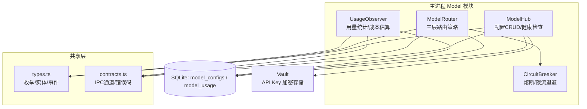
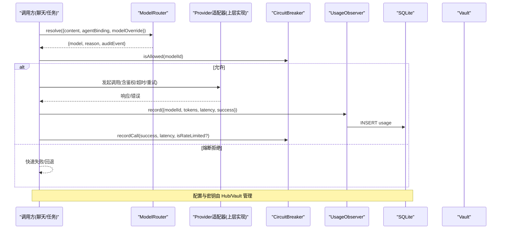
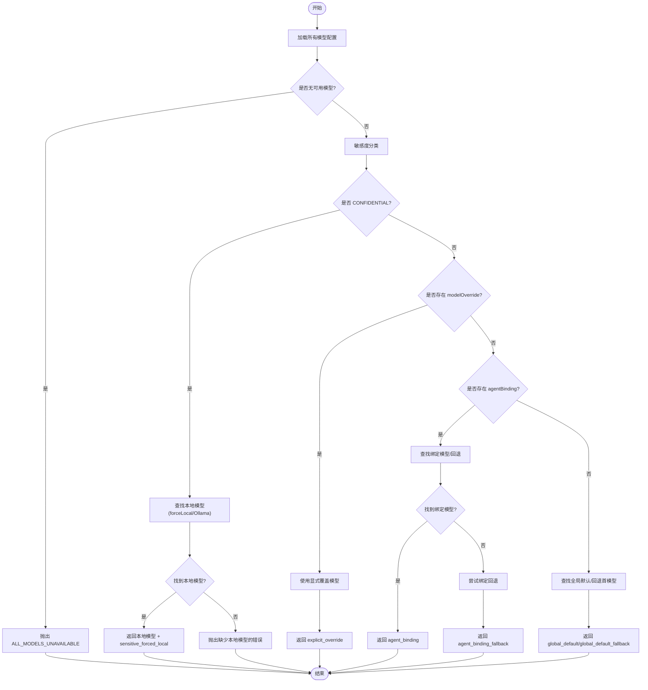
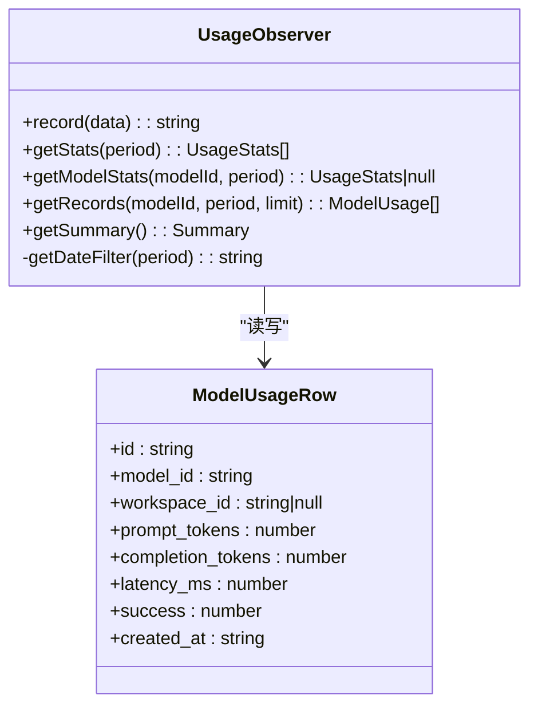
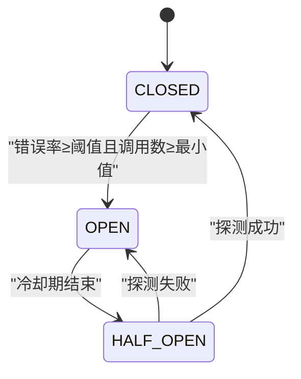
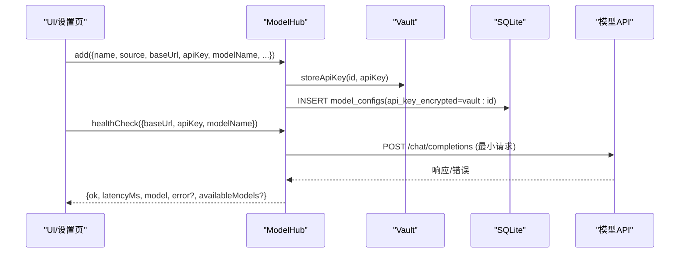
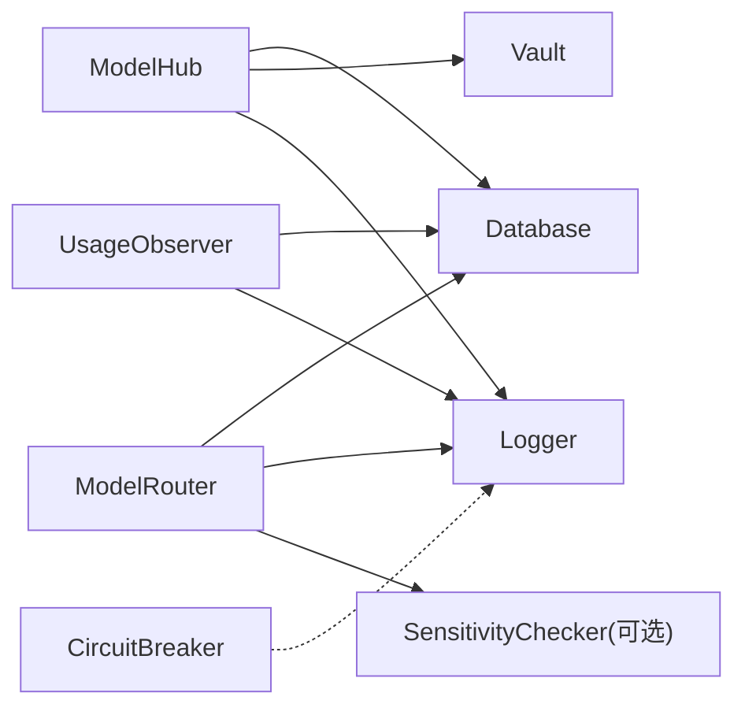

# Model Hub 系统

<cite>
**本文引用的文件**   
- [hub.ts](file://tongtian-tauri/src/main/model/hub.ts)
- [router.ts](file://tongtian-tauri/src/main/model/router.ts)
- [observer.ts](file://tongtian-tauri/src/main/model/observer.ts)
- [circuit-breaker.ts](file://tongtian-tauri/src/main/model/circuit-breaker.ts)
- [types.ts](file://tongtian-tauri/src/shared/types.ts)
- [contracts.ts](file://tongtian-tauri/src/shared/contracts.ts)
</cite>

## 目录
1. [简介](#简介)
2. [项目结构](#项目结构)
3. [核心组件](#核心组件)
4. [架构总览](#架构总览)
5. [详细组件分析](#详细组件分析)
6. [依赖关系分析](#依赖关系分析)
7. [性能与可靠性](#性能与可靠性)
8. [故障排查指南](#故障排查指南)
9. [结论](#结论)
10. [附录：扩展新模型提供商指南](#附录扩展新模型提供商指南)

## 简介
Model Hub 是通天办公（TongTian）桌面应用中的“模型接入中枢”，负责统一接入不同模型提供商、智能路由选择、使用观测与计费统计，以及熔断降级等可靠性保障。其设计采用三层架构：
- 接入层（Adapter）：统一适配 OpenAI、Ollama、Anthropic 等不同提供商的协议差异，完成请求封装、鉴权、超时与重试。
- 路由层（Router）：基于数据敏感度、智能体绑定与全局默认策略进行模型选择，并支持显式覆盖与回退链。
- 观测层（Observer）：记录每次调用的 Token 用量、延迟、成功/失败，提供按日/周/月的聚合统计与成本估算。

本系统通过单例模式组织 Hub、Router、Observer 与 CircuitBreaker，结合数据库持久化与 Vault 密钥管理，形成稳定可扩展的模型调用基础设施。

## 项目结构
Model Hub 的核心代码位于主进程侧的 model 模块，配合共享类型与 IPC 契约定义，形成清晰的职责边界：
- src/main/model：Hub（配置与健康检查）、Router（路由决策）、Observer（使用观测）、CircuitBreaker（熔断器）
- src/shared：统一的类型与 IPC 契约，确保前后端一致

图表来源
- [hub.ts:1-374](file://tongtian-tauri/src/main/model/hub.ts#L1-L374)
- [router.ts:1-318](file://tongtian-tauri/src/main/model/router.ts#L1-L318)
- [observer.ts:1-260](file://tongtian-tauri/src/main/model/observer.ts#L1-L260)
- [circuit-breaker.ts:1-346](file://tongtian-tauri/src/main/model/circuit-breaker.ts#L1-L346)
- [types.ts:104-136](file://tongtian-tauri/src/shared/types.ts#L104-L136)
- [contracts.ts:480-584](file://tongtian-tauri/src/shared/contracts.ts#L480-L584)

章节来源
- [hub.ts:1-374](file://tongtian-tauri/src/main/model/hub.ts#L1-L374)
- [router.ts:1-318](file://tongtian-tauri/src/main/model/router.ts#L1-L318)
- [observer.ts:1-260](file://tongtian-tauri/src/main/model/observer.ts#L1-L260)
- [circuit-breaker.ts:1-346](file://tongtian-tauri/src/main/model/circuit-breaker.ts#L1-L346)
- [types.ts:104-136](file://tongtian-tauri/src/shared/types.ts#L104-L136)
- [contracts.ts:480-584](file://tongtian-tauri/src/shared/contracts.ts#L480-L584)

## 核心组件
- ModelHub：模型配置的增删改查、默认模型设置、健康检查；API Key 通过 Vault 加密存储，配置项包含 source、baseUrl、modelName、contextWindow、agentBinding、forceLocal 等。
- ModelRouter：实现三层路由策略（敏感强制本地、智能体绑定、全局默认），支持显式覆盖与回退链，输出审计事件。
- UsageObserver：记录每次调用的 prompt/completion token、延迟、成功状态，并提供按周期聚合统计与成本估算。
- CircuitBreaker：滑动窗口错误率检测、OPEN/HALF_OPEN/CLOSED 状态机、指数退避重试，保护下游服务。

章节来源
- [hub.ts:85-367](file://tongtian-tauri/src/main/model/hub.ts#L85-L367)
- [router.ts:92-311](file://tongtian-tauri/src/main/model/router.ts#L92-L311)
- [observer.ts:77-253](file://tongtian-tauri/src/main/model/observer.ts#L77-L253)
- [circuit-breaker.ts:82-339](file://tongtian-tauri/src/main/model/circuit-breaker.ts#L82-L339)

## 架构总览
Model Hub 的整体调用流程如下：
- 上层业务（如聊天任务）提交请求时，先经 Router 解析目标模型；
- 若允许，则进入 Adapter 层（由上层 Provider 实现）发起 HTTP 调用；
- 调用结果由 Observer 记录用量与延迟；
- CircuitBreaker 在 Adapter 层或调用前对高频失败进行熔断保护；
- Hub 提供配置管理与健康检查能力，支撑运维与诊断。

图表来源
- [router.ts:139-247](file://tongtian-tauri/src/main/model/router.ts#L139-L247)
- [circuit-breaker.ts:108-163](file://tongtian-tauri/src/main/model/circuit-breaker.ts#L108-L163)
- [observer.ts:101-128](file://tongtian-tauri/src/main/model/observer.ts#L101-L128)
- [hub.ts:129-161](file://tongtian-tauri/src/main/model/hub.ts#L129-L161)

## 详细组件分析

### 接入层（Adapter）
- 职责：将不同提供商的 API 差异统一为内部调用接口，处理鉴权、超时、重试、错误映射与流式响应。
- 关键点：
  - 协议转换：OpenAI 兼容接口、Ollama 本地推理、Anthropic 等差异化参数映射。
  - 超时控制：基于 AbortController 或 SDK 超时配置，避免长尾阻塞。
  - 重试机制：结合 CircuitBreaker 的指数退避，区分可重试错误（如限流）与不可重试错误（如认证失败）。
  - 错误映射：将上游错误映射为统一 ErrorCode，便于上层处理与审计。
- 注意：当前仓库未直接包含 Provider 实现文件，但 Router/Observer/CircuitBreaker 已为 Adapter 集成预留了清晰入口与契约。

章节来源
- [contracts.ts:15-109](file://tongtian-tauri/src/shared/contracts.ts#L15-L109)
- [types.ts:104-136](file://tongtian-tauri/src/shared/types.ts#L104-L136)

### 路由层（Router）
- 三层策略优先级：
  1) 敏感数据强制本地：当内容被判定为 CONFIDENTIAL 且存在本地模型（forceLocal 或 Ollama）时，强制走本地。
  2) 智能体绑定：根据 agentBinding 匹配绑定的模型，若无则尝试同绑定下的回退模型（预留扩展点）。
  3) 全局默认：选择 isDefault=true 的模型，否则回退到第一个可用模型。
- 显式覆盖：modelOverride 可直接指定模型 ID，优先于绑定与默认。
- 审计事件：每次路由决策均生成审计事件字符串，便于追踪与合规。

图表来源
- [router.ts:139-247](file://tongtian-tauri/src/main/model/router.ts#L139-L247)

章节来源
- [router.ts:92-311](file://tongtian-tauri/src/main/model/router.ts#L92-L311)
- [types.ts:131-136](file://tongtian-tauri/src/shared/types.ts#L131-L136)

### 观测层（Observer）
- 功能：记录每次模型调用的 prompt/completion token、延迟、成功状态，并支持按日/周/月聚合统计与成本估算。
- 数据结构：model_usage 表记录明细，聚合查询 JOIN model_configs 获取模型名称。
- 成本估算：基于固定单价（默认 OpenAI 兼容定价占位），本地模型计价为 0。

图表来源
- [observer.ts:77-253](file://tongtian-tauri/src/main/model/observer.ts#L77-L253)

章节来源
- [observer.ts:77-253](file://tongtian-tauri/src/main/model/observer.ts#L77-L253)

### 熔断器（CircuitBreaker）
- 状态机：CLOSED → OPEN → HALF_OPEN → CLOSED
- 触发条件：滑动窗口内错误率超过阈值（默认 15%）且最小调用数达到阈值后，进入 OPEN 状态。
- 恢复机制：冷却期后进入 HALF_OPEN，允许一次探测调用，成功则回到 CLOSED，失败则重新 OPEN。
- 指数退避：限流场景下按 1s→2s→4s→8s 递增重试，最多 4 次。

图表来源
- [circuit-breaker.ts:82-339](file://tongtian-tauri/src/main/model/circuit-breaker.ts#L82-L339)

章节来源
- [circuit-breaker.ts:82-339](file://tongtian-tauri/src/main/model/circuit-breaker.ts#L82-L339)

### 配置与健康检查（Hub）
- CRUD：新增/更新/删除模型配置，API Key 通过 Vault 加密存储，配置项包含 source、baseUrl、modelName、contextWindow、agentBinding、forceLocal、isDefault 等。
- 默认模型：设置唯一默认模型，清除其他默认标记。
- 健康检查：发送轻量 Chat Completions 请求，测量延迟与可用性，返回可用模型列表（若上游支持）。

图表来源
- [hub.ts:129-161](file://tongtian-tauri/src/main/model/hub.ts#L129-L161)
- [hub.ts:282-358](file://tongtian-tauri/src/main/model/hub.ts#L282-L358)

章节来源
- [hub.ts:85-367](file://tongtian-tauri/src/main/model/hub.ts#L85-L367)

## 依赖关系分析
- Hub 依赖 Database、Vault、Logger，用于配置持久化与密钥安全。
- Router 依赖 Database、Logger，并可注入 SensitivityChecker（合规模块）以进行敏感度分类。
- Observer 依赖 Database、Logger，用于用量记录与统计。
- CircuitBreaker 独立运行，不直接依赖外部 I/O，仅维护内存状态。
- 共享类型 types.ts 与 contracts.ts 贯穿各模块，保证契约一致性。

图表来源
- [hub.ts:1-374](file://tongtian-tauri/src/main/model/hub.ts#L1-L374)
- [router.ts:1-318](file://tongtian-tauri/src/main/model/router.ts#L1-L318)
- [observer.ts:1-260](file://tongtian-tauri/src/main/model/observer.ts#L1-L260)
- [circuit-breaker.ts:1-346](file://tongtian-tauri/src/main/model/circuit-breaker.ts#L1-L346)

章节来源
- [hub.ts:1-374](file://tongtian-tauri/src/main/model/hub.ts#L1-L374)
- [router.ts:1-318](file://tongtian-tauri/src/main/model/router.ts#L1-L318)
- [observer.ts:1-260](file://tongtian-tauri/src/main/model/observer.ts#L1-L260)
- [circuit-breaker.ts:1-346](file://tongtian-tauri/src/main/model/circuit-breaker.ts#L1-L346)

## 性能与可靠性
- 路由优化：优先命中缓存/默认模型，减少不必要的回退路径；敏感数据强制本地，避免网络开销。
- 熔断保护：在高错误率或限流场景下快速失败，降低雪崩风险；HALF_OPEN 探测避免长时间不可用。
- 指数退避：限流重试避免加剧上游压力，提升整体吞吐稳定性。
- 观测统计：按周期聚合统计，帮助识别慢模型与高成本模型，指导容量规划与成本控制。
- 健康检查：启动或变更配置后进行连通性测试，提前发现异常。

[本节为通用建议，无需引用具体文件]

## 故障排查指南
- 无法解析模型（ALL_MODELS_UNAVAILABLE）：检查是否至少有一个可用模型配置；确认默认模型或绑定模型存在。
- 敏感数据强制本地失败：确认存在 forceLocal 或 Ollama 源模型；若无，需补充本地模型。
- 连接失败/认证失败：检查 baseUrl、apiKey 是否正确；通过健康检查定位上游可达性与鉴权问题。
- 频繁限流/熔断：查看 CircuitBreaker 状态与错误率；调整重试策略或扩容上游资源。
- 用量统计缺失：确认 Observer.record 被正确调用；检查 model_usage 表写入是否正常。

章节来源
- [router.ts:306-311](file://tongtian-tauri/src/main/model/router.ts#L306-L311)
- [hub.ts:282-358](file://tongtian-tauri/src/main/model/hub.ts#L282-L358)
- [circuit-breaker.ts:303-319](file://tongtian-tauri/src/main/model/circuit-breaker.ts#L303-L319)
- [observer.ts:101-128](file://tongtian-tauri/src/main/model/observer.ts#L101-L128)

## 结论
Model Hub 通过清晰的三层架构与完善的可靠性机制，实现了多模型提供商的统一接入、智能路由与用量观测。借助 Vault 安全存储、SQLite 持久化与 CircuitBreaker 熔断保护，系统在易用性、安全性与稳定性方面具备良好基础。后续可在 Adapter 层完善多提供商适配，并在 Router 中增强绑定回退与敏感度规则，进一步提升灵活性与合规性。

[本节为总结，无需引用具体文件]

## 附录：扩展新模型提供商指南
- 定义 Source：在 types.ts 的 ModelSource 中添加新的提供商枚举值（如 PRESET_ANTHROPIC）。
- 实现 Adapter：在上层 Provider 层实现该提供商的协议转换、鉴权、超时与重试逻辑，遵循统一接口。
- 配置模型：通过 Hub.add 创建模型配置，填写 source、baseUrl、modelName、contextWindow、agentBinding、forceLocal 等字段；API Key 自动加密存储。
- 路由策略：如需强制本地或绑定特定智能体，设置 forceLocal 或 agentBinding；必要时设置 isDefault 作为全局默认。
- 健康检查：使用 Hub.healthCheck 验证连通性与鉴权；观察 latencyMs 与 availableModels。
- 观测统计：确保调用完成后调用 Observer.record，记录 prompt/completion token、延迟与成功状态。
- 熔断保护：在 Adapter 或调用前集成 CircuitBreaker，记录 call 结果并根据错误率自动熔断。

章节来源
- [types.ts:104-112](file://tongtian-tauri/src/shared/types.ts#L104-L112)
- [hub.ts:129-161](file://tongtian-tauri/src/main/model/hub.ts#L129-L161)
- [observer.ts:101-128](file://tongtian-tauri/src/main/model/observer.ts#L101-L128)
- [circuit-breaker.ts:130-163](file://tongtian-tauri/src/main/model/circuit-breaker.ts#L130-L163)