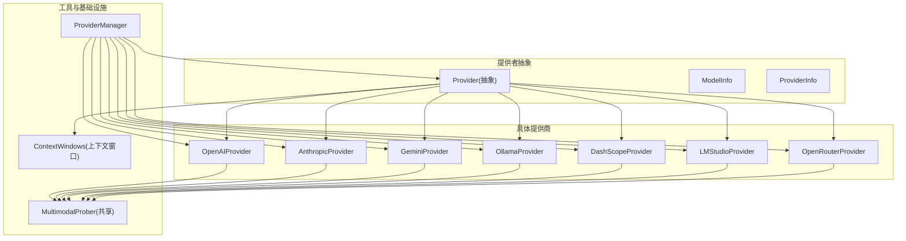
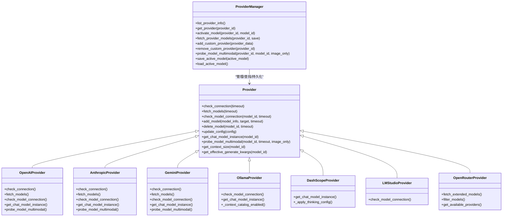
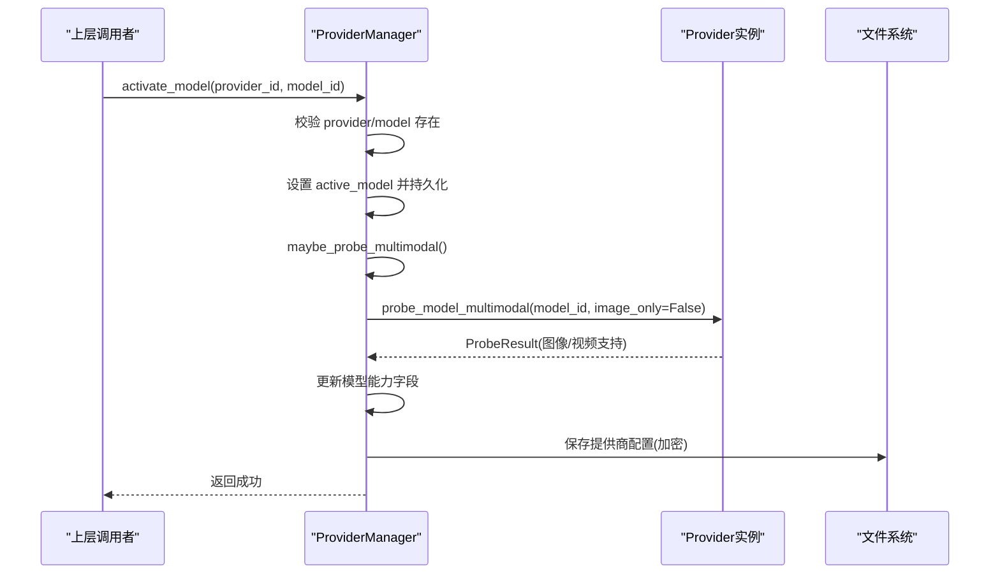
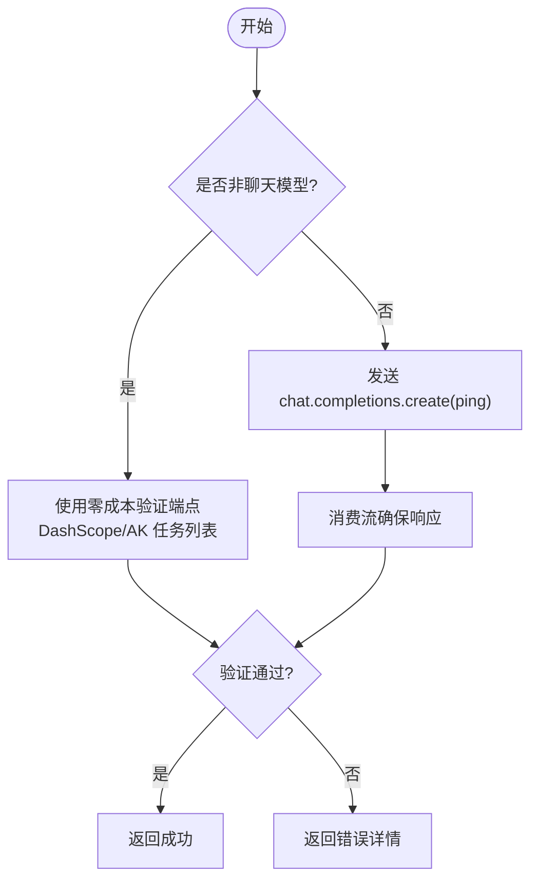
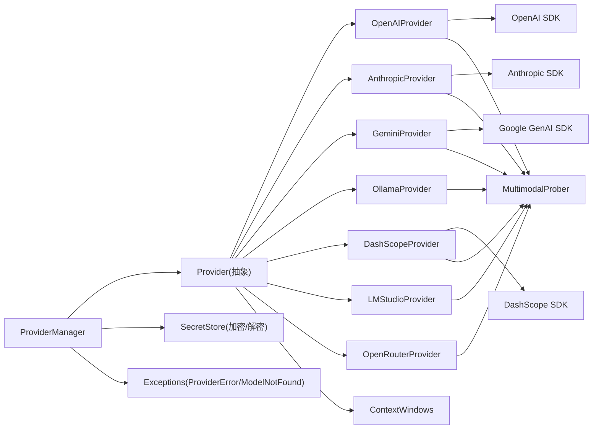

# Provider 管理器

<cite>
**本文引用的文件**   
- [provider_manager.py](file://tongtian-tauri/src/agent/providers/provider_manager.py)
- [provider.py](file://tongtian-tauri/src/agent/providers/provider.py)
- [openai_provider.py](file://tongtian-tauri/src/agent/providers/openai_provider.py)
- [anthropic_provider.py](file://tongtian-tauri/src/agent/providers/anthropic_provider.py)
- [gemini_provider.py](file://tongtian-tauri/src/agent/providers/gemini_provider.py)
- [ollama_provider.py](file://tongtian-tauri/src/agent/providers/ollama_provider.py)
- [dashscope_provider.py](file://tongtian-tauri/src/agent/providers/dashscope_provider.py)
- [lmstudio_provider.py](file://tongtian-tauri/src/agent/providers/lmstudio_provider.py)
- [openrouter_provider.py](file://tongtian-tauri/src/agent/providers/openrouter_provider.py)
- [multimodal_prober.py](file://tongtian-tauri/src/agent/providers/multimodal_prober.py)
- [context_windows.py](file://tongtian-tauri/src/agent/providers/context_windows.py)
- [__init__.py](file://tongtian-tauri/src/agent/providers/__init__.py)
</cite>

## 目录
1. [简介](#简介)
2. [项目结构](#项目结构)
3. [核心组件](#核心组件)
4. [架构总览](#架构总览)
5. [详细组件分析](#详细组件分析)
6. [依赖关系分析](#依赖关系分析)
7. [性能考量](#性能考量)
8. [故障排查指南](#故障排查指南)
9. [结论](#结论)
10. [附录：使用示例与扩展指南](#附录使用示例与扩展指南)

## 简介
本文件围绕 ProviderManager 类及其相关提供商实现，系统性阐述以下主题：
- 设计模式与职责边界：Provider 抽象、具体提供商实现、ProviderManager 统一编排。
- 内置提供商注册机制与自定义提供商动态加载。
- 提供商生命周期管理：初始化、持久化、迁移、激活模型、能力探测与缓存。
- 统一管理 OpenAI、Ollama、Anthropic、Gemini、DashScope、OpenRouter 等模型提供商。
- 提供商发现、配置验证、能力探测（图像/视频）。
- 提供商元数据管理、模型列表维护、动态更新机制。
- 使用示例、扩展指南与最佳实践、性能优化建议与常见问题排查。

## 项目结构
Provider 子系统位于 tongtian-tauri/src/agent/providers 目录下，采用“抽象基类 + 多实现 + 管理器”的分层组织方式：
- provider.py：定义 ModelInfo、ProviderInfo、Provider 抽象接口及通用能力（上下文窗口解析、生成参数合并、思考/推理参数注入等）。
- 各提供商实现：openai_provider.py、anthropic_provider.py、gemini_provider.py、ollama_provider.py、dashscope_provider.py、lmstudio_provider.py、openrouter_provider.py。
- multimodal_prober.py：多模态探测共享常量与评估逻辑。
- context_windows.py：静态上下文窗口目录与解析入口。
- provider_manager.py：ProviderManager 管理器，负责内置/自定义/插件提供商的注册、加载、持久化、激活模型、能力探测与动态更新。
- __init__.py：对外暴露 Provider、ProviderInfo、ModelInfo、ProviderManager。

图表来源
- [provider.py:20-121](file://tongtian-tauri/src/agent/providers/provider.py#L20-L121)
- [provider.py:144-279](file://tongtian-tauri/src/agent/providers/provider.py#L144-L279)
- [provider.py:281-672](file://tongtian-tauri/src/agent/providers/provider.py#L281-L672)
- [openai_provider.py:171-524](file://tongtian-tauri/src/agent/providers/openai_provider.py#L171-L524)
- [anthropic_provider.py:75-305](file://tongtian-tauri/src/agent/providers/anthropic_provider.py#L75-L305)
- [gemini_provider.py:165-338](file://tongtian-tauri/src/agent/providers/gemini_provider.py#L165-L338)
- [ollama_provider.py:14-105](file://tongtian-tauri/src/agent/providers/ollama_provider.py#L14-L105)
- [dashscope_provider.py:34-223](file://tongtian-tauri/src/agent/providers/dashscope_provider.py#L34-L223)
- [lmstudio_provider.py:7-20](file://tongtian-tauri/src/agent/providers/lmstudio_provider.py#L7-L20)
- [openrouter_provider.py:22-400](file://tongtian-tauri/src/agent/providers/openrouter_provider.py#L22-L400)
- [multimodal_prober.py:76-110](file://tongtian-tauri/src/agent/providers/multimodal_prober.py#L76-L110)
- [context_windows.py:118-143](file://tongtian-tauri/src/agent/providers/context_windows.py#L118-L143)
- [provider_manager.py:1363-1437](file://tongtian-tauri/src/agent/providers/provider_manager.py#L1363-L1437)

章节来源
- [provider.py:20-672](file://tongtian-tauri/src/agent/providers/provider.py#L20-L672)
- [provider_manager.py:1363-1437](file://tongtian-tauri/src/agent/providers/provider_manager.py#L1363-L1437)
- [__init__.py:1-13](file://tongtian-tauri/src/agent/providers/__init__.py#L1-L13)

## 核心组件
- Provider（抽象）：定义连接检查、模型获取、模型连通性检查、模型增删、配置更新、上下文窗口解析、多模态探测等统一接口；提供默认实现与通用方法（如 get_effective_generate_kwargs、get_context_size、_apply_thinking_config 钩子）。
- ModelInfo / ProviderInfo：描述模型与提供商的元数据，支持 thinking/reasoning 参数、最大 token、上下文窗口、是否免费、OAuth 支持等。
- ProviderManager：集中管理所有提供商实例（内置、自定义、插件），负责：
  - 内置提供商注册与初始化
  - 自定义提供商的动态加载与持久化
  - 插件提供商的配置与实例化
  - 激活模型与保存状态
  - 模型发现与动态更新
  - 多模态能力探测与结果持久化
  - 旧版本配置迁移与安全加密存储

章节来源
- [provider.py:20-121](file://tongtian-tauri/src/agent/providers/provider.py#L20-L121)
- [provider.py:144-279](file://tongtian-tauri/src/agent/providers/provider.py#L144-L279)
- [provider.py:281-672](file://tongtian-tauri/src/agent/providers/provider.py#L281-L672)
- [provider_manager.py:1363-1437](file://tongtian-tauri/src/agent/providers/provider_manager.py#L1363-L1437)
- [provider_manager.py:1552-1593](file://tongtian-tauri/src/agent/providers/provider_manager.py#L1552-L1593)
- [provider_manager.py:1610-1640](file://tongtian-tauri/src/agent/providers/provider_manager.py#L1610-L1640)
- [provider_manager.py:1653-1676](file://tongtian-tauri/src/agent/providers/provider_manager.py#L1653-L1676)
- [provider_manager.py:1812-1896](file://tongtian-tauri/src/agent/providers/provider_manager.py#L1812-L1896)

## 架构总览
ProviderManager 作为统一入口，屏蔽不同提供商的差异，向上暴露一致的 API。各 Provider 实现通过 AgentScope 的 ChatModelBase 适配具体 SDK（OpenAI、Anthropic、Gemini、DashScope 等），并通过统一的格式化器与能力探测模块完成媒体处理与能力判定。

图表来源
- [provider.py:281-672](file://tongtian-tauri/src/agent/providers/provider.py#L281-L672)
- [openai_provider.py:171-524](file://tongtian-tauri/src/agent/providers/openai_provider.py#L171-L524)
- [anthropic_provider.py:75-305](file://tongtian-tauri/src/agent/providers/anthropic_provider.py#L75-L305)
- [gemini_provider.py:165-338](file://tongtian-tauri/src/agent/providers/gemini_provider.py#L165-L338)
- [ollama_provider.py:14-105](file://tongtian-tauri/src/agent/providers/ollama_provider.py#L14-L105)
- [dashscope_provider.py:34-223](file://tongtian-tauri/src/agent/providers/dashscope_provider.py#L34-L223)
- [lmstudio_provider.py:7-20](file://tongtian-tauri/src/agent/providers/lmstudio_provider.py#L7-L20)
- [openrouter_provider.py:22-400](file://tongtian-tauri/src/agent/providers/openrouter_provider.py#L22-L400)
- [provider_manager.py:1363-1437](file://tongtian-tauri/src/agent/providers/provider_manager.py#L1363-L1437)

## 详细组件分析

### ProviderManager：统一管理与生命周期
- 内置提供商注册：在初始化阶段将大量内置 Provider 实例加入内存字典，并准备磁盘存储路径（builtin/custom/plugin）。
- 自定义提供商动态加载：从 custom_path 扫描 JSON 配置文件，解密后反序列化为 Provider 实例，避免与内置 ID 冲突。
- 插件提供商：以 ProviderInfo 形式存储，按需实例化对应类。
- 激活模型：校验 provider/model 存在，设置 active_model 并持久化，触发异步多模态探测。
- 模型发现与更新：调用 provider.fetch_models() 拉取可用模型，可选择保存到 extra_models 并持久化。
- 能力探测：对未标注的模型进行图像/视频探测，更新 supports_image/supports_video/supports_multimodal，并与预期基线对比记录差异。
- 持久化与安全：敏感字段（如 api_key）加密存储，权限收紧；支持明文到密文的迁移。
- 旧版兼容：迁移 copaw-local → qwenpaw-local，迁移 legacy providers.json 到新结构。

图表来源
- [provider_manager.py:1653-1676](file://tongtian-tauri/src/agent/providers/provider_manager.py#L1653-L1676)
- [provider_manager.py:1677-1718](file://tongtian-tauri/src/agent/providers/provider_manager.py#L1677-L1718)
- [provider_manager.py:1812-1896](file://tongtian-tauri/src/agent/providers/provider_manager.py#L1812-L1896)
- [provider_manager.py:1898-1938](file://tongtian-tauri/src/agent/providers/provider_manager.py#L1898-L1938)

章节来源
- [provider_manager.py:1363-1437](file://tongtian-tauri/src/agent/providers/provider_manager.py#L1363-L1437)
- [provider_manager.py:1552-1593](file://tongtian-tauri/src/agent/providers/provider_manager.py#L1552-L1593)
- [provider_manager.py:1610-1640](file://tongtian-tauri/src/agent/providers/provider_manager.py#L1610-L1640)
- [provider_manager.py:1653-1676](file://tongtian-tauri/src/agent/providers/provider_manager.py#L1653-L1676)
- [provider_manager.py:1812-1896](file://tongtian-tauri/src/agent/providers/provider_manager.py#L1812-L1896)
- [provider_manager.py:1898-1938](file://tongtian-tauri/src/agent/providers/provider_manager.py#L1898-L1938)
- [provider_manager.py:2261-2333](file://tongtian-tauri/src/agent/providers/provider_manager.py#L2261-L2333)

### OpenAIProvider：OpenAI 与兼容端点
- 连接检查：调用 models.list() 或轻量 ping 请求。
- 模型发现：标准化响应为 ModelInfo 列表。
- 模型连通性：对非聊天模型（ASR/TTS/embedding/媒体生成）使用零成本验证端点（如 DashScope upload-policy、Ark task-list）。
- 多模态探测：发送最小图片/视频载荷，结合语义判断（颜色识别）避免误报。
- 生成参数：根据模型族选择 max_tokens 或 max_completion_tokens，注入思考/推理参数。

图表来源
- [openai_provider.py:222-323](file://tongtian-tauri/src/agent/providers/openai_provider.py#L222-L323)
- [openai_provider.py:324-463](file://tongtian-tauri/src/agent/providers/openai_provider.py#L324-L463)
- [openai_provider.py:526-667](file://tongtian-tauri/src/agent/providers/openai_provider.py#L526-L667)

章节来源
- [openai_provider.py:171-524](file://tongtian-tauri/src/agent/providers/openai_provider.py#L171-L524)
- [openai_provider.py:526-800](file://tongtian-tauri/src/agent/providers/openai_provider.py#L526-L800)

### AnthropicProvider：Anthropic 与兼容平台
- 连接检查：优先 models.list()，若不支持则回退到 messages.create 轻量探测。
- 模型发现：标准化响应为 ModelInfo 列表。
- 模型连通性：发送最小消息并消费流。
- 多模态探测：图片/视频分别探测，支持 base64 与 URL 两种输入格式。
- 认证模式：支持 api_key 与 auth_token，必要时剥离 x-api-key 头以避免代理拒绝。

章节来源
- [anthropic_provider.py:75-305](file://tongtian-tauri/src/agent/providers/anthropic_provider.py#L75-L305)
- [anthropic_provider.py:307-579](file://tongtian-tauri/src/agent/providers/anthropic_provider.py#L307-L579)

### GeminiProvider：Google Gemini
- 连接检查：异步 models.list()。
- 模型发现：标准化响应，去除 models/ 前缀。
- 模型连通性：generate_content_stream 轻量 ping。
- 多模态探测：inline_data 图片与 file_data 视频探测。
- 参数适配：将 OpenAI-style 键映射到 GenerateContentConfig（如 max_output_tokens）。

章节来源
- [gemini_provider.py:165-338](file://tongtian-tauri/src/agent/providers/gemini_provider.py#L165-L338)
- [gemini_provider.py:340-514](file://tongtian-tauri/src/agent/providers/gemini_provider.py#L340-L514)

### OllamaProvider 与 LMStudioProvider：本地托管
- Ollama：继承 OpenAIProvider，自动拼接 /v1，默认 host 来自环境变量或 127.0.0.1:11434；禁用静态上下文目录（本地 num_ctx 决定截断）。
- LMStudio：继承 OpenAIProvider，基于 OpenAI 兼容端点进行模型连通性检查。

章节来源
- [ollama_provider.py:14-105](file://tongtian-tauri/src/agent/providers/ollama_provider.py#L14-L105)
- [lmstudio_provider.py:7-20](file://tongtian-tauri/src/agent/providers/lmstudio_provider.py#L7-L20)

### DashScopeProvider：阿里灵积（原生 2.0）
- 复用 OpenAIProvider 的连接与模型发现逻辑，但构造原生 DashScopeChatModel。
- 思考/推理参数：支持 effort/budget 风格，按模型类型注入 extra_body 或直接参数。
- 默认 relay_reasoning 为 False，需显式开启。

章节来源
- [dashscope_provider.py:34-223](file://tongtian-tauri/src/agent/providers/dashscope_provider.py#L34-L223)

### OpenRouterProvider：聚合路由
- 强制 HTTP-Referer/X-Title 等头部。
- 支持扩展模型信息（ExtendedModelInfo）：包含 provider、modalities、pricing、context_length。
- 过滤与查询：按 provider、输入/输出模态、价格、免费等条件筛选。
- 模型发现：models.list() 并标准化。

章节来源
- [openrouter_provider.py:22-400](file://tongtian-tauri/src/agent/providers/openrouter_provider.py#L22-L400)

### 多模态探测与上下文窗口
- 多模态探测：共享常量（最小图片/视频）、错误关键词匹配、答案语义评估（红/蓝色识别）。
- 上下文窗口：resolve_context_window 统一入口，优先级为用户显式配置 > 静态目录 > 默认 128k；本地提供商可禁用目录。

章节来源
- [multimodal_prober.py:76-110](file://tongtian-tauri/src/agent/providers/multimodal_prober.py#L76-L110)
- [multimodal_prober.py:133-200](file://tongtian-tauri/src/agent/providers/multimodal_prober.py#L133-L200)
- [context_windows.py:118-143](file://tongtian-tauri/src/agent/providers/context_windows.py#L118-L143)

## 依赖关系分析
- ProviderManager 依赖 Provider 抽象与各具体实现，同时依赖安全存储（secret_store）与异常定义（exceptions）。
- 各 Provider 依赖 AgentScope 的 ChatModelBase 与各自 SDK（OpenAI、Anthropic、Gemini、DashScope）。
- 多模态探测与上下文窗口解析为共享模块，被多个 Provider 复用。

图表来源
- [provider_manager.py:1363-1437](file://tongtian-tauri/src/agent/providers/provider_manager.py#L1363-L1437)
- [provider.py:281-672](file://tongtian-tauri/src/agent/providers/provider.py#L281-L672)
- [openai_provider.py:171-524](file://tongtian-tauri/src/agent/providers/openai_provider.py#L171-L524)
- [anthropic_provider.py:75-305](file://tongtian-tauri/src/agent/providers/anthropic_provider.py#L75-L305)
- [gemini_provider.py:165-338](file://tongtian-tauri/src/agent/providers/gemini_provider.py#L165-L338)
- [multimodal_prober.py:76-110](file://tongtian-tauri/src/agent/providers/multimodal_prober.py#L76-L110)
- [context_windows.py:118-143](file://tongtian-tauri/src/agent/providers/context_windows.py#L118-L143)

章节来源
- [provider_manager.py:1363-1437](file://tongtian-tauri/src/agent/providers/provider_manager.py#L1363-L1437)
- [provider.py:281-672](file://tongtian-tauri/src/agent/providers/provider.py#L281-L672)

## 性能考量
- 并发与异步：ProviderManager 使用 asyncio.gather 并行获取各 Provider 的 info；模型发现与探测均异步执行，避免阻塞主流程。
- 流式消费：模型连通性检查中消费流以确保真实响应，减少假阳性。
- 零成本探测：针对非聊天模型使用官方零成本端点（如 DashScope upload-policy、Ark task-list），避免计费。
- 上下文窗口解析：统一入口 resolve_context_window，避免不一致导致压缩触发时机偏差。
- 媒体大小限制：各 Provider 支持 max_inline_media_bytes，防止超大媒体导致请求体过大。
- 缓存与复用：部分 Provider 内部缓存客户端（如 Anthropic 的 httpx AsyncClient），减少重复创建开销。

[本节为通用指导，不直接分析具体文件]

## 故障排查指南
- 连接失败：检查 base_url、api_key、auth_mode；查看 Provider.check_connection 返回的错误详情。
- 模型不可用：确认模型存在于 models/extra_models；对非聊天模型使用专用端点验证。
- 多模态误判：检查图像/视频探测日志，关注 400 错误与媒体关键词；必要时仅做图像探测（image_only=True）。
- 上下文窗口异常：确认用户显式配置是否覆盖目录值；本地提供商应禁用目录。
- 配置未生效：检查 update_config 与持久化路径；确认加密字段是否正确写入。
- 旧版兼容问题：迁移 copaw-local → qwenpaw-local；legacy providers.json 迁移完成后删除旧文件。

章节来源
- [openai_provider.py:222-323](file://tongtian-tauri/src/agent/providers/openai_provider.py#L222-L323)
- [anthropic_provider.py:152-203](file://tongtian-tauri/src/agent/providers/anthropic_provider.py#L152-L203)
- [gemini_provider.py:225-287](file://tongtian-tauri/src/agent/providers/gemini_provider.py#L225-L287)
- [provider_manager.py:1898-1938](file://tongtian-tauri/src/agent/providers/provider_manager.py#L1898-L1938)
- [provider_manager.py:2104-2155](file://tongtian-tauri/src/agent/providers/provider_manager.py#L2104-L2155)
- [provider_manager.py:2157-2225](file://tongtian-tauri/src/agent/providers/provider_manager.py#L2157-L2225)

## 结论
ProviderManager 通过抽象与多实现解耦了不同模型提供商的差异，提供了统一的注册、发现、配置、探测与持久化管理能力。结合多模态探测与上下文窗口解析，系统能够在复杂生态中稳定运行，并具备良好的扩展性与可维护性。

[本节为总结，不直接分析具体文件]

## 附录：使用示例与扩展指南

### 使用示例
- 列出所有提供商信息：调用 list_provider_info() 获取 ProviderInfo 列表。
- 激活模型：activate_model(provider_id, model_id) 设置当前使用的提供商与模型。
- 发现模型：fetch_provider_models(provider_id, save=True) 拉取并可选保存额外模型。
- 添加自定义提供商：add_custom_provider(provider_data) 动态注册新提供商。
- 更新模型配置：update_model_config(provider_id, model_id, config) 修改 per-model 参数。
- 多模态探测：probe_model_multimodal(provider_id, model_id, image_only=False) 探测并持久化结果。

章节来源
- [provider_manager.py:1441-1456](file://tongtian-tauri/src/agent/providers/provider_manager.py#L1441-L1456)
- [provider_manager.py:1552-1593](file://tongtian-tauri/src/agent/providers/provider_manager.py#L1552-L1593)
- [provider_manager.py:1610-1640](file://tongtian-tauri/src/agent/providers/provider_manager.py#L1610-L1640)
- [provider_manager.py:1754-1784](file://tongtian-tauri/src/agent/providers/provider_manager.py#L1754-L1784)
- [provider_manager.py:1812-1896](file://tongtian-tauri/src/agent/providers/provider_manager.py#L1812-L1896)

### 扩展指南
- 新增提供商：实现 Provider 抽象类，至少实现 check_connection、fetch_models、check_model_connection、get_chat_model_instance；如需多模态探测，实现 probe_model_multimodal。
- 注册内置提供商：在 _init_builtins 中添加 PROVIDER_X = XxxProvider(...) 并调用 _add_builtin(PROVIDER_X)。
- 自定义提供商：通过 add_custom_provider 动态加载 JSON 配置，注意 id 冲突解决与 is_custom 标记。
- 插件提供商：以 ProviderInfo 形式存储，按需实例化对应类，支持热插拔。

章节来源
- [provider.py:281-672](file://tongtian-tauri/src/agent/providers/provider.py#L281-L672)
- [provider_manager.py:1403-1437](file://tongtian-tauri/src/agent/providers/provider_manager.py#L1403-L1437)
- [provider_manager.py:1610-1640](file://tongtian-tauri/src/agent/providers/provider_manager.py#L1610-L1640)

### 最佳实践
- 明确区分 models 与 extra_models：models 为内置定义，extra_models 为用户添加或动态发现。
- 谨慎使用 freeze_url：对固定端点的提供商启用冻结，避免误改。
- 合理设置 thinking/reasoning 参数：按模型族选择合适的 style（budget/effort），避免无效参数。
- 控制媒体大小：根据需求调整 max_inline_media_bytes，防止请求体过大。
- 使用零成本探测：对非聊天模型优先使用官方验证端点，避免计费。

[本节为通用指导，不直接分析具体文件]