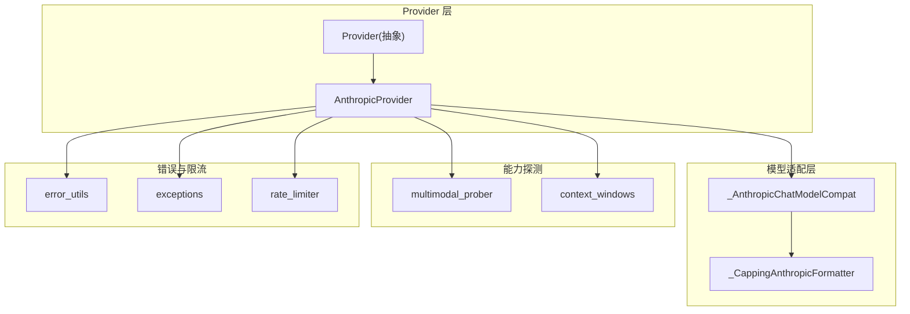
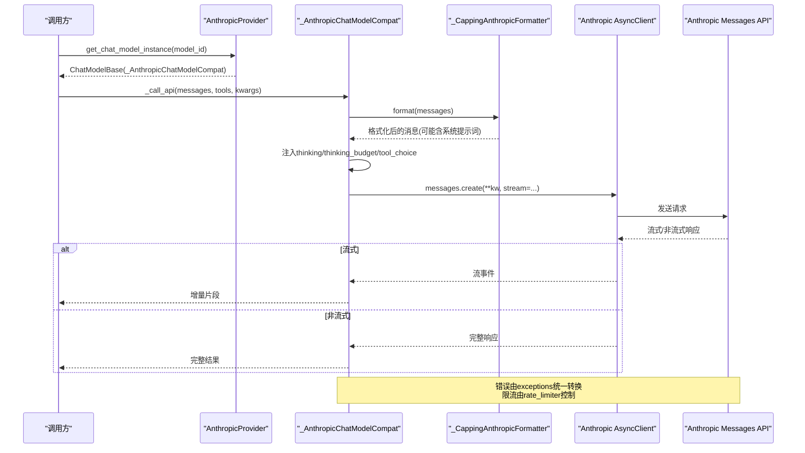
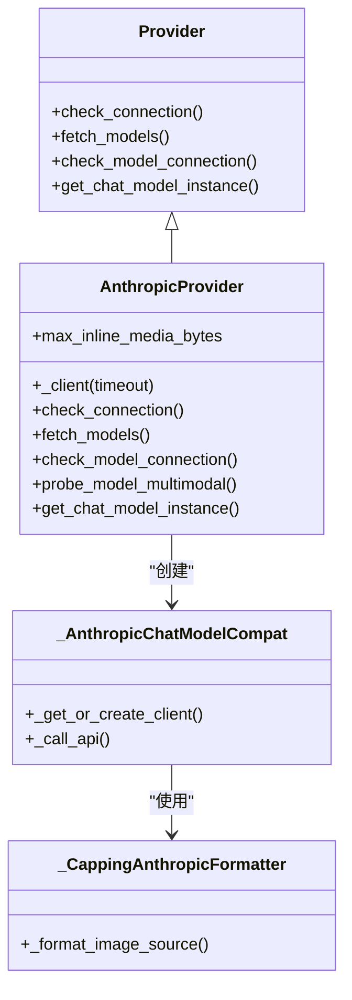
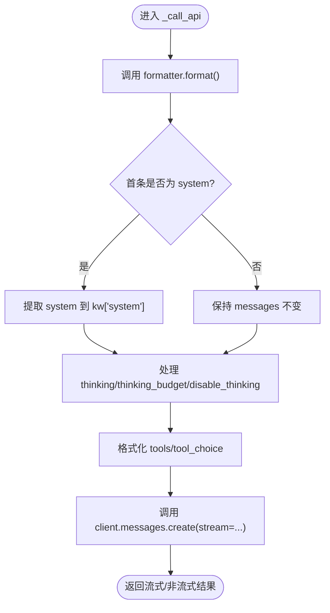
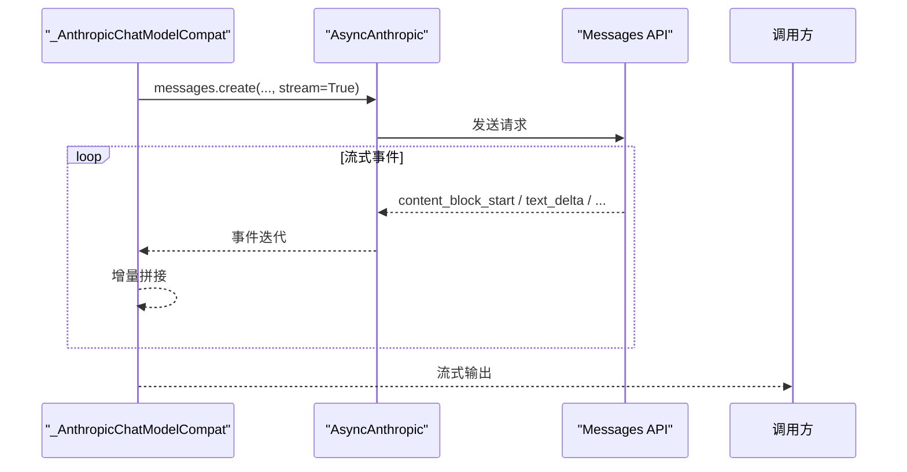
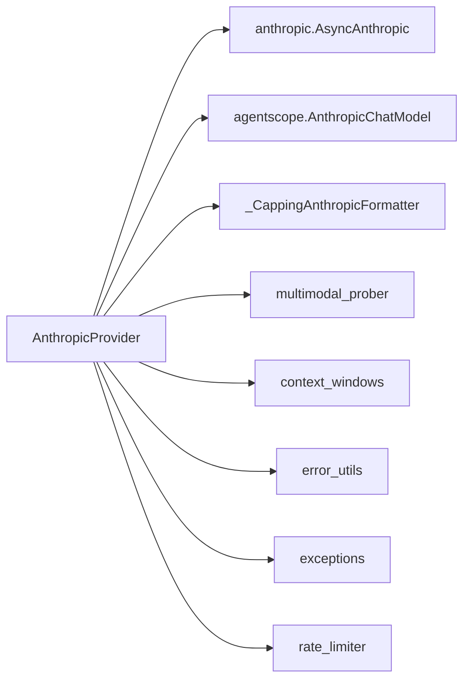

# Anthropic Claude 适配器

<cite>
**本文引用的文件**
- [anthropic_provider.py](file://tongtian-tauri/src/agent/providers/anthropic_provider.py)
- [provider.py](file://tongtian-tauri/src/agent/providers/provider.py)
- [capping_formatter.py](file://tongtian-tauri/src/agent/providers/capping_formatter.py)
- [multimodal_prober.py](file://tongtian-tauri/src/agent/providers/multimodal_prober.py)
- [context_windows.py](file://tongtian-tauri/src/agent/providers/context_windows.py)
- [error_utils.py](file://tongtian-tauri/src/agent/providers/error_utils.py)
- [rate_limiter.py](file://tongtian-tauri/src/agent/providers/rate_limiter.py)
- [exceptions.py](file://tongtian-tauri/src/agent/exceptions.py)
</cite>

## 目录
1. [简介](#简介)
2. [项目结构](#项目结构)
3. [核心组件](#核心组件)
4. [架构总览](#架构总览)
5. [详细组件分析](#详细组件分析)
6. [依赖关系分析](#依赖关系分析)
7. [性能考量](#性能考量)
8. [故障排查指南](#故障排查指南)
9. [结论](#结论)
10. [附录：配置与使用示例](#附录：配置与使用示例)

## 简介
本文件面向需要集成 Anthropic Claude 的开发者，系统性说明 AnthropicProvider 的实现细节、Claude API 集成方式、消息格式转换、流式响应处理、模型能力探测（图像/视频）、系统提示词处理、工具调用支持、安全内容过滤策略、与标准 OpenAI 接口的差异、特殊参数映射、错误码转换、速率限制处理，以及配置、密钥设置、请求示例和常见问题解决方案。目标是帮助读者在不深入源码的情况下也能正确、高效地使用 Claude 适配能力。

## 项目结构
Anthropic Claude 适配位于 Python AgentScope Provider 体系内，围绕以下关键模块组织：
- 提供者抽象与通用能力：Provider、ModelInfo、ProviderInfo
- Anthropic 专用实现：AnthropicProvider、_AnthropicChatModelCompat
- 媒体大小裁剪格式化器：CappingFormatterMixin 及 _CappingAnthropicFormatter
- 多模态能力探测：multimodal_prober
- 上下文窗口解析：context_windows
- 错误工具与异常转换：error_utils、exceptions
- 速率限制：rate_limiter

图表来源
- [anthropic_provider.py:75-305](file://tongtian-tauri/src/agent/providers/anthropic_provider.py#L75-L305)
- [provider.py:281-590](file://tongtian-tauri/src/agent/providers/provider.py#L281-L590)
- [capping_formatter.py:202-215](file://tongtian-tauri/src/agent/providers/capping_formatter.py#L202-L215)
- [multimodal_prober.py:76-130](file://tongtian-tauri/src/agent/providers/multimodal_prober.py#L76-L130)
- [context_windows.py:118-143](file://tongtian-tauri/src/agent/providers/context_windows.py#L118-L143)
- [error_utils.py:20-54](file://tongtian-tauri/src/agent/providers/error_utils.py#L20-L54)
- [rate_limiter.py:39-263](file://tongtian-tauri/src/agent/providers/rate_limiter.py#L39-L263)

章节来源
- [anthropic_provider.py:75-305](file://tongtian-tauri/src/agent/providers/anthropic_provider.py#L75-L305)
- [provider.py:281-590](file://tongtian-tauri/src/agent/providers/provider.py#L281-L590)

## 核心组件
- AnthropicProvider：封装 Anthropic SDK 客户端创建、连接检查、模型列表获取、模型连通性检测、多模态能力探测、聊天模型实例化。
- _AnthropicChatModelCompat：对 AnthropicChatModel 的轻量包装，注入默认头、认证模式、流式/非流式处理、思考预算、工具调用、系统提示词提取等。
- _CappingAnthropicFormatter：在格式化阶段对本地大体积媒体进行“占位替换”，避免请求体过大导致连接失败。
- multimodal_prober：提供图像/视频探针常量与评估逻辑，用于运行时探测模型是否真正具备多模态感知能力。
- context_windows：维护已知模型的上下文窗口表，统一解析输入上下文上限，影响压缩触发与显示一致性。
- error_utils + exceptions：跨 SDK 的错误状态码提取与统一转换为内部异常类型（如鉴权失败、配额超限、超时、上下文超长）。
- rate_limiter：按模型维度的 QPM 滑动窗口、并发信号量、429 冷却暂停与抖动，防止级联拥塞。

章节来源
- [anthropic_provider.py:75-305](file://tongtian-tauri/src/agent/providers/anthropic_provider.py#L75-L305)
- [anthropic_provider.py:582-702](file://tongtian-tauri/src/agent/providers/anthropic_provider.py#L582-L702)
- [capping_formatter.py:202-215](file://tongtian-tauri/src/agent/providers/capping_formatter.py#L202-L215)
- [multimodal_prober.py:76-130](file://tongtian-tauri/src/agent/providers/multimodal_prober.py#L76-L130)
- [context_windows.py:118-143](file://tongtian-tauri/src/agent/providers/context_windows.py#L118-L143)
- [error_utils.py:20-54](file://tongtian-tauri/src/agent/providers/error_utils.py#L20-L54)
- [exceptions.py:673-807](file://tongtian-tauri/src/agent/exceptions.py#L673-L807)
- [rate_limiter.py:39-263](file://tongtian-tauri/src/agent/providers/rate_limiter.py#L39-L263)

## 架构总览
下图展示了从上层调用到 Anthropic API 的关键路径，包括消息格式化、系统提示词分离、工具调用注入、流式响应解析与错误/限流处理。

图表来源
- [anthropic_provider.py:252-305](file://tongtian-tauri/src/agent/providers/anthropic_provider.py#L252-L305)
- [anthropic_provider.py:643-702](file://tongtian-tauri/src/agent/providers/anthropic_provider.py#L643-L702)
- [capping_formatter.py:202-215](file://tongtian-tauri/src/agent/providers/capping_formatter.py#L202-L215)
- [rate_limiter.py:91-144](file://tongtian-tauri/src/agent/providers/rate_limiter.py#L91-L144)
- [exceptions.py:673-807](file://tongtian-tauri/src/agent/exceptions.py#L673-L807)

## 详细组件分析

### AnthropicProvider 类
- 客户端构建：根据 auth_mode 选择 api_key 或 auth_token 模式；当为 auth_token 时通过自定义传输剥离 x-api-key 头，避免与 Authorization 冲突。
- 连接检查：优先尝试 models.list；若代理不支持该端点（404/405），回退到最小 messages.create 探测。
- 模型列表：标准化返回数据，去重后生成 ModelInfo。
- 模型连通性：以流式 ping 验证目标模型可用。
- 多模态探测：
  - 图像：发送极小 PNG，并询问主色，结合回答判断是否真正支持图像。
  - 视频：先尝试 base64 MP4，再尝试 HTTP URL；官方 Anthropic 通常拒绝 video 块，第三方兼容网关可能接受。
- 聊天模型实例：构造 _AnthropicChatModelCompat，注入默认头（含 DashScope 元信息）、思考参数、上下文窗口、媒体裁剪格式化器。

图表来源
- [provider.py:281-590](file://tongtian-tauri/src/agent/providers/provider.py#L281-L590)
- [anthropic_provider.py:75-305](file://tongtian-tauri/src/agent/providers/anthropic_provider.py#L75-L305)
- [anthropic_provider.py:582-702](file://tongtian-tauri/src/agent/providers/anthropic_provider.py#L582-L702)
- [capping_formatter.py:202-215](file://tongtian-tauri/src/agent/providers/capping_formatter.py#L202-L215)

章节来源
- [anthropic_provider.py:95-121](file://tongtian-tauri/src/agent/providers/anthropic_provider.py#L95-L121)
- [anthropic_provider.py:152-209](file://tongtian-tauri/src/agent/providers/anthropic_provider.py#L152-L209)
- [anthropic_provider.py:211-250](file://tongtian-tauri/src/agent/providers/anthropic_provider.py#L211-L250)
- [anthropic_provider.py:252-305](file://tongtian-tauri/src/agent/providers/anthropic_provider.py#L252-L305)
- [anthropic_provider.py:307-580](file://tongtian-tauri/src/agent/providers/anthropic_provider.py#L307-L580)

### 消息格式转换与系统提示词处理
- 格式化：通过 _CappingAnthropicFormatter 对本地媒体进行体积裁剪，超过阈值则替换为文本占位，避免请求体膨胀。
- 系统提示词：格式化后若首条为 system，将其提取至 kw["system"]，其余作为 messages 发送。
- 思考能力：根据 thinking_enable/thinking_budget 或 disable_thinking 标志，注入 thinking 配置；必要时动态调整 max_tokens。
- 工具调用：将中性工具描述转换为 Anthropic 工具格式，并支持 tool_choice。

图表来源
- [anthropic_provider.py:643-702](file://tongtian-tauri/src/agent/providers/anthropic_provider.py#L643-L702)
- [capping_formatter.py:202-215](file://tongtian-tauri/src/agent/providers/capping_formatter.py#L202-L215)

章节来源
- [anthropic_provider.py:643-702](file://tongtian-tauri/src/agent/providers/anthropic_provider.py#L643-L702)
- [capping_formatter.py:115-162](file://tongtian-tauri/src/agent/providers/capping_formatter.py#L115-L162)

### 流式响应处理
- 流式开关：stream 由模型实例决定；_call_api 中根据 self.stream 选择流式或非流式解析。
- 流式解析：调用 _parse_anthropic_stream_completion_response（由底层模型实现）逐步产出增量内容。
- 非流式解析：调用 _parse_anthropic_completion_response 获取完整响应。

图表来源
- [anthropic_provider.py:688-699](file://tongtian-tauri/src/agent/providers/anthropic_provider.py#L688-L699)

章节来源
- [anthropic_provider.py:688-699](file://tongtian-tauri/src/agent/providers/anthropic_provider.py#L688-L699)

### 支持的 Claude 模型版本与上下文窗口
- 上下文窗口解析：通过 context_windows.resolve_context_window 统一解析，优先级为用户显式配置 > 静态目录 > 默认值。
- 已知模型族：claude-instant(100k)、claude-2(100k)、claude(200k)。更长的上下文（如 1M）可通过 per-model 覆盖表达。
- 模型发现：AnthropicProvider.fetch_models 会调用 models.list 并标准化返回。

章节来源
- [context_windows.py:118-143](file://tongtian-tauri/src/agent/providers/context_windows.py#L118-L143)
- [context_windows.py:44-86](file://tongtian-tauri/src/agent/providers/context_windows.py#L44-L86)
- [anthropic_provider.py:204-209](file://tongtian-tauri/src/agent/providers/anthropic_provider.py#L204-L209)

### 工具调用支持与特殊参数映射
- 工具调用：_call_api 中通过 _format_tools 将工具描述转为 Anthropic 格式，并支持 tool_choice。
- 思考参数：
  - disable_thinking -> thinking={"type":"disabled"}
  - thinking_enable/thinking_budget -> thinking={"type":"enabled","budget_tokens":...}
  - 自动调整 max_tokens 以容纳思考预算。
- 系统提示词：格式化后若首条为 system，则放入 kw["system"]。

章节来源
- [anthropic_provider.py:643-702](file://tongtian-tauri/src/agent/providers/anthropic_provider.py#L643-L702)

### 安全内容过滤与媒体裁剪
- 媒体裁剪：_CappingAnthropicFormatter 对本地图片/音频/视频进行体积检查，超过阈值替换为文本占位，避免请求体过大。
- 多模态探测：通过真实请求验证模型是否能“看见”图像/视频，避免仅凭接口接受而误判。
- 安全建议：对于超大媒体，优先使用 URL 引用而非 base64 内联；合理设置 max_inline_media_bytes。

章节来源
- [capping_formatter.py:115-162](file://tongtian-tauri/src/agent/providers/capping_formatter.py#L115-L162)
- [capping_formatter.py:202-215](file://tongtian-tauri/src/agent/providers/capping_formatter.py#L202-L215)
- [multimodal_prober.py:133-179](file://tongtian-tauri/src/agent/providers/multimodal_prober.py#L133-L179)
- [multimodal_prober.py:182-259](file://tongtian-tauri/src/agent/providers/multimodal_prober.py#L182-L259)

### 与标准 OpenAI 接口的差异处理
- 认证头：Anthropic 支持 api_key 与 auth_token 两种模式；auth_token 模式下通过自定义传输剥离 x-api-key，避免与 Authorization 冲突。
- 系统提示词：Anthropic 使用 system 字段，OpenAI 使用 messages[role="system"]；此处通过格式化器提取 system。
- 思考能力：Anthropic 使用 thinking/budget 字段；OpenAI 使用 reasoning_effort 等；本适配通过 Provider 层统一映射。
- 工具调用：Anthropic 有独立的 tools/tool_choice 格式；OpenAI 使用 function calling；本适配在 _call_api 中进行差异化转换。

章节来源
- [anthropic_provider.py:95-121](file://tongtian-tauri/src/agent/providers/anthropic_provider.py#L95-L121)
- [anthropic_provider.py:643-702](file://tongtian-tauri/src/agent/providers/anthropic_provider.py#L643-L702)
- [provider.py:221-228](file://tongtian-tauri/src/agent/providers/provider.py#L221-L228)

### 错误码转换与异常处理
- 状态码提取：error_utils.extract_status_code 兼容多种 SDK 异常结构，提取 HTTP 状态码。
- 异常分类：exceptions.convert_model_exception 将状态码与关键字映射为内部异常类型（鉴权失败、配额超限、超时、上下文超长等）。
- 连接检查：AnthropicProvider.check_connection 对 models.list 不可用场景进行回退探测。

章节来源
- [error_utils.py:20-54](file://tongtian-tauri/src/agent/providers/error_utils.py#L20-L54)
- [exceptions.py:673-807](file://tongtian-tauri/src/agent/exceptions.py#L673-L807)
- [anthropic_provider.py:152-209](file://tongtian-tauri/src/agent/providers/anthropic_provider.py#L152-L209)

### 速率限制处理
- 每模型限流：LLMRateLimiter 基于 QPM 滑动窗口、并发信号量、429 冷却暂停与抖动，避免级联拥塞。
- 暂停恢复：on_success 清理陈旧暂停；report_rate_limit 设置暂停时间并限制最大暂停时长。
- 统计指标：stats 提供当前并发、QPM、暂停剩余时间等监控指标。

章节来源
- [rate_limiter.py:39-263](file://tongtian-tauri/src/agent/providers/rate_limiter.py#L39-L263)
- [rate_limiter.py:281-356](file://tongtian-tauri/src/agent/providers/rate_limiter.py#L281-L356)

## 依赖关系分析
- AnthropicProvider 依赖：
  - anthropic.AsyncAnthropic：实际 API 客户端
  - agentscope.model.AnthropicChatModel：聊天模型基类
  - capping_formatter._CappingAnthropicFormatter：媒体裁剪
  - multimodal_prober：多模态探测
  - context_windows：上下文窗口解析
  - error_utils + exceptions：错误处理
  - rate_limiter：速率限制

图表来源
- [anthropic_provider.py:75-305](file://tongtian-tauri/src/agent/providers/anthropic_provider.py#L75-L305)
- [anthropic_provider.py:582-702](file://tongtian-tauri/src/agent/providers/anthropic_provider.py#L582-L702)

章节来源
- [anthropic_provider.py:75-305](file://tongtian-tauri/src/agent/providers/anthropic_provider.py#L75-L305)
- [anthropic_provider.py:582-702](file://tongtian-tauri/src/agent/providers/anthropic_provider.py#L582-L702)

## 性能考量
- 媒体裁剪：避免大体积本地媒体内联导致请求体膨胀，降低网络与解析开销。
- 流式响应：优先使用流式以减少首字节延迟，提升交互体验。
- 上下文窗口：通过 resolve_context_window 精确控制压缩触发点，避免过早或过晚压缩。
- 速率限制：QPM 滑动窗口与 429 冷却暂停有效防止拥塞雪崩。
- 客户端缓存：_AnthropicChatModelCompat 缓存 AsyncAnthropic 实例，减少重复初始化开销。

[本节为通用性能指导，不直接分析具体文件]

## 故障排查指南
- 连接失败：
  - 检查 base_url 与 auth_mode 是否正确；auth_token 模式下确保未同时发送 x-api-key。
  - 若 models.list 不可用，系统将回退到 messages.create 探测。
- 鉴权失败（401/403）：
  - 确认 API Key 或 Token 有效且权限足够；查看异常类型 UnauthorizedModelAccessException。
- 配额超限（429）：
  - 启用 rate_limiter 的 QPM 与暂停机制；关注 stats 中的 total_rate_limited 与 pause_remaining_s。
- 上下文超长：
  - 检查 model.max_input_length 与 resolve_context_window 的结果；必要时缩短历史或启用压缩。
- 多模态误判：
  - 使用 probe_model_multimodal 进行真实探测；官方 Anthropic 可能拒绝 video，第三方网关可能支持。
- 媒体过大：
  - 调整 max_inline_media_bytes；优先使用 URL 引用而非 base64 内联。

章节来源
- [anthropic_provider.py:152-209](file://tongtian-tauri/src/agent/providers/anthropic_provider.py#L152-L209)
- [exceptions.py:673-807](file://tongtian-tauri/src/agent/exceptions.py#L673-L807)
- [rate_limiter.py:205-263](file://tongtian-tauri/src/agent/providers/rate_limiter.py#L205-L263)
- [multimodal_prober.py:133-179](file://tongtian-tauri/src/agent/providers/multimodal_prober.py#L133-L179)
- [capping_formatter.py:115-162](file://tongtian-tauri/src/agent/providers/capping_formatter.py#L115-L162)

## 结论
AnthropicProvider 提供了完整的 Claude API 集成能力，涵盖消息格式化、系统提示词处理、工具调用、思考能力、多模态探测、媒体裁剪、错误转换与速率限制。通过统一的 Provider 抽象与适配层，可在不同后端间保持一致的调用体验。建议在生产环境中启用媒体裁剪、流式响应与速率限制，并结合多模态探测与上下文窗口解析优化性能与稳定性。

[本节为总结性内容，不直接分析具体文件]

## 附录：配置与使用示例

### 配置要点
- 基础配置：
  - base_url：Anthropic 或兼容网关地址
  - api_key：API Key 或 Token（取决于 auth_mode）
  - auth_mode：api_key 或 auth_token
  - custom_headers：可注入追踪或网关所需头（如 DashScope 元信息）
- 模型配置：
  - max_tokens：默认由 ModelInfo 提供，可按需覆盖
  - max_input_length：通过 per-model 配置或静态目录解析
  - thinking_enable/thinking_budget：控制思考能力与预算
  - relay_reasoning：是否在后继轮次中继推理内容

### API 密钥设置
- 使用 api_key：适用于官方或兼容网关的标准认证
- 使用 auth_token：适用于某些网关要求 Authorization Bearer 的场景；此时会剥离 x-api-key 以避免冲突

### 请求示例（概念性）
- 文本对话：messages=[{role:"user", content:"..."}], system 可选
- 图像输入：content 包含 image 块，source 为 base64 或 URL
- 视频输入：content 包含 video 块，source 为 base64 或 URL（第三方网关可能支持）
- 工具调用：tools 与 tool_choice 按 Anthropic 格式传入

### 常见错误与解决
- 401/403：检查密钥与权限
- 429：启用速率限制并观察暂停时间
- 上下文超长：缩短历史或调整 max_input_length
- 媒体过大：启用媒体裁剪或使用 URL 引用
- 多模态不支持：使用探针验证，避免误用

[本节为通用配置与使用指导，不直接分析具体文件]