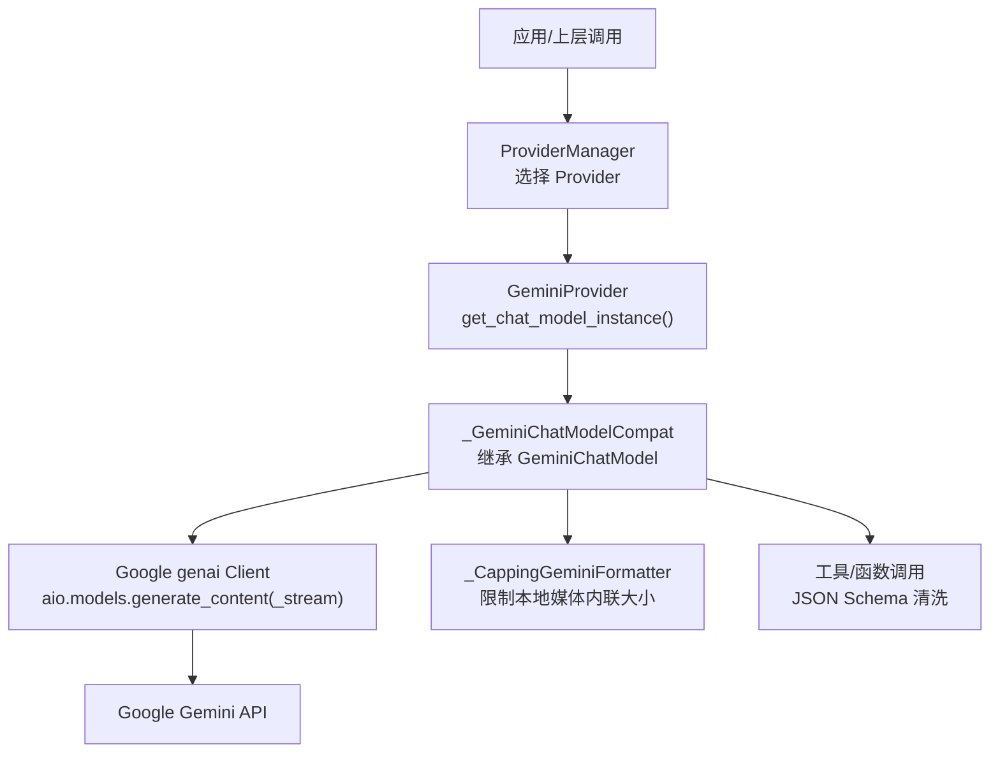
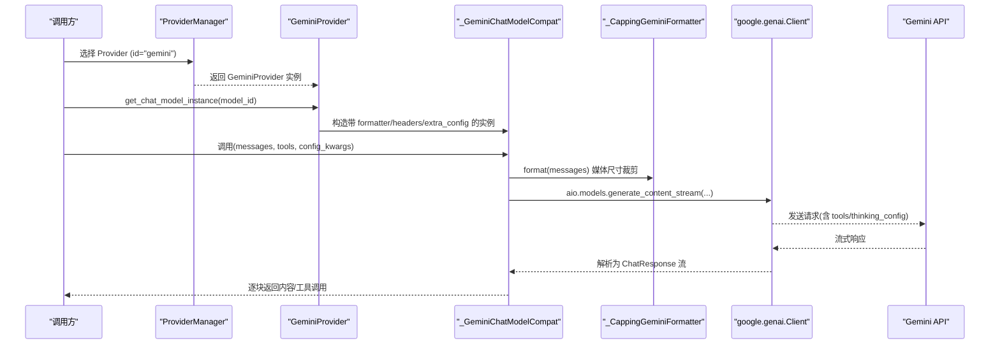
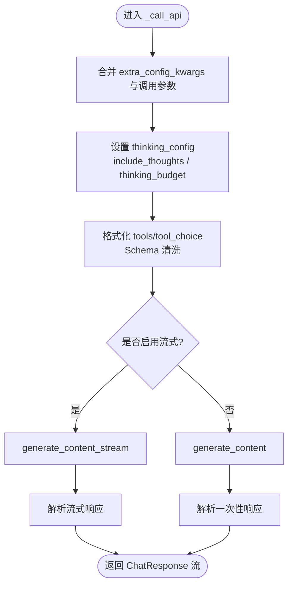
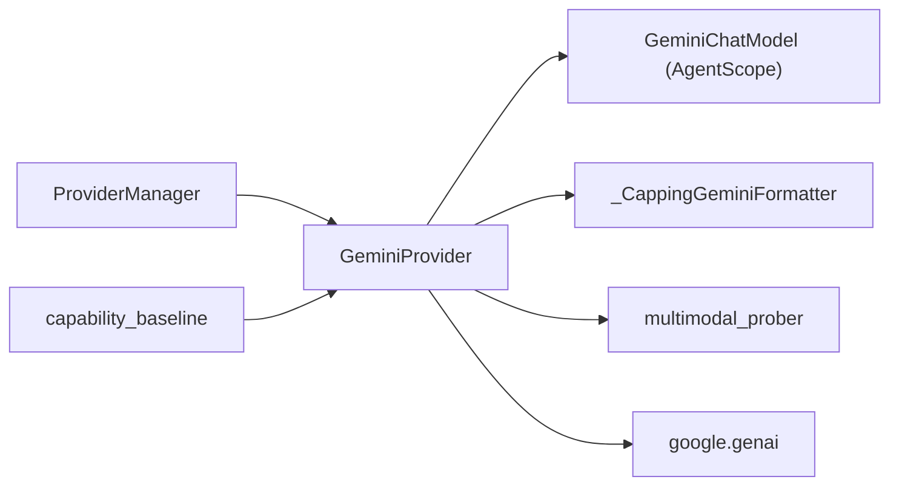

# Gemini 适配器

<cite>
**本文引用的文件**
- [gemini_provider.py](file://tongtian-tauri/src/agent/providers/gemini_provider.py)
- [provider.py](file://tongtian-tauri/src/agent/providers/provider.py)
- [multimodal_prober.py](file://tongtian-tauri/src/agent/providers/multimodal_prober.py)
- [capping_formatter.py](file://tongtian-tauri/src/agent/providers/capping_formatter.py)
- [openai_chat_model_compat.py](file://tongtian-tauri/src/agent/providers/openai_chat_model_compat.py)
- [capability_baseline.py](file://tongtian-tauri/src/agent/providers/capability_baseline.py)
- [provider_manager.py](file://tongtian-tauri/src/agent/providers/provider_manager.py)
</cite>

## 目录
1. [简介](#简介)
2. [项目结构](#项目结构)
3. [核心组件](#核心组件)
4. [架构总览](#架构总览)
5. [详细组件分析](#详细组件分析)
6. [依赖关系分析](#依赖关系分析)
7. [性能考量](#性能考量)
8. [故障排查指南](#故障排查指南)
9. [结论](#结论)
10. [附录](#附录)

## 简介
本文件面向“Gemini 适配器”的实现与使用，围绕 Google Gemini API 的集成、多模态能力（图像/视频）、函数调用（工具）支持、实时对话模式（流式响应）、缓存与上下文控制、与 OpenAI 接口的适配层、错误处理策略等展开。文档同时提供配置示例、API 密钥管理、多模态输入示例以及性能优化建议，并给出 Gemini 特有功能的开发与调试技巧。

## 项目结构
Gemini 适配器位于 AgentScope Provider 体系内，通过自定义 Provider 与 ChatModel 兼容层对接 Google genai SDK，并在格式化层对本地大体积媒体进行裁剪，避免请求体膨胀。

图表来源
- [provider_manager.py:2040-2050](file://tongtian-tauri/src/agent/providers/provider_manager.py#L2040-L2050)
- [gemini_provider.py:306-338](file://tongtian-tauri/src/agent/providers/gemini_provider.py#L306-L338)
- [gemini_provider.py:517-637](file://tongtian-tauri/src/agent/providers/gemini_provider.py#L517-L637)
- [capping_formatter.py:217-235](file://tongtian-tauri/src/agent/providers/capping_formatter.py#L217-L235)

章节来源
- [provider_manager.py:2040-2050](file://tongtian-tauri/src/agent/providers/provider_manager.py#L2040-L2050)
- [gemini_provider.py:165-338](file://tongtian-tauri/src/agent/providers/gemini_provider.py#L165-L338)

## 核心组件
- GeminiProvider：实现 Provider 抽象，负责连接检查、模型发现、模型连通性检测、多模态探测、生成参数适配、构造 ChatModel 实例。
- _GeminiChatModelCompat：动态子类化 GeminiChatModel，注入默认头、额外配置、思考开关、工具/函数调用 Schema 清洗、流式与非流式调用路径。
- _CappingGeminiFormatter：基于 GeminiChatFormatter 扩展，限制本地媒体内联大小，防止历史消息中残留的大文件导致请求体过大。
- multimodal_prober：提供图像/视频探测常量、评估逻辑与结果类型。
- openai_chat_model_compat：提供 OpenAI 风格兼容层（工具调用清洗、流式数据规范化），用于其他 Provider 或作为参考。
- capability_baseline：声明各模型的多模态能力基线（含 Gemini 系列）。
- provider：定义 Provider/ModelInfo/ProviderInfo 等基础结构与通用方法。

章节来源
- [gemini_provider.py:165-637](file://tongtian-tauri/src/agent/providers/gemini_provider.py#L165-L637)
- [multimodal_prober.py:76-180](file://tongtian-tauri/src/agent/providers/multimodal_prober.py#L76-L180)
- [capping_formatter.py:115-235](file://tongtian-tauri/src/agent/providers/capping_formatter.py#L115-L235)
- [capability_baseline.py:634-656](file://tongtian-tauri/src/agent/providers/capability_baseline.py#L634-L656)
- [provider.py:20-122](file://tongtian-tauri/src/agent/providers/provider.py#L20-L122)

## 架构总览
Gemini 适配器在 ProviderManager 中被识别为 gemini 或 chat_model=“GeminiChatModel”，随后由 GeminiProvider 创建带定制行为的 GeminiChatModel 实例。该实例在每次调用时：
- 将 OpenAI 风格的生成参数转换为 Gemini 的 GenerateContentConfig；
- 合并 thinking_config（思考预算/是否启用）；
- 对工具/函数调用的 JSON Schema 进行扁平化与清洗；
- 通过 google.genai 异步客户端发起 generate_content_stream 或 generate_content；
- 使用 _CappingGeminiFormatter 限制本地媒体内联大小，避免请求体过大。

图表来源
- [provider_manager.py:2040-2050](file://tongtian-tauri/src/agent/providers/provider_manager.py#L2040-L2050)
- [gemini_provider.py:306-338](file://tongtian-tauri/src/agent/providers/gemini_provider.py#L306-L338)
- [gemini_provider.py:517-637](file://tongtian-tauri/src/agent/providers/gemini_provider.py#L517-L637)
- [capping_formatter.py:217-235](file://tongtian-tauri/src/agent/providers/capping_formatter.py#L217-L235)

## 详细组件分析

### GeminiProvider：Google Gemini API 集成
- 连接与模型发现
  - check_connection：通过 models.list 验证可达性。
  - fetch_models：拉取可用模型列表，标准化名称（去除 models/ 前缀）。
  - check_model_connection：对指定模型执行最小请求以验证可用性。
- 生成参数适配
  - _adapt_generate_kwargs_for_gemini：将 max_tokens 映射到 max_output_tokens，避免多余字段。
- 构建 ChatModel 实例
  - get_chat_model_instance：组装 GeminiCredential、Parameters、formatter、context_size，并开启流式。
- 多模态探测
  - probe_model_multimodal：分别探测图像与视频支持，使用内置探针图片/视频与提示词。
  - _probe_image_support/_probe_video_support：通过 inline_data/file_data 发送最小负载，依据回答判定支持情况。

章节来源
- [gemini_provider.py:183-257](file://tongtian-tauri/src/agent/providers/gemini_provider.py#L183-L257)
- [gemini_provider.py:259-338](file://tongtian-tauri/src/agent/providers/gemini_provider.py#L259-L338)
- [gemini_provider.py:340-514](file://tongtian-tauri/src/agent/providers/gemini_provider.py#L340-L514)

### _GeminiChatModelCompat：流式响应、函数调用与思考配置
- 动态子类化 GeminiChatModel，注入：
  - default_headers：统一附加 HTTP 头。
  - extra_config_kwargs：合并 provider-level 生成参数。
  - thinking_config：根据 parameters.thinking_enable/thinking_budget 设置 include_thoughts 与 thinking_budget。
- 工具/函数调用 Schema 清洗
  - _format_tools：递归扁平化 $ref/$defs，移除不支持的字段（如 additionalProperties），将 const 转为 enum，处理 anyOf/null 分支。
- 调用流程
  - _call_api：格式化消息、合并配置、选择流式或非流式调用，解析响应。

图表来源
- [gemini_provider.py:517-637](file://tongtian-tauri/src/agent/providers/gemini_provider.py#L517-L637)

章节来源
- [gemini_provider.py:517-637](file://tongtian-tauri/src/agent/providers/gemini_provider.py#L517-L637)

### 多模态处理能力：图像与视频
- 图像探测：发送 32x32 红色 PNG 的 base64 与固定提示词，判断模型是否能识别颜色。
- 视频探测：通过 file_data 引用外部 MP4 链接，询问是否包含运动内容，依据回答判定支持。
- 结果封装：ProbeResult 包含 supports_image/supports_video 及诊断信息。

章节来源
- [multimodal_prober.py:14-130](file://tongtian-tauri/src/agent/providers/multimodal_prober.py#L14-L130)
- [multimodal_prober.py:133-180](file://tongtian-tauri/src/agent/providers/multimodal_prober.py#L133-L180)
- [gemini_provider.py:340-514](file://tongtian-tauri/src/agent/providers/gemini_provider.py#L340-L514)

### 函数调用支持（工具/Tool Calling）
- Schema 清洗要点：
  - 扁平化 $ref/$defs，避免嵌套引用。
  - 移除 additionalProperties。
  - 将 const 改写为单值 enum。
  - 处理 anyOf 中的 null 分支，必要时简化为非空类型。
- 注入方式：在 _call_api 中格式化 tools 与 tool_choice，并放入 config.tools/config.tool_config。

章节来源
- [gemini_provider.py:38-162](file://tongtian-tauri/src/agent/providers/gemini_provider.py#L38-L162)
- [gemini_provider.py:531-547](file://tongtian-tauri/src/agent/providers/gemini_provider.py#L531-L547)
- [gemini_provider.py:608-615](file://tongtian-tauri/src/agent/providers/gemini_provider.py#L608-L615)

### 与 OpenAI 接口的适配层
- 参数映射：max_tokens -> max_output_tokens。
- 兼容层参考：openai_chat_model_compat 提供工具调用清洗、流式数据规范化、extra_content 透传等能力，可作为跨 Provider 的统一处理范式。
- 注意：Gemini 适配器通过 _GeminiChatModelCompat 直接操作 GeminiChatModel，但遵循相同的“清洗 + 兼容”思想。

章节来源
- [gemini_provider.py:289-304](file://tongtian-tauri/src/agent/providers/gemini_provider.py#L289-L304)
- [openai_chat_model_compat.py:46-153](file://tongtian-tauri/src/agent/providers/openai_chat_model_compat.py#L46-L153)
- [openai_chat_model_compat.py:580-623](file://tongtian-tauri/src/agent/providers/openai_chat_model_compat.py#L580-L623)

### 实时对话模式（流式响应）
- 默认启用流式：get_chat_model_instance 中 stream=True。
- 流式调用：_call_api 中优先使用 generate_content_stream，并按块解析为 ChatResponse。
- 优势：低延迟、渐进式渲染、更好的用户体验。

章节来源
- [gemini_provider.py:306-338](file://tongtian-tauri/src/agent/providers/gemini_provider.py#L306-L338)
- [gemini_provider.py:623-634](file://tongtian-tauri/src/agent/providers/gemini_provider.py#L623-L634)

### 缓存机制与上下文窗口
- 上下文窗口：通过 Provider.get_context_size 解析模型上下文长度，驱动自动压缩与显示用量。
- 媒体内联上限：_CappingGeminiFormatter 限制本地媒体内联大小（默认 2MB），超过则替换为文本占位符，避免请求体过大。
- 模型能力基线：capability_baseline 预注册 Gemini 系列模型的多模态能力，便于前端展示与快速决策。

章节来源
- [provider.py:556-584](file://tongtian-tauri/src/agent/providers/provider.py#L556-L584)
- [capping_formatter.py:51-54](file://tongtian-tauri/src/agent/providers/capping_formatter.py#L51-L54)
- [capping_formatter.py:217-235](file://tongtian-tauri/src/agent/providers/capping_formatter.py#L217-L235)
- [capability_baseline.py:634-656](file://tongtian-tauri/src/agent/providers/capability_baseline.py#L634-L656)

## 依赖关系分析
- ProviderManager 根据 provider_id/chat_model 路由到 GeminiProvider。
- GeminiProvider 依赖 google.genai 客户端与 AgentScope 的 GeminiChatModel/GeminiChatFormatter。
- 多模态探测依赖 multimodal_prober 提供的常量与评估逻辑。
- 媒体裁剪依赖 capping_formatter 的 CappingFormatterMixin 与 _CappingGeminiFormatter。
- 模型能力基线来自 capability_baseline，影响 UI 展示与探测策略。

图表来源
- [provider_manager.py:2040-2050](file://tongtian-tauri/src/agent/providers/provider_manager.py#L2040-L2050)
- [gemini_provider.py:165-338](file://tongtian-tauri/src/agent/providers/gemini_provider.py#L165-L338)
- [capping_formatter.py:217-235](file://tongtian-tauri/src/agent/providers/capping_formatter.py#L217-L235)
- [multimodal_prober.py:76-180](file://tongtian-tauri/src/agent/providers/multimodal_prober.py#L76-L180)
- [capability_baseline.py:634-656](file://tongtian-tauri/src/agent/providers/capability_baseline.py#L634-L656)

章节来源
- [provider_manager.py:2040-2050](file://tongtian-tauri/src/agent/providers/provider_manager.py#L2040-L2050)
- [gemini_provider.py:165-338](file://tongtian-tauri/src/agent/providers/gemini_provider.py#L165-L338)

## 性能考量
- 媒体内联上限：默认 2MB，超过阈值会替换为文本占位符，显著降低请求体大小，避免连接中断。
- 流式响应：默认启用，减少首字节延迟，提升交互体验。
- 工具 Schema 清洗：避免不必要的复杂结构，降低解析失败风险与重试开销。
- 上下文窗口：通过 Provider.get_context_size 精确控制压缩触发点，避免无效长上下文。
- 超时与重试：check_connection/check_model_connection 设置合理超时，提高鲁棒性。

章节来源
- [capping_formatter.py:51-54](file://tongtian-tauri/src/agent/providers/capping_formatter.py#L51-L54)
- [gemini_provider.py:306-338](file://tongtian-tauri/src/agent/providers/gemini_provider.py#L306-L338)
- [gemini_provider.py:225-257](file://tongtian-tauri/src/agent/providers/gemini_provider.py#L225-L257)

## 故障排查指南
- 连接失败
  - 现象：check_connection 返回 False，提示无法连接或 API Key 问题。
  - 排查：确认 api_key 有效、网络可达、base_url 正确。
- 模型不可用
  - 现象：check_model_connection 失败，提示模型不可达。
  - 排查：确认 model_id 存在且权限足够；尝试更短超时或更换模型。
- 多模态探测失败
  - 现象：图像/视频探测返回不支持。
  - 排查：检查网络访问外部资源（视频 URL）、模型是否支持对应模态；查看日志中的错误码与关键词。
- 工具调用 Schema 报错
  - 现象：函数参数校验失败或 extra_forbidden。
  - 排查：确认 Schema 已扁平化与清洗；避免 unsupported 字段；将 const 改为 enum。
- 请求体过大
  - 现象：连接被服务端断开或响应缓慢。
  - 排查：调整 max_inline_media_bytes；清理历史消息中的大文件；使用 URLSource 而非 Base64Source。

章节来源
- [gemini_provider.py:225-257](file://tongtian-tauri/src/agent/providers/gemini_provider.py#L225-L257)
- [gemini_provider.py:340-514](file://tongtian-tauri/src/agent/providers/gemini_provider.py#L340-L514)
- [capping_formatter.py:115-161](file://tongtian-tauri/src/agent/providers/capping_formatter.py#L115-L161)

## 结论
Gemini 适配器通过 ProviderManager 路由至 GeminiProvider，结合 AgentScope 的 GeminiChatModel 与 google.genai 客户端，实现了稳定的 Google Gemini API 集成。其关键特性包括：
- 多模态能力探测（图像/视频）；
- 工具/函数调用 Schema 清洗与注入；
- 流式响应与思考配置；
- 媒体内联上限控制，保障请求体大小可控；
- 与 OpenAI 风格参数的兼容映射。
在生产环境中，建议结合能力基线与探测结果动态选择模型，并合理配置上下文窗口与媒体上限以获得最佳性能与稳定性。

## 附录

### 配置示例与 API 密钥管理
- Provider 配置关键字段
  - id/name/base_url/api_key/chat_model/models/extra_models/generate_kwargs/custom_headers
- 激活 Provider
  - ProviderManager 根据 provider_id="gemini" 或 chat_model="GeminiChatModel" 选择 GeminiProvider。
- API 密钥
  - 通过 ProviderInfo.get_info 可掩码显示；确保仅安全存储与传输。

章节来源
- [provider.py:144-278](file://tongtian-tauri/src/agent/providers/provider.py#L144-L278)
- [provider.py:614-672](file://tongtian-tauri/src/agent/providers/provider.py#L614-L672)
- [provider_manager.py:2040-2050](file://tongtian-tauri/src/agent/providers/provider_manager.py#L2040-L2050)

### 支持的 Gemini 模型与多模态能力
- 预注册模型（示例）：gemini-3.1-pro-preview、gemini-3-flash-preview、gemini-3.1-flash-lite-preview、gemini-2.5-pro、gemini-2.5-flash、gemini-2.5-flash-lite、gemini-2.0-flash
- 能力：均预期支持图像与视频输入（可通过 probe_model_multimodal 进一步验证）

章节来源
- [capability_baseline.py:634-656](file://tongtian-tauri/src/agent/providers/capability_baseline.py#L634-L656)

### 多模态输入示例（概念说明）
- 图像：通过 Base64Source 或 URLSource(file://) 传入图片；若超过内联上限将被替换为文本占位符。
- 视频：通过 URLSource(file://) 或远程 URL 传入视频；探测阶段使用外部 MP4 链接验证支持。
- 音频：当前 Gemini 适配器主要聚焦图像/视频；音频需按 Provider 的 Formatter 行为处理。

章节来源
- [capping_formatter.py:57-112](file://tongtian-tauri/src/agent/providers/capping_formatter.py#L57-L112)
- [capping_formatter.py:217-235](file://tongtian-tauri/src/agent/providers/capping_formatter.py#L217-L235)
- [multimodal_prober.py:22-27](file://tongtian-tauri/src/agent/providers/multimodal_prober.py#L22-L27)

### 性能优化建议
- 合理设置 max_inline_media_bytes：根据业务场景调整，避免不必要的大文件内联。
- 启用流式响应：默认已启用，确保下游消费端能正确处理流式数据。
- 精简工具 Schema：避免冗余字段与复杂嵌套，减少解析失败概率。
- 上下文压缩：利用 Provider.get_context_size 控制压缩触发点，保持高效对话。

章节来源
- [gemini_provider.py:306-338](file://tongtian-tauri/src/agent/providers/gemini_provider.py#L306-L338)
- [capping_formatter.py:115-161](file://tongtian-tauri/src/agent/providers/capping_formatter.py#L115-L161)
- [provider.py:556-584](file://tongtian-tauri/src/agent/providers/provider.py#L556-L584)

### 开发指南与调试技巧
- 调试多模态探测：查看日志中的模型 ID、耗时与回答内容，定位不支持的原因。
- 调试工具调用：打印格式化后的 tools/tool_config，确认 Schema 是否符合要求。
- 调试流式响应：捕获 ChatResponse 流，观察分块内容与工具调用块。
- 调试媒体裁剪：检查 inline_media_size 返回值与占位符文本，确认裁剪生效。

章节来源
- [multimodal_prober.py:133-180](file://tongtian-tauri/src/agent/providers/multimodal_prober.py#L133-L180)
- [gemini_provider.py:340-514](file://tongtian-tauri/src/agent/providers/gemini_provider.py#L340-L514)
- [capping_formatter.py:115-161](file://tongtian-tauri/src/agent/providers/capping_formatter.py#L115-L161)