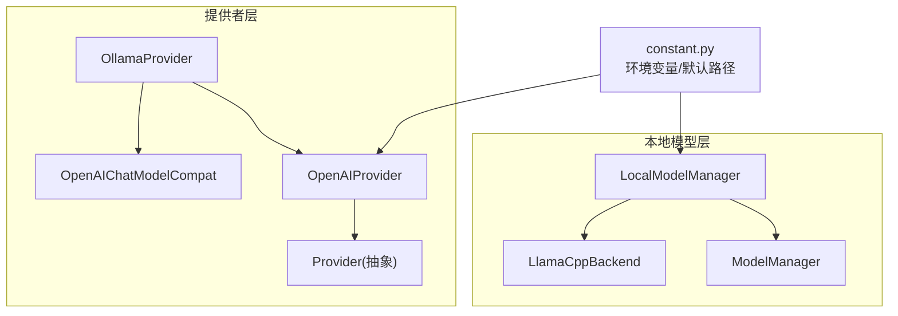
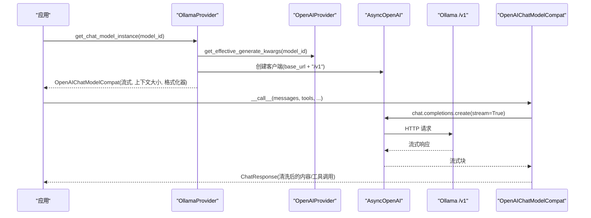
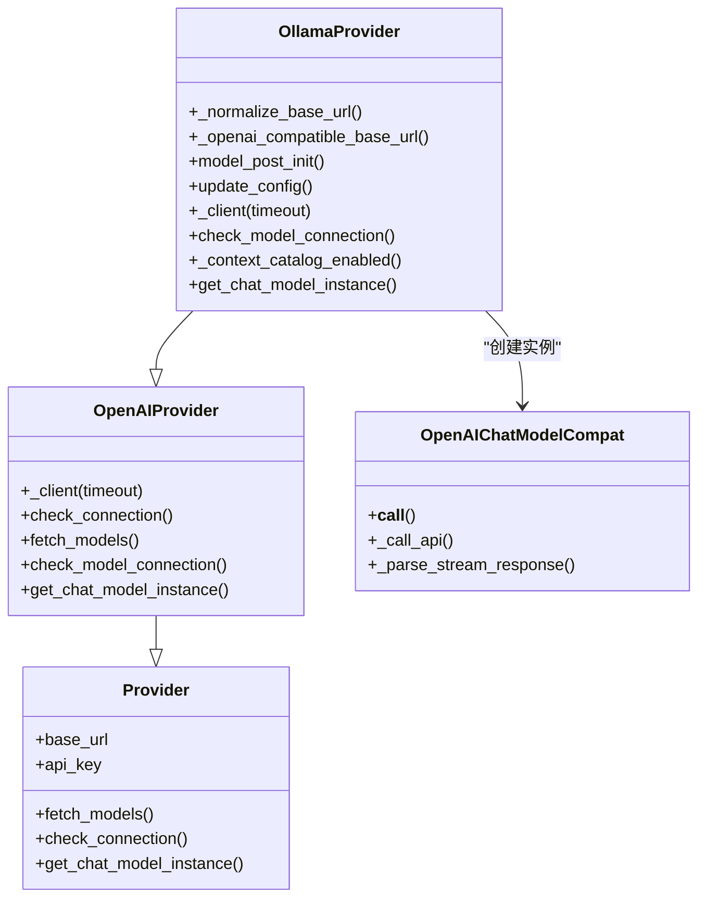
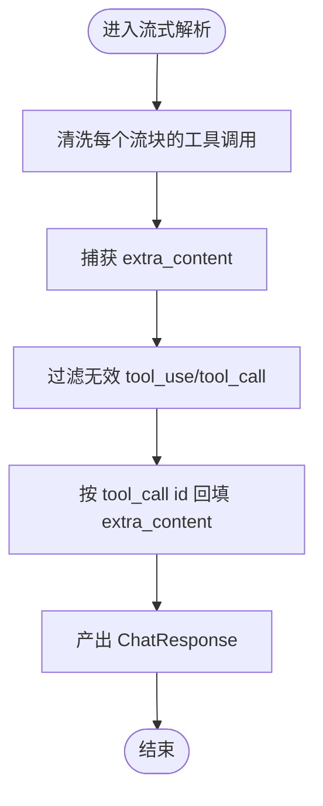
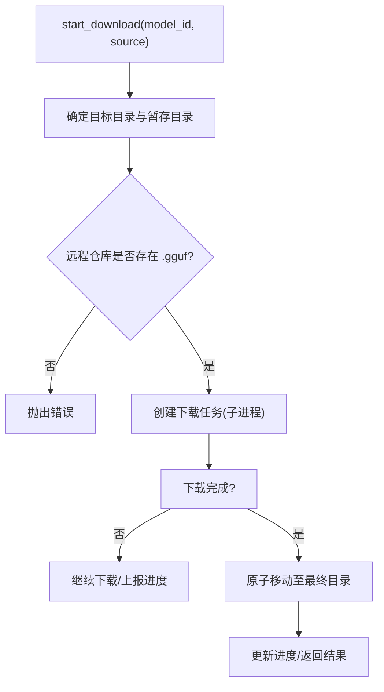
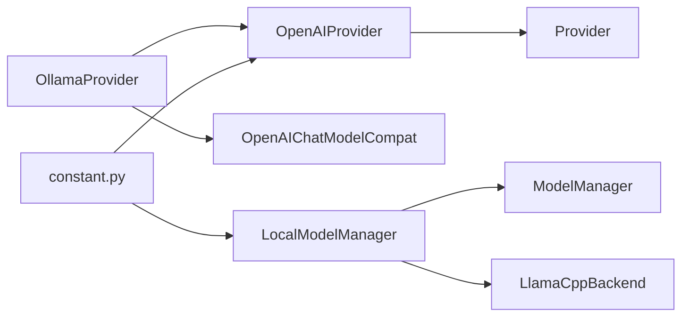

# Ollama 本地模型适配器

<cite>
**本文引用的文件**
- [ollama_provider.py](file://tongtian-tauri/src/agent/providers/ollama_provider.py)
- [openai_provider.py](file://tongtian-tauri/src/agent/providers/openai_provider.py)
- [provider.py](file://tongtian-tauri/src/agent/providers/provider.py)
- [openai_chat_model_compat.py](file://tongtian-tauri/src/agent/providers/openai_chat_model_compat.py)
- [model_manager.py](file://tongtian-tauri/src/agent/local_models/model_manager.py)
- [manager.py](file://tongtian-tauri/src/agent/local_models/manager.py)
- [llamacpp.py](file://tongtian-tauri/src/agent/local_models/llamacpp.py)
- [constant.py](file://tongtian-tauri/src/agent/constant.py)
</cite>

## 目录
1. [简介](#简介)
2. [项目结构](#项目结构)
3. [核心组件](#核心组件)
4. [架构总览](#架构总览)
5. [详细组件分析](#详细组件分析)
6. [依赖关系分析](#依赖关系分析)
7. [性能与并发](#性能与并发)
8. [配置与部署](#配置与部署)
9. [故障排除](#故障排除)
10. [结论](#结论)

## 简介
本文件面向本地大模型运行场景，系统性说明 OllamaProvider 适配器的实现与使用方式。内容涵盖：
- 本地模型管理、API 通信、模型发现机制
- 支持的本地模型类型、模型下载与管理
- 内存使用优化、并发控制
- OpenAI 兼容接口适配、流式响应处理
- 错误处理与重试机制、模型能力探测
- 配置示例、模型安装指南、性能调优建议与故障排除
- 本地部署最佳实践与安全考虑

## 项目结构
Ollama 适配器位于 providers 层，继承自 OpenAIProvider，复用其连接、模型发现与实例化逻辑；本地模型管理与 llama.cpp 后端位于 local_models 层；常量与环境变量在 constant.py 中集中管理。

图表来源
- [ollama_provider.py:14-105](file://tongtian-tauri/src/agent/providers/ollama_provider.py#L14-L105)
- [openai_provider.py:171-524](file://tongtian-tauri/src/agent/providers/openai_provider.py#L171-L524)
- [provider.py:281-584](file://tongtian-tauri/src/agent/providers/provider.py#L281-L584)
- [openai_chat_model_compat.py:626-800](file://tongtian-tauri/src/agent/providers/openai_chat_model_compat.py#L626-L800)
- [model_manager.py:63-255](file://tongtian-tauri/src/agent/local_models/model_manager.py#L63-L255)
- [manager.py:41-244](file://tongtian-tauri/src/agent/local_models/manager.py#L41-L244)
- [llamacpp.py:52-313](file://tongtian-tauri/src/agent/local_models/llamacpp.py#L52-L313)
- [constant.py:179-180](file://tongtian-tauri/src/agent/constant.py#L179-L180)

章节来源
- [ollama_provider.py:14-105](file://tongtian-tauri/src/agent/providers/ollama_provider.py#L14-L105)
- [openai_provider.py:171-524](file://tongtian-tauri/src/agent/providers/openai_provider.py#L171-L524)
- [provider.py:281-584](file://tongtian-tauri/src/agent/providers/provider.py#L281-L584)
- [openai_chat_model_compat.py:626-800](file://tongtian-tauri/src/agent/providers/openai_chat_model_compat.py#L626-L800)
- [model_manager.py:63-255](file://tongtian-tauri/src/agent/local_models/model_manager.py#L63-L255)
- [manager.py:41-244](file://tongtian-tauri/src/agent/local_models/manager.py#L41-L244)
- [llamacpp.py:52-313](file://tongtian-tauri/src/agent/local_models/llamacpp.py#L52-L313)
- [constant.py:179-180](file://tongtian-tauri/src/agent/constant.py#L179-L180)

## 核心组件
- OllamaProvider：基于 OpenAIProvider 的轻量适配，将 base_url 规范化为 Ollama 的 /v1 兼容端点，构造 OpenAI 客户端并生成聊天模型实例。
- OpenAIProvider：提供通用连接检查、模型列表拉取、模型连通性探测、聊天模型实例构建等能力。
- OpenAIChatModelCompat：对流式响应进行健壮解析与工具调用清洗，支持额外请求头与生成参数透传。
- LocalModelManager：本地模型与 llama.cpp 后端的统一入口，负责下载、启动/停止服务、端口与上下文长度配置持久化。
- ModelManager：模型仓库下载（HuggingFace/ModelScope）、进度跟踪、已下载模型清单与清理。
- LlamaCppBackend：llama.cpp 二进制下载、解压、进程管理、健康检查与设备/版本查询。
- constant.py：工作目录、本地模型目录、重试与并发等全局环境变量。

章节来源
- [ollama_provider.py:14-105](file://tongtian-tauri/src/agent/providers/ollama_provider.py#L14-L105)
- [openai_provider.py:171-524](file://tongtian-tauri/src/agent/providers/openai_provider.py#L171-L524)
- [openai_chat_model_compat.py:626-800](file://tongtian-tauri/src/agent/providers/openai_chat_model_compat.py#L626-L800)
- [model_manager.py:63-255](file://tongtian-tauri/src/agent/local_models/model_manager.py#L63-L255)
- [manager.py:41-244](file://tongtian-tauri/src/agent/local_models/manager.py#L41-L244)
- [llamacpp.py:52-313](file://tongtian-tauri/src/agent/local_models/llamacpp.py#L52-L313)
- [constant.py:179-180](file://tongtian-tauri/src/agent/constant.py#L179-L180)

## 架构总览
OllamaProvider 通过 OpenAI 兼容协议与本地 Ollama 服务通信；本地模型由 LocalModelManager 统一管理，必要时拉起 llama.cpp 服务暴露推理接口；OpenAIChatModelCompat 保证流式输出与工具调用的鲁棒性。

图表来源
- [ollama_provider.py:45-105](file://tongtian-tauri/src/agent/providers/ollama_provider.py#L45-L105)
- [openai_provider.py:464-524](file://tongtian-tauri/src/agent/providers/openai_provider.py#L464-L524)
- [openai_chat_model_compat.py:626-800](file://tongtian-tauri/src/agent/providers/openai_chat_model_compat.py#L626-L800)

## 详细组件分析

### OllamaProvider 类
- 目标：以最小改动接入 Ollama 的 OpenAI 兼容接口。
- 关键行为：
  - 规范化 base_url，自动追加 /v1 后缀，兼容历史写法。
  - model_post_init：若未显式设置 base_url，则从环境变量读取或回退到本地默认地址。
  - _client：构造 AsyncOpenAI 客户端，注入超时与默认请求头。
  - check_model_connection：通过 fetch_models 校验指定模型是否可用。
  - _context_catalog_enabled：关闭静态上下文窗口目录，避免误用云端上下文限制。
  - get_chat_model_instance：构造 OpenAICredential 与 OpenAIChatModelCompat，启用流式、上下文大小与媒体截断格式化器。

图表来源
- [provider.py:281-584](file://tongtian-tauri/src/agent/providers/provider.py#L281-L584)
- [openai_provider.py:171-524](file://tongtian-tauri/src/agent/providers/openai_provider.py#L171-L524)
- [ollama_provider.py:14-105](file://tongtian-tauri/src/agent/providers/ollama_provider.py#L14-L105)
- [openai_chat_model_compat.py:626-800](file://tongtian-tauri/src/agent/providers/openai_chat_model_compat.py#L626-L800)

章节来源
- [ollama_provider.py:14-105](file://tongtian-tauri/src/agent/providers/ollama_provider.py#L14-L105)

### OpenAIProvider 基类能力
- 连接检查：尝试列出模型，捕获 APIError 并返回可读错误信息。
- 模型发现：调用 models.list，标准化数据并去重。
- 模型连通性探测：对非聊天模型采用零成本验证端点；聊天模型发送短消息并消费流以确保可响应。
- 聊天模型实例：构造 OpenAIChatModelCompat，注入平台相关请求头、生成参数与上下文大小。

章节来源
- [openai_provider.py:222-323](file://tongtian-tauri/src/agent/providers/openai_provider.py#L222-L323)
- [openai_provider.py:464-524](file://tongtian-tauri/src/agent/providers/openai_provider.py#L464-L524)

### OpenAIChatModelCompat 流式与工具调用处理
- 流式代理：封装底层流，逐块清洗工具调用，避免空 id 或非法名称导致的历史污染。
- 额外内容透传：捕获 tool_call 的 extra_content（如思考签名）并回填到结果块。
- 工具参数 Schema 清洗：展开 $ref/$defs、去除布尔 schema 特殊值、移除 null 分支、转换正则简写，提升跨后端兼容性。
- 请求合并：合并默认请求头与生成参数，支持禁用“思考”模式等开关。

图表来源
- [openai_chat_model_compat.py:156-207](file://tongtian-tauri/src/agent/providers/openai_chat_model_compat.py#L156-L207)
- [openai_chat_model_compat.py:580-624](file://tongtian-tauri/src/agent/providers/openai_chat_model_compat.py#L580-L624)
- [openai_chat_model_compat.py:730-800](file://tongtian-tauri/src/agent/providers/openai_chat_model_compat.py#L730-L800)

章节来源
- [openai_chat_model_compat.py:626-800](file://tongtian-tauri/src/agent/providers/openai_chat_model_compat.py#L626-L800)

### 本地模型管理（ModelManager）
- 推荐模型：根据可用内存（优先 VRAM）推荐不同规模的模型。
- 下载源选择：优先 HuggingFace，不可达时回退 ModelScope。
- 下载流程：在子进程中执行阻塞下载，使用暂存目录，完成后原子移动到最终目录。
- 进度与取消：通过下载控制器与进度追踪器暴露快照与取消能力。
- 已下载模型：扫描包含 .gguf 的目录，计算占用空间并返回列表。
- 清理：删除模型目录及空父目录。

图表来源
- [model_manager.py:181-255](file://tongtian-tauri/src/agent/local_models/model_manager.py#L181-L255)
- [model_manager.py:321-372](file://tongtian-tauri/src/agent/local_models/model_manager.py#L321-L372)
- [model_manager.py:583-607](file://tongtian-tauri/src/agent/local_models/model_manager.py#L583-L607)

章节来源
- [model_manager.py:63-255](file://tongtian-tauri/src/agent/local_models/model_manager.py#L63-L255)

### 本地运行时入口（LocalModelManager）
- 统一入口：封装 ModelManager 与 LlamaCppBackend，提供下载、启动/停止服务、配置持久化。
- 配置持久化：max_context_length 与 port 写入 config.json，下次启动生效。
- 服务生命周期：确保同一时间只有一个服务进程运行，切换模型时先停旧进程再启新进程。
- 就绪检测：轮询 /health 直到成功或超时。

章节来源
- [manager.py:41-244](file://tongtian-tauri/src/agent/local_models/manager.py#L41-L244)

### llama.cpp 后端（LlamaCppBackend）
- 安装与更新：检测环境、下载压缩包、解压到 bin 目录。
- 进程管理：启动 llama-server，绑定 127.0.0.1，自动选择端口，支持 mmproj 多模态。
- 健康检查：循环 GET /health，等待服务就绪。
- 日志与清理：后台任务读取 stdout，退出时优雅关闭进程。

章节来源
- [llamacpp.py:52-313](file://tongtian-tauri/src/agent/local_models/llamacpp.py#L52-L313)
- [llamacpp.py:705-741](file://tongtian-tauri/src/agent/local_models/llamacpp.py#L705-L741)

## 依赖关系分析
- OllamaProvider 依赖 OpenAIProvider 的连接与模型发现能力，并通过 OpenAIChatModelCompat 增强流式与工具调用鲁棒性。
- LocalModelManager 组合 ModelManager 与 LlamaCppBackend，屏蔽底层细节。
- constant.py 提供工作目录、重试与并发等全局配置，影响所有组件行为。

图表来源
- [ollama_provider.py:14-105](file://tongtian-tauri/src/agent/providers/ollama_provider.py#L14-L105)
- [openai_provider.py:171-524](file://tongtian-tauri/src/agent/providers/openai_provider.py#L171-L524)
- [provider.py:281-584](file://tongtian-tauri/src/agent/providers/provider.py#L281-L584)
- [openai_chat_model_compat.py:626-800](file://tongtian-tauri/src/agent/providers/openai_chat_model_compat.py#L626-L800)
- [model_manager.py:63-255](file://tongtian-tauri/src/agent/local_models/model_manager.py#L63-L255)
- [manager.py:41-244](file://tongtian-tauri/src/agent/local_models/manager.py#L41-L244)
- [llamacpp.py:52-313](file://tongtian-tauri/src/agent/local_models/llamacpp.py#L52-L313)
- [constant.py:179-180](file://tongtian-tauri/src/agent/constant.py#L179-L180)

章节来源
- [ollama_provider.py:14-105](file://tongtian-tauri/src/agent/providers/ollama_provider.py#L14-L105)
- [openai_provider.py:171-524](file://tongtian-tauri/src/agent/providers/openai_provider.py#L171-L524)
- [provider.py:281-584](file://tongtian-tauri/src/agent/providers/provider.py#L281-L584)
- [openai_chat_model_compat.py:626-800](file://tongtian-tauri/src/agent/providers/openai_chat_model_compat.py#L626-L800)
- [model_manager.py:63-255](file://tongtian-tauri/src/agent/local_models/model_manager.py#L63-L255)
- [manager.py:41-244](file://tongtian-tauri/src/agent/local_models/manager.py#L41-L244)
- [llamacpp.py:52-313](file://tongtian-tauri/src/agent/local_models/llamacpp.py#L52-L313)
- [constant.py:179-180](file://tongtian-tauri/src/agent/constant.py#L179-L180)

## 性能与并发
- 流式响应：OllamaProvider 与 OpenAIProvider 均启用 stream=True，降低首字延迟，提高交互体验。
- 上下文窗口：OllamaProvider 关闭静态上下文目录，避免误用云端限制；实际上下文由模型与服务参数决定。
- 并发控制：全局 LLM_MAX_CONCURRENT 限制并发请求数，LLM_MAX_QPM 限制每分钟请求量，防止过载。
- 重试与退避：LLM_MAX_RETRIES、LLM_BACKOFF_BASE、LLM_BACKOFF_CAP 控制重试次数与指数退避上限。
- 速率限制：LLM_RATE_LIMIT_PAUSE 与 LLM_RATE_LIMIT_JITTER 在遇到限流时暂停并抖动唤醒，减少突发。
- 获取令牌：LLM_ACQUIRE_TIMEOUT 限制等待信号量的最长时间，避免无限阻塞。

章节来源
- [constant.py:319-381](file://tongtian-tauri/src/agent/constant.py#L319-L381)
- [ollama_provider.py:75-105](file://tongtian-tauri/src/agent/providers/ollama_provider.py#L75-L105)
- [openai_provider.py:464-524](file://tongtian-tauri/src/agent/providers/openai_provider.py#L464-L524)

## 配置与部署
- 基础 URL：
  - 若未设置 base_url，OllamaProvider 会读取环境变量 OLLAMA_HOST，否则使用 http://127.0.0.1:11434。
  - base_url 会被规范化并追加 /v1 作为 OpenAI 兼容端点。
- 本地模型目录：
  - 默认工作目录下的 local_models 子目录用于存放本地模型与二进制。
- 上下文长度与端口：
  - 通过 LocalModelManager 持久化 max_context_length 与 port，供 llama.cpp 启动时使用。
- 环境变量（部分）：
  - QWENPAW_LLM_MAX_RETRIES、QWENPAW_LLM_BACKOFF_BASE、QWENPAW_LLM_BACKOFF_CAP：重试与退避。
  - QWENPAW_LLM_MAX_CONCURRENT、QWENPAW_LLM_MAX_QPM：并发与速率限制。
  - QWENPAW_MODEL_PROVIDER_CHECK_TIMEOUT：连接检查超时。
  - QWENPAW_WORKING_DIR：工作目录（影响 local_models 位置）。

章节来源
- [ollama_provider.py:34-44](file://tongtian-tauri/src/agent/providers/ollama_provider.py#L34-L44)
- [constant.py:179-180](file://tongtian-tauri/src/agent/constant.py#L179-L180)
- [constant.py:254-260](file://tongtian-tauri/src/agent/constant.py#L254-L260)
- [constant.py:319-381](file://tongtian-tauri/src/agent/constant.py#L319-L381)
- [manager.py:113-123](file://tongtian-tauri/src/agent/local_models/manager.py#L113-L123)

## 故障排除
- 连接失败：
  - 检查 Ollama 服务是否运行于 base_url 指定的地址与端口。
  - 使用 check_connection 或 check_model_connection 快速诊断。
- 模型不存在：
  - check_model_connection 会列出可用模型并判断目标模型是否存在。
- 下载失败：
  - ModelManager 会报告远程仓库是否包含 .gguf；若缺失则提示不支持。
  - LlamaCppBackend 在下载阶段给出明确的 HTTP 状态码与错误原因。
- 服务未就绪：
  - setup_server 会轮询 /health，超时则抛出异常并清理进程。
- 流式解析异常：
  - OpenAIChatModelCompat 会过滤无效工具调用块，避免历史污染；如遇异常请检查上游模型输出格式。

章节来源
- [openai_provider.py:222-323](file://tongtian-tauri/src/agent/providers/openai_provider.py#L222-L323)
- [ollama_provider.py:56-65](file://tongtian-tauri/src/agent/providers/ollama_provider.py#L56-L65)
- [model_manager.py:307-319](file://tongtian-tauri/src/agent/local_models/model_manager.py#L307-L319)
- [llamacpp.py:705-741](file://tongtian-tauri/src/agent/local_models/llamacpp.py#L705-L741)
- [openai_chat_model_compat.py:730-800](file://tongtian-tauri/src/agent/providers/openai_chat_model_compat.py#L730-L800)

## 结论
OllamaProvider 以最小侵入的方式将 Ollama 的 OpenAI 兼容接口纳入统一提供者体系，结合 OpenAIChatModelCompat 的流式与工具调用鲁棒性，以及 LocalModelManager 对本地模型与 llama.cpp 后端的完整生命周期管理，提供了开箱即用的本地大模型运行能力。通过环境变量与配置项，可实现灵活的并发、重试与速率控制，满足本地部署的性能与安全需求。