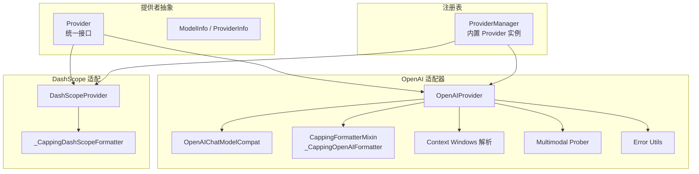
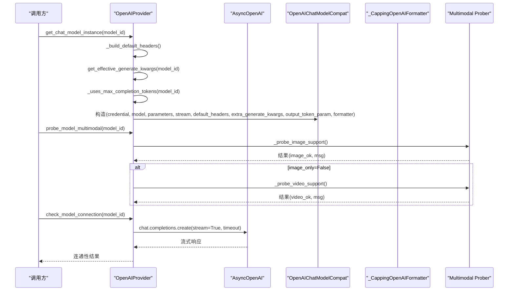
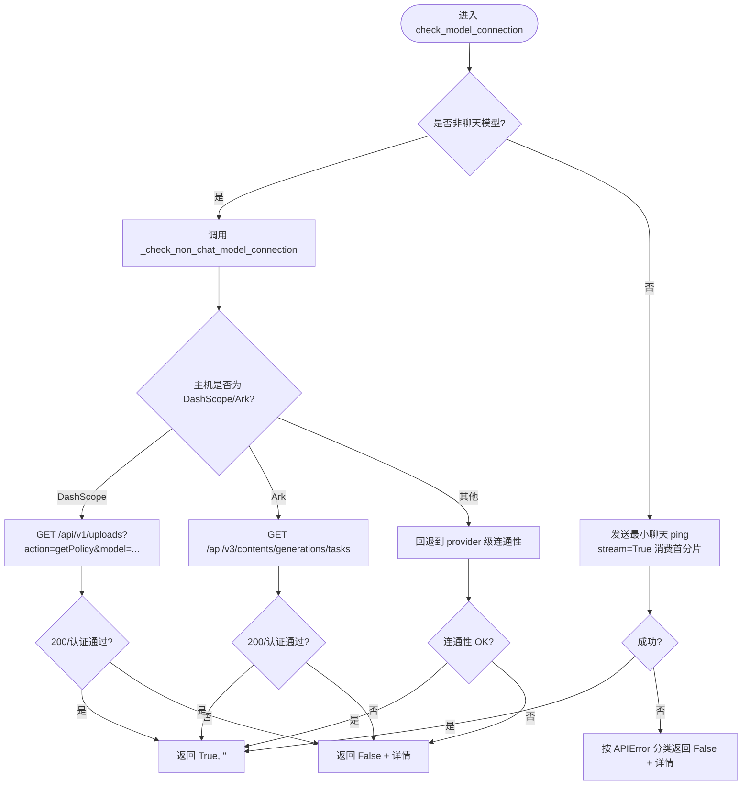
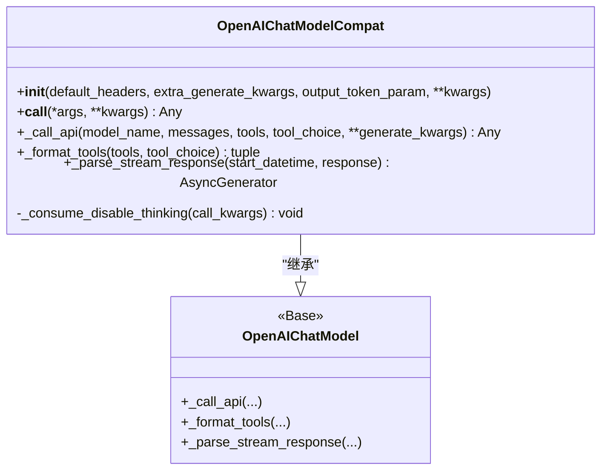
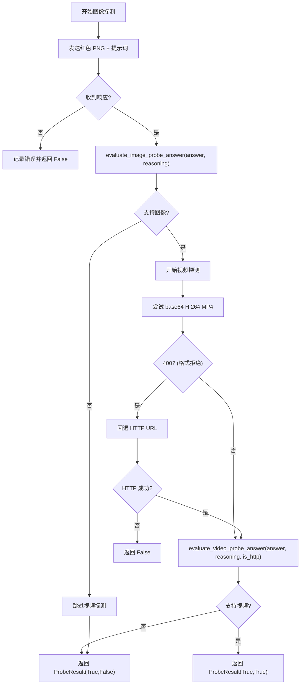
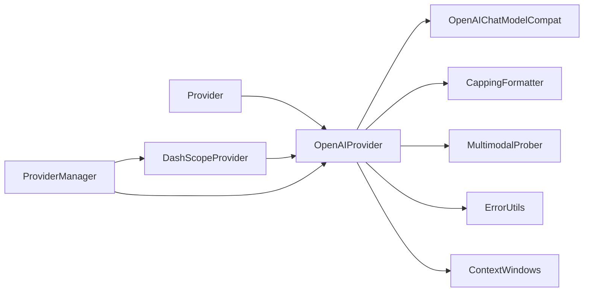

# OpenAI 适配器

<cite>
**本文引用的文件**   
- [openai_provider.py](file://tongtian-tauri/src/agent/providers/openai_provider.py)
- [provider.py](file://tongtian-tauri/src/agent/providers/provider.py)
- [multimodal_prober.py](file://tongtian-tauri/src/agent/providers/multimodal_prober.py)
- [dashscope_provider.py](file://tongtian-tauri/src/agent/providers/dashscope_provider.py)
- [error_utils.py](file://tongtian-tauri/src/agent/providers/error_utils.py)
- [openai_chat_model_compat.py](file://tongtian-tauri/src/agent/providers/openai_chat_model_compat.py)
- [capping_formatter.py](file://tongtian-tauri/src/agent/providers/capping_formatter.py)
- [context_windows.py](file://tongtian-tauri/src/agent/providers/context_windows.py)
- [provider_manager.py](file://tongtian-tauri/src/agent/providers/provider_manager.py)
</cite>

## 目录
1. [简介](#简介)
2. [项目结构](#项目结构)
3. [核心组件](#核心组件)
4. [架构总览](#架构总览)
5. [详细组件分析](#详细组件分析)
6. [依赖关系分析](#依赖关系分析)
7. [性能考量](#性能考量)
8. [故障排查指南](#故障排查指南)
9. [结论](#结论)
10. [附录：配置与使用示例](#附录配置与使用示例)

## 简介
本文件面向“OpenAI 适配器”的实现与使用，聚焦 OpenAIProvider 类的设计与实现。内容涵盖统一接口设计、协议转换、参数映射、支持的模型族（GPT-4o、GPT-5、o1/o3/o4 系列等）、消息格式转换、流式响应处理、错误处理策略、超时控制、多模态能力检测（图像/视频探测）、非聊天模型的特殊处理、DashScope 兼容模式、自定义头部注入，以及调试技巧与性能优化建议。文档同时给出配置方法、连接测试步骤与常见问题解决方案。

## 项目结构
OpenAI 适配器位于 providers 子系统中，围绕 Provider 抽象基类扩展，提供统一的模型发现、连接检查、多模态探测、流式调用与格式化能力。关键文件职责如下：
- provider.py：Provider 抽象与 ModelInfo/ProviderInfo 数据模型，定义统一接口与通用逻辑（上下文窗口解析、生成参数合并、思考参数注入钩子等）。
- openai_provider.py：OpenAI 适配器的核心实现，封装 OpenAI/兼容端点的连接、模型列表获取、连通性检查、多模态探测、实例化 ChatModel 等。
- multimodal_prober.py：多模态探测的共享常量与评估函数（图片/视频探针、颜色判定、错误关键词识别）。
- dashscope_provider.py：基于 OpenAIProvider 的 DashScope 原生实现，覆盖 get_chat_model_instance 以接入 DashScopeChatModel，并处理 thinking 参数风格。
- openai_chat_model_compat.py：对 OpenAIChatModel 的兼容性包装，增强流式解析、工具调用清洗、默认头部注入、输出 token 参数映射等。
- capping_formatter.py：媒体大小裁剪器，避免本地大文件 base64 内联导致请求过大。
- context_windows.py：模型上下文窗口的静态目录与解析入口，确保压缩触发与 UI 展示一致。
- error_utils.py：跨 SDK 的 HTTP 状态码提取工具。
- provider_manager.py：内置 Provider 实例注册与默认模型清单（含 OpenAI、Azure、Kimi、Zhipu、DeepSeek、Volcengine 等）。

图表来源
- [provider.py:281-590](file://tongtian-tauri/src/agent/providers/provider.py#L281-L590)
- [openai_provider.py:171-524](file://tongtian-tauri/src/agent/providers/openai_provider.py#L171-L524)
- [dashscope_provider.py:34-224](file://tongtian-tauri/src/agent/providers/dashscope_provider.py#L34-L224)
- [capping_formatter.py:182-292](file://tongtian-tauri/src/agent/providers/capping_formatter.py#L182-L292)
- [context_windows.py:118-143](file://tongtian-tauri/src/agent/providers/context_windows.py#L118-L143)
- [multimodal_prober.py:76-180](file://tongtian-tauri/src/agent/providers/multimodal_prober.py#L76-L180)
- [error_utils.py:20-54](file://tongtian-tauri/src/agent/providers/error_utils.py#L20-L54)
- [provider_manager.py:915-1200](file://tongtian-tauri/src/agent/providers/provider_manager.py#L915-L1200)

章节来源
- [provider.py:281-590](file://tongtian-tauri/src/agent/providers/provider.py#L281-L590)
- [openai_provider.py:171-524](file://tongtian-tauri/src/agent/providers/openai_provider.py#L171-L524)
- [provider_manager.py:915-1200](file://tongtian-tauri/src/agent/providers/provider_manager.py#L915-L1200)

## 核心组件
- Provider 抽象层：定义 check_connection、fetch_models、check_model_connection、get_chat_model_instance、probe_model_multimodal 等统一接口；提供 generate_kwargs 合并、thinking 参数注入钩子、上下文窗口解析等通用能力。
- OpenAIProvider：实现 OpenAI 及兼容端点的具体逻辑，包括：
  - 客户端构建与超时控制
  - 模型列表获取与去重
  - 连接性与单模型连通性检查（含非聊天模型零成本校验）
  - 多模态探测（图像/视频）
  - ChatModel 实例化（OpenAIChatModelCompat），注入默认头、输出 token 参数映射、上下文窗口、媒体裁剪格式化器
- DashScopeProvider：继承 OpenAIProvider，重写 get_chat_model_instance 以使用原生 DashScopeChatModel，并支持 thinking 参数风格（budget/effort）与额外 body 映射。
- OpenAIChatModelCompat：增强 OpenAIChatModel，支持：
  - 默认头部注入（extra_headers）
  - extra_generate_kwargs 透传
  - 输出 token 参数映射（max_tokens ↔ max_completion_tokens）
  - 流式响应清洗与 extra_content 透传（如 Gemini thought_signature）
  - JSON Schema 规范化（布尔值、nullable、$ref 展开、正则简写）
- CappingFormatterMixin：限制本地媒体 base64 内联大小，避免请求体膨胀。
- Context Windows：集中管理模型输入上下文窗口，保证压缩触发与 UI 显示一致。
- Error Utils：跨 SDK 提取 HTTP 状态码，辅助错误分类。

章节来源
- [provider.py:281-590](file://tongtian-tauri/src/agent/providers/provider.py#L281-L590)
- [openai_provider.py:171-524](file://tongtian-tauri/src/agent/providers/openai_provider.py#L171-L524)
- [dashscope_provider.py:34-224](file://tongtian-tauri/src/agent/providers/dashscope_provider.py#L34-L224)
- [openai_chat_model_compat.py:626-800](file://tongtian-tauri/src/agent/providers/openai_chat_model_compat.py#L626-L800)
- [capping_formatter.py:115-180](file://tongtian-tauri/src/agent/providers/capping_formatter.py#L115-L180)
- [context_windows.py:118-143](file://tongtian-tauri/src/agent/providers/context_windows.py#L118-L143)
- [error_utils.py:20-54](file://tongtian-tauri/src/agent/providers/error_utils.py#L20-L54)

## 架构总览
OpenAI 适配器通过 Provider 抽象统一对外暴露能力，OpenAIProvider 负责 OpenAI/兼容端点的具体实现，DashScopeProvider 复用大部分逻辑但切换为原生 DashScope 模型。OpenAIChatModelCompat 作为底层模型调用的包装层，负责头部注入、参数映射、流式处理与 Schema 规范化。CappingFormatterMixin 在格式化阶段拦截本地媒体，防止超大请求。Context Windows 提供一致的上下文窗口解析。

图表来源
- [openai_provider.py:464-524](file://tongtian-tauri/src/agent/providers/openai_provider.py#L464-L524)
- [openai_provider.py:526-704](file://tongtian-tauri/src/agent/providers/openai_provider.py#L526-L704)
- [openai_chat_model_compat.py:626-800](file://tongtian-tauri/src/agent/providers/openai_chat_model_compat.py#L626-L800)
- [multimodal_prober.py:133-180](file://tongtian-tauri/src/agent/providers/multimodal_prober.py#L133-L180)

## 详细组件分析

### OpenAIProvider 类
- 统一接口实现
  - check_connection：调用 models.list 验证基础连通性，捕获 APIError 并返回状态码与详情。
  - fetch_models：拉取模型列表并标准化为 ModelInfo，去重后返回。
  - check_model_connection：对聊天模型发送最小 ping（stream=True，消费首个分片）；对非聊天模型走零成本校验（DashScope upload-policy、Ark task-list 或回退到 provider 级连通性）。
- 协议转换与参数映射
  - _token_limit_kwargs：根据模型族决定使用 max_completion_tokens 还是 max_tokens（gpt-5 与 o* 系列使用 max_completion_tokens）。
  - get_chat_model_instance：构造 OpenAICredential/OpenAIChatModel，注入 default_headers（DashScope 元信息）、extra_generate_kwargs、output_token_param、formatter（媒体裁剪）、context_size。
- 多模态能力检测
  - probe_model_multimodal：先探测图像（发送 16x16 红色 PNG 并语义判断），再可选探测视频（base64 H.264 MP4 与 HTTP URL 回退），返回 ProbeResult。
  - _probe_image_support/_probe_video_support：结合错误关键词与语义判定，避免误报（某些文本模型静默接受媒体但不处理）。
- 错误处理与超时控制
  - 所有网络调用均设置 timeout；APIError 中抽取 status_code 与 message；对特定错误标记（如“does not support asynchronous calls”）判定为端点已识别但需专用 API。
- 自定义头部注入
  - _build_default_headers：从 custom_headers 合并；针对 DashScope 不同 base_url 注入 x-dashscope-agentapp 或 X-DashScope-Cdpl 元信息。

图表来源
- [openai_provider.py:255-322](file://tongtian-tauri/src/agent/providers/openai_provider.py#L255-L322)
- [openai_provider.py:324-462](file://tongtian-tauri/src/agent/providers/openai_provider.py#L324-L462)

章节来源
- [openai_provider.py:171-524](file://tongtian-tauri/src/agent/providers/openai_provider.py#L171-L524)
- [openai_provider.py:526-704](file://tongtian-tauri/src/agent/providers/openai_provider.py#L526-L704)
- [openai_provider.py:706-800](file://tongtian-tauri/src/agent/providers/openai_provider.py#L706-L800)

### OpenAIChatModelCompat 兼容性包装
- 默认头部注入：将 default_headers 合并到每次调用的 extra_headers。
- 输出 token 参数映射：当 output_token_param != "max_tokens" 时，将 max_tokens 转换为对应参数（如 max_completion_tokens）。
- 流式响应清洗：过滤非法 tool_call 块，保留 extra_content（如 Gemini thought_signature）以便上层使用。
- JSON Schema 规范化：
  - 布尔值 schema 替换（true→{}，false→{"not":{}}）
  - nullable 分支清理（移除 null 分支）
  - $ref/$defs 展开（扁平化 schema）
  - pattern 字段正则简写展开（\d→[0-9] 等）
- disable_thinking 标志处理：转换为 enable_thinking/thinking.type 等后端参数。

图表来源
- [openai_chat_model_compat.py:626-800](file://tongtian-tauri/src/agent/providers/openai_chat_model_compat.py#L626-L800)

章节来源
- [openai_chat_model_compat.py:626-800](file://tongtian-tauri/src/agent/providers/openai_chat_model_compat.py#L626-L800)

### 多模态探测（图像/视频）
- 图像探测：发送 16x16 红色 PNG 与固定提示词，要求模型仅回答颜色名；若答案或 reasoning 包含红家族关键词则判定支持。
- 视频探测：优先尝试 base64 H.264 MP4，失败回退 HTTP URL；若 400 表示该格式被拒绝，继续尝试下一个；最终依据答案/推理中的蓝家族关键词或 HTTP 非空答案判定。
- 错误关键词识别：包含 image/video/vision/multimodal/image_url/video_url/does not support 等关键字视为明确拒绝。

图表来源
- [multimodal_prober.py:133-180](file://tongtian-tauri/src/agent/providers/multimodal_prober.py#L133-L180)
- [multimodal_prober.py:182-260](file://tongtian-tauri/src/agent/providers/multimodal_prober.py#L182-L260)
- [openai_provider.py:568-704](file://tongtian-tauri/src/agent/providers/openai_provider.py#L568-L704)

章节来源
- [multimodal_prober.py:76-180](file://tongtian-tauri/src/agent/providers/multimodal_prober.py#L76-L180)
- [openai_provider.py:526-704](file://tongtian-tauri/src/agent/providers/openai_provider.py#L526-L704)

### 非聊天模型特殊处理
- 识别规则：名称包含 asr/tts/t2v/i2v/s2v/kf2v/r2v/t2i/i2i/sora 等关键字，或子串匹配 embedding/rerank/qwen-image/z-image/gpt-image/dall-e/video-synthesis/image-synthesis/seedance/seedream/seededit 等。
- 零成本校验：
  - DashScope：调用 /api/v1/uploads?action=getPolicy&model=... 验证端点与密钥，不产生计费。
  - Volcano Ark：调用 /api/v3/contents/generations/tasks 验证端点与密钥。
  - 其他：回退到 provider 级连通性检查。

章节来源
- [openai_provider.py:132-139](file://tongtian-tauri/src/agent/providers/openai_provider.py#L132-L139)
- [openai_provider.py:324-462](file://tongtian-tauri/src/agent/providers/openai_provider.py#L324-L462)

### DashScope 兼容模式
- 继承 OpenAIProvider，chat_model 指向 DashScopeChatModel。
- 支持 thinking 参数风格：
  - budget：映射 thinking_enable/thinking_budget/reasoning_effort。
  - effort：映射 extra_body.thinking.type 与 reasoning_effort。
- 兼容旧版 extra_body 键映射（enable_thinking/thinking_budget/top_k → 顶层参数）。
- 默认 relay_reasoning=False（可通过 ModelInfo 覆盖）。

章节来源
- [dashscope_provider.py:34-224](file://tongtian-tauri/src/agent/providers/dashscope_provider.py#L34-L224)

### 媒体裁剪格式化器
- 目标：避免本地大文件 base64 内联导致请求体过大。
- 机制：在格式化阶段计算本地文件大小，超过阈值则替换为文本占位符。
- 支持：OpenAI/Anthropic/Gemini/DashScope/Response 等不同格式化器。

章节来源
- [capping_formatter.py:115-180](file://tongtian-tauri/src/agent/providers/capping_formatter.py#L115-L180)
- [capping_formatter.py:182-292](file://tongtian-tauri/src/agent/providers/capping_formatter.py#L182-L292)

### 上下文窗口解析
- 优先级：用户显式配置 > 静态目录（可禁用）> 默认 128k。
- 目录包含 Qwen/Anthropic/OpenAI/Google 等常见模型族，保守取值以避免截断失败。

章节来源
- [context_windows.py:118-143](file://tongtian-tauri/src/agent/providers/context_windows.py#L118-L143)

## 依赖关系分析
- OpenAIProvider 依赖：
  - Provider 抽象（统一接口）
  - OpenAIChatModelCompat（模型调用包装）
  - CappingFormatterMixin（媒体裁剪）
  - Multimodal Prober（多模态探测）
  - Error Utils（错误状态码提取）
  - Context Windows（上下文窗口解析）
- DashScopeProvider 依赖 OpenAIProvider 并扩展原生 DashScope 模型。
- ProviderManager 注册多个 OpenAIProvider 实例（OpenAI、Azure、Kimi、Zhipu、DeepSeek、Volcengine 等）与 DashScopeProvider。

图表来源
- [provider.py:281-590](file://tongtian-tauri/src/agent/providers/provider.py#L281-L590)
- [openai_provider.py:171-524](file://tongtian-tauri/src/agent/providers/openai_provider.py#L171-L524)
- [dashscope_provider.py:34-224](file://tongtian-tauri/src/agent/providers/dashscope_provider.py#L34-L224)
- [provider_manager.py:915-1200](file://tongtian-tauri/src/agent/providers/provider_manager.py#L915-L1200)

章节来源
- [provider.py:281-590](file://tongtian-tauri/src/agent/providers/provider.py#L281-L590)
- [provider_manager.py:915-1200](file://tongtian-tauri/src/agent/providers/provider_manager.py#L915-L1200)

## 性能考量
- 流式响应：默认启用 stream=True，减少首字延迟，提升交互体验。
- 媒体裁剪：限制本地媒体 base64 内联大小（默认 2MB），避免请求体膨胀导致连接中断。
- 上下文窗口：保守取值，提前触发压缩，避免超出 API 限制。
- 超时控制：所有网络调用设置合理超时，避免阻塞。
- Schema 规范化：减少因 JSON Schema 不兼容导致的重试与失败。

## 故障排查指南
- 连接失败
  - 检查 base_url 与 api_key 是否正确。
  - 使用 check_connection 验证基础连通性。
- 模型不可用
  - 使用 check_model_connection 验证具体模型；非聊天模型会走零成本校验。
  - 关注错误消息中的关键词（如“does not support asynchronous calls”）以区分端点类型。
- 多模态探测失败
  - 图像探测失败会跳过视频探测；检查错误是否包含媒体相关关键词。
  - 视频探测支持 base64 与 HTTP URL 回退。
- 流式响应异常
  - OpenAIChatModelCompat 会清洗非法 tool_call 块并保留 extra_content；检查上游模型输出是否符合预期。
- 超时问题
  - 调整各方法的 timeout 参数；HTTP 视频探测可能延长超时。

章节来源
- [openai_provider.py:222-322](file://tongtian-tauri/src/agent/providers/openai_provider.py#L222-L322)
- [openai_provider.py:568-704](file://tongtian-tauri/src/agent/providers/openai_provider.py#L568-L704)
- [error_utils.py:20-54](file://tongtian-tauri/src/agent/providers/error_utils.py#L20-L54)

## 结论
OpenAI 适配器通过 Provider 抽象与 OpenAIProvider 实现，提供了统一的模型访问接口，支持丰富的模型族、多模态探测、流式响应、错误处理与超时控制。DashScope 兼容模式与媒体裁剪进一步增强了实用性与稳定性。通过 ProviderManager 注册多个实例，系统可灵活对接多种后端服务。

## 附录：配置与使用示例
- 创建 OpenAIProvider 实例
  - 参考 provider_manager.py 中的 PROVIDER_OPENAI、PROVIDER_AZURE_OPENAI、PROVIDER_KIMI_CN 等示例。
  - 关键参数：id、name、base_url、api_key_prefix、models、freeze_url、support_connection_check、provider_group 等。
- 配置自定义头部
  - 通过 custom_headers 注入；OpenAIProvider 会在 _build_default_headers 中合并。
- 连接测试
  - 调用 check_connection(timeout=5) 验证基础连通性。
  - 调用 check_model_connection(model_id, timeout=5) 验证具体模型。
- 多模态探测
  - 调用 probe_model_multimodal(model_id, timeout=60, image_only=False)。
- 获取 ChatModel 实例
  - 调用 get_chat_model_instance(model_id)，内部会构造 OpenAIChatModelCompat 并注入必要参数。

章节来源
- [provider_manager.py:915-1200](file://tongtian-tauri/src/agent/providers/provider_manager.py#L915-L1200)
- [openai_provider.py:464-524](file://tongtian-tauri/src/agent/providers/openai_provider.py#L464-L524)