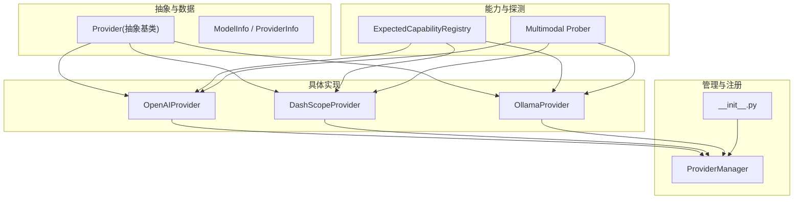
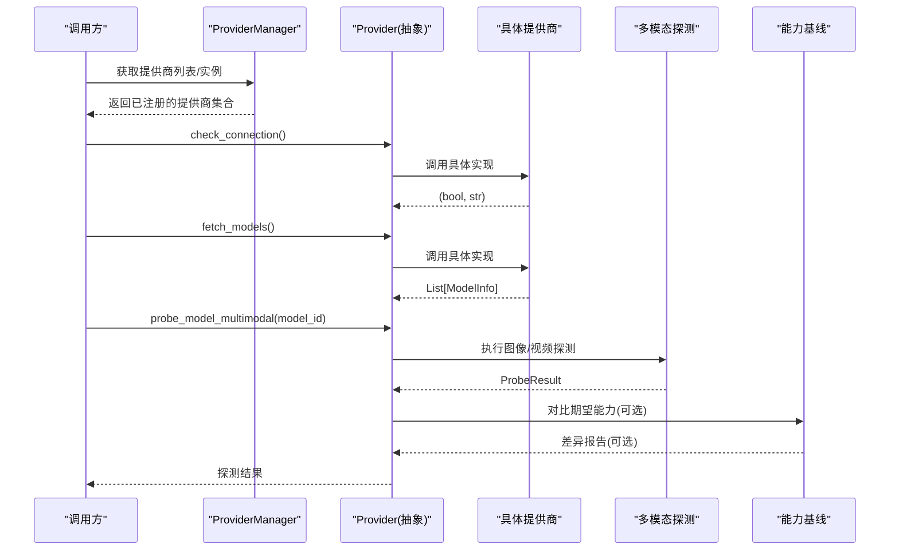
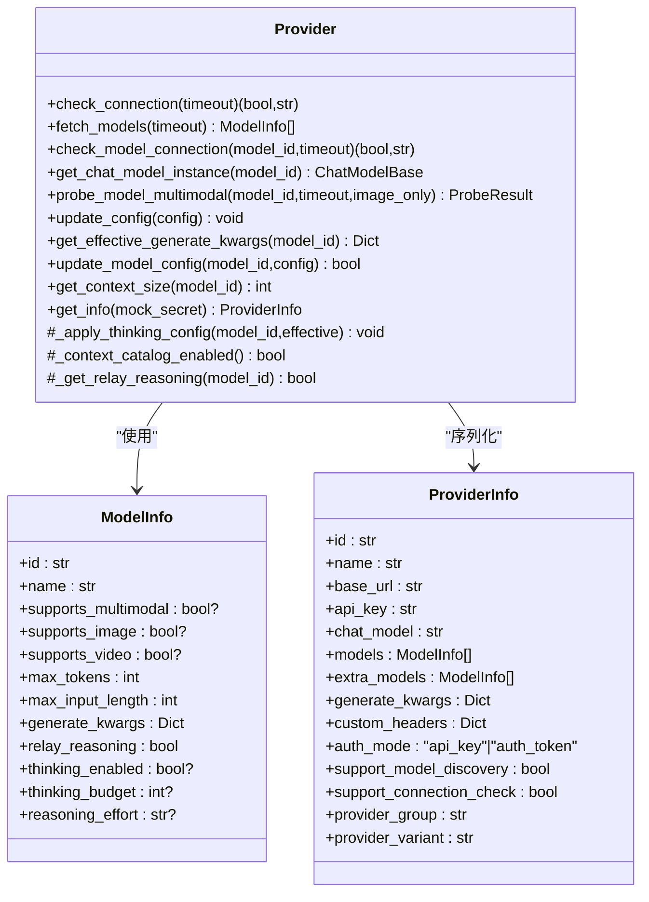
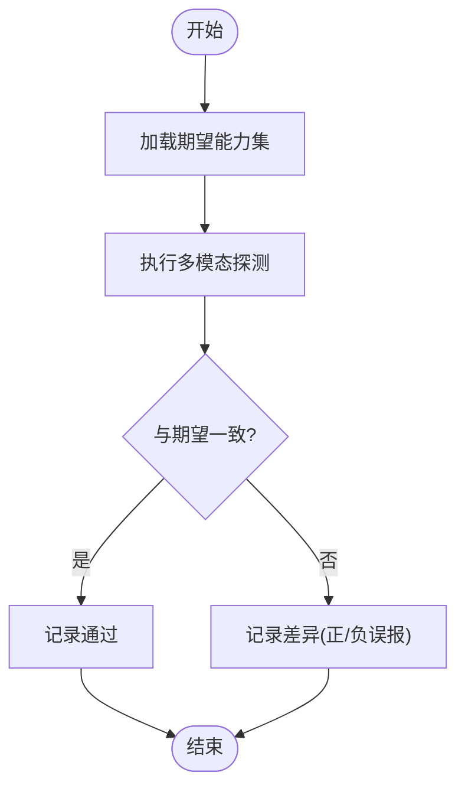
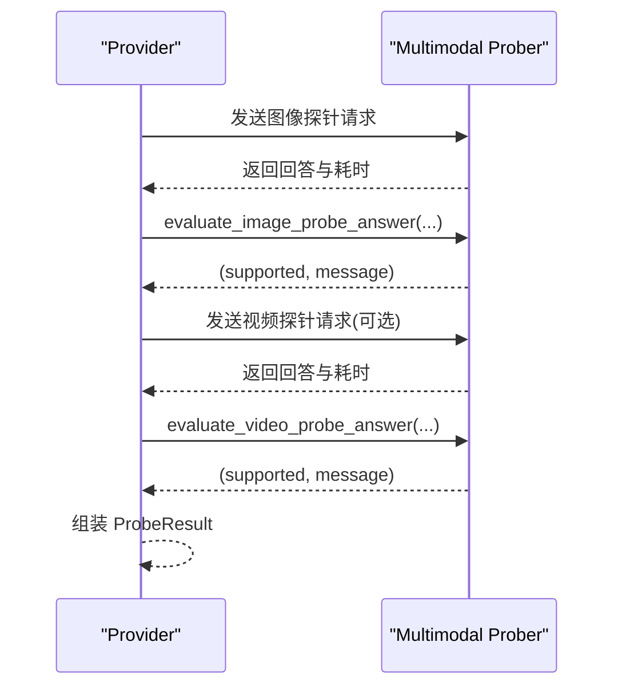
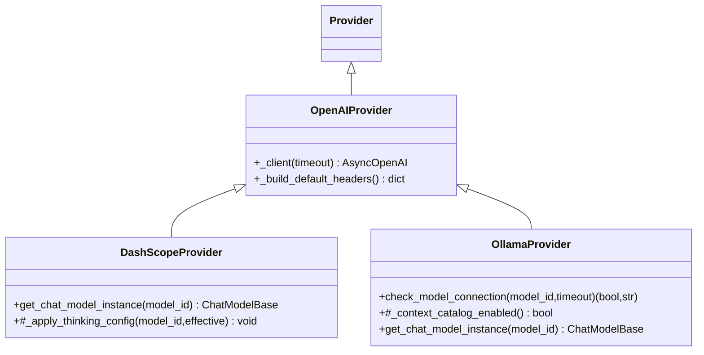
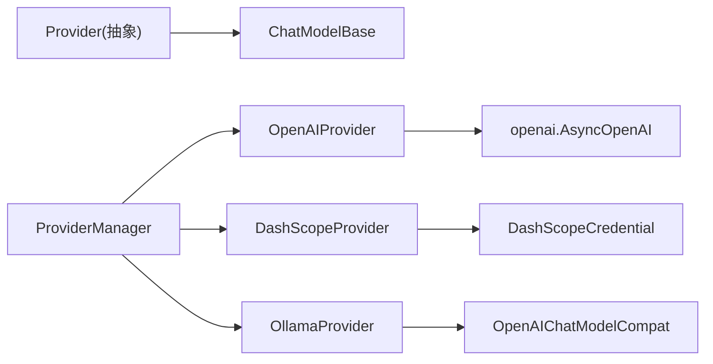

# 提供商基类设计

<cite>
**本文引用的文件**
- [provider.py](file://tongtian-tauri/src/agent/providers/provider.py)
- [provider_manager.py](file://tongtian-tauri/src/agent/providers/provider_manager.py)
- [capability_baseline.py](file://tongtian-tauri/src/agent/providers/capability_baseline.py)
- [multimodal_prober.py](file://tongtian-tauri/src/agent/providers/multimodal_prober.py)
- [openai_provider.py](file://tongtian-tauri/src/agent/providers/openai_provider.py)
- [dashscope_provider.py](file://tongtian-tauri/src/agent/providers/dashscope_provider.py)
- [ollama_provider.py](file://tongtian-tauri/src/agent/providers/ollama_provider.py)
- [__init__.py](file://tongtian-tauri/src/agent/providers/__init__.py)
</cite>

## 目录
1. [简介](#简介)
2. [项目结构](#项目结构)
3. [核心组件](#核心组件)
4. [架构总览](#架构总览)
5. [详细组件分析](#详细组件分析)
6. [依赖关系分析](#依赖关系分析)
7. [性能考量](#性能考量)
8. [故障排查指南](#故障排查指南)
9. [结论](#结论)
10. [附录](#附录)

## 简介
本文件系统性阐述“提供商基类”的设计与实现，覆盖统一接口定义、能力基线检查、配置管理、生命周期管理、抽象方法实现要求、默认行为覆盖、扩展点设计、错误处理规范。同时详细说明 ModelInfo 数据结构、能力探测接口、连接测试方法、模型列表获取，并提供继承示例、自定义提供商开发指南、最佳实践，以及提供商注册机制、动态加载与插件化架构说明。

## 项目结构
提供商子系统位于 agent/providers 目录下，采用“抽象基类 + 具体提供商实现 + 管理器 + 能力基线与探测工具”的分层组织：
- 抽象基类与数据模型：provider.py
- 提供商实例与内置清单：provider_manager.py
- 能力基线（期望能力）：capability_baseline.py
- 多模态探测工具：multimodal_prober.py
- 具体提供商实现：openai_provider.py、dashscope_provider.py、ollama_provider.py 等
- 模块导出入口：__init__.py

图表来源
- [provider.py:20-281](file://tongtian-tauri/src/agent/providers/provider.py#L20-L281)
- [provider_manager.py:915-1200](file://tongtian-tauri/src/agent/providers/provider_manager.py#L915-L1200)
- [capability_baseline.py:55-100](file://tongtian-tauri/src/agent/providers/capability_baseline.py#L55-L100)
- [multimodal_prober.py:76-88](file://tongtian-tauri/src/agent/providers/multimodal_prober.py#L76-L88)

章节来源
- [provider.py:20-281](file://tongtian-tauri/src/agent/providers/provider.py#L20-L281)
- [provider_manager.py:915-1200](file://tongtian-tauri/src/agent/providers/provider_manager.py#L915-L1200)
- [capability_baseline.py:55-100](file://tongtian-tauri/src/agent/providers/capability_baseline.py#L55-L100)
- [multimodal_prober.py:76-88](file://tongtian-tauri/src/agent/providers/multimodal_prober.py#L76-L88)

## 核心组件
- Provider 抽象基类：定义统一接口（连接检查、模型列表获取、模型连接检查、上下文窗口解析、思考参数注入、多模态探测等），提供默认行为与通用配置更新逻辑。
- ModelInfo / ExtendedModelInfo / ProviderInfo：描述模型与提供商的元数据、能力标记、生成参数、认证模式、分组与变体等。
- ExpectedCapabilityRegistry：维护各提供商模型的“期望能力”，用于对比实际探测结果，发现差异。
- Multimodal Prober：提供图像/视频探测的最小样本、评估函数与结果封装。
- 具体提供商实现：基于 OpenAIProvider/DashScopeProvider/OllamaProvider 等，复用基类能力并差异化实现关键方法。
- ProviderManager：集中注册、列举、添加/删除自定义提供商，提供统一访问入口。

章节来源
- [provider.py:20-281](file://tongtian-tauri/src/agent/providers/provider.py#L20-L281)
- [capability_baseline.py:55-100](file://tongtian-tauri/src/agent/providers/capability_baseline.py#L55-L100)
- [multimodal_prober.py:76-88](file://tongtian-tauri/src/agent/providers/multimodal_prober.py#L76-L88)
- [provider_manager.py:915-1200](file://tongtian-tauri/src/agent/providers/provider_manager.py#L915-L1200)

## 架构总览
提供商体系以抽象基类为核心，通过“声明式注册 + 可插拔实现”的方式组合：
- 抽象基类定义契约与默认行为，屏蔽底层差异。
- 具体提供商按需覆盖抽象方法与扩展点（如 _apply_thinking_config、_context_catalog_enabled）。
- 管理器负责实例化、注册与对外暴露统一 API。
- 能力基线与探测工具为“能力一致性校验”提供支撑。

图表来源
- [provider.py:284-298](file://tongtian-tauri/src/agent/providers/provider.py#L284-L298)
- [provider.py:591-612](file://tongtian-tauri/src/agent/providers/provider.py#L591-L612)
- [capability_baseline.py:55-100](file://tongtian-tauri/src/agent/providers/capability_baseline.py#L55-L100)
- [multimodal_prober.py:76-88](file://tongtian-tauri/src/agent/providers/multimodal_prober.py#L76-L88)

## 详细组件分析

### Provider 抽象基类
- 统一接口
  - check_connection(timeout): 检查提供商可达性
  - fetch_models(timeout): 获取可用模型列表
  - check_model_connection(model_id, timeout): 检查指定模型是否可用
  - get_chat_model_instance(model_id): 返回 ChatModelBase 实例
  - probe_model_multimodal(model_id, timeout, image_only): 多模态能力探测
- 配置与生命周期
  - update_config(config): 安全更新提供商配置（名称、base_url、api_key、chat_model、generate_kwargs、custom_headers、auth_mode、extra_models 等）
  - get_effective_generate_kwargs(model_id): 合并 provider 级与 model 级 generate_kwargs，注入 max_tokens
  - update_model_config(model_id, config): 更新 per-model 配置（max_tokens、max_input_length、relay_reasoning、thinking_* 等）
  - get_context_size(model_id): 解析上下文窗口大小（支持静态目录与显式配置）
  - get_info(mock_secret): 序列化提供商信息（脱敏 api_key）
- 扩展点
  - _apply_thinking_config(model_id, effective): 将 thinking/thinking_budget/reasoning_effort 映射到具体提供商参数
  - _context_catalog_enabled(): 控制是否使用静态上下文窗口目录（本地服务通常关闭）
  - _get_relay_reasoning(model_id): 控制是否回传推理内容
- 默认行为
  - add_model/delete_model: 基础模型增删
  - has_model/get_model_info: 查询模型是否存在与详情
  - probe_model_multimodal: 默认返回全 False（子类应覆盖）

图表来源
- [provider.py:20-281](file://tongtian-tauri/src/agent/providers/provider.py#L20-L281)
- [provider.py:284-612](file://tongtian-tauri/src/agent/providers/provider.py#L284-L612)

章节来源
- [provider.py:20-281](file://tongtian-tauri/src/agent/providers/provider.py#L20-L281)
- [provider.py:284-612](file://tongtian-tauri/src/agent/providers/provider.py#L284-L612)

### ModelInfo 数据结构
- 标识与名称：id、name
- 多模态能力：supports_multimodal、supports_image、supports_video、probe_source（documentation/probed）
- 生成参数：max_tokens、max_input_length、generate_kwargs
- 推理与思考：relay_reasoning、thinking_enabled、thinking_budget、reasoning_effort、thinking_param_style、thinking_budget_range、reasoning_effort_options
- 其他：is_free、pricing/input_modalities/output_modalities（ExtendedModelInfo）

用途：
- 作为模型元数据在提供商间传递
- 驱动 UI 展示与参数映射
- 作为能力基线对比的输入

章节来源
- [provider.py:20-142](file://tongtian-tauri/src/agent/providers/provider.py#L20-L142)

### 能力基线检查
- ExpectedCapabilityRegistry：按 provider_id/model_id 维护期望的多模态能力（image/video），并附带文档来源与备注
- compare_probe_result：对比实际探测结果与期望值，输出差异日志（false_positive/false_negative）
- 适用场景：
  - 新增模型时，自动比对官方文档能力与实际探测结果
  - 回归测试中，确保模型能力未退化

图表来源
- [capability_baseline.py:55-100](file://tongtian-tauri/src/agent/providers/capability_baseline.py#L55-L100)
- [capability_baseline.py:800-875](file://tongtian-tauri/src/agent/providers/capability_baseline.py#L800-L875)

章节来源
- [capability_baseline.py:55-100](file://tongtian-tauri/src/agent/providers/capability_baseline.py#L55-L100)
- [capability_baseline.py:800-875](file://tongtian-tauri/src/agent/providers/capability_baseline.py#L800-L875)

### 多模态探测接口
- ProbeResult：包含 supports_image、supports_video、image_message、video_message
- evaluate_image_probe_answer：对图像探测回答进行关键词匹配判定
- evaluate_video_probe_answer：对视频探测回答进行关键词或宽松匹配判定（HTTP URL 场景放宽）
- 共享探针素材：最小 PNG 图片与 H.264 MP4 视频（避免过小被拒绝）

图表来源
- [multimodal_prober.py:76-88](file://tongtian-tauri/src/agent/providers/multimodal_prober.py#L76-L88)
- [multimodal_prober.py:133-179](file://tongtian-tauri/src/agent/providers/multimodal_prober.py#L133-L179)
- [multimodal_prober.py:182-259](file://tongtian-tauri/src/agent/providers/multimodal_prober.py#L182-L259)

章节来源
- [multimodal_prober.py:76-88](file://tongtian-tauri/src/agent/providers/multimodal_prober.py#L76-L88)
- [multimodal_prober.py:133-179](file://tongtian-tauri/src/agent/providers/multimodal_prober.py#L133-L179)
- [multimodal_prober.py:182-259](file://tongtian-tauri/src/agent/providers/multimodal_prober.py#L182-L259)

### 连接测试与模型列表获取
- check_connection：由具体提供商实现，返回可达性与消息
- fetch_models：由具体提供商实现，返回 ModelInfo 列表
- check_model_connection：验证特定模型是否可用（例如 Ollama 通过列出模型判断）

章节来源
- [provider.py:284-298](file://tongtian-tauri/src/agent/providers/provider.py#L284-L298)
- [ollama_provider.py:56-65](file://tongtian-tauri/src/agent/providers/ollama_provider.py#L56-L65)

### 抽象方法的实现要求与默认行为覆盖
- 必须实现
  - check_connection、fetch_models、check_model_connection、get_chat_model_instance
- 推荐覆盖
  - _apply_thinking_config：将 thinking/thinking_budget/reasoning_effort 映射到具体参数
  - _context_catalog_enabled：本地服务需关闭静态目录（避免误用云端上下文窗口）
  - _get_relay_reasoning：根据提供商默认策略调整
- 默认行为
  - add_model/delete_model：基础增删
  - probe_model_multimodal：默认返回不支持（子类应覆盖）
  - get_context_size：优先显式配置 > 静态目录 > 默认值

章节来源
- [provider.py:284-612](file://tongtian-tauri/src/agent/providers/provider.py#L284-L612)

### 错误处理规范
- 统一异常：ProviderError（如找不到 chat_model 类、缺少 api_key）
- 探测失败：返回 (False, message)，并在日志中记录原因
- 非聊天模型识别：通过关键词过滤避免无效探测
- HTTP 错误提取：从响应中提取可读错误信息

章节来源
- [provider.py:393-409](file://tongtian-tauri/src/agent/providers/provider.py#L393-L409)
- [openai_provider.py:141-155](file://tongtian-tauri/src/agent/providers/openai_provider.py#L141-L155)
- [openai_provider.py:132-139](file://tongtian-tauri/src/agent/providers/openai_provider.py#L132-L139)

### 继承示例与最佳实践
- OpenAIProvider：通用 OpenAI 兼容实现，提供 _client、头部构建、媒体裁剪格式化器
- DashScopeProvider：继承 OpenAIProvider，仅覆盖 get_chat_model_instance 以使用原生 DashScopeChatModel，并实现 _apply_thinking_config 支持 effort/budget 两种风格
- OllamaProvider：继承 OpenAIProvider，重写 base_url 规范化、模型连接检查、上下文目录开关，并使用 OpenAIChatModelCompat

图表来源
- [openai_provider.py:171-199](file://tongtian-tauri/src/agent/providers/openai_provider.py#L171-L199)
- [dashscope_provider.py:34-127](file://tongtian-tauri/src/agent/providers/dashscope_provider.py#L34-L127)
- [ollama_provider.py:14-105](file://tongtian-tauri/src/agent/providers/ollama_provider.py#L14-L105)

章节来源
- [openai_provider.py:171-199](file://tongtian-tauri/src/agent/providers/openai_provider.py#L171-L199)
- [dashscope_provider.py:34-127](file://tongtian-tauri/src/agent/providers/dashscope_provider.py#L34-L127)
- [ollama_provider.py:14-105](file://tongtian-tauri/src/agent/providers/ollama_provider.py#L14-L105)

### 提供商注册机制、动态加载与插件化
- 内置注册：在 provider_manager.py 中集中创建 PROVIDER_* 实例（如 PROVIDER_OPENAI、PROVIDER_DASHSCOPE、PROVIDER_MINIMAX 等），并附带 models、group、variant、meta 等元数据
- 统一入口：__init__.py 导出 Provider、ProviderInfo、ModelInfo、ProviderManager，供上层模块使用
- 动态加载建议：
  - 通过 ProviderManager 提供 add/remove/list 接口，运行时动态注册自定义提供商
  - 结合外部配置文件或环境变量，按需导入并实例化自定义 Provider 子类
  - 使用 meta 字段承载 UI 提示、base_url 选项、免费层级等扩展信息

章节来源
- [provider_manager.py:915-1200](file://tongtian-tauri/src/agent/providers/provider_manager.py#L915-L1200)
- [__init__.py:1-13](file://tongtian-tauri/src/agent/providers/__init__.py#L1-L13)

## 依赖关系分析
- Provider 依赖 agentscope.model.ChatModelBase 与 pydantic BaseModel
- 具体提供商依赖各自 SDK（如 openai.AsyncOpenAI、agentscope.credential.DashScopeCredential）
- 能力基线与探测工具独立于具体提供商，便于复用
- ProviderManager 聚合所有内置提供商实例，向上提供统一 API

图表来源
- [provider.py:9-10](file://tongtian-tauri/src/agent/providers/provider.py#L9-L10)
- [openai_provider.py:15-18](file://tongtian-tauri/src/agent/providers/openai_provider.py#L15-L18)
- [dashscope_provider.py:18-23](file://tongtian-tauri/src/agent/providers/dashscope_provider.py#L18-L23)
- [ollama_provider.py:7-11](file://tongtian-tauri/src/agent/providers/ollama_provider.py#L7-L11)

章节来源
- [provider.py:9-10](file://tongtian-tauri/src/agent/providers/provider.py#L9-L10)
- [openai_provider.py:15-18](file://tongtian-tauri/src/agent/providers/openai_provider.py#L15-L18)
- [dashscope_provider.py:18-23](file://tongtian-tauri/src/agent/providers/dashscope_provider.py#L18-L23)
- [ollama_provider.py:7-11](file://tongtian-tauri/src/agent/providers/ollama_provider.py#L7-L11)

## 性能考量
- 上下文窗口解析：优先使用显式配置，避免误用云端目录导致压缩阈值偏差
- 多模态探测：图像/视频探针使用极小样本，减少网络与计算开销；视频探测仅在图像探测通过后执行
- 生成参数合并：deep merge 避免重复赋值，且每次返回新字典，不污染全局状态
- 媒体裁剪：限制内联媒体大小，防止历史消息膨胀导致请求过大

章节来源
- [provider.py:411-449](file://tongtian-tauri/src/agent/providers/provider.py#L411-L449)
- [multimodal_prober.py:14-73](file://tongtian-tauri/src/agent/providers/multimodal_prober.py#L14-L73)

## 故障排查指南
- 无法找到 chat_model 类：检查 Provider.chat_model 是否正确，并确保对应类存在于 agentscope.model
- 缺少 api_key：DashScopeProvider 会抛出 ProviderError，需在配置中补充
- 模型不可达：检查 base_url、api_key、网络连通性；对于 Ollama，确认模型已拉取
- 多模态探测失败：查看 ProbeResult 中的 message，确认是否为关键词匹配失败或模型不支持
- 能力不一致：使用 ExpectedCapabilityRegistry 对比期望与实际，定位差异并更新基线或修复实现

章节来源
- [provider.py:393-409](file://tongtian-tauri/src/agent/providers/provider.py#L393-L409)
- [dashscope_provider.py:128-140](file://tongtian-tauri/src/agent/providers/dashscope_provider.py#L128-L140)
- [ollama_provider.py:56-65](file://tongtian-tauri/src/agent/providers/ollama_provider.py#L56-L65)
- [multimodal_prober.py:133-179](file://tongtian-tauri/src/agent/providers/multimodal_prober.py#L133-L179)
- [capability_baseline.py:800-875](file://tongtian-tauri/src/agent/providers/capability_baseline.py#L800-L875)

## 结论
Provider 抽象基类通过统一接口、默认行为与扩展点，实现了跨提供商的一致体验与低耦合扩展。配合能力基线与多模态探测，系统可在保证功能一致性的同时，灵活适配不同提供商的差异。ProviderManager 提供了集中注册与管理入口，便于运行时动态加载与插件化扩展。遵循本文的最佳实践，可快速开发新的提供商实现并保持与现有生态的兼容性。

## 附录
- 自定义提供商开发步骤
  - 继承 Provider 或已有具体提供商（如 OpenAIProvider）
  - 实现必要抽象方法（check_connection、fetch_models、check_model_connection、get_chat_model_instance）
  - 根据需要覆盖扩展点（_apply_thinking_config、_context_catalog_enabled、_get_relay_reasoning）
  - 在 ProviderManager 中注册实例（或提供动态加载机制）
  - 编写单元测试：连接检查、模型列表、多模态探测、能力基线对比
- 接口实现最佳实践
  - 保持 generate_kwargs 合并的幂等性与不可变性
  - 合理设置超时与重试策略
  - 对敏感信息进行脱敏（get_info 中已处理）
  - 使用 ExpectedCapabilityRegistry 持续校准能力

章节来源
- [provider.py:284-612](file://tongtian-tauri/src/agent/providers/provider.py#L284-L612)
- [provider_manager.py:915-1200](file://tongtian-tauri/src/agent/providers/provider_manager.py#L915-L1200)
- [capability_baseline.py:55-100](file://tongtian-tauri/src/agent/providers/capability_baseline.py#L55-L100)