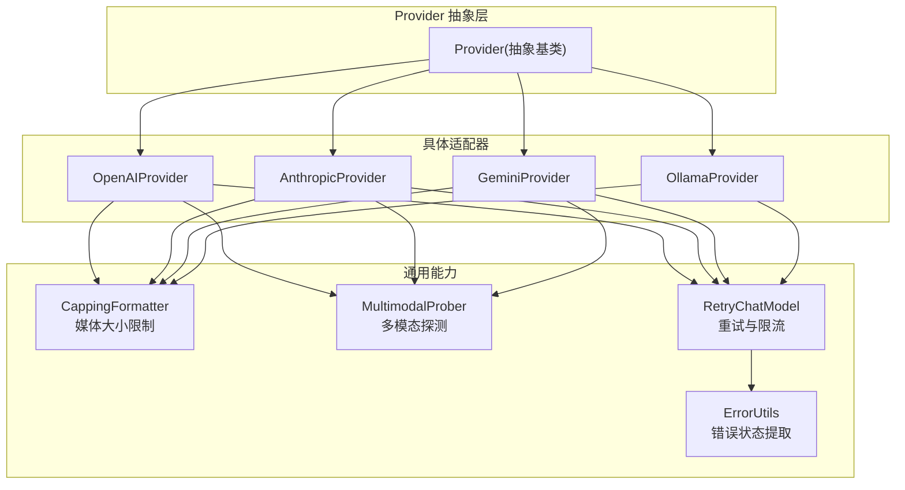
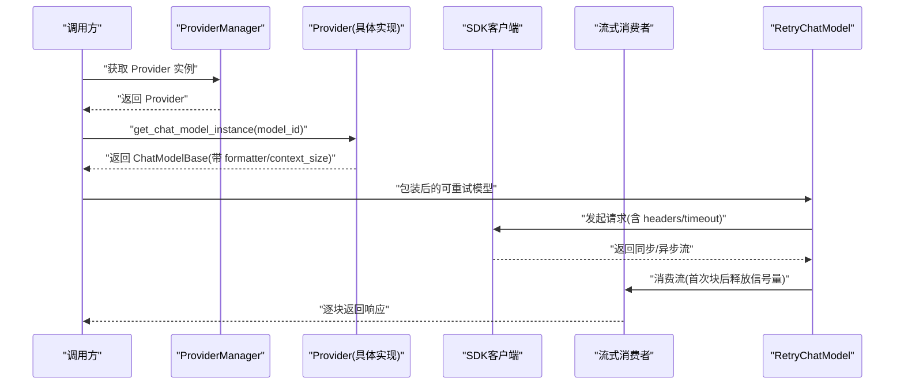
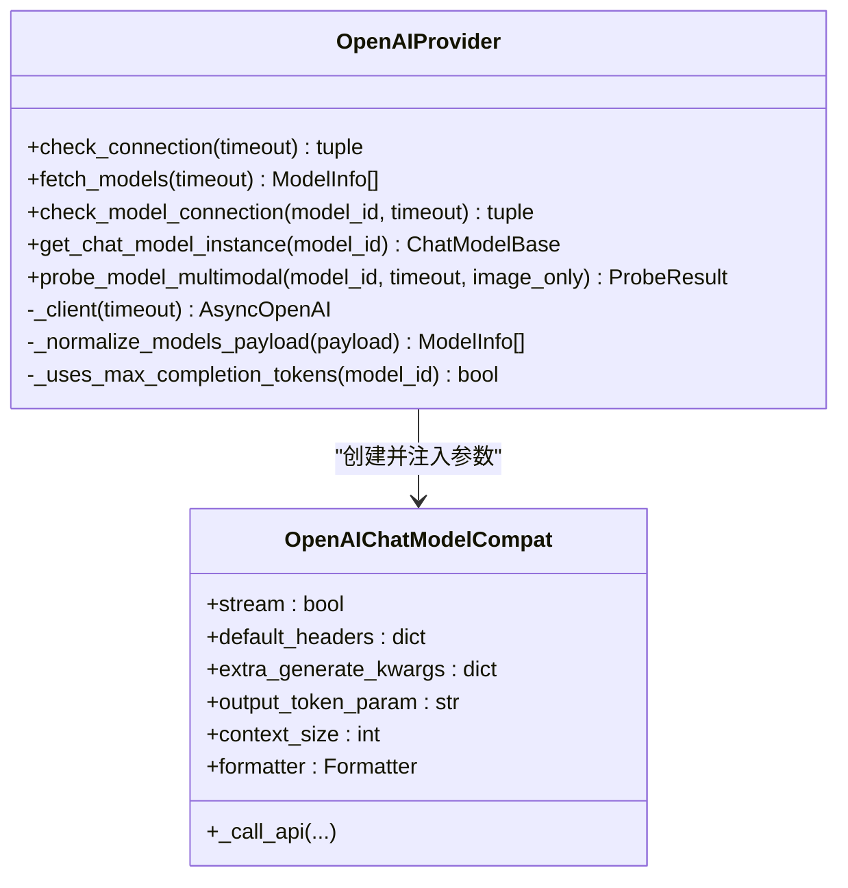
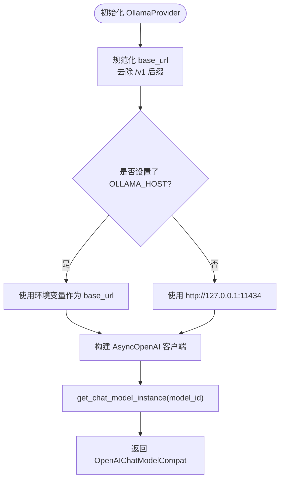
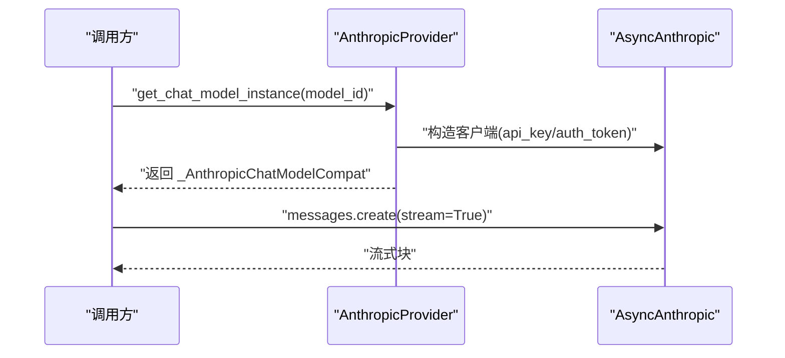
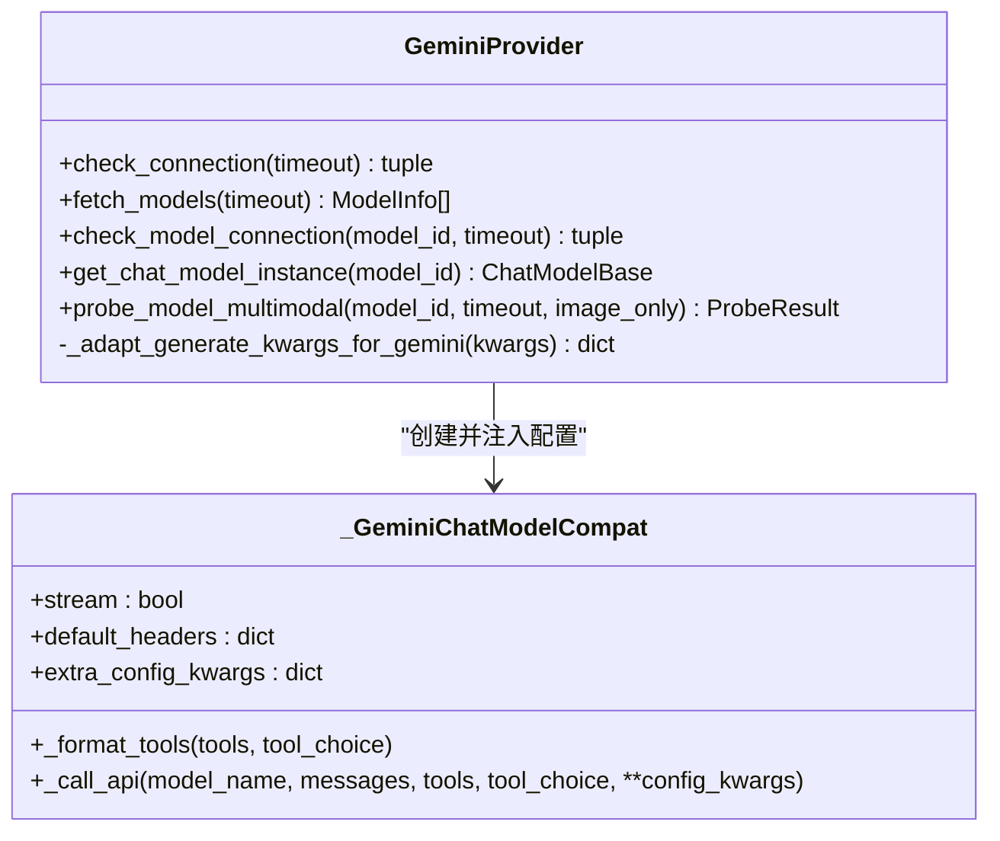
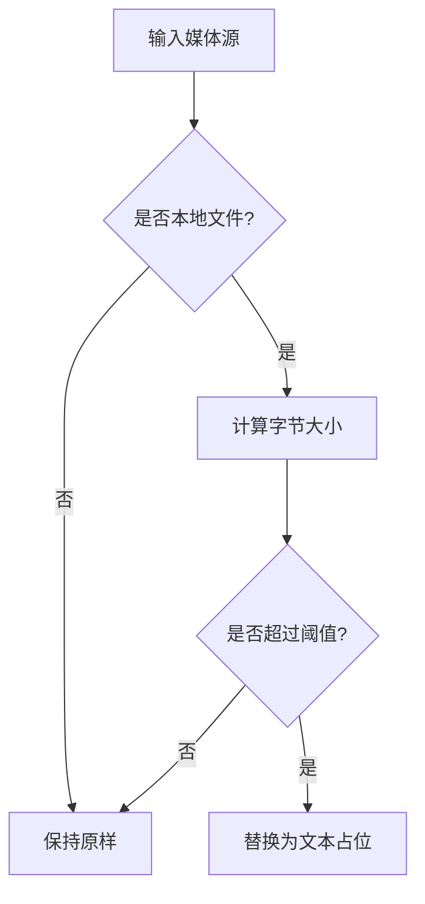
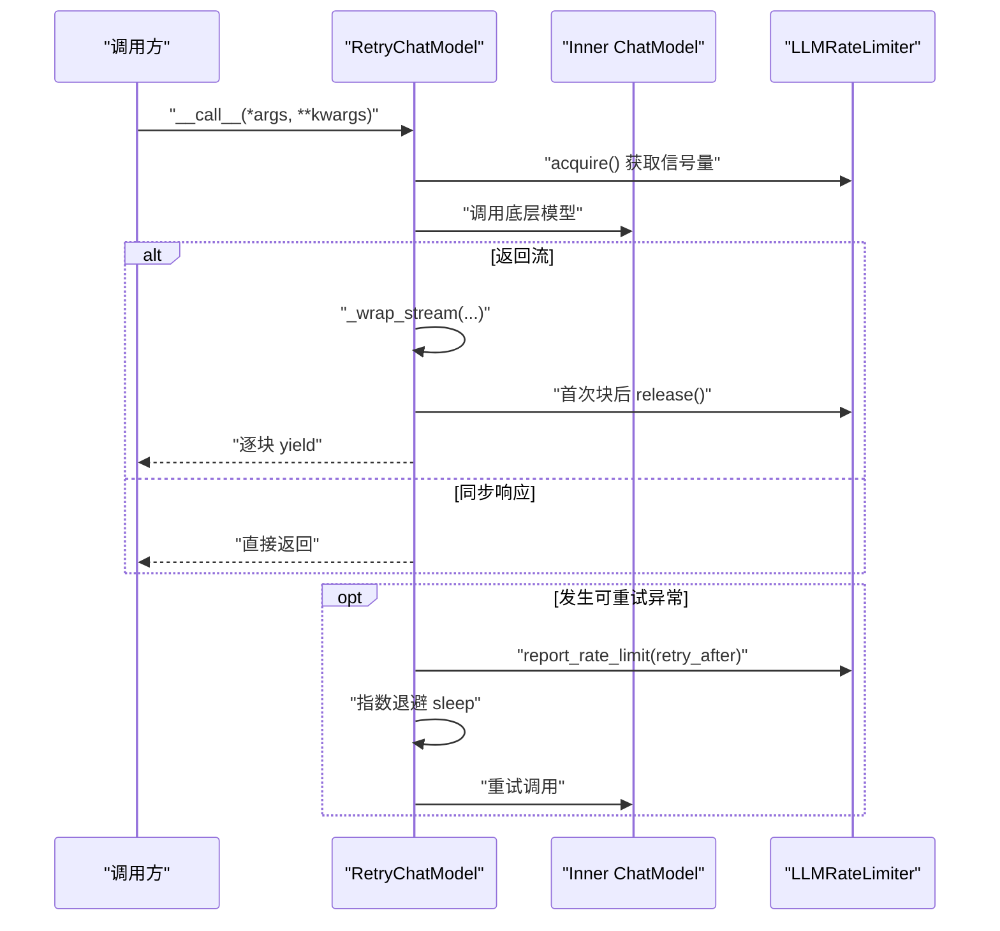
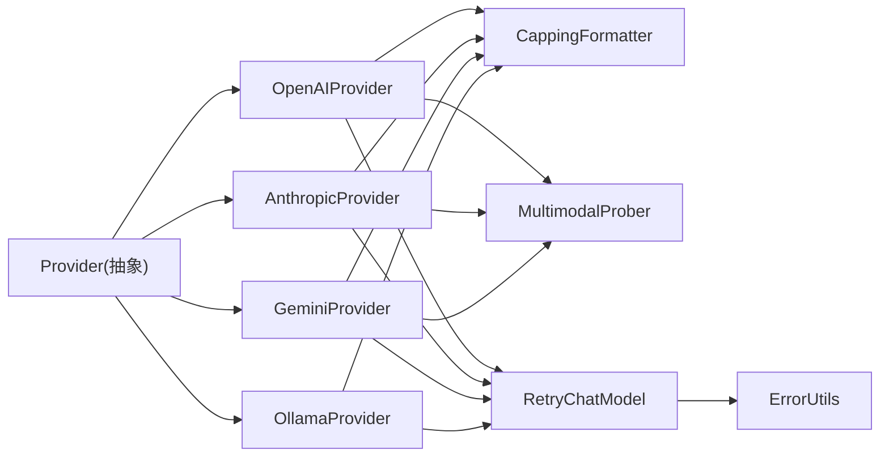

# 模型适配器

<cite>
**本文引用的文件**   
- [provider.py](file://tongtian-tauri/src/agent/providers/provider.py)
- [provider_manager.py](file://tongtian-tauri/src/agent/providers/provider_manager.py)
- [openai_provider.py](file://tongtian-tauri/src/agent/providers/openai_provider.py)
- [anthropic_provider.py](file://tongtian-tauri/src/agent/providers/anthropic_provider.py)
- [gemini_provider.py](file://tongtian-tauri/src/agent/providers/gemini_provider.py)
- [ollama_provider.py](file://tongtian-tauri/src/agent/providers/ollama_provider.py)
- [capping_formatter.py](file://tongtian-tauri/src/agent/providers/capping_formatter.py)
- [multimodal_prober.py](file://tongtian-tauri/src/agent/providers/multimodal_prober.py)
- [error_utils.py](file://tongtian-tauri/src/agent/providers/error_utils.py)
- [retry_chat_model.py](file://tongtian-tauri/src/agent/providers/retry_chat_model.py)
</cite>

## 目录
1. [简介](#简介)
2. [项目结构](#项目结构)
3. [核心组件](#核心组件)
4. [架构总览](#架构总览)
5. [详细组件分析](#详细组件分析)
6. [依赖关系分析](#依赖关系分析)
7. [性能与可靠性](#性能与可靠性)
8. [故障排查指南](#故障排查指南)
9. [结论](#结论)
10. [附录：扩展新适配器的完整指南](#附录扩展新适配器的完整指南)

## 简介
本文件系统性阐述 Model Hub 中的“适配器（Adapter）模式”实践，围绕统一接口设计、协议转换、参数映射、消息格式转换、流式响应处理、错误处理策略与超时控制展开。文档覆盖 OpenAI 适配器（支持 GPT-4o、GPT-5 等）、Ollama 本地模型适配器、Anthropic Claude 适配器、Gemini 适配器，并提供配置方法、调试技巧与常见问题解决方案，帮助读者快速理解并扩展新的提供商适配器。

## 项目结构
Model Hub 的适配器体系位于 Python 层 providers 目录下，采用“抽象基类 + 具体实现”的分层组织方式：
- 抽象基类 Provider 定义统一能力边界（连接检查、模型发现、上下文窗口、生成参数合并、多模态探测等）。
- 各 Provider 实现针对特定 API 的客户端构造、认证方式、消息格式化、流式消费与错误归一化。
- 通用能力通过独立模块提供：媒体大小限制格式化器、多模态探测工具、重试与限流包装器、错误状态提取等。

**图表来源** 
- [provider.py:281-584](file://tongtian-tauri/src/agent/providers/provider.py#L281-L584)
- [openai_provider.py:171-524](file://tongtian-tauri/src/agent/providers/openai_provider.py#L171-L524)
- [anthropic_provider.py:75-305](file://tongtian-tauri/src/agent/providers/anthropic_provider.py#L75-L305)
- [gemini_provider.py:165-338](file://tongtian-tauri/src/agent/providers/gemini_provider.py#L165-L338)
- [ollama_provider.py:14-105](file://tongtian-tauri/src/agent/providers/ollama_provider.py#L14-L105)
- [capping_formatter.py:182-292](file://tongtian-tauri/src/agent/providers/capping_formatter.py#L182-L292)
- [multimodal_prober.py:76-110](file://tongtian-tauri/src/agent/providers/multimodal_prober.py#L76-L110)
- [retry_chat_model.py:285-525](file://tongtian-tauri/src/agent/providers/retry_chat_model.py#L285-L525)
- [error_utils.py:20-54](file://tongtian-tauri/src/agent/providers/error_utils.py#L20-L54)

**章节来源**
- [provider.py:281-584](file://tongtian-tauri/src/agent/providers/provider.py#L281-L584)
- [provider_manager.py:1-120](file://tongtian-tauri/src/agent/providers/provider_manager.py#L1-L120)

## 核心组件
- Provider 抽象基类
  - 统一接口：check_connection、fetch_models、check_model_connection、get_chat_model_instance、probe_model_multimodal。
  - 模型信息：ModelInfo/ExtendedModelInfo/ProviderInfo 描述模型能力、上下文窗口、生成参数、思考模式开关等。
  - 参数合并：get_effective_generate_kwargs 将 provider 级与 model 级 generate_kwargs 深度合并，注入 max_tokens。
  - 上下文窗口：resolve_context_window 结合显式配置、静态目录与默认值，确保压缩触发与展示一致。
  - 思考模式：_apply_thinking_config 由子类按提供商语义注入 thinking/thinking_budget/reasoning_effort 等字段。

- 具体 Provider 实现
  - OpenAIProvider：兼容 OpenAI/DashScope/Azure/OpenRouter 等；根据模型族选择 max_tokens 或 max_completion_tokens；非聊天模型走零成本校验端点；支持图片/视频探测。
  - AnthropicProvider：支持 api_key 与 auth_token 两种认证；messages.create 流式 ping；图片/视频探测；thinking 预算自动扩容。
  - GeminiProvider：使用 google-genai SDK；JSON Schema 扁平化与清洗；max_output_tokens 映射；thinking_config 注入。
  - OllamaProvider：继承 OpenAIProvider，规范化 base_url，禁用静态上下文目录，使用 OpenAI 兼容端点。

- 通用能力
  - CappingFormatter：对本地媒体进行大小限制，超过阈值替换为文本占位，避免请求体膨胀。
  - MultimodalProber：统一的图片/视频探测常量与评估逻辑，减少误判。
  - RetryChatModel：透明重试包装器，指数退避、并发信号量、429 协调暂停、流式失败重试。
  - ErrorUtils：跨 SDK 的 HTTP 状态码提取，便于统一错误分类。

**章节来源**
- [provider.py:20-121](file://tongtian-tauri/src/agent/providers/provider.py#L20-L121)
- [provider.py:144-279](file://tongtian-tauri/src/agent/providers/provider.py#L144-L279)
- [provider.py:429-449](file://tongtian-tauri/src/agent/providers/provider.py#L429-L449)
- [provider.py:556-584](file://tongtian-tauri/src/agent/providers/provider.py#L556-L584)
- [capping_formatter.py:51-162](file://tongtian-tauri/src/agent/providers/capping_formatter.py#L51-L162)
- [multimodal_prober.py:76-110](file://tongtian-tauri/src/agent/providers/multimodal_prober.py#L76-L110)
- [retry_chat_model.py:285-525](file://tongtian-tauri/src/agent/providers/retry_chat_model.py#L285-L525)
- [error_utils.py:20-54](file://tongtian-tauri/src/agent/providers/error_utils.py#L20-L54)

## 架构总览
下图展示了从上层调用到具体 Provider 的调用链路与关键能力模块的协作关系。

**图表来源** 
- [provider.py:586-589](file://tongtian-tauri/src/agent/providers/provider.py#L586-L589)
- [openai_provider.py:464-524](file://tongtian-tauri/src/agent/providers/openai_provider.py#L464-L524)
- [anthropic_provider.py:252-305](file://tongtian-tauri/src/agent/providers/anthropic_provider.py#L252-L305)
- [gemini_provider.py:306-338](file://tongtian-tauri/src/agent/providers/gemini_provider.py#L306-L338)
- [retry_chat_model.py:408-525](file://tongtian-tauri/src/agent/providers/retry_chat_model.py#L408-L525)

## 详细组件分析

### OpenAI 适配器（支持 GPT-4o、GPT-5 等）
- 统一接口与客户端构造
  - _client 构建 AsyncOpenAI，支持自定义 headers、base_url、timeout。
  - get_chat_model_instance 组装 OpenAIChatModelCompat，注入 default_headers、extra_generate_kwargs、output_token_param、context_size、formatter。
- 参数映射
  - 根据模型族决定使用 max_tokens 或 max_completion_tokens（gpt-5、o* 系列）。
  - 合并 provider/model 级 generate_kwargs，注入 temperature/top_p/max_tokens。
- 连接与模型可用性检查
  - check_connection 调用 models.list。
  - check_model_connection 对聊天模型发送最小流式 ping；对非聊天模型使用零成本端点（DashScope upload-policy、Ark task-list）。
- 多模态探测
  - 图片：发送内联 PNG 并语义判断主色；视频：尝试 base64 与 URL 两种格式，失败回退。
- 错误处理
  - 区分 400/408/429/5xx 等状态，解析错误详情，避免误报。

**图表来源** 
- [openai_provider.py:171-524](file://tongtian-tauri/src/agent/providers/openai_provider.py#L171-L524)

**章节来源**
- [openai_provider.py:171-524](file://tongtian-tauri/src/agent/providers/openai_provider.py#L171-L524)
- [openai_provider.py:222-322](file://tongtian-tauri/src/agent/providers/openai_provider.py#L222-L322)
- [openai_provider.py:526-800](file://tongtian-tauri/src/agent/providers/openai_provider.py#L526-L800)

### Ollama 本地模型适配器
- 基于 OpenAIProvider 继承，规范化 base_url（去除尾随 /v1），默认 host 来自环境变量或 127.0.0.1:11434。
- 禁用静态上下文目录（_context_catalog_enabled=False），避免云侧上下文窗口误导本地服务截断。
- check_model_connection 通过 fetch_models 列表匹配判定模型存在性。
- get_chat_model_instance 复用 OpenAI 兼容路径，设置 credential/base_url/stream/formatter。

**图表来源** 
- [ollama_provider.py:14-105](file://tongtian-tauri/src/agent/providers/ollama_provider.py#L14-L105)

**章节来源**
- [ollama_provider.py:14-105](file://tongtian-tauri/src/agent/providers/ollama_provider.py#L14-L105)

### Anthropic Claude 适配器
- 认证模式
  - 支持 api_key 与 auth_token；当使用 auth_token 时，通过自定义 Transport 移除 x-api-key 头，避免代理拒绝双头。
- 连接与模型检查
  - check_connection 优先 models.list，若端点不支持则回退 messages.create 轻量探测。
  - check_model_connection 发送最小流式 ping，消费首个块确认可用。
- 参数映射与思考模式
  - 将 thinking_enable/thinking_budget 映射到 parameters；必要时自动扩容 max_tokens。
- 多模态探测
  - 图片：发送 base64 PNG 并语义判断主色；视频：先 base64 再 URL 回退。

**图表来源** 
- [anthropic_provider.py:75-305](file://tongtian-tauri/src/agent/providers/anthropic_provider.py#L75-L305)
- [anthropic_provider.py:582-702](file://tongtian-tauri/src/agent/providers/anthropic_provider.py#L582-L702)

**章节来源**
- [anthropic_provider.py:75-305](file://tongtian-tauri/src/agent/providers/anthropic_provider.py#L75-L305)
- [anthropic_provider.py:307-579](file://tongtian-tauri/src/agent/providers/anthropic_provider.py#L307-L579)
- [anthropic_provider.py:582-702](file://tongtian-tauri/src/agent/providers/anthropic_provider.py#L582-L702)

### Gemini 适配器
- 客户端与配置
  - 使用 google-genai.Client，支持 HttpOptions 注入 headers/timeout。
  - JSON Schema 扁平化与清洗，移除 $defs/$ref/additionalProperties/null 等不兼容项。
- 参数映射
  - max_tokens -> max_output_tokens；temperature/top_p 透传；thinking_config.include_thoughts/budget。
- 连接与模型检查
  - check_connection 使用 aio.models.list；check_model_connection 使用 generate_content_stream 最小 ping。
- 多模态探测
  - 图片：inline_data Blob；视频：file_data URL。

**图表来源** 
- [gemini_provider.py:165-338](file://tongtian-tauri/src/agent/providers/gemini_provider.py#L165-L338)
- [gemini_provider.py:517-637](file://tongtian-tauri/src/agent/providers/gemini_provider.py#L517-L637)

**章节来源**
- [gemini_provider.py:165-338](file://tongtian-tauri/src/agent/providers/gemini_provider.py#L165-L338)
- [gemini_provider.py:340-515](file://tongtian-tauri/src/agent/providers/gemini_provider.py#L340-L515)
- [gemini_provider.py:517-637](file://tongtian-tauri/src/agent/providers/gemini_provider.py#L517-L637)

### 媒体大小限制格式化器（CappingFormatter）
- 目标：防止本地大媒体（如生成的视频）被 base64 内联导致请求体过大。
- 机制：在格式化阶段检测本地 URLSource/Base64Source 的大小，超过阈值替换为文本占位。
- 适配：OpenAI/Anthropic/Gemini/DashScope/Responses 各自覆盖 _placeholder 以匹配 wire format。

**图表来源** 
- [capping_formatter.py:51-162](file://tongtian-tauri/src/agent/providers/capping_formatter.py#L51-L162)
- [capping_formatter.py:182-292](file://tongtian-tauri/src/agent/providers/capping_formatter.py#L182-L292)

**章节来源**
- [capping_formatter.py:51-162](file://tongtian-tauri/src/agent/providers/capping_formatter.py#L51-L162)
- [capping_formatter.py:182-292](file://tongtian-tauri/src/agent/providers/capping_formatter.py#L182-L292)

### 多模态探测（MultimodalProber）
- 统一常量：小尺寸 PNG/MP4 用于探测，HTTP URL 用于部分提供商。
- 评估逻辑：颜色关键词匹配（红/蓝家族），支持 reasoning/thinking 字段辅助判断。
- 结果：ProbeResult 包含 supports_image/supports_video 及诊断消息。

**章节来源**
- [multimodal_prober.py:76-110](file://tongtian-tauri/src/agent/providers/multimodal_prober.py#L76-L110)
- [multimodal_prober.py:133-260](file://tongtian-tauri/src/agent/providers/multimodal_prober.py#L133-L260)

### 重试与限流（RetryChatModel）
- 功能：对 ChatModelBase 透明包装，支持指数退避、并发信号量、429 协调暂停、流式失败重试。
- 关键点：
  - 首次块到达后释放信号量，避免长时间占用。
  - 对缺失 reasoning_content 的错误自动注入空值并缓存学习。
  - 支持 Retry-After 头部解析与最大暂停上限。

**图表来源** 
- [retry_chat_model.py:285-525](file://tongtian-tauri/src/agent/providers/retry_chat_model.py#L285-L525)
- [retry_chat_model.py:528-638](file://tongtian-tauri/src/agent/providers/retry_chat_model.py#L528-L638)

**章节来源**
- [retry_chat_model.py:285-525](file://tongtian-tauri/src/agent/providers/retry_chat_model.py#L285-L525)
- [retry_chat_model.py:528-638](file://tongtian-tauri/src/agent/providers/retry_chat_model.py#L528-L638)

## 依赖关系分析
- Provider 抽象层与各具体实现之间松耦合，通过统一接口解耦上游调用。
- 各 Provider 共享 CappingFormatter/MultimodalProber 能力，降低重复实现。
- RetryChatModel 作为横切关注点，对所有 Provider 的 ChatModelBase 透明增强。
- error_utils 提供跨 SDK 的状态码提取，提升错误处理一致性。

**图表来源** 
- [provider.py:281-584](file://tongtian-tauri/src/agent/providers/provider.py#L281-L584)
- [openai_provider.py:171-524](file://tongtian-tauri/src/agent/providers/openai_provider.py#L171-L524)
- [anthropic_provider.py:75-305](file://tongtian-tauri/src/agent/providers/anthropic_provider.py#L75-L305)
- [gemini_provider.py:165-338](file://tongtian-tauri/src/agent/providers/gemini_provider.py#L165-L338)
- [ollama_provider.py:14-105](file://tongtian-tauri/src/agent/providers/ollama_provider.py#L14-L105)
- [capping_formatter.py:182-292](file://tongtian-tauri/src/agent/providers/capping_formatter.py#L182-L292)
- [multimodal_prober.py:76-110](file://tongtian-tauri/src/agent/providers/multimodal_prober.py#L76-L110)
- [retry_chat_model.py:285-525](file://tongtian-tauri/src/agent/providers/retry_chat_model.py#L285-L525)
- [error_utils.py:20-54](file://tongtian-tauri/src/agent/providers/error_utils.py#L20-L54)

**章节来源**
- [provider.py:281-584](file://tongtian-tauri/src/agent/providers/provider.py#L281-L584)
- [provider_manager.py:1-120](file://tongtian-tauri/src/agent/providers/provider_manager.py#L1-L120)

## 性能与可靠性
- 并发与限流
  - 全局 LLMRateLimiter 控制并发与 QPM，遇到 429 协调所有调用者统一暂停，避免惊群效应。
- 超时控制
  - 每个 Provider 的 _client 均设置 timeout；流式消费在首次块后释放信号量，缩短资源占用时间。
- 重试策略
  - 指数退避 + 最大重试次数；对缺失 reasoning_content 的错误自动注入并缓存学习，减少后续失败。
- 媒体大小限制
  - 本地媒体超过阈值替换为文本占位，避免请求体过大导致连接中断。

[本节为通用指导，无需引用具体文件]

## 故障排查指南
- 连接失败
  - 检查 base_url/api_key/auth_mode；OpenAI 使用 models.list，Anthropic 支持回退 messages.create。
- 模型不可用
  - OpenAI：非聊天模型走零成本端点校验；Anthropic/Gemini：最小流式 ping。
- 多模态误判
  - 查看 ProbeResult 的诊断消息；确认图片/视频探针是否成功；注意某些模型会静默接受媒体但不处理。
- 速率限制
  - 观察 Retry-After 头部与 429 状态；RetryChatModel 已内置协调暂停与抖动。
- 媒体过大
  - 调整 capping formatter 的 max_bytes；确认本地路径解析是否正确。

**章节来源**
- [openai_provider.py:222-322](file://tongtian-tauri/src/agent/providers/openai_provider.py#L222-L322)
- [anthropic_provider.py:152-203](file://tongtian-tauri/src/agent/providers/anthropic_provider.py#L152-L203)
- [gemini_provider.py:225-287](file://tongtian-tauri/src/agent/providers/gemini_provider.py#L225-L287)
- [retry_chat_model.py:334-357](file://tongtian-tauri/src/agent/providers/retry_chat_model.py#L334-L357)
- [capping_formatter.py:51-162](file://tongtian-tauri/src/agent/providers/capping_formatter.py#L51-L162)

## 结论
Model Hub 通过 Provider 抽象与具体实现分离，实现了统一的模型接入与协议转换。OpenAI/Ollama/Anthropic/Gemini 适配器在消息格式、参数映射、流式处理、错误处理与超时控制上保持一致性与可扩展性。CappingFormatter 与 MultimodalProber 提供了通用的媒体与多模态能力，RetryChatModel 增强了可靠性与稳定性。该架构便于快速扩展新的提供商适配器，同时保证系统的一致性与健壮性。

[本节为总结，无需引用具体文件]

## 附录：扩展新适配器的完整指南
- 步骤概览
  1. 新建 Provider 类继承自 Provider，实现必要抽象方法：check_connection、fetch_models、check_model_connection、get_chat_model_instance、probe_model_multimodal。
  2. 在 get_chat_model_instance 中构造对应 ChatModelBase，注入 default_headers、extra_generate_kwargs、context_size、formatter。
  3. 如需特殊认证（如 auth_token），参考 AnthropicProvider 的 _StripApiKeyTransport。
  4. 实现多模态探测：图片/视频探针，使用 MultimodalProber 的评估函数。
  5. 注册到 ProviderManager 的内置提供者列表或用户自定义列表。
  6. 测试连接与模型可用性，验证流式响应与错误处理。

- 配置要点
  - ProviderInfo：id/name/base_url/api_key/chat_model/models/generate_kwargs/custom_headers/auth_mode 等。
  - ModelInfo：id/name/supports_*_modalities/max_tokens/max_input_length/thinking_enabled/thinking_budget/reasoning_effort 等。
  - 上下文窗口：通过 resolve_context_window 管理，本地服务建议禁用静态目录。

- 调试技巧
  - 启用日志输出，观察 probe 与错误详情。
  - 使用最小请求（ping）验证连通性。
  - 调整 capping formatter 的 max_bytes 避免媒体过大。
  - 检查 Retry-After 与 429 状态，确认限流策略生效。

- 常见问题
  - 认证失败：确认 api_key/auth_token 与 auth_mode 匹配。
  - 模型不存在：核对模型 ID 与提供商命名规范。
  - 媒体不被识别：检查探针提示词与评估逻辑。
  - 流式中断：确认首次块到达后信号量释放与重试逻辑。

**章节来源**
- [provider.py:281-584](file://tongtian-tauri/src/agent/providers/provider.py#L281-L584)
- [provider_manager.py:1-120](file://tongtian-tauri/src/agent/providers/provider_manager.py#L1-L120)
- [anthropic_provider.py:75-305](file://tongtian-tauri/src/agent/providers/anthropic_provider.py#L75-L305)
- [capping_formatter.py:182-292](file://tongtian-tauri/src/agent/providers/capping_formatter.py#L182-L292)
- [multimodal_prober.py:76-110](file://tongtian-tauri/src/agent/providers/multimodal_prober.py#L76-L110)
- [retry_chat_model.py:285-525](file://tongtian-tauri/src/agent/providers/retry_chat_model.py#L285-L525)