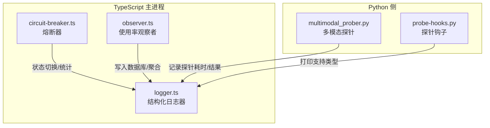
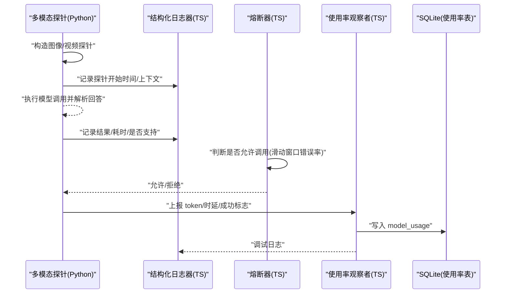
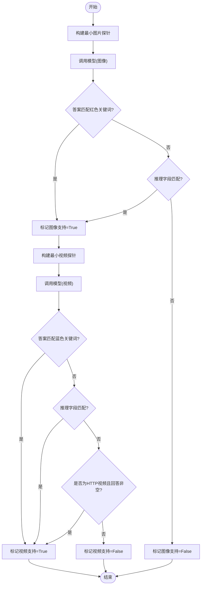
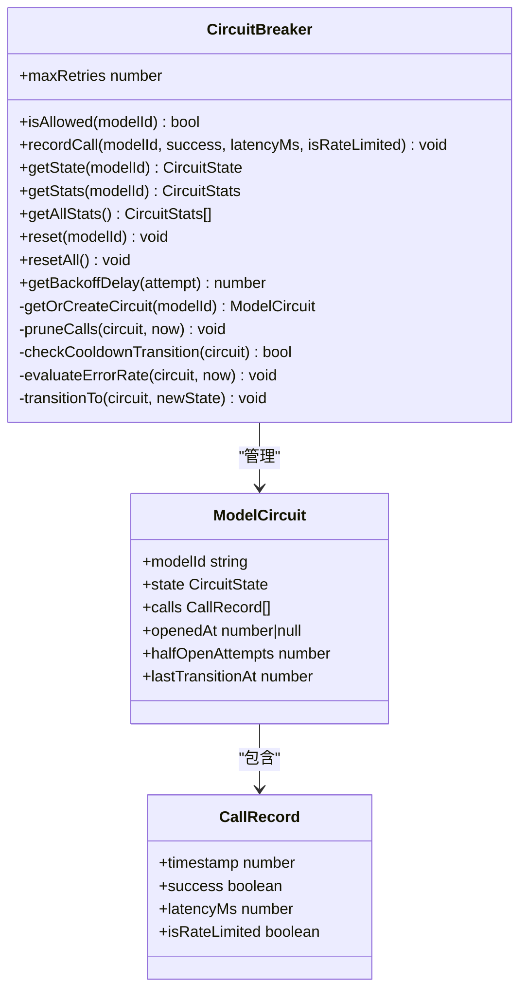
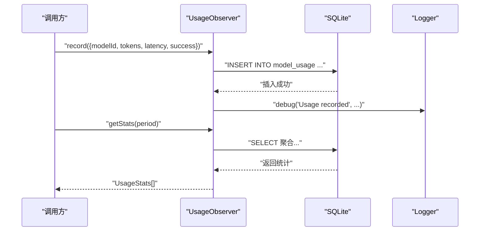
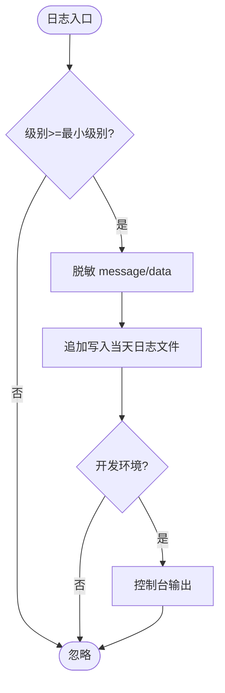
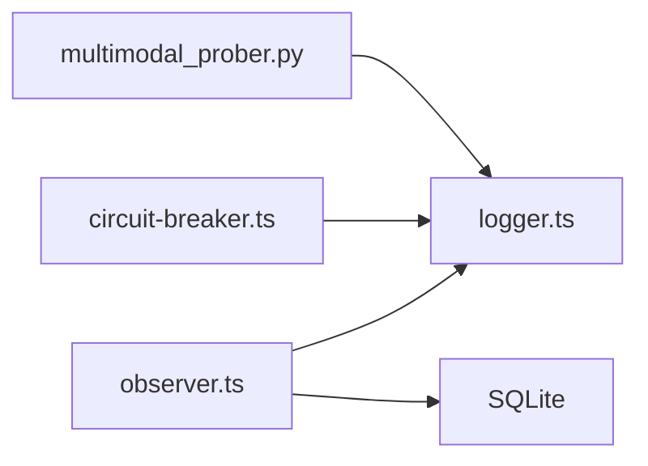

# 监控与可观测性

<cite>
**本文引用的文件**   
- [multimodal_prober.py](file://tongtian-tauri/src/agent/providers/multimodal_prober.py)
- [circuit-breaker.ts](file://tongtian-tauri/src/main/model/circuit-breaker.ts)
- [logger.ts](file://tongtian-tauri/src/main/util/logger.ts)
- [observer.ts](file://tongtian-tauri/src/main/model/observer.ts)
- [probe-hooks.py](file://.tools/probe-hooks.py)
</cite>

## 目录
1. [引言](#引言)
2. [项目结构](#项目结构)
3. [核心组件](#核心组件)
4. [架构总览](#架构总览)
5. [详细组件分析](#详细组件分析)
6. [依赖关系分析](#依赖关系分析)
7. [性能考量](#性能考量)
8. [故障排查指南](#故障排查指南)
9. [结论](#结论)
10. [附录](#附录)

## 引言
本文件面向“通天办公”项目的监控与可观测性实现，聚焦以下目标：
- 模型健康检查与能力探测：通过多模态探针验证图像/视频能力，结合连通性与延迟评估。
- 错误诊断与分类：基于日志与探针结果进行问题定位，提供重试与熔断策略。
- 指标收集与日志规范：统一记录调用量、时延、成功率、成本估算等关键指标，并规范化敏感信息脱敏。
- 告警与面板：给出可落地的指标口径与可视化建议。
- 运维实践：覆盖常见故障的排查流程、恢复策略与最佳实践。

## 项目结构
本项目在前后端与工具脚本中实现了完整的可观测性闭环：
- Python 侧（Agent 层）：多模态探针用于能力探测与连通性测试，输出结构化日志。
- TypeScript 侧（主进程）：熔断器模式保护下游服务，使用率观察者持久化指标，结构化日志器负责安全写入。
- 工具脚本：探针钩子用于辅助探测 Agent 能力支持情况。

**图表来源** 
- [multimodal_prober.py:1-260](file://tongtian-tauri/src/agent/providers/multimodal_prober.py#L1-L260)
- [circuit-breaker.ts:1-346](file://tongtian-tauri/src/main/model/circuit-breaker.ts#L1-L346)
- [observer.ts:1-260](file://tongtian-tauri/src/main/model/observer.ts#L1-L260)
- [logger.ts:1-230](file://tongtian-tauri/src/main/util/logger.ts#L1-L230)
- [probe-hooks.py:1-6](file://.tools/probe-hooks.py#L1-L6)

**章节来源**
- [multimodal_prober.py:1-260](file://tongtian-tauri/src/agent/providers/multimodal_prober.py#L1-L260)
- [circuit-breaker.ts:1-346](file://tongtian-tauri/src/main/model/circuit-breaker.ts#L1-L346)
- [observer.ts:1-260](file://tongtian-tauri/src/main/model/observer.ts#L1-L260)
- [logger.ts:1-230](file://tongtian-tauri/src/main/util/logger.ts#L1-L230)
- [probe-hooks.py:1-6](file://.tools/probe-hooks.py#L1-L6)

## 核心组件
- 多模态探针（Python）：构造最小图片/视频样本，驱动模型返回颜色关键词以判定是否具备图像/视频理解能力；同时记录耗时与结果，便于连通性与延迟评估。
- 熔断器（TypeScript）：按模型维度维护滑动窗口内的调用记录，计算错误率，自动在 CLOSED/OPEN/HALF_OPEN 三态间切换，并提供指数退避重试。
- 使用率观察者（TypeScript）：记录每次调用的 token 用量、时延、成功与否，并按日/周/月聚合统计，估算成本。
- 结构化日志器（TypeScript）：统一输出 JSON 日志，内置敏感信息脱敏、日志轮转清理、开发/生产环境差异化输出。

**章节来源**
- [multimodal_prober.py:1-260](file://tongtian-tauri/src/agent/providers/multimodal_prober.py#L1-L260)
- [circuit-breaker.ts:1-346](file://tongtian-tauri/src/main/model/circuit-breaker.ts#L1-L346)
- [observer.ts:1-260](file://tongtian-tauri/src/main/model/observer.ts#L1-L260)
- [logger.ts:1-230](file://tongtian-tauri/src/main/util/logger.ts#L1-L230)

## 架构总览
下图展示了从探针到指标落库与日志输出的整体链路，以及熔断器对请求的保护作用。

**图表来源** 
- [multimodal_prober.py:1-260](file://tongtian-tauri/src/agent/providers/multimodal_prober.py#L1-L260)
- [circuit-breaker.ts:1-346](file://tongtian-tauri/src/main/model/circuit-breaker.ts#L1-L346)
- [observer.ts:1-260](file://tongtian-tauri/src/main/model/observer.ts#L1-L260)
- [logger.ts:1-230](file://tongtian-tauri/src/main/util/logger.ts#L1-L230)

## 详细组件分析

### 多模态探针（能力探测与连通性）
- 工作原理
  - 使用极小图片（32x32 红色 PNG）与极小视频（H.264 MP4）作为探针载荷，避免被某些后端因尺寸或格式拒绝。
  - 通过固定提示词要求模型返回单一主导颜色，匹配红/蓝色词汇集合判定是否支持图像/视频。
  - 对于 HTTP 视频场景，放宽校验：只要非空回答即视为支持（前置已通过图像探针过滤纯文本模型）。
- 连通性与延迟
  - 探针记录 start_time，并在 evaluate_* 函数中计算 elapsed，输出带耗时信息的日志，便于连通性与延迟监控。
- 错误分类
  - 通过 _is_media_keyword_error 识别与媒体相关的异常关键词，辅助区分“不支持媒体”与“网络/鉴权错误”。
- 输出与集成
  - 探针结果包含 supports_image/supports_video 及消息字段，供上层决策是否启用多模态能力。

**图表来源** 
- [multimodal_prober.py:105-180](file://tongtian-tauri/src/agent/providers/multimodal_prober.py#L105-L180)
- [multimodal_prober.py:182-260](file://tongtian-tauri/src/agent/providers/multimodal_prober.py#L182-L260)

**章节来源**
- [multimodal_prober.py:1-260](file://tongtian-tauri/src/agent/providers/multimodal_prober.py#L1-L260)

### 熔断器（错误处理与重试）
- 状态机
  - CLOSED：正常放行，滑动窗口内累计调用，计算错误率。
  - OPEN：达到阈值后进入冷却期，拒绝新请求。
  - HALF_OPEN：冷却期后允许一次探测请求，成功则回到 CLOSED，失败则重回 OPEN。
- 配置要点
  - 滑动窗口：5 分钟
  - 错误率阈值：15%
  - 冷却期：3 分钟
  - 指数退避：1s→2s→4s→8s，最多 4 次重试
- 统计与可观测性
  - 暴露 getStats/getAllStats，输出 totalCalls/successCount/failureCount/errorRate/avgLatencyMs/openedAt 等。
  - 状态转换与关键事件均通过 Logger 输出，便于追踪。

**图表来源** 
- [circuit-breaker.ts:80-120](file://tongtian-tauri/src/main/model/circuit-breaker.ts#L80-L120)
- [circuit-breaker.ts:130-163](file://tongtian-tauri/src/main/model/circuit-breaker.ts#L130-L163)
- [circuit-breaker.ts:168-207](file://tongtian-tauri/src/main/model/circuit-breaker.ts#L168-L207)
- [circuit-breaker.ts:241-259](file://tongtian-tauri/src/main/model/circuit-breaker.ts#L241-L259)
- [circuit-breaker.ts:279-338](file://tongtian-tauri/src/main/model/circuit-breaker.ts#L279-L338)

**章节来源**
- [circuit-breaker.ts:1-346](file://tongtian-tauri/src/main/model/circuit-breaker.ts#L1-L346)

### 使用率观察者（指标收集与成本估算）
- 记录内容
  - modelId、workspaceId、promptTokens、completionTokens、latencyMs、success、createdAt。
- 聚合查询
  - 支持 day/week/month 三个周期，聚合 total_calls、avg_latency_ms、success_count 等。
  - 估算成本：默认 prompt/completion 单价与本地模型免费策略。
- 数据持久化
  - 写入 SQLite 的 model_usage 表，提供原始记录查询与汇总接口。

**图表来源** 
- [observer.ts:96-128](file://tongtian-tauri/src/main/model/observer.ts#L96-L128)
- [observer.ts:135-172](file://tongtian-tauri/src/main/model/observer.ts#L135-L172)
- [observer.ts:202-227](file://tongtian-tauri/src/main/model/observer.ts#L202-L227)

**章节来源**
- [observer.ts:1-260](file://tongtian-tauri/src/main/model/observer.ts#L1-L260)

### 结构化日志器（日志规范与安全）
- 输出格式
  - JSON 行式日志，包含 timestamp、level、message、module、data。
- 安全脱敏
  - 内置正则匹配 API Key、Bearer Token、邮箱、手机号等，替换为 [REDACTED]。
- 存储与清理
  - 按天分文件，保留最近 7 天，自动清理过期日志。
- 环境差异
  - 开发环境同时输出到控制台，生产仅落盘。

**图表来源** 
- [logger.ts:109-168](file://tongtian-tauri/src/main/util/logger.ts#L109-L168)
- [logger.ts:170-182](file://tongtian-tauri/src/main/util/logger.ts#L170-L182)
- [logger.ts:84-105](file://tongtian-tauri/src/main/util/logger.ts#L84-L105)

**章节来源**
- [logger.ts:1-230](file://tongtian-tauri/src/main/util/logger.ts#L1-L230)

### 探针钩子（辅助探测）
- 用途：打印 ReActAgent 支持的 hook 类型，辅助确认 Agent 能力边界。
- 集成：可作为独立脚本运行，输出至标准输出，便于 CI/CD 或运维脚本采集。

**章节来源**
- [probe-hooks.py:1-6](file://.tools/probe-hooks.py#L1-L6)

## 依赖关系分析
- 模块耦合
  - 多模态探针依赖 Python logging，输出探针结果与耗时。
  - 熔断器依赖 Logger 记录状态切换与关键事件。
  - 使用率观察者依赖 Database 与 Logger，负责持久化与调试日志。
  - 日志器为全局单例，被各模块复用。
- 外部依赖
  - SQLite（model_usage）、Electron app.getPath（日志路径）。
- 潜在循环依赖
  - 当前无直接循环依赖；探针与观察者解耦，通过日志与数据库桥接。

**图表来源** 
- [multimodal_prober.py:1-260](file://tongtian-tauri/src/agent/providers/multimodal_prober.py#L1-L260)
- [circuit-breaker.ts:1-346](file://tongtian-tauri/src/main/model/circuit-breaker.ts#L1-L346)
- [observer.ts:1-260](file://tongtian-tauri/src/main/model/observer.ts#L1-L260)
- [logger.ts:1-230](file://tongtian-tauri/src/main/util/logger.ts#L1-L230)

**章节来源**
- [multimodal_prober.py:1-260](file://tongtian-tauri/src/agent/providers/multimodal_prober.py#L1-L260)
- [circuit-breaker.ts:1-346](file://tongtian-tauri/src/main/model/circuit-breaker.ts#L1-L346)
- [observer.ts:1-260](file://tongtian-tauri/src/main/model/observer.ts#L1-L260)
- [logger.ts:1-230](file://tongtian-tauri/src/main/util/logger.ts#L1-L230)

## 性能考量
- 探针开销
  - 使用极小样本降低带宽与解码开销；仅在必要时触发（如首次上线或周期性巡检）。
- 熔断窗口
  - 5 分钟滑动窗口平衡实时性与内存占用；错误率阈值 15% 适合高可用场景。
- 日志写入
  - 异步落盘与开发/生产分流，避免阻塞主流程；定期清理减少磁盘压力。
- 指标聚合
  - 使用 SQL 聚合减少应用层计算；按需限制返回条数（如 getRecords limit=100）。

[本节为通用指导，不直接分析具体文件]

## 故障排查指南
- 常见问题分类
  - 媒体不支持：探针返回 supports_image=false 或 supports_video=false。
  - 网络/鉴权错误：错误消息包含鉴权或连接相关关键字。
  - 速率限制：熔断器记录 isRateLimited=true，触发指数退避重试。
  - 超时/延迟过高：观察 avgLatencyMs 与单次探针耗时。
- 排查步骤
  1) 查看探针日志：确认 image/video probe 的结果与耗时。
  2) 检查熔断器状态：getState 与 getStats 确认是否处于 OPEN/HALF_OPEN。
  3) 核对使用率统计：getStats/getModelStats 确认成功率与时延趋势。
  4) 检索结构化日志：按 module 与 level 筛选，关注 [REDACTED] 后的上下文。
- 恢复策略
  - 手动重置熔断器：reset(modelId) 强制回到 CLOSED。
  - 调整阈值：根据业务容忍度微调 ERROR_RATE_THRESHOLD 与 COOLDOWN_MS。
  - 降级策略：当视频不支持时回退到图像/文本模式。

**章节来源**
- [circuit-breaker.ts:168-207](file://tongtian-tauri/src/main/model/circuit-breaker.ts#L168-L207)
- [observer.ts:135-172](file://tongtian-tauri/src/main/model/observer.ts#L135-L172)
- [logger.ts:109-168](file://tongtian-tauri/src/main/util/logger.ts#L109-L168)

## 结论
本项目通过“探针+熔断+观察者+日志器”的组合，构建了端到端的监控与可观测性体系：
- 探针确保模型能力与连通性可量化；
- 熔断器保障系统在高错误率下的稳定性；
- 观察者沉淀指标并估算成本；
- 日志器保证安全与可追溯。
建议在生产环境中持续优化阈值与采样策略，并结合告警规则与可视化面板提升排障效率。

[本节为总结，不直接分析具体文件]

## 附录

### 指标口径与面板建议
- 核心指标
  - 调用总量、成功率、平均时延、错误率、成本估算。
- 面板维度
  - 按模型维度展示：total_calls、avg_latency_ms、error_rate、estimated_cost。
  - 熔断状态看板：CLOSED/OPEN/HALF_OPEN 占比与切换次数。
- 告警规则
  - 错误率 > 15% 持续 5 分钟 → 触发熔断并告警。
  - 平均时延 > 阈值（如 2s）持续 10 分钟 → 性能告警。
  - 视频/图像支持率下降 → 能力退化告警。

[本节为概念性建议，不直接分析具体文件]

### 最佳实践与运维指南
- 探针策略
  - 上线前全量探针；周期性巡检（如每日）；变更发布后即时重跑。
- 熔断参数
  - 根据 SLA 调整窗口与阈值；对热点模型单独配置。
- 日志规范
  - 所有关键路径必须输出结构化日志；禁止明文敏感信息。
- 指标治理
  - 定期清理历史数据；限制查询范围与返回条数。
- 恢复演练
  - 模拟熔断打开、网络抖动、鉴权失败等场景，验证自动恢复与降级。

[本节为通用指导，不直接分析具体文件]