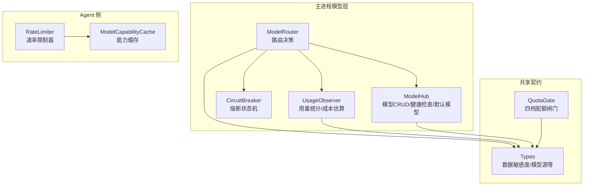
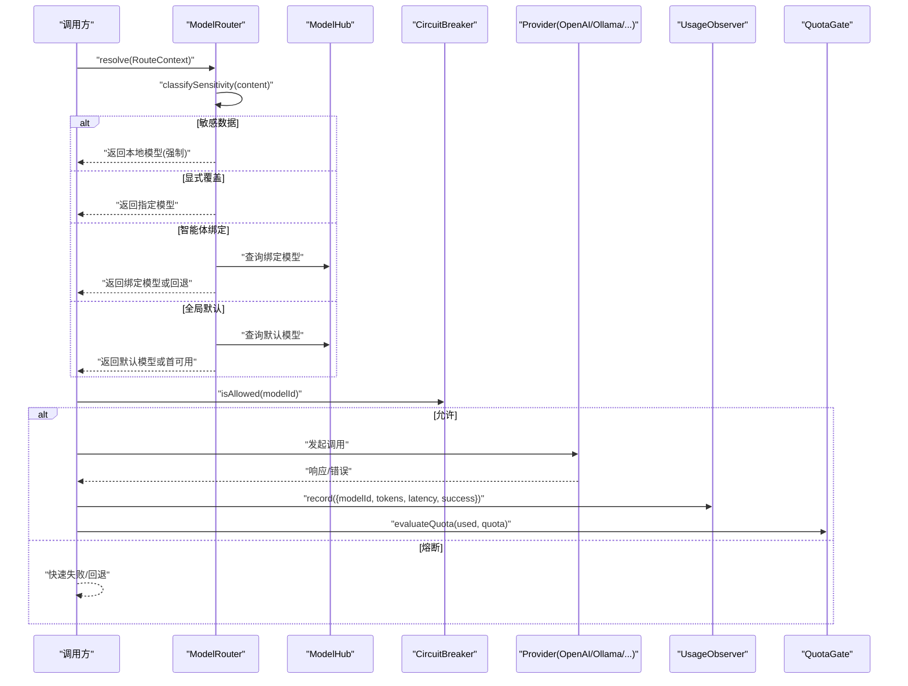
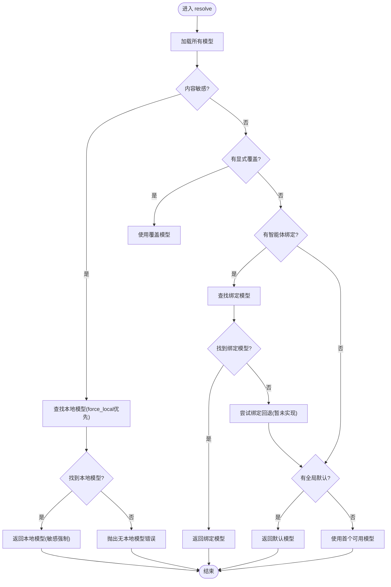
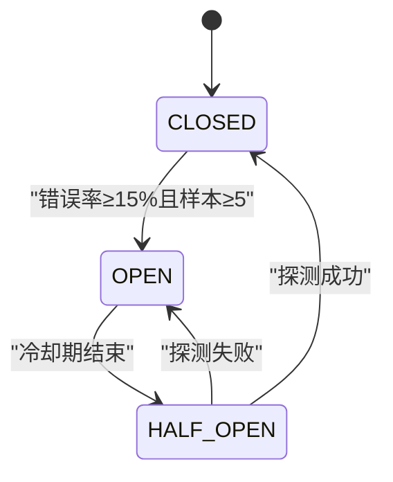
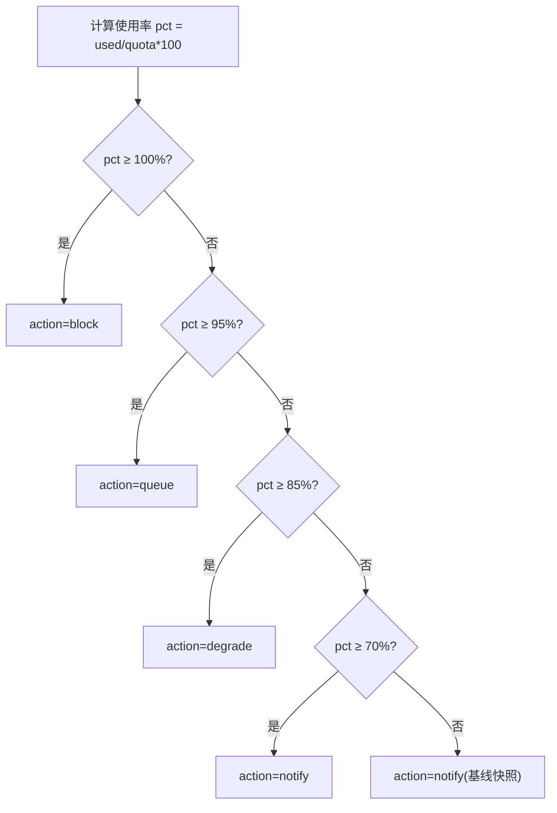
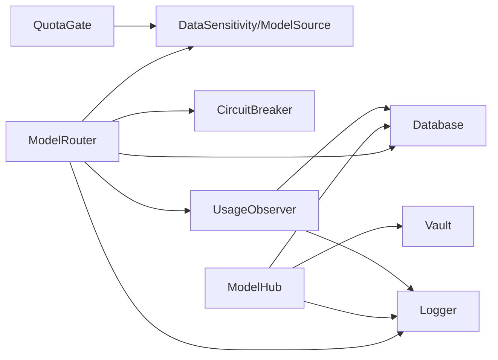

# 路由策略

<cite>
**本文引用的文件**   
- [router.ts](file://tongtian-tauri/src/main/model/router.ts)
- [hub.ts](file://tongtian-tauri/src/main/model/hub.ts)
- [circuit-breaker.ts](file://tongtian-tauri/src/main/model/circuit-breaker.ts)
- [observer.ts](file://tongtian-tauri/src/main/model/observer.ts)
- [quota-gate.ts](file://tongtian-tauri/src/shared/quota-gate.ts)
- [types.ts](file://tongtian-tauri/src/shared/types.ts)
- [model_capability_cache.py](file://tongtian-tauri/src/agent/providers/model_capability_cache.py)
- [rate_limiter.py](file://tongtian-tauri/src/agent/providers/rate_limiter.py)
</cite>

## 目录
1. [简介](#简介)
2. [项目结构](#项目结构)
3. [核心组件](#核心组件)
4. [架构总览](#架构总览)
5. [详细组件分析](#详细组件分析)
6. [依赖关系分析](#依赖关系分析)
7. [性能考量](#性能考量)
8. [故障排查指南](#故障排查指南)
9. [结论](#结论)
10. [附录](#附录)

## 简介
本文件系统化阐述通天办公的“模型路由策略”，覆盖智能路由算法、负载均衡与故障转移、降级熔断机制、速率限制与配额管理、成本优化、模型能力缓存、上下文窗口管理与请求格式化，并提供配置示例、监控指标、性能调优建议以及故障排查与日志分析指南。目标是让具备不同技术背景的读者都能准确理解并落地使用。

## 项目结构
与路由策略直接相关的代码主要分布在以下模块：
- 主进程模型路由与管理：src/main/model（router.ts、hub.ts、circuit-breaker.ts、observer.ts）
- 共享类型与配额闸门：src/shared（types.ts、quota-gate.ts）
- Agent 侧能力缓存与限流：src/agent/providers（model_capability_cache.py、rate_limiter.py）

图表来源
- [router.ts:1-318](file://tongtian-tauri/src/main/model/router.ts#L1-L318)
- [hub.ts:1-374](file://tongtian-tauri/src/main/model/hub.ts#L1-L374)
- [circuit-breaker.ts:1-346](file://tongtian-tauri/src/main/model/circuit-breaker.ts#L1-L346)
- [observer.ts:1-260](file://tongtian-tauri/src/main/model/observer.ts#L1-L260)
- [types.ts:1-346](file://tongtian-tauri/src/shared/types.ts#L1-L346)
- [quota-gate.ts:1-81](file://tongtian-tauri/src/shared/quota-gate.ts#L1-L81)
- [model_capability_cache.py:1-95](file://tongtian-tauri/src/agent/providers/model_capability_cache.py#L1-L95)
- [rate_limiter.py:1-95](file://tongtian-tauri/src/agent/providers/rate_limiter.py#L1-L95)

章节来源
- [router.ts:1-318](file://tongtian-tauri/src/main/model/router.ts#L1-L318)
- [hub.ts:1-374](file://tongtian-tauri/src/main/model/hub.ts#L1-L374)
- [circuit-breaker.ts:1-346](file://tongtian-tauri/src/main/model/circuit-breaker.ts#L1-L346)
- [observer.ts:1-260](file://tongtian-tauri/src/main/model/observer.ts#L1-L260)
- [types.ts:1-346](file://tongtian-tauri/src/shared/types.ts#L1-L346)
- [quota-gate.ts:1-81](file://tongtian-tauri/src/shared/quota-gate.ts#L1-L81)
- [model_capability_cache.py:1-95](file://tongtian-tauri/src/agent/providers/model_capability_cache.py#L1-L95)
- [rate_limiter.py:1-95](file://tongtian-tauri/src/agent/providers/rate_limiter.py#L1-L95)

## 核心组件
- 模型路由器（ModelRouter）：实现三层路由策略（敏感数据强制本地 → 智能体绑定 → 全局默认），支持显式覆盖与回退链。
- 模型中心（ModelHub）：模型配置的增删改查、密钥安全存储、健康检查、默认模型设置。
- 熔断器（CircuitBreaker）：按模型维度维护滑动窗口错误率，实现 CLOSED/OPEN/HALF_OPEN 状态机与指数退避重试。
- 用量观测器（UsageObserver）：记录每次调用的 token 用量、延迟、成功失败，提供周期聚合与成本估算。
- 配额闸门（QuotaGate）：四档阈值（70/85/95/100%）决定 notify/degrade/queue/block 动作。
- 模型能力缓存（ModelCapabilityCache）：进程内缓存“学习到的”模型能力（如是否需要 reasoning_content、是否拒绝多模态）。
- 速率限制器（RateLimiter）：对下游模型调用进行限速，配合熔断与排队策略。

章节来源
- [router.ts:1-318](file://tongtian-tauri/src/main/model/router.ts#L1-L318)
- [hub.ts:1-374](file://tongtian-tauri/src/main/model/hub.ts#L1-L374)
- [circuit-breaker.ts:1-346](file://tongtian-tauri/src/main/model/circuit-breaker.ts#L1-L346)
- [observer.ts:1-260](file://tongtian-tauri/src/main/model/observer.ts#L1-L260)
- [quota-gate.ts:1-81](file://tongtian-tauri/src/shared/quota-gate.ts#L1-L81)
- [model_capability_cache.py:1-95](file://tongtian-tauri/src/agent/providers/model_capability_cache.py#L1-L95)
- [rate_limiter.py:1-95](file://tongtian-tauri/src/agent/providers/rate_limiter.py#L1-L95)

## 架构总览
下图展示一次典型请求从路由到执行的关键路径，包括敏感检测、绑定匹配、默认选择、熔断判定、用量记录与配额闸门联动。

图表来源
- [router.ts:128-247](file://tongtian-tauri/src/main/model/router.ts#L128-L247)
- [hub.ts:282-358](file://tongtian-tauri/src/main/model/hub.ts#L282-L358)
- [circuit-breaker.ts:108-163](file://tongtian-tauri/src/main/model/circuit-breaker.ts#L108-L163)
- [observer.ts:101-128](file://tongtian-tauri/src/main/model/observer.ts#L101-L128)
- [quota-gate.ts:37-54](file://tongtian-tauri/src/shared/quota-gate.ts#L37-L54)

## 详细组件分析

### 智能路由算法（三层策略）
- 第一层：敏感数据强制本地
  - 通过 SensitivityChecker 接口分类文本敏感度；若为机密级且存在本地模型（优先 force_local，其次 Ollama），则强制走本地。
- 第二层：智能体绑定
  - 根据 agentBinding 查找绑定模型；若无，尝试同绑定的回退模型（当前未实现专用回退逻辑，将回落到第三层）。
- 第三层：全局默认
  - 选择 isDefault 的模型；若无默认，回退到第一个可用模型。
- 显式覆盖
  - 若 RouteContext.modelOverride 存在且有效，直接使用该模型。

图表来源
- [router.ts:128-247](file://tongtian-tauri/src/main/model/router.ts#L128-L247)
- [types.ts:132-136](file://tongtian-tauri/src/shared/types.ts#L132-L136)

章节来源
- [router.ts:128-247](file://tongtian-tauri/src/main/model/router.ts#L128-L247)
- [types.ts:132-136](file://tongtian-tauri/src/shared/types.ts#L132-L136)

### 负载均衡与故障转移
- 负载均衡
  - 当前路由以“优先级+回退”为主，尚未实现基于权重/延迟/吞吐的动态负载分配。可通过扩展 findFallbackForBinding 与新增“多候选池”策略实现。
- 故障转移
  - 当绑定模型不可用时，可结合健康检查与熔断状态，自动切换到回退模型或默认模型。
  - 健康检查由 ModelHub.healthCheck 提供，用于探测连通性与延迟。

章节来源
- [hub.ts:282-358](file://tongtian-tauri/src/main/model/hub.ts#L282-L358)
- [router.ts:289-304](file://tongtian-tauri/src/main/model/router.ts#L289-L304)

### 降级与熔断机制
- 熔断状态机
  - CLOSED：正常记录错误率；达到阈值（≥15%，且窗口内至少5次调用）→ OPEN。
  - OPEN：冷却期（3分钟）内拒绝调用；冷却后进入 HALF_OPEN，仅允许一次探测调用。
  - HALF_OPEN：探测成功 → CLOSED；失败 → 重新 OPEN。
- 指数退避
  - 针对限流场景，采用 1s→2s→4s→8s 的指数退避，最多4次重试。

图表来源
- [circuit-breaker.ts:24-41](file://tongtian-tauri/src/main/model/circuit-breaker.ts#L24-L41)
- [circuit-breaker.ts:108-163](file://tongtian-tauri/src/main/model/circuit-breaker.ts#L108-L163)
- [circuit-breaker.ts:249-259](file://tongtian-tauri/src/main/model/circuit-breaker.ts#L249-L259)

章节来源
- [circuit-breaker.ts:108-163](file://tongtian-tauri/src/main/model/circuit-breaker.ts#L108-L163)
- [circuit-breaker.ts:249-259](file://tongtian-tauri/src/main/model/circuit-breaker.ts#L249-L259)

### 速率限制器与配额管理
- 速率限制器（RateLimiter）
  - 在 Agent 侧对模型调用进行限速，避免上游过载；与熔断协同，限流触发时记录 isRateLimited，辅助熔断评估。
- 配额闸门（QuotaGate）
  - 四档阈值：70%（notify）、85%（degrade）、95%（queue）、100%（block）。
  - 动作语义：
    - 70%：仅提示，不阻断。
    - 85%：降级到备用模型（需满足成功率基线）。
    - 95%：新任务入队，不启动执行。
    - 100%：拒绝新提交（QUOTA_EXCEEDED/BUDGET_EXHAUSTED），运行中任务标记预算暂停。

图表来源
- [quota-gate.ts:10-15](file://tongtian-tauri/src/shared/quota-gate.ts#L10-L15)
- [quota-gate.ts:37-54](file://tongtian-tauri/src/shared/quota-gate.ts#L37-L54)

章节来源
- [quota-gate.ts:10-15](file://tongtian-tauri/src/shared/quota-gate.ts#L10-L15)
- [quota-gate.ts:37-54](file://tongtian-tauri/src/shared/quota-gate.ts#L37-L54)

### 模型能力缓存与上下文窗口管理
- 模型能力缓存（ModelCapabilityCache）
  - 进程内线程安全缓存，记录“学习到的”能力键值，例如：
    - needs_reasoning_content：是否在思考模式下需要附加 reasoning_content。
    - rejects_media：尽管声明支持多模态，实际拒绝媒体输入。
  - 仅在“失败-恢复”确认后写入，避免误判。
- 上下文窗口管理
  - 路由与调用前需校验 contextWindow，确保 prompt + completion 不超过模型上限；必要时截断或拆分消息。

章节来源
- [model_capability_cache.py:24-95](file://tongtian-tauri/src/agent/providers/model_capability_cache.py#L24-L95)
- [types.ts:201-215](file://tongtian-tauri/src/shared/types.ts#L201-L215)

### 请求格式化与适配
- 统一请求格式
  - 健康检查与测试调用采用 OpenAI 兼容格式（/chat/completions），便于跨提供商复用。
- 适配器
  - 各 Provider 负责将内部消息结构转换为目标 API 所需格式，并结合能力缓存调整字段（如 reasoning_content）。

章节来源
- [hub.ts:282-358](file://tongtian-tauri/src/main/model/hub.ts#L282-L358)
- [model_capability_cache.py:24-95](file://tongtian-tauri/src/agent/providers/model_capability_cache.py#L24-L95)

## 依赖关系分析
- ModelRouter 依赖：
  - Database（读取 model_configs）
  - Logger（审计与调试）
  - DataSensitivity（敏感度枚举）
  - CircuitBreaker（可选集成，用于调用前放行判断）
  - UsageObserver（调用后记录用量）
- ModelHub 依赖：
  - Database（持久化）
  - Vault（API Key 加密存储）
  - Logger
- CircuitBreaker 独立运行，按 modelId 维度隔离状态。
- UsageObserver 依赖 Database 与 Logger，提供统计与成本估算。
- QuotaGate 为纯函数，供上层统一判定配额动作。

图表来源
- [router.ts:1-318](file://tongtian-tauri/src/main/model/router.ts#L1-L318)
- [hub.ts:1-374](file://tongtian-tauri/src/main/model/hub.ts#L1-L374)
- [circuit-breaker.ts:1-346](file://tongtian-tauri/src/main/model/circuit-breaker.ts#L1-L346)
- [observer.ts:1-260](file://tongtian-tauri/src/main/model/observer.ts#L1-L260)
- [quota-gate.ts:1-81](file://tongtian-tauri/src/shared/quota-gate.ts#L1-L81)
- [types.ts:1-346](file://tongtian-tauri/src/shared/types.ts#L1-L346)

章节来源
- [router.ts:1-318](file://tongtian-tauri/src/main/model/router.ts#L1-L318)
- [hub.ts:1-374](file://tongtian-tauri/src/main/model/hub.ts#L1-L374)
- [circuit-breaker.ts:1-346](file://tongtian-tauri/src/main/model/circuit-breaker.ts#L1-L346)
- [observer.ts:1-260](file://tongtian-tauri/src/main/model/observer.ts#L1-L260)
- [quota-gate.ts:1-81](file://tongtian-tauri/src/shared/quota-gate.ts#L1-L81)
- [types.ts:1-346](file://tongtian-tauri/src/shared/types.ts#L1-L346)

## 性能考量
- 路由决策
  - 单次解析复杂度 O(n)（n 为模型数量），建议对常用模型建立索引（如按 binding/default）以降低查找开销。
- 熔断窗口
  - 滑动窗口清理与统计在每次记录时执行，注意控制窗口大小与采样频率，避免频繁 GC。
- 用量统计
  - 聚合查询按天/周/月分组，建议在数据库层面建立 created_at 与 model_id 索引。
- 健康检查
  - 超时时间 10s，建议异步批量探测，避免阻塞主流程。
- 能力缓存
  - 进程内缓存命中率高，减少首次失败重试次数，降低端到端延迟。

[本节为通用指导，无需特定文件引用]

## 故障排查指南
- 常见错误码与现象
  - ALL_MODELS_UNAVAILABLE：无可用模型或未配置默认/绑定模型。
  - MODEL_NOT_FOUND：更新/删除模型时 ID 不存在。
  - QUOTA_EXCEEDED / BUDGET_EXHAUSTED：配额耗尽导致新提交被拒或运行中任务暂停。
- 定位步骤
  - 查看路由审计事件（route:*）确认选择原因。
  - 检查熔断状态（getStats/getAllStats）与最近错误率。
  - 核对健康检查结果（latencyMs、error 信息）。
  - 检查用量统计（getStats/getSummary）与成本估算。
  - 查看配额闸门快照（tier/action）与档位变化事件（quota_warning）。
- 日志关键字
  - route:sensitive_forced_local / route:agent_binding / route:global_default
  - circuit state transition / opened due to high error rate
  - health check passed/failed
  - usage recorded / estimated cost

章节来源
- [router.ts:139-247](file://tongtian-tauri/src/main/model/router.ts#L139-L247)
- [circuit-breaker.ts:168-230](file://tongtian-tauri/src/main/model/circuit-breaker.ts#L168-L230)
- [hub.ts:282-358](file://tongtian-tauri/src/main/model/hub.ts#L282-L358)
- [observer.ts:101-172](file://tongtian-tauri/src/main/model/observer.ts#L101-L172)
- [quota-gate.ts:37-54](file://tongtian-tauri/src/shared/quota-gate.ts#L37-L54)

## 结论
本路由策略以“安全优先、绑定优先、默认兜底”为核心原则，结合熔断、限流与配额闸门形成闭环治理。通过能力缓存与上下文窗口管理提升稳定性与效率，通过用量观测与成本估算支撑精细化运营。后续可在负载均衡、绑定回退、动态权重等方面持续演进。

[本节为总结性内容，无需特定文件引用]

## 附录

### 配置示例（说明性）
- 模型配置字段
  - name、source、baseUrl、apiKeyEncrypted、modelName、contextWindow、isDefault、agentBinding、forceLocal
- 路由上下文
  - content、agentBinding、modelOverride、workspaceId
- 健康检查参数
  - baseUrl、apiKey、modelName、contextWindow、id（可选）

章节来源
- [types.ts:201-232](file://tongtian-tauri/src/shared/types.ts#L201-L232)
- [router.ts:24-33](file://tongtian-tauri/src/main/model/router.ts#L24-L33)
- [hub.ts:282-358](file://tongtian-tauri/src/main/model/hub.ts#L282-L358)

### 监控指标建议
- 路由层
  - 选择原因分布（sensitive_forced_local、agent_binding、global_default、explicit_override）
- 熔断层
  - 各模型状态占比、错误率、平均延迟、冷却次数
- 用量层
  - 每日/周/月 token 总量、调用次数、平均延迟、估计成本
- 配额层
  - 档位分布（70/85/95/100）、动作计数、档位跃迁事件

章节来源
- [observer.ts:135-172](file://tongtian-tauri/src/main/model/observer.ts#L135-L172)
- [circuit-breaker.ts:183-218](file://tongtian-tauri/src/main/model/circuit-breaker.ts#L183-L218)
- [quota-gate.ts:37-54](file://tongtian-tauri/src/shared/quota-gate.ts#L37-L54)

### 性能调优建议
- 路由层
  - 为 agentBinding 与 isDefault 建立索引；缓存热门模型列表。
- 熔断层
  - 合理调整窗口大小与阈值，避免误触发；对高频模型单独观察。
- 用量层
  - 聚合查询加索引；按需分页拉取明细。
- 健康检查
  - 异步批量探测；结果缓存短时效，避免频繁网络 IO。
- 能力缓存
  - 在模型切换或升级后清理对应 key，保证一致性。

[本节为通用指导，无需特定文件引用]