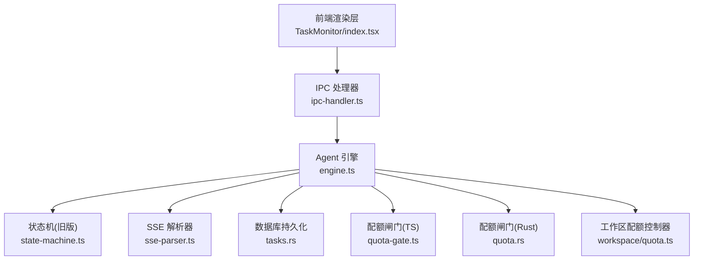
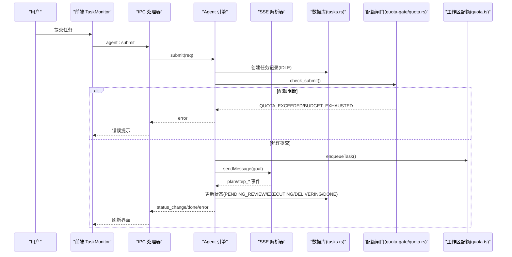
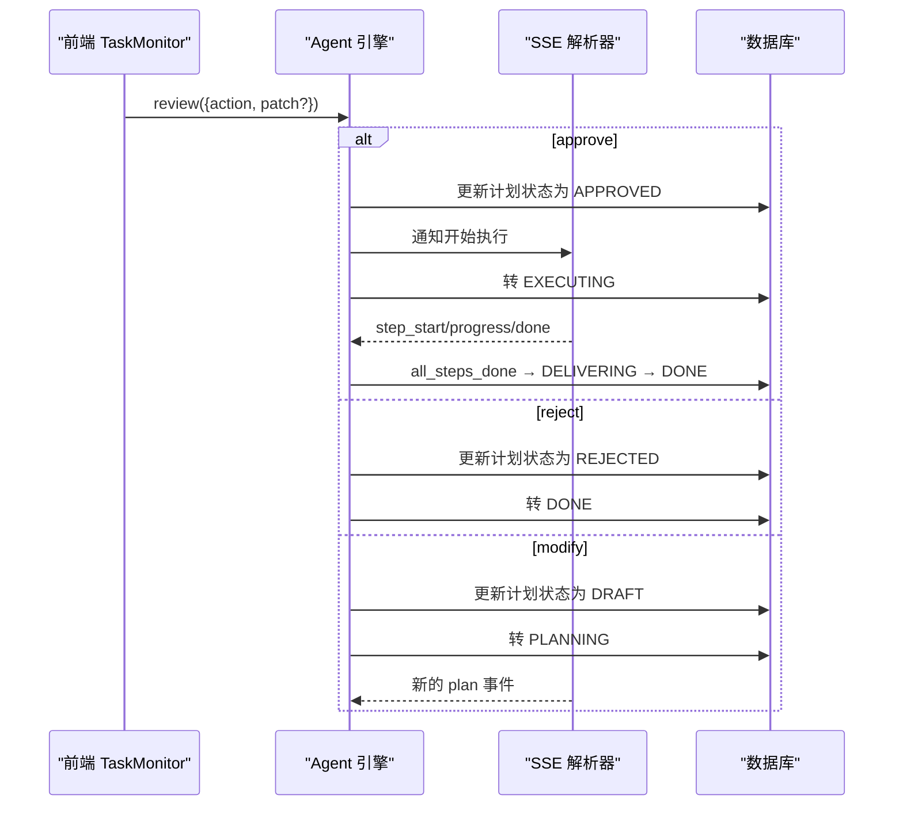
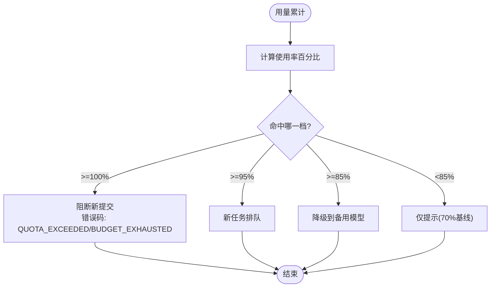
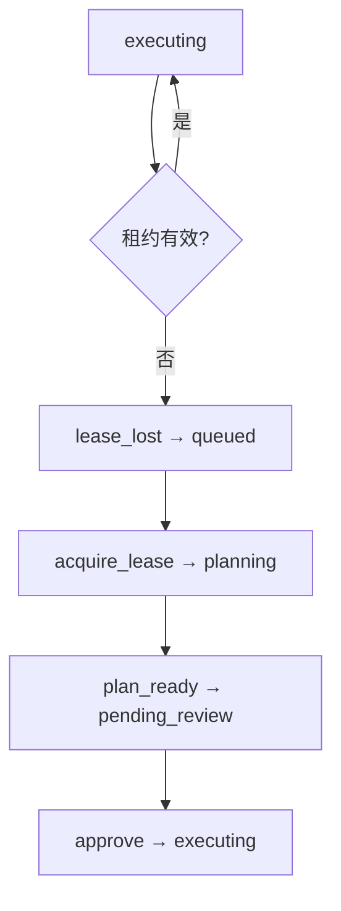
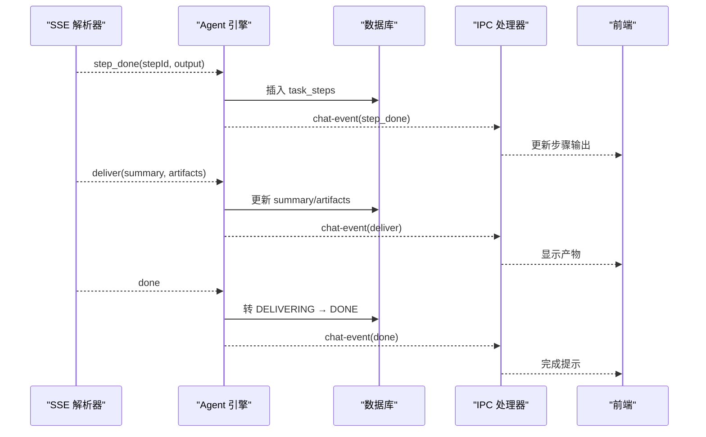
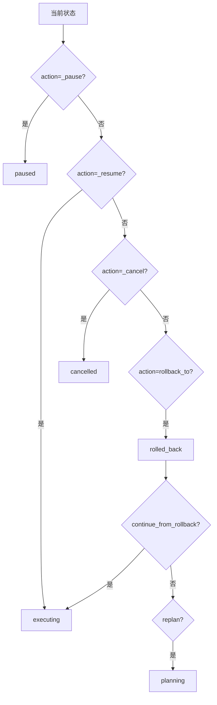
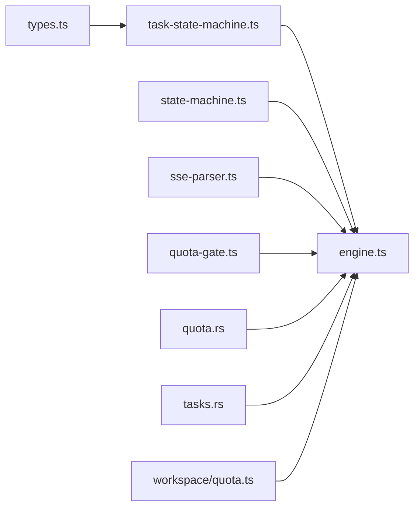

# 任务管理系统

<cite>
**本文引用的文件**   
- [task-state-machine.ts](file://src/shared/task-state-machine.ts)
- [types.ts](file://src/shared/types.ts)
- [quota-gate.ts](file://src/shared/quota-gate.ts)
- [engine.ts](file://src/main/agent/engine.ts)
- [state-machine.ts](file://src/main/agent/state-machine.ts)
- [ipc-handler.ts](file://src/main/agent/ipc-handler.ts)
- [sse-parser.ts](file://src/main/bridge/sse-parser.ts)
- [quota.ts](file://src/main/workspace/quota.ts)
- [tasks.rs](file://src-tauri/src/store/tasks.rs)
- [quota.rs](file://src-tauri/src/task/quota.rs)
- [TaskMonitor/index.tsx](file://src/renderer/components/TaskMonitor/index.tsx)
- [state-machine-14.test.ts](file://tests/unit/agent/state-machine-14.test.ts)
</cite>

## 目录
1. [引言](#引言)
2. [项目结构](#项目结构)
3. [核心组件](#核心组件)
4. [架构总览](#架构总览)
5. [详细组件分析](#详细组件分析)
6. [依赖关系分析](#依赖关系分析)
7. [性能考量](#性能考量)
8. [故障排查指南](#故障排查指南)
9. [结论](#结论)
10. [附录](#附录)

## 引言
本文件面向任务管理系统的研发与运维人员，系统性阐述14态任务状态机、两阶段协议（计划生成 → 用户审阅 → 执行）、任务生命周期管理、配额控制、租约管理、事件重放机制，以及任务控制操作（暂停、恢复、取消、回滚）和前后端状态同步策略。文档同时提供调试方法与常见问题解决方案，帮助读者快速定位问题并优化系统行为。

## 项目结构
本项目采用多语言混合架构：
- TypeScript/React 前端渲染层负责交互与展示
- Electron/Tauri 主进程作为桥接与调度中心
- Rust 侧实现持久化与配额闸门等关键能力
- Python Agent 引擎通过 SSE 事件驱动任务执行



**图表来源** 
- [TaskMonitor/index.tsx](file://src/renderer/components/TaskMonitor/index.tsx)
- [ipc-handler.ts](file://src/main/agent/ipc-handler.ts)
- [engine.ts](file://src/main/agent/engine.ts)
- [state-machine.ts](file://src/main/agent/state-machine.ts)
- [sse-parser.ts](file://src/main/bridge/sse-parser.ts)
- [tasks.rs](file://src-tauri/src/store/tasks.rs)
- [quota-gate.ts](file://src/shared/quota-gate.ts)
- [quota.rs](file://src-tauri/src/task/quota.rs)
- [quota.ts](file://src/main/workspace/quota.ts)

**章节来源**
- [engine.ts](file://src/main/agent/engine.ts)
- [ipc-handler.ts](file://src/main/agent/ipc-handler.ts)
- [sse-parser.ts](file://src/main/bridge/sse-parser.ts)
- [tasks.rs](file://src-tauri/src/store/tasks.rs)
- [quota-gate.ts](file://src/shared/quota-gate.ts)
- [quota.rs](file://src-tauri/src/task/quota.rs)
- [quota.ts](file://src/main/workspace/quota.ts)

## 核心组件
- 14态任务状态机：定义状态集合、转移事件、约束条件与非法转移拒绝策略
- 两阶段协议：计划生成后进入待审阅，用户批准/拒绝/修改后再进入执行或重新规划
- 配额闸门：四档阈值（70/85/95/100%），动作链「降级→排队→阻断」，跨端一致语义
- 租约管理：QUEUED 入队即出队（本地退化），心跳超时触发 lease_lost 回到 QUEUED
- 事件流与重放：SSE 事件驱动引擎推进状态，支持错误处理与重试路径
- 任务控制：暂停、恢复、回滚到指定步骤，取消任务并清理资源

**章节来源**
- [task-state-machine.ts](file://src/shared/task-state-machine.ts)
- [types.ts](file://src/shared/types.ts)
- [quota-gate.ts](file://src/shared/quota-gate.ts)
- [engine.ts](file://src/main/agent/engine.ts)
- [state-machine.ts](file://src/main/agent/state-machine.ts)
- [sse-parser.ts](file://src/main/bridge/sse-parser.ts)
- [quota.rs](file://src-tauri/src/task/quota.rs)

## 架构总览
整体流程以“提交目标 → 生成计划 → 用户审阅 → 执行步骤 → 交付产物”为主线，辅以配额闸门与工作区资源限制，确保系统在预算与资源范围内稳定运行。



**图表来源** 
- [engine.ts](file://src/main/agent/engine.ts)
- [ipc-handler.ts](file://src/main/agent/ipc-handler.ts)
- [sse-parser.ts](file://src/main/bridge/sse-parser.ts)
- [tasks.rs](file://src-tauri/src/store/tasks.rs)
- [quota-gate.ts](file://src/shared/quota-gate.ts)
- [quota.rs](file://src-tauri/src/task/quota.rs)
- [quota.ts](file://src/main/workspace/quota.ts)

## 详细组件分析

### 14态任务状态机
- 状态集合：IDLE、PLANNING、PENDING_REVIEW、EXECUTING、PAUSED、DELIVERING、DONE、FAILED、ROLLED_BACK、QUEUED、BUDGET_PAUSED、RETRY_PENDING、CANCELLED、ARCHIVED
- 转移事件：submit、acquire_lease、cancel、queue_timeout、plan_ready、retryable_error、fatal_error、approve、reject、modify、review_ttl、all_steps_done、pause、budget_exhausted、lease_lost、resume、rollback_to、continue_from_rollback、replan、budget_restored、budget_ttl、backoff_done、retry_exhausted、deliver_done、manual_retry、archive
- 约束条件：
  - retryable_error 在 retryCount≥3 时路由到 FAILED（重试耗尽）
  - executing.wait_reason 子态仅用于限流等待，不引入新状态
  - 终态 CANCELLED/ARCHIVED 无出边
- 非法转移显式拒绝抛出 IllegalTransitionError

```mermaid
classDiagram
class TaskStatus {
+IDLE
+PLANNING
+PENDING_REVIEW
+EXECUTING
+PAUSED
+DELIVERING
+DONE
+FAILED
+ROLLED_BACK
+QUEUED
+BUDGET_PAUSED
+RETRY_PENDING
+CANCELLED
+ARCHIVED
}
class TransitionEvent {
+submit
+acquire_lease
+cancel
+queue_timeout
+plan_ready
+retryable_error
+fatal_error
+approve
+reject
+modify
+review_ttl
+all_steps_done
+pause
+budget_exhausted
+lease_lost
+resume
+rollback_to
+continue_from_rollback
+replan
+budget_restored
+budget_ttl
+backoff_done
+retry_exhausted
+deliver_done
+manual_retry
+archive
}
class TaskStateMachine {
+canTransition(from, event, ctx) bool
+transition(from, event, ctx) TaskStatus
+applyWaitReason(status, reason) {status, waitReason}
+isTerminal(status) bool
+availableEvents(from) TransitionEvent[]
}
TaskStateMachine --> TaskStatus : "使用"
TaskStateMachine --> TransitionEvent : "基于事件"
```

**图表来源** 
- [task-state-machine.ts](file://src/shared/task-state-machine.ts)
- [types.ts](file://src/shared/types.ts)

**章节来源**
- [task-state-machine.ts](file://src/shared/task-state-machine.ts)
- [types.ts](file://src/shared/types.ts)
- [state-machine-14.test.ts](file://tests/unit/agent/state-machine-14.test.ts)

### 两阶段协议（计划生成 → 用户审阅 → 执行）
- 计划生成：Engine 接收 Agent 的 plan 事件，将任务转入 PENDING_REVIEW
- 用户审阅：UI 显示 Plan 步骤，支持 approve/reject/modify
- 执行阶段：approve 后转入 EXECUTING；reject 直接 DONE；modify 返回 PLANNING 重新生成



**图表来源** 
- [engine.ts](file://src/main/agent/engine.ts)
- [sse-parser.ts](file://src/main/bridge/sse-parser.ts)
- [tasks.rs](file://src-tauri/src/store/tasks.rs)

**章节来源**
- [engine.ts](file://src/main/agent/engine.ts)
- [sse-parser.ts](file://src/main/bridge/sse-parser.ts)
- [TaskMonitor/index.tsx](file://src/renderer/components/TaskMonitor/index.tsx)

### 配额控制与闸门
- 四档阈值：70% notify、85% degrade、95% queue、100% block
- 动作链：降级模型 → 新任务排队 → 阻断提交
- 跨端一致性：TS quota-gate 与 Rust quota.rs 镜像实现，测试用例共享边界值
- 运行中任务：100% 触发 budget_paused（转移 #17），恢复后按 FIFO 继续执行



**图表来源** 
- [quota-gate.ts](file://src/shared/quota-gate.ts)
- [quota.rs](file://src-tauri/src/task/quota.rs)

**章节来源**
- [quota-gate.ts](file://src/shared/quota-gate.ts)
- [quota.rs](file://src-tauri/src/task/quota.rs)

### 租约管理与心跳
- 本地 local-first：QUEUED 停留时间 <100ms，立即 acquire_lease 进入 PLANNING
- 心跳超时：executing 丢失租约触发 lease_lost 回到 QUEUED，从最后成功 Step 恢复
- 队列超时：queued 超过 QUEUE_TIMEOUT 转为 failed



**图表来源** 
- [task-state-machine.ts](file://src/shared/task-state-machine.ts)

**章节来源**
- [task-state-machine.ts](file://src/shared/task-state-machine.ts)

### 事件重放与状态同步
- SSE 事件：plan、step_start、step_progress、step_done、step_failed、deliver、done、error
- 引擎处理：根据事件类型推进状态机并持久化结果
- 前端同步：IPC 转发 status_change/done/error 事件，UI 实时更新



**图表来源** 
- [sse-parser.ts](file://src/main/bridge/sse-parser.ts)
- [engine.ts](file://src/main/agent/engine.ts)
- [ipc-handler.ts](file://src/main/agent/ipc-handler.ts)

**章节来源**
- [sse-parser.ts](file://src/main/bridge/sse-parser.ts)
- [engine.ts](file://src/main/agent/engine.ts)
- [ipc-handler.ts](file://src/main/agent/ipc-handler.ts)

### 任务控制操作（暂停、恢复、取消、回滚）
- 暂停：executing → paused
- 恢复：paused → executing
- 取消：任意可取消状态 → cancelled
- 回滚：paused → rolled_back，然后 continue_from_rollback → executing 或 replan → planning



**图表来源** 
- [task-state-machine.ts](file://src/shared/task-state-machine.ts)
- [state-machine.ts](file://src/main/agent/state-machine.ts)

**章节来源**
- [task-state-machine.ts](file://src/shared/task-state-machine.ts)
- [state-machine.ts](file://src/main/agent/state-machine.ts)
- [engine.ts](file://src/main/agent/engine.ts)

### 前端状态同步策略
- TaskMonitor 组件根据 plan/fileOps 展示步骤与产物
- pending_review 时显示批准/拒绝按钮
- 通过 workbenchStore 订阅状态变更，实时刷新界面

**章节来源**
- [TaskMonitor/index.tsx](file://src/renderer/components/TaskMonitor/index.tsx)

## 依赖关系分析
- 状态机与类型定义：shared/task-state-machine.ts 依赖 shared/types.ts
- 引擎与状态机：main/agent/engine.ts 依赖 main/agent/state-machine.ts
- 事件流：main/bridge/sse-parser.ts 被 engine.ts 消费
- 配额闸门：shared/quota-gate.ts 与 src-tauri/task/quota.rs 镜像实现
- 持久化：src-tauri/store/tasks.rs 提供任务行 upsert 与列表查询
- 工作区配额：main/workspace/quota.ts 管理并发与队列深度



**图表来源** 
- [types.ts](file://src/shared/types.ts)
- [task-state-machine.ts](file://src/shared/task-state-machine.ts)
- [engine.ts](file://src/main/agent/engine.ts)
- [state-machine.ts](file://src/main/agent/state-machine.ts)
- [sse-parser.ts](file://src/main/bridge/sse-parser.ts)
- [quota-gate.ts](file://src/shared/quota-gate.ts)
- [quota.rs](file://src-tauri/src/task/quota.rs)
- [tasks.rs](file://src-tauri/src/store/tasks.rs)
- [quota.ts](file://src/main/workspace/quota.ts)

**章节来源**
- [engine.ts](file://src/main/agent/engine.ts)
- [task-state-machine.ts](file://src/shared/task-state-machine.ts)
- [types.ts](file://src/shared/types.ts)
- [sse-parser.ts](file://src/main/bridge/sse-parser.ts)
- [quota-gate.ts](file://src/shared/quota-gate.ts)
- [quota.rs](file://src-tauri/src/task/quota.rs)
- [tasks.rs](file://src-tauri/src/store/tasks.rs)
- [quota.ts](file://src/main/workspace/quota.ts)

## 性能考量
- 本地退化：QUEUED 停留 <100ms，减少网络开销
- 事件批处理：SSE 解析器缓冲与队列，避免阻塞主循环
- 配额闸门：纯函数计算，避免频繁 I/O
- 数据库写入：upsert 合并更新，减少锁竞争
- 内存监控：工作区配额控制器跟踪内存使用，超阈值告警

[本节为通用指导，无需特定文件引用]

## 故障排查指南
- 非法状态转移：检查 canTransition/transition 调用参数，确认事件与状态匹配
- 配额阻断：查看 quota-gate/quota.rs 快照，确认 usedTokens/quotaTokens 与阈值
- SSE 事件丢失：检查 sse-parser.ts 缓冲区与 onEnd/onError 回调
- 租约丢失：确认心跳超时逻辑与 lease_lost 事件触发
- 任务卡住：查看 activeTasks 清理逻辑与 cleanupActiveTask 调用时机

**章节来源**
- [task-state-machine.ts](file://src/shared/task-state-machine.ts)
- [quota-gate.ts](file://src/shared/quota-gate.ts)
- [quota.rs](file://src-tauri/src/task/quota.rs)
- [sse-parser.ts](file://src/main/bridge/sse-parser.ts)
- [engine.ts](file://src/main/agent/engine.ts)

## 结论
本任务管理系统通过14态状态机、两阶段协议、配额闸门与租约管理，构建了健壮的任务生命周期框架。前后端一致的配额语义与事件驱动架构确保了高可用性与可扩展性。建议在生产环境中加强监控与日志采集，结合单元测试覆盖边界场景，持续优化性能与稳定性。

[本节为总结性内容，无需特定文件引用]

## 附录
- 14态状态机完整转移表与测试用例见 tests/unit/agent/state-machine-14.test.ts
- 配额闸门边界测试见 tests/unit/model/quota-gate.test.ts
- 契约一致性测试见 tests/unit/shared/contract.test.ts

**章节来源**
- [state-machine-14.test.ts](file://tests/unit/agent/state-machine-14.test.ts)