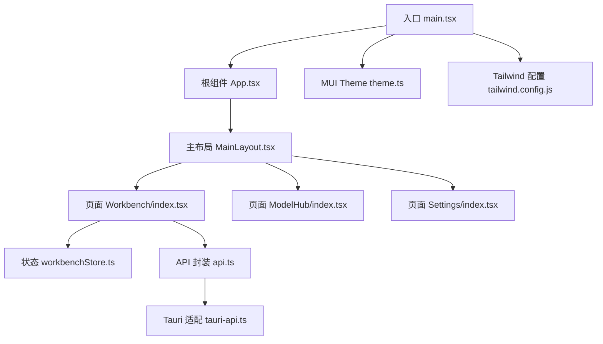
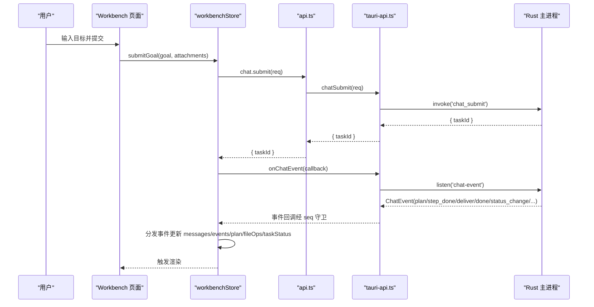
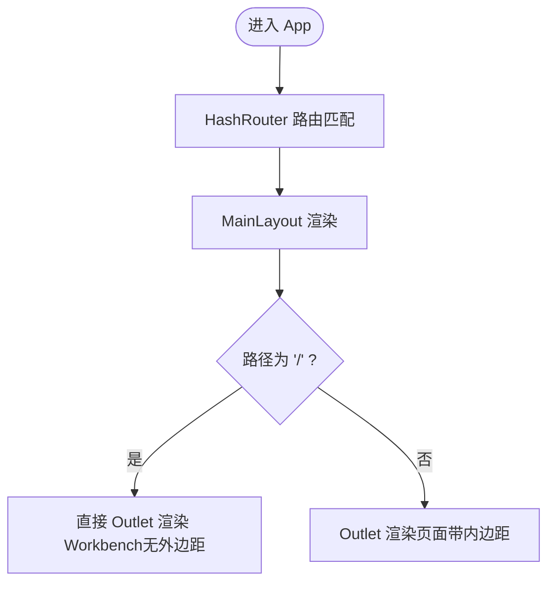
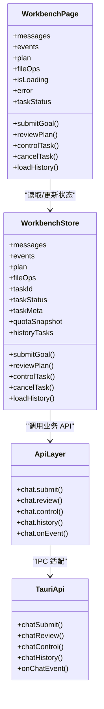
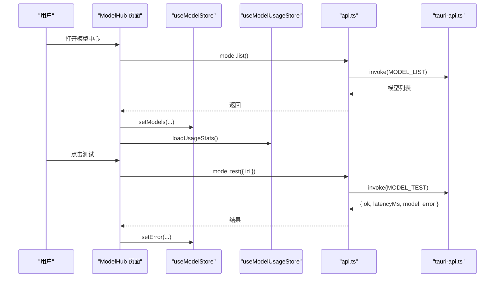
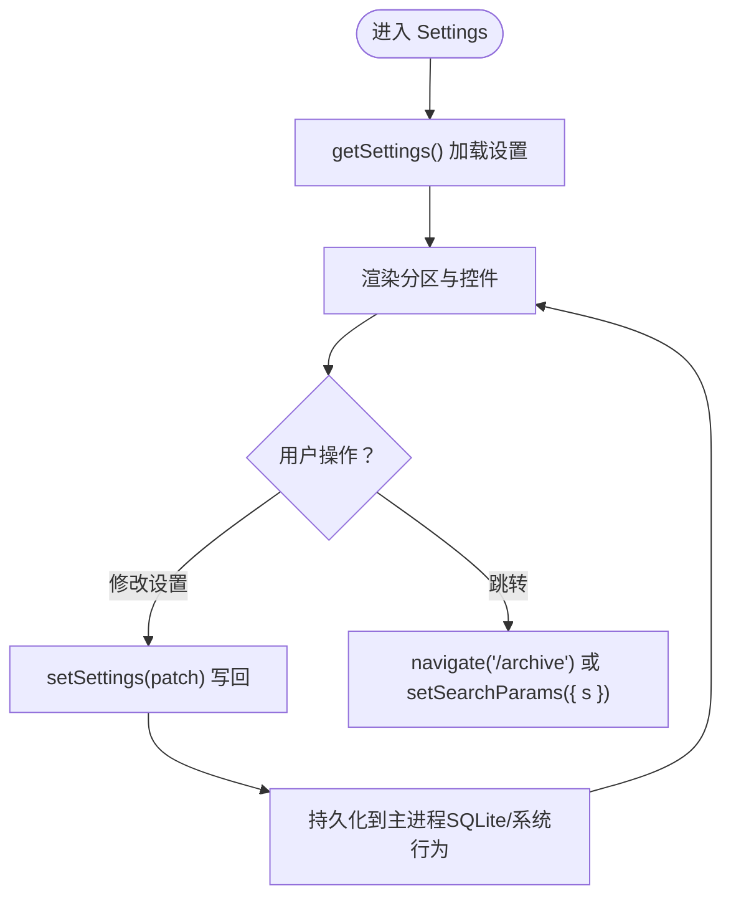
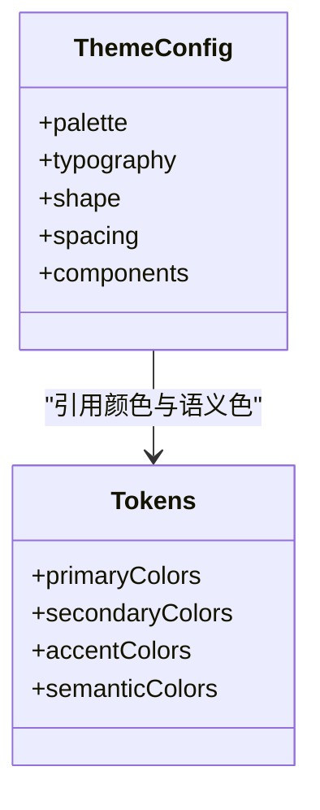
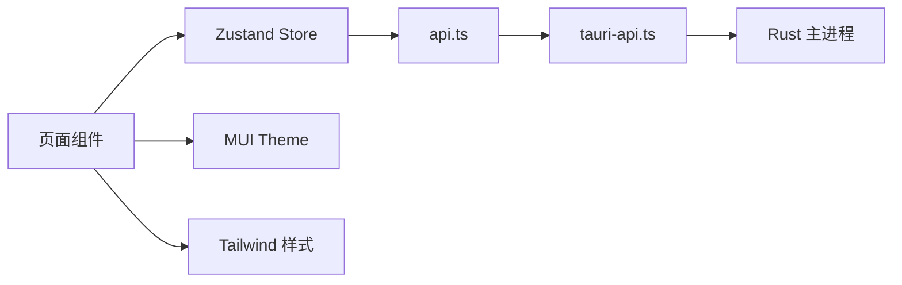

# 前端架构

<cite>
**本文引用的文件**   
- [main.tsx](file://tongtian-tauri/src/renderer/main.tsx)
- [App.tsx](file://tongtian-tauri/src/renderer/App.tsx)
- [MainLayout.tsx](file://tongtian-tauri/src/renderer/components/Layout/MainLayout.tsx)
- [Workbench/index.tsx](file://tongtian-tauri/src/renderer/pages/Workbench/index.tsx)
- [ModelHub/index.tsx](file://tongtian-tauri/src/renderer/pages/ModelHub/index.tsx)
- [Settings/index.tsx](file://tongtian-tauri/src/renderer/pages/Settings/index.tsx)
- [api.ts](file://tongtian-tauri/src/renderer/lib/api.ts)
- [tauri-api.ts](file://tongtian-tauri/src/renderer/lib/tauri-api.ts)
- [workbenchStore.ts](file://tongtian-tauri/src/renderer/store/workbenchStore.ts)
- [index.ts（stores）](file://tongtian-tauri/src/renderer/stores/index.ts)
- [useAppStore.ts](file://tongtian-tauri/src/renderer/stores/useAppStore.ts)
- [theme.ts](file://tongtian-tauri/src/renderer/theme/theme.ts)
- [tailwind.config.js](file://tongtian-tauri/tailwind.config.js)
- [package.json](file://tongtian-tauri/package.json)
- [types.ts](file://tongtian-tauri/src/shared/types.ts)
</cite>

## 目录
1. [简介](#简介)
2. [项目结构](#项目结构)
3. [核心组件](#核心组件)
4. [架构总览](#架构总览)
5. [详细组件分析](#详细组件分析)
6. [依赖关系分析](#依赖关系分析)
7. [性能考量](#性能考量)
8. [故障排查指南](#故障排查指南)
9. [结论](#结论)
10. [附录](#附录)

## 简介
本文件为通天办公前端架构的详细技术文档，聚焦于基于 React 18 + TypeScript + MUI + Tailwind CSS 的技术选型与实现。内容涵盖：
- 组件结构设计、路由配置与页面职责
- 状态管理方案（Zustand + React Query 的替代路径：当前以 Zustand 为主，事件流驱动）
- 前后端通信机制（Tauri IPC 封装、事件处理、错误处理策略）
- 主要页面组件的职责说明（Workbench、ModelHub、Settings 等）
- 组件间数据流转、响应式设计与主题系统
- 具体代码示例与使用模式指引，帮助开发者理解与扩展

## 项目结构
前端采用 Vite + React 18 工程化构建，通过 Tauri 容器运行。关键目录与职责：
- src/renderer：渲染进程源码
  - components：可复用 UI 组件（布局、聊天输入、任务监控等）
  - pages：页面级组件（工作台、模型中心、设置等）
  - store：业务状态切片（如 workbenchStore）
  - stores：全局 Store 导出与通用 Store（应用、偏好等）
  - lib：API 适配层（tauri-api.ts、api.ts）、工具模块
  - theme：MUI 主题与 Token
  - styles：全局样式（Tailwind 注入）
- shared：前后端共享类型与契约
- tailwind.config.js：Tailwind 主题与颜色体系
- package.json：依赖与脚本

**图表来源** 
- [main.tsx:1-25](file://tongtian-tauri/src/renderer/main.tsx#L1-L25)
- [App.tsx:1-80](file://tongtian-tauri/src/renderer/App.tsx#L1-L80)
- [MainLayout.tsx:1-60](file://tongtian-tauri/src/renderer/components/Layout/MainLayout.tsx#L1-L60)
- [Workbench/index.tsx:1-443](file://tongtian-tauri/src/renderer/pages/Workbench/index.tsx#L1-L443)
- [ModelHub/index.tsx:1-442](file://tongtian-tauri/src/renderer/pages/ModelHub/index.tsx#L1-L442)
- [Settings/index.tsx:1-800](file://tongtian-tauri/src/renderer/pages/Settings/index.tsx#L1-L800)
- [workbenchStore.ts:1-409](file://tongtian-tauri/src/renderer/store/workbenchStore.ts#L1-L409)
- [api.ts:1-207](file://tongtian-tauri/src/renderer/lib/api.ts#L1-L207)
- [tauri-api.ts:1-186](file://tongtian-tauri/src/renderer/lib/tauri-api.ts#L1-L186)
- [theme.ts:1-336](file://tongtian-tauri/src/renderer/theme/theme.ts#L1-L336)
- [tailwind.config.js:1-67](file://tongtian-tauri/tailwind.config.js#L1-L67)

**章节来源**
- [main.tsx:1-25](file://tongtian-tauri/src/renderer/main.tsx#L1-L25)
- [App.tsx:1-80](file://tongtian-tauri/src/renderer/App.tsx#L1-L80)
- [package.json:1-45](file://tongtian-tauri/package.json#L1-L45)

## 核心组件
- 入口与主题
  - main.tsx：初始化 React 18 根节点，注入 MUI ThemeProvider 与 CssBaseline，加载全局样式与 Mock API（开发自测）。
  - theme.ts：定义 MUI 主题（亮/暗模式、字体、圆角、阴影、组件覆盖），并导出响应式主题 lightThemeResponsive/darkThemeResponsive。
- 路由与布局
  - App.tsx：使用 HashRouter（Electron/Tauri 兼容），懒加载各页面；MainLayout 作为外层布局。
  - MainLayout.tsx：左侧 Sidebar + 全高内容区；Workbench 特殊处理无外边距的全高三栏布局。
- 页面组件
  - Workbench：三栏布局（聊天区 + 任务监控），两阶段协议（提交→计划审阅→执行→完成），事件流驱动 UI。
  - ModelHub：模型列表、搜索、新增/编辑/删除、连通性测试、用量统计。
  - Settings：三分组导航（通用/扩展与集成/高级设置），支持深度链接 ?s=xxx。
- 状态管理
  - workbenchStore.ts：集中管理对话消息、事件流、Plan、FileOps、任务状态与历史，订阅 ChatEvent 流并分发更新。
  - useAppStore.ts：全局应用状态（主题模式、硬开关、侧边栏折叠、全局加载、通知）。
  - stores/index.ts：统一导出各 Store。
- API 与 IPC
  - tauri-api.ts：Tauri command/event 适配层，封装 invoke/listen，提供 chatSubmit/chatReview/chatControl/history/cancel/taskState/quotaStatus/leaseInfo/eventReplay 等方法，内置事件守卫（seq 去重/缺口检测）。
  - api.ts：类型安全的业务 API 封装（chat/model/file/system/p0），调用 tongtianAPI。

**章节来源**
- [main.tsx:1-25](file://tongtian-tauri/src/renderer/main.tsx#L1-L25)
- [theme.ts:1-336](file://tongtian-tauri/src/renderer/theme/theme.ts#L1-L336)
- [App.tsx:1-80](file://tongtian-tauri/src/renderer/App.tsx#L1-L80)
- [MainLayout.tsx:1-60](file://tongtian-tauri/src/renderer/components/Layout/MainLayout.tsx#L1-L60)
- [Workbench/index.tsx:1-443](file://tongtian-tauri/src/renderer/pages/Workbench/index.tsx#L1-L443)
- [ModelHub/index.tsx:1-442](file://tongtian-tauri/src/renderer/pages/ModelHub/index.tsx#L1-L442)
- [Settings/index.tsx:1-800](file://tongtian-tauri/src/renderer/pages/Settings/index.tsx#L1-L800)
- [workbenchStore.ts:1-409](file://tongtian-tauri/src/renderer/store/workbenchStore.ts#L1-L409)
- [useAppStore.ts:1-110](file://tongtian-tauri/src/renderer/stores/useAppStore.ts#L1-L110)
- [index.ts（stores）:1-17](file://tongtian-tauri/src/renderer/stores/index.ts#L1-L17)
- [tauri-api.ts:1-186](file://tongtian-tauri/src/renderer/lib/tauri-api.ts#L1-L186)
- [api.ts:1-207](file://tongtian-tauri/src/renderer/lib/api.ts#L1-L207)

## 架构总览
前端采用“页面组件 → Store → API 封装 → Tauri IPC”的分层架构。事件流驱动的实时交互由 ChatEvent 驱动，保证 UI 与后端状态一致。

**图表来源** 
- [Workbench/index.tsx:1-443](file://tongtian-tauri/src/renderer/pages/Workbench/index.tsx#L1-L443)
- [workbenchStore.ts:1-409](file://tongtian-tauri/src/renderer/store/workbenchStore.ts#L1-L409)
- [api.ts:1-207](file://tongtian-tauri/src/renderer/lib/api.ts#L1-L207)
- [tauri-api.ts:1-186](file://tongtian-tauri/src/renderer/lib/tauri-api.ts#L1-L186)

## 详细组件分析

### 路由与布局
- 路由配置
  - 使用 HashRouter，所有页面在 App.tsx 中注册，按需懒加载。
  - 旧路由兼容：skill-market/connectors 重定向到 /extensions?tab=...
- 主布局
  - MainLayout 根据当前路径判断是否为 Workbench，决定是否有内边距与是否展示右侧 TaskMonitor。
  - 移动端使用抽屉式侧边栏，桌面端常驻展开。

**图表来源** 
- [App.tsx:1-80](file://tongtian-tauri/src/renderer/App.tsx#L1-L80)
- [MainLayout.tsx:1-60](file://tongtian-tauri/src/renderer/components/Layout/MainLayout.tsx#L1-L60)

**章节来源**
- [App.tsx:1-80](file://tongtian-tauri/src/renderer/App.tsx#L1-L80)
- [MainLayout.tsx:1-60](file://tongtian-tauri/src/renderer/components/Layout/MainLayout.tsx#L1-L60)

### 工作台（Workbench）
- 职责
  - 中间聊天区：头部（任务标题 + 状态徽标 + 时间）+ 消息流 + 输入区
  - 右侧任务监控：TaskMonitor（待办/产物/工作目录/技能/MCP）
  - 两阶段协议：submit → plan → pending_review（TaskMonitor 批准）→ 执行 → 完成
- 状态与事件
  - 通过 workbenchStore 统一管理消息、事件流、Plan、FileOps、任务状态与历史
  - 订阅 ChatEvent 流，按事件类型分发更新（plan/step_done/step_failed/deliver/done/status_change/quota_warning/heartbeat/error）
- 交互
  - 发送消息（支持附件暂存）
  - 审阅计划（approve/reject/modify）
  - 控制任务（pause/resume/rollback_to）
  - 取消任务（三层架构演进 P0）

**图表来源** 
- [Workbench/index.tsx:1-443](file://tongtian-tauri/src/renderer/pages/Workbench/index.tsx#L1-L443)
- [workbenchStore.ts:1-409](file://tongtian-tauri/src/renderer/store/workbenchStore.ts#L1-L409)
- [api.ts:1-207](file://tongtian-tauri/src/renderer/lib/api.ts#L1-L207)
- [tauri-api.ts:1-186](file://tongtian-tauri/src/renderer/lib/tauri-api.ts#L1-L186)

**章节来源**
- [Workbench/index.tsx:1-443](file://tongtian-tauri/src/renderer/pages/Workbench/index.tsx#L1-L443)
- [workbenchStore.ts:1-409](file://tongtian-tauri/src/renderer/store/workbenchStore.ts#L1-L409)
- [types.ts:1-346](file://tongtian-tauri/src/shared/types.ts#L1-L346)

### 模型中心（ModelHub）
- 职责
  - 模型列表展示与搜索
  - 模型配置管理（增删改查）
  - 模型连通性测试（真实接入 /chat/completions）
  - 本地/云端模型切换与用量统计
- 数据流
  - 从 api.model.list 获取模型列表，映射到 store 展示
  - 新增/更新通过 api.model.create/update 持久化（密钥不落库）
  - 测试连通性通过 api.model.test，失败时显示错误信息

**图表来源** 
- [ModelHub/index.tsx:1-442](file://tongtian-tauri/src/renderer/pages/ModelHub/index.tsx#L1-L442)
- [api.ts:1-207](file://tongtian-tauri/src/renderer/lib/api.ts#L1-L207)
- [tauri-api.ts:1-186](file://tongtian-tauri/src/renderer/lib/tauri-api.ts#L1-L186)

**章节来源**
- [ModelHub/index.tsx:1-442](file://tongtian-tauri/src/renderer/pages/ModelHub/index.tsx#L1-L442)
- [api.ts:1-207](file://tongtian-tauri/src/renderer/lib/api.ts#L1-L207)

### 设置页（Settings）
- 职责
  - 三分组导航（通用/扩展与集成/高级设置）
  - 偏好设置、个人资料、系统设置、语音输入、应用快照、快捷键、意识、更新应用、已归档、安全工作环境、实验特性
  - 支持深度链接 ?s=xxx
- 数据持久化
  - 使用 alignment-api 的 getSettings/setSettings 读写应用设置
  - 部分设置项通过 preferenceStore 管理（如主题、对话宽度、预览方式等）

**图表来源** 
- [Settings/index.tsx:1-800](file://tongtian-tauri/src/renderer/pages/Settings/index.tsx#L1-L800)

**章节来源**
- [Settings/index.tsx:1-800](file://tongtian-tauri/src/renderer/pages/Settings/index.tsx#L1-L800)

### 主题与响应式设计
- MUI 主题
  - 品牌绿主色 + 石板灰中性色，柔和阴影、大圆角、低饱和背景
  - 组件覆盖：按钮、卡片、输入框、对话框、标签芯片、顶栏、抽屉、选项卡、表格、提示条、工具提示、菜单等
  - 响应式字体大小：responsiveFontSizes(lightTheme/darkTheme)
- Tailwind 设计令牌
  - 自定义颜色（primary/secondary/accent/surface）、圆角、阴影
  - 与 MUI 主题协同，形成统一的视觉语言

**图表来源** 
- [theme.ts:1-336](file://tongtian-tauri/src/renderer/theme/theme.ts#L1-L336)
- [tailwind.config.js:1-67](file://tongtian-tauri/tailwind.config.js#L1-L67)

**章节来源**
- [theme.ts:1-336](file://tongtian-tauri/src/renderer/theme/theme.ts#L1-L336)
- [tailwind.config.js:1-67](file://tongtian-tauri/tailwind.config.js#L1-L67)

## 依赖关系分析
- 运行时依赖
  - React 18、ReactDOM、react-router-dom、@mui/material、@emotion/react、@tauri-apps/api、zustand、zod、uuid 等
- 构建与开发
  - Vite、TypeScript、TailwindCSS、PostCSS、Vitest
- 模块耦合
  - 页面组件依赖对应 Store 与 API 封装
  - API 封装依赖 Tauri 适配层
  - 主题与样式解耦，通过 Provider 注入

**图表来源** 
- [package.json:1-45](file://tongtian-tauri/package.json#L1-L45)
- [api.ts:1-207](file://tongtian-tauri/src/renderer/lib/api.ts#L1-L207)
- [tauri-api.ts:1-186](file://tongtian-tauri/src/renderer/lib/tauri-api.ts#L1-L186)

**章节来源**
- [package.json:1-45](file://tongtian-tauri/package.json#L1-L45)

## 性能考量
- 懒加载页面：通过 React.lazy 减少首屏体积
- 事件流优化：使用 EventStreamGuard 进行 seq 去重与缺口检测，避免重复渲染
- 最小化重渲染：useShallow 选择 Store 字段，减少不必要的更新
- 主题与样式：Tailwind 按需生成样式，MUI 组件覆盖减少额外 CSS

[本节为通用指导，不直接分析具体文件]

## 故障排查指南
- 常见问题定位
  - 事件丢失/重复：检查 EventStreamGuard 的 onGap 日志，必要时使用 eventReplay 补齐
  - 任务状态异常：查看 status_change 事件的 waitReason/statusReasonCode，结合 14 态映射
  - 模型测试失败：确认 API keyring 中的密钥是否正确，查看 test 返回 error 字段
  - 设置未生效：检查 getSettings/setSettings 调用链路，确认持久化成功
- 错误处理策略
  - 统一通过 errorMessageOf 将错误码转换为可读文案
  - Snackbar 提示错误，支持自动关闭与手动关闭
  - 降级策略：未实现的 channel 返回空数组，避免 UI 崩溃

**章节来源**
- [workbenchStore.ts:1-409](file://tongtian-tauri/src/renderer/store/workbenchStore.ts#L1-L409)
- [tauri-api.ts:1-186](file://tongtian-tauri/src/renderer/lib/tauri-api.ts#L1-L186)
- [types.ts:1-346](file://tongtian-tauri/src/shared/types.ts#L1-L346)

## 结论
通天办公前端采用清晰的层次化架构与事件流驱动的数据同步机制，结合 MUI + Tailwind 的统一设计语言，实现了高效、可扩展且易于维护的前端系统。通过 Zustand 管理状态、Tauri IPC 封装通信、以及完善的错误处理与降级策略，确保了良好的用户体验与稳定性。

[本节为总结，不直接分析具体文件]

## 附录
- 技术栈清单
  - React 18、TypeScript、MUI、Tailwind CSS、Zustand、Vite、Tauri
- 关键路径参考
  - 入口与主题：[main.tsx](file://tongtian-tauri/src/renderer/main.tsx)、[theme.ts](file://tongtian-tauri/src/renderer/theme/theme.ts)
  - 路由与布局：[App.tsx](file://tongtian-tauri/src/renderer/App.tsx)、[MainLayout.tsx](file://tongtian-tauri/src/renderer/components/Layout/MainLayout.tsx)
  - 页面组件：[Workbench/index.tsx](file://tongtian-tauri/src/renderer/pages/Workbench/index.tsx)、[ModelHub/index.tsx](file://tongtian-tauri/src/renderer/pages/ModelHub/index.tsx)、[Settings/index.tsx](file://tongtian-tauri/src/renderer/pages/Settings/index.tsx)
  - 状态管理：[workbenchStore.ts](file://tongtian-tauri/src/renderer/store/workbenchStore.ts)、[useAppStore.ts](file://tongtian-tauri/src/renderer/stores/useAppStore.ts)
  - API 与 IPC：[api.ts](file://tongtian-tauri/src/renderer/lib/api.ts)、[tauri-api.ts](file://tongtian-tauri/src/renderer/lib/tauri-api.ts)
  - 类型契约：[types.ts](file://tongtian-tauri/src/shared/types.ts)

[本节为索引，不直接分析具体文件]