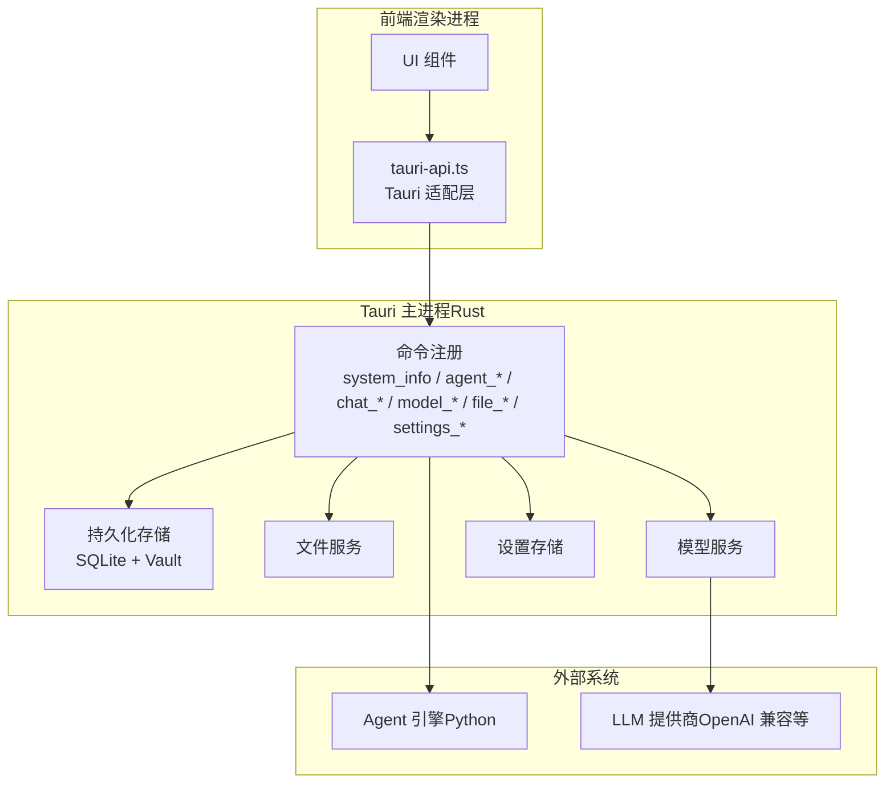
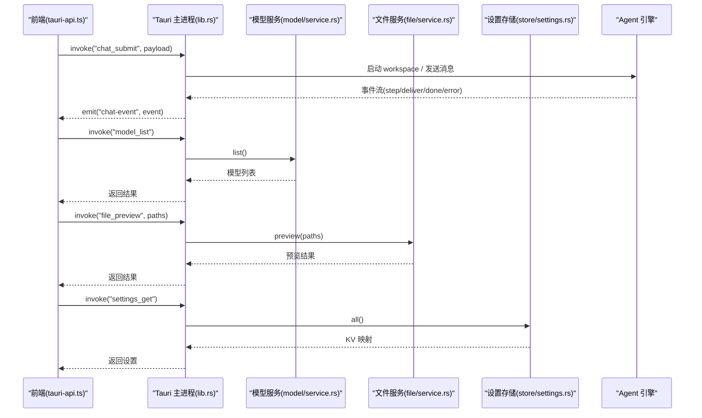
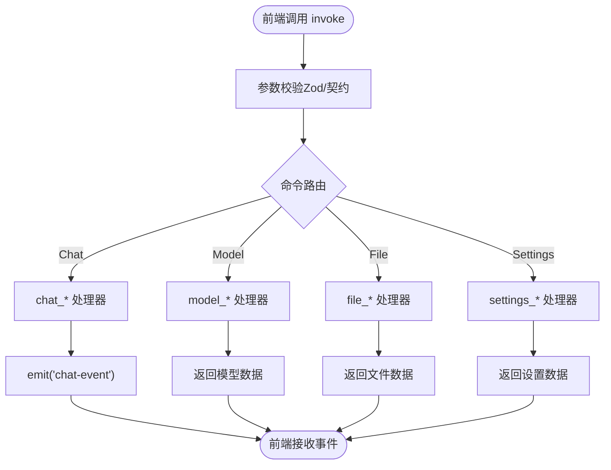
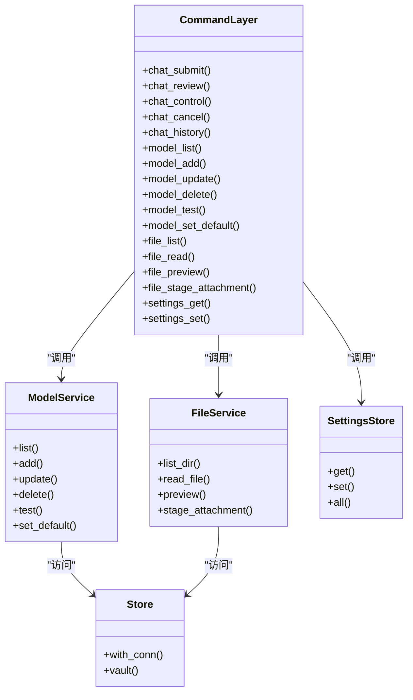

# API 接口

<cite>
**本文引用的文件**   
- [lib.rs](file://tongtian-tauri/src-tauri/src/lib.rs)
- [service.rs（模型服务）](file://tongtian-tauri/src-tauri/src/model/service.rs)
- [service.rs（文件服务）](file://tongtian-tauri/src-tauri/src/file/service.rs)
- [settings.rs（设置存储）](file://tongtian-tauri/src-tauri/src/store/settings.rs)
- [contracts.ts（IPC 通道与类型）](file://tongtian-tauri/src/shared/contracts.ts)
- [types.ts（扩展类型）](file://tongtian-tauri/src/shared/types.ts)
- [tauri-api.ts（前端 Tauri 适配层）](file://tongtian-tauri/src/renderer/lib/tauri-api.ts)
- [index.d.ts（预加载类型声明）](file://tongtian-tauri/src/preload/index.d.ts)
</cite>

## 目录
1. [简介](#简介)
2. [项目结构](#项目结构)
3. [核心组件](#核心组件)
4. [架构总览](#架构总览)
5. [详细组件分析](#详细组件分析)
6. [依赖关系分析](#依赖关系分析)
7. [性能考虑](#性能考虑)
8. [故障排查指南](#故障排查指南)
9. [结论](#结论)
10. [附录](#附录)

## 简介
本文件为通天办公的 Tauri 后端 API 接口文档，覆盖 Agent 控制、任务管理、模型管理、文件操作与设置管理等全部命令。文档基于仓库中的 Rust 命令实现、共享类型定义以及前端适配层进行梳理，给出每个接口的参数类型、返回值格式、错误码定义与调用示例，并说明 IPC 通信机制、事件协议、数据类型定义及前后端数据同步策略。

## 项目结构
- Tauri 后端入口与命令注册位于 Rust 模块中，统一通过 tauri::command 暴露给前端。
- 共享契约与类型定义在 TypeScript 侧集中维护，确保前后端一致。
- 前端通过 @tauri-apps/api 的 invoke/listen 调用命令与订阅事件。

图表来源
- [lib.rs:794-822](file://tongtian-tauri/src-tauri/src/lib.rs#L794-L822)
- [tauri-api.ts:39-84](file://tongtian-tauri/src/renderer/lib/tauri-api.ts#L39-L84)

章节来源
- [lib.rs:794-822](file://tongtian-tauri/src-tauri/src/lib.rs#L794-L822)
- [tauri-api.ts:39-84](file://tongtian-tauri/src/renderer/lib/tauri-api.ts#L39-L84)

## 核心组件
- 命令注册中心：统一暴露所有 tauri::command，包括 Agent 控制、任务管理、模型管理、文件操作与设置管理。
- 模型服务：提供模型配置的 CRUD、连通性自测与默认模型设置。
- 文件服务：提供工作区文件浏览、读取、预览与附件暂存能力，内置白名单校验与大小限制。
- 设置存储：KV 键值对读写，支持一次性获取全部设置项。
- 事件总线：通过 Tauri 事件推送任务状态变更、错误与完成事件，前端可订阅处理。

章节来源
- [lib.rs:794-822](file://tongtian-tauri/src-tauri/src/lib.rs#L794-L822)
- [service.rs（模型服务）:126-169](file://tongtian-tauri/src-tauri/src/model/service.rs#L126-L169)
- [service.rs（文件服务）:137-171](file://tongtian-tauri/src-tauri/src/file/service.rs#L137-L171)
- [settings.rs:33-48](file://tongtian-tauri/src-tauri/src/store/settings.rs#L33-L48)

## 架构总览
下图展示从前端到后端的完整调用链路，包括命令调用、服务层处理与事件回推。

图表来源
- [lib.rs:127-237](file://tongtian-tauri/src-tauri/src/lib.rs#L127-L237)
- [service.rs（模型服务）:126-169](file://tongtian-tauri/src-tauri/src/model/service.rs#L126-L169)
- [service.rs（文件服务）:213-256](file://tongtian-tauri/src-tauri/src/file/service.rs#L213-L256)
- [settings.rs:33-48](file://tongtian-tauri/src-tauri/src/store/settings.rs#L33-L48)

## 详细组件分析

### Agent 控制接口
- agent_status
  - 功能：查询桥接状态（Python 探测结果与各 workspace 实例）。
  - 参数：无。
  - 返回：包含状态信息的 JSON。
  - 错误码：无（成功返回状态对象）。
  - 调用示例：前端通过 systemHealth 或直接 invoke('agent_status') 获取。

- agent_start_workspace
  - 功能：启动指定 workspace 的 Agent 实例。
  - 参数：workspace_id（字符串）。
  - 返回：{ workspaceId, port }。
  - 错误码：启动失败时抛出异常（由上层捕获）。
  - 调用示例：invoke('agent_start_workspace', { workspaceId })。

- agent_stop_workspace
  - 功能：停止指定 workspace 的 Agent 实例。
  - 参数：workspace_id（字符串）。
  - 返回：{ success: true }。
  - 错误码：停止失败时抛出异常。
  - 调用示例：invoke('agent_stop_workspace', { workspaceId })。

章节来源
- [lib.rs:62-87](file://tongtian-tauri/src-tauri/src/lib.rs#L62-L87)
- [tauri-api.ts:168-169](file://tongtian-tauri/src/renderer/lib/tauri-api.ts#L168-L169)

### 任务管理接口
- chat_submit
  - 功能：提交新任务（两阶段协议：stage=plan 生成计划待审阅）。
  - 参数：workspace_id（可选）、goal（字符串）、attachments（附件数组，可选）。
  - 返回：{ taskId, workspaceId, status }。
  - 错误码：配额耗尽（QUOTA_EXCEEDED）、任务已运行（TASK_ALREADY_RUNNING）、桥接错误（BRIDGE_ERROR）。
  - 调用示例：invoke('chat_submit', { goal, attachments })。

- chat_review
  - 功能：审阅计划（approve/reject/modify），触发状态转移。
  - 参数：task_id（字符串）、action（枚举）、patch（可选）、workspace_id（可选）。
  - 返回：{ ok, taskId, status }。
  - 错误码：VALIDATION_ERROR（状态不匹配）、BRIDGE_ERROR（执行失败）。
  - 调用示例：invoke('chat_review', { taskId, action, patch })。

- chat_control
  - 功能：任务控制（pause/resume/rollback_to）。
  - 参数：task_id（字符串）、action（枚举）、step_id（可选）、workspace_id（可选）。
  - 返回：{ ok, taskId, status }。
  - 错误码：VALIDATION_ERROR（状态不匹配）、BRIDGE_CONTROL_FAILED（控制失败）。
  - 调用示例：invoke('chat_control', { taskId, action, stepId })。

- chat_cancel
  - 功能：取消任务（非终态 → cancelled）。
  - 参数：task_id（字符串）、workspace_id（可选）。
  - 返回：{ taskId, cancelled, engine }。
  - 错误码：无（幂等取消）。
  - 调用示例：invoke('chat_cancel', { taskId })。

- chat_history
  - 功能：历史任务（tasks 表，按更新时间倒序，含 14 态 meta）。
  - 参数：limit（可选）。
  - 返回：TaskSummary[]。
  - 错误码：无。
  - 调用示例：invoke('chat_history', { limit })。

章节来源
- [lib.rs:127-237](file://tongtian-tauri/src-tauri/src/lib.rs#L127-L237)
- [lib.rs:239-390](file://tongtian-tauri/src-tauri/src/lib.rs#L239-L390)
- [lib.rs:392-483](file://tongtian-tauri/src-tauri/src/lib.rs#L392-L483)
- [lib.rs:485-526](file://tongtian-tauri/src-tauri/src/lib.rs#L485-L526)
- [lib.rs:528-555](file://tongtian-tauri/src-tauri/src/lib.rs#L528-L555)
- [contracts.ts:480-584](file://tongtian-tauri/src/shared/contracts.ts#L480-L584)

### 模型管理接口
- model_list
  - 功能：列出全部模型配置。
  - 参数：无。
  - 返回：ModelConfig[]。
  - 错误码：无。
  - 调用示例：invoke('model_list')。

- model_add
  - 功能：添加模型（密钥存 vault；is_default 时清除其他默认）。
  - 参数：req（ModelAddReq）。
  - 返回：ModelConfig。
  - 错误码：VALIDATION_ERROR（name/modelName 为空）、MODEL_WRITE_FAILED（写入失败）。
  - 调用示例：invoke('model_add', { req })。

- model_update
  - 功能：更新模型（部分字段；api_key 空串=清除密钥）。
  - 参数：req（ModelUpdateReq）。
  - 返回：ModelConfig。
  - 错误码：MODEL_NOT_FOUND（id 不存在）、MODEL_WRITE_FAILED（写入失败）。
  - 调用示例：invoke('model_update', { req })。

- model_delete
  - 功能：删除模型（连同 vault 密钥）。
  - 参数：id（字符串）。
  - 返回：{ ok: true }。
  - 错误码：MODEL_NOT_FOUND（id 不存在）。
  - 调用示例：invoke('model_delete', { id })。

- model_test
  - 功能：连通性自测（OpenAI 兼容 /chat/completions 最小探测）。
  - 参数：req（ModelTestReq）。
  - 返回：ModelTestResp（ok, latencyMs, model, error, availableModels）。
  - 错误码：MODEL_CONNECTION_FAILED、MODEL_AUTH_FAILED（HTTP 401/403）。
  - 调用示例：invoke('model_test', { req })。

- model_set_default
  - 功能：设为默认（清除其他默认位）。
  - 参数：id（字符串）。
  - 返回：{ ok: true }。
  - 错误码：MODEL_NOT_FOUND（id 不存在）。
  - 调用示例：invoke('model_set_default', { id })。

章节来源
- [lib.rs:603-660](file://tongtian-tauri/src-tauri/src/lib.rs#L603-L660)
- [service.rs（模型服务）:126-169](file://tongtian-tauri/src-tauri/src/model/service.rs#L126-L169)
- [service.rs（模型服务）:178-215](file://tongtian-tauri/src-tauri/src/model/service.rs#L178-L215)
- [service.rs（模型服务）:262-316](file://tongtian-tauri/src-tauri/src/model/service.rs#L262-L316)
- [service.rs（模型服务）:319-329](file://tongtian-tauri/src-tauri/src/model/service.rs#L319-L329)
- [service.rs（模型服务）:348-421](file://tongtian-tauri/src-tauri/src/model/service.rs#L348-L421)
- [service.rs（模型服务）:332-345](file://tongtian-tauri/src-tauri/src/model/service.rs#L332-L345)

### 文件操作接口
- file_list
  - 功能：列出工作区文件（白名单校验）。
  - 参数：dir_path（字符串）、workspace_id（可选）。
  - 返回：FileInfo[]。
  - 错误码：FILE_NOT_FOUND（目录不存在）、FILE_ACCESS_DENIED（越界访问）。
  - 调用示例：invoke('file_list', { dirPath, workspaceId })。

- file_read
  - 功能：读取文本文件（白名单 + 2MB 上限）。
  - 参数：file_path（字符串）、workspace_id（可选）。
  - 返回：{ path, content }。
  - 错误码：FILE_NOT_FOUND（文件不存在）、FILE_TOO_LARGE（超过 2MB）、FILE_READ_FAILED（二进制文件）。
  - 调用示例：invoke('file_read', { filePath, workspaceId })。

- file_preview
  - 功能：批量预览（txt/md/csv/json 直读；docx/xlsx/pdf 返回元信息 + 转换未落地提示）。
  - 参数：file_paths（字符串数组）、workspace_id（可选）。
  - 返回：FilePreview[]。
  - 错误码：FILE_ACCESS_DENIED（越界访问）、FILE_CONVERSION_FAILED（格式转换未落地）。
  - 调用示例：invoke('file_preview', { filePaths, workspaceId })。

- file_stage_attachment
  - 功能：附件暂存（复制到运行目录并返回 AttachmentMeta）。
  - 参数：src_path（字符串）、task_id（可选）、workspace_id（可选）。
  - 返回：AttachmentMeta（fileName, stagedPath, sizeBytes, mime, sensitivity）。
  - 错误码：FILE_NOT_FOUND（源文件不存在）、FILE_REJECTED（不支持的格式或超大小）、FILE_BACKUP_FAILED（复制失败）。
  - 调用示例：invoke('file_stage_attachment', { srcPath, taskId, workspaceId })。

章节来源
- [lib.rs:682-744](file://tongtian-tauri/src-tauri/src/lib.rs#L682-L744)
- [service.rs（文件服务）:137-171](file://tongtian-tauri/src-tauri/src/file/service.rs#L137-L171)
- [service.rs（文件服务）:174-197](file://tongtian-tauri/src-tauri/src/file/service.rs#L174-L197)
- [service.rs（文件服务）:213-256](file://tongtian-tauri/src-tauri/src/file/service.rs#L213-L256)
- [service.rs（文件服务）:272-345](file://tongtian-tauri/src-tauri/src/file/service.rs#L272-L345)

### 设置管理接口
- settings_get
  - 功能：读取全部设置项（settings_kv）。
  - 参数：无。
  - 返回：Map<string, string>。
  - 错误码：无。
  - 调用示例：invoke('settings_get')。

- settings_set
  - 功能：写入单个设置项（覆盖）。
  - 参数：key（字符串）、value（字符串）。
  - 返回：{ ok: true, key }。
  - 错误码：无。
  - 调用示例：invoke('settings_set', { key, value })。

章节来源
- [lib.rs:664-678](file://tongtian-tauri/src-tauri/src/lib.rs#L664-L678)
- [settings.rs:33-48](file://tongtian-tauri/src-tauri/src/store/settings.rs#L33-L48)
- [settings.rs:20-30](file://tongtian-tauri/src-tauri/src/store/settings.rs#L20-L30)

### IPC 通信机制与事件协议
- 命令调用：前端通过 tauri-api.ts 的 invoke 调用 Rust 命令，参数与返回类型由 shared 契约保证。
- 事件订阅：前端通过 listen('chat-event') 订阅任务状态变更、错误与完成事件。
- 事件流守卫：前端使用 EventStreamGuard 进行 seq 去重与缺口检测，必要时触发 eventReplay 补齐。

图表来源
- [tauri-api.ts:146-165](file://tongtian-tauri/src/renderer/lib/tauri-api.ts#L146-L165)
- [lib.rs:89-102](file://tongtian-tauri/src-tauri/src/lib.rs#L89-L102)

章节来源
- [tauri-api.ts:146-165](file://tongtian-tauri/src/renderer/lib/tauri-api.ts#L146-L165)
- [contracts.ts:480-584](file://tongtian-tauri/src/shared/contracts.ts#L480-L584)

### 数据类型定义
- 错误码：ErrorCode 枚举涵盖模型、文件、任务、配置、工作区、技能、MCP、沙箱、合规、桥接、调度与通用错误。
- 任务状态：TaskStatus 枚举包含 14 态（原 9 态 + 云端演进增量 5 态）。
- 附件元数据：AttachmentMeta 包含文件名、暂存路径、大小、MIME 与敏感度。
- 模型配置：ModelConfig 包含名称、源、基础 URL、模型名、上下文窗口、是否默认、绑定信息等。
- 设置数据：AppSettingsData 包含语言、主题、UI 风格、聊天字体、代理模式、隐私模式等。

章节来源
- [contracts.ts:15-109](file://tongtian-tauri/src/shared/contracts.ts#L15-L109)
- [types.ts:3-25](file://tongtian-tauri/src/shared/types.ts#L3-L25)
- [service.rs（文件服务）:45-52](file://tongtian-tauri/src-tauri/src/file/service.rs#L45-L52)
- [service.rs（模型服务）:11-33](file://tongtian-tauri/src-tauri/src/model/service.rs#L11-L33)
- [contracts.ts:449-476](file://tongtian-tauri/src/shared/contracts.ts#L449-L476)

### 前后端数据同步策略
- 本地优先：任务状态与事件在本地持久化（SQLite + EventStore），确保应用可用。
- 事件重放：支持 24h 持久化与 ≥10min 重放窗口，seq > fromSeq 拉取缺失事件。
- 配额闸门：四档预警（70/85/95/100%），动作链降级→排队→阻断。
- 租约机制：单设备持有活跃租约，禁止抢占；超时回收触发重新排队。

章节来源
- [lib.rs:747-793](file://tongtian-tauri/src-tauri/src/lib.rs#L747-L793)
- [lib.rs:834-873](file://tongtian-tauri/src-tauri/src/lib.rs#L834-L873)
- [contracts.ts:288-321](file://tongtian-tauri/src/shared/contracts.ts#L288-L321)

## 依赖关系分析
- 命令层依赖服务层：chat_* 依赖 AgentBridge 与任务注册表；model_* 依赖模型服务；file_* 依赖文件服务；settings_* 依赖设置存储。
- 服务层依赖持久化：模型服务与文件服务均通过 Store 访问 SQLite；模型密钥通过 Vault 存取。
- 事件驱动：任务状态变更通过 Tauri 事件推送，前端订阅处理。

图表来源
- [lib.rs:794-822](file://tongtian-tauri/src-tauri/src/lib.rs#L794-L822)
- [service.rs（模型服务）:126-169](file://tongtian-tauri/src-tauri/src/model/service.rs#L126-L169)
- [service.rs（文件服务）:137-171](file://tongtian-tauri/src-tauri/src/file/service.rs#L137-L171)
- [settings.rs:33-48](file://tongtian-tauri/src-tauri/src/store/settings.rs#L33-L48)

章节来源
- [lib.rs:794-822](file://tongtian-tauri/src-tauri/src/lib.rs#L794-L822)

## 性能考虑
- 事件存储异步刷盘：后台任务批量写入磁盘，减少 I/O 阻塞。
- 租约扫描循环：定时扫描超时租约，避免资源泄漏。
- 文件读取限制：2MB 上限防止大文件导致内存压力。
- 模型测试超时：10s 超时避免长时间等待。

章节来源
- [lib.rs:826-832](file://tongtian-tauri/src-tauri/src/lib.rs#L826-L832)
- [lib.rs:834-873](file://tongtian-tauri/src-tauri/src/lib.rs#L834-L873)
- [service.rs（文件服务）:17-19](file://tongtian-tauri/src-tauri/src/file/service.rs#L17-L19)
- [service.rs（模型服务）:367-375](file://tongtian-tauri/src-tauri/src/model/service.rs#L367-L375)

## 故障排查指南
- 常见错误码：
  - VALIDATION_ERROR：参数校验失败。
  - MODEL_NOT_FOUND：模型 ID 不存在。
  - FILE_NOT_FOUND：文件或目录不存在。
  - FILE_ACCESS_DENIED：路径不在白名单内。
  - TASK_ALREADY_RUNNING：任务已被其他端持有。
  - BRIDGE_ERROR：Agent 桥接错误。
- 排查步骤：
  - 检查前端传入参数是否符合契约。
  - 查看后端日志确认错误位置。
  - 验证文件路径是否在白名单内。
  - 确认模型配置与密钥是否正确。
  - 检查任务状态与租约情况。

章节来源
- [contracts.ts:15-109](file://tongtian-tauri/src/shared/contracts.ts#L15-L109)
- [lib.rs:142-165](file://tongtian-tauri/src-tauri/src/lib.rs#L142-L165)
- [service.rs（文件服务）:118-132](file://tongtian-tauri/src-tauri/src/file/service.rs#L118-L132)
- [service.rs（模型服务）:348-421](file://tongtian-tauri/src-tauri/src/model/service.rs#L348-L421)

## 结论
本 API 文档全面覆盖了通天办公的 Tauri 后端接口，包括 Agent 控制、任务管理、模型管理、文件操作与设置管理。通过统一的命令注册与事件机制，实现了前后端的高效通信与数据同步。建议在实际使用中严格遵循契约定义，合理处理错误码，并利用事件重放与配额闸门提升系统稳定性与用户体验。

## 附录
- 前端类型声明：preload/index.d.ts 提供了 TongtianAPI 的完整类型定义，便于前端开发。
- 共享契约：shared/contracts.ts 与 shared/types.ts 定义了所有 IPC 通道与数据类型，确保前后端一致性。

章节来源
- [index.d.ts:38-143](file://tongtian-tauri/src/preload/index.d.ts#L38-L143)
- [contracts.ts:480-584](file://tongtian-tauri/src/shared/contracts.ts#L480-L584)
- [types.ts:256-346](file://tongtian-tauri/src/shared/types.ts#L256-L346)