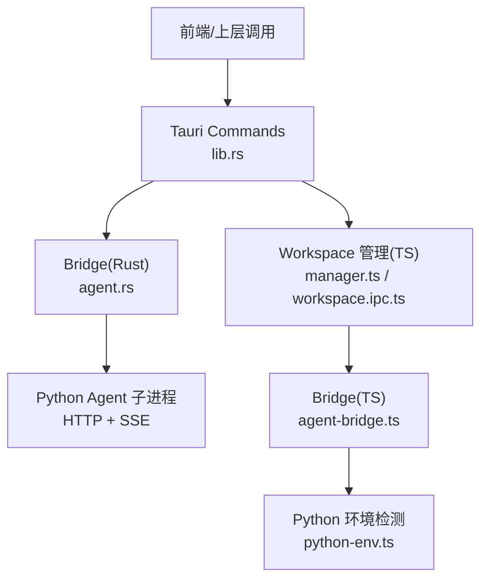
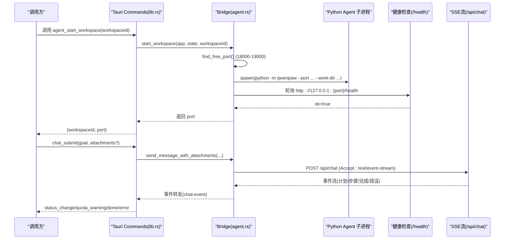
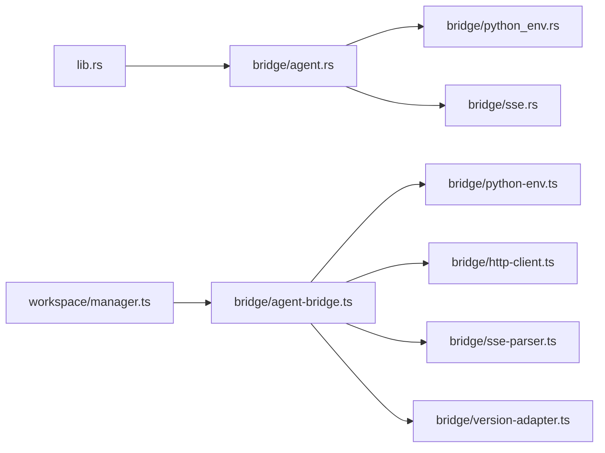

# Agent 控制接口

<cite>
**本文引用的文件**
- [lib.rs](file://tongtian-tauri/src-tauri/src/lib.rs)
- [agent.rs](file://tongtian-tauri/src-tauri/src/bridge/agent.rs)
- [mod.rs](file://tongtian-tauri/src-tauri/src/bridge/mod.rs)
- [python-env.ts](file://tongtian-tauri/src/main/bridge/python-env.ts)
- [agent-bridge.ts](file://tongtian-tauri/src/main/bridge/agent-bridge.ts)
- [workspace.ipc.ts](file://tongtian-tauri/src/main/ipc/workspace.ipc.ts)
- [manager.ts](file://tongtian-tauri/src/main/workspace/manager.ts)
- [types.ts](file://tongtian-tauri/src/shared/types.ts)
- [contracts.ts](file://tongtian-tauri/src/shared/contracts.ts)
</cite>

## 目录
1. [简介](#简介)
2. [项目结构](#项目结构)
3. [核心组件](#核心组件)
4. [架构总览](#架构总览)
5. [详细组件分析](#详细组件分析)
6. [依赖关系分析](#依赖关系分析)
7. [性能考量](#性能考量)
8. [故障排查指南](#故障排查指南)
9. [结论](#结论)
10. [附录：调用示例与错误处理模式](#附录调用示例与错误处理模式)

## 简介
本文件面向“Agent 控制接口”的完整技术文档，聚焦 Tauri 命令层对 Python Agent 引擎的桥接与控制。重点覆盖以下三个命令：
- agent_status：查询桥接状态（Python 环境、各 workspace 实例状态）
- agent_start_workspace：启动指定工作区的 Agent 子进程实例
- agent_stop_workspace：停止指定工作区的 Agent 子进程实例

文档将详细说明每个接口的参数类型、返回值格式、错误码与异常恢复策略；阐述工作区实例的生命周期管理、端口分配策略、进程间通信机制（HTTP + SSE），以及与 Python Agent 引擎的集成方式、健康检查机制和异常恢复策略。

## 项目结构
Tauri 后端通过 Rust 暴露命令，内部使用 bridge 模块管理 Python Agent 子进程与 HTTP/SSE 通信；Electron 侧也有对应的 TypeScript 实现用于对比与兼容。关键路径如下：
- Tauri 入口与命令注册：src-tauri/src/lib.rs
- Bridge 实现（Rust）：src-tauri/src/bridge/agent.rs
- Bridge 模块组织：src-tauri/src/bridge/mod.rs
- Electron 侧 Bridge（TS）：src/main/bridge/agent-bridge.ts
- Python 环境探测与启动参数：src/main/bridge/python-env.ts
- Workspace IPC 处理器：src/main/ipc/workspace.ipc.ts
- Workspace 管理器（TS）：src/main/workspace/manager.ts
- 共享类型与契约：src/shared/types.ts, src/shared/contracts.ts

图表来源
- [lib.rs:62-87](file://tongtian-tauri/src-tauri/src/lib.rs#L62-L87)
- [agent.rs:119-262](file://tongtian-tauri/src-tauri/src/bridge/agent.rs#L119-L262)
- [agent-bridge.ts:131-247](file://tongtian-tauri/src/main/bridge/agent-bridge.ts#L131-L247)
- [python-env.ts:141-152](file://tongtian-tauri/src/main/bridge/python-env.ts#L141-L152)

章节来源
- [lib.rs:1-120](file://tongtian-tauri/src-tauri/src/lib.rs#L1-L120)
- [agent.rs:1-120](file://tongtian-tauri/src-tauri/src/bridge/agent.rs#L1-L120)
- [agent-bridge.ts:1-120](file://tongtian-tauri/src/main/bridge/agent-bridge.ts#L1-L120)

## 核心组件
- Tauri 命令层（lib.rs）
  - 暴露 agent_status、agent_start_workspace、agent_stop_workspace 等命令
  - 统一返回 Result<Value, String>，错误以字符串形式抛出，便于前端解析
- Bridge（Rust，agent.rs）
  - 管理 Python 子进程生命周期、端口分配、健康检查、SSE 事件流转发
  - 支持 Mock、agentscope、qwenpaw 三种引擎模式
- Bridge（TS，agent-bridge.ts）
  - Electron 侧等价实现，提供 startWorkspace、stopWorkspace、sendMessage、callTool 等方法
- Python 环境（python-env.ts）
  - 探测 Python 安装、Agent 包、生成启动命令与工作目录
- Workspace 管理（manager.ts + workspace.ipc.ts）
  - 封装工作区创建、暂停、恢复、归档、销毁等操作，并驱动 Bridge 启动/停止子进程

章节来源
- [lib.rs:62-87](file://tongtian-tauri/src-tauri/src/lib.rs#L62-L87)
- [agent.rs:70-120](file://tongtian-tauri/src-tauri/src/bridge/agent.rs#L70-L120)
- [agent-bridge.ts:94-127](file://tongtian-tauri/src/main/bridge/agent-bridge.ts#L94-L127)
- [python-env.ts:39-82](file://tongtian-tauri/src/main/bridge/python-env.ts#L39-L82)
- [workspace.ipc.ts:55-148](file://tongtian-tauri/src/main/ipc/workspace.ipc.ts#L55-L148)
- [manager.ts:56-127](file://tongtian-tauri/src/main/workspace/manager.ts#L56-L127)

## 架构总览
下图展示从 Tauri 命令到 Python Agent 子进程的完整调用链，包括健康检查、SSE 事件流与错误传播。

图表来源
- [lib.rs:68-87](file://tongtian-tauri/src-tauri/src/lib.rs#L68-L87)
- [agent.rs:119-262](file://tongtian-tauri/src-tauri/src/bridge/agent.rs#L119-L262)
- [agent.rs:684-703](file://tongtian-tauri/src-tauri/src/bridge/agent.rs#L684-L703)

## 详细组件分析

### 命令：agent_status
- 功能：查询桥接状态（Python 探测结果与各 workspace 实例状态）
- 输入参数：无
- 返回值：JSON 对象，包含 Python 信息与实例列表（由 bridge_status 实现）
- 错误处理：正常返回；若未初始化或内部错误，返回字符串错误（由上层捕获）

章节来源
- [lib.rs:62-65](file://tongtian-tauri/src-tauri/src/lib.rs#L62-L65)
- [agent.rs:109-114](file://tongtian-tauri/src-tauri/src/bridge/agent.rs#L109-L114)

### 命令：agent_start_workspace
- 功能：为指定 workspace 启动一个独立的 Python Agent 子进程，分配唯一端口，等待健康检查通过后就绪
- 输入参数：
  - workspaceId: string（工作区标识）
- 返回值：
  - { workspaceId: string, port: number }
- 关键流程：
  - 端口分配：在 18000-19000 范围内寻找可用端口
  - 工作目录：确保 workspaces/{workspaceId} 存在
  - 子进程启动：根据 TT_ENGINE 环境变量选择 agentscope/qwenpaw/Mock 模式
  - 健康检查：轮询 /health，最长 30s
  - 后台巡检：每 10s 检查进程存活与健康，连续失败 3 次标记 error
- 错误处理：
  - BRIDGE_PYTHON_NOT_FOUND：未检测到 Python 3.10+
  - BRIDGE_AGENT_NOT_FOUND：未检测到对应引擎包
  - BRIDGE_NO_FREE_PORT：端口范围无可用端口
  - BRIDGE_START_TIMEOUT：健康检查超时
  - BRIDGE_SPAWN_FAILED：子进程启动失败

章节来源
- [lib.rs:68-76](file://tongtian-tauri/src-tauri/src/lib.rs#L68-L76)
- [agent.rs:119-262](file://tongtian-tauri/src-tauri/src/bridge/agent.rs#L119-L262)
- [agent.rs:92-103](file://tongtian-tauri/src-tauri/src/bridge/agent.rs#L92-L103)
- [agent.rs:281-286](file://tongtian-tauri/src-tauri/src/bridge/agent.rs#L281-L286)

### 命令：agent_stop_workspace
- 功能：停止指定 workspace 的 Agent 子进程，释放端口，清理状态
- 输入参数：
  - workspaceId: string（工作区标识）
- 返回值：
  - { success: boolean }
- 关键流程：
  - 查找实例并移除记录
  - 终止进程（Windows 使用 taskkill，Unix 使用 kill -9）
  - 释放端口并广播 stopped 状态
- 错误处理：
  - 未找到实例时返回错误字符串

章节来源
- [lib.rs:79-87](file://tongtian-tauri/src-tauri/src/lib.rs#L79-L87)
- [agent.rs:360-398](file://tongtian-tauri/src-tauri/src/bridge/agent.rs#L360-L398)

### 工作区实例生命周期管理（TS 版对照）
- startWorkspace：
  - 检测 Python 与 Agent 安装
  - 分配端口、创建工作目录、写入配置
  - 启动子进程、等待健康检查、版本适配
  - 启动后台健康检查（10s 间隔，连续失败 3 次标记 error）
  - 事件回调：instance-status、instance-error、agent-event
- stopWorkspace：
  - 优雅关闭（SIGTERM，超时后 SIGKILL）
  - 清理定时器、释放端口、更新状态
- sendMessage/callTool：
  - 基于版本适配的 HTTP 请求与 SSE 流消费
  - 错误恢复：异常时回退 ready 状态

章节来源
- [agent-bridge.ts:131-247](file://tongtian-tauri/src/main/bridge/agent-bridge.ts#L131-L247)
- [agent-bridge.ts:253-299](file://tongtian-tauri/src/main/bridge/agent-bridge.ts#L253-L299)
- [agent-bridge.ts:304-346](file://tongtian-tauri/src/main/bridge/agent-bridge.ts#L304-L346)
- [agent-bridge.ts:351-394](file://tongtian-tauri/src/main/bridge/agent-bridge.ts#L351-L394)

### 端口分配策略
- 范围：18000-19000（两端一致）
- 算法：顺序扫描，尝试绑定 127.0.0.1:{port}，成功则加入已用集合
- 释放：实例停止或崩溃退出时释放端口

章节来源
- [agent.rs:92-103](file://tongtian-tauri/src-tauri/src/bridge/agent.rs#L92-L103)
- [agent-bridge.ts:57-83](file://tongtian-tauri/src/main/bridge/agent-bridge.ts#L57-L83)

### 进程间通信机制（HTTP + SSE）
- 健康检查：GET /health
- 提交任务：POST /api/chat（Accept: text/event-stream）
- 审阅任务：POST /api/chat/review
- 控制任务：POST /api/chat/control
- 取消任务：POST /api/chat/cancel
- 事件重放：GET /api/events/replay?task_id=...&from_seq=...

章节来源
- [agent.rs:684-703](file://tongtian-tauri/src-tauri/src/bridge/agent.rs#L684-L703)
- [agent.rs:706-724](file://tongtian-tauri/src-tauri/src/bridge/agent.rs#L706-L724)
- [agent.rs:727-754](file://tongtian-tauri/src-tauri/src/bridge/agent.rs#L727-L754)
- [agent.rs:543-565](file://tongtian-tauri/src-tauri/src/bridge/agent.rs#L543-L565)
- [agent.rs:518-541](file://tongtian-tauri/src-tauri/src/bridge/agent.rs#L518-L541)

### 健康检查与异常恢复
- 启动阶段：轮询 /health，最长 30s，失败则报错
- 运行阶段：每 10s 检查一次，连续失败 3 次标记 error 并停止巡检
- 进程退出：非零退出码标记 error，正常退出标记 stopped
- 断线补齐：SSE 中断后按 seq 重放缺失事件（gap 修复）

章节来源
- [agent.rs:220-262](file://tongtian-tauri/src-tauri/src/bridge/agent.rs#L220-L262)
- [agent.rs:307-356](file://tongtian-tauri/src-tauri/src/bridge/agent.rs#L307-L356)
- [agent.rs:757-800](file://tongtian-tauri/src-tauri/src/bridge/agent.rs#L757-L800)

### 与 Python Agent 引擎的集成方式
- 引擎模式：
  - TT_ENGINE=qwenpaw：使用 qwenpaw 引擎
  - TT_ENGINE=agentscope：使用 agentscope 引擎
  - TT_AGENT_MOCK=1：Mock 引擎（纯模拟事件）
- 启动命令：
  - python -m qwenpaw --port {port} --work-dir {workDir}
  - 或通过 agentscope_engine_command/mock_agent_command 生成

章节来源
- [agent.rs:144-180](file://tongtian-tauri/src-tauri/src/bridge/agent.rs#L144-L180)
- [python-env.ts:141-152](file://tongtian-tauri/src/main/bridge/python-env.ts#L141-L152)

## 依赖关系分析
- lib.rs 依赖 bridge::agent（Rust）
- bridge::agent 依赖 python_env（Rust）、sse（Rust）
- Electron 侧 manager.ts 依赖 agent-bridge.ts
- agent-bridge.ts 依赖 python-env.ts、http-client.ts、sse-parser.ts、version-adapter.ts

图表来源
- [lib.rs:17-31](file://tongtian-tauri/src-tauri/src/lib.rs#L17-L31)
- [mod.rs:1-7](file://tongtian-tauri/src-tauri/src/bridge/mod.rs#L1-L7)
- [manager.ts:1-20](file://tongtian-tauri/src/main/workspace/manager.ts#L1-L20)
- [agent-bridge.ts:1-20](file://tongtian-tauri/src/main/bridge/agent-bridge.ts#L1-L20)

章节来源
- [lib.rs:17-31](file://tongtian-tauri/src-tauri/src/lib.rs#L17-L31)
- [mod.rs:1-7](file://tongtian-tauri/src-tauri/src/bridge/mod.rs#L1-L7)
- [manager.ts:1-20](file://tongtian-tauri/src/main/workspace/manager.ts#L1-L20)
- [agent-bridge.ts:1-20](file://tongtian-tauri/src/main/bridge/agent-bridge.ts#L1-L20)

## 性能考量
- 端口分配顺序扫描，避免冲突但可能在高并发下耗时；建议限制最大尝试次数
- 健康检查轮询间隔 10s，超时 30s，平衡快速失败与网络抖动
- SSE 事件批量 emit，降低调度开销；通道容量 1024，背压保护
- 进程日志泵异步读取 stdout/stderr，避免阻塞主循环

[本节为通用指导，不直接分析具体文件]

## 故障排查指南
- 常见错误码与含义：
  - BRIDGE_PYTHON_NOT_FOUND：未检测到 Python 3.10+
  - BRIDGE_AGENT_NOT_FOUND：未检测到对应引擎包
  - BRIDGE_NO_FREE_PORT：端口范围无可用端口
  - BRIDGE_START_TIMEOUT：健康检查超时
  - BRIDGE_SPAWN_FAILED：子进程启动失败
  - BRIDGE_COMM_FAILED：通信失败（SSE/HTTP）
- 排查步骤：
  - 确认 Python 与 Agent 安装正确
  - 检查端口占用情况（18000-19000）
  - 查看子进程 stdout/stderr 日志
  - 验证 /health 端点可达
  - 检查 SSE 流是否中断及重放逻辑

章节来源
- [agent.rs:142-180](file://tongtian-tauri/src-tauri/src/bridge/agent.rs#L142-L180)
- [agent.rs:281-286](file://tongtian-tauri/src-tauri/src/bridge/agent.rs#L281-L286)
- [agent.rs:757-800](file://tongtian-tauri/src-tauri/src/bridge/agent.rs#L757-L800)

## 结论
Agent 控制接口通过 Tauri 命令层与 Rust Bridge 实现了稳定的 Python Agent 子进程管理与 HTTP/SSE 通信。端口分配、健康检查、事件重放与异常恢复机制确保了高可用性。开发者可依据本文档进行集成与扩展，同时参考 TS 版 Bridge 实现进行对比与兼容。

[本节为总结性内容，不直接分析具体文件]

## 附录：调用示例与错误处理模式

### 调用示例（概念性）
- 启动工作区实例：
  - 调用 agent_start_workspace(workspaceId)
  - 成功返回 { workspaceId, port }
  - 失败返回错误字符串（如 BRIDGE_NO_FREE_PORT）
- 停止工作区实例：
  - 调用 agent_stop_workspace(workspaceId)
  - 成功返回 { success: true }
  - 失败返回错误字符串（如未找到实例）
- 查询桥接状态：
  - 调用 agent_status()
  - 返回 JSON 对象（Python 信息 + 实例列表）

### 错误处理模式
- 统一捕获字符串错误，映射为 ErrorCode（如 VALIDATION_ERROR、INTERNAL_ERROR）
- 前端根据 code 字段决定重试、降级或提示用户
- 对于 SSE 流错误，自动回退 ready 状态并重试连接

章节来源
- [contracts.ts:15-109](file://tongtian-tauri/src/shared/contracts.ts#L15-L109)
- [types.ts:291-303](file://tongtian-tauri/src/shared/types.ts#L291-L303)