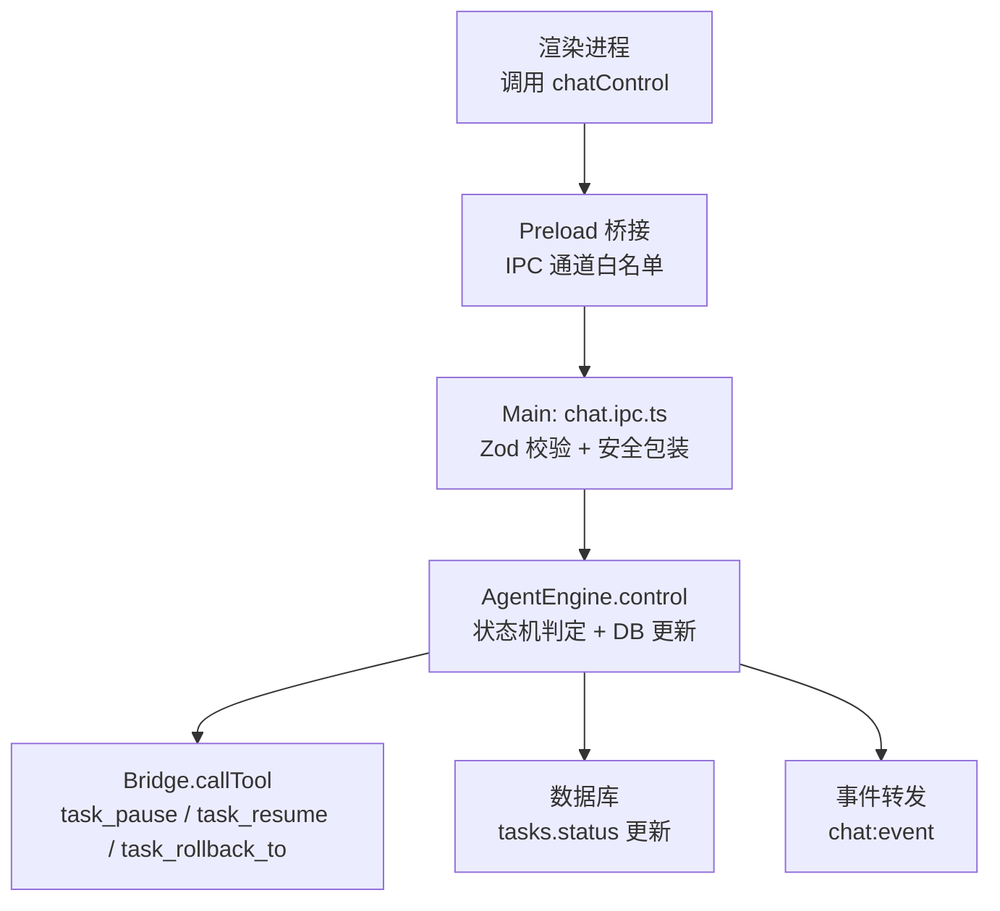
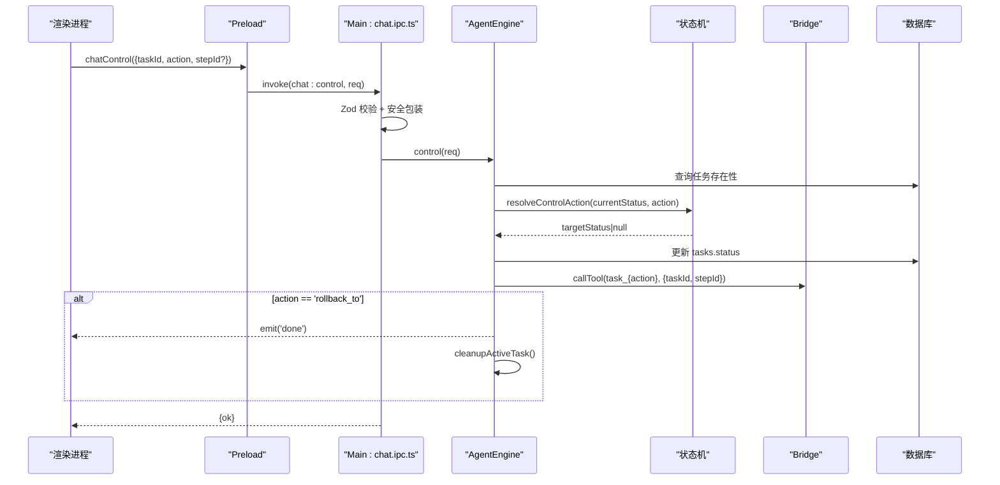
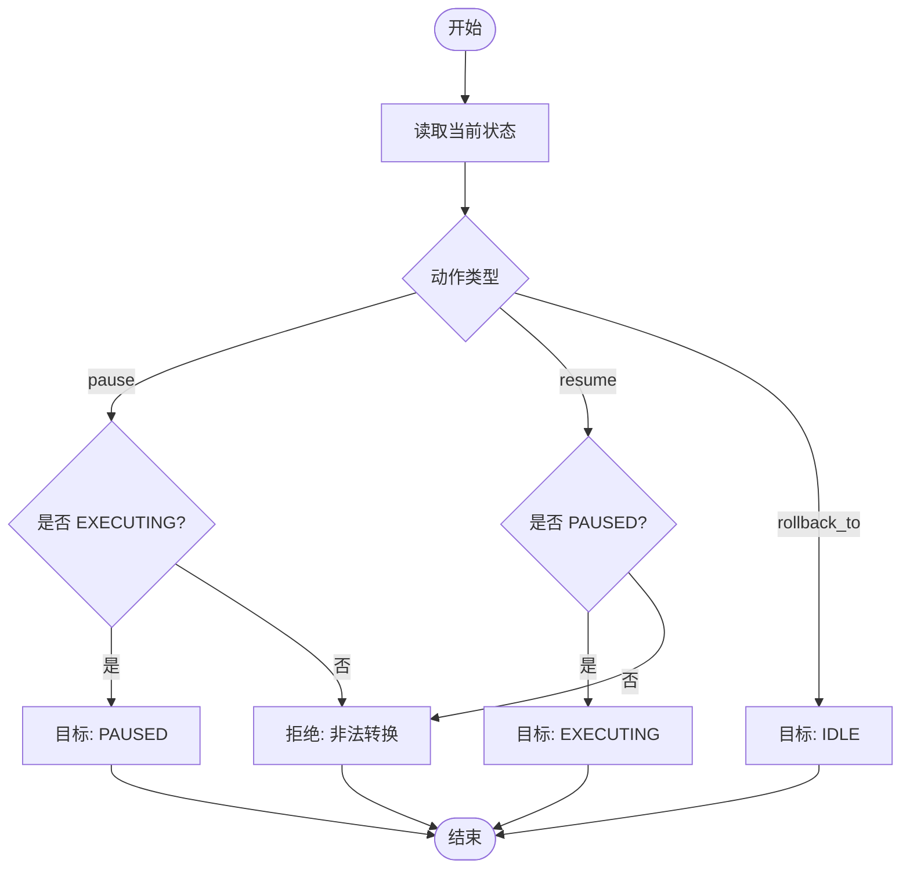
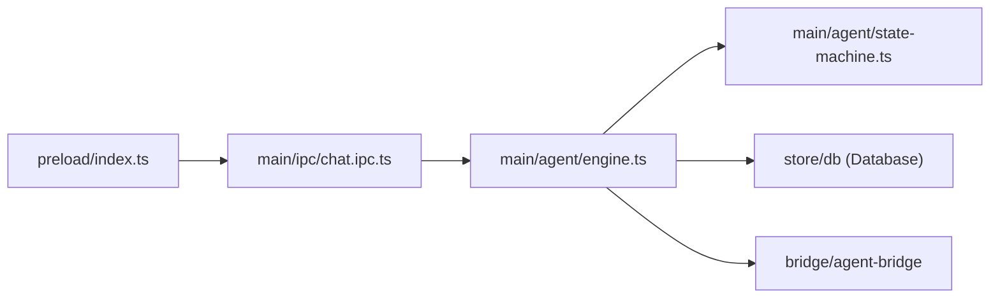

# 任务控制接口

<cite>
**本文引用的文件**
- [engine.ts](file://tongtian-tauri/src/main/agent/engine.ts)
- [state-machine.ts](file://tongtian-tauri/src/main/agent/state-machine.ts)
- [chat.ipc.ts](file://tongtian-tauri/src/main/ipc/chat.ipc.ts)
- [index.ts（preload）](file://tongtian-tauri/src/preload/index.ts)
- [types.ts](file://tongtian-tauri/src/shared/types.ts)
- [contracts.ts](file://tongtian-tauri/src/shared/contracts.ts)
</cite>

## 目录
1. [简介](#简介)
2. [项目结构](#项目结构)
3. [核心组件](#核心组件)
4. [架构总览](#架构总览)
5. [详细组件分析](#详细组件分析)
6. [依赖关系分析](#依赖关系分析)
7. [性能与并发考虑](#性能与并发考虑)
8. [故障排查指南](#故障排查指南)
9. [结论](#结论)
10. [附录：调用示例与恢复场景](#附录调用示例与恢复场景)

## 简介
本文件面向“任务控制接口”，聚焦 chat_control 的三种控制操作：pause（暂停执行）、resume（继续执行）、rollback_to（回滚到指定步骤）。文档从权限校验、状态机转换、与 Agent 引擎的控制命令交互、step_id 参数验证、文件级恢复机制、租约释放逻辑、错误处理、状态一致性保证以及并发控制策略等维度进行系统化说明，并提供调用示例与故障恢复场景。

## 项目结构
围绕 chat_control 的关键路径如下：
- 渲染层通过 preload 暴露的 chatControl 方法发起 IPC 调用
- Main 进程 chat.ipc.ts 对请求进行 Zod 校验并路由至 AgentEngine.control
- AgentEngine 基于状态机确定目标状态，持久化状态变更，并通过 Bridge 向 Agent 发送控制命令
- 对于 rollback_to，引擎在完成控制后触发事件并清理活跃任务

图表来源
- [index.ts（preload）:113-115](file://tongtian-tauri/src/preload/index.ts#L113-L115)
- [chat.ipc.ts:151-162](file://tongtian-tauri/src/main/ipc/chat.ipc.ts#L151-L162)
- [engine.ts:187-239](file://tongtian-tauri/src/main/agent/engine.ts#L187-L239)
- [state-machine.ts:141-159](file://tongtian-tauri/src/main/agent/state-machine.ts#L141-L159)

章节来源
- [index.ts（preload）:113-115](file://tongtian-tauri/src/preload/index.ts#L113-L115)
- [chat.ipc.ts:151-162](file://tongtian-tauri/src/main/ipc/chat.ipc.ts#L151-L162)
- [engine.ts:187-239](file://tongtian-tauri/src/main/agent/engine.ts#L187-L239)
- [state-machine.ts:141-159](file://tongtian-tauri/src/main/agent/state-machine.ts#L141-L159)

## 核心组件
- 控制入口与校验
  - chat.ipc.ts 使用 Zod 定义 chatControlSchema，强制 action 为 pause/resume/rollback_to，可选 stepId
  - 通过 safeHandler 统一捕获异常并返回结构化错误码
- 引擎控制流程
  - engine.ts 的 control 方法负责：
    - 查询任务是否存在且处于活跃状态
    - 根据当前状态与动作计算目标状态（状态机）
    - 持久化状态变更
    - 通过 Bridge 将控制命令下发给 Agent
    - 对 rollback_to 额外触发完成事件并清理活跃任务
- 状态机
  - state-machine.ts 定义 TRANSITION_RULES 与 resolveControlAction
  - pause：仅允许从 EXECUTING → PAUSED
  - resume：仅允许从 PAUSED → EXECUTING
  - rollback_to：映射为目标 IDLE（用于后续重试或重新规划）

章节来源
- [chat.ipc.ts:31-35](file://tongtian-tauri/src/main/ipc/chat.ipc.ts#L31-L35)
- [chat.ipc.ts:63-83](file://tongtian-tauri/src/main/ipc/chat.ipc.ts#L63-L83)
- [engine.ts:187-239](file://tongtian-tauri/src/main/agent/engine.ts#L187-L239)
- [state-machine.ts:31-63](file://tongtian-tauri/src/main/agent/state-machine.ts#L31-L63)
- [state-machine.ts:141-159](file://tongtian-tauri/src/main/agent/state-machine.ts#L141-L159)

## 架构总览
下图展示一次 chat_control 调用的端到端时序，包括校验、状态转换、Bridge 命令下发与事件转发。

图表来源
- [index.ts（preload）:113-115](file://tongtian-tauri/src/preload/index.ts#L113-L115)
- [chat.ipc.ts:151-162](file://tongtian-tauri/src/main/ipc/chat.ipc.ts#L151-L162)
- [engine.ts:187-239](file://tongtian-tauri/src/main/agent/engine.ts#L187-L239)
- [state-machine.ts:141-159](file://tongtian-tauri/src/main/agent/state-machine.ts#L141-L159)

## 详细组件分析

### 控制入口与参数校验（chat.ipc.ts）
- 使用 Zod 严格校验 action 枚举与 taskId 必填，stepId 可选
- 通过 safeHandler 将未捕获异常转换为结构化 AppError（包含 ErrorCode）
- 将请求转发至 AgentEngine.control

关键要点
- 非法 action 或缺失 taskId 会直接在校验阶段失败，避免无效请求进入引擎
- 所有异常均被包装为统一错误格式，便于前端统一处理

章节来源
- [chat.ipc.ts:31-35](file://tongtian-tauri/src/main/ipc/chat.ipc.ts#L31-L35)
- [chat.ipc.ts:63-83](file://tongtian-tauri/src/main/ipc/chat.ipc.ts#L63-L83)
- [chat.ipc.ts:151-162](file://tongtian-tauri/src/main/ipc/chat.ipc.ts#L151-L162)

### 引擎控制流程（engine.ts）
- 控制前检查：
  - 任务是否存在
  - 是否属于活跃任务（activeTasks 中存在）
- 状态机决策：
  - 依据当前状态与控制动作计算目标状态
  - 若不可达则拒绝并记录警告日志
- 状态持久化：
  - 通过 transitionTask 更新 tasks.status
- 控制命令下发：
  - 通过 Bridge.callTool 发送 task_pause / task_resume / task_rollback_to
  - 携带 taskId 与 stepId（rollback_to 时由上层传入）
- 回滚后处理：
  - 对 rollback_to 触发 done 事件并清理活跃任务

注意
- 若 Bridge 调用失败，仍会返回 ok=true（因为本地状态已更新），但需关注日志与后续重试策略

章节来源
- [engine.ts:187-239](file://tongtian-tauri/src/main/agent/engine.ts#L187-L239)
- [engine.ts:459-478](file://tongtian-tauri/src/main/agent/engine.ts#L459-L478)

### 状态机与转换规则（state-machine.ts）
- 转换规则表定义了各状态允许的下一状态及触发器
- resolveControlAction 将控制动作映射为目标状态：
  - pause：EXECUTING → PAUSED
  - resume：PAUSED → EXECUTING
  - rollback_to：→ IDLE（用于后续重试或重新规划）
- 任何非法转换将被拒绝并记录警告

图表来源
- [state-machine.ts:31-63](file://tongtian-tauri/src/main/agent/state-machine.ts#L31-L63)
- [state-machine.ts:141-159](file://tongtian-tauri/src/main/agent/state-machine.ts#L141-L159)

章节来源
- [state-machine.ts:31-63](file://tongtian-tauri/src/main/agent/state-machine.ts#L31-L63)
- [state-machine.ts:141-159](file://tongtian-tauri/src/main/agent/state-machine.ts#L141-L159)

### 与 Agent 引擎的控制命令交互（Bridge）
- 控制命令以工具调用形式下发：task_pause / task_resume / task_rollback_to
- 参数：
  - taskId：必传
  - stepId：可选（在 rollback_to 场景中由上层传入）
- 当 Bridge 调用失败时，引擎记录错误日志但不影响本地状态更新

章节来源
- [engine.ts:219-230](file://tongtian-tauri/src/main/agent/engine.ts#L219-L230)

### rollback_to 的 step_id 参数验证与文件级恢复机制
- 参数验证
  - stepId 在 IPC 层为可选字符串；若提供，将随控制命令一并下发给 Agent
- 文件级恢复
  - 具体恢复实现位于 Agent 侧（Python 运行时），通过 tool 名称 task_rollback_to 触发
  - 引擎侧不直接操作文件系统，而是委托 Agent 完成文件级回滚与资源清理
- 租约释放
  - 引擎在 rollback_to 完成后触发 done 事件并清理活跃任务
  - 租约相关逻辑（心跳、超时回收、空闲释放）由 Agent/Bridge 层维护；引擎侧通过清理活跃任务间接参与释放流程

章节来源
- [chat.ipc.ts:31-35](file://tongtian-tauri/src/main/ipc/chat.ipc.ts#L31-L35)
- [engine.ts:219-239](file://tongtian-tauri/src/main/agent/engine.ts#L219-L239)

### 权限与安全
- 通道白名单
  - preload 中明确允许 CHAT_CONTROL 通道，防止任意 IPC 调用
- 输入校验
  - Zod 强约束 action 与 taskId，避免恶意或畸形请求
- 错误隔离
  - safeHandler 将异常转换为结构化错误，避免泄露内部细节

章节来源
- [index.ts（preload）:11-89](file://tongtian-tauri/src/preload/index.ts#L11-L89)
- [chat.ipc.ts:31-35](file://tongtian-tauri/src/main/ipc/chat.ipc.ts#L31-L35)
- [chat.ipc.ts:63-83](file://tongtian-tauri/src/main/ipc/chat.ipc.ts#L63-L83)

### 并发控制策略
- 活跃任务集合
  - engine.ts 使用 Map 维护 activeTasks，确保同一时刻对任务的唯一控制上下文
- 取消与清理
  - cancelTask/cancelAll 通过 AbortController 中断事件流并清理活跃任务
- 状态一致性
  - 所有状态变更通过 transitionTask 统一落库，避免竞态导致的状态不一致

章节来源
- [engine.ts:270-288](file://tongtian-tauri/src/main/agent/engine.ts#L270-L288)
- [engine.ts:459-478](file://tongtian-tauri/src/main/agent/engine.ts#L459-L478)

## 依赖关系分析
- 模块耦合
  - chat.ipc.ts 依赖 contracts.ts 中的类型与常量，依赖 engine.ts 的核心控制能力
  - engine.ts 依赖 state-machine.ts 的状态规则，依赖 Database 与 Bridge
  - preload/index.ts 仅暴露受控通道，降低攻击面
- 外部依赖
  - Bridge 作为与 Agent 进程的通信桥梁，承担实际的控制命令执行
  - 数据库用于持久化任务状态与审计信息

图表来源
- [index.ts（preload）:11-89](file://tongtian-tauri/src/preload/index.ts#L11-L89)
- [chat.ipc.ts:151-162](file://tongtian-tauri/src/main/ipc/chat.ipc.ts#L151-L162)
- [engine.ts:187-239](file://tongtian-tauri/src/main/agent/engine.ts#L187-L239)

章节来源
- [index.ts（preload）:11-89](file://tongtian-tauri/src/preload/index.ts#L11-L89)
- [chat.ipc.ts:151-162](file://tongtian-tauri/src/main/ipc/chat.ipc.ts#L151-L162)
- [engine.ts:187-239](file://tongtian-tauri/src/main/agent/engine.ts#L187-L239)

## 性能与并发考虑
- 控制命令为轻量同步调用，主要开销在于状态机判断与数据库更新
- 事件流处理采用异步迭代，避免阻塞主循环
- 建议：
  - 对频繁的控制请求做客户端去抖
  - 对 Bridge 调用增加超时与重试上限，避免长尾延迟
  - 监控 Bridge 调用失败率，及时告警

[本节为通用指导，无需特定文件引用]

## 故障排查指南
- 常见错误码
  - VALIDATION_ERROR：参数校验失败（如 action 非法、taskId 缺失）
  - INTERNAL_ERROR：未捕获异常或系统内部错误
  - TASK_NOT_FOUND/TASK_ALREADY_RUNNING：任务不存在或不在预期状态
  - BRIDGE_COMMUNICATION_FAILED：与 Agent 通信失败
- 定位步骤
  - 检查 IPC 层日志（safeHandler 输出）
  - 检查引擎日志（状态转换失败、Bridge 调用失败）
  - 核对状态机规则，确认当前状态是否允许该动作
- 恢复建议
  - 对 Bridge 失败：重试或降级为本地状态回滚
  - 对状态非法：提示用户先切换到可执行状态（如先 resume 再执行）

章节来源
- [chat.ipc.ts:63-83](file://tongtian-tauri/src/main/ipc/chat.ipc.ts#L63-L83)
- [engine.ts:219-230](file://tongtian-tauri/src/main/agent/engine.ts#L219-L230)
- [contracts.ts:15-109](file://tongtian-tauri/src/shared/contracts.ts#L15-L109)

## 结论
chat_control 接口通过严格的参数校验、清晰的状态机规则与统一的错误处理，实现了安全的任务控制能力。pause/resume 精确控制执行生命周期，rollback_to 借助 Agent 侧的文件级恢复与租约释放机制，保障状态一致性与资源安全。结合并发控制与事件驱动模型，系统在复杂场景下仍能保持稳定与可观测性。

[本节为总结性内容，无需特定文件引用]

## 附录：调用示例与恢复场景

### 调用示例
- 暂停执行
  - 请求体：{ taskId: "...", action: "pause" }
  - 预期结果：任务状态从 executing → paused，Agent 收到 task_pause
- 继续执行
  - 请求体：{ taskId: "...", action: "resume" }
  - 预期结果：任务状态从 paused → executing，Agent 收到 task_resume
- 回滚到指定步骤
  - 请求体：{ taskId: "...", action: "rollback_to", stepId: "..." }
  - 预期结果：任务状态转为 idle，Agent 收到 task_rollback_to，随后触发 done 并清理活跃任务

章节来源
- [chat.ipc.ts:31-35](file://tongtian-tauri/src/main/ipc/chat.ipc.ts#L31-L35)
- [engine.ts:219-239](file://tongtian-tauri/src/main/agent/engine.ts#L219-L239)
- [state-machine.ts:141-159](file://tongtian-tauri/src/main/agent/state-machine.ts#L141-L159)

### 典型恢复场景
- 场景一：Bridge 调用失败
  - 现象：本地状态已更新，但 Agent 未响应
  - 处理：记录错误日志，前端提示“控制已生效，等待 Agent 响应”；必要时重试
- 场景二：非法状态转换
  - 现象：在非 executing 状态调用 pause
  - 处理：返回 VALIDATION_ERROR 或业务拒绝，提示用户先切换到可执行状态
- 场景三：rollback_to 后需要重新规划
  - 现象：任务回到 idle
  - 处理：前端触发 submit 重新生成计划，或引导用户修改目标后再次提交

章节来源
- [engine.ts:219-239](file://tongtian-tauri/src/main/agent/engine.ts#L219-L239)
- [chat.ipc.ts:63-83](file://tongtian-tauri/src/main/ipc/chat.ipc.ts#L63-L83)