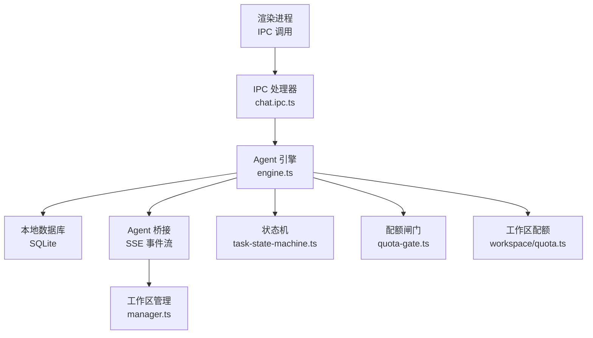
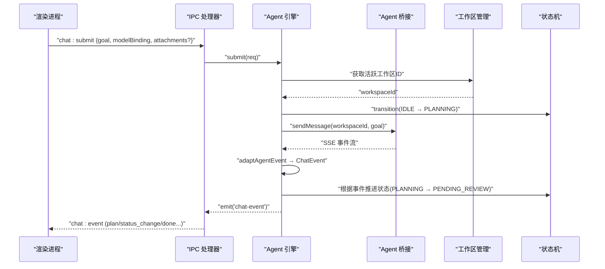
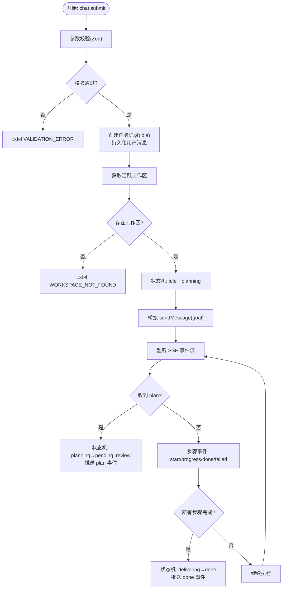
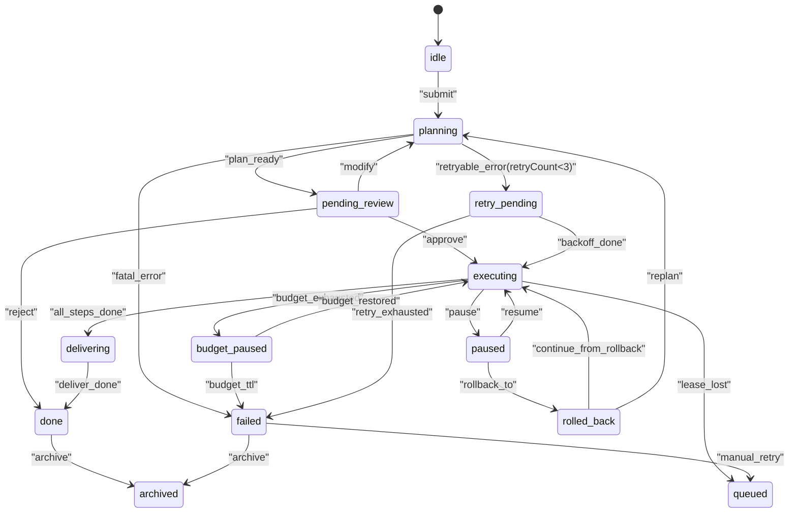
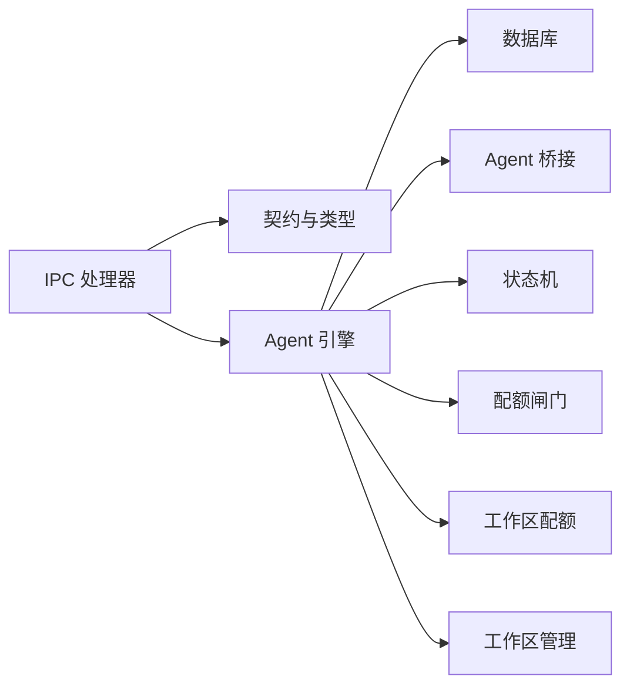

# 任务生命周期接口

<cite>
**本文引用的文件**
- [chat.ipc.ts](file://tongtian-tauri/src/main/ipc/chat.ipc.ts)
- [engine.ts](file://tongtian-tauri/src/main/agent/engine.ts)
- [task-state-machine.ts](file://tongtian-tauri/src/shared/task-state-machine.ts)
- [types.ts](file://tongtian-tauri/src/shared/types.ts)
- [contracts.ts](file://tongtian-tauri/src/shared/contracts.ts)
- [quota-gate.ts](file://tongtian-tauri/src/shared/quota-gate.ts)
- [manager.ts](file://tongtian-tauri/src/main/workspace/manager.ts)
- [quota.ts](file://tongtian-tauri/src/main/workspace/quota.ts)
</cite>

## 目录
1. [简介](#简介)
2. [项目结构](#项目结构)
3. [核心组件](#核心组件)
4. [架构总览](#架构总览)
5. [详细组件分析](#详细组件分析)
6. [依赖关系分析](#依赖关系分析)
7. [性能考量](#性能考量)
8. [故障排查指南](#故障排查指南)
9. [结论](#结论)
10. [附录：调用示例与最佳实践](#附录调用示例与最佳实践)

## 简介
本文件面向“任务生命周期接口”，聚焦 chat_submit（提交任务）与 chat_history（历史查询）两个核心接口的实现细节，并围绕两阶段协议（计划与执行）、状态机流转、配额闸门、租约机制、事件推送、工作区隔离与异步处理等高级特性进行系统化说明。文档同时给出请求参数、响应格式、错误码定义及调用示例，帮助读者快速理解并正确集成。

## 项目结构
- IPC 层负责接收渲染进程请求，校验参数后转发至 Agent 引擎；同时将引擎事件通过 IPC 通道推送到渲染端。
- Agent 引擎维护任务状态机、持久化任务与消息、驱动工作区与 Agent 子进程交互，并将 SSE 事件转换为 ChatEvent 向上游推送。
- 共享类型与契约定义了任务状态、事件、错误码、配额快照、附件元数据等跨进程契约。
- 工作区管理器负责工作区的创建、启动、暂停、恢复、归档与销毁，提供活跃工作区列表供任务调度使用。
- 配额闸门与工作区配额控制器分别提供全局配额策略与按工作区的资源限制控制。

图表来源
- [chat.ipc.ts:122-189](file://tongtian-tauri/src/main/ipc/chat.ipc.ts#L122-L189)
- [engine.ts:50-102](file://tongtian-tauri/src/main/agent/engine.ts#L50-L102)
- [manager.ts:56-127](file://tongtian-tauri/src/main/workspace/manager.ts#L56-L127)
- [task-state-machine.ts:63-133](file://tongtian-tauri/src/shared/task-state-machine.ts#L63-L133)
- [quota-gate.ts:37-54](file://tongtian-tauri/src/shared/quota-gate.ts#L37-L54)
- [quota.ts:45-100](file://tongtian-tauri/src/main/workspace/quota.ts#L45-L100)

章节来源
- [chat.ipc.ts:122-189](file://tongtian-tauri/src/main/ipc/chat.ipc.ts#L122-L189)
- [engine.ts:50-102](file://tongtian-tauri/src/main/agent/engine.ts#L50-L102)
- [manager.ts:56-127](file://tongtian-tauri/src/main/workspace/manager.ts#L56-L127)
- [task-state-machine.ts:63-133](file://tongtian-tauri/src/shared/task-state-machine.ts#L63-L133)
- [quota-gate.ts:37-54](file://tongtian-tauri/src/shared/quota-gate.ts#L37-L54)
- [quota.ts:45-100](file://tongtian-tauri/src/main/workspace/quota.ts#L45-L100)

## 核心组件
- IPC 处理器：注册 chat:submit、chat:review、chat:control、chat:history 等通道，统一参数校验与异常包装，并建立事件转发管道。
- Agent 引擎：负责任务提交、计划审阅、运行控制、历史查询；维护活跃任务、状态机转换、事件适配与持久化。
- 状态机：定义 14 态任务状态与 35 条合法转移，支持 wait_reason 子态、重试上限、终态判定等。
- 配额闸门：四档阈值（70/85/95/100%），动作链 notify→degrade→queue→block，并提供阻断与排队判断、档位变化检测。
- 工作区管理：工作区生命周期与隔离，提供活跃工作区列表，构建工作区配置并启动/停止子进程。
- 工作区配额：按工作区维度控制并发步骤、内存、模型调用与队列深度，提供告警与状态查询。

章节来源
- [chat.ipc.ts:17-83](file://tongtian-tauri/src/main/ipc/chat.ipc.ts#L17-L83)
- [engine.ts:50-102](file://tongtian-tauri/src/main/agent/engine.ts#L50-L102)
- [task-state-machine.ts:16-43](file://tongtian-tauri/src/shared/task-state-machine.ts#L16-L43)
- [quota-gate.ts:9-18](file://tongtian-tauri/src/shared/quota-gate.ts#L9-L18)
- [manager.ts:33-52](file://tongtian-tauri/src/main/workspace/manager.ts#L33-L52)
- [quota.ts:9-30](file://tongtian-tauri/src/main/workspace/quota.ts#L9-L30)

## 架构总览
下图展示从渲染进程发起 chat:submit 到事件回推到渲染端的完整链路，包括状态机推进、工作区选择、Agent 桥接与事件适配。

图表来源
- [chat.ipc.ts:127-136](file://tongtian-tauri/src/main/ipc/chat.ipc.ts#L127-L136)
- [engine.ts:56-102](file://tongtian-tauri/src/main/agent/engine.ts#L56-L102)
- [engine.ts:295-331](file://tongtian-tauri/src/main/agent/engine.ts#L295-L331)
- [engine.ts:351-454](file://tongtian-tauri/src/main/agent/engine.ts#L351-L454)
- [task-state-machine.ts:63-133](file://tongtian-tauri/src/shared/task-state-machine.ts#L63-L133)

## 详细组件分析

### chat_submit（提交任务）
- 入口与校验
  - IPC 通道：chat:submit
  - 参数校验：Zod schema 校验 goal、modelBinding、taskId（可选）
  - 错误包装：非法输入返回 VALIDATION_ERROR
- 引擎处理
  - 创建任务记录（初始状态 idle），持久化用户消息
  - 选择活跃工作区（无则失败并返回 WORKSPACE_NOT_FOUND）
  - 状态机推进：idle → planning
  - 通过桥接发送目标到 Agent，进入后台事件监听
- 事件与状态推进
  - 收到 plan 事件：持久化计划，推进到 pending_review，推送 plan 事件
  - 步骤事件：step_start/progress/done/failed，逐步推进执行与交付
  - 完成事件：deliver/done，推进 delivering → done，清理活跃任务
- 配额闸门
  - 新提交前可结合 evaluateQuota 与 shouldBlock/shouldQueue 决策是否拒绝或排队
  - 100% 阻断时返回 QUOTA_EXCEEDED（新提交）或 BUDGET_EXHAUSTED（运行中）
- 附件暂存
  - 支持 AttachmentMeta 列表（fileName/stagedPath/sizeBytes/mime/sensitivity），随提交携带
- 工作区隔离
  - 基于活跃工作区 ID 路由到对应 Agent 子进程，确保数据与执行隔离
- 异步处理
  - 提交后立即返回 taskId，后续通过事件流更新状态与进度

图表来源
- [chat.ipc.ts:127-136](file://tongtian-tauri/src/main/ipc/chat.ipc.ts#L127-L136)
- [engine.ts:56-102](file://tongtian-tauri/src/main/agent/engine.ts#L56-L102)
- [engine.ts:295-331](file://tongtian-tauri/src/main/agent/engine.ts#L295-L331)
- [engine.ts:351-454](file://tongtian-tauri/src/main/agent/engine.ts#L351-L454)

章节来源
- [chat.ipc.ts:17-83](file://tongtian-tauri/src/main/ipc/chat.ipc.ts#L17-L83)
- [engine.ts:56-102](file://tongtian-tauri/src/main/agent/engine.ts#L56-L102)
- [engine.ts:295-331](file://tongtian-tauri/src/main/agent/engine.ts#L295-L331)
- [engine.ts:351-454](file://tongtian-tauri/src/main/agent/engine.ts#L351-L454)
- [types.ts:258-276](file://tongtian-tauri/src/shared/types.ts#L258-L276)
- [contracts.ts:121-158](file://tongtian-tauri/src/shared/contracts.ts#L121-L158)
- [quota-gate.ts:37-80](file://tongtian-tauri/src/shared/quota-gate.ts#L37-L80)

### chat_history（历史查询）
- 入口与校验
  - IPC 通道：chat:history
  - 参数：limit（可选，1-500）
- 引擎处理
  - 查询 tasks 表，按创建时间倒序取最近 N 条
  - 返回 TaskSummary 列表（id/title/status/createdAt/updatedAt）
- 用途
  - 渲染端用于任务列表展示、状态筛选、跳转详情

章节来源
- [chat.ipc.ts:166-174](file://tongtian-tauri/src/main/ipc/chat.ipc.ts#L166-L174)
- [engine.ts:244-258](file://tongtian-tauri/src/main/agent/engine.ts#L244-L258)
- [contracts.ts:278-286](file://tongtian-tauri/src/shared/contracts.ts#L278-L286)

### 两阶段协议与状态机
- 两阶段协议
  - 规划阶段：Agent 生成计划（plan），任务进入 pending_review，等待用户批准/拒绝/修改
  - 执行阶段：批准后进入 executing，逐步执行步骤，完成后进入 delivering，最终 done
- 状态机关键转移
  - submit: idle → queued/planning（当前实现直接 planning）
  - plan_ready: planning → pending_review
  - approve: pending_review → executing
  - reject: pending_review → done
  - modify: pending_review → planning
  - all_steps_done: executing → delivering
  - deliver_done: delivering → done
  - retryable_error/fatal_error: 视重试次数与错误类型路由到 retry_pending 或 failed
- 子态与原因码
  - wait_reason：rate_limited/circuit_break/quota_wait/budget_wait/lease_wait/user_pause/pending_review_ttl
  - statusReasonCode：如 QUEUE_TIMEOUT、LEASE_LOST、REJECTED 等

图表来源
- [task-state-machine.ts:63-133](file://tongtian-tauri/src/shared/task-state-machine.ts#L63-L133)
- [types.ts:4-25](file://tongtian-tauri/src/shared/types.ts#L4-L25)

章节来源
- [task-state-machine.ts:16-43](file://tongtian-tauri/src/shared/task-state-machine.ts#L16-L43)
- [task-state-machine.ts:63-133](file://tongtian-tauri/src/shared/task-state-machine.ts#L63-L133)
- [types.ts:27-41](file://tongtian-tauri/src/shared/types.ts#L27-L41)

### 配额闸门检查
- 四档阈值与动作
  - 70%：notify（仅提示）
  - 85%：degrade（降级到备用模型）
  - 95%：queue（新任务排队）
  - 100%：block（拒绝新提交；运行中转 budget_paused）
- 使用方式
  - evaluateQuota(usedTokens, quotaTokens) 计算当前档位与动作
  - shouldBlock(snapshot)/shouldQueue(snapshot) 决定拒绝或排队
  - tierChanged(prev, next) 仅在档位跃迁时触发预警事件，避免风暴
  - blockErrorCodeFor(isNewSubmission) 返回 QUOTA_EXCEEDED 或 BUDGET_EXHAUSTED

章节来源
- [quota-gate.ts:9-18](file://tongtian-tauri/src/shared/quota-gate.ts#L9-L18)
- [quota-gate.ts:37-80](file://tongtian-tauri/src/shared/quota-gate.ts#L37-L80)

### 租约管理机制
- 设计要点
  - 心跳周期、租约时长、超时回收、空闲释放由租约协议约定（ADJ-R2-4）
  - 本地 local-first：本地持有者恒为本设备；云端 Runner 池场景下需处理抢占与接管
- 状态联动
  - lease_lost：executing → queued（心跳超时 60s），从最后成功 step 恢复
  - statusReasonCode 可标记 LEASE_LOST
- 接口扩展
  - IPC_CHANNELS 包含 lease:info、lease:takeover、event:replay 等通道，便于上层管理与重放

章节来源
- [contracts.ts:290-309](file://tongtian-tauri/src/shared/contracts.ts#L290-L309)
- [contracts.ts:480-584](file://tongtian-tauri/src/shared/contracts.ts#L480-L584)
- [task-state-machine.ts:96-100](file://tongtian-tauri/src/shared/task-state-machine.ts#L96-L100)

### 事件推送机制
- 事件源
  - Agent 引擎通过 SSE 接收 Agent 子进程事件，适配为 ChatEvent
- 事件转发
  - 引擎 emit('chat-event')，IPC 层订阅并通过 'chat:event' 推送到渲染端
- 事件类型
  - plan、step_start、step_progress、step_done、step_failed、deliver、done、error
  - 三层架构演进新增：status_change、quota_warning、heartbeat
- 可靠性
  - 窗口关闭时移除监听，防止泄漏；事件包含 seq/taskId 便于排序与过滤

章节来源
- [chat.ipc.ts:85-112](file://tongtian-tauri/src/main/ipc/chat.ipc.ts#L85-L112)
- [engine.ts:483-485](file://tongtian-tauri/src/main/agent/engine.ts#L483-L485)
- [contracts.ts:146-158](file://tongtian-tauri/src/shared/contracts.ts#L146-L158)
- [types.ts:286-303](file://tongtian-tauri/src/shared/types.ts#L286-L303)

### 与 Agent 引擎的集成与事件流处理
- 集成点
  - IPC 层通过 getEngine() 获取引擎实例，调用 submit/review/control/getHistory
  - 引擎内部通过 bridge.sendMessage 向 Agent 子进程发送目标，并消费 SSE 事件流
- 事件处理
  - handleAgentEvent 将不同事件映射到状态机转移与持久化操作
  - adaptAgentEvent 将 AgentEvent 转为 ChatEvent 并向上游推送
- 控制流
  - review 支持 approve/reject/modify，分别推进状态并通知 Agent
  - control 支持 pause/resume/rollback_to，并调用 Agent 工具方法执行控制

章节来源
- [engine.ts:56-102](file://tongtian-tauri/src/main/agent/engine.ts#L56-L102)
- [engine.ts:107-185](file://tongtian-tauri/src/main/agent/engine.ts#L107-L185)
- [engine.ts:190-239](file://tongtian-tauri/src/main/agent/engine.ts#L190-L239)
- [engine.ts:295-331](file://tongtian-tauri/src/main/agent/engine.ts#L295-L331)
- [engine.ts:351-454](file://tongtian-tauri/src/main/agent/engine.ts#L351-L454)

## 依赖关系分析
- IPC 层依赖：contracts（通道名与类型）、engine（引擎实例）、logger（日志）
- 引擎依赖：Database（持久化）、Bridge（SSE 事件）、StateMachine（状态机）、Logger（日志）
- 工作区管理依赖：Bridge（启动/停止工作区）、Database（元数据持久化）
- 配额闸门与工作区配额：纯函数与控制器，被引擎与上层逻辑调用以做准入与限流决策

图表来源
- [chat.ipc.ts:122-189](file://tongtian-tauri/src/main/ipc/chat.ipc.ts#L122-L189)
- [engine.ts:50-102](file://tongtian-tauri/src/main/agent/engine.ts#L50-L102)
- [task-state-machine.ts:63-133](file://tongtian-tauri/src/shared/task-state-machine.ts#L63-L133)
- [quota-gate.ts:37-80](file://tongtian-tauri/src/shared/quota-gate.ts#L37-L80)
- [quota.ts:45-100](file://tongtian-tauri/src/main/workspace/quota.ts#L45-L100)
- [manager.ts:56-127](file://tongtian-tauri/src/main/workspace/manager.ts#L56-L127)

章节来源
- [chat.ipc.ts:122-189](file://tongtian-tauri/src/main/ipc/chat.ipc.ts#L122-L189)
- [engine.ts:50-102](file://tongtian-tauri/src/main/agent/engine.ts#L50-L102)
- [task-state-machine.ts:63-133](file://tongtian-tauri/src/shared/task-state-machine.ts#L63-L133)
- [quota-gate.ts:37-80](file://tongtian-tauri/src/shared/quota-gate.ts#L37-L80)
- [quota.ts:45-100](file://tongtian-tauri/src/main/workspace/quota.ts#L45-L100)
- [manager.ts:56-127](file://tongtian-tauri/src/main/workspace/manager.ts#L56-L127)

## 性能考量
- 本地优先与快速出队：queued 停留目标 <100ms，减少排队延迟
- 事件流背压：SSE 事件在引擎侧适配与过滤，避免渲染端过载
- 配额闸门：在高使用率时降级/排队/阻断，保护系统稳定性
- 工作区隔离：每个工作区独立子进程，避免资源争用与数据污染
- 重试与退避：retry_pending 配合 backoff，降低瞬时失败对整体吞吐的影响

[本节为通用指导，不直接分析具体文件]

## 故障排查指南
- 常见错误码
  - VALIDATION_ERROR：参数校验失败
  - INTERNAL_ERROR：IPC 处理异常
  - WORKSPACE_NOT_FOUND：无活跃工作区
  - BRIDGE_COMMUNICATION_FAILED：与 Agent 通信失败
  - TASK_EXECUTION_FAILED：任务执行失败
  - QUEUE_TIMEOUT：排队超时
  - LEASE_LOST：租约丢失
  - FILE_REJECTED：附件上传被拒
  - SYNC_CONFLICT：同步冲突
  - PAYMENT_GRACE：支付宽限期
  - DATA_TIER_BLOCKED：数据分级阻断
  - INJECTION_BLOCKED：提示词注入拦截
  - QUOTA_EXCEEDED/BUDGET_EXHAUSTED：配额/预算耗尽
- 排查建议
  - 检查 IPC 参数是否符合 Zod schema
  - 确认存在活跃工作区且已启动
  - 查看 SSE 事件流是否持续，必要时重启工作区
  - 关注配额闸门档位变化与警告事件
  - 检查租约心跳与超时回收逻辑

章节来源
- [chat.ipc.ts:47-83](file://tongtian-tauri/src/main/ipc/chat.ipc.ts#L47-L83)
- [contracts.ts:15-109](file://tongtian-tauri/src/shared/contracts.ts#L15-L109)
- [engine.ts:319-331](file://tongtian-tauri/src/main/agent/engine.ts#L319-L331)
- [quota-gate.ts:75-80](file://tongtian-tauri/src/shared/quota-gate.ts#L75-L80)

## 结论
本接口体系通过 IPC、引擎、状态机、配额闸门与工作区管理的协同，实现了任务从提交到完成的完整生命周期管理。两阶段协议保障了计划的可控性与执行的安全性；配额闸门与租约机制提升了系统的稳定性与可用性；事件流提供了实时反馈能力。结合工作区隔离与异步处理，系统具备良好的可扩展性与鲁棒性。

[本节为总结，不直接分析具体文件]

## 附录：调用示例与最佳实践
- 提交任务（chat:submit）
  - 请求体字段：
    - taskId：可选，若未提供则由引擎生成
    - goal：必填，任务目标描述
    - modelBinding：可选，模型绑定标识
    - attachments：可选，附件元数据列表（AttachmentMeta）
  - 响应：{ taskId }
  - 事件流：后续通过 'chat:event' 接收 plan、step_*、deliver、done、status_change、quota_warning、heartbeat 等事件
- 历史查询（chat:history）
  - 请求体字段：
    - limit：可选，1-500，默认 50
  - 响应：TaskSummary[]（id/title/status/createdAt/updatedAt）
- 附件暂存
  - 先通过文件相关 IPC 暂存附件，获得 stagedPath 与敏感度检测结果，再随提交携带
- 工作区隔离
  - 确保至少一个活跃工作区；任务自动路由到首个活跃工作区
- 异步处理
  - 提交后立即返回 taskId，前端订阅事件流进行状态更新与进度展示
- 配额闸门
  - 在提交前调用 evaluateQuota，若 shouldBlock 则拒绝并返回 QUOTA_EXCEEDED；若 shouldQueue 则排队等待
- 租约管理
  - 关注 status_change 中的 waitReason 与 statusReasonCode，处理 lease_lost 导致的恢复流程

章节来源
- [types.ts:258-276](file://tongtian-tauri/src/shared/types.ts#L258-L276)
- [contracts.ts:121-158](file://tongtian-tauri/src/shared/contracts.ts#L121-L158)
- [engine.ts:56-102](file://tongtian-tauri/src/main/agent/engine.ts#L56-L102)
- [engine.ts:244-258](file://tongtian-tauri/src/main/agent/engine.ts#L244-L258)
- [quota-gate.ts:37-80](file://tongtian-tauri/src/shared/quota-gate.ts#L37-L80)
- [contracts.ts:290-309](file://tongtian-tauri/src/shared/contracts.ts#L290-L309)