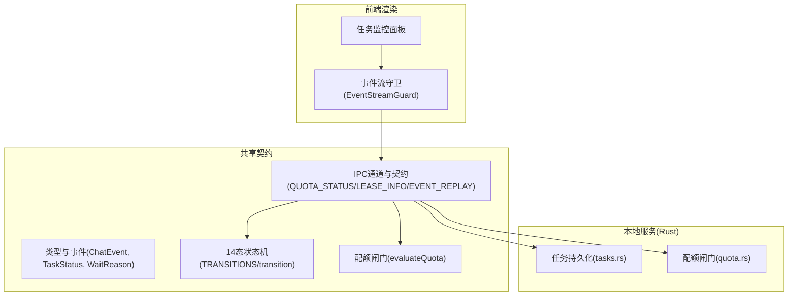
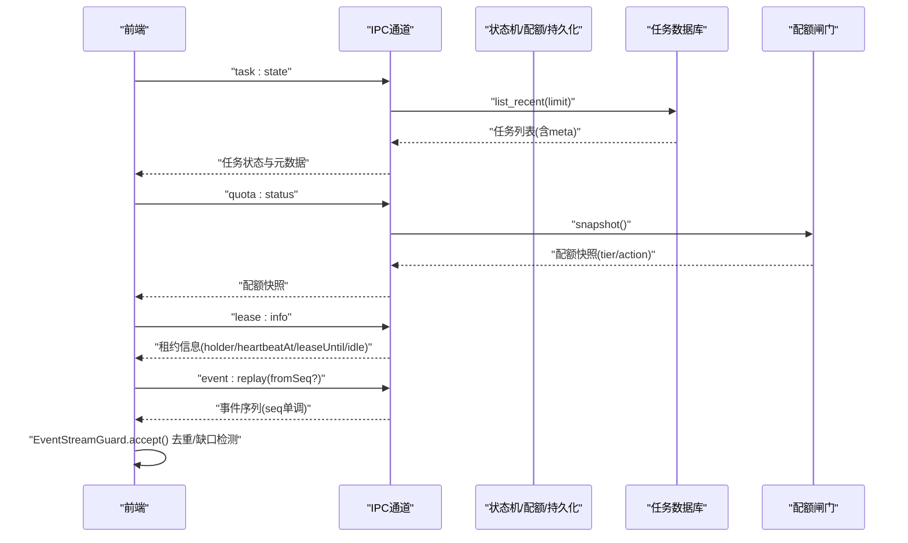
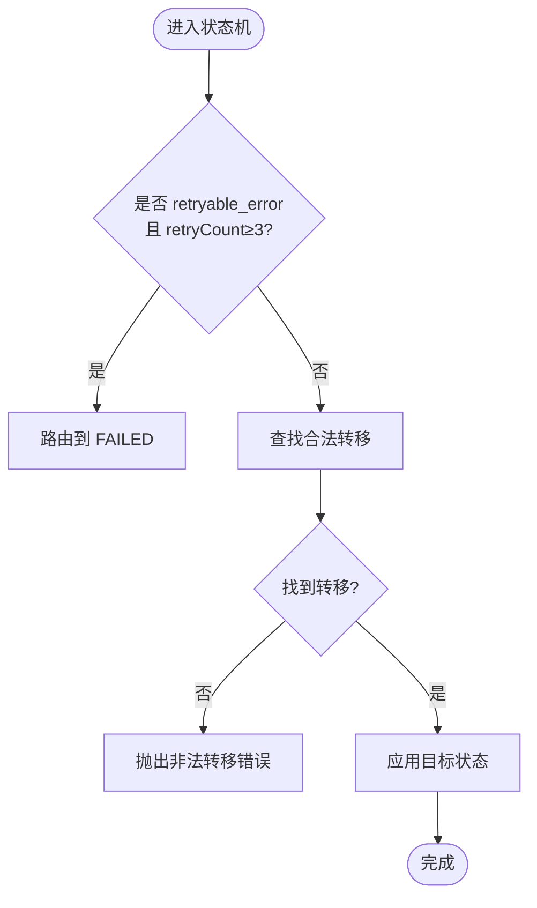
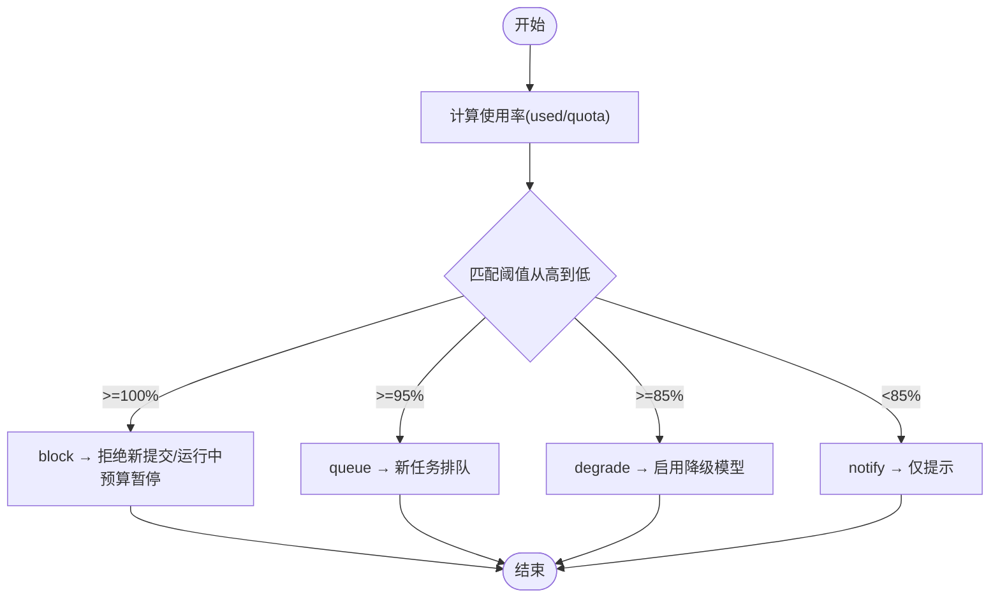
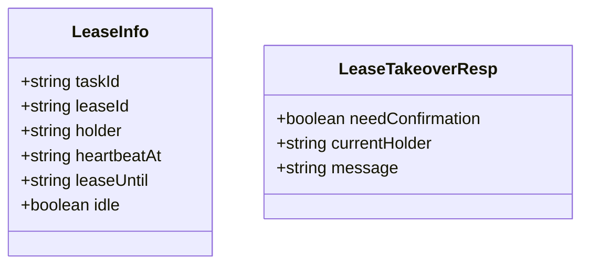
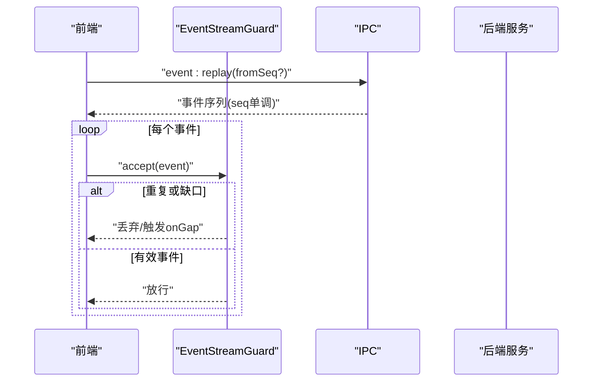
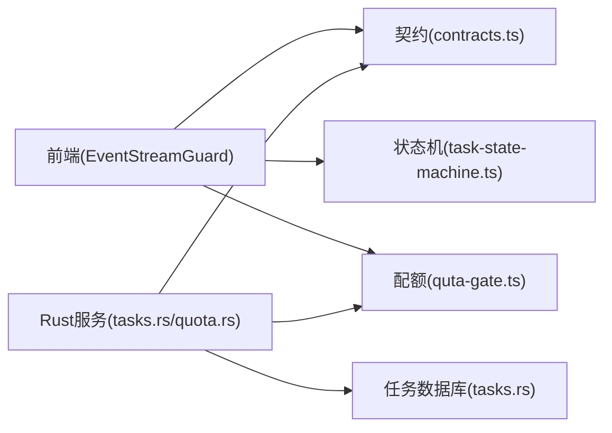

# 任务监控接口

<cite>
**本文引用的文件**
- [task-state-machine.ts](file://src/shared/task-state-machine.ts)
- [types.ts](file://src/shared/types.ts)
- [contracts.ts](file://src/shared/contracts.ts)
- [quota-gate.ts](file://src/shared/quota-gate.ts)
- [state-machine.ts](file://src/main/agent/state-machine.ts)
- [tasks.rs](file://src-tauri/src/store/tasks.rs)
- [quota.rs](file://src-tauri/src/task/quota.rs)
- [event-stream-guard.ts](file://src/renderer/lib/event-stream-guard.ts)
</cite>

## 目录
1. [简介](#简介)
2. [项目结构](#项目结构)
3. [核心组件](#核心组件)
4. [架构总览](#架构总览)
5. [详细组件分析](#详细组件分析)
6. [依赖关系分析](#依赖关系分析)
7. [性能考虑](#性能考虑)
8. [故障排查指南](#故障排查指南)
9. [结论](#结论)
10. [附录](#附录)

## 简介
本文件面向“任务监控接口”的完整说明，覆盖以下能力：
- task_state（任务状态查询）：基于 14 态状态机与持久化任务摘要，提供任务当前状态、等待原因、重试次数、排队位次等。
- quota_status（配额快照）：四档预警（70/85/95/100%），动作链为“提示→降级→排队→阻断”，并输出配额事件。
- lease_info（租约视图）：展示任务租约持有方、心跳时间、到期时间与空闲释放策略。
- event_replay（事件重放）：基于 SSE 单调 seq 的重放与断线补发，前端守卫保证幂等与去重。

同时给出 wait_reason 与 status_reason_code 的含义、配额闸门机制、事件持久化与重放窗口、监控数据模型、查询优化策略以及实时监控最佳实践与告警配置示例。

## 项目结构
围绕任务监控的关键代码分布在共享类型与契约、状态机、配额闸门、持久化存储、SSE 事件守卫等模块中：
- 共享层：定义 14 态、WaitReason、TaskMeta、ChatEvent、IPC Channel 等契约。
- 状态机：TS 侧实现 14 态转移表与 guard；Electron 遗留状态机用于兼容。
- 配额闸门：TS 纯函数与 Rust 镜像实现一致的四档阈值与动作。
- 持久化：Rust 侧 tasks 表 upsert/list_recent，包含 wait_reason、status_reason_code 等字段。
- 事件流：前端 EventStreamGuard 负责 seq 去重、缺口检测与 status_change 幂等。

图表来源
- [contracts.ts:480-584](file://src/shared/contracts.ts#L480-L584)
- [task-state-machine.ts:63-133](file://src/shared/task-state-machine.ts#L63-L133)
- [quota-gate.ts:10-54](file://src/shared/quota-gate.ts#L10-L54)
- [tasks.rs:27-95](file://src-tauri/src/store/tasks.rs#L27-L95)
- [quota.rs:87-117](file://src-tauri/src/task/quota.rs#L87-L117)

章节来源
- [contracts.ts:480-584](file://src/shared/contracts.ts#L480-L584)
- [task-state-machine.ts:1-223](file://src/shared/task-state-machine.ts#L1-L223)
- [quota-gate.ts:1-81](file://src/shared/quota-gate.ts#L1-L81)
- [tasks.rs:1-168](file://src-tauri/src/store/tasks.rs#L1-L168)
- [quota.rs:1-300](file://src-tauri/src/task/quota.rs#L1-L300)
- [event-stream-guard.ts:1-97](file://src/renderer/lib/event-stream-guard.ts#L1-L97)

## 核心组件
- 14 态任务状态机：定义 35 条合法转移、终态集合、wait_reason 子态管理、可用事件查询。
- 配额闸门：四档阈值与动作链，支持新提交阻断、运行中预算暂停、档位跃迁事件去抖。
- 任务持久化：upsert 与按更新时间倒序列出，包含 wait_reason、status_reason_code、queue_position 等。
- 事件流守卫：基于 seq 的去重、缺口检测、status_change 幂等，保障重放一致性。
- IPC 监控通道：task:state、quota:status、lease:info、event:replay 等。

章节来源
- [task-state-machine.ts:16-133](file://src/shared/task-state-machine.ts#L16-L133)
- [quota-gate.ts:20-81](file://src/shared/quota-gate.ts#L20-L81)
- [tasks.rs:9-95](file://src-tauri/src/store/tasks.rs#L9-L95)
- [event-stream-guard.ts:20-97](file://src/renderer/lib/event-stream-guard.ts#L20-L97)
- [contracts.ts:577-584](file://src/shared/contracts.ts#L577-L584)

## 架构总览
监控接口通过 IPC 暴露四个关键能力：
- task:state：读取任务当前状态与元数据（含 wait_reason、status_reason_code、retry_count、queue_position）。
- quota:status：返回当前配额快照（usedTokens、quotaTokens、tier、action）。
- lease:info：返回任务租约信息（taskId、leaseId、holder、heartbeatAt、leaseUntil、idle）。
- event:replay：从指定游标或起始位置回放事件序列，配合前端守卫进行幂等消费。

图表来源
- [contracts.ts:577-584](file://src/shared/contracts.ts#L577-L584)
- [tasks.rs:61-95](file://src-tauri/src/store/tasks.rs#L61-L95)
- [quota.rs:152-156](file://src-tauri/src/task/quota.rs#L152-L156)
- [event-stream-guard.ts:46-78](file://src/renderer/lib/event-stream-guard.ts#L46-L78)

## 详细组件分析

### 14 态状态机与 wait_reason/status_reason_code
- 状态定义：IDLE、PLANNING、PENDING_REVIEW、EXECUTING、PAUSED、DELIVERING、DONE、FAILED、ROLLED_BACK、QUEUED、BUDGET_PAUSED、RETRY_PENDING、CANCELLED、ARCHIVED。
- 转移规则：35 条合法转移，含 retryable_error 在 retryCount≥3 时路由到 FAILED。
- wait_reason：限流/熔断/配额等待/预算等待/租约等待/用户暂停/审阅超期等，仅允许在 EXECUTING 设置子态。
- status_reason_code：如 BUDGET_EXHAUSTED、QUEUE_TIMEOUT、LEASE_LOST、REJECTED 等，用于解释状态成因。
- 可用性：availableEvents 可动态生成 UI 操作按钮。

图表来源
- [task-state-machine.ts:165-201](file://src/shared/task-state-machine.ts#L165-L201)
- [task-state-machine.ts:203-212](file://src/shared/task-state-machine.ts#L203-L212)
- [types.ts:3-25](file://src/shared/types.ts#L3-L25)
- [types.ts:27-61](file://src/shared/types.ts#L27-L61)

章节来源
- [task-state-machine.ts:16-133](file://src/shared/task-state-machine.ts#L16-L133)
- [task-state-machine.ts:141-223](file://src/shared/task-state-machine.ts#L141-L223)
- [types.ts:3-61](file://src/shared/types.ts#L3-L61)

### 配额四档预警机制（70/85/95/100%）
- 阈值与动作：
  - 70%：notify（仅提示）
  - 85%：degrade（降级到备用模型）
  - 95%：queue（新任务排队）
  - 100%：block（拒绝新提交；运行中转 budget_paused）
- 行为：
  - evaluateQuota/evaluate 计算使用率与档位。
  - shouldBlock/shouldQueue 控制新提交与排队。
  - tierChanged 仅在档位跃迁时产出 quota_warning 事件，避免风暴。
  - blockErrorCodeFor 区分新提交 QUOTA_EXCEEDED 与运行中 BUDGET_EXHAUSTED。

图表来源
- [quota-gate.ts:10-54](file://src/shared/quota-gate.ts#L10-L54)
- [quota.rs:15-21](file://src-tauri/src/task/quota.rs#L15-L21)
- [quota.rs:87-117](file://src-tauri/src/task/quota.rs#L87-L117)
- [quota.rs:191-206](file://src-tauri/src/task/quota.rs#L191-L206)

章节来源
- [quota-gate.ts:20-81](file://src/shared/quota-gate.ts#L20-L81)
- [quota.rs:1-300](file://src-tauri/src/task/quota.rs#L1-L300)

### 租约管理（lease_info）
- 租约协议：心跳周期、租约时长、超时回收与空闲释放策略由契约描述。
- 视图字段：taskId、leaseId、holder、heartbeatAt、leaseUntil、idle。
- 接管：LeaseTakeoverResp 明确是否需要确认与当前持有者。

图表来源
- [contracts.ts:290-309](file://src/shared/contracts.ts#L290-L309)

章节来源
- [contracts.ts:290-309](file://src/shared/contracts.ts#L290-L309)

### 事件重放（event_replay）与持久化
- 事件契约：ChatEvent 包含 plan/step_* /deliver/done/error/status_change/quota_warning/heartbeat 等，新增 seq 与 taskId 可选字段以支撑重放。
- 前端守卫：EventStreamGuard 维护 per-task lastSeq，丢弃重复事件，检测缺口并触发 replay 回调；对 status_change 做幂等处理。
- 持久化：Rust tasks 表记录任务摘要与 meta（wait_reason、status_reason_code、retry_count、queue_position 等），支持按 updated_at_ms 倒序查询。

图表来源
- [contracts.ts:146-158](file://src/shared/contracts.ts#L146-L158)
- [event-stream-guard.ts:46-78](file://src/renderer/lib/event-stream-guard.ts#L46-L78)
- [tasks.rs:61-95](file://src-tauri/src/store/tasks.rs#L61-L95)

章节来源
- [contracts.ts:146-158](file://src/shared/contracts.ts#L146-L158)
- [event-stream-guard.ts:1-97](file://src/renderer/lib/event-stream-guard.ts#L1-L97)
- [tasks.rs:9-95](file://src-tauri/src/store/tasks.rs#L9-L95)

### 监控数据模型
- 任务状态查询（task:state）：返回任务列表与元数据（TaskRow/TaskSummary.meta），包含 status、wait_reason、retry_count、status_reason_code、queue_position、created_at_ms、updated_at_ms。
- 配额快照（quota:status）：返回 usedTokens、quotaTokens、tier、action、updatedAt。
- 租约视图（lease:info）：返回 LeaseInfo 字段。
- 事件重放（event:replay）：返回 ChatEvent 序列，含 seq、taskId、status_change/quota_warning 等。

章节来源
- [tasks.rs:9-25](file://src-tauri/src/store/tasks.rs#L9-L25)
- [contracts.ts:278-321](file://src/shared/contracts.ts#L278-L321)
- [contracts.ts:146-158](file://src/shared/contracts.ts#L146-L158)

### 查询优化策略
- 任务列表：按 updated_at_ms 倒序，limit 限制返回数量，减少前端渲染压力。
- 配额快照：内存锁保护，跨日重置台账，避免频繁 IO。
- 事件重放：前端守卫去重与幂等，降低重复渲染与状态抖动。
- 状态机：转移表 O(n) 查找，n=35，常数级开销；guard 条件判断常量时间。

章节来源
- [tasks.rs:61-95](file://src-tauri/src/store/tasks.rs#L61-L95)
- [quota.rs:152-189](file://src-tauri/src/task/quota.rs#L152-L189)
- [event-stream-guard.ts:46-78](file://src/renderer/lib/event-stream-guard.ts#L46-L78)
- [task-state-machine.ts:157-174](file://src/shared/task-state-machine.ts#L157-L174)

### 实时监控最佳实践
- 订阅事件流：统一通过 IPC 的 CHAT_EVENT 通道接收 ChatEvent，结合 EventStreamGuard 消费。
- 状态变更：关注 status_change 与 quota_warning，避免同状态重复渲染。
- 配额告警：当 tier 跃迁至 85/95/100 时触发降级、排队或阻断策略。
- 租约健康：监听心跳与租约到期，及时恢复或迁移任务。
- 重放窗口：根据业务需求设定 fromSeq，确保断线后快速补齐。

章节来源
- [contracts.ts:480-584](file://src/shared/contracts.ts#L480-L584)
- [event-stream-guard.ts:20-97](file://src/renderer/lib/event-stream-guard.ts#L20-L97)
- [quota-gate.ts:66-81](file://src/shared/quota-gate.ts#L66-L81)

## 依赖关系分析
- 前端依赖共享契约（types/contracts）与状态机/配额闸门逻辑，用于渲染与决策。
- Rust 服务依赖持久化与配额闸门，提供任务列表与配额快照。
- 事件流贯穿前后端，seq 单调性与守卫保证一致性。

图表来源
- [contracts.ts:480-584](file://src/shared/contracts.ts#L480-L584)
- [task-state-machine.ts:63-133](file://src/shared/task-state-machine.ts#L63-L133)
- [quota-gate.ts:10-54](file://src/shared/quota-gate.ts#L10-L54)
- [tasks.rs:27-95](file://src-tauri/src/store/tasks.rs#L27-L95)
- [quota.rs:87-117](file://src-tauri/src/task/quota.rs#L87-L117)

章节来源
- [contracts.ts:480-584](file://src/shared/contracts.ts#L480-L584)
- [task-state-machine.ts:63-133](file://src/shared/task-state-machine.ts#L63-L133)
- [quota-gate.ts:10-54](file://src/shared/quota-gate.ts#L10-L54)
- [tasks.rs:27-95](file://src-tauri/src/store/tasks.rs#L27-L95)
- [quota.rs:87-117](file://src-tauri/src/task/quota.rs#L87-L117)

## 性能考虑
- 状态机转移表固定规模，查找与 guard 判定均为常数级。
- 配额快照内存锁保护，跨日重置避免无限增长；持久化按需写入。
- 事件流守卫去重与幂等，减少无效渲染与状态抖动。
- 任务列表 limit 控制，避免大数据量拖慢 UI。

[本节为通用指导，不直接分析具体文件]

## 故障排查指南
- 非法状态转移：检查 from/event/to 是否在 35 条转移内；若 retryable_error 且 retryCount≥3，应路由到 FAILED。
- 配额阻断：确认当前 tier 是否为 100%，新提交返回 QUOTA_EXCEEDED；运行中任务转 budget_paused 并返回 BUDGET_EXHAUSTED。
- 事件缺失：EventStreamGuard 检测到缺口时触发 onGap，调用 event:replay 补齐；注意 status_change 幂等。
- 租约异常：检查 heartbeatAt 与 leaseUntil，必要时执行接管或恢复。

章节来源
- [task-state-machine.ts:165-201](file://src/shared/task-state-machine.ts#L165-L201)
- [quota-gate.ts:56-81](file://src/shared/quota-gate.ts#L56-L81)
- [event-stream-guard.ts:46-78](file://src/renderer/lib/event-stream-guard.ts#L46-L78)
- [contracts.ts:290-309](file://src/shared/contracts.ts#L290-L309)

## 结论
本监控体系以 14 态状态机为核心，结合配额四档闸门与租约管理，形成完整的任务生命周期监控能力。通过事件流守卫与持久化，确保状态一致性与可重放性。建议在生产环境中：
- 严格遵循状态转移与 guard 条件，避免非法转移。
- 合理配置配额阈值与告警策略，及时响应降级与阻断。
- 利用事件重放与守卫，提升系统鲁棒性与用户体验。

[本节为总结，不直接分析具体文件]

## 附录
- 监控场景示例：
  - 高并发下配额达到 95%：新任务排队，UI 显示排队位次与警告。
  - 配额达到 100%：新提交被拒（QUOTA_EXCEEDED），运行中任务转入 budget_paused（BUDGET_EXHAUSTED）。
  - 租约丢失：任务回到 queued，从最后成功步骤恢复。
  - 事件断线：前端检测到缺口，触发 event:replay 补齐，保证状态一致。
- 告警配置示例：
  - 70%：通知类告警（日志/消息）。
  - 85%：降级模型告警（切换备用模型）。
  - 95%：排队告警（限制新任务启动）。
  - 100%：阻断告警（拒绝新提交，运行中预算暂停）。

[本节为概念性内容，不直接分析具体文件]