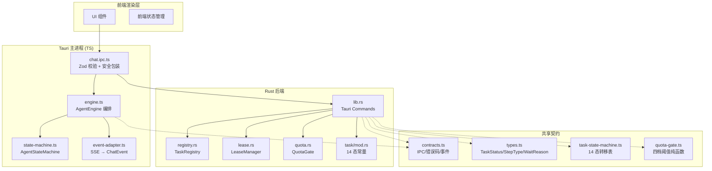
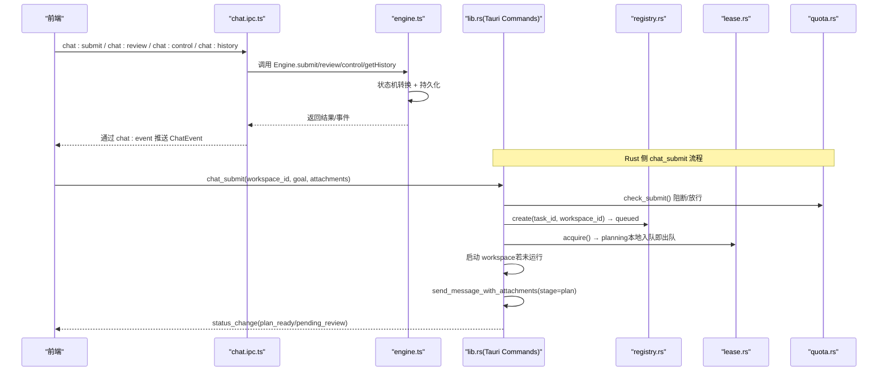
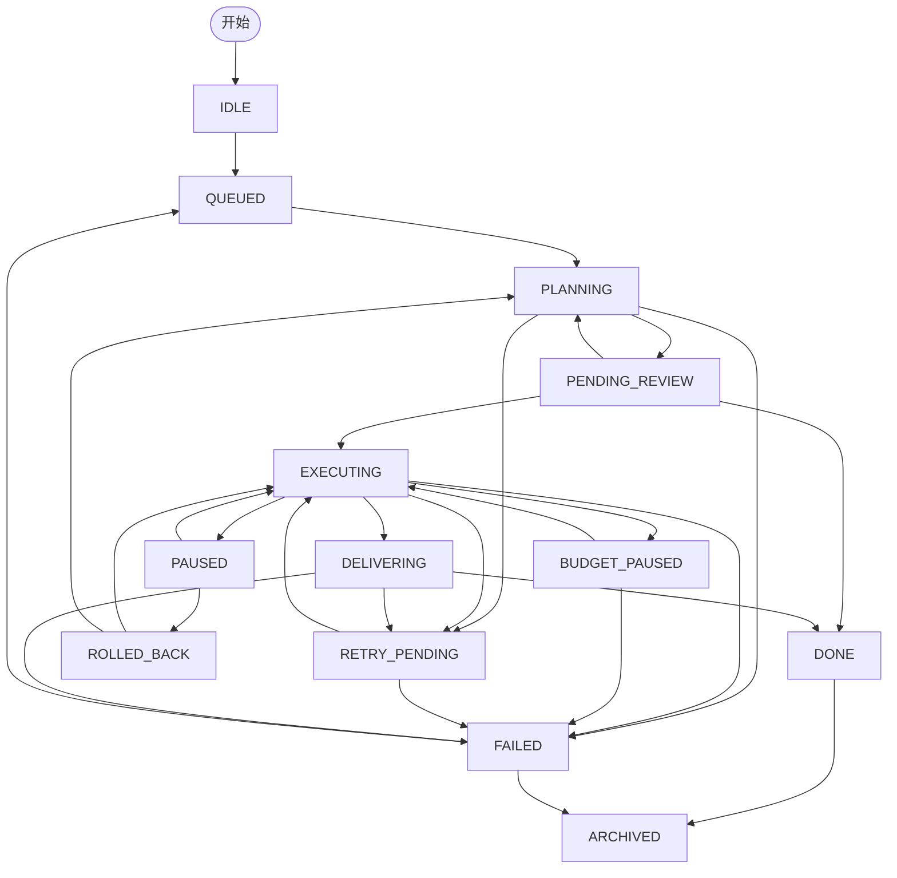
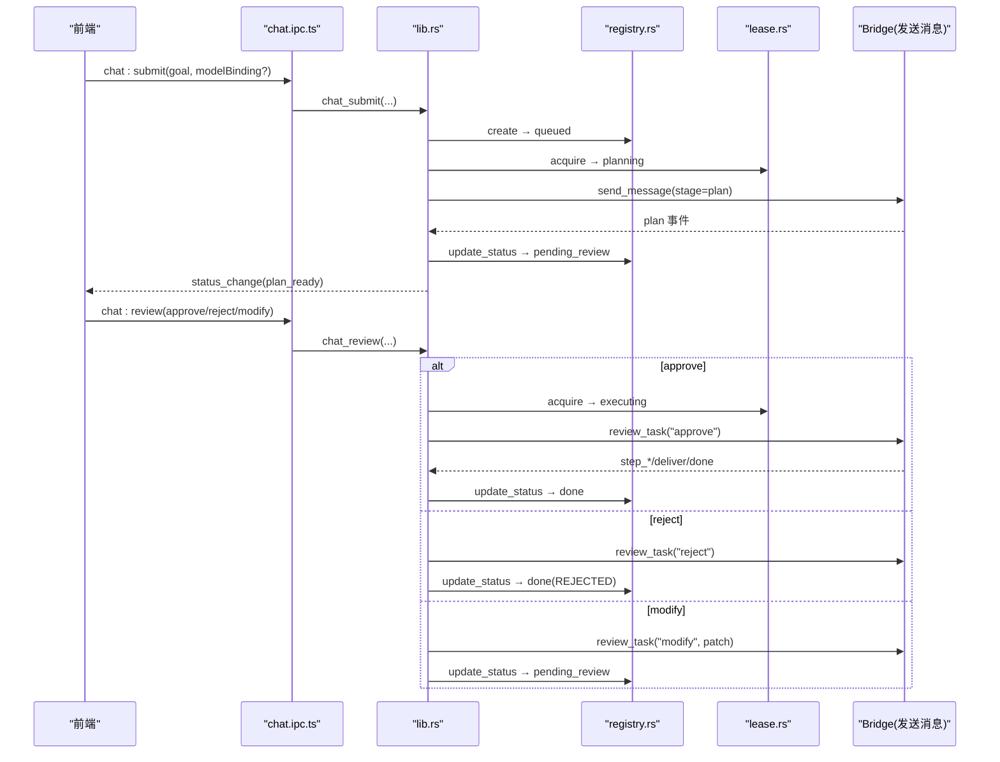
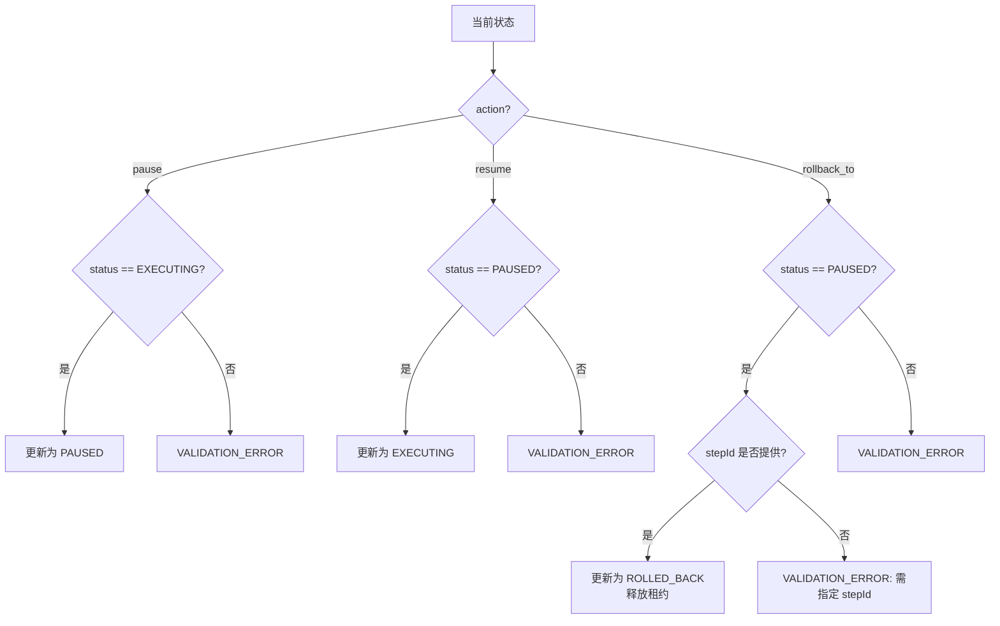
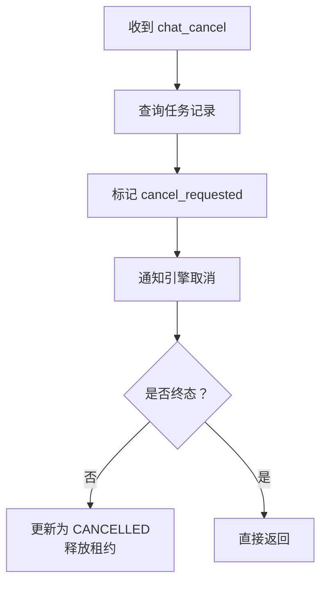
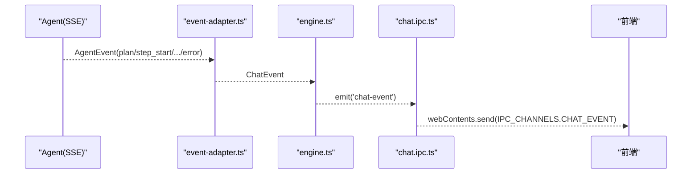
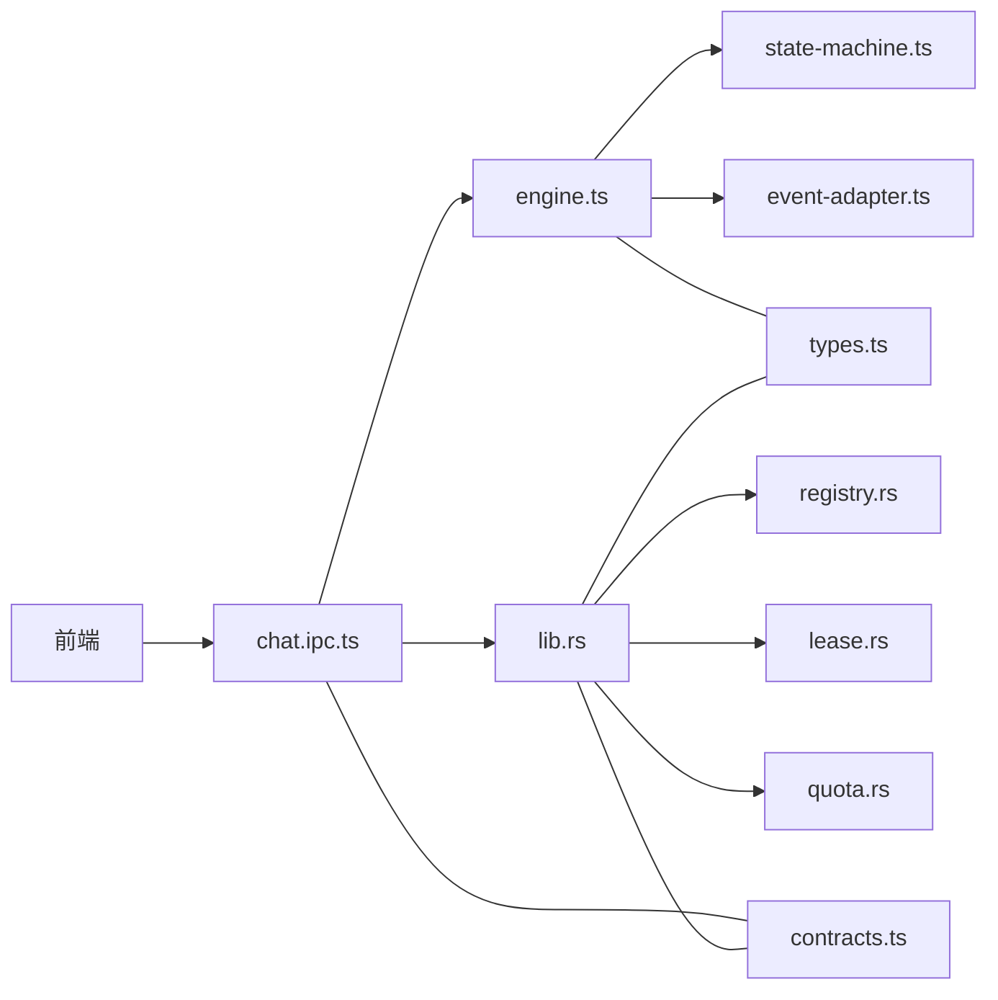

# 任务管理接口

<cite>
**本文引用的文件**   
- [task-state-machine.ts](file://tongtian-tauri/src/shared/task-state-machine.ts)
- [contracts.ts](file://tongtian-tauri/src/shared/contracts.ts)
- [types.ts](file://tongtian-tauri/src/shared/types.ts)
- [chat.ipc.ts](file://tongtian-tauri/src/main/ipc/chat.ipc.ts)
- [engine.ts](file://tongtian-tauri/src/main/agent/engine.ts)
- [state-machine.ts](file://tongtian-tauri/src/main/agent/state-machine.ts)
- [event-adapter.ts](file://tongtian-tauri/src/main/agent/event-adapter.ts)
- [mod.rs](file://tongtian-tauri/src-tauri/src/task/mod.rs)
- [registry.rs](file://tongtian-tauri/src-tauri/src/task/registry.rs)
- [quota.rs](file://tongtian-tauri/src-tauri/src/task/quota.rs)
- [lease.rs](file://tongtian-tauri/src-tauri/src/task/lease.rs)
- [lib.rs](file://tongtian-tauri/src-tauri/src/lib.rs)
- [quota-gate.ts](file://tongtian-tauri/src/shared/quota-gate.ts)
</cite>

## 目录
1. [简介](#简介)
2. [项目结构](#项目结构)
3. [核心组件](#核心组件)
4. [架构总览](#架构总览)
5. [详细组件分析](#详细组件分析)
6. [依赖关系分析](#依赖关系分析)
7. [性能考量](#性能考量)
8. [故障排查指南](#故障排查指南)
9. [结论](#结论)
10. [附录：调用示例与最佳实践](#附录调用示例与最佳实践)

## 简介
本文件面向“任务管理”相关 Tauri 命令接口，覆盖两阶段协议（计划生成→审阅执行）、14 态状态机、任务控制（pause/resume/rollback_to）、任务注册表、租约管理与配额闸门集成，以及事件流处理、错误码定义与前后端数据同步策略。文档同时提供端到端调用示例与最佳实践，帮助读者快速理解并正确集成。

## 项目结构
围绕任务管理的代码分布在三层：
- 共享契约与类型（TS）：统一状态、事件、错误码与 IPC 通道名
- 主进程逻辑（TS/Rust）：IPC 路由、引擎编排、状态机驱动、事件适配
- Rust 后端能力：任务注册表、租约管理、配额闸门、持久化与事件存储

**图表来源** 
- [chat.ipc.ts:122-189](file://tongtian-tauri/src/main/ipc/chat.ipc.ts#L122-L189)
- [engine.ts:50-102](file://tongtian-tauri/src/main/agent/engine.ts#L50-L102)
- [state-machine.ts:79-160](file://tongtian-tauri/src/main/agent/state-machine.ts#L79-L160)
- [event-adapter.ts:43-75](file://tongtian-tauri/src/main/agent/event-adapter.ts#L43-L75)
- [lib.rs:127-237](file://tongtian-tauri/src-tauri/src/lib.rs#L127-L237)
- [registry.rs:61-90](file://tongtian-tauri/src-tauri/src/task/registry.rs#L61-L90)
- [lease.rs:68-108](file://tongtian-tauri/src-tauri/src/task/lease.rs#L68-L108)
- [quota.rs:119-150](file://tongtian-tauri/src-tauri/src/task/quota.rs#L119-L150)
- [mod.rs:7-23](file://tongtian-tauri/src-tauri/src/task/mod.rs#L7-L23)
- [contracts.ts:478-584](file://tongtian-tauri/src/shared/contracts.ts#L478-L584)
- [types.ts:4-25](file://tongtian-tauri/src/shared/types.ts#L4-L25)
- [task-state-machine.ts:63-133](file://tongtian-tauri/src/shared/task-state-machine.ts#L63-L133)
- [quota-gate.ts:37-54](file://tongtian-tauri/src/shared/quota-gate.ts#L37-L54)

**章节来源**
- [chat.ipc.ts:122-189](file://tongtian-tauri/src/main/ipc/chat.ipc.ts#L122-L189)
- [engine.ts:50-102](file://tongtian-tauri/src/main/agent/engine.ts#L50-L102)
- [lib.rs:127-237](file://tongtian-tauri/src-tauri/src/lib.rs#L127-L237)

## 核心组件
- 14 态状态机（TS）：集中定义 35 条合法转移与守卫条件（如 retryCount<3），提供 canTransition/transition/availableEvents 等工具
- AgentEngine（TS）：封装 submit/review/control/history 等业务编排，驱动状态机、持久化、事件转发
- AgentStateMachine（TS）：轻量状态机（用于 engine.ts 的过渡），并提供 resolveControlAction 映射控制动作到目标状态
- 事件适配器（TS）：将 Agent SSE 事件转换为统一的 ChatEvent 供 IPC 转发
- Tauri Commands（Rust）：实现 chat_submit/chat_review/chat_control/chat_cancel/chat_history 等命令，串联注册表、租约、配额与事件存储
- TaskRegistry（Rust）：内存任务注册表，维护 14 态、wait_reason、retry_count、revision、lease_id、cancel_requested 等字段
- LeaseManager（Rust）：心跳/租约/空闲释放/禁止抢占/单 interval 扫描
- QuotaGate（Rust）：四档预警（70/85/95/100%），支持 add_usage/check_submit/should_queue，并与 TS 镜像一致
- 共享契约（TS）：统一 ErrorCode、ChatEvent、IPC_CHANNELS、TaskSummary、QuotaSnapshot 等

**章节来源**
- [task-state-machine.ts:1-223](file://tongtian-tauri/src/shared/task-state-machine.ts#L1-L223)
- [engine.ts:50-102](file://tongtian-tauri/src/main/agent/engine.ts#L50-L102)
- [state-machine.ts:79-160](file://tongtian-tauri/src/main/agent/state-machine.ts#L79-L160)
- [event-adapter.ts:43-75](file://tongtian-tauri/src/main/agent/event-adapter.ts#L43-L75)
- [lib.rs:127-237](file://tongtian-tauri/src-tauri/src/lib.rs#L127-L237)
- [registry.rs:61-90](file://tongtian-tauri/src-tauri/src/task/registry.rs#L61-L90)
- [lease.rs:68-108](file://tongtian-tauri/src-tauri/src/task/lease.rs#L68-L108)
- [quota.rs:119-150](file://tongtian-tauri/src-tauri/src/task/quota.rs#L119-L150)
- [contracts.ts:15-109](file://tongtian-tauri/src/shared/contracts.ts#L15-L109)

## 架构总览
下图展示从前端到 Rust 命令、再到注册表/租约/配额的完整调用链，以及事件回推前端的流程。

**图表来源** 
- [chat.ipc.ts:122-189](file://tongtian-tauri/src/main/ipc/chat.ipc.ts#L122-L189)
- [engine.ts:56-102](file://tongtian-tauri/src/main/agent/engine.ts#L56-L102)
- [lib.rs:127-237](file://tongtian-tauri/src-tauri/src/lib.rs#L127-L237)
- [registry.rs:68-90](file://tongtian-tauri/src-tauri/src/task/registry.rs#L68-L90)
- [lease.rs:84-108](file://tongtian-tauri/src-tauri/src/task/lease.rs#L84-L108)
- [quota.rs:191-206](file://tongtian-tauri/src-tauri/src/task/quota.rs#L191-L206)

## 详细组件分析

### 14 态状态机与转移规则
- 14 个状态：idle、queued、planning、pending_review、executing、paused、budget_paused、retry_pending、delivering、done、failed、rolled_back、cancelled、archived
- 35 条合法转移，含守卫条件（如 retryable_error 在 retryCount≥3 时路由到 failed）
- executing 子态通过 wait_reason 表达（rate_limited/circuit_break/quota_wait/budget_wait/lease_wait/user_pause/pending_review_ttl），不引入新状态
- 终态集合：cancelled、archived（done 仅保留 archive 边）

**图表来源** 
- [task-state-machine.ts:63-133](file://tongtian-tauri/src/shared/task-state-machine.ts#L63-L133)

**章节来源**
- [task-state-machine.ts:1-223](file://tongtian-tauri/src/shared/task-state-machine.ts#L1-L223)
- [types.ts:4-25](file://tongtian-tauri/src/shared/types.ts#L4-L25)

### 两阶段协议（计划生成→审阅执行）
- 第一阶段（plan）：chat_submit 创建任务→queued→planning→收到 plan 事件→pending_review
- 第二阶段（execute）：chat_review approve→executing→delivering→done；reject→done(REJECTED)；modify→planning（携带 patch）

**图表来源** 
- [lib.rs:127-237](file://tongtian-tauri/src-tauri/src/lib.rs#L127-L237)
- [lib.rs:239-390](file://tongtian-tauri/src-tauri/src/lib.rs#L239-L390)
- [registry.rs:68-90](file://tongtian-tauri/src-tauri/src/task/registry.rs#L68-L90)
- [lease.rs:84-108](file://tongtian-tauri/src-tauri/src/task/lease.rs#L84-L108)

**章节来源**
- [lib.rs:127-237](file://tongtian-tauri/src-tauri/src/lib.rs#L127-L237)
- [lib.rs:239-390](file://tongtian-tauri/src-tauri/src/lib.rs#L239-L390)

### 任务控制操作（pause/resume/rollback_to）
- pause：仅允许 executing→paused，需桥接确认
- resume：仅允许 paused→executing，需桥接确认
- rollback_to：仅允许 paused→rolled_back，需指定 stepId，成功后释放租约

**图表来源** 
- [lib.rs:392-483](file://tongtian-tauri/src-tauri/src/lib.rs#L392-L483)
- [state-machine.ts:145-159](file://tongtian-tauri/src/main/agent/state-machine.ts#L145-L159)

**章节来源**
- [lib.rs:392-483](file://tongtian-tauri/src-tauri/src/lib.rs#L392-L483)
- [state-machine.ts:145-159](file://tongtian-tauri/src/main/agent/state-machine.ts#L145-L159)

### 取消任务（chat_cancel）
- 幂等标记 cancel_requested，通知引擎终止执行
- 非终态任务可置为 cancelled，并释放租约

**图表来源** 
- [lib.rs:485-526](file://tongtian-tauri/src-tauri/src/lib.rs#L485-L526)

**章节来源**
- [lib.rs:485-526](file://tongtian-tauri/src-tauri/src/lib.rs#L485-L526)

### 历史查询（chat_history）
- 读取 tasks 表最近记录，包含 14 态 meta（waitReason、queuePosition、retryCount、statusReasonCode）

**章节来源**
- [lib.rs:528-555](file://tongtian-tauri/src-tauri/src/lib.rs#L528-L555)

### 事件流处理与适配
- Agent SSE 事件经 event-adapter.ts 转为 ChatEvent，再由 engine.ts 或 lib.rs 通过 IPC 推送至前端
- 新增 status_change/quota_warning/heartbeat 事件，seq/taskId 可选以支撑重放与追踪

**图表来源** 
- [event-adapter.ts:43-75](file://tongtian-tauri/src/main/agent/event-adapter.ts#L43-L75)
- [engine.ts:351-454](file://tongtian-tauri/src/main/agent/engine.ts#L351-L454)
- [chat.ipc.ts:93-112](file://tongtian-tauri/src/main/ipc/chat.ipc.ts#L93-L112)

**章节来源**
- [event-adapter.ts:43-75](file://tongtian-tauri/src/main/agent/event-adapter.ts#L43-L75)
- [engine.ts:351-454](file://tongtian-tauri/src/main/agent/engine.ts#L351-L454)
- [chat.ipc.ts:93-112](file://tongtian-tauri/src/main/ipc/chat.ipc.ts#L93-L112)

### 任务注册表（TaskRegistry）
- 职责：创建任务（queued）、状态更新（revision 单调递增）、wait_reason 标注、重试计数累计、租约绑定、取消请求标记、列表视图
- 语义对齐 14 态与转移 #1/#2/#20/#34 等

**章节来源**
- [registry.rs:61-183](file://tongtian-tauri/src-tauri/src/task/registry.rs#L61-L183)

### 租约管理（LeaseManager）
- 参数：心跳 10s、租约 30s、超时回收 60s、空闲释放 5min、扫描间隔 10s
- 行为：acquire（禁止抢占）、heartbeat、touch/release、scan（超时回收+空闲释放）、takeover（需确认）

**章节来源**
- [lease.rs:14-24](file://tongtian-tauri/src-tauri/src/task/lease.rs#L14-L24)
- [lease.rs:68-108](file://tongtian-tauri/src-tauri/src/task/lease.rs#L68-L108)
- [lease.rs:160-184](file://tongtian-tauri/src-tauri/src/task/lease.rs#L160-L184)

### 配额闸门（QuotaGate）
- 四档阈值：70/85/95/100%，动作链 notify→degrade→queue→block
- 方法：add_usage（跨日重置、去抖触发）、check_submit（100% 阻断）、should_queue（≥95%）
- 与 TS 镜像一致（quota-gate.ts）

**章节来源**
- [quota.rs:16-21](file://tongtian-tauri/src-tauri/src/task/quota.rs#L16-L21)
- [quota.rs:119-150](file://tongtian-tauri/src-tauri/src/task/quota.rs#L119-L150)
- [quota.rs:191-206](file://tongtian-tauri/src-tauri/src/task/quota.rs#L191-L206)
- [quota-gate.ts:37-54](file://tongtian-tauri/src/shared/quota-gate.ts#L37-L54)

### 错误码定义与 AppError
- ErrorCode 枚举涵盖模型、文件、任务、配置、工作区、技能、MCP、沙箱、合规、桥接、调度、通用等
- AppError 结构体包含 code/message/details

**章节来源**
- [contracts.ts:15-109](file://tongtian-tauri/src/shared/contracts.ts#L15-L109)

## 依赖关系分析
- 前端通过 IPC_CHANNELS 调用 chat.ipc.ts，后者使用 Zod 校验后调用 engine.ts
- engine.ts 依赖 state-machine.ts 进行状态转换，并通过 event-adapter.ts 适配 SSE 事件
- Rust 侧 lib.rs 暴露 Tauri 命令，组合 registry.rs、lease.rs、quota.rs 与 store（SQLite）
- 共享 types.ts 与 contracts.ts 作为 TS/Rust 契约镜像

**图表来源** 
- [chat.ipc.ts:122-189](file://tongtian-tauri/src/main/ipc/chat.ipc.ts#L122-L189)
- [engine.ts:50-102](file://tongtian-tauri/src/main/agent/engine.ts#L50-L102)
- [lib.rs:127-237](file://tongtian-tauri/src-tauri/src/lib.rs#L127-L237)
- [types.ts:4-25](file://tongtian-tauri/src/shared/types.ts#L4-L25)
- [contracts.ts:478-584](file://tongtian-tauri/src/shared/contracts.ts#L478-L584)

**章节来源**
- [chat.ipc.ts:122-189](file://tongtian-tauri/src/main/ipc/chat.ipc.ts#L122-L189)
- [engine.ts:50-102](file://tongtian-tauri/src/main/agent/engine.ts#L50-L102)
- [lib.rs:127-237](file://tongtian-tauri/src-tauri/src/lib.rs#L127-L237)

## 性能考量
- 本地 local-first 退化：queued 入队即出队（<100ms），减少排队延迟
- 单 interval 扫描租约：避免每任务一个 timer，O(n) 开销对桌面级任务数可忽略
- 配额快照去抖：同档不重复触发 quota_warning，避免事件风暴
- 事件持久化与 TTL 清理：后台异步刷盘，24h 窗口保障重放

[本节为通用指导，无需引用具体文件]

## 故障排查指南
- 常见错误码
  - VALIDATION_ERROR：参数校验失败（Zod）
  - TASK_NOT_FOUND：任务不存在
  - TASK_ALREADY_RUNNING：租约被其他持有者占用（云端语义）
  - BRIDGE_COMMUNICATION_FAILED：桥接通信失败
  - QUOTA_EXCEEDED/BUDGET_EXHAUSTED：配额/预算耗尽
  - LEASE_LOST：租约丢失（心跳超时）
- 排查步骤
  - 检查 IPC 校验日志与错误码
  - 查看 status_change 事件中的 statusReasonCode 与 waitReason
  - 使用 task_state/lease_info/quota_status 定位问题
  - 必要时使用 event_replay 重放事件

**章节来源**
- [contracts.ts:15-109](file://tongtian-tauri/src/shared/contracts.ts#L15-L109)
- [lib.rs:127-237](file://tongtian-tauri/src-tauri/src/lib.rs#L127-L237)

## 结论
本任务管理系统通过清晰的 14 态状态机、两阶段协议与完善的注册表/租约/配额机制，实现了健壮的任务生命周期管理。前后端契约统一、事件流稳定、错误码完备，便于扩展与排障。建议在生产中结合 event_replay 与 lease/quota 监控提升可观测性。

[本节为总结，无需引用具体文件]

## 附录：调用示例与最佳实践
- 提交任务（chat_submit）
  - 输入：goal、modelBinding（可选）、attachments（可选）
  - 流程：配额检查→注册表 queued→租约 planning→计划事件→pending_review
  - 输出：{taskId, workspaceId, status, quota}
- 审阅计划（chat_review）
  - 输入：planId、action(approve/reject/modify)、patch（可选）
  - 输出：{ok, taskId, status}
- 任务控制（chat_control）
  - 输入：taskId、action(pause/resume/rollback_to)、stepId（rollback_to 必需）
  - 输出：{ok, taskId, status}
- 取消任务（chat_cancel）
  - 输入：taskId、workspaceId（可选）
  - 输出：{taskId, cancelled, engine}
- 历史查询（chat_history）
  - 输入：limit（可选）
  - 输出：TaskSummary[]（含 meta）

最佳实践
- 前端订阅 chat:event，按 seq 排序处理，避免乱序
- 遇到 quota_warning 时根据 tier/action 提示用户或降级
- 使用 task_state/lease_info 监控异常（如 LEASE_LOST）
- 对 rollback_to 务必校验 stepId 存在且有效

**章节来源**
- [lib.rs:127-237](file://tongtian-tauri/src-tauri/src/lib.rs#L127-L237)
- [lib.rs:239-390](file://tongtian-tauri/src-tauri/src/lib.rs#L239-L390)
- [lib.rs:392-483](file://tongtian-tauri/src-tauri/src/lib.rs#L392-L483)
- [lib.rs:485-526](file://tongtian-tauri/src-tauri/src/lib.rs#L485-L526)
- [lib.rs:528-555](file://tongtian-tauri/src-tauri/src/lib.rs#L528-L555)
- [contracts.ts:478-584](file://tongtian-tauri/src/shared/contracts.ts#L478-L584)