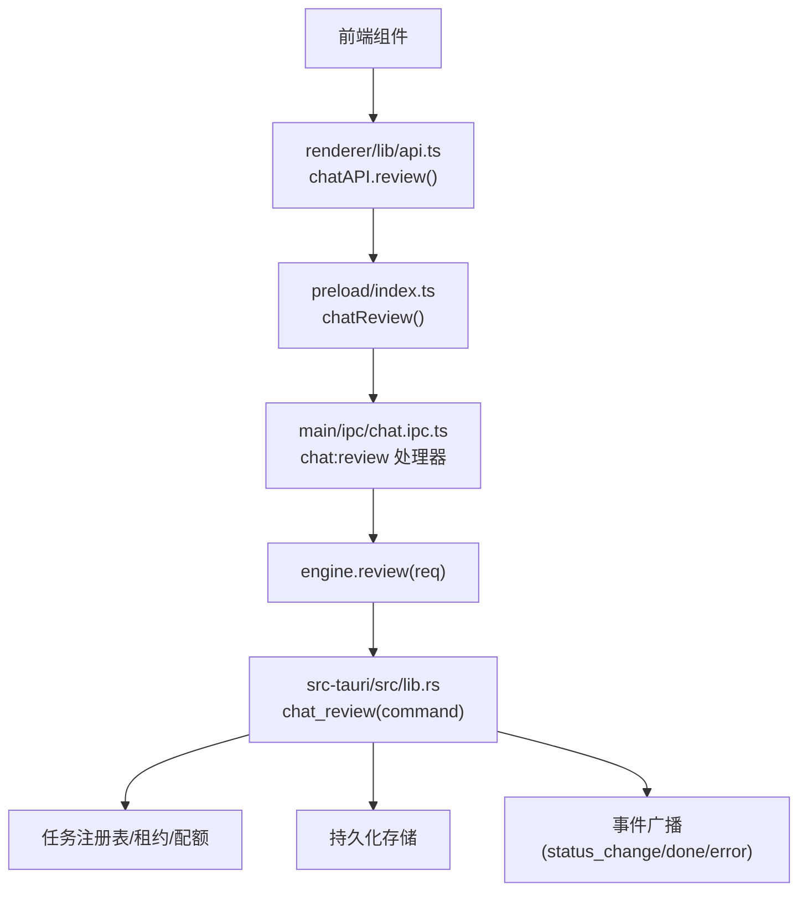
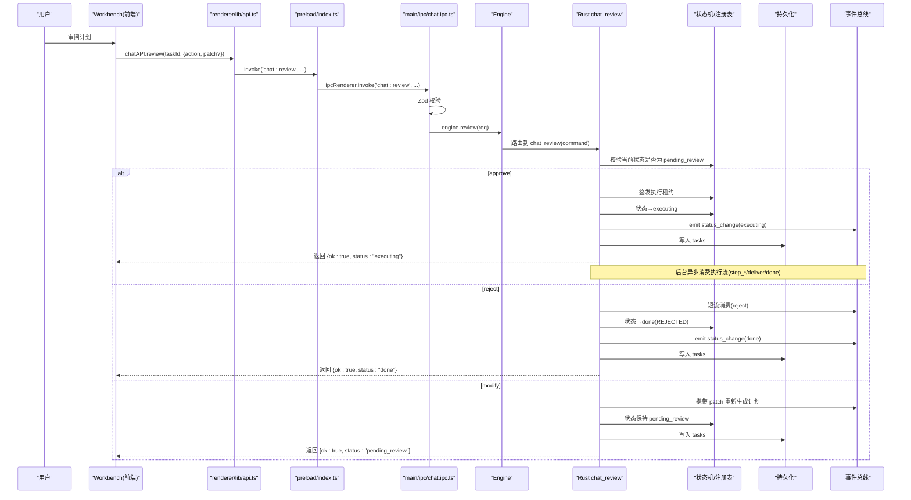
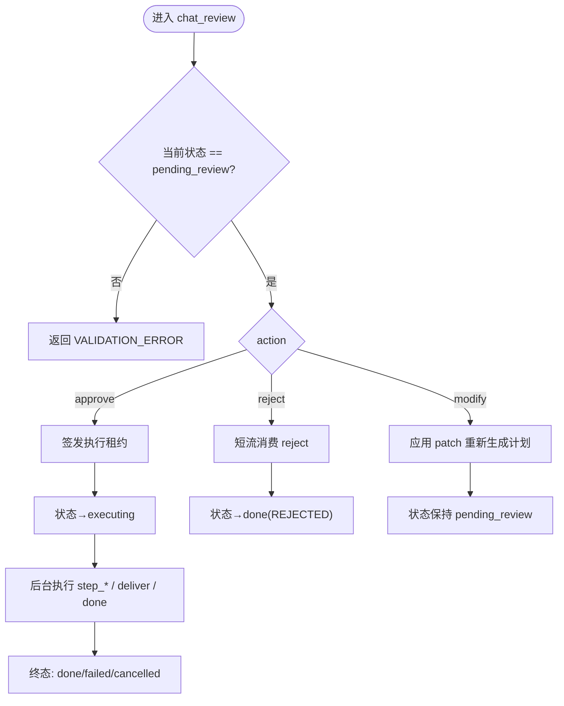
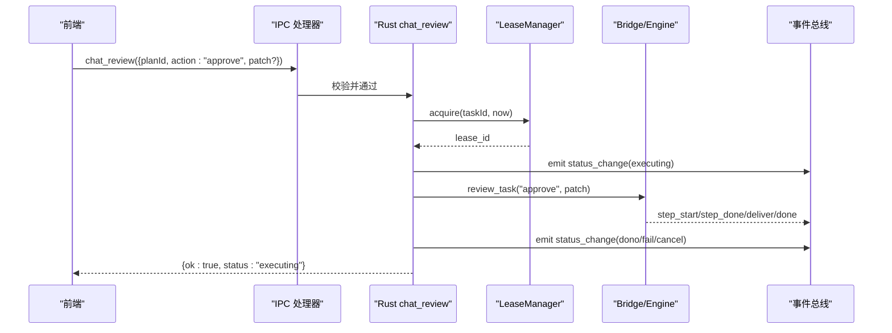
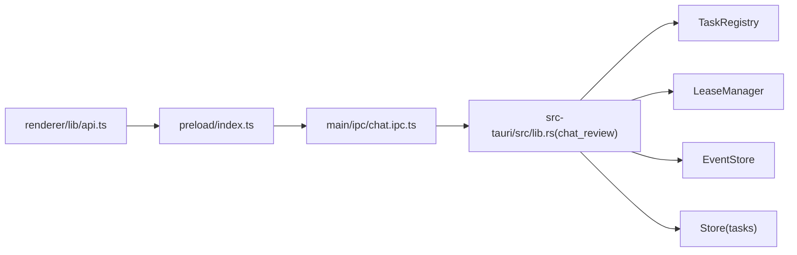

# 计划审阅接口

<cite>
**本文引用的文件**
- [chat.ipc.ts](file://tongtian-tauri/src/main/ipc/chat.ipc.ts)
- [lib.rs](file://tongtian-tauri/src-tauri/src/lib.rs)
- [task-state-machine.ts](file://tongtian-tauri/src/shared/task-state-machine.ts)
- [types.ts](file://tongtian-tauri/src/shared/types.ts)
- [contracts.ts](file://tongtian-tauri/src/shared/contracts.ts)
- [api.ts](file://tongtian-tauri/src/renderer/lib/api.ts)
- [index.ts（preload）](file://tongtian-tauri/src/preload/index.ts)
- [mvp设计文档](file://tongtian-office-mvp-design.md)
</cite>

## 目录
1. [简介](#简介)
2. [项目结构](#项目结构)
3. [核心组件](#核心组件)
4. [架构总览](#架构总览)
5. [详细组件分析](#详细组件分析)
6. [依赖关系分析](#依赖关系分析)
7. [性能与并发特性](#性能与并发特性)
8. [故障排查指南](#故障排查指南)
9. [结论](#结论)
10. [附录：调用示例与最佳实践](#附录调用示例与最佳实践)

## 简介
本文件面向“计划审阅”能力，围绕 chat_review 接口的三种操作模式展开：approve（批准执行）、reject（拒绝任务）、modify（修改计划）。文档从参数校验、状态机转移、后端处理流程、租约签发、补丁合并、短流消费等实现细节出发，给出前后端状态同步策略、错误处理规范以及可操作的调用示例与最佳实践。

## 项目结构
计划审阅能力贯穿前端渲染层、预加载桥接、主进程 IPC、Rust 核心命令与共享状态机：
- 前端 API 封装：提供 review(taskId, req) 方法，统一转发至底层通道。
- Preload 桥接：将 chat:review 加入白名单并暴露便捷方法。
- 主进程 IPC：使用 Zod 对请求进行强校验，再委派给引擎 review。
- Rust 核心：实现 chat_review 命令，完成状态校验、状态转移、租约管理、事件推送与持久化。
- 共享类型与状态机：定义 ChatReviewReq、TaskStatus、14 态转移表，确保前后端一致。

图表来源
- [api.ts:33-47](file://tongtian-tauri/src/renderer/lib/api.ts#L33-L47)
- [index.ts（preload）:105-115](file://tongtian-tauri/src/preload/index.ts#L105-L115)
- [chat.ipc.ts:138-149](file://tongtian-tauri/src/main/ipc/chat.ipc.ts#L138-L149)
- [lib.rs:239-390](file://tongtian-tauri/src-tauri/src/lib.rs#L239-L390)

章节来源
- [api.ts:33-47](file://tongtian-tauri/src/renderer/lib/api.ts#L33-L47)
- [index.ts（preload）:105-115](file://tongtian-tauri/src/preload/index.ts#L105-L115)
- [chat.ipc.ts:138-149](file://tongtian-tauri/src/main/ipc/chat.ipc.ts#L138-L149)
- [lib.rs:239-390](file://tongtian-tauri/src-tauri/src/lib.rs#L239-L390)

## 核心组件
- 参数契约与校验
  - 前端类型：ChatReviewReq(planId, action, patch?)，action 限定 approve/reject/modify。
  - 主进程校验：Zod schema 要求 planId 非空、action 为枚举、patch 可选。
- 状态机约束
  - 仅 pending_review 允许 approve/reject/modify；非法转移将被拒绝。
- 后端处理
  - approve：重新签发执行租约 → 状态转 executing → 后台消费执行流 → done/failed/cancelled。
  - reject：短流消费 → 状态转 done(REJECTED)。
  - modify：携带 patch 重新生成计划 → 保持 pending_review。
- 事件与持久化
  - 每次状态变更通过 status_change 事件推送前端，并落库 tasks 表。

章节来源
- [types.ts:305-309](file://tongtian-tauri/src/shared/types.ts#L305-L309)
- [contracts.ts:129-133](file://tongtian-tauri/src/shared/contracts.ts#L129-L133)
- [chat.ipc.ts:25-29](file://tongtian-tauri/src/main/ipc/chat.ipc.ts#L25-L29)
- [task-state-machine.ts:80-87](file://tongtian-tauri/src/shared/task-state-machine.ts#L80-L87)
- [lib.rs:239-390](file://tongtian-tauri/src-tauri/src/lib.rs#L239-L390)

## 架构总览
计划审阅的端到端时序如下：

图表来源
- [api.ts:39-42](file://tongtian-tauri/src/renderer/lib/api.ts#L39-L42)
- [index.ts（preload）:109-111](file://tongtian-tauri/src/preload/index.ts#L109-L111)
- [chat.ipc.ts:140-148](file://tongtian-tauri/src/main/ipc/chat.ipc.ts#L140-L148)
- [lib.rs:239-390](file://tongtian-tauri/src-tauri/src/lib.rs#L239-L390)

## 详细组件分析

### 参数验证与错误处理
- 前端类型约束：planId 必填、action 限定 approve/reject/modify、patch 可选。
- 主进程 Zod 校验：planId 非空、action 枚举、patch 任意对象；失败时抛出结构化 VALIDATION_ERROR。
- 安全包装：safeHandler 捕获异常并转换为标准 AppError(code/message)，便于前端统一处理。

章节来源
- [types.ts:305-309](file://tongtian-tauri/src/shared/types.ts#L305-L309)
- [chat.ipc.ts:25-29](file://tongtian-tauri/src/main/ipc/chat.ipc.ts#L25-L29)
- [chat.ipc.ts:47-83](file://tongtian-tauri/src/main/ipc/chat.ipc.ts#L47-L83)

### 状态转换逻辑（14 态）
- 仅 pending_review 允许 approve/reject/modify；其他状态直接拒绝。
- approve：pending_review → executing（转移 #9），随后按步骤执行至 delivering → done（或 failed/cancelled）。
- reject：pending_review → done(REJECTED)（转移 #10）。
- modify：pending_review → planning（转移 #11），保持待审阅态以便再次审阅。

图表来源
- [task-state-machine.ts:80-87](file://tongtian-tauri/src/shared/task-state-machine.ts#L80-L87)
- [lib.rs:239-390](file://tongtian-tauri/src-tauri/src/lib.rs#L239-L390)

章节来源
- [task-state-machine.ts:80-87](file://tongtian-tauri/src/shared/task-state-machine.ts#L80-L87)
- [lib.rs:239-390](file://tongtian-tauri/src-tauri/src/lib.rs#L239-L390)

### approve 操作：执行租约签发与执行流
- 前置校验：仅 pending_review 可批准。
- 租约签发：acquire 获取执行租约，绑定到任务；若已被抢占则返回 TASK_ALREADY_RUNNING。
- 状态转移：pending_review → executing，并广播 status_change。
- 执行流：后台异步调用 review_task("approve", patch)，逐步产出 step_start/step_done/deliver/done 等事件。
- 终态处理：成功→done；失败→failed；被取消→cancelled；释放租约并落库。

图表来源
- [lib.rs:260-330](file://tongtian-tauri/src-tauri/src/lib.rs#L260-L330)

章节来源
- [lib.rs:260-330](file://tongtian-tauri/src-tauri/src/lib.rs#L260-L330)

### modify 操作：补丁合并与重新规划
- 前置校验：仅 pending_review 可修改。
- 补丁合并：将 patch 作为 StepPatch 传入 review_task("modify")，驱动 planner 重新生成 Plan。
- 状态保持：仍为 pending_review，等待用户再次审阅。
- 错误处理：若重新规划失败，通过 error 事件通知前端，不改变任务终态。

章节来源
- [lib.rs:360-387](file://tongtian-tauri/src-tauri/src/lib.rs#L360-L387)
- [types.ts:305-309](file://tongtian-tauri/src/shared/types.ts#L305-L309)

### reject 操作：短流消费与终态
- 前置校验：仅 pending_review 可拒绝。
- 短流消费：调用 review_task("reject", patch) 快速清理/终止相关资源。
- 状态转移：pending_review → done(REJECTED)，广播 status_change。
- 释放租约并落库。

章节来源
- [lib.rs:331-359](file://tongtian-tauri/src-tauri/src/lib.rs#L331-L359)

### 前后端状态同步策略
- 事件驱动：status_change、done、error 等事件经 IPC 推送到前端，用于刷新 UI。
- 轮询兜底：前端可结合 task_state/history 查询最新状态，保证事件丢失时的最终一致性。
- 幂等性：审阅动作在状态机层面受保护，重复提交不会造成非法转移。

章节来源
- [chat.ipc.ts:85-112](file://tongtian-tauri/src/main/ipc/chat.ipc.ts#L85-L112)
- [lib.rs:89-102](file://tongtian-tauri/src-tauri/src/lib.rs#L89-L102)

## 依赖关系分析
- 前端 api.ts 依赖 preload 暴露的 chatReview，后者映射到 'chat:review' 通道。
- 主进程 chat.ipc.ts 使用 Zod 校验后调用 engine.review，再由 Rust command 实现具体逻辑。
- Rust lib.rs 依赖 TaskRegistry、LeaseManager、EventStore、Store 等 P0Services。
- 共享 types/contracts 保证前后端契约一致，task-state-machine 提供合法转移表。

图表来源
- [api.ts:39-42](file://tongtian-tauri/src/renderer/lib/api.ts#L39-L42)
- [index.ts（preload）:109-111](file://tongtian-tauri/src/preload/index.ts#L109-L111)
- [chat.ipc.ts:140-148](file://tongtian-tauri/src/main/ipc/chat.ipc.ts#L140-L148)
- [lib.rs:239-390](file://tongtian-tauri/src-tauri/src/lib.rs#L239-L390)

章节来源
- [api.ts:39-42](file://tongtian-tauri/src/renderer/lib/api.ts#L39-L42)
- [index.ts（preload）:109-111](file://tongtian-tauri/src/preload/index.ts#L109-L111)
- [chat.ipc.ts:140-148](file://tongtian-tauri/src/main/ipc/chat.ipc.ts#L140-L148)
- [lib.rs:239-390](file://tongtian-tauri/src-tauri/src/lib.rs#L239-L390)

## 性能与并发特性
- 异步执行：approve/reject/modify 均通过后台异步任务处理，避免阻塞主线程。
- 事件流：step_*、deliver、done 等事件以流式方式推送，提升交互体验。
- 租约机制：防止多端抢占执行，保障执行唯一性。
- 本地退化：queued 入队即出队（<100ms），减少排队延迟。

章节来源
- [lib.rs:171-229](file://tongtian-tauri/src-tauri/src/lib.rs#L171-L229)
- [lib.rs:260-390](file://tongtian-tauri/src-tauri/src/lib.rs#L260-L390)
- [task-state-machine.ts:54-56](file://tongtian-tauri/src/shared/task-state-machine.ts#L54-L56)

## 故障排查指南
- 参数校验失败：检查 planId/action/patch 是否符合契约；查看 VALIDATION_ERROR 详情。
- 非法状态转移：确认任务当前状态是否为 pending_review；否则返回 VALIDATION_ERROR。
- 租约冲突：TASK_ALREADY_RUNNING 表示已有活跃租约；需等待释放或接管。
- 执行失败：关注 error 事件与 status_change 中的 statusReasonCode；必要时重试或回滚。
- 事件丢失：使用 event_replay 或 task_state 拉取最新状态，确保 UI 一致性。

章节来源
- [chat.ipc.ts:47-83](file://tongtian-tauri/src/main/ipc/chat.ipc.ts#L47-L83)
- [lib.rs:260-390](file://tongtian-tauri/src-tauri/src/lib.rs#L260-L390)
- [lib.rs:485-526](file://tongtian-tauri/src-tauri/src/lib.rs#L485-L526)
- [lib.rs:590-599](file://tongtian-tauri/src-tauri/src/lib.rs#L590-L599)

## 结论
chat_review 接口通过严格的参数校验与 14 态状态机约束，实现了 approve/reject/modify 三类审阅操作的可靠流转。approve 路径引入执行租约与异步执行流，reject 路径采用短流消费快速终态，modify 路径支持补丁驱动的重新规划。配合事件驱动与持久化，系统在前端与后端之间达成高效且一致的状态同步。

## 附录：调用示例与最佳实践
- 调用入口
  - 前端：调用 chatAPI.review(taskId, {action, patch?})。
  - 通道：'chat:review'，由 preload 白名单放行。
- 参数建议
  - planId：必填，对应计划 ID。
  - action：approve/reject/modify 三选一。
  - patch：modify 时传入 StepPatch 数组，用于精准调整计划。
- 状态同步
  - 订阅 status_change/done/error 事件，实时更新 UI。
  - 必要时通过 task_state/history 做兜底校验。
- 错误处理
  - 捕获 VALIDATION_ERROR/TASK_NOT_FOUND/TASK_ALREADY_RUNNING 等错误码，给出明确提示。
  - 对于 BRIDGE_ERROR，记录日志并引导用户重试或联系管理员。
- 最佳实践
  - 仅在 pending_review 状态下启用审阅按钮，避免非法操作。
  - 对 modify 的 patch 进行最小化变更，降低重新规划成本。
  - 对 approve 的执行过程展示进度与产物预览，提升透明度。

章节来源
- [api.ts:39-42](file://tongtian-tauri/src/renderer/lib/api.ts#L39-L42)
- [index.ts（preload）:109-111](file://tongtian-tauri/src/preload/index.ts#L109-L111)
- [mvp设计文档:217-227](file://tongtian-office-mvp-design.md#L217-L227)