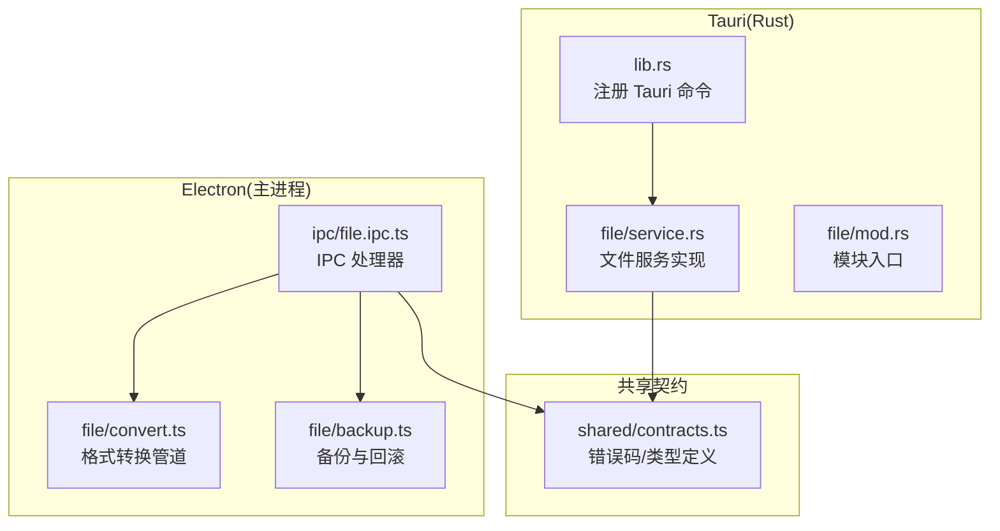
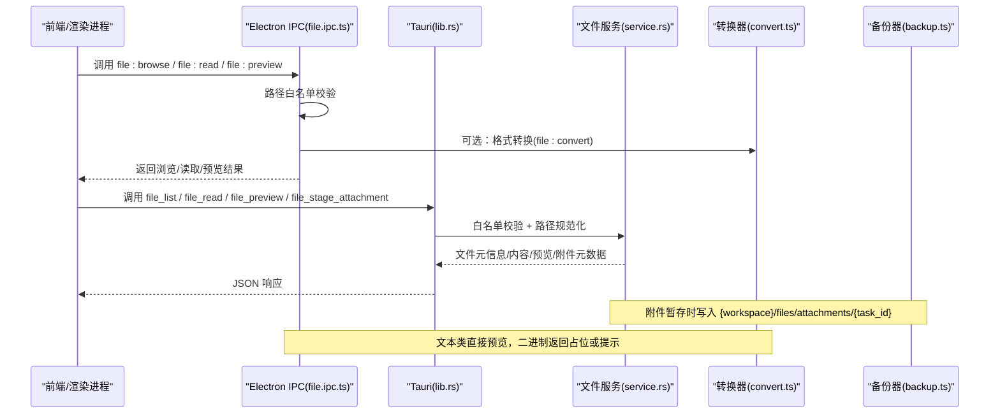
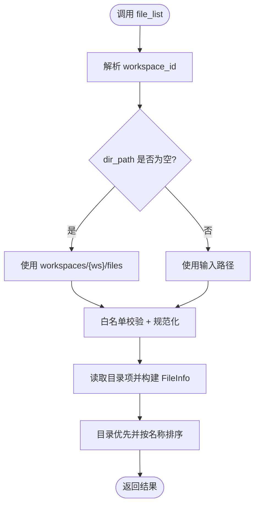
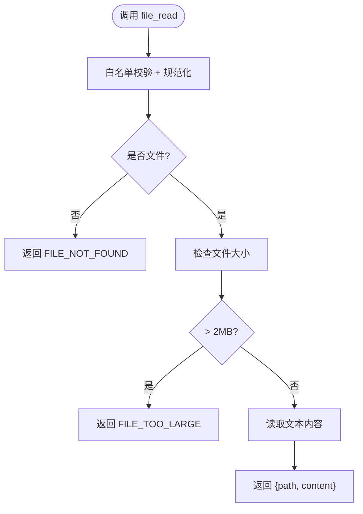
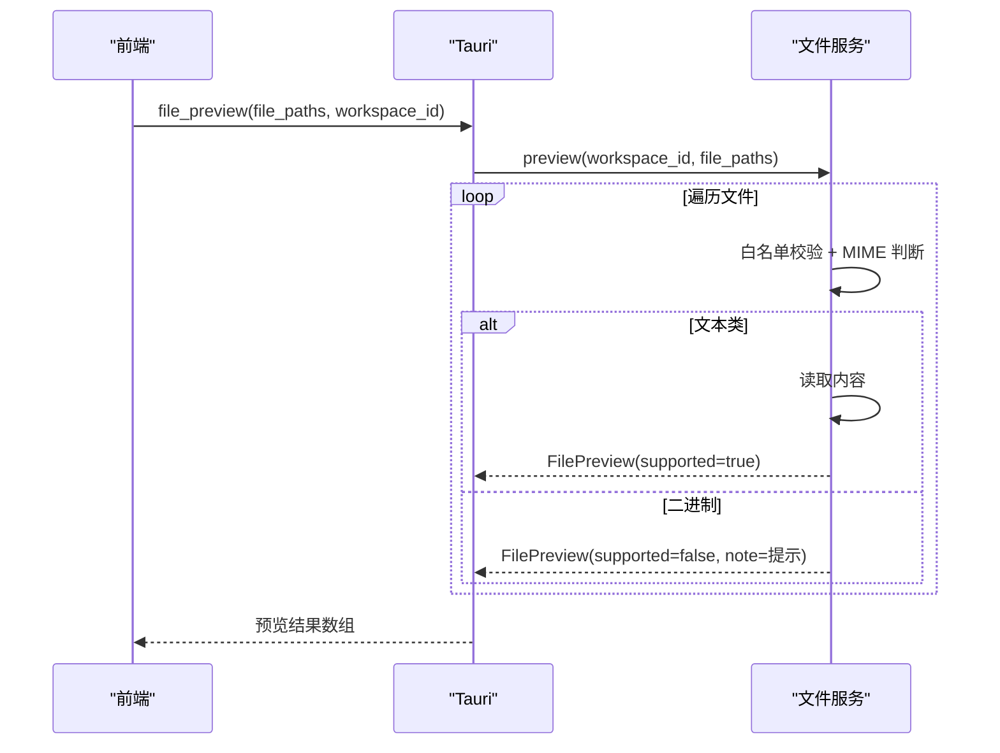
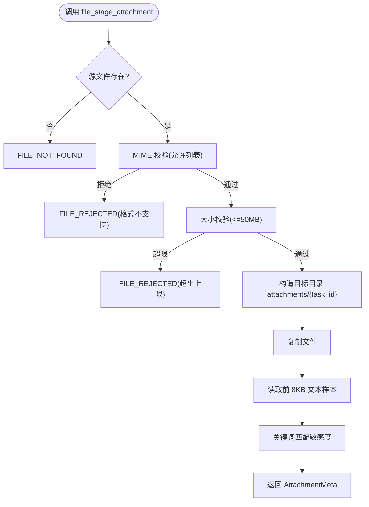
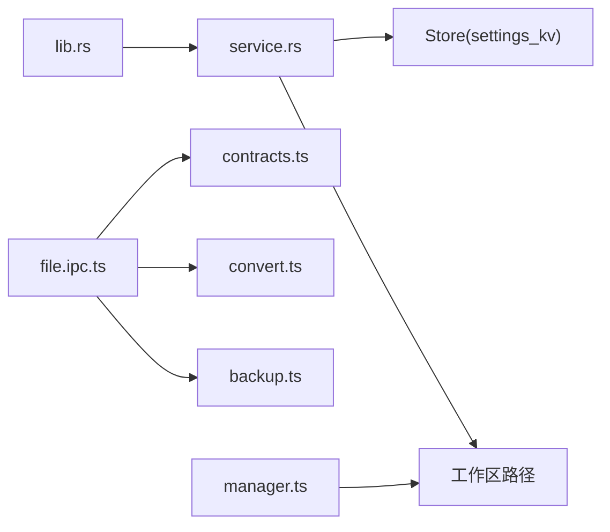

# 文件操作接口

<cite>
**本文引用的文件**
- [service.rs](file://tongtian-tauri/src-tauri/src/file/service.rs)
- [lib.rs](file://tongtian-tauri/src-tauri/src/lib.rs)
- [mod.rs](file://tongtian-tauri/src-tauri/src/file/mod.rs)
- [file.ipc.ts](file://tongtian-tauri/src/main/ipc/file.ipc.ts)
- [convert.ts](file://tongtian-tauri/src/main/file/convert.ts)
- [backup.ts](file://tongtian-tauri/src/main/file/backup.ts)
- [contracts.ts](file://tongtian-tauri/src/shared/contracts.ts)
- [manager.ts](file://tongtian-tauri/src/main/workspace/manager.ts)
</cite>

## 目录
1. [简介](#简介)
2. [项目结构](#项目结构)
3. [核心组件](#核心组件)
4. [架构总览](#架构总览)
5. [详细组件分析](#详细组件分析)
6. [依赖关系分析](#依赖关系分析)
7. [性能考虑](#性能考虑)
8. [故障排查指南](#故障排查指南)
9. [结论](#结论)
10. [附录](#附录)

## 简介
本文件面向“文件管理”的四个核心 Tauri 命令接口：file_list（文件列表）、file_read（文件读取）、file_preview（文件预览）、file_stage_attachment（附件暂存）。文档重点说明：
- 文件系统访问权限与工作区隔离机制
- 文件路径映射策略与白名单校验
- 支持的格式类型、预览生成逻辑
- 附件上传的安全校验（格式、大小、敏感度）
- 完整调用示例、错误处理模式
- 与工作区存储结构的集成方式及备份恢复机制
- 性能优化建议

## 项目结构
Tauri 侧通过 Rust 实现文件服务，暴露为 Tauri 命令；Electron 侧提供 IPC 处理器与格式转换、备份能力。工作区数据根目录遵循约定布局：{home}/workspaces/{ws}/files，附件按任务隔离存放。

图表来源
- [lib.rs:680-820](file://tongtian-tauri/src-tauri/src/lib.rs#L680-L820)
- [service.rs:1-478](file://tongtian-tauri/src-tauri/src/file/service.rs#L1-L478)
- [file.ipc.ts:1-250](file://tongtian-tauri/src/main/ipc/file.ipc.ts#L1-L250)
- [convert.ts:1-496](file://tongtian-tauri/src/main/file/convert.ts#L1-L496)
- [backup.ts:1-336](file://tongtian-tauri/src/main/file/backup.ts#L1-L336)
- [contracts.ts:14-109](file://tongtian-tauri/src/shared/contracts.ts#L14-L109)

章节来源
- [lib.rs:680-820](file://tongtian-tauri/src-tauri/src/lib.rs#L680-L820)
- [service.rs:1-478](file://tongtian-tauri/src-tauri/src/file/service.rs#L1-L478)
- [file.ipc.ts:1-250](file://tongtian-tauri/src/main/ipc/file.ipc.ts#L1-L250)
- [convert.ts:1-496](file://tongtian-tauri/src/main/file/convert.ts#L1-L496)
- [backup.ts:1-336](file://tongtian-tauri/src/main/file/backup.ts#L1-L336)
- [contracts.ts:14-109](file://tongtian-tauri/src/shared/contracts.ts#L14-L109)

## 核心组件
- Tauri 命令层：在 lib.rs 中注册 file_list、file_read、file_preview、file_stage_attachment，负责参数解析、工作区上下文注入、结果序列化。
- 文件服务层：service.rs 实现白名单校验、路径规范化、读取限制、预览与附件暂存等核心逻辑。
- Electron IPC 层：file.ipc.ts 提供浏览、读取、预览、转换等 IPC 通道，并做基础路径安全校验。
- 格式转换：convert.ts 提供 IR 中间表示与多格式转换管线（当前 txt/md/csv 已落地，docx/xlsx/pdf 待接入第三方库）。
- 备份与回滚：backup.ts 提供基于 SHA256 的备份记录、定时清理与回滚能力。
- 工作区管理：manager.ts 管理工作区生命周期与归档目录，配合文件服务的路径布局。

章节来源
- [lib.rs:680-820](file://tongtian-tauri/src-tauri/src/lib.rs#L680-L820)
- [service.rs:1-478](file://tongtian-tauri/src-tauri/src/file/service.rs#L1-L478)
- [file.ipc.ts:1-250](file://tongtian-tauri/src/main/ipc/file.ipc.ts#L1-L250)
- [convert.ts:1-496](file://tongtian-tauri/src/main/file/convert.ts#L1-L496)
- [backup.ts:1-336](file://tongtian-tauri/src/main/file/backup.ts#L1-L336)
- [manager.ts:1-401](file://tongtian-tauri/src/main/workspace/manager.ts#L1-L401)

## 架构总览
下图展示从前端到 Tauri/Rust 再到文件系统的调用链，以及 Electron IPC 与转换/备份能力的协作。

图表来源
- [lib.rs:680-820](file://tongtian-tauri/src-tauri/src/lib.rs#L680-L820)
- [service.rs:136-345](file://tongtian-tauri/src-tauri/src/file/service.rs#L136-L345)
- [file.ipc.ts:100-235](file://tongtian-tauri/src/main/ipc/file.ipc.ts#L100-L235)
- [convert.ts:93-153](file://tongtian-tauri/src/main/file/convert.ts#L93-L153)
- [backup.ts:86-182](file://tongtian-tauri/src/main/file/backup.ts#L86-L182)

## 详细组件分析

### 文件列表 file_list
- 功能：列出指定目录内容，支持空目录默认进入工作区文件根。
- 权限与隔离：
  - 路径必须位于白名单内：工作区文件根 workspaces/{ws}/files，以及通过 settings_kv 配置的 sandbox.file_allowlist.{ws} 扩展目录。
  - 路径先规范化再校验是否以白名单根开头。
- 返回：FileInfo 数组，包含名称、路径、是否目录、大小、修改时间。
- 典型调用：
  - 传入空 dir_path 将自动定位到 workspaces/{ws}/files。
  - 传入具体子目录则列出该子目录内容。

图表来源
- [lib.rs:683-701](file://tongtian-tauri/src-tauri/src/lib.rs#L683-L701)
- [service.rs:61-82](file://tongtian-tauri/src-tauri/src/file/service.rs#L61-L82)
- [service.rs:112-167](file://tongtian-tauri/src-tauri/src/file/service.rs#L112-L167)

章节来源
- [lib.rs:683-701](file://tongtian-tauri/src-tauri/src/lib.rs#L683-L701)
- [service.rs:61-82](file://tongtian-tauri/src-tauri/src/file/service.rs#L61-L82)
- [service.rs:112-167](file://tongtian-tauri/src-tauri/src/file/service.rs#L112-L167)

### 文件读取 file_read
- 功能：读取文本文件内容，限制最大 2MB。
- 权限与隔离：同 file_list 的白名单校验。
- 错误：
  - FILE_NOT_FOUND：路径不存在或非文件。
  - FILE_TOO_LARGE：超过 2MB。
  - FILE_READ_FAILED：二进制文件或读取失败。
- 典型调用：
  - 传入工作区内任意可访问文件路径即可读取。

图表来源
- [service.rs:173-197](file://tongtian-tauri/src-tauri/src/file/service.rs#L173-L197)
- [lib.rs:704-714](file://tongtian-tauri/src-tauri/src/lib.rs#L704-L714)

章节来源
- [service.rs:173-197](file://tongtian-tauri/src-tauri/src/file/service.rs#L173-L197)
- [lib.rs:704-714](file://tongtian-tauri/src-tauri/src/lib.rs#L704-L714)

### 文件预览 file_preview
- 功能：批量预览多个文件，文本类（txt/md/csv/json）直接返回内容；二进制（docx/xlsx/pdf）返回不支持提示与 MIME。
- 权限与隔离：同白名单校验。
- 输出：FilePreview 数组，包含 path、content、mime_type、supported、note。
- 注意：docx/xlsx/pdf 当前不静默失败，会返回 note 提示转换能力未落地。

图表来源
- [service.rs:199-256](file://tongtian-tauri/src-tauri/src/file/service.rs#L199-L256)
- [lib.rs:717-727](file://tongtian-tauri/src-tauri/src/lib.rs#L717-L727)

章节来源
- [service.rs:199-256](file://tongtian-tauri/src-tauri/src/file/service.rs#L199-L256)
- [lib.rs:717-727](file://tongtian-tauri/src-tauri/src/lib.rs#L717-L727)

### 附件暂存 file_stage_attachment
- 功能：将外部文件复制到工作区附件目录，进行格式与大小校验，并抽样检测敏感度。
- 存储位置：{home}/workspaces/{ws}/files/attachments/{task_id}/{file_name}。
- 安全校验：
  - 格式白名单：txt/md/csv/json/docx/xlsx/pdf。
  - 大小上限：50MB。
  - 敏感度检测：对前 8KB 文本与文件名关键词匹配，标记 public/internal/confidential。
- 返回：AttachmentMeta（file_name、staged_path、size_bytes、mime、sensitivity）。

图表来源
- [service.rs:270-345](file://tongtian-tauri/src-tauri/src/file/service.rs#L270-L345)
- [lib.rs:729-744](file://tongtian-tauri/src-tauri/src/lib.rs#L729-L744)

章节来源
- [service.rs:270-345](file://tongtian-tauri/src-tauri/src/file/service.rs#L270-L345)
- [lib.rs:729-744](file://tongtian-tauri/src-tauri/src/lib.rs#L729-L744)

### 工作区隔离与白名单
- 默认白名单根：workspaces/{ws}/files。
- 扩展白名单：通过 settings_kv 键 sandbox.file_allowlist.{ws} 配置额外目录。
- 路径规范化：对不存在路径尝试回溯到存在的祖先拼接剩余部分，再进行 starts_with 校验。
- 越界访问统一返回 FILE_ACCESS_DENIED。

章节来源
- [service.rs:54-82](file://tongtian-tauri/src-tauri/src/file/service.rs#L54-L82)
- [service.rs:84-132](file://tongtian-tauri/src-tauri/src/file/service.rs#L84-L132)

### 文件格式与预览策略
- 文本类：txt、md、csv、json 直接读取内容并标记 supported=true。
- 二进制类：docx、xlsx、pdf 返回 supported=false 与 note 提示转换能力未落地。
- Electron 侧 convert.ts 提供 IR 中间表示与转换管线，当前 txt/md/csv 已实现，docx/xlsx/pdf 需引入第三方库后启用。

章节来源
- [service.rs:199-256](file://tongtian-tauri/src-tauri/src/file/service.rs#L199-L256)
- [convert.ts:93-153](file://tongtian-tauri/src/main/file/convert.ts#L93-L153)
- [convert.ts:157-323](file://tongtian-tauri/src/main/file/convert.ts#L157-L323)

### 备份与恢复机制
- 备份：计算 SHA256，复制文件至 .tongtian-backups/{taskId}/{stepId}，记录状态 pending/success/failed/rolled_back。
- 回滚：根据备份记录还原或删除文件，更新状态。
- 清理：每小时扫描，删除超过 24 小时的备份文件与记录。
- 数据库：SQLite 表 file_backups 持久化备份元数据。

章节来源
- [backup.ts:39-182](file://tongtian-tauri/src/main/file/backup.ts#L39-L182)
- [backup.ts:227-280](file://tongtian-tauri/src/main/file/backup.ts#L227-L280)
- [backup.ts:293-332](file://tongtian-tauri/src/main/file/backup.ts#L293-L332)

### 与工作区存储结构的集成
- 工作区根：由 manager.ts 构建 workDir = userData/workspaces/{ws}。
- 文件服务根：workspaces/{ws}/files，与引擎 work-dir 同源布局。
- 附件目录：workspaces/{ws}/files/attachments/{task_id}，按任务隔离。
- 归档目录：userData/.tongtian-archives/{ws}，用于工作区归档。

章节来源
- [manager.ts:353-378](file://tongtian-tauri/src/main/workspace/manager.ts#L353-L378)
- [service.rs:61-69](file://tongtian-tauri/src-tauri/src/file/service.rs#L61-L69)
- [service.rs:311-322](file://tongtian-tauri/src-tauri/src/file/service.rs#L311-L322)

## 依赖关系分析
- Tauri 命令依赖文件服务 service.rs，并通过 Store 读取设置（如 allowlist）。
- Electron IPC 依赖 contracts.ts 的错误码与类型，并与 convert.ts、backup.ts 协作。
- 工作区管理器 manager.ts 提供工作区路径与归档能力，间接影响文件服务的路径解析。

图表来源
- [lib.rs:680-820](file://tongtian-tauri/src-tauri/src/lib.rs#L680-L820)
- [service.rs:1-478](file://tongtian-tauri/src-tauri/src/file/service.rs#L1-L478)
- [file.ipc.ts:1-250](file://tongtian-tauri/src/main/ipc/file.ipc.ts#L1-L250)
- [convert.ts:1-496](file://tongtian-tauri/src/main/file/convert.ts#L1-L496)
- [backup.ts:1-336](file://tongtian-tauri/src/main/file/backup.ts#L1-L336)
- [manager.ts:1-401](file://tongtian-tauri/src/main/workspace/manager.ts#L1-L401)

章节来源
- [lib.rs:680-820](file://tongtian-tauri/src-tauri/src/lib.rs#L680-L820)
- [service.rs:1-478](file://tongtian-tauri/src-tauri/src/file/service.rs#L1-L478)
- [file.ipc.ts:1-250](file://tongtian-tauri/src/main/ipc/file.ipc.ts#L1-L250)
- [convert.ts:1-496](file://tongtian-tauri/src/main/file/convert.ts#L1-L496)
- [backup.ts:1-336](file://tongtian-tauri/src/main/file/backup.ts#L1-L336)
- [manager.ts:1-401](file://tongtian-tauri/src/main/workspace/manager.ts#L1-L401)

## 性能考虑
- 读取限制：file_read 限制 2MB，避免大文件阻塞 UI 线程与内存占用。
- 预览批处理：file_preview 批量处理，减少多次 I/O 与网络往返。
- 文本直读：仅对文本类执行内容读取，二进制跳过读取以提升性能。
- 附件暂存：仅抽样前 8KB 进行敏感度检测，降低大文件 IO 成本。
- 转换管线：convert.ts 采用 IR 中间表示，便于复用与缓存；当前 txt/md/csv 已优化，后续 docx/xlsx/pdf 应引入流式解析以降低内存峰值。
- 备份清理：定时清理过期备份，控制磁盘增长。

[本节为通用性能建议，无需特定文件引用]

## 故障排查指南
- 常见错误码（来自 contracts.ts）：
  - FILE_NOT_FOUND：路径不存在或非文件。
  - FILE_ACCESS_DENIED：路径不在白名单内。
  - FILE_TOO_LARGE：超过读取或附件大小限制。
  - FILE_CONVERSION_FAILED：转换能力未就绪或转换失败。
  - FILE_BACKUP_FAILED：备份创建或复制失败。
  - FILE_REJECTED：附件格式不支持或超大小。
- 排查步骤：
  - 确认工作区 ID 与路径是否正确，必要时使用 file_list 验证可达目录。
  - 检查 settings_kv 中的 sandbox.file_allowlist.{ws} 是否包含期望目录。
  - 对于预览失败，确认 MIME 类型与 supported 字段，必要时使用 convert.ts 提供的转换能力。
  - 附件暂存失败时，检查格式白名单与大小限制，查看敏感度检测结果。
  - 备份问题：检查 SQLite 表 file_backups 与 .tongtian-backups 目录权限与空间。

章节来源
- [contracts.ts:14-109](file://tongtian-tauri/src/shared/contracts.ts#L14-L109)
- [service.rs:136-345](file://tongtian-tauri/src-tauri/src/file/service.rs#L136-L345)
- [backup.ts:147-182](file://tongtian-tauri/src/main/file/backup.ts#L147-L182)

## 结论
本文件操作接口通过严格的白名单与路径规范化确保工作区隔离与安全；提供高效的文本预览与安全的附件暂存机制；结合 Electron 的转换与备份能力，形成完整的文件管理闭环。建议在后续迭代中完善 docx/xlsx/pdf 的解析与生成能力，并引入流式处理与缓存策略以进一步提升性能与稳定性。

[本节为总结性内容，无需特定文件引用]

## 附录

### API 参考（Tauri 命令）
- file_list(dir_path, workspace_id?)
  - 作用：列出目录内容，空目录默认进入工作区文件根。
  - 返回：FileInfo[]。
  - 错误：FILE_NOT_FOUND、FILE_ACCESS_DENIED。
- file_read(file_path, workspace_id?)
  - 作用：读取文本文件内容。
  - 返回：{path, content}。
  - 错误：FILE_NOT_FOUND、FILE_TOO_LARGE、FILE_READ_FAILED。
- file_preview(file_paths, workspace_id?)
  - 作用：批量预览文件。
  - 返回：FilePreview[]。
  - 错误：FILE_ACCESS_DENIED。
- file_stage_attachment(src_path, task_id?, workspace_id?)
  - 作用：附件暂存，返回元数据。
  - 返回：AttachmentMeta。
  - 错误：FILE_NOT_FOUND、FILE_REJECTED。

章节来源
- [lib.rs:683-744](file://tongtian-tauri/src-tauri/src/lib.rs#L683-L744)
- [service.rs:136-345](file://tongtian-tauri/src-tauri/src/file/service.rs#L136-L345)

### 调用示例（概念性）
- 列举工作区文件：
  - 调用 file_list 且 dir_path 为空，workspace_id 设置为当前工作区。
- 读取 Markdown：
  - 调用 file_read 传入工作区内 .md 文件路径。
- 预览多个文件：
  - 调用 file_preview 传入多个文件路径，区分文本与二进制结果。
- 上传附件：
  - 调用 file_stage_attachment 传入系统选择文件路径，返回 staged_path 与 sensitivity。

[本节为概念性示例，无需特定文件引用]