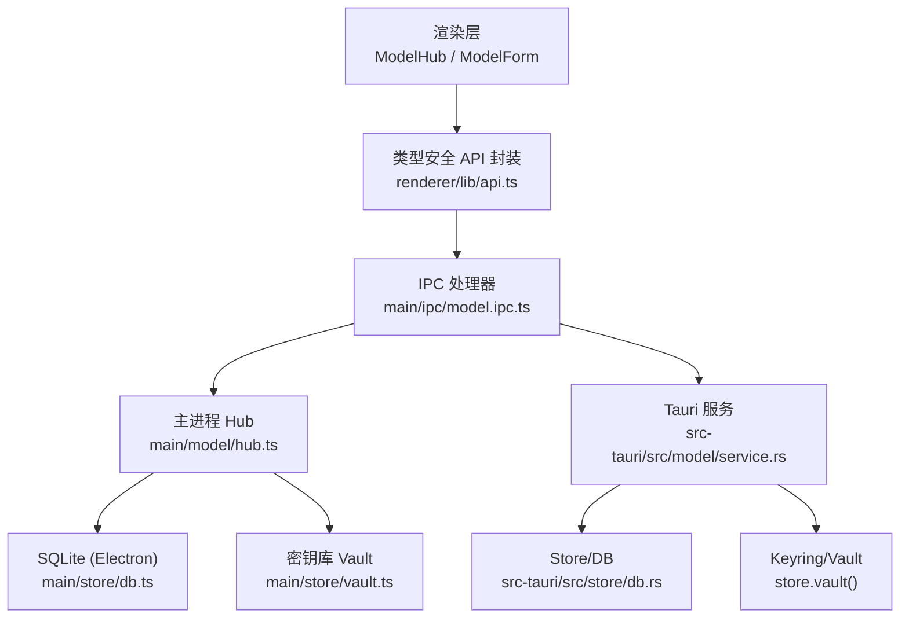
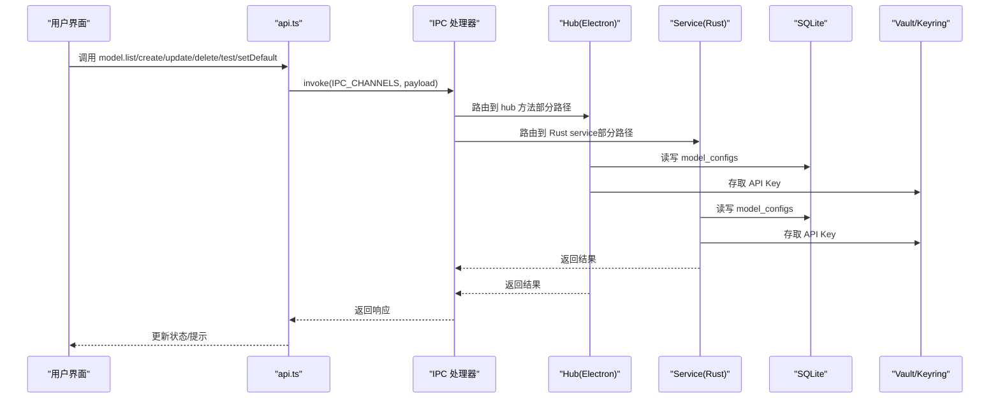
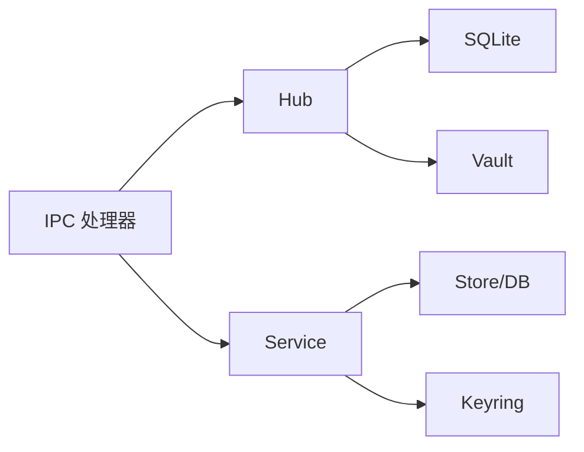

# 模型管理接口

<cite>
**本文引用的文件**
- [service.rs](file://tongtian-tauri/src-tauri/src/model/service.rs)
- [mod.rs](file://tongtian-tauri/src-tauri/src/model/mod.rs)
- [db.rs](file://tongtian-tauri/src-tauri/src/store/db.rs)
- [model.ipc.ts](file://tongtian-tauri/src/main/ipc/model.ipc.ts)
- [hub.ts](file://tongtian-tauri/src/main/model/hub.ts)
- [vault.ts](file://tongtian-tauri/src/main/store/vault.ts)
- [types.ts](file://tongtian-tauri/src/shared/types.ts)
- [contracts.ts](file://tongtian-tauri/src/shared/contracts.ts)
- [api.ts](file://tongtian-tauri/src/renderer/lib/api.ts)
- [ModelHub/index.tsx](file://tongtian-tauri/src/renderer/pages/ModelHub/index.tsx)
- [ModelForm/index.tsx](file://tongtian-tauri/src/renderer/components/ModelForm/index.tsx)
</cite>

## 目录
1. [简介](#简介)
2. [项目结构](#项目结构)
3. [核心组件](#核心组件)
4. [架构总览](#架构总览)
5. [详细组件分析](#详细组件分析)
6. [依赖关系分析](#依赖关系分析)
7. [性能考量](#性能考量)
8. [故障排查指南](#故障排查指南)
9. [结论](#结论)
10. [附录：API 调用示例与配置模板](#附录api-调用示例与配置模板)

## 简介
本文件面向 Model Hub 管理接口的完整说明，聚焦五个核心 Tauri 命令接口：model_list、model_add（对应 IPC model:create）、model_update、model_delete、model_test、model_set_default。文档覆盖模型配置的 CRUD、密钥管理（Vault/keyring）、连接测试机制、SQLite 存储结构、配置验证规则、错误处理策略，并提供 API 调用示例、配置模板与故障排查指南，同时说明与后端 Provider 系统的集成方式与扩展机制。

## 项目结构
Model Hub 由三层构成：
- 渲染层（React）：页面与表单负责用户交互，通过 api.ts 封装的 modelAPI 调用 IPC。
- 主进程桥接（Electron/Tauri IPC）：model.ipc.ts 注册并校验请求，转发到 hub.ts 或 Rust service。
- 后端服务（Rust + SQLite + Vault）：service.rs 实现持久化、CRUD、连通性探测；db.rs 提供数据库连接；vault.ts 在 Electron 侧提供密钥存储。

图表来源
- [model.ipc.ts:105-184](file://tongtian-tauri/src/main/ipc/model.ipc.ts#L105-L184)
- [hub.ts:85-367](file://tongtian-tauri/src/main/model/hub.ts#L85-L367)
- [service.rs:125-459](file://tongtian-tauri/src-tauri/src/model/service.rs#L125-L459)
- [db.rs:16-25](file://tongtian-tauri/src-tauri/src/store/db.rs#L16-L25)
- [vault.ts:60-124](file://tongtian-tauri/src/main/store/vault.ts#L60-L124)

章节来源
- [model.ipc.ts:105-184](file://tongtian-tauri/src/main/ipc/model.ipc.ts#L105-L184)
- [hub.ts:85-367](file://tongtian-tauri/src/main/model/hub.ts#L85-L367)
- [service.rs:125-459](file://tongtian-tauri/src-tauri/src/model/service.rs#L125-L459)
- [db.rs:16-25](file://tongtian-tauri/src-tauri/src/store/db.rs#L16-L25)
- [vault.ts:60-124](file://tongtian-tauri/src/main/store/vault.ts#L60-L124)

## 核心组件
- 模型配置实体与契约
  - shared/types.ts 定义 ModelConfig、ModelTestReq/Resp、ModelSource 等。
  - shared/contracts.ts 定义 IPC_CHANNELS 及错误码 ErrorCode。
- IPC 层
  - main/ipc/model.ipc.ts 使用 Zod 校验输入，将请求路由到 hub.ts 或 Tauri service。
- 主进程 Hub（Electron）
  - main/model/hub.ts 提供 CRUD、默认模型设置、健康检查（OpenAI 兼容 /chat/completions）。
  - main/store/vault.ts 使用 keytar 或内存 mock 存储 API Key。
- Tauri 服务（Rust）
  - src-tauri/src/model/service.rs 实现 list/add/update/delete/set_default/test，密钥通过 store.vault() 存取。
  - src-tauri/src/store/db.rs 打开 SQLite 连接（WAL 模式，外键开启）。

章节来源
- [types.ts:104-232](file://tongtian-tauri/src/shared/types.ts#L104-L232)
- [contracts.ts:15-109](file://tongtian-tauri/src/shared/contracts.ts#L15-L109)
- [contracts.ts:480-495](file://tongtian-tauri/src/shared/contracts.ts#L480-L495)
- [model.ipc.ts:18-80](file://tongtian-tauri/src/main/ipc/model.ipc.ts#L18-L80)
- [hub.ts:129-241](file://tongtian-tauri/src/main/model/hub.ts#L129-L241)
- [service.rs:10-100](file://tongtian-tauri/src-tauri/src/model/service.rs#L10-L100)
- [db.rs:16-25](file://tongtian-tauri/src-tauri/src/store/db.rs#L16-L25)

## 架构总览
下图展示从前端到后端的完整调用链，涵盖五种核心命令与连接测试流程。

图表来源
- [model.ipc.ts:105-184](file://tongtian-tauri/src/main/ipc/model.ipc.ts#L105-L184)
- [hub.ts:109-241](file://tongtian-tauri/src/main/model/hub.ts#L109-L241)
- [service.rs:125-345](file://tongtian-tauri/src-tauri/src/model/service.rs#L125-L345)
- [db.rs:16-25](file://tongtian-tauri/src-tauri/src/store/db.rs#L16-L25)
- [vault.ts:75-106](file://tongtian-tauri/src/main/store/vault.ts#L75-L106)

## 详细组件分析

### 数据模型与存储结构
- 模型配置字段（前后端对齐）
  - id、name、source、baseUrl/base_url、apiKeyEncrypted/api_key_encrypted（引用标记）、modelName/model_name、contextWindow/context_window、isDefault/is_default、agentBinding/agent_binding、forceLocal/force_local、createdAt/created_at、updatedAt/updated_at、lastUsedAt（可选）。
- SQLite 表
  - 表名：model_configs
  - 关键字段：id(PK)、name、source、base_url、api_key_encrypted、model_name、context_window、is_default、agent_binding、force_local、created_at、updated_at。
- 密钥存储
  - Electron 侧：Vault 使用 keytar（系统钥匙串）或内存 mock，按模型 id 存取 API Key。
  - Tauri 侧：service.rs 通过 store.vault().get_secret/set_secret/delete_secret 存取密钥；DB 中仅保存 has_api_key 标记或空字符串占位。

章节来源
- [types.ts:201-232](file://tongtian-tauri/src/shared/types.ts#L201-L232)
- [service.rs:10-33](file://tongtian-tauri/src-tauri/src/model/service.rs#L10-L33)
- [service.rs:122-124](file://tongtian-tauri/src-tauri/src/model/service.rs#L122-L124)
- [hub.ts:29-57](file://tongtian-tauri/src/main/model/hub.ts#L29-L57)
- [vault.ts:75-106](file://tongtian-tauri/src/main/store/vault.ts#L75-L106)

### 五大命令详解

#### model_list（获取模型列表）
- 入口
  - 前端：api.model.list() → IPC model:list。
  - 主进程：ipc handler 调用 hub.list() 或 Rust service.list()。
- 行为
  - 读取 model_configs，映射为 ModelConfig 列表。
  - 附加 has_api_key 标志（基于 vault/keyring 是否存在密钥）。
- 输出
  - ModelConfig[]，包含基础信息与时间戳。

章节来源
- [api.ts:73-77](file://tongtian-tauri/src/renderer/lib/api.ts#L73-L77)
- [model.ipc.ts:110-116](file://tongtian-tauri/src/main/ipc/model.ipc.ts#L110-L116)
- [hub.ts:109-113](file://tongtian-tauri/src/main/model/hub.ts#L109-L113)
- [service.rs:125-169](file://tongtian-tauri/src-tauri/src/model/service.rs#L125-L169)

#### model_add（添加模型）
- 入口
  - 前端：api.model.create(config) → IPC model:create。
  - 主进程：Zod 校验 → hub.add() 或 Rust service.add()。
- 行为
  - 生成唯一 id。
  - 将 API Key 存入 Vault/keyring（Electron 用 vault.storeApiKey，Tauri 用 store.vault().set_secret）。
  - 写入 model_configs，若 is_default=true 则清除其他默认。
- 校验
  - name、model_name 非空；context_window 正数且上限约束（Zod）。
- 输出
  - 新增后的 ModelConfig。

章节来源
- [api.ts:79-82](file://tongtian-tauri/src/renderer/lib/api.ts#L79-L82)
- [model.ipc.ts:120-129](file://tongtian-tauri/src/main/ipc/model.ipc.ts#L120-L129)
- [hub.ts:129-161](file://tongtian-tauri/src/main/model/hub.ts#L129-L161)
- [service.rs:177-215](file://tongtian-tauri/src-tauri/src/model/service.rs#L177-L215)
- [model.ipc.ts:28-37](file://tongtian-tauri/src/main/ipc/model.ipc.ts#L28-L37)

#### model_update（更新模型）
- 入口
  - 前端：api.model.update(id, patch) → IPC model:update。
  - 主进程：Zod 校验 → hub.update() 或 Rust service.update()。
- 行为
  - 支持部分字段更新（name、baseUrl、modelName、contextWindow、agentBinding、forceLocal）。
  - 若传入 apiKey，则更新 Vault/keyring；空串表示清除密钥。
  - 更新 model_configs 记录 with updated_at。
- 输出
  - 更新后的 ModelConfig。

章节来源
- [api.ts:84-87](file://tongtian-tauri/src/renderer/lib/api.ts#L84-L87)
- [model.ipc.ts:133-142](file://tongtian-tauri/src/main/ipc/model.ipc.ts#L133-L142)
- [hub.ts:166-218](file://tongtian-tauri/src/main/model/hub.ts#L166-L218)
- [service.rs:261-316](file://tongtian-tauri/src-tauri/src/model/service.rs#L261-L316)

#### model_delete（删除模型）
- 入口
  - 前端：api.model.remove(id) → IPC model:delete。
  - 主进程：Zod 校验 → hub.delete() 或 Rust service.delete()。
- 行为
  - 删除 model_configs 记录。
  - 同步删除 Vault/keyring 中的 API Key。
- 输出
  - 成功返回 { ok: true } 或空结果。

章节来源
- [api.ts:89-92](file://tongtian-tauri/src/renderer/lib/api.ts#L89-L92)
- [model.ipc.ts:146-155](file://tongtian-tauri/src/main/ipc/model.ipc.ts#L146-L155)
- [hub.ts:223-241](file://tongtian-tauri/src/main/model/hub.ts#L223-L241)
- [service.rs:318-329](file://tongtian-tauri/src-tauri/src/model/service.rs#L318-L329)

#### model_test（测试连接）
- 入口
  - 前端：api.model.test(req) → IPC model:test。
  - 主进程：Zod 校验 → hub.healthCheck() 或 Rust service.test()。
- 行为
  - 向 baseUrl/chat/completions 发送最小消息体（stream=false），超时限制（Electron 10s，Rust 10s）。
  - 可选拉取 /models 列表（失败不影响主结果）。
  - 根据 HTTP 状态区分认证失败与连接失败。
- 输出
  - ModelTestResp：ok、latencyMs、model、error、availableModels。

章节来源
- [api.ts:94-97](file://tongtian-tauri/src/renderer/lib/api.ts#L94-L97)
- [model.ipc.ts:159-171](file://tongtian-tauri/src/main/ipc/model.ipc.ts#L159-L171)
- [hub.ts:282-358](file://tongtian-tauri/src/main/model/hub.ts#L282-L358)
- [service.rs:347-459](file://tongtian-tauri/src-tauri/src/model/service.rs#L347-L459)

#### model_set_default（设置默认模型）
- 入口
  - 前端：api.model.setDefault(id) → IPC model:setDefault。
  - 主进程：Zod 校验 → hub.setDefault() 或 Rust service.set_default()。
- 行为
  - 先清空所有 is_default=1，再将目标设为默认。
- 输出
  - 返回更新后的 ModelConfig（Electron）或空结果（Rust）。

章节来源
- [api.ts:99-102](file://tongtian-tauri/src/renderer/lib/api.ts#L99-L102)
- [model.ipc.ts:175-184](file://tongtian-tauri/src/main/ipc/model.ipc.ts#L175-L184)
- [hub.ts:249-266](file://tongtian-tauri/src/main/model/hub.ts#L249-L266)
- [service.rs:331-345](file://tongtian-tauri/src-tauri/src/model/service.rs#L331-L345)

### 密钥管理与安全策略
- 密钥不落库原则
  - 数据库仅保存引用标记或空字符串；真实密钥存于 Vault/keyring。
  - 列表时通过 vault.get_secret 判断 has_api_key。
- 更新与删除联动
  - 更新时若传入空串 apiKey 表示清除密钥；删除时同步清理密钥。
- 本地缓存
  - Electron Vault 维护内存缓存以提升读取性能，进程退出时清理。

章节来源
- [service.rs:18-28](file://tongtian-tauri/src-tauri/src/model/service.rs#L18-L28)
- [service.rs:150-165](file://tongtian-tauri/src-tauri/src/model/service.rs#L150-L165)
- [service.rs:265-271](file://tongtian-tauri/src-tauri/src/model/service.rs#L265-L271)
- [vault.ts:75-106](file://tongtian-tauri/src/main/store/vault.ts#L75-L106)

### 连接测试机制
- 最小探测
  - 发送 {"model": "...", "messages": [{"role":"user","content":"ping"}], "max_tokens": 1, "stream": false}。
- 超时控制
  - 10 秒超时，避免阻塞 UI。
- 可用模型列表
  - 尝试 GET /models，解析 data[].id/name 返回 availableModels。
- 错误分类
  - 401/403 → MODEL_AUTH_FAILED；其他 → MODEL_CONNECTION_FAILED；网络异常或超时 → 连接失败。

章节来源
- [service.rs:347-459](file://tongtian-tauri/src-tauri/src/model/service.rs#L347-L459)
- [hub.ts:282-358](file://tongtian-tauri/src/main/model/hub.ts#L282-L358)

### 配置验证规则
- 必填项
  - name、model_name 非空；baseUrl 有效 URL；contextWindow 正整数且有上限。
- 可选项
  - agentBinding、forceLocal、isDefault。
- 校验位置
  - IPC 层使用 Zod 进行强校验；Rust 层对 name/model_name 做空值校验。

章节来源
- [model.ipc.ts:28-59](file://tongtian-tauri/src/main/ipc/model.ipc.ts#L28-L59)
- [service.rs:177-181](file://tongtian-tauri/src-tauri/src/model/service.rs#L177-L181)

### 错误处理策略
- 统一错误码
  - ErrorCode 枚举集中定义（如 MODEL_NOT_FOUND、MODEL_CONNECTION_FAILED、VALIDATION_ERROR 等）。
- 捕获与包装
  - IPC safeHandler 捕获异常并转换为结构化错误对象；Rust 函数返回 Result 并携带错误信息。
- 前端展示
  - 使用 errorMessageOf 将错误码映射为用户可读消息。

章节来源
- [contracts.ts:15-109](file://tongtian-tauri/src/shared/contracts.ts#L15-L109)
- [model.ipc.ts:67-101](file://tongtian-tauri/src/main/ipc/model.ipc.ts#L67-L101)
- [ModelHub/index.tsx:167-170](file://tongtian-tauri/src/renderer/pages/ModelHub/index.tsx#L167-L170)

### 与后端 Provider 系统的集成与扩展
- OpenAI 兼容协议
  - 测试与调用均基于 /chat/completions 与 /models 标准接口，便于接入任意兼容 Provider。
- 扩展点
  - 新增 Provider 只需遵循 OpenAI 兼容协议；如需特殊能力，可在 hub 或 service 中增加探测逻辑。
- 本地与云端切换
  - forceLocal 字段用于强制本地模式；source 标识不同来源（openai_compat、ollama、preset_*）。

章节来源
- [types.ts:104-112](file://tongtian-tauri/src/shared/types.ts#L104-L112)
- [hub.ts:282-358](file://tongtian-tauri/src/main/model/hub.ts#L282-L358)
- [service.rs:347-459](file://tongtian-tauri/src-tauri/src/model/service.rs#L347-L459)

## 依赖关系分析
- 模块耦合
  - IPC 层依赖 contracts.ts 与 types.ts；Hub 依赖 Database 与 Vault；Rust Service 依赖 Store 与 Vault。
- 外部依赖
  - SQLite（WAL 模式，外键开启）；keytar（系统钥匙串）或内存 mock；reqwest/tokio（Rust 侧 HTTP 客户端）。
- 潜在循环依赖
  - 当前分层清晰，未见循环导入；IPC 作为单向入口。

图表来源
- [model.ipc.ts:105-184](file://tongtian-tauri/src/main/ipc/model.ipc.ts#L105-L184)
- [hub.ts:109-241](file://tongtian-tauri/src/main/model/hub.ts#L109-L241)
- [service.rs:125-345](file://tongtian-tauri/src-tauri/src/model/service.rs#L125-L345)
- [db.rs:16-25](file://tongtian-tauri/src-tauri/src/store/db.rs#L16-L25)
- [vault.ts:75-106](file://tongtian-tauri/src/main/store/vault.ts#L75-L106)

章节来源
- [model.ipc.ts:105-184](file://tongtian-tauri/src/main/ipc/model.ipc.ts#L105-L184)
- [hub.ts:109-241](file://tongtian-tauri/src/main/model/hub.ts#L109-L241)
- [service.rs:125-345](file://tongtian-tauri/src-tauri/src/model/service.rs#L125-L345)
- [db.rs:16-25](file://tongtian-tauri/src-tauri/src/store/db.rs#L16-L25)
- [vault.ts:75-106](file://tongtian-tauri/src/main/store/vault.ts#L75-L106)

## 性能考量
- 数据库
  - WAL 模式提升并发写性能；外键开启保证一致性。
- 网络请求
  - 连接测试设置 10 秒超时，避免长时间阻塞；/models 拉取失败不影响主结果。
- 密钥读取
  - Electron Vault 使用内存缓存减少重复 IO。
- 建议
  - 批量操作时合并请求；对高频读取可考虑短期缓存模型列表。

[本节为通用指导，不直接分析具体文件]

## 故障排查指南
- 常见错误与定位
  - VALIDATION_ERROR：检查 IPC 入参是否符合 Zod 校验规则（名称、URL、上下文窗口范围）。
  - MODEL_NOT_FOUND：确认 id 存在且未被删除。
  - MODEL_AUTH_FAILED：检查 API Key 是否正确且未过期。
  - MODEL_CONNECTION_FAILED：检查 baseUrl 可达性与防火墙设置；确认 /chat/completions 接口可用。
- 日志与调试
  - IPC 层记录校验失败与内部错误；Hub/Service 记录健康检查详情。
  - 前端通过 Alert 展示错误信息，可使用 errorMessageOf 转换错误码。
- 恢复步骤
  - 重新设置默认模型以排除默认位冲突；清理并重建模型配置；检查系统钥匙串权限。

章节来源
- [model.ipc.ts:67-101](file://tongtian-tauri/src/main/ipc/model.ipc.ts#L67-L101)
- [contracts.ts:15-109](file://tongtian-tauri/src/shared/contracts.ts#L15-L109)
- [ModelHub/index.tsx:167-170](file://tongtian-tauri/src/renderer/pages/ModelHub/index.tsx#L167-L170)

## 结论
Model Hub 管理接口通过清晰的三层架构实现了模型配置的完整生命周期管理，结合 Vault/keyring 保障密钥安全，利用 SQLite 持久化配置，并通过 OpenAI 兼容协议实现灵活的 Provider 集成。统一的错误码与校验机制提升了健壮性与可维护性，适合在企业级场景中扩展与定制。

[本节为总结，不直接分析具体文件]

## 附录：API 调用示例与配置模板

### 前端调用示例（基于 api.ts）
- 获取模型列表
  - 调用：api.model.list()
  - 返回：ModelConfig[]
- 创建模型
  - 调用：api.model.create({ name, source, baseUrl, apiKey, modelName, contextWindow, isDefault, agentBinding, forceLocal })
  - 返回：ModelConfig
- 更新模型
  - 调用：api.model.update(id, { name?, baseUrl?, apiKey?, modelName?, contextWindow?, agentBinding?, forceLocal? })
  - 返回：ModelConfig
- 删除模型
  - 调用：api.model.remove(id)
  - 返回：void
- 测试连接
  - 调用：api.model.test({ baseUrl, apiKey, modelName, contextWindow, id? })
  - 返回：ModelTestResp
- 设置默认模型
  - 调用：api.model.setDefault(id)
  - 返回：void

章节来源
- [api.ts:73-107](file://tongtian-tauri/src/renderer/lib/api.ts#L73-L107)

### 配置模板（JSON 示意）
- 模型配置（ModelConfig）
  - id: string
  - name: string
  - source: "openai_compat" | "ollama" | "preset_qwen" | "preset_deepseek" | "preset_openai" | "custom"
  - baseUrl: string
  - apiKeyEncrypted: string（实际密钥不在库中）
  - modelName: string
  - contextWindow: number
  - isDefault: boolean
  - agentBinding: string
  - forceLocal: boolean
  - lastUsedAt?: string
  - createdAt: string
  - updatedAt: string

章节来源
- [types.ts:201-232](file://tongtian-tauri/src/shared/types.ts#L201-L232)

### 连接测试请求/响应（ModelTestReq/Resp）
- 请求
  - baseUrl: string
  - apiKey: string
  - modelName: string
  - contextWindow: number
  - id?: string（用于从 keyring 补齐密钥）
- 响应
  - ok: boolean
  - latencyMs: number
  - model: string
  - error?: string
  - availableModels?: string[]

章节来源
- [types.ts:217-232](file://tongtian-tauri/src/shared/types.ts#L217-L232)
- [contracts.ts:169-182](file://tongtian-tauri/src/shared/contracts.ts#L169-L182)