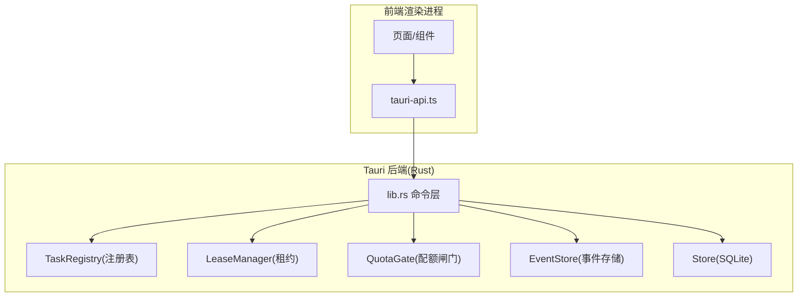
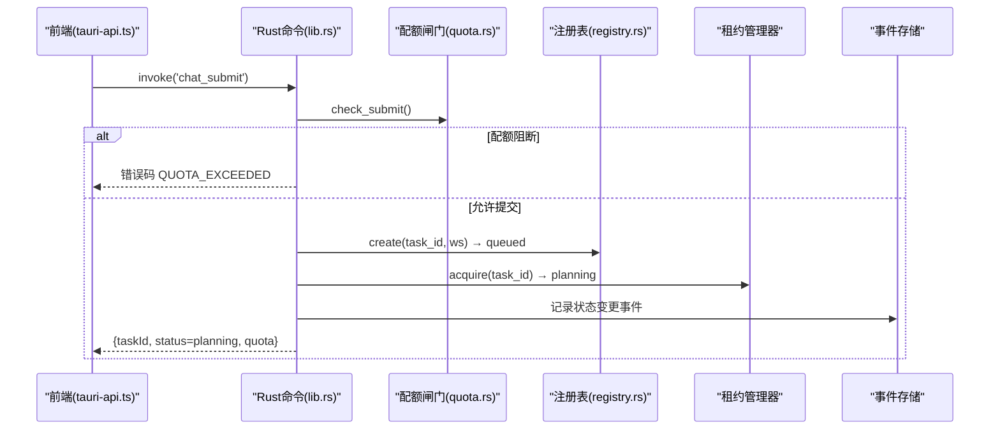
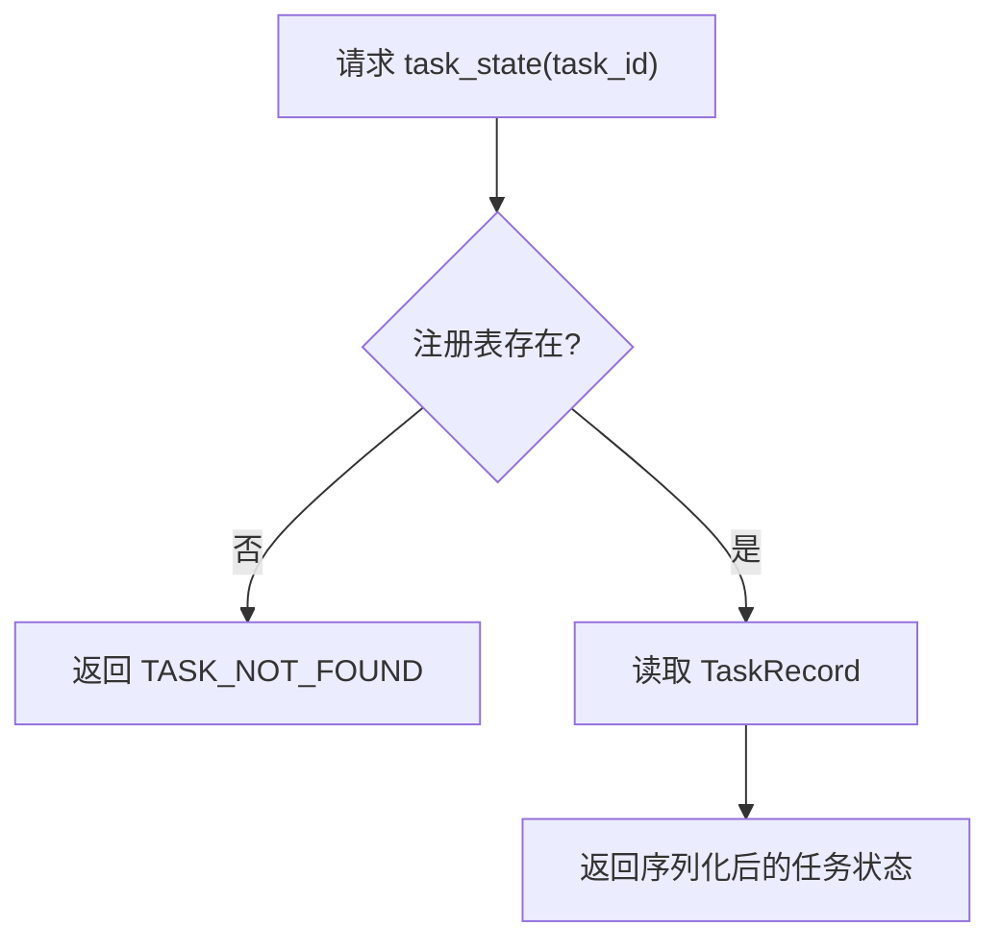
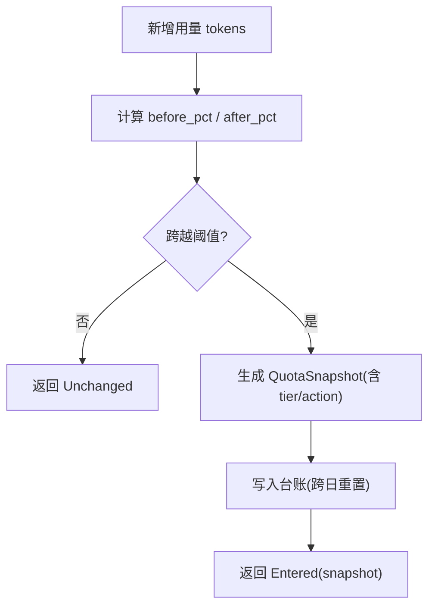
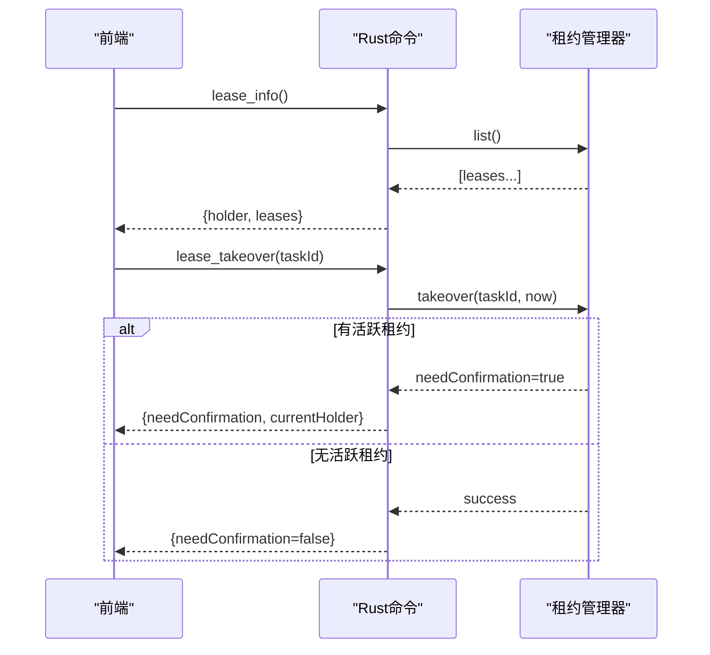
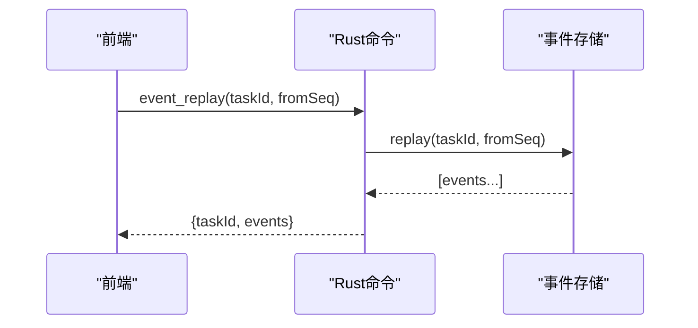
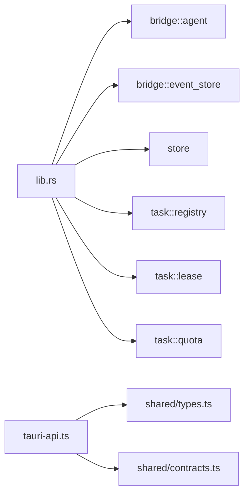

# 系统工具接口

<cite>
**本文引用的文件**
- [lib.rs](file://tongtian-tauri/src-tauri/src/lib.rs)
- [tauri-api.ts](file://tongtian-tauri/src/renderer/lib/tauri-api.ts)
- [types.ts](file://tongtian-tauri/src/shared/types.ts)
- [contracts.ts](file://tongtian-tauri/src/shared/contracts.ts)
- [quota.rs](file://tongtian-tauri/src-tauri/src/task/quota.rs)
- [registry.rs](file://tongtian-tauri/src-tauri/src/task/registry.rs)
- [mod.rs](file://tongtian-tauri/src-tauri/src/task/mod.rs)
</cite>

## 目录
1. [简介](#简介)
2. [项目结构](#项目结构)
3. [核心组件](#核心组件)
4. [架构总览](#架构总览)
5. [详细组件分析](#详细组件分析)
6. [依赖关系分析](#依赖关系分析)
7. [性能考量](#性能考量)
8. [故障排查指南](#故障排查指南)
9. [结论](#结论)
10. [附录](#附录)

## 简介
本文件面向系统监控与管理相关的 Tauri 命令接口，聚焦以下能力：
- system_info：系统信息
- task_state：任务状态（14 态）
- quota_status：配额快照与预警
- lease_info / lease_takeover：租约视图与接管
- event_replay：事件重放（24h 持久化 + 序列号去重）

文档将解释系统监控指标、配额管理机制、租约管理策略、事件存储与重放功能，并提供字段说明、阈值、冲突处理策略、监控示例、调试技巧与性能分析建议。

## 项目结构
Tauri 后端通过 Rust 暴露命令，前端通过 tauri-api.ts 调用；共享类型在 shared 中定义，确保前后端契约一致。

图表来源
- [lib.rs:747-808](file://tongtian-tauri/src-tauri/src/lib.rs#L747-L808)
- [tauri-api.ts:39-169](file://tongtian-tauri/src/renderer/lib/tauri-api.ts#L39-L169)

章节来源
- [lib.rs:1-33](file://tongtian-tauri/src-tauri/src/lib.rs#L1-L33)
- [tauri-api.ts:1-27](file://tongtian-tauri/src/renderer/lib/tauri-api.ts#L1-L27)

## 核心组件
- P0Services：聚合任务注册表、租约、配额、事件存储、持久化存储，作为命令层的共享上下文。
- TaskRegistry：维护任务 14 态状态机、重试计数、排队位次、租约绑定、取消标记等。
- QuotaGate：四档配额预警（70/85/95/100%），动作链“降级→排队→阻断”，支持本地台账持久化与跨日重置。
- LeaseManager：租约心跳/超时回收/空闲释放，禁止抢占式接管需对端确认。
- EventStore：事件落盘（24h TTL）、按任务 ID 重放、序列号去重。

章节来源
- [lib.rs:35-42](file://tongtian-tauri/src-tauri/src/lib.rs#L35-L42)
- [registry.rs:12-46](file://tongtian-tauri/src-tauri/src/task/registry.rs#L12-L46)
- [quota.rs:15-36](file://tongtian-tauri/src-tauri/src/task/quota.rs#L15-L36)
- [mod.rs:7-23](file://tongtian-tauri/src-tauri/src/task/mod.rs#L7-L23)

## 架构总览
命令层统一对外暴露 Tauri 命令，内部组合 P0Services 完成业务编排。关键流程包括：提交任务→配额检查→注册表受理→租约签发→后台执行→状态变更事件→历史落库。

图表来源
- [lib.rs:127-237](file://tongtian-tauri/src-tauri/src/lib.rs#L127-L237)
- [quota.rs:191-206](file://tongtian-tauri/src-tauri/src/task/quota.rs#L191-L206)
- [registry.rs:68-90](file://tongtian-tauri/src-tauri/src/task/registry.rs#L68-L90)

## 详细组件分析

### system_info（系统信息）
- 作用：返回应用名、版本、平台、架构等基础信息。
- 输入：无
- 输出：包含 name/version/platform/arch 的 JSON 对象
- 前端调用：tauriAPI.systemInfo()

章节来源
- [lib.rs:51-59](file://tongtian-tauri/src-tauri/src/lib.rs#L51-L59)
- [tauri-api.ts:168-169](file://tongtian-tauri/src/renderer/lib/tauri-api.ts#L168-L169)

### task_state（任务状态）
- 作用：查询任务的 14 态状态及元数据（wait_reason、retry_count、lease_id、status_reason_code、queue_position 等）。
- 输入：task_id
- 输出：任务记录的序列化结果（camelCase 字段）
- 典型用途：任务列表详情、状态面板、诊断

图表来源
- [lib.rs:557-564](file://tongtian-tauri/src-tauri/src/lib.rs#L557-L564)
- [registry.rs:12-46](file://tongtian-tauri/src-tauri/src/task/registry.rs#L12-L46)

章节来源
- [lib.rs:557-564](file://tongtian-tauri/src-tauri/src/lib.rs#L557-L564)
- [registry.rs:68-173](file://tongtian-tauri/src-tauri/src/task/registry.rs#L68-L173)

### quota_status（配额状态）
- 作用：返回当前配额快照，包含 used_tokens、quota_tokens、tier、action、updatedAt。
- 阈值与动作链：
  - 70%：notify（提示）
  - 85%：degrade（降级）
  - 95%：queue（排队）
  - 100%：block（阻断新提交，返回 QUOTA_EXCEEDED）
- 行为：
  - add_usage 累计用量并触发档位跃迁事件（同档不重复）
  - check_submit 在 100% 阻断新任务
  - should_queue 在 ≥95% 时建议排队
- 持久化：JSON 台账，跨日重置

图表来源
- [quota.rs:158-206](file://tongtian-tauri/src-tauri/src/task/quota.rs#L158-L206)

章节来源
- [quota.rs:15-36](file://tongtian-tauri/src-tauri/src/task/quota.rs#L15-L36)
- [quota.rs:87-117](file://tongtian-tauri/src-tauri/src/task/quota.rs#L87-L117)
- [quota.rs:158-206](file://tongtian-tauri/src-tauri/src/task/quota.rs#L158-L206)
- [lib.rs:566-570](file://tongtian-tauri/src-tauri/src/lib.rs#L566-L570)
- [contracts.ts:311-321](file://tongtian-tauri/src/shared/contracts.ts#L311-L321)

### lease_info / lease_takeover（租约信息与接管）
- 作用：
  - lease_info：列出全部活跃租约，返回 holder_id 与 leases 列表
  - lease_takeover：发起接管请求；若存在活跃租约则禁止抢占，需对端确认
- 策略要点：
  - 心跳周期、租约时长、超时回收、空闲释放由租约管理器维护
  - 多端场景下，接管需显式确认，避免脑裂
- 前端调用：tauriAPI.leaseInfo() / tauriAPI.leaseTakeover(taskId)

图表来源
- [lib.rs:572-588](file://tongtian-tauri/src-tauri/src/lib.rs#L572-L588)
- [tauri-api.ts:133-139](file://tongtian-tauri/src/renderer/lib/tauri-api.ts#L133-L139)
- [contracts.ts:290-309](file://tongtian-tauri/src/shared/contracts.ts#L290-L309)

章节来源
- [lib.rs:572-588](file://tongtian-tauri/src-tauri/src/lib.rs#L572-L588)
- [contracts.ts:290-309](file://tongtian-tauri/src/shared/contracts.ts#L290-L309)

### event_replay（事件重放）
- 作用：按任务 ID 从指定 from_seq 之后重放事件，用于断线续传、补全缺失事件。
- 特性：
  - 事件持久化 24h（TTL 清理）
  - 前端使用 EventStreamGuard 做 seq 去重与缺口检测
- 前端调用：tauriAPI.eventReplay(taskId, fromSeq)

图表来源
- [lib.rs:590-599](file://tongtian-tauri/src-tauri/src/lib.rs#L590-L599)
- [tauri-api.ts:141-143](file://tongtian-tauri/src/renderer/lib/tauri-api.ts#L141-L143)

章节来源
- [lib.rs:590-599](file://tongtian-tauri/src-tauri/src/lib.rs#L590-L599)
- [tauri-api.ts:141-143](file://tongtian-tauri/src/renderer/lib/tauri-api.ts#L141-L143)

## 依赖关系分析
- lib.rs 命令层依赖：
  - bridge::agent（AgentBridge 集成）
  - bridge::event_store（事件存储与 TTL 清理）
  - store（SQLite 持久化）
  - task::{lease, quota, registry}（租约、配额、注册表）
- 前端 tauri-api.ts 依赖 shared 类型，保证 IPC 契约一致性。

图表来源
- [lib.rs:17-33](file://tongtian-tauri/src-tauri/src/lib.rs#L17-L33)
- [tauri-api.ts:9-13](file://tongtian-tauri/src/renderer/lib/tauri-api.ts#L9-L13)

章节来源
- [lib.rs:17-33](file://tongtian-tauri/src-tauri/src/lib.rs#L17-L33)
- [tauri-api.ts:9-13](file://tongtian-tauri/src/renderer/lib/tauri-api.ts#L9-L13)

## 性能考量
- 配额闸门：
  - 使用内存锁保护台账，跨日自动重置；高频 add_usage 应批量合并以减少写放大。
  - 100% 阻断新提交，避免雪崩；≥95% 建议排队以削峰。
- 事件存储：
  - 后台异步批量刷盘 + 24h TTL 清理，降低 I/O 压力。
  - 前端 seq 去重减少重复渲染开销。
- 租约管理：
  - 心跳/超时回收循环避免僵尸任务；空闲释放及时回收资源。
- 注册表：
  - 本地退化队列 <100ms 入队即出队，减少等待；revision 单调递增便于并发控制。

[本节为通用指导，不直接分析具体文件]

## 故障排查指南
- 常见错误码与含义：
  - QUOTA_EXCEEDED：配额用尽，阻断新提交
  - BUDGET_EXHAUSTED：组织预算耗尽（云端语义）
  - QUEUE_TIMEOUT：排队超时
  - LEASE_LOST：租约丢失（心跳超时/Runner 崩溃）
  - TASK_ALREADY_RUNNING：任务已在运行（租约冲突）
  - VALIDATION_ERROR：参数或状态校验失败
- 排查步骤：
  - 使用 task_state 查看任务 14 态、wait_reason、status_reason_code、lease_id
  - 使用 quota_status 检查配额档位与 action，必要时调整配额或等待回落
  - 使用 lease_info 查看活跃租约持有者；如需接管，调用 lease_takeover 并处理 needConfirmation
  - 使用 event_replay 从最近 from_seq 重放事件，定位丢消息或乱序问题
  - 结合 chat_history 查看任务生命周期与最终状态

章节来源
- [contracts.ts:15-109](file://tongtian-tauri/src/shared/contracts.ts#L15-L109)
- [lib.rs:557-599](file://tongtian-tauri/src-tauri/src/lib.rs#L557-L599)
- [registry.rs:100-173](file://tongtian-tauri/src-tauri/src/task/registry.rs#L100-L173)

## 结论
本系统通过统一的 Tauri 命令层暴露系统监控与管理能力，结合任务注册表、配额闸门、租约管理与事件重放，形成可观测、可控、可恢复的任务执行闭环。建议在运维与开发中充分利用 task_state、quota_status、lease_info、event_replay 等接口进行日常巡检与问题定位，并结合配额阈值与租约策略优化系统稳定性与用户体验。

[本节为总结性内容，不直接分析具体文件]

## 附录

### 接口清单与调用路径
- system_info
  - 后端：lib.rs system_info
  - 前端：tauri-api.ts systemInfo()
- task_state
  - 后端：lib.rs task_state
  - 前端：tauri-api.ts taskState(taskId)
- quota_status
  - 后端：lib.rs quota_status
  - 前端：tauri-api.ts quotaStatus()
- lease_info / lease_takeover
  - 后端：lib.rs lease_info / lease_takeover
  - 前端：tauri-api.ts leaseInfo() / leaseTakeover(taskId)
- event_replay
  - 后端：lib.rs event_replay
  - 前端：tauri-api.ts eventReplay(taskId, fromSeq)

章节来源
- [lib.rs:51-59](file://tongtian-tauri/src-tauri/src/lib.rs#L51-L59)
- [lib.rs:557-599](file://tongtian-tauri/src-tauri/src/lib.rs#L557-L599)
- [tauri-api.ts:126-143](file://tongtian-tauri/src/renderer/lib/tauri-api.ts#L126-L143)
- [tauri-api.ts:168-169](file://tongtian-tauri/src/renderer/lib/tauri-api.ts#L168-L169)

### 监控示例（基于现有接口）
- 启动后获取系统信息：调用 systemInfo，验证版本与平台
- 观察配额趋势：定时调用 quotaStatus，当 tier 进入 95/100 时触发告警或限流
- 任务健康检查：对活跃任务调用 taskState，关注 status_reason_code 与 wait_reason
- 租约冲突处理：调用 leaseInfo 发现占用，必要时调用 leaseTakeover 并处理确认
- 事件补全：发生断线或丢消息时，使用 eventReplay 从 lastSeq 重放

[本节为概念性示例，不直接分析具体文件]

### 调试技巧
- 日志定位：关注 “[store]”、“[quota]”、“[bridge]” 等前缀日志
- 状态一致性：对比注册表 revision 与数据库 tasks 表更新时间戳
- 事件完整性：前端 EventStreamGuard 记录 gap，配合 eventReplay 补齐
- 配额影响面：在高负载期间观察 should_queue 与 check_submit 的行为变化

章节来源
- [lib.rs:119-121](file://tongtian-tauri/src-tauri/src/lib.rs#L119-L121)
- [quota.rs:208-218](file://tongtian-tauri/src-tauri/src/task/quota.rs#L208-L218)
- [tauri-api.ts:15-22](file://tongtian-tauri/src/renderer/lib/tauri-api.ts#L15-L22)