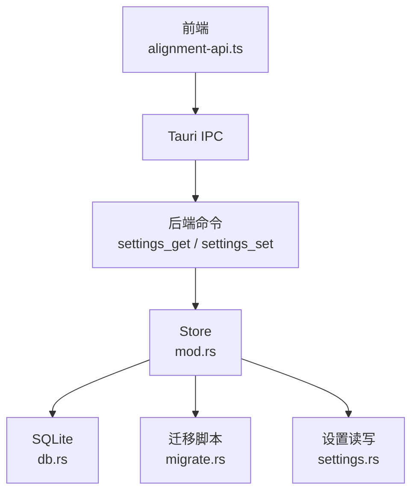
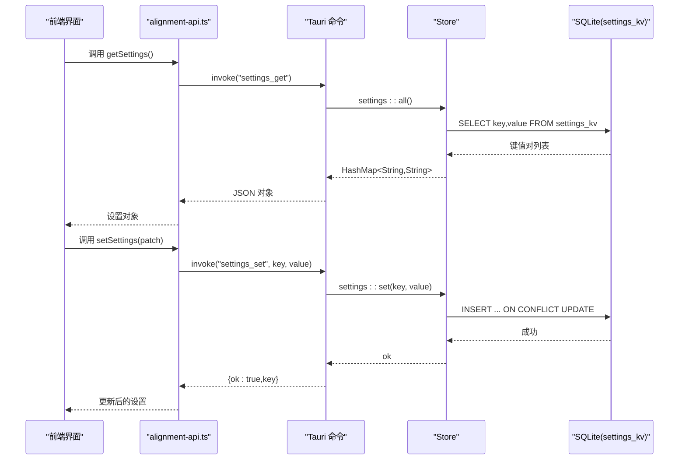
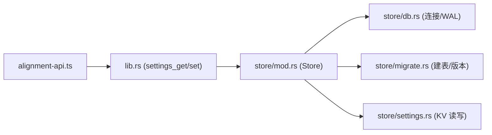

# 设置管理接口

<cite>
**本文引用的文件**
- [lib.rs](file://tongtian-tauri/src-tauri/src/lib.rs)
- [settings.rs](file://tongtian-tauri/src-tauri/src/store/settings.rs)
- [db.rs](file://tongtian-tauri/src-tauri/src/store/db.rs)
- [migrate.rs](file://tongtian-tauri/src-tauri/src/store/migrate.rs)
- [mod.rs](file://tongtian-tauri/src-tauri/src/store/mod.rs)
- [alignment-api.ts](file://tongtian-tauri/src/renderer/lib/alignment-api.ts)
- [Settings/index.tsx](file://tongtian-tauri/src/renderer/pages/Settings/index.tsx)
</cite>

## 目录
1. [简介](#简介)
2. [项目结构](#项目结构)
3. [核心组件](#核心组件)
4. [架构总览](#架构总览)
5. [详细组件分析](#详细组件分析)
6. [依赖关系分析](#依赖关系分析)
7. [性能与可靠性](#性能与可靠性)
8. [故障排查指南](#故障排查指南)
9. [结论](#结论)
10. [附录：使用示例与最佳实践](#附录使用示例与最佳实践)

## 简介
本文件面向“通天办公”Tauri 后端的设置管理能力，聚焦两个核心命令：
- settings_get：获取应用设置（键值对集合）
- settings_set：写入单个设置项（键值对）

文档将说明：
- 键值对存储机制、数据类型支持、持久化策略
- 设置项命名规范、默认值管理、配置验证规则
- 完整操作示例、批量更新模式建议、配置迁移策略
- 与 SQLite 数据库的集成方式与数据备份机制

## 项目结构
设置能力由前端渲染层通过 Tauri IPC 调用后端命令，后端通过 Store 访问 SQLite 完成持久化。关键路径如下：
- 前端：renderer/lib/alignment-api.ts 暴露 getSettings/setSettings，封装 IPC 通道
- 后端入口：src-tauri/src/lib.rs 注册 tauri::command 并路由到 store::settings
- 数据层：store/settings.rs 提供 all/get/set；store/db.rs 负责连接与 WAL 模式；store/migrate.rs 负责建表与版本化迁移

图表来源
- [lib.rs:664-678](file://tongtian-tauri/src-tauri/src/lib.rs#L664-L678)
- [mod.rs:18-52](file://tongtian-tauri/src-tauri/src/store/mod.rs#L18-L52)
- [db.rs:16-25](file://tongtian-tauri/src-tauri/src/store/db.rs#L16-L25)
- [migrate.rs:4-41](file://tongtian-tauri/src-tauri/src/store/migrate.rs#L4-L41)
- [settings.rs:5-48](file://tongtian-tauri/src-tauri/src/store/settings.rs#L5-L48)

章节来源
- [lib.rs:664-678](file://tongtian-tauri/src-tauri/src/lib.rs#L664-L678)
- [mod.rs:18-52](file://tongtian-tauri/src-tauri/src/store/mod.rs#L18-L52)
- [db.rs:16-25](file://tongtian-tauri/src-tauri/src/store/db.rs#L16-L25)
- [migrate.rs:4-41](file://tongtian-tauri/src-tauri/src/store/migrate.rs#L4-L41)
- [settings.rs:5-48](file://tongtian-tauri/src-tauri/src/store/settings.rs#L5-L48)

## 核心组件
- Tauri 命令层
  - settings_get：读取全部设置键值对，返回 JSON 对象
  - settings_set：写入单个键值对，幂等覆盖
- 存储层
  - Store：封装 rusqlite 连接与 Vault（密钥保管），提供 with_conn 短临界区
  - db：打开 SQLite，启用 WAL 和外键约束
  - migrate：创建 schema_version 与业务表（含 settings_kv）
  - settings：实现 all/get/set 三个原子操作
- 前端适配
  - alignment-api.ts：在 Electron 下走 IPC，浏览器开发环境回退 localStorage
  - Settings 页面：通过 useAppSettings hook 加载与增量更新设置

章节来源
- [lib.rs:664-678](file://tongtian-tauri/src-tauri/src/lib.rs#L664-L678)
- [mod.rs:18-52](file://tongtian-tauri/src-tauri/src/store/mod.rs#L18-L52)
- [db.rs:16-25](file://tongtian-tauri/src-tauri/src/store/db.rs#L16-L25)
- [migrate.rs:4-41](file://tongtian-tauri/src-tauri/src/store/migrate.rs#L4-L41)
- [settings.rs:5-48](file://tongtian-tauri/src-tauri/src/store/settings.rs#L5-L48)
- [alignment-api.ts:89-105](file://tongtian-tauri/src/renderer/lib/alignment-api.ts#L89-L105)
- [Settings/index.tsx:160-171](file://tongtian-tauri/src/renderer/pages/Settings/index.tsx#L160-L171)

## 架构总览
设置管理的端到端流程如下：

图表来源
- [lib.rs:664-678](file://tongtian-tauri/src-tauri/src/lib.rs#L664-L678)
- [settings.rs:5-48](file://tongtian-tauri/src-tauri/src/store/settings.rs#L5-L48)
- [alignment-api.ts:89-105](file://tongtian-tauri/src/renderer/lib/alignment-api.ts#L89-L105)

## 详细组件分析

### 键值对存储机制与数据结构
- 表结构：settings_kv（key TEXT PRIMARY KEY, value TEXT NOT NULL）
- 读取单条：SELECT value WHERE key = ?
- 写入单条：INSERT ... ON CONFLICT(key) DO UPDATE SET value = excluded.value
- 读取全部：SELECT key, value FROM settings_kv 映射为 HashMap

复杂度与特性
- 单条读写 O(1)（基于主键索引）
- 全量读取 O(N)（N 为设置项数量）
- 并发安全：Store.with_conn 使用 Mutex 保护连接，保证短临界区串行执行

章节来源
- [migrate.rs:36-39](file://tongtian-tauri/src-tauri/src/store/migrate.rs#L36-L39)
- [settings.rs:5-48](file://tongtian-tauri/src-tauri/src/store/settings.rs#L5-L48)
- [mod.rs:43-47](file://tongtian-tauri/src-tauri/src/store/mod.rs#L43-L47)

### 数据类型支持与序列化
- 存储类型：value 为 TEXT
- 前端传递：JSON 对象（HashMap 或 AppSettingsData 片段）
- 后端处理：settings_get 返回 JSON 对象；settings_set 接收字符串键与字符串值
- 复杂类型：前端可将对象序列化为 JSON 字符串存入单一 key（如 experiments），或在后端扩展多列/多表以支持结构化字段

注意
- 当前实现未对 value 做反序列化校验，建议在业务层进行格式校验后再写入

章节来源
- [lib.rs:664-678](file://tongtian-tauri/src-tauri/src/lib.rs#L664-L678)
- [settings.rs:5-48](file://tongtian-tauri/src-tauri/src/store/settings.rs#L5-L48)
- [alignment-api.ts:89-105](file://tongtian-tauri/src/renderer/lib/alignment-api.ts#L89-L105)

### 持久化策略与运行目录
- 数据库位置：优先使用环境变量 TONGTIAN_HOME 指定的目录，否则回退至 bridge::python_env::base_dir()
- 数据库文件：tongtian.db
- 连接参数：WAL 模式、外键开启，提升并发写入与一致性
- 启动流程：Store::open_default 创建目录并打开数据库，随后执行迁移

章节来源
- [db.rs:5-25](file://tongtian-tauri/src-tauri/src/store/db.rs#L5-L25)
- [mod.rs:24-41](file://tongtian-tauri/src-tauri/src/store/mod.rs#L24-L41)
- [lib.rs:747-793](file://tongtian-tauri/src-tauri/src/lib.rs#L747-L793)

### 默认值管理与前端合并
- 前端默认值：alignment-api.ts 定义 DEFAULT_SETTINGS，Electron 环境下通过 IPC 获取后端设置并与默认值合并
- 行为生效：Settings 页面通过 useAppSettings hook 增量更新，立即落库并在前端缓存中合并

章节来源
- [alignment-api.ts:61-105](file://tongtian-tauri/src/renderer/lib/alignment-api.ts#L61-L105)
- [Settings/index.tsx:160-171](file://tongtian-tauri/src/renderer/pages/Settings/index.tsx#L160-L171)

### 配置验证规则
- 当前后端未对 key/value 做额外校验，仅依赖 SQLite 约束（key 唯一、value 非空）
- 建议在前端或命令层增加白名单校验（key 命名规范）、值域校验（枚举、范围）与长度限制

章节来源
- [settings.rs:5-48](file://tongtian-tauri/src-tauri/src/store/settings.rs#L5-L48)
- [lib.rs:664-678](file://tongtian-tauri/src-tauri/src/lib.rs#L664-L678)

### 设置项命名规范
- 建议采用点号分隔的命名空间，例如：ui.theme、chat.font_size、system.auto_start
- 避免特殊字符与空格，保持小写英文为主，便于索引与查询
- 对同一语义的不同维度分组（如 ui.*、chat.*、system.*）

说明
- 当前代码未强制命名规范，建议在业务层统一约定并在写入前校验

章节来源
- [settings.rs:5-48](file://tongtian-tauri/src-tauri/src/store/settings.rs#L5-L48)

### 批量更新模式
- 当前 settings_set 为单键写入，适合细粒度更新
- 批量更新建议：
  - 前端聚合多次变更为一个 JSON 对象，按 key 拆分后循环调用 settings_set
  - 或扩展后端接口支持批量写入（事务包裹，失败回滚）
- 事务与一致性：可通过 Store.with_conn 在单次连接内执行多条语句，确保原子性

章节来源
- [settings.rs:19-30](file://tongtian-tauri/src-tauri/src/store/settings.rs#L19-L30)
- [mod.rs:43-47](file://tongtian-tauri/src-tauri/src/store/mod.rs#L43-L47)

### 配置迁移策略
- 版本化迁移：schema_version 表记录已应用版本，迁移脚本按顺序执行且幂等
- 新增设置项：
  - 若需新列或多表结构，通过 migrate.rs 追加迁移脚本
  - 若仅需新增键，可在应用启动时检测缺失键并写入默认值（业务层逻辑）
- 向后兼容：旧客户端可忽略未知键，新客户端应兼容旧值格式

章节来源
- [migrate.rs:44-73](file://tongtian-tauri/src-tauri/src/store/migrate.rs#L44-L73)
- [mod.rs:24-41](file://tongtian-tauri/src-tauri/src/store/mod.rs#L24-L41)

### 与 SQLite 的集成与数据备份
- 集成方式：rusqlite 直接嵌入，WAL 模式提升并发写入性能，外键约束保障引用完整性
- 备份机制：
  - 物理备份：复制 tongtian.db 及其 WAL 文件（如有）
  - 逻辑备份：导出 settings_kv 表为 JSON/CSV
  - 建议定期备份运行目录下的数据库文件，或使用 WAL 检查点 + 归档

章节来源
- [db.rs:16-25](file://tongtian-tauri/src-tauri/src/store/db.rs#L16-L25)
- [migrate.rs:44-73](file://tongtian-tauri/src-tauri/src/store/migrate.rs#L44-L73)

## 依赖关系分析
- 命令层依赖 Store，Store 依赖 db 与 migrate，settings 模块依赖 Store
- 前端依赖 alignment-api.ts，后者在 Electron 下调用 Tauri 命令，浏览器下回退 localStorage

图表来源
- [lib.rs:664-678](file://tongtian-tauri/src-tauri/src/lib.rs#L664-L678)
- [mod.rs:18-52](file://tongtian-tauri/src-tauri/src/store/mod.rs#L18-L52)
- [db.rs:16-25](file://tongtian-tauri/src-tauri/src/store/db.rs#L16-L25)
- [migrate.rs:44-73](file://tongtian-tauri/src-tauri/src/store/migrate.rs#L44-L73)
- [settings.rs:5-48](file://tongtian-tauri/src-tauri/src/store/settings.rs#L5-L48)

章节来源
- [lib.rs:664-678](file://tongtian-tauri/src-tauri/src/lib.rs#L664-L678)
- [mod.rs:18-52](file://tongtian-tauri/src-tauri/src/store/mod.rs#L18-L52)
- [db.rs:16-25](file://tongtian-tauri/src-tauri/src/store/db.rs#L16-L25)
- [migrate.rs:44-73](file://tongtian-tauri/src-tauri/src/store/migrate.rs#L44-L73)
- [settings.rs:5-48](file://tongtian-tauri/src-tauri/src/store/settings.rs#L5-L48)

## 性能与可靠性
- WAL 模式：提高并发写入与读性能，减少锁竞争
- 短临界区：with_conn 确保每次数据库操作快速完成，降低持有锁时间
- 幂等写入：ON CONFLICT 保证重复写入不报错
- 建议
  - 批量更新时使用事务包裹多条语句
  - 对热点键加缓存（前端内存缓存已存在）
  - 监控数据库文件大小与 WAL 增长，定期清理或归档

章节来源
- [db.rs:16-25](file://tongtian-tauri/src-tauri/src/store/db.rs#L16-L25)
- [mod.rs:43-47](file://tongtian-tauri/src-tauri/src/store/mod.rs#L43-L47)
- [settings.rs:19-30](file://tongtian-tauri/src-tauri/src/store/settings.rs#L19-L30)

## 故障排查指南
- 常见错误码
  - STORE_OPEN_FAILED：数据库打开失败（权限/路径问题）
  - STORE_PRAGMA_FAILED：WAL 或外键设置失败（不支持的环境）
  - STORE_MIGRATE_FAILED：迁移脚本执行失败（SQL 语法/权限）
  - TASK_NOT_FOUND：任务相关错误（与设置无关，但同属 lib.rs 命令）
- 排查步骤
  - 检查 TONGTIAN_HOME 是否存在并可写
  - 查看日志输出中的错误信息，定位具体阶段（打开/迁移/读写）
  - 确认 settings_kv 表是否存在（迁移是否成功）
  - 在测试环境中使用临时目录验证（参考测试用例）

章节来源
- [db.rs:16-25](file://tongtian-tauri/src-tauri/src/store/db.rs#L16-L25)
- [migrate.rs:44-73](file://tongtian-tauri/src-tauri/src/store/migrate.rs#L44-L73)
- [lib.rs:747-793](file://tongtian-tauri/src-tauri/src/lib.rs#L747-L793)

## 结论
设置管理通过简洁的键值对模型实现了灵活、可扩展的配置持久化。后端基于 SQLite 的 WAL 模式与版本化迁移保证了高可用与可演进性。前端通过默认值合并与增量更新提供了良好的用户体验。后续可在命令层增加更严格的校验与批量接口，进一步提升一致性与性能。

## 附录：使用示例与最佳实践

### 基本操作示例
- 获取设置
  - 前端调用：getSettings()
  - 后端命令：settings_get
  - 返回：JSON 对象（键值对）
- 设置单个值
  - 前端调用：setSettings({ key: "ui.theme", value: "dark" })
  - 后端命令：settings_set
  - 返回：{ ok: true, key }

章节来源
- [alignment-api.ts:89-105](file://tongtian-tauri/src/renderer/lib/alignment-api.ts#L89-L105)
- [lib.rs:664-678](file://tongtian-tauri/src-tauri/src/lib.rs#L664-L678)

### 批量更新模式
- 方案一：前端循环调用 settings_set（简单可靠）
- 方案二：扩展后端批量接口（推荐用于大量键更新，使用事务保证原子性）
- 建议：在 with_conn 内执行多条语句，捕获异常并回滚

章节来源
- [mod.rs:43-47](file://tongtian-tauri/src-tauri/src/store/mod.rs#L43-L47)
- [settings.rs:19-30](file://tongtian-tauri/src-tauri/src/store/settings.rs#L19-L30)

### 配置迁移策略
- 新增设置项：在 migrate.rs 追加脚本，或在应用启动时检测缺失键并写入默认值
- 版本控制：通过 schema_version 跟踪已应用版本，确保幂等
- 兼容性：旧客户端忽略未知键，新客户端兼容旧值格式

章节来源
- [migrate.rs:44-73](file://tongtian-tauri/src-tauri/src/store/migrate.rs#L44-L73)

### 数据备份机制
- 物理备份：复制 tongtian.db 与 WAL 文件
- 逻辑备份：导出 settings_kv 表为 JSON/CSV
- 建议：定时任务备份运行目录，结合 WAL 检查点减少锁定

章节来源
- [db.rs:16-25](file://tongtian-tauri/src-tauri/src/store/db.rs#L16-L25)