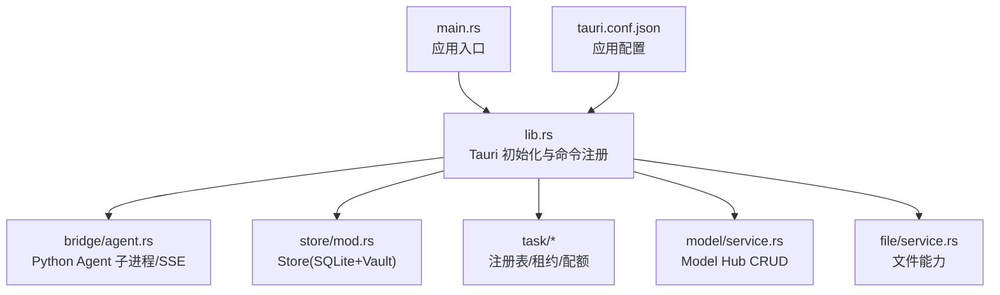
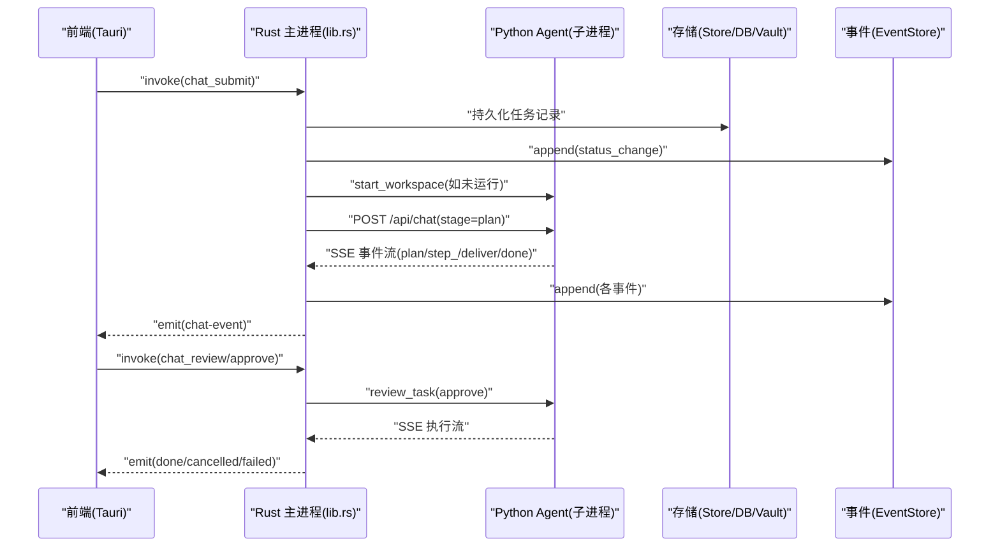
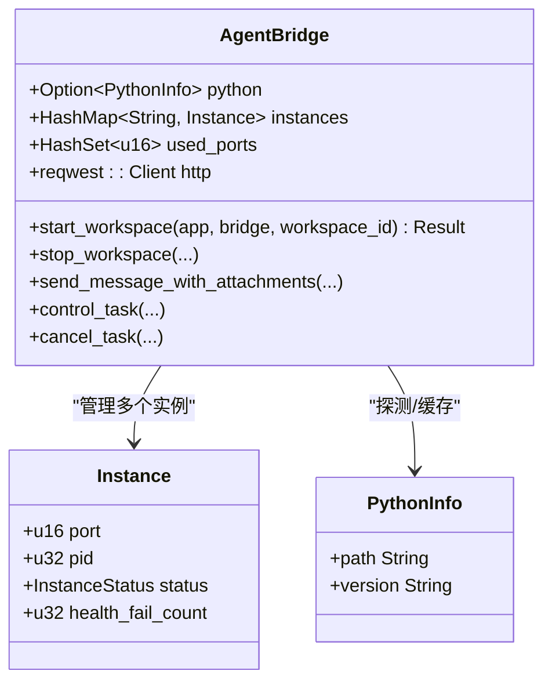
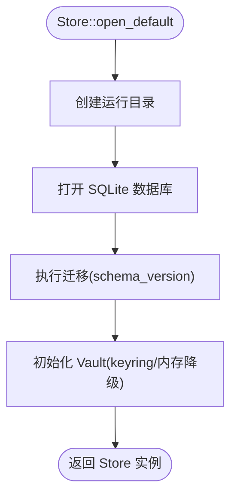
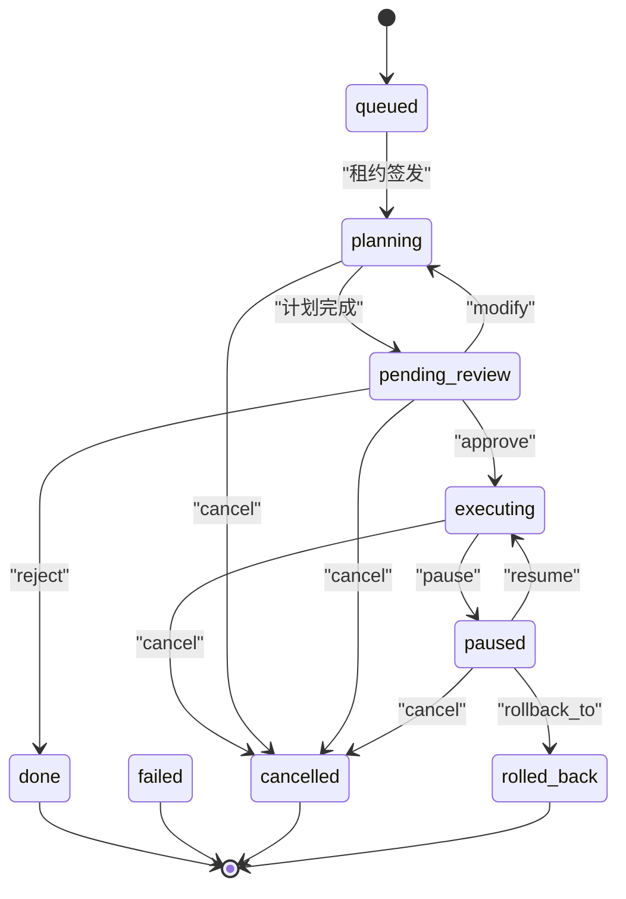
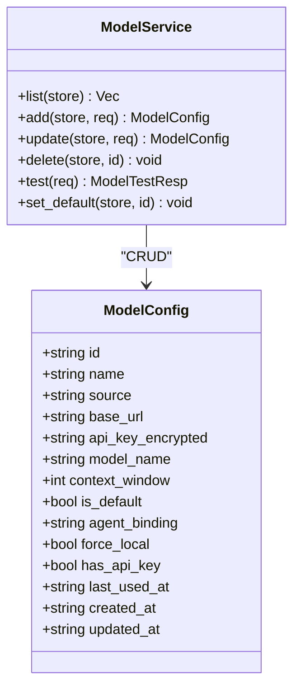
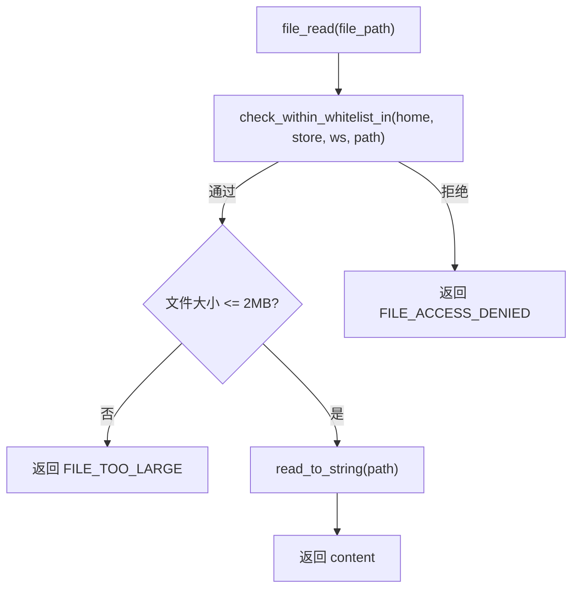
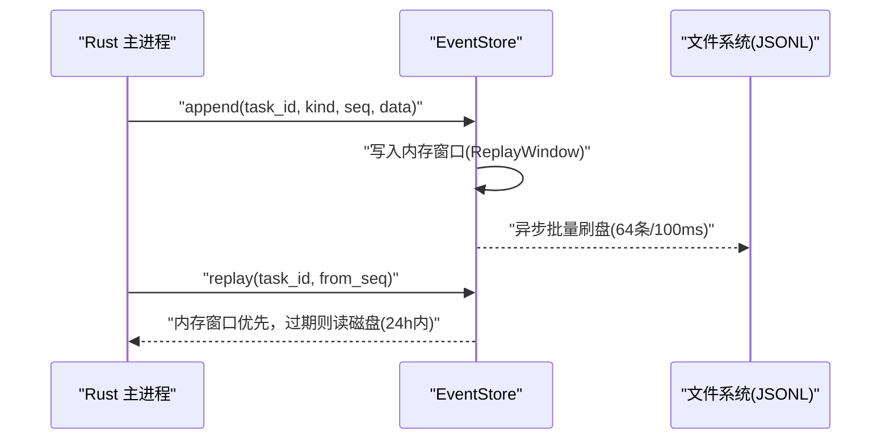
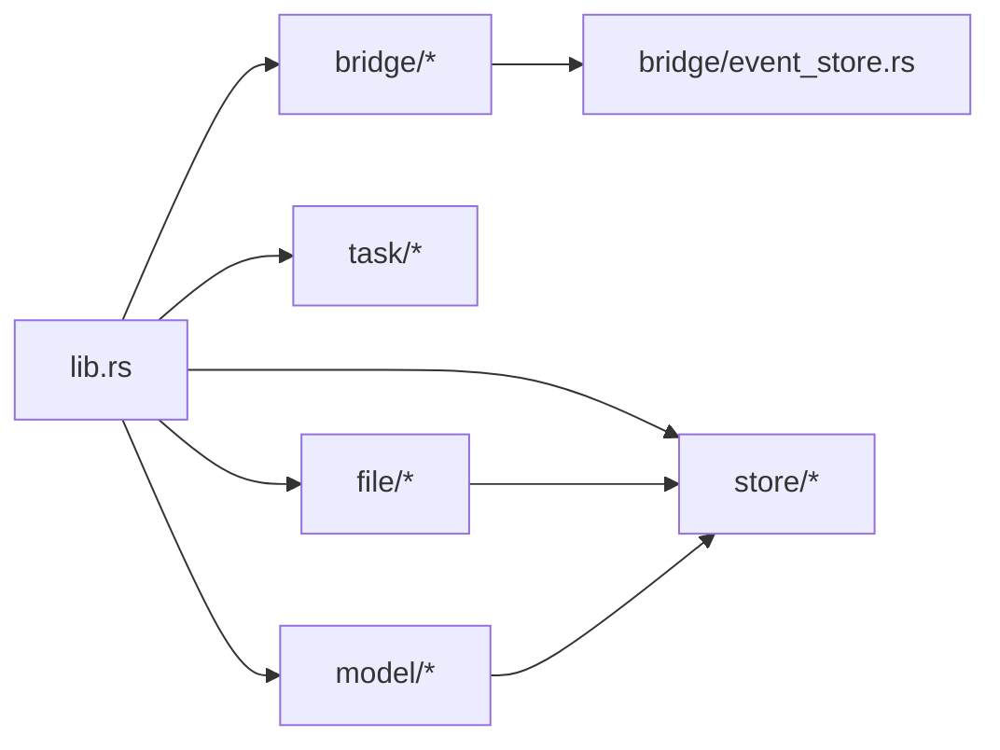

# 后端架构

<cite>
**本文引用的文件**   
- [Cargo.toml](file://tongtian-tauri/src-tauri/Cargo.toml)
- [main.rs](file://tongtian-tauri/src-tauri/src/main.rs)
- [lib.rs](file://tongtian-tauri/src-tauri/src/lib.rs)
- [tauri.conf.json](file://tongtian-tauri/src-tauri/tauri.conf.json)
- [bridge/mod.rs](file://tongtian-tauri/src-tauri/src/bridge/mod.rs)
- [bridge/agent.rs](file://tongtian-tauri/src-tauri/src/bridge/agent.rs)
- [bridge/event_store.rs](file://tongtian-tauri/src-tauri/src/bridge/event_store.rs)
- [store/mod.rs](file://tongtian-tauri/src-tauri/src/store/mod.rs)
- [store/settings.rs](file://tongtian-tauri/src-tauri/src/store/settings.rs)
- [store/vault.rs](file://tongtian-tauri/src-tauri/src/store/vault.rs)
- [task/mod.rs](file://tongtian-tauri/src-tauri/src/task/mod.rs)
- [task/registry.rs](file://tongtian-tauri/src-tauri/src/task/registry.rs)
- [task/quota.rs](file://tongtian-tauri/src-tauri/src/task/quota.rs)
- [model/mod.rs](file://tongtian-tauri/src-tauri/src/model/mod.rs)
- [model/service.rs](file://tongtian-tauri/src-tauri/src/model/service.rs)
- [file/mod.rs](file://tongtian-tauri/src-tauri/src/file/mod.rs)
- [file/service.rs](file://tongtian-tauri/src-tauri/src/file/service.rs)
</cite>

## 目录
1. [简介](#简介)
2. [项目结构](#项目结构)
3. [核心组件](#核心组件)
4. [架构总览](#架构总览)
5. [详细组件分析](#详细组件分析)
6. [依赖关系分析](#依赖关系分析)
7. [性能考量](#性能考量)
8. [故障排查指南](#故障排查指南)
9. [结论](#结论)
10. [附录](#附录)

## 简介
本文件系统化梳理通天办公基于 Tauri 2.x + Rust 的后端架构，重点说明主进程架构、模块划分、命令注册机制与事件协议；深入解析 Rust crate 的组织（bridge/agent、model-hub、file-ops、storage 等）及各模块职责与接口设计。文档覆盖异步运行时（Tokio）使用、错误处理策略、日志系统、配置管理、配额闸门、租约与任务状态机、事件持久化与重放、以及与其他模块的集成方式，并提供可追溯的代码片段路径与最佳实践建议。

## 项目结构
- 应用入口与构建
  - Cargo 包名 tongtian-tauri，输出静态库/动态库/rlib，启用 tauri 2.x 插件与 tokio 全量特性。
  - main.rs 仅调用 lib::run()，保持二进制极简。
  - tauri.conf.json 定义窗口、前端资源与打包图标等。
- Rust 源码组织
  - src/lib.rs：Tauri 应用初始化、命令注册、服务装配、后台任务启动。
  - 模块划分：bridge（Agent 子进程与 SSE）、store（SQLite + keyring）、task（注册表/租约/配额）、model（Model Hub CRUD）、file（文件能力）。
- 前端与桥接
  - TypeScript 前端通过 Tauri invoke/handle 与 Rust 命令交互；SSE 事件经 "chat-event" 推送至渲染进程。

**图示来源** 
- [main.rs:1-6](file://tongtian-tauri/src-tauri/src/main.rs#L1-L6)
- [lib.rs:746-873](file://tongtian-tauri/src-tauri/src/lib.rs#L746-L873)
- [tauri.conf.json:1-40](file://tongtian-tauri/src-tauri/tauri.conf.json#L1-L40)

**章节来源**
- [Cargo.toml:1-40](file://tongtian-tauri/src-tauri/Cargo.toml#L1-L40)
- [main.rs:1-6](file://tongtian-tauri/src-tauri/src/main.rs#L1-L6)
- [tauri.conf.json:1-40](file://tongtian-tauri/src-tauri/tauri.conf.json#L1-L40)

## 核心组件
- 主进程与服务装配
  - P0Services：聚合 TaskRegistry、LeaseManager、QuotaGate、EventStore、Store。
  - 启动流程：打开 Store（失败回退 temp）、创建 EventStore、注册服务、启动事件刷盘与 TTL 清理、租约扫描循环。
- 命令层（@tauri::command）
  - 系统信息、Agent 生命周期、任务提交/审阅/控制/取消、历史查询、状态/配额/租约视图、事件重放。
  - Model Hub 五件套：list/add/update/delete/test/set_default。
  - 设置持久化：settings_get / settings_set。
  - 文件能力：file_list/read/preview/stage_attachment。
- 事件与协议
  - chat-event：plan/step_*/deliver/done/error/status_change/quota_warning 等。
  - agent-status：workspace 实例状态。
  - 两阶段协议：stage=plan 生成计划待审阅，approve→executing，reject→done(REJECTED)，modify→planning。

**章节来源**
- [lib.rs:35-42](file://tongtian-tauri/src-tauri/src/lib.rs#L35-L42)
- [lib.rs:746-873](file://tongtian-tauri/src-tauri/src/lib.rs#L746-L873)
- [bridge/agent.rs:47-50](file://tongtian-tauri/src-tauri/src/bridge/agent.rs#L47-L50)

## 架构总览
整体采用“Rust 主进程 + Python Agent 子进程”的双进程模型：
- Rust 主进程负责：命令路由、状态机、配额/租约、事件持久化、存储与安全密钥、与前端通信。
- Python Agent 子进程负责：具体业务执行（agentscope/qwenpaw/mock），暴露 HTTP API 并通过 SSE 推送事件。

**图示来源** 
- [lib.rs:127-237](file://tongtian-tauri/src-tauri/src/lib.rs#L127-L237)
- [lib.rs:239-390](file://tongtian-tauri/src-tauri/src/lib.rs#L239-L390)
- [bridge/agent.rs:118-200](file://tongtian-tauri/src-tauri/src/bridge/agent.rs#L118-L200)
- [bridge/event_store.rs:116-145](file://tongtian-tauri/src-tauri/src/bridge/event_store.rs#L116-L145)

## 详细组件分析

### Bridge/Agent（Python 子进程与 SSE）
- 职责
  - 探测 Python/Agent 环境，按 TT_ENGINE 或 TT_AGENT_MOCK 选择引擎。
  - 为每个 workspace 分配端口（18000-19000），启动子进程并轮询 /health。
  - 健康巡检与停止策略，stdout/stderr 日志泵。
  - 发送消息到 /api/chat，解析 SSE 事件并转发为 "chat-event"。
- 关键实现要点
  - 共享 reqwest::Client，避免重复创建。
  - 事件通道容量限制（背压上限），断线补齐轮询与超时。
  - 事件类型常量 EVENT_CHAT/EVENT_STATUS。

**图示来源** 
- [bridge/agent.rs:70-86](file://tongtian-tauri/src-tauri/src/bridge/agent.rs#L70-L86)
- [bridge/agent.rs:118-200](file://tongtian-tauri/src-tauri/src/bridge/agent.rs#L118-L200)

**章节来源**
- [bridge/mod.rs:1-7](file://tongtian-tauri/src-tauri/src/bridge/mod.rs#L1-L7)
- [bridge/agent.rs:1-200](file://tongtian-tauri/src-tauri/src/bridge/agent.rs#L1-L200)

### Storage（Store + Vault + Settings）
- Store
  - 封装 rusqlite 连接，提供 with_conn 短临界区访问。
  - 默认路径 TONGTIAN_HOME 覆盖，失败回退 temp。
  - 版本化迁移（schema_version），确保表存在。
- Vault
  - 优先 keyring 保管 API Key，不可用时内存降级。
  - DB 仅存 has_api_key 引用标记，不落地明文。
- Settings
  - settings_kv 键值对读写，支持 all/get/set。

**图示来源** 
- [store/mod.rs:24-41](file://tongtian-tauri/src-tauri/src/store/mod.rs#L24-L41)
- [store/vault.rs:17-53](file://tongtian-tauri/src-tauri/src/store/vault.rs#L17-L53)
- [store/settings.rs:1-48](file://tongtian-tauri/src-tauri/src/store/settings.rs#L1-L48)

**章节来源**
- [store/mod.rs:1-105](file://tongtian-tauri/src-tauri/src/store/mod.rs#L1-L105)
- [store/vault.rs:1-119](file://tongtian-tauri/src-tauri/src/store/vault.rs#L1-L119)
- [store/settings.rs:1-100](file://tongtian-tauri/src-tauri/src/store/settings.rs#L1-L100)

### Task（注册表/租约/配额）
- 注册表（TaskRegistry）
  - 维护任务记录（14 态状态字面值），revision 乐观锁，重试计数上限。
  - 绑定租约、请求取消、更新状态与原因码。
- 租约（LeaseManager）
  - 签发/释放/接管，禁止抢占（活跃租约需对端确认）。
- 配额（QuotaGate）
  - 四档阈值（70/85/95/100%），动作链「降级→排队→阻断」。
  - 本地 JSON 台账跨日重置，add_usage 触发档位跃迁去抖。
  - check_submit 在 100% 档阻断新提交（QUOTA_EXCEEDED）。

**图示来源** 
- [task/mod.rs:7-24](file://tongtian-tauri/src-tauri/src/task/mod.rs#L7-L24)
- [task/registry.rs:68-119](file://tongtian-tauri/src-tauri/src/task/registry.rs#L68-L119)
- [task/quota.rs:16-24](file://tongtian-tauri/src-tauri/src/task/quota.rs#L16-L24)

**章节来源**
- [task/mod.rs:1-24](file://tongtian-tauri/src-tauri/src/task/mod.rs#L1-L24)
- [task/registry.rs:1-200](file://tongtian-tauri/src-tauri/src/task/registry.rs#L1-L200)
- [task/quota.rs:1-200](file://tongtian-tauri/src-tauri/src/task/quota.rs#L1-L200)

### Model Hub（模型配置与连通性测试）
- 数据模型
  - ModelConfig：id/name/source/base_url/model_name/context_window/is_default/agent_binding/force_local/has_api_key/timestamps。
  - 请求体：ModelAddReq/ModelUpdateReq/ModelTestReq。
- 服务方法
  - list/add/update/delete/test/set_default。
  - test 支持传入已存 id 时自动补齐 base_url/model_name/api_key（从 vault 读取）。
- 安全
  - API Key 仅存 vault，DB 中 api_key_encrypted 恒为空串。

**图示来源** 
- [model/service.rs:10-100](file://tongtian-tauri/src-tauri/src/model/service.rs#L10-L100)
- [model/service.rs:126-200](file://tongtian-tauri/src-tauri/src/model/service.rs#L126-L200)

**章节来源**
- [model/mod.rs:1-4](file://tongtian-tauri/src-tauri/src/model/mod.rs#L1-L4)
- [model/service.rs:1-200](file://tongtian-tauri/src-tauri/src/model/service.rs#L1-L200)

### File Ops（文件能力与附件暂存）
- 白名单与路径校验
  - 允许根：workspaces/{ws}/files + SandboxPolicy.file_allowlist（settings_kv 暂存）。
  - 越界访问返回 FILE_ACCESS_DENIED；大小上限 2MB（FILE_TOO_LARGE）。
- 能力函数
  - list_dir/read_file/preview/stage_attachment。
  - 提供 _in(home,...) 变体注入数据根目录（测试隔离）。
- 附件暂存
  - 复制到运行目录并返回 AttachmentMeta（含 sensitivity 分级检测结果）。

**图示来源** 
- [file/service.rs:112-132](file://tongtian-tauri/src-tauri/src/file/service.rs#L112-L132)
- [file/service.rs:173-197](file://tongtian-tauri/src-tauri/src/file/service.rs#L173-L197)

**章节来源**
- [file/mod.rs:1-4](file://tongtian-tauri/src-tauri/src/file/mod.rs#L1-L4)
- [file/service.rs:1-200](file://tongtian-tauri/src-tauri/src/file/service.rs#L1-L200)

### 事件存储与重放（EventStore）
- 设计要点
  - append-only JSONL 持久化，异步批量刷盘（≥64 条或 100ms flush）。
  - 内存 ReplayWindow：双上限（2048 条 + 10min），drop-oldest 防膨胀。
  - 24h TTL 清理，单任务文件容量上限 10MB 滚动重开。
- 接口
  - append/replay/start_flusher/spawn_ttl_cleanup_loop。

**图示来源** 
- [bridge/event_store.rs:116-145](file://tongtian-tauri/src-tauri/src/bridge/event_store.rs#L116-L145)
- [bridge/event_store.rs:162-198](file://tongtian-tauri/src-tauri/src/bridge/event_store.rs#L162-L198)

**章节来源**
- [bridge/event_store.rs:1-200](file://tongtian-tauri/src-tauri/src/bridge/event_store.rs#L1-L200)

## 依赖关系分析
- 外部依赖
  - tauri 2.x 与插件（opener/dialog）。
  - tokio（process/net/time/io-util/sync/macros/rt-multi-thread）。
  - reqwest（json/stream）用于 HTTP/SSE。
  - rusqlite（bundled）与 keyring（凭据管理）。
- 内部依赖
  - lib.rs 依赖 bridge、store、task、model、file 模块。
  - bridge/agent 依赖 python_env、sse、event_store。
  - file/service 依赖 bridge/python_env 与 store。
  - model/service 依赖 store 与 vault。

**图示来源** 
- [lib.rs:17-21](file://tongtian-tauri/src-tauri/src/lib.rs#L17-L21)
- [bridge/mod.rs:1-7](file://tongtian-tauri/src-tauri/src/bridge/mod.rs#L1-L7)
- [file/service.rs:1-14](file://tongtian-tauri/src-tauri/src/file/service.rs#L1-L14)
- [model/service.rs:1-9](file://tongtian-tauri/src-tauri/src/model/service.rs#L1-L9)

**章节来源**
- [Cargo.toml:21-33](file://tongtian-tauri/src-tauri/Cargo.toml#L21-L33)
- [lib.rs:17-21](file://tongtian-tauri/src-tauri/src/lib.rs#L17-L21)

## 性能考量
- 异步与并发
  - Tokio 多核运行时（rt-multi-thread），HTTP/SSE 与 I/O 非阻塞。
  - 事件刷盘异步批量（64 条/100ms），避免阻塞事件流。
- 内存与背压
  - 事件通道容量限制（EMIT_CHANNEL_CAPACITY=1024），防止无界积压。
  - ReplayWindow 双上限（2048 条 + 10min），drop-oldest 保内存。
- 存储与 IO
  - SQLite bundled 减少依赖；with_conn 短临界区降低锁竞争。
  - 文件读取限 2MB，附件暂存限 50MB，避免大对象阻塞。
- 网络与重试
  - 共享 reqwest::Client，减少握手开销。
  - Agent 健康检查轮询与连续失败判定，快速失败与恢复。

[本节为通用指导，无需引用具体文件]

## 故障排查指南
- Agent 启动失败
  - 检查 TT_AGENT_MOCK/TT_ENGINE 环境变量与 Python/Agent 安装。
  - 查看端口占用（18000-19000）与健康检查日志。
- 事件丢失或不同步
  - 使用 event_replay(task_id, from_seq) 拉取 24h 内事件。
  - 检查 EventStore 刷盘线程是否运行与 JSONL 文件是否滚动。
- 配额阻断
  - 调用 quota_status 查看当前档位与 action。
  - 100% 档将阻断新提交（QUOTA_EXCEEDED），需调整配额或等待跨日重置。
- 文件访问被拒
  - 确认路径在白名单（workspaces/{ws}/files 或 sandbox.file_allowlist）。
  - 检查文件大小是否超过 2MB（FILE_TOO_LARGE）。
- 密钥问题
  - Vault 自动降级到内存保管（keyring 不可用），确认 has_api_key 标记。
  - 使用 model_test 验证连通性与密钥有效性。

**章节来源**
- [bridge/agent.rs:118-200](file://tongtian-tauri/src-tauri/src/bridge/agent.rs#L118-L200)
- [bridge/event_store.rs:134-160](file://tongtian-tauri/src-tauri/src/bridge/event_store.rs#L134-L160)
- [task/quota.rs:191-200](file://tongtian-tauri/src-tauri/src/task/quota.rs#L191-L200)
- [file/service.rs:173-197](file://tongtian-tauri/src-tauri/src/file/service.rs#L173-L197)
- [store/vault.rs:39-69](file://tongtian-tauri/src-tauri/src/store/vault.rs#L39-L69)

## 结论
通天办公后端以 Tauri 2.x + Rust 为主干，结合 Python Agent 子进程实现解耦与可扩展性。通过清晰的模块边界（bridge/store/task/model/file）、严格的错误与配额策略、健壮的事件持久化与重放机制，以及安全的密钥管理，构建了稳定可靠的本地 AI 工作助手后端。未来可在 Phase B 引入云端配额来源与远程 BFF 切换，进一步增强企业级治理能力。

[本节为总结性内容，无需引用具体文件]

## 附录
- 命令清单（部分）
  - system_info、agent_status、agent_start_workspace、agent_stop_workspace
  - chat_submit、chat_review、chat_control、chat_cancel、chat_history
  - task_state、quota_status、lease_info、lease_takeover、event_replay
  - model_list/add/update/delete/test/set_default
  - settings_get/settings_set
  - file_list/file_read/file_preview/file_stage_attachment
- 事件协议
  - chat-event：status_change/plan/step_*/deliver/done/error/quota_warning
  - agent-status：workspace 实例状态（starting/ready/busy/stopped/error）

**章节来源**
- [lib.rs:794-873](file://tongtian-tauri/src-tauri/src/lib.rs#L794-L873)
- [bridge/agent.rs:47-50](file://tongtian-tauri/src-tauri/src/bridge/agent.rs#L47-L50)