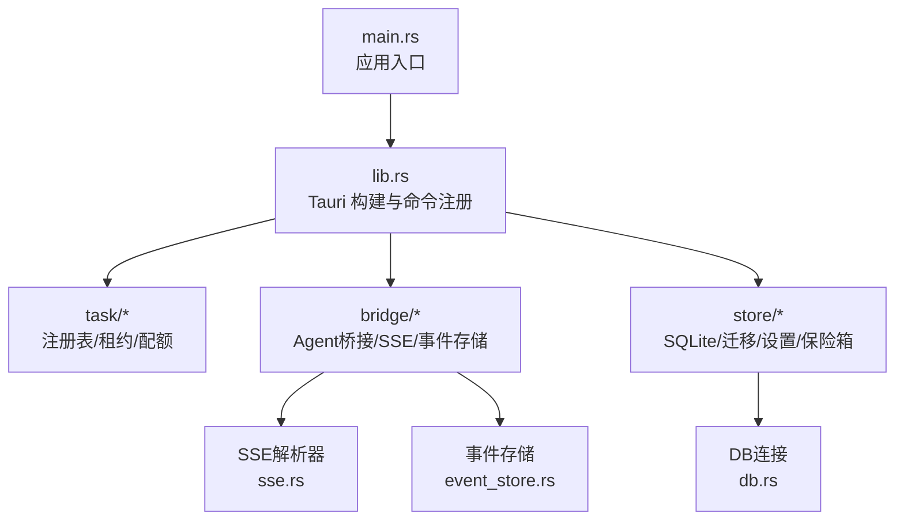
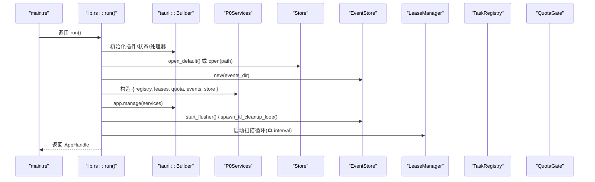
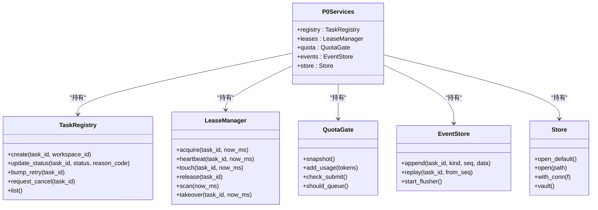
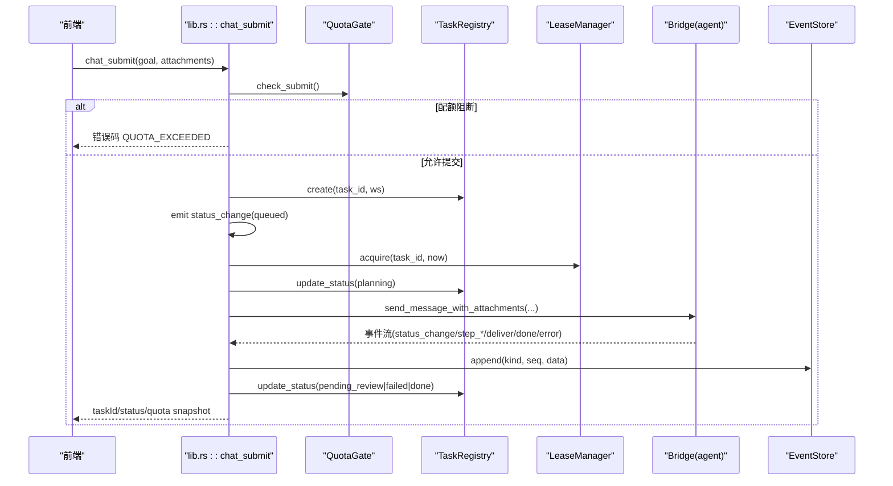
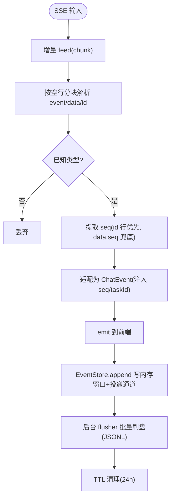
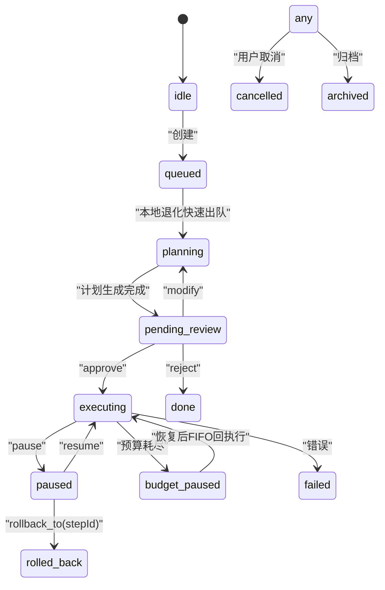
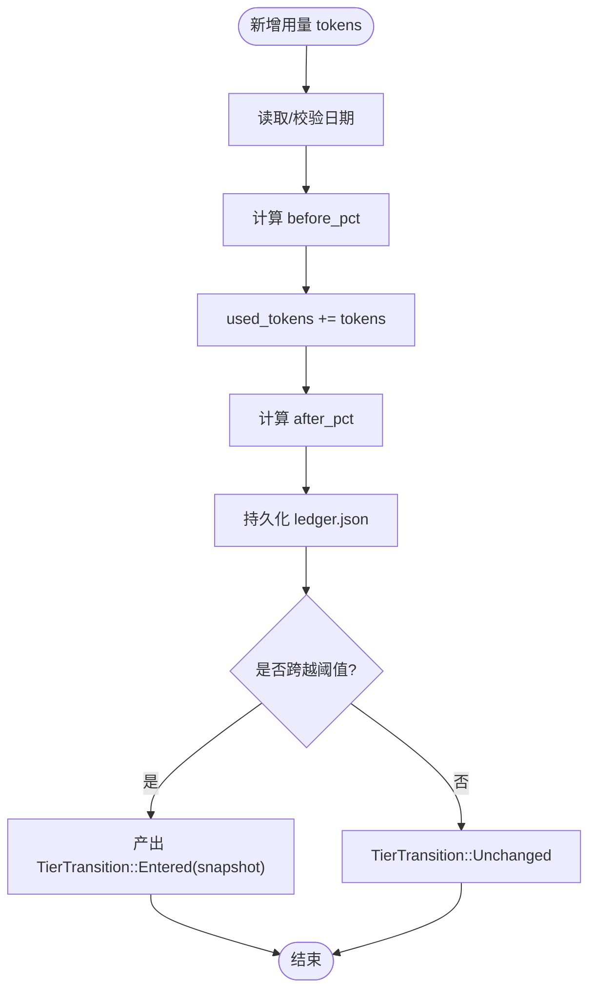
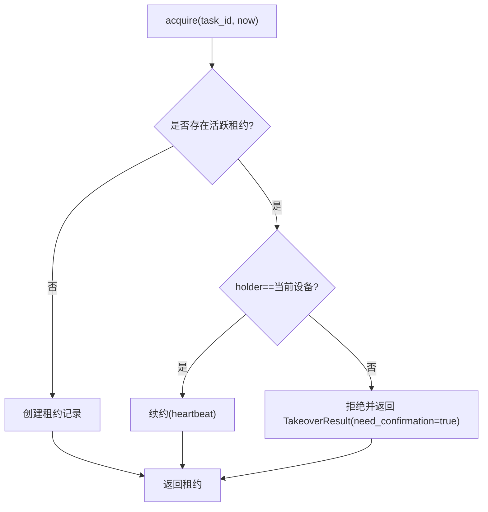
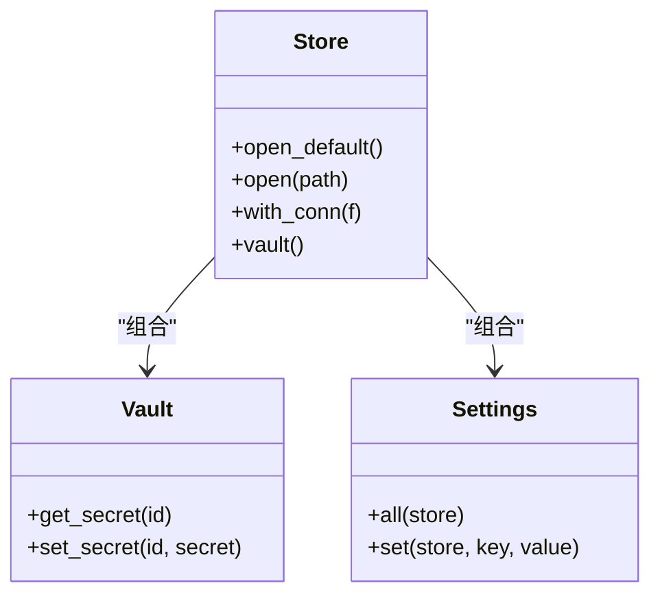
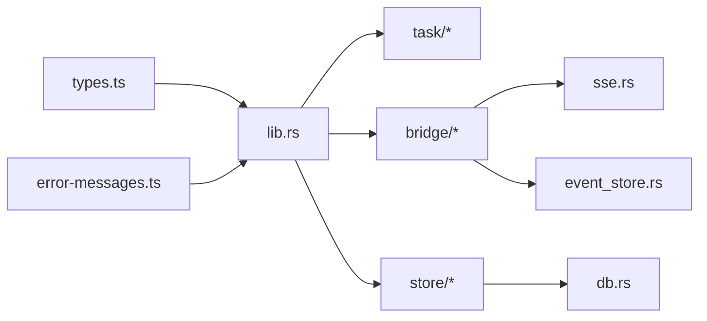

# 核心框架

<cite>
**本文引用的文件**   
- [main.rs](file://tongtian-tauri/src-tauri/src/main.rs)
- [lib.rs](file://tongtian-tauri/src-tauri/src/lib.rs)
- [Cargo.toml](file://tongtian-tauri/src-tauri/Cargo.toml)
- [task/mod.rs](file://tongtian-tauri/src-tauri/src/task/mod.rs)
- [task/registry.rs](file://tongtian-tauri/src-tauri/src/task/registry.rs)
- [task/quota.rs](file://tongtian-tauri/src-tauri/src/task/quota.rs)
- [task/lease.rs](file://tongtian-tauri/src-tauri/src/task/lease.rs)
- [bridge/mod.rs](file://tongtian-tauri/src-tauri/src/bridge/mod.rs)
- [bridge/agent.rs](file://tongtian-tauri/src-tauri/src/bridge/agent.rs)
- [bridge/sse.rs](file://tongtian-tauri/src-tauri/src/bridge/sse.rs)
- [bridge/event_store.rs](file://tongtian-tauri/src-tauri/src/bridge/event_store.rs)
- [store/mod.rs](file://tongtian-tauri/src-tauri/src/store/mod.rs)
- [store/db.rs](file://tongtian-tauri/src-tauri/src/store/db.rs)
- [types.ts](file://tongtian-tauri/src/shared/types.ts)
- [error-messages.ts](file://tongtian-tauri/src/shared/error-messages.ts)
</cite>

## 目录
1. [简介](#简介)
2. [项目结构](#项目结构)
3. [核心组件](#核心组件)
4. [架构总览](#架构总览)
5. [详细组件分析](#详细组件分析)
6. [依赖关系分析](#依赖关系分析)
7. [性能考量](#性能考量)
8. [故障排查指南](#故障排查指南)
9. [结论](#结论)
10. [附录](#附录)

## 简介
本文件为通天办公核心框架的技术文档，聚焦于基于 Tauri 2.x + Rust 的后端主进程与 P0 服务集合。内容涵盖：
- 主进程初始化流程、模块加载机制、服务注册系统
- P0Services（TaskRegistry、LeaseManager、QuotaGate、EventStore、Store）的职责边界与生命周期管理
- 异步运行时配置、错误处理策略、日志系统实现、配置管理机制
- 命令注册示例、事件发射器使用、与其他模块的集成方式
- 最佳实践与常见问题定位

## 项目结构
Tauri 后端以 lib.rs 作为库入口，main.rs 仅做最小化启动；业务逻辑集中在 task、bridge、store 三大模块：
- task：任务注册表、租约管理、配额闸门
- bridge：Python Agent 子进程管理与 HTTP/SSE 通信、事件持久化
- store：SQLite 存储地基与密钥保管

**图表来源** 
- [main.rs:1-6](file://tongtian-tauri/src-tauri/src/main.rs#L1-L6)
- [lib.rs:747-800](file://tongtian-tauri/src-tauri/src/lib.rs#L747-L800)
- [task/mod.rs:1-24](file://tongtian-tauri/src-tauri/src/task/mod.rs#L1-L24)
- [bridge/mod.rs:1-7](file://tongtian-tauri/src-tauri/src/bridge/mod.rs#L1-L7)
- [store/mod.rs:1-52](file://tongtian-tauri/src-tauri/src/store/mod.rs#L1-L52)

**章节来源**
- [main.rs:1-6](file://tongtian-tauri/src-tauri/src/main.rs#L1-L6)
- [lib.rs:747-800](file://tongtian-tauri/src-tauri/src/lib.rs#L747-L800)

## 核心组件
- P0Services：聚合 TaskRegistry、LeaseManager、QuotaGate、EventStore、Store，作为全局共享状态注入 Tauri 容器
- TaskRegistry：维护任务记录与状态转移、重试计数、乐观锁 revision、取消标记等
- LeaseManager：签发/心跳/空闲释放/超时回收/禁止抢占的租约管理
- QuotaGate：四档阈值（70/85/95/100%）配额闸门，支持本地台账持久化与云端扩展点
- EventStore：内存重放窗口 + append-only JSONL 异步批量刷盘，支持 24h TTL 清理与断线重放
- Store：SQLite 连接封装、版本化迁移、keyring 密钥保管

**章节来源**
- [lib.rs:35-42](file://tongtian-tauri/src-tauri/src/lib.rs#L35-L42)
- [task/registry.rs:1-59](file://tongtian-tauri/src-tauri/src/task/registry.rs#L1-L59)
- [task/lease.rs:1-75](file://tongtian-tauri/src-tauri/src/task/lease.rs#L1-L75)
- [task/quota.rs:1-64](file://tongtian-tauri/src-tauri/src/task/quota.rs#L1-L64)
- [bridge/event_store.rs:1-114](file://tongtian-tauri/src-tauri/src/bridge/event_store.rs#L1-L114)
- [store/mod.rs:18-52](file://tongtian-tauri/src-tauri/src/store/mod.rs#L18-L52)

## 架构总览
Tauri 应用通过 Builder 初始化插件、注册全局状态、挂载 invoke_handler，并在 setup 中完成存储与后台任务启动。P0Services 在 setup 阶段构造并 manage，后续所有命令均可通过 State<'_, Arc<P0Services>> 访问。

**图表来源** 
- [lib.rs:747-793](file://tongtian-tauri/src-tauri/src/lib.rs#L747-L793)
- [store/mod.rs:24-52](file://tongtian-tauri/src-tauri/src/store/mod.rs#L24-L52)
- [bridge/event_store.rs:162-198](file://tongtian-tauri/src-tauri/src/bridge/event_store.rs#L162-L198)
- [task/lease.rs:160-184](file://tongtian-tauri/src-tauri/src/task/lease.rs#L160-L184)

**章节来源**
- [lib.rs:747-800](file://tongtian-tauri/src-tauri/src/lib.rs#L747-L800)

## 详细组件分析

### P0Services 与服务生命周期
- 职责边界
  - TaskRegistry：任务元数据与状态机权威源，提供 create/update_status/bump_retry/request_cancel/list 等
  - LeaseManager：租约生命周期（acquire/heartbeat/touch/release/scan），禁止抢占
  - QuotaGate：配额快照与提交阻断，add_usage 触发档位跃迁事件
  - EventStore：append/replay/start_flusher/spawn_ttl_cleanup_loop
  - Store：with_conn/vault/迁移
- 生命周期
  - 应用启动时构造 P0Services，manage 到 Tauri 容器
  - EventStore 启动 flusher 与 TTL 清理后台任务
  - LeaseManager 启动单 interval 扫描循环
  - 各命令通过 State<'_, Arc<P0Services>> 获取实例

**图表来源** 
- [lib.rs:35-42](file://tongtian-tauri/src-tauri/src/lib.rs#L35-L42)
- [task/registry.rs:61-183](file://tongtian-tauri/src-tauri/src/task/registry.rs#L61-L183)
- [task/lease.rs:68-207](file://tongtian-tauri/src-tauri/src/task/lease.rs#L68-L207)
- [task/quota.rs:119-220](file://tongtian-tauri/src-tauri/src/task/quota.rs#L119-L220)
- [bridge/event_store.rs:98-131](file://tongtian-tauri/src-tauri/src/bridge/event_store.rs#L98-L131)
- [store/mod.rs:24-52](file://tongtian-tauri/src-tauri/src/store/mod.rs#L24-L52)

**章节来源**
- [lib.rs:35-42](file://tongtian-tauri/src-tauri/src/lib.rs#L35-L42)

### 命令注册与事件发射
- 命令注册：system_info、agent_*、chat_*、model_*、settings_*、file_* 等通过 tauri::generate_handler! 统一注册
- 事件发射：app.emit(EVENT_CHAT, json!) 推送 status_change、error、done 等事件至前端
- 典型流程：chat_submit → 配额检查 → 注册表受理 → 租约签发 → 后台发送消息 → 更新状态并落库

**图表来源** 
- [lib.rs:127-237](file://tongtian-tauri/src-tauri/src/lib.rs#L127-L237)
- [bridge/agent.rs:119-200](file://tongtian-tauri/src-tauri/src/bridge/agent.rs#L119-L200)
- [bridge/event_store.rs:116-131](file://tongtian-tauri/src-tauri/src/bridge/event_store.rs#L116-L131)

**章节来源**
- [lib.rs:794-800](file://tongtian-tauri/src-tauri/src/lib.rs#L794-L800)
- [lib.rs:127-237](file://tongtian-tauri/src-tauri/src/lib.rs#L127-L237)

### SSE 事件流与重放
- SSE 解析器支持多行 data、id 行提取 seq、未知类型忽略、JSON 失败回退 raw
- 适配层将 AgentEvent 转换为 ChatEvent，统一注入 seq/taskId
- EventStore 提供内存重放窗口与磁盘兜底（24h TTL），flusher 批量写入

**图表来源** 
- [bridge/sse.rs:48-169](file://tongtian-tauri/src-tauri/src/bridge/sse.rs#L48-L169)
- [bridge/event_store.rs:116-198](file://tongtian-tauri/src-tauri/src/bridge/event_store.rs#L116-L198)

**章节来源**
- [bridge/sse.rs:1-169](file://tongtian-tauri/src-tauri/src/bridge/sse.rs#L1-L169)
- [bridge/event_store.rs:1-114](file://tongtian-tauri/src-tauri/src/bridge/event_store.rs#L1-L114)

### 任务状态机与 14 态
- 状态常量定义与 TS 镜像对齐（idle/queued/planning/pending_review/executing/paused/budget_paused/retry_pending/delivering/done/failed/rolled_back/cancelled/archived）
- 注册表维护 wait_reason、retry_count、revision、status_reason_code、queue_position、lease_id、cancel_requested 等字段
- 关键转移：创建→queued→planning→pending_review→executing→paused→...→done/failed/cancelled/rolled_back/archived

**图表来源** 
- [task/mod.rs:7-23](file://tongtian-tauri/src-tauri/src/task/mod.rs#L7-L23)
- [task/registry.rs:12-39](file://tongtian-tauri/src-tauri/src/task/registry.rs#L12-L39)

**章节来源**
- [task/mod.rs:1-24](file://tongtian-tauri/src-tauri/src/task/mod.rs#L1-L24)
- [task/registry.rs:1-59](file://tongtian-tauri/src-tauri/src/task/registry.rs#L1-L59)

### 配额闸门与四档预警
- 阈值：70/85/95/100%，动作链 notify→degrade→queue→block
- check_submit 在 100% 阻断新提交（QUOTA_EXCEEDED）
- add_usage 累计用量并产出档位跃迁事件（去抖）
- 本地台账 JSON 持久化，跨日重置

**图表来源** 
- [task/quota.rs:158-220](file://tongtian-tauri/src-tauri/src/task/quota.rs#L158-L220)

**章节来源**
- [task/quota.rs:1-64](file://tongtian-tauri/src-tauri/src/task/quota.rs#L1-L64)

### 租约管理与禁止抢占
- 参数：心跳 10s、租约 30s、超时回收 60s、空闲释放 5min、扫描间隔 10s
- 禁止抢占：若存在活跃 holder，需对端确认（need_confirmation=true）
- 单 interval 扫描全部租约，O(n) 开销可接受

**图表来源** 
- [task/lease.rs:83-108](file://tongtian-tauri/src-tauri/src/task/lease.rs#L83-L108)
- [task/lease.rs:139-158](file://tongtian-tauri/src-tauri/src/task/lease.rs#L139-L158)

**章节来源**
- [task/lease.rs:1-75](file://tongtian-tauri/src-tauri/src/task/lease.rs#L1-L75)

### 存储地基与配置管理
- Store.open_default/open：WAL 模式、外键开启、版本化迁移
- runtime_home：TONGTIAN_HOME 环境变量覆盖，缺省平台路径
- settings_kv：settings_get/settings_set 持久化
- vault：API Key 不落库，仅存引用标记

**图表来源** 
- [store/mod.rs:24-52](file://tongtian-tauri/src-tauri/src/store/mod.rs#L24-L52)
- [store/db.rs:1-25](file://tongtian-tauri/src-tauri/src/store/db.rs#L1-L25)

**章节来源**
- [store/mod.rs:1-52](file://tongtian-tauri/src-tauri/src/store/mod.rs#L1-L52)
- [store/db.rs:1-25](file://tongtian-tauri/src-tauri/src/store/db.rs#L1-L25)

### 异步运行时与并发模型
- tokio rt-multi-thread 启用，reqwest/stream 用于 HTTP/SSE 流式消费
- tauri::async_runtime::spawn 用于后台任务（事件刷新、租约扫描、SSE 消费）
- UnboundedChannel 用于 EventStore 批量刷盘，避免阻塞事件流

**章节来源**
- [Cargo.toml:21-34](file://tongtian-tauri/src-tauri/Cargo.toml#L21-L34)
- [bridge/event_store.rs:162-198](file://tongtian-tauri/src-tauri/src/bridge/event_store.rs#L162-L198)

## 依赖关系分析
- lib.rs 依赖 task/*、bridge/*、store/* 模块
- bridge/agent.rs 依赖 python_env、sse、event_store
- store/* 依赖 rusqlite、keyring
- 前后端契约由 types.ts 与 error-messages.ts 对齐

**图表来源** 
- [lib.rs:17-22](file://tongtian-tauri/src-tauri/src/lib.rs#L17-L22)
- [bridge/mod.rs:1-7](file://tongtian-tauri/src-tauri/src/bridge/mod.rs#L1-L7)
- [store/mod.rs:9-13](file://tongtian-tauri/src-tauri/src/store/mod.rs#L9-L13)

**章节来源**
- [lib.rs:17-22](file://tongtian-tauri/src-tauri/src/lib.rs#L17-L22)

## 性能考量
- EventStore 批量刷盘（≥64 条或 100ms）降低 I/O 压力
- SSE 解析器增量 feed，避免全量重读
- LeaseManager 单 interval 扫描，避免每任务一个 timer
- SQLite WAL 模式提升并发读写性能
- reqwest Client 复用减少握手开销

[本节为通用指导，不直接分析具体文件]

## 故障排查指南
- 常见错误码映射与文案：error-messages.ts 提供统一映射，未知码降级展示
- Bridge 错误：PYTHON_NOT_FOUND、START_TIMEOUT、NO_FREE_PORT、SPAWN_FAILED 等
- 配额问题：QUOTA_EXCEEDED/BUDGET_EXHAUSTED 导致提交阻断或运行中暂停
- 租约丢失：LEASE_LOST 触发 executing→queued 并重新排队
- 事件缺失：使用 event_replay(from_seq) 补齐断线期间事件

**章节来源**
- [error-messages.ts:1-37](file://tongtian-tauri/src/shared/error-messages.ts#L1-L37)
- [bridge/agent.rs:119-200](file://tongtian-tauri/src-tauri/src/bridge/agent.rs#L119-L200)
- [task/quota.rs:191-220](file://tongtian-tauri/src-tauri/src/task/quota.rs#L191-L220)
- [task/lease.rs:160-184](file://tongtian-tauri/src-tauri/src/task/lease.rs#L160-L184)

## 结论
通天办公核心框架以 P0Services 为中心，围绕任务状态机、租约与配额控制、事件持久化与重放、SQLite 存储地基构建了稳定可靠的桌面 AI 工作助手后端。通过 Tauri 2.x 的命令注册与事件发射机制，实现了前后端解耦与高内聚的服务边界。建议在生产环境关注配额阈值调优、事件刷盘批大小与 TTL 策略、租约心跳与空闲释放参数，以及错误码文案的用户友好性。

[本节为总结，不直接分析具体文件]

## 附录
- 命令注册示例路径：lib.rs generate_handler 列表
- 事件发射器使用：app.emit(EVENT_CHAT, json!)
- 与 Python Agent 集成：bridge/agent.rs 子进程管理、端口分配、健康巡检、SSE 流消费
- 配置管理：TONGTIAN_HOME 环境变量、settings_kv、keyring 密钥保管

**章节来源**
- [lib.rs:794-800](file://tongtian-tauri/src-tauri/src/lib.rs#L794-L800)
- [bridge/agent.rs:119-200](file://tongtian-tauri/src-tauri/src/bridge/agent.rs#L119-L200)
- [store/db.rs:1-25](file://tongtian-tauri/src-tauri/src/store/db.rs#L1-L25)