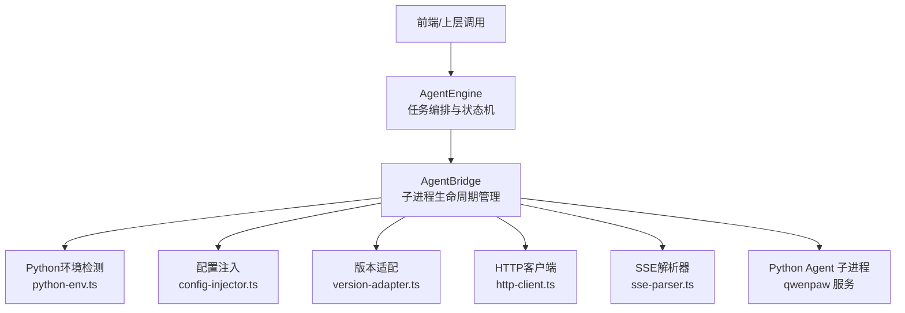
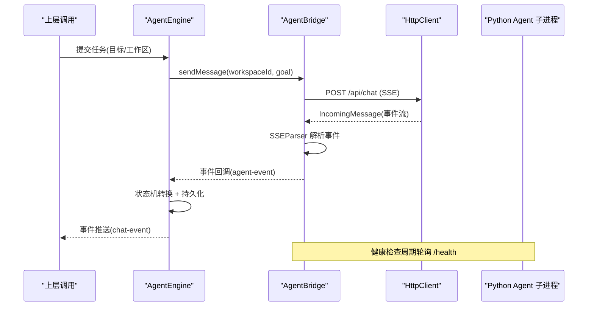
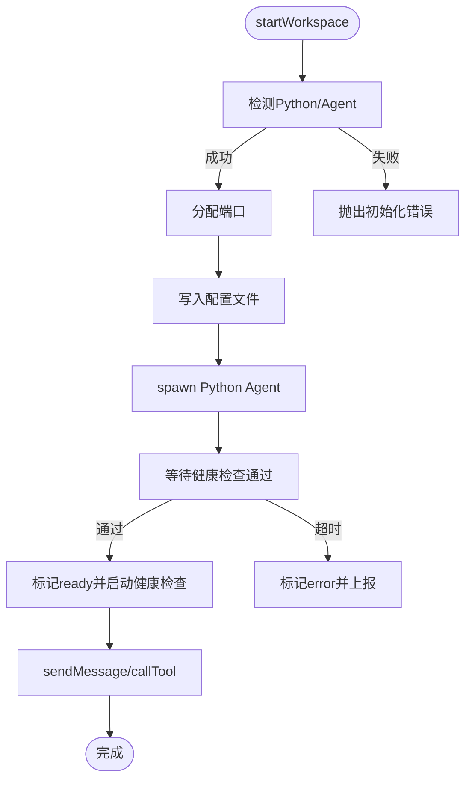
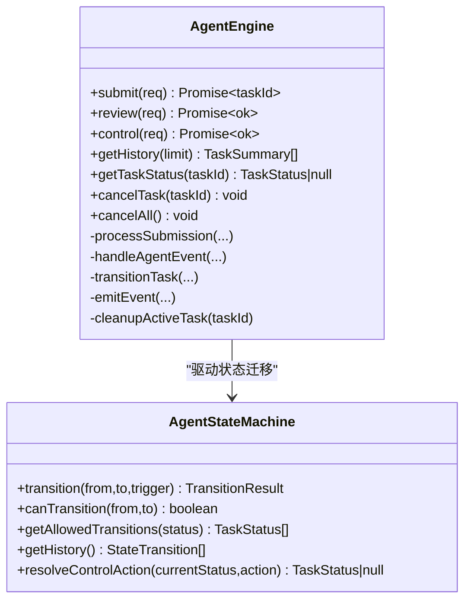
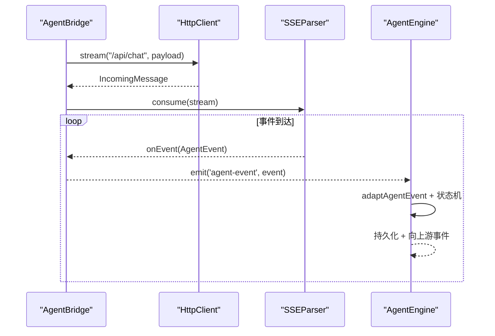
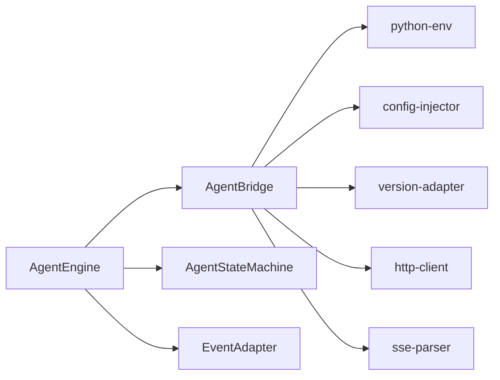

# Agent 子进程管理

<cite>
**本文引用的文件**
- [engine.ts](file://tongtian-tauri/src/main/agent/engine.ts)
- [state-machine.ts](file://tongtian-tauri/src/main/agent/state-machine.ts)
- [event-adapter.ts](file://tongtian-tauri/src/main/agent/event-adapter.ts)
- [agent-bridge.ts](file://tongtian-tauri/src/main/bridge/agent-bridge.ts)
- [http-client.ts](file://tongtian-tauri/src/main/bridge/http-client.ts)
- [sse-parser.ts](file://tongtian-tauri/src/main/bridge/sse-parser.ts)
- [config-injector.ts](file://tongtian-tauri/src/main/bridge/config-injector.ts)
- [version-adapter.ts](file://tongtian-tauri/src/main/bridge/version-adapter.ts)
- [python-env.ts](file://tongtian-tauri/src/main/bridge/python-env.ts)
</cite>

## 目录
1. [简介](#简介)
2. [项目结构](#项目结构)
3. [核心组件](#核心组件)
4. [架构总览](#架构总览)
5. [详细组件分析](#详细组件分析)
6. [依赖关系分析](#依赖关系分析)
7. [性能与可靠性](#性能与可靠性)
8. [故障排查指南](#故障排查指南)
9. [结论](#结论)
10. [附录：API 与配置参考](#附录api-与配置参考)

## 简介
本文件聚焦于 Python Agent 子进程的完整生命周期管理与进程间通信机制，覆盖启动、监控、停止、重启、错误处理、资源清理与异常恢复。文档面向不同技术背景的读者，提供从高层架构到代码级实现的逐步说明，并附带流程图、时序图与调试建议。

## 项目结构
Agent 子进程管理由主进程侧的桥接层（Bridge）与引擎层（Engine）共同实现，配合 HTTP/SSE 协议与版本适配、配置注入等模块完成对 Python Agent 子进程的统一编排。

图表来源
- [engine.ts:50-102](file://tongtian-tauri/src/main/agent/engine.ts#L50-L102)
- [agent-bridge.ts:94-247](file://tongtian-tauri/src/main/bridge/agent-bridge.ts#L94-L247)
- [python-env.ts:141-152](file://tongtian-tauri/src/main/bridge/python-env.ts#L141-L152)
- [config-injector.ts:95-159](file://tongtian-tauri/src/main/bridge/config-injector.ts#L95-L159)
- [version-adapter.ts:65-113](file://tongtian-tauri/src/main/bridge/version-adapter.ts#L65-L113)
- [http-client.ts:36-186](file://tongtian-tauri/src/main/bridge/http-client.ts#L36-L186)
- [sse-parser.ts:40-124](file://tongtian-tauri/src/main/bridge/sse-parser.ts#L40-L124)

章节来源
- [engine.ts:50-102](file://tongtian-tauri/src/main/agent/engine.ts#L50-L102)
- [agent-bridge.ts:94-247](file://tongtian-tauri/src/main/bridge/agent-bridge.ts#L94-L247)

## 核心组件
- AgentBridge：负责 Python Agent 子进程的启动、健康检查、停止、事件流转发、工具调用、热更新配置、端口分配与释放、实例状态管理等。
- AgentEngine：负责任务提交、计划审批/拒绝/修改、执行控制（暂停/恢复/回滚）、事件分发、数据库持久化与状态机驱动。
- HttpClient：轻量 HTTP 客户端，支持超时、重试、流式响应。
- SSEParser：解析 Agent 返回的 Server-Sent Events 流，转换为统一事件模型。
- ConfigInjector：生成并写入 Agent 配置文件，支持运行时热更新。
- VersionAdapter：探测 Agent 版本并屏蔽 API 差异，提供统一的接口路径与请求体适配。
- Python环境检测：自动发现 Python 与 Agent 安装，构造启动命令与工作目录。

章节来源
- [agent-bridge.ts:94-573](file://tongtian-tauri/src/main/bridge/agent-bridge.ts#L94-L573)
- [engine.ts:50-569](file://tongtian-tauri/src/main/agent/engine.ts#L50-L569)
- [http-client.ts:36-249](file://tongtian-tauri/src/main/bridge/http-client.ts#L36-L249)
- [sse-parser.ts:40-240](file://tongtian-tauri/src/main/bridge/sse-parser.ts#L40-L240)
- [config-injector.ts:95-222](file://tongtian-tauri/src/main/bridge/config-injector.ts#L95-L222)
- [version-adapter.ts:65-209](file://tongtian-tauri/src/main/bridge/version-adapter.ts#L65-L209)
- [python-env.ts:39-152](file://tongtian-tauri/src/main/bridge/python-env.ts#L39-L152)

## 架构总览
Agent 子进程管理的整体流程如下：
- 启动阶段：检测 Python 与 Agent 安装；为工作区分配端口；写入配置文件；使用 child_process.spawn 启动 Python Agent 子进程；等待健康检查通过；记录版本信息并开启周期性健康检查。
- 运行阶段：通过 HTTP POST /api/chat 发送消息，接收 SSE 事件流；将事件转换为内部 ChatEvent 并驱动状态机；支持工具调用与配置热更新。
- 停止阶段：优雅关闭（SIGTERM），超时后强制终止（SIGKILL）；释放端口；清理实例状态与健康检查定时器。

图表来源
- [engine.ts:56-102](file://tongtian-tauri/src/main/agent/engine.ts#L56-L102)
- [agent-bridge.ts:304-346](file://tongtian-tauri/src/main/bridge/agent-bridge.ts#L304-L346)
- [http-client.ts:138-186](file://tongtian-tauri/src/main/bridge/http-client.ts#L138-L186)
- [sse-parser.ts:40-124](file://tongtian-tauri/src/main/bridge/sse-parser.ts#L40-L124)

## 详细组件分析

### AgentBridge：子进程生命周期管理
- 启动工作区
  - 检测 Python 与 Agent 是否可用；若未初始化则抛出明确错误。
  - 防止重复实例；分配本地端口；确保工作区目录存在；写入配置文件。
  - 使用 spawn 启动 Python Agent，设置环境变量 PYTHONUNBUFFERED=1，绑定 stdio 管道用于日志。
  - 监听 stdout/stderr 输出；注册 exit/error 事件处理器。
  - 等待健康检查通过；探测版本；标记 ready；启动周期性健康检查。
- 停止工作区
  - 先停止健康检查；尝试 SIGTERM；在超时后 SIGKILL；清理实例与端口。
- 消息与工具调用
  - sendMessage：POST /api/chat，返回可迭代的 SSE 事件流；事件回调中转发给 Engine。
  - callTool：POST /api/tools/{tool_name}，封装结果与耗时。
- 健康检查与错误恢复
  - 周期性 /health 检查；连续失败达到阈值时标记 error；触发 instance-error 事件。
  - 进程退出时根据退出码区分正常/异常退出，释放端口并更新状态。

图表来源
- [agent-bridge.ts:108-247](file://tongtian-tauri/src/main/bridge/agent-bridge.ts#L108-L247)
- [agent-bridge.ts:253-299](file://tongtian-tauri/src/main/bridge/agent-bridge.ts#L253-L299)
- [agent-bridge.ts:304-394](file://tongtian-tauri/src/main/bridge/agent-bridge.ts#L304-L394)
- [agent-bridge.ts:469-522](file://tongtian-tauri/src/main/bridge/agent-bridge.ts#L469-L522)

章节来源
- [agent-bridge.ts:94-573](file://tongtian-tauri/src/main/bridge/agent-bridge.ts#L94-L573)

### AgentEngine：任务编排与状态机
- 任务提交
  - 创建任务记录（初始状态 idle）；持久化用户消息；状态机转入 planning；选择活跃工作区；注册活动任务；后台发送消息至 Agent。
- 计划评审
  - approve：更新计划状态为已批准，转入 executing，通知 Agent 开始执行。
  - reject：更新计划状态为拒绝，转入 done，持久化拒绝消息，清理活动任务。
  - modify：更新计划状态为草稿，重新进入 planning，发送补丁并继续监听事件。
- 执行控制
  - pause/resume/rollback_to：依据当前状态计算目标状态，通过工具调用通知 Agent，必要时清理活动任务。
- 事件处理
  - plan：存储计划，转入 pending_review。
  - step_start/step_progress：向上传递事件。
  - step_done：持久化步骤输出。
  - step_failed：记录错误，转入 failed，清理活动任务。
  - deliver/done：持久化交付物，转入 delivering/done，清理活动任务。
  - error：转入 failed，清理活动任务。
- 状态机
  - 定义合法的状态迁移规则；记录历史；提供控制动作映射。

图表来源
- [engine.ts:50-569](file://tongtian-tauri/src/main/agent/engine.ts#L50-L569)
- [state-machine.ts:79-161](file://tongtian-tauri/src/main/agent/state-machine.ts#L79-L161)

章节来源
- [engine.ts:50-569](file://tongtian-tauri/src/main/agent/engine.ts#L50-L569)
- [state-machine.ts:31-63](file://tongtian-tauri/src/main/agent/state-machine.ts#L31-L63)

### 进程间通信协议与数据流
- 协议
  - HTTP POST /api/chat：发送消息，返回 SSE 事件流。
  - HTTP POST /api/tools/{tool_name}：调用工具。
  - HTTP GET /health：健康检查。
  - HTTP POST /api/config：运行时配置热更新。
- 事件类型
  - plan、step_start、step_progress、step_done、step_failed、deliver、done、error。
- 数据流
  - Bridge 通过 HttpClient.stream 获取原始流；SSEParser 解析为 AgentEvent；Bridge 转发给 Engine；Engine 转换为 ChatEvent 并驱动状态机与持久化。

图表来源
- [agent-bridge.ts:304-346](file://tongtian-tauri/src/main/bridge/agent-bridge.ts#L304-L346)
- [http-client.ts:138-186](file://tongtian-tauri/src/main/bridge/http-client.ts#L138-L186)
- [sse-parser.ts:40-124](file://tongtian-tauri/src/main/bridge/sse-parser.ts#L40-L124)
- [engine.ts:351-454](file://tongtian-tauri/src/main/agent/engine.ts#L351-L454)

章节来源
- [agent-bridge.ts:304-346](file://tongtian-tauri/src/main/bridge/agent-bridge.ts#L304-L346)
- [sse-parser.ts:145-216](file://tongtian-tauri/src/main/bridge/sse-parser.ts#L145-L216)
- [engine.ts:351-454](file://tongtian-tauri/src/main/agent/engine.ts#L351-L454)

### 错误处理策略与异常恢复
- 启动失败
  - 未检测到 Python/Agent：抛出明确错误，阻止后续流程。
  - 健康检查超时：标记实例为 error，上报 instance-error。
- 运行期错误
  - SSE 流错误：记录错误并恢复实例状态为 ready。
  - 工具调用失败：返回结构化结果（success=false），包含错误信息与耗时。
  - 健康检查连续失败：超过阈值标记 error，停止健康检查。
- 进程退出
  - 非零退出码：记录崩溃信息，标记 error。
  - 正常退出或信号：标记 stopped，释放端口。
- 取消与清理
  - Engine 层使用 AbortController 取消事件处理；清理活动任务。
  - Bridge 层 stopWorkspace 优雅关闭，超时后强制终止，清理定时器与实例。

章节来源
- [agent-bridge.ts:201-247](file://tongtian-tauri/src/main/bridge/agent-bridge.ts#L201-L247)
- [agent-bridge.ts:253-299](file://tongtian-tauri/src/main/bridge/agent-bridge.ts#L253-L299)
- [agent-bridge.ts:304-394](file://tongtian-tauri/src/main/bridge/agent-bridge.ts#L304-L394)
- [agent-bridge.ts:469-522](file://tongtian-tauri/src/main/bridge/agent-bridge.ts#L469-L522)
- [engine.ts:270-288](file://tongtian-tauri/src/main/agent/engine.ts#L270-L288)

### 资源清理与配置热更新
- 资源清理
  - 端口释放：进程退出或停止时释放占用的端口。
  - 定时器清理：停止健康检查定时器，避免内存泄漏。
  - 实例清理：从 Map 中移除实例引用，重置状态。
- 配置热更新
  - 通过 POST /api/config 动态更新 Agent 配置，无需重启进程。
  - 写入配置文件用于启动时加载；热更新用于运行时调整。

章节来源
- [agent-bridge.ts:524-554](file://tongtian-tauri/src/main/bridge/agent-bridge.ts#L524-L554)
- [config-injector.ts:146-192](file://tongtian-tauri/src/main/bridge/config-injector.ts#L146-L192)

### 调试技巧
- 启用 Python 无缓冲输出：PYTHONUNBUFFERED=1，便于实时查看 Agent 日志。
- 关注 Bridge 日志标签：bridge:stdout、bridge:stderr、bridge:http、bridge:sse、bridge:version、bridge:config。
- 健康检查与版本探测：确认 /health 可达且版本兼容。
- 事件流调试：观察 SSEParser 的事件队列与解析过程，定位事件丢失或格式问题。
- 状态机历史：通过状态机历史追踪任务迁移路径，辅助定位非法迁移。

章节来源
- [agent-bridge.ts:190-216](file://tongtian-tauri/src/main/bridge/agent-bridge.ts#L190-L216)
- [sse-parser.ts:128-188](file://tongtian-tauri/src/main/bridge/sse-parser.ts#L128-L188)
- [state-machine.ts:127-139](file://tongtian-tauri/src/main/agent/state-machine.ts#L127-L139)

## 依赖关系分析
- AgentBridge 依赖：
  - python-env：检测 Python/Agent、构造启动命令、创建工作区目录。
  - config-injector：生成并写入配置，支持热更新。
  - version-adapter：探测版本、适配 API 路径与请求体。
  - http-client：HTTP 请求与流式传输、健康检查。
  - sse-parser：解析 SSE 事件流。
- AgentEngine 依赖：
  - agent-bridge：发送消息、调用工具、获取活跃工作区。
  - state-machine：状态迁移校验与历史记录。
  - event-adapter：将 AgentEvent 转换为 ChatEvent。
  - store/db：持久化任务、消息、步骤与计划。

图表来源
- [engine.ts:50-569](file://tongtian-tauri/src/main/agent/engine.ts#L50-L569)
- [agent-bridge.ts:94-573](file://tongtian-tauri/src/main/bridge/agent-bridge.ts#L94-L573)

章节来源
- [engine.ts:50-569](file://tongtian-tauri/src/main/agent/engine.ts#L50-L569)
- [agent-bridge.ts:94-573](file://tongtian-tauri/src/main/bridge/agent-bridge.ts#L94-L573)

## 性能与可靠性
- 并发与隔离
  - 每个工作区独立子进程与端口，避免相互干扰。
- 健康检查
  - 周期性轮询 /health，快速发现不可用实例并降级。
- 超时与重试
  - HTTP 请求默认超时与指数退避重试；流式请求不重试，由上层负责重连。
- 优雅关闭
  - 优先 SIGTERM，超时后 SIGKILL，确保资源释放。
- 事件流稳定性
  - SSEParser 具备缓冲与队列机制，保证事件有序处理与结束信号正确传递。

[本节为通用指导，不直接分析具体文件]

## 故障排查指南
- 无法启动 Agent
  - 检查 Python 与 Agent 是否安装；确认 detectPython/detectAgent 返回值。
  - 检查工作区目录权限与磁盘空间。
  - 查看健康检查日志与版本探测结果。
- 事件流中断
  - 检查 SSEParser 的错误回调与 onEnd 触发时机。
  - 确认上游连接未被防火墙或代理断开。
- 工具调用失败
  - 检查 tool 名称与参数是否符合版本适配要求。
  - 查看 HTTP 响应码与错误体。
- 进程崩溃
  - 根据退出码判断异常原因；收集 stderr 日志。
  - 确认是否有资源竞争或端口冲突。
- 状态不一致
  - 通过状态机历史与数据库中的任务状态比对，定位非法迁移。

章节来源
- [agent-bridge.ts:108-126](file://tongtian-tauri/src/main/bridge/agent-bridge.ts#L108-L126)
- [agent-bridge.ts:219-247](file://tongtian-tauri/src/main/bridge/agent-bridge.ts#L219-L247)
- [agent-bridge.ts:351-394](file://tongtian-tauri/src/main/bridge/agent-bridge.ts#L351-L394)
- [agent-bridge.ts:524-554](file://tongtian-tauri/src/main/bridge/agent-bridge.ts#L524-L554)
- [state-machine.ts:96-117](file://tongtian-tauri/src/main/agent/state-machine.ts#L96-L117)

## 结论
该方案通过 Bridge 统一管理 Python Agent 子进程的生命周期，结合状态机与事件驱动，实现了高内聚、低耦合的任务编排与进程间通信。健康检查、优雅关闭、版本适配与配置热更新提升了系统的可靠性与可维护性。建议在复杂场景中结合日志与状态机历史进行深度诊断，并根据业务需求调整健康检查频率与超时策略。

[本节为总结性内容，不直接分析具体文件]

## 附录：API 与配置参考
- 关键 API
  - POST /api/chat：发送消息，返回 SSE 事件流。
  - POST /api/tools/{tool_name}：调用工具。
  - GET /health：健康检查。
  - POST /api/config：运行时配置热更新。
- 事件类型
  - plan、step_start、step_progress、step_done、step_failed、deliver、done、error。
- 配置项
  - workspace_id、work_dir、agent.role、agent.system_prompt。
  - model.provider、model.base_url、model.api_key、model.model_name、model.context_window。
  - skills、mcp_servers、sandbox.execution_level、文件与工具白/黑名单。
- 启动命令
  - python -m qwenpaw --port <port> --work-dir <workDir>。

章节来源
- [version-adapter.ts:132-209](file://tongtian-tauri/src/main/bridge/version-adapter.ts#L132-L209)
- [config-injector.ts:12-81](file://tongtian-tauri/src/main/bridge/config-injector.ts#L12-L81)
- [python-env.ts:141-152](file://tongtian-tauri/src/main/bridge/python-env.ts#L141-L152)