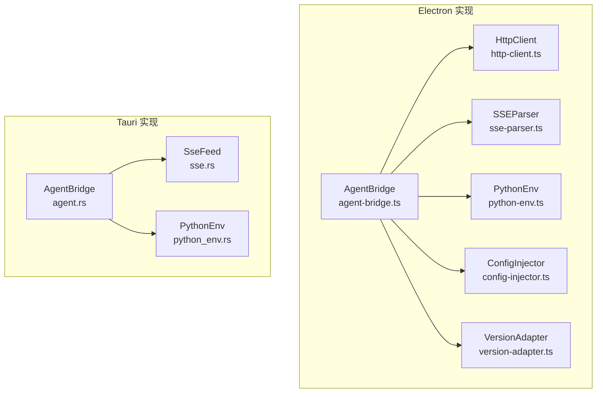
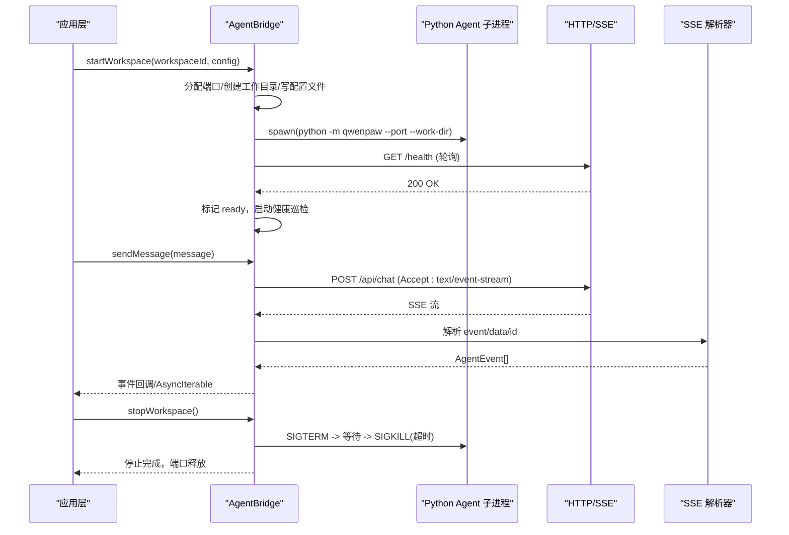
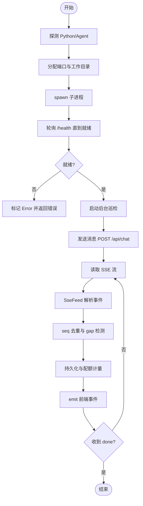
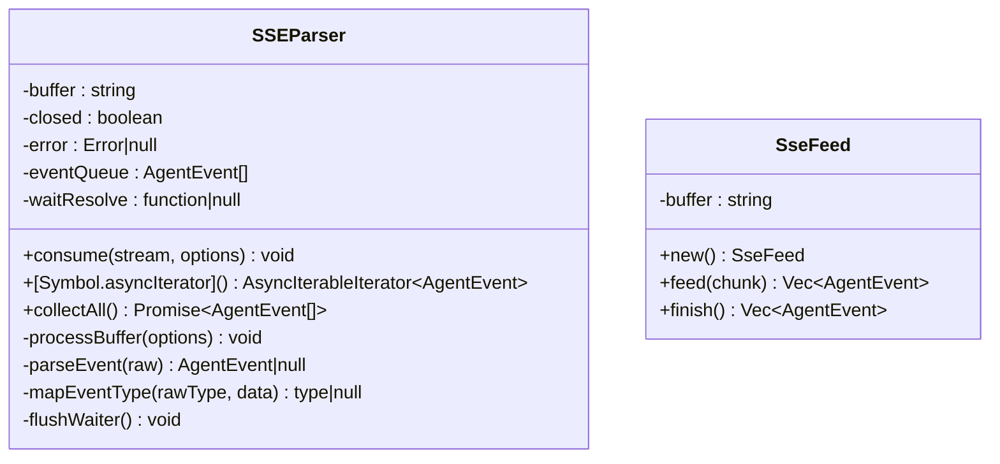
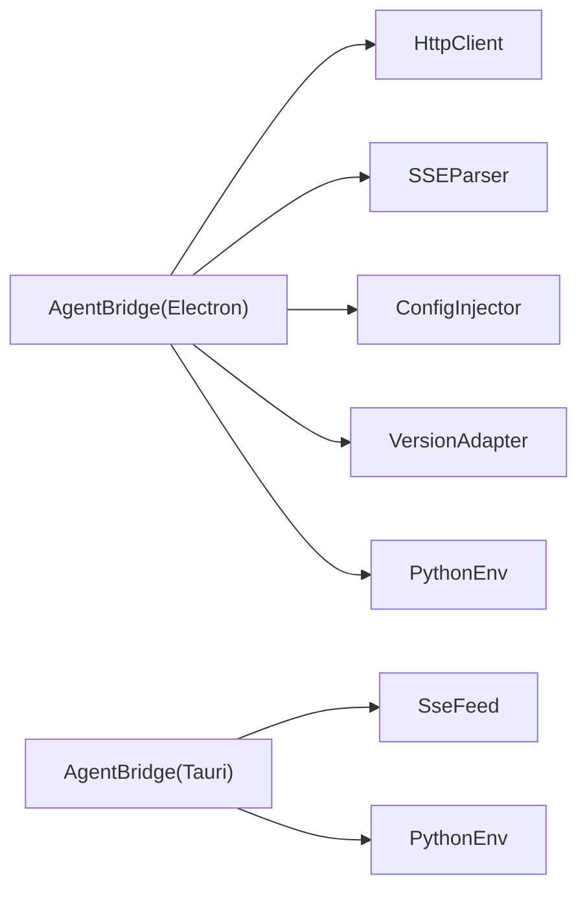

# Bridge 模块

<cite>
**本文引用的文件**   
- [agent-bridge.ts](file://tongtian-tauri/src/main/bridge/agent-bridge.ts)
- [http-client.ts](file://tongtian-tauri/src/main/bridge/http-client.ts)
- [sse-parser.ts](file://tongtian-tauri/src/main/bridge/sse-parser.ts)
- [python-env.ts](file://tongtian-tauri/src/main/bridge/python-env.ts)
- [config-injector.ts](file://tongtian-tauri/src/main/bridge/config-injector.ts)
- [version-adapter.ts](file://tongtian-tauri/src/main/bridge/version-adapter.ts)
- [mod.rs](file://tongtian-tauri/src-tauri/src/bridge/mod.rs)
- [agent.rs](file://tongtian-tauri/src-tauri/src/bridge/agent.rs)
- [sse.rs](file://tongtian-tauri/src-tauri/src/bridge/sse.rs)
- [python_env.rs](file://tongtian-tauri/src-tauri/src/bridge/python_env.rs)
- [engine_sse_selftest.py](file://tongtian-tauri/tests/integration/engine_sse_selftest.py)
</cite>

## 目录
1. [简介](#简介)
2. [项目结构](#项目结构)
3. [核心组件](#核心组件)
4. [架构总览](#架构总览)
5. [详细组件分析](#详细组件分析)
6. [依赖关系分析](#依赖关系分析)
7. [性能考量](#性能考量)
8. [故障排查指南](#故障排查指南)
9. [结论](#结论)
10. [附录：API 与配置参考](#附录api-与配置参考)

## 简介
Bridge 模块负责在桌面应用（Electron/Tauri）中管理 Python Agent 子进程的生命周期，并通过 HTTP/SSE 与 Agent 进行通信。其核心能力包括：
- 子进程生命周期管理：启动、健康检查、优雅关闭、异常退出处理、端口分配与回收
- Python 环境探测与隔离：自动发现 Python、检测 Agent 安装、按工作区隔离目录与配置注入
- SSE 事件流处理：解析 QwenPaw SSE 协议、事件类型映射、断线重放与去重、配额计量与状态变更
- 版本适配：屏蔽 Agent API 版本差异，统一上层调用路径与请求体格式
- 错误处理与资源清理：超时、重试、背压、端口释放、定时器清理、进程信号终止

本模块同时提供 Electron（TypeScript）与 Tauri（Rust）两套实现，行为保持一致，便于跨平台迁移与对比。

## 项目结构
Bridge 模块由两类实现组成：
- Electron 版（src/main/bridge/*.ts）：基于 Node.js child_process、http.IncomingMessage 与 EventEmitter
- Tauri 版（src-tauri/src/bridge/*.rs）：基于 tokio、reqwest、mpsc 通道与 SseFeed 增量解析



**图表来源** 
- [agent-bridge.ts:1-120](file://tongtian-tauri/src/main/bridge/agent-bridge.ts#L1-L120)
- [http-client.ts:1-120](file://tongtian-tauri/src/main/bridge/http-client.ts#L1-L120)
- [sse-parser.ts:1-120](file://tongtian-tauri/src/main/bridge/sse-parser.ts#L1-L120)
- [python-env.ts:1-120](file://tongtian-tauri/src/main/bridge/python-env.ts#L1-L120)
- [config-injector.ts:1-120](file://tongtian-tauri/src/main/bridge/config-injector.ts#L1-L120)
- [version-adapter.ts:1-120](file://tongtian-tauri/src/main/bridge/version-adapter.ts#L1-L120)
- [agent.rs:1-120](file://tongtian-tauri/src-tauri/src/bridge/agent.rs#L1-L120)
- [sse.rs:1-120](file://tongtian-tauri/src-tauri/src/bridge/sse.rs#L1-L120)
- [python_env.rs:1-120](file://tongtian-tauri/src-tauri/src/bridge/python_env.rs#L1-L120)

**章节来源**
- [agent-bridge.ts:1-120](file://tongtian-tauri/src/main/bridge/agent-bridge.ts#L1-L120)
- [agent.rs:1-120](file://tongtian-tauri/src-tauri/src/bridge/agent.rs#L1-L120)

## 核心组件
- AgentBridge（Electron/Tauri）：维护每个 workspace 的独立子进程实例、端口、状态与健康巡检；提供 startWorkspace、stopWorkspace、sendMessage/callTool、updateConfig、shutdownAll 等接口
- HttpClient（Electron）：封装带超时与指数退避重试的 HTTP 请求与 SSE 流获取
- SSEParser（Electron）：解析 SSE 文本流，产出 AgentEvent 并支持 AsyncIterable
- ConfigInjector（Electron）：生成 agent_config.json 并支持运行时热更新 /api/config
- VersionAdapter（Electron）：通过 /health 探测 Agent 版本，统一 chat/tool/config 等 API 路径与请求体
- SseFeed（Tauri）：增量式 SSE 解析器，支持 id 行 seq 提取与事件类型映射
- PythonEnv（Electron/Tauri）：探测 Python、检测 qwenpaw、构造启动命令、管理工作区目录

**章节来源**
- [agent-bridge.ts:85-250](file://tongtian-tauri/src/main/bridge/agent-bridge.ts#L85-L250)
- [http-client.ts:35-120](file://tongtian-tauri/src/main/bridge/http-client.ts#L35-L120)
- [sse-parser.ts:28-120](file://tongtian-tauri/src/main/bridge/sse-parser.ts#L28-L120)
- [config-injector.ts:88-160](file://tongtian-tauri/src/main/bridge/config-injector.ts#L88-L160)
- [version-adapter.ts:56-120](file://tongtian-tauri/src/main/bridge/version-adapter.ts#L56-L120)
- [agent.rs:70-120](file://tongtian-tauri/src-tauri/src/bridge/agent.rs#L70-L120)
- [sse.rs:48-120](file://tongtian-tauri/src-tauri/src/bridge/sse.rs#L48-L120)
- [python_env.rs:53-120](file://tongtian-tauri/src-tauri/src/bridge/python_env.rs#L53-L120)

## 架构总览
Bridge 模块采用“进程隔离 + HTTP/SSE 通信”的架构：
- 每个 workspace 拥有独立的 Python 子进程，绑定本地回环地址的独占端口（18000-19000）
- 启动后轮询 /health 直至就绪，后台定时健康检查，失败阈值触发 error 状态
- 消息发送走 POST /api/chat（或 /api/chat/review），返回 SSE 流；事件经解析后以事件形式向上层暴露
- 工具调用走 POST /api/tools/{tool_name}，同步返回结果
- 配置注入支持文件写入与运行时热更新



**图表来源** 
- [agent-bridge.ts:130-247](file://tongtian-tauri/src/main/bridge/agent-bridge.ts#L130-L247)
- [agent.rs:118-262](file://tongtian-tauri/src-tauri/src/bridge/agent.rs#L118-L262)
- [http-client.ts:138-186](file://tongtian-tauri/src/main/bridge/http-client.ts#L138-L186)
- [sse-parser.ts:40-120](file://tongtian-tauri/src/main/bridge/sse-parser.ts#L40-L120)
- [sse.rs:48-120](file://tongtian-tauri/src-tauri/src/bridge/sse.rs#L48-L120)

## 详细组件分析

### AgentBridge（Electron 版）
- 职责：子进程生命周期、端口分配、健康检查、SSE 流消费、工具调用、配置热更新、事件广播
- 关键流程：
  - initialize：检测 Python 与 Agent 安装
  - startWorkspace：分配端口、确保工作目录、写入配置、spawn 子进程、等待就绪、版本探测、启动健康巡检
  - stopWorkspace：SIGTERM 优雅关闭，超时后 SIGKILL，清理端口与状态
  - sendMessage：POST /api/chat，建立 SSE 流，解析事件并回调，结束时恢复 ready
  - callTool：POST /api/tools/{name}，同步返回 ToolResult
  - updateConfig：POST /api/config 热更新
  - shutdownAll：遍历实例逐一停止，清理定时器与实例表

```mermaid
classDiagram
class AgentBridge {
+initialize() Promise~void~
+startWorkspace(workspaceId, config) Promise~AgentInstance~
+stopWorkspace(workspaceId) Promise~void~
+sendMessage(workspaceId, message) Promise~AsyncIterable~
+callTool(workspaceId, toolName, params) Promise~ToolResult~
+getStatus(workspaceId) InstanceStatus
+healthCheck(workspaceId) Promise~{ok,latencyMs}~
+updateConfig(workspaceId, config) Promise~boolean~
+shutdownAll() Promise~void~
-getInstance(workspaceId) AgentInstance
-setInstanceStatus(instance, status) void
-waitForReady(httpClient) Promise~void~
-startHealthCheck(workspaceId) void
-stopHealthCheck(workspaceId) void
-handleProcessExit(workspaceId, code, signal) void
-cleanupInstance(workspaceId) void
}
class HttpClient {
+get(path, options) Promise~HttpResponse~
+post(path, body, options) Promise~HttpResponse~
+stream(path, body, timeoutMs) Promise~IncomingMessage~
+healthCheck(timeoutMs) Promise~{ok,latencyMs}~
}
class SSEParser {
+consume(stream, options) void
+[Symbol.asyncIterator]() AsyncIterableIterator~AgentEvent~
+collectAll() Promise~AgentEvent[]~
}
class ConfigInjector {
+generate(config) AgentConfig
+writeConfigFile(config) Promise~string~
+hotUpdate(httpClient, config) Promise~boolean~
+readConfigFile(workDir) Promise~AgentConfig|null~
+removeConfigFile(workDir) Promise~void~
}
class VersionAdapter {
+detect(httpClient) Promise~AgentVersionInfo~
+isCompatible() boolean
+getChatPath() string
+getToolCallPath(toolName) string
+getConfigPath() string
+adaptChatRequest(message, context) Record
+adaptToolCallRequest(params) Record
}
AgentBridge --> HttpClient : "使用"
AgentBridge --> SSEParser : "使用"
AgentBridge --> ConfigInjector : "使用"
AgentBridge --> VersionAdapter : "使用"
```

**图表来源** 
- [agent-bridge.ts:94-247](file://tongtian-tauri/src/main/bridge/agent-bridge.ts#L94-L247)
- [http-client.ts:35-186](file://tongtian-tauri/src/main/bridge/http-client.ts#L35-L186)
- [sse-parser.ts:40-120](file://tongtian-tauri/src/main/bridge/sse-parser.ts#L40-L120)
- [config-injector.ts:95-192](file://tongtian-tauri/src/main/bridge/config-injector.ts#L95-L192)
- [version-adapter.ts:65-120](file://tongtian-tauri/src/main/bridge/version-adapter.ts#L65-L120)

**章节来源**
- [agent-bridge.ts:108-247](file://tongtian-tauri/src/main/bridge/agent-bridge.ts#L108-L247)
- [agent-bridge.ts:253-346](file://tongtian-tauri/src/main/bridge/agent-bridge.ts#L253-L346)
- [agent-bridge.ts:351-394](file://tongtian-tauri/src/main/bridge/agent-bridge.ts#L351-L394)
- [agent-bridge.ts:418-439](file://tongtian-tauri/src/main/bridge/agent-bridge.ts#L418-L439)

### AgentBridge（Tauri 版）
- 职责：与 Electron 版一致，但使用 tokio 异步 I/O、reqwest HTTP 客户端、mpsc 通道与 SseFeed 增量解析
- 关键流程：
  - start_workspace：探测 Python/Agent、分配端口与工作目录、构造命令（mock/qwenpaw/agentscope）、spawn 子进程、轮询 /health、后台 watch_loop
  - send_message_with_attachments：POST /api/chat（stage=plan），SSE 流解析、seq 去重与 gap 修复、持久化与配额计量、emit 到前端事件
  - review_task/control_task：审阅与控制端点转发
  - stream_post：通用 SSE 消费管道，独立 emit 任务、背压通道、断线补齐循环



**图表来源** 
- [agent.rs:118-262](file://tongtian-tauri/src-tauri/src/bridge/agent.rs#L118-L262)
- [agent.rs:410-461](file://tongtian-tauri/src-tauri/src/bridge/agent.rs#L410-L461)
- [agent.rs:684-703](file://tongtian-tauri/src-tauri/src/bridge/agent.rs#L684-L703)
- [agent.rs:756-800](file://tongtian-tauri/src-tauri/src/bridge/agent.rs#L756-L800)

**章节来源**
- [agent.rs:118-262](file://tongtian-tauri/src-tauri/src/bridge/agent.rs#L118-L262)
- [agent.rs:410-461](file://tongtian-tauri/src-tauri/src/bridge/agent.rs#L410-L461)
- [agent.rs:684-703](file://tongtian-tauri/src-tauri/src/bridge/agent.rs#L684-L703)
- [agent.rs:756-800](file://tongtian-tauri/src-tauri/src/bridge/agent.rs#L756-L800)

### SSE 事件流处理（Electron/Tauri）
- Electron 版 SSEParser：
  - 基于 IncomingMessage 数据事件累积 buffer，按 \n\n 分割事件块
  - 解析 event/data/id 行，JSON 解析失败回退 raw
  - 支持 AsyncIterable 与 collectAll，事件回调 onEvent/onEnd/onError
- Tauri 版 SseFeed：
  - 增量 feed(chunk) 返回完整事件数组，finish 处理残留
  - 支持 id 行 seq 提取（feature 开关），data.seq 兜底
  - 事件类型白名单映射，未知类型忽略



**图表来源** 
- [sse-parser.ts:40-120](file://tongtian-tauri/src/main/bridge/sse-parser.ts#L40-L120)
- [sse.rs:48-120](file://tongtian-tauri/src-tauri/src/bridge/sse.rs#L48-L120)

**章节来源**
- [sse-parser.ts:128-188](file://tongtian-tauri/src/main/bridge/sse-parser.ts#L128-L188)
- [sse.rs:88-144](file://tongtian-tauri/src-tauri/src/bridge/sse.rs#L88-L144)

### Python 环境与配置注入
- Python 环境探测：
  - Electron：detectPython 尝试 python3/python/py 及 Windows 常见路径；detectAgent 通过 pip show qwenpaw 检测
  - Tauri：detect_python/detect_agent 使用 tokio::process::Command，超时控制
- 工作区目录：
  - Electron：ensureWorkspaceDir 创建 workspaces/{workspaceId}
  - Tauri：base_dir/workspace_dir/ensure_workspace_dir，支持 TONGTIAN_HOME 环境变量
- 启动命令：
  - Electron：getAgentStartCommand → python -m qwenpaw --port --work-dir
  - Tauri：agent_start_command/mock_agent_command/agentscope_engine_command，支持三种引擎模式
- 配置注入：
  - Electron：ConfigInjector.generate/write/hotUpdate/read/remove
  - Tauri：通过 /api/config 热更新（由上层调用）

**章节来源**
- [python-env.ts:39-120](file://tongtian-tauri/src/main/bridge/python-env.ts#L39-L120)
- [python_env.rs:53-120](file://tongtian-tauri/src-tauri/src/bridge/python_env.rs#L53-L120)
- [config-injector.ts:95-192](file://tongtian-tauri/src/main/bridge/config-injector.ts#L95-L192)

### 版本适配
- 通过 GET /health 获取 version/api_version，判断是否在兼容范围 [MIN_VERSION, MAX_VERSION]
- 统一 API 路径：/api/chat、/api/tools/{name}、/api/config、/api/cron/*、/api/skills/*、/api/mcp/*
- 请求体适配：adaptChatRequest/adaptToolCallRequest

**章节来源**
- [version-adapter.ts:65-120](file://tongtian-tauri/src/main/bridge/version-adapter.ts#L65-L120)
- [version-adapter.ts:135-208](file://tongtian-tauri/src/main/bridge/version-adapter.ts#L135-L208)

## 依赖关系分析
- Electron 版依赖链：
  - AgentBridge → HttpClient/SSEParser/ConfigInjector/VersionAdapter/PythonEnv
  - HttpClient → Node http 模块
  - SSEParser → Node IncomingMessage
  - ConfigInjector → fs/promises
  - PythonEnv → child_process/execFile、fs、path、app.getPath
- Tauri 版依赖链：
  - AgentBridge → SseFeed/PythonEnv（命令构造）
  - SseFeed → serde_json、tokio io
  - PythonEnv → tokio::process::Command、std::fs



**图表来源** 
- [agent-bridge.ts:1-120](file://tongtian-tauri/src/main/bridge/agent-bridge.ts#L1-L120)
- [agent.rs:1-120](file://tongtian-tauri/src-tauri/src/bridge/agent.rs#L1-L120)

**章节来源**
- [agent-bridge.ts:1-120](file://tongtian-tauri/src/main/bridge/agent-bridge.ts#L1-L120)
- [agent.rs:1-120](file://tongtian-tauri/src-tauri/src/bridge/agent.rs#L1-L120)

## 性能考量
- 健康检查与巡检：
  - 启动时轮询 /health，间隔 500ms，最长 30s
  - 后台巡检每 10s 一次，连续 3 次失败标记 error
- 背压与缓冲：
  - Tauri 版使用有界 mpsc 通道（容量 1024）避免解析阻塞前端消费
  - Electron 版通过事件队列与 AsyncIterable 解耦
- 重试策略：
  - HttpClient 默认 3 次重试，指数退避（1s 起步）
  - SSE 流不重试，由上层负责重连与断线补齐
- 资源清理：
  - 端口集合 usedPorts 防止冲突，停止时释放
  - 定时器 map 清理，实例表 clear

**章节来源**
- [agent-bridge.ts:46-54](file://tongtian-tauri/src/main/bridge/agent-bridge.ts#L46-L54)
- [agent.rs:24-38](file://tongtian-tauri/src-tauri/src/bridge/agent.rs#L24-L38)
- [http-client.ts:26-31](file://tongtian-tauri/src/main/bridge/http-client.ts#L26-L31)
- [agent.rs:500-515](file://tongtian-tauri/src-tauri/src/bridge/agent.rs#L500-L515)

## 故障排查指南
- 常见问题与定位：
  - Python 未找到：initialize 抛出 BRIDGE_PYTHON_NOT_FOUND，检查 PATH 或 Windows 安装路径
  - Agent 未安装：BRIDGE_AGENT_NOT_FOUND，执行 pip install qwenpaw
  - 端口占用：findFreePort 抛错，检查 18000-19000 范围内占用情况
  - 健康检查超时：startWorkspace 等待就绪失败，检查 Agent 是否启动成功、/health 是否可达
  - SSE 流错误：onError 回调记录错误信息，检查网络与 Agent 服务状态
  - 进程异常退出：handleProcessExit 记录 exit code/signal，必要时重启实例
- 调试建议：
  - 查看 stdout/stderr 日志泵输出
  - 使用 engine_sse_selftest.py 验证 SSE 契约（seq 单调性、id 行、replay、cancel）
  - 启用 TT_AGENT_MOCK=1 快速验证事件流与 UI 渲染

**章节来源**
- [agent-bridge.ts:108-126](file://tongtian-tauri/src/main/bridge/agent-bridge.ts#L108-L126)
- [agent-bridge.ts:218-247](file://tongtian-tauri/src/main/bridge/agent-bridge.ts#L218-L247)
- [agent-bridge.ts:328-346](file://tongtian-tauri/src/main/bridge/agent-bridge.ts#L328-L346)
- [agent-bridge.ts:524-554](file://tongtian-tauri/src/main/bridge/agent-bridge.ts#L524-L554)
- [engine_sse_selftest.py:1-168](file://tongtian-tauri/tests/integration/engine_sse_selftest.py#L1-L168)

## 结论
Bridge 模块通过严格的进程隔离与稳定的 HTTP/SSE 通信协议，实现了高内聚、低耦合的 Agent 子进程管理。Electron 与 Tauri 双实现保证了跨平台一致性，SSE 解析与断线补齐机制提升了鲁棒性，版本适配层屏蔽了上游 API 变化。结合完善的错误处理与资源清理策略，该模块为上层业务提供了可靠、可观测、可扩展的 Agent 运行基座。

## 附录：API 与配置参考
- 常用 API 路径（由 VersionAdapter 统一）：
  - 聊天：POST /api/chat（Accept: text/event-stream）
  - 工具调用：POST /api/tools/{tool_name}
  - 配置热更新：POST /api/config
  - 计划审阅：POST /api/chat/review
  - 任务控制：POST /api/chat/control
  - 事件重放：GET /api/events/replay?task_id={id}&from_seq={seq}
- 配置项（WorkspaceConfig → AgentConfig）：
  - workspace_id/work_dir/agent.role/agent.system_prompt
  - model.provider/base_url/api_key/model_name/context_window
  - skills[]/mcp_servers[].name/transport/endpoint/auth_type/auth_config
  - sandbox.execution_level/file_allowlist/file_blocklist/tool_allowlist/tool_blocklist
- 示例调用（概念性说明，非代码片段）：
  - 启动工作区：传入 workspaceId 与 WorkspaceConfig，返回 AgentInstance（含端口、状态、HTTP 客户端）
  - 发送消息：传入 workspaceId 与 message，返回 AsyncIterable<AgentEvent>，逐事件回调
  - 工具调用：传入 workspaceId、toolName、params，返回 ToolResult（success/output/error/durationMs）
  - 热更新配置：传入 workspaceId 与 Partial<WorkspaceConfig>，返回布尔表示是否成功

**章节来源**
- [version-adapter.ts:135-208](file://tongtian-tauri/src/main/bridge/version-adapter.ts#L135-L208)
- [config-injector.ts:12-81](file://tongtian-tauri/src/main/bridge/config-injector.ts#L12-L81)
- [agent-bridge.ts:304-346](file://tongtian-tauri/src/main/bridge/agent-bridge.ts#L304-L346)
- [agent-bridge.ts:351-394](file://tongtian-tauri/src/main/bridge/agent-bridge.ts#L351-L394)
- [agent.rs:684-703](file://tongtian-tauri/src-tauri/src/bridge/agent.rs#L684-L703)
- [agent.rs:756-800](file://tongtian-tauri/src-tauri/src/bridge/agent.rs#L756-L800)