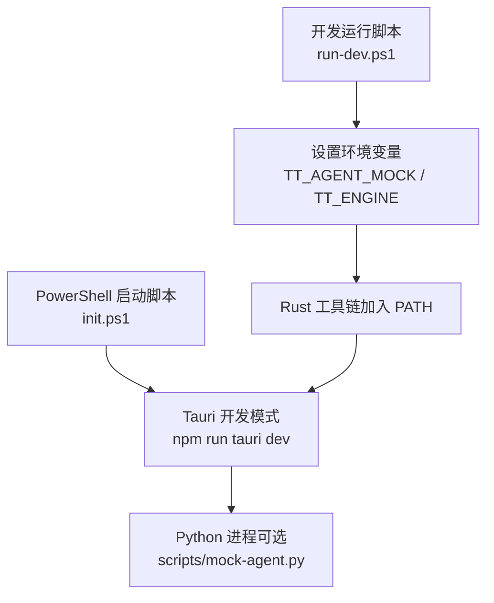
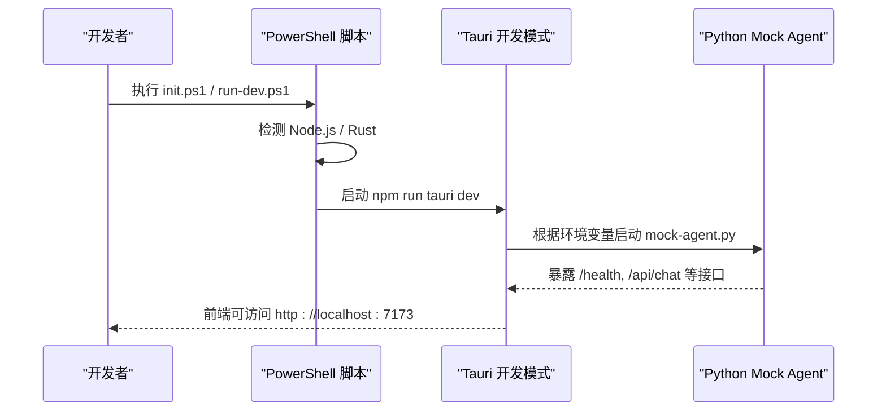
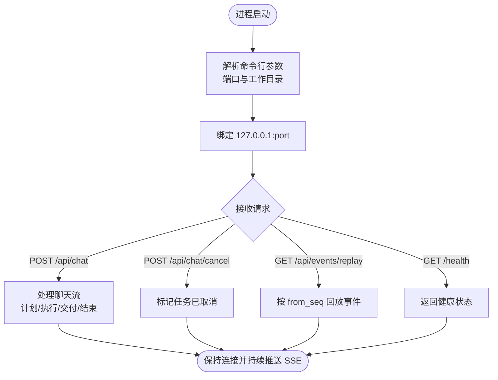
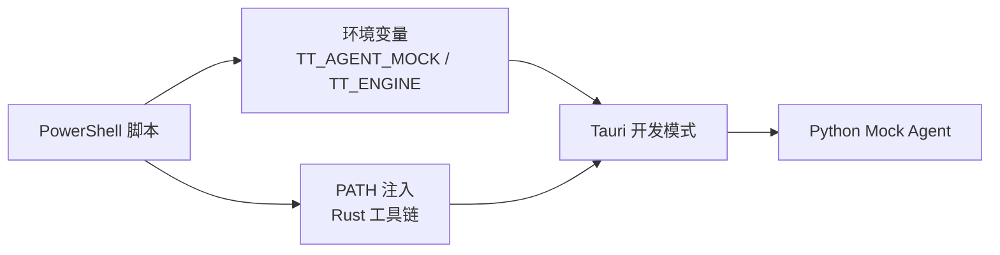

# Python 环境配置

<cite>
**本文引用的文件**
- [init.ps1](file://tongtian-tauri/init.ps1)
- [run-dev.ps1](file://tongtian-tauri/run-dev.ps1)
- [mock-agent.py](file://tongtian-tauri/scripts/mock-agent.py)
- [setup-env.ps1](file://.tools/setup-env.ps1)
- [download-env.ps1](file://.tools/download-env.ps1)
</cite>

## 目录
1. [简介](#简介)
2. [项目结构](#项目结构)
3. [核心组件](#核心组件)
4. [架构总览](#架构总览)
5. [详细组件分析](#详细组件分析)
6. [依赖关系分析](#依赖关系分析)
7. [性能考虑](#性能考虑)
8. [故障排除指南](#故障排除指南)
9. [结论](#结论)
10. [附录](#附录)

## 简介
本文件聚焦于本项目中 Python 环境的创建、激活与管理机制，涵盖依赖包安装、环境变量配置、路径解析与版本兼容性检查；并说明多环境隔离策略、动态环境切换与环境验证流程。文档同时提供可操作的配置示例、常见问题排查与环境故障排除指南，帮助开发者在不同平台（尤其是 Windows）上稳定运行 Python 相关能力（如 Mock Agent）。

## 项目结构
本项目在桌面端通过 Tauri 启动，Python 侧以独立进程方式提供能力（例如 Mock Agent），由前端/桥接层通过环境变量与命令参数进行控制。关键脚本与入口如下：
- 初始化与开发启动脚本负责检测 Node.js/Rust 并启动 Tauri 开发模式。
- 开发运行脚本设置 Python 引擎选择的环境变量，并将 Rust 工具链加入 PATH。
- Mock Agent 为纯 Python 标准库实现，零依赖，便于快速验证与调试。
- 通用工具脚本用于下载与解压 JDK/Maven，辅助构建链路。

图表来源
- [init.ps1:13-53](file://tongtian-tauri/init.ps1#L13-L53)
- [run-dev.ps1:1-12](file://tongtian-tauri/run-dev.ps1#L1-L12)

章节来源
- [init.ps1:13-53](file://tongtian-tauri/init.ps1#L13-L53)
- [run-dev.ps1:1-12](file://tongtian-tauri/run-dev.ps1#L1-L12)

## 核心组件
- 初始化与开发启动
  - 检测 Node.js 与 Rust 工具链，按需降级到浏览器 Mock 模式或完整桌面应用。
  - 自动安装前端依赖并输出访问地址与运行模式信息。
- 开发运行与引擎切换
  - 通过环境变量 TT_AGENT_MOCK 与 TT_ENGINE 控制是否启用 Mock Agent 以及使用何种后端引擎。
  - 将 Cargo/bin 加入 PATH，确保 Rust 命令可用。
- Mock Agent（Python）
  - 基于 Python 标准库的 HTTP/SSE 服务，零外部依赖，端口与工作目录可通过命令行参数配置。
  - 提供健康检查、事件重放、任务取消、两阶段计划审阅与执行流等接口。

章节来源
- [init.ps1:13-53](file://tongtian-tauri/init.ps1#L13-L53)
- [run-dev.ps1:1-12](file://tongtian-tauri/run-dev.ps1#L1-L12)
- [mock-agent.py:1-20](file://tongtian-tauri/scripts/mock-agent.py#L1-L20)

## 架构总览
下图展示了从 PowerShell 启动脚本到 Tauri 开发模式，再到 Python Mock Agent 的调用关系与环境变量传递。

图表来源
- [init.ps1:13-53](file://tongtian-tauri/init.ps1#L13-L53)
- [run-dev.ps1:1-12](file://tongtian-tauri/run-dev.ps1#L1-L12)
- [mock-agent.py:383-399](file://tongtian-tauri/scripts/mock-agent.py#L383-L399)

## 详细组件分析

### 初始化与开发启动（init.ps1）
- 功能要点
  - 检测 Node.js 是否存在，不存在则中止。
  - 尝试将用户目录下的 Rust 工具链加入 PATH，若未检测到则提示降级为浏览器 Mock 模式。
  - 检查 node_modules 是否存在，不存在则执行安装。
  - 输出前端地址、运行模式、桌面应用与后端能力摘要，并根据是否具备 Rust 能力选择启动 Tauri 或仅前端开发服务器。
- 环境与路径
  - 通过修改当前会话的 PATH 注入 Rust 工具链。
  - 通过 npm 管理前端依赖。
- 兼容性与回退
  - 无 Rust 时自动降级，保证开发体验连续性。

章节来源
- [init.ps1:13-53](file://tongtian-tauri/init.ps1#L13-L53)

### 开发运行与引擎切换（run-dev.ps1）
- 功能要点
  - 设置默认环境变量：TT_AGENT_MOCK=0、TT_ENGINE=agentscope。
  - 将 Rust 工具链加入 PATH。
  - 切换到项目目录并启动 Tauri 开发模式。
- 多环境隔离与动态切换
  - 通过 TT_AGENT_MOCK 与 TT_ENGINE 控制是否启用 Mock Agent 以及选择后端引擎，无需修改代码即可切换运行模式。
- 建议实践
  - 在 CI 或不同机器上，通过设置不同的环境变量实现“Mock 模式”和“真实模式”的快速切换。

章节来源
- [run-dev.ps1:1-12](file://tongtian-tauri/run-dev.ps1#L1-L12)

### Python Mock Agent（mock-agent.py）
- 功能要点
  - 基于 Python 标准库实现 HTTP 与 SSE 服务，零依赖，开箱即用。
  - 支持健康检查、事件重放、任务取消、两阶段计划审阅与执行流。
  - 通过命令行参数指定监听端口与工作目录。
- 数据流与协议
  - 每任务单调 seq，SSE 输出包含 id/event/data 三行，seq 写入 data。
  - 提供 GET /api/events/replay?task_id=&from_seq= 用于断线补齐。
  - 提供 POST /api/chat/cancel 用于取消任务。
- 错误处理
  - 捕获连接断开异常（BrokenPipeError、ConnectionResetError），避免进程崩溃。
- 版本与兼容性
  - 使用 Python 标准库，兼容 Python 3.x；不引入第三方依赖，降低环境差异带来的问题。

图表来源
- [mock-agent.py:383-399](file://tongtian-tauri/scripts/mock-agent.py#L383-L399)
- [mock-agent.py:80-108](file://tongtian-tauri/scripts/mock-agent.py#L80-L108)
- [mock-agent.py:112-128](file://tongtian-tauri/scripts/mock-agent.py#L112-L128)
- [mock-agent.py:132-144](file://tongtian-tauri/scripts/mock-agent.py#L132-L144)
- [mock-agent.py:273-379](file://tongtian-tauri/scripts/mock-agent.py#L273-L379)

章节来源
- [mock-agent.py:1-20](file://tongtian-tauri/scripts/mock-agent.py#L1-L20)
- [mock-agent.py:80-108](file://tongtian-tauri/scripts/mock-agent.py#L80-L108)
- [mock-agent.py:112-128](file://tongtian-tauri/scripts/mock-agent.py#L112-L128)
- [mock-agent.py:132-144](file://tongtian-tauri/scripts/mock-agent.py#L132-L144)
- [mock-agent.py:273-379](file://tongtian-tauri/scripts/mock-agent.py#L273-L379)
- [mock-agent.py:383-399](file://tongtian-tauri/scripts/mock-agent.py#L383-L399)

### 通用工具与环境准备（JDK/Maven）
- 功能要点
  - 下载并解压 JDK 8 与 Maven 3.9.9，提取实际目录并校验可执行文件存在性。
  - 打印 Java 与 Maven 的路径与版本信息，便于定位环境问题。
- 适用场景
  - 当项目需要 Java 构建链路时，提供一致的本地工具链，减少环境差异。

章节来源
- [download-env.ps1:1-39](file://.tools/download-env.ps1#L1-L39)
- [setup-env.ps1:1-43](file://.tools/setup-env.ps1#L1-L43)

## 依赖关系分析
- 启动链路
  - PowerShell 脚本负责环境检测与依赖安装，随后启动 Tauri 开发模式。
  - Tauri 作为宿主进程，可根据环境变量拉起 Python Mock Agent。
- 环境变量驱动
  - TT_AGENT_MOCK：是否启用 Mock Agent。
  - TT_ENGINE：选择后端引擎（如 agentscope）。
- 路径与工具链
  - 将 Rust 工具链加入 PATH，确保 cargo 可用。
  - Python 进程使用标准库，无需额外依赖。

图表来源
- [run-dev.ps1:1-12](file://tongtian-tauri/run-dev.ps1#L1-L12)
- [init.ps1:13-53](file://tongtian-tauri/init.ps1#L13-L53)

章节来源
- [run-dev.ps1:1-12](file://tongtian-tauri/run-dev.ps1#L1-L12)
- [init.ps1:13-53](file://tongtian-tauri/init.ps1#L13-L53)

## 性能考虑
- 网络与并发
  - Mock Agent 使用线程化 HTTP 服务器，适合开发与测试阶段的并发请求。
- 事件回放窗口
  - 事件重放窗口限制最大事件数与时间范围，避免内存无限增长。
- 资源占用
  - 由于使用标准库且无第三方依赖，Mock Agent 的资源占用较低，适合频繁启停。

[本节为通用指导，不直接分析具体文件]

## 故障排除指南
- 无法找到 Node.js
  - 现象：初始化脚本报错并退出。
  - 处理：安装 Node.js 并确保系统 PATH 中包含其可执行文件。
- 未检测到 Rust
  - 现象：提示降级为浏览器 Mock 模式。
  - 处理：安装 Rustup 并将 .cargo/bin 加入 PATH，或使用提供的开发运行脚本自动注入。
- Python 端口冲突
  - 现象：Mock Agent 启动失败或无法访问。
  - 处理：更换 --port 参数或释放被占用的端口。
- 事件重放失效
  - 现象：客户端断线后无法补齐事件。
  - 处理：确认 from_seq 正确传入，并检查服务端事件窗口是否过期。
- 任务取消无效
  - 现象：取消请求未生效。
  - 处理：确认 task_id 正确，且服务端会话仍存在；检查网络连接与 SSE 流是否中断。

章节来源
- [init.ps1:13-53](file://tongtian-tauri/init.ps1#L13-L53)
- [run-dev.ps1:1-12](file://tongtian-tauri/run-dev.ps1#L1-L12)
- [mock-agent.py:112-128](file://tongtian-tauri/scripts/mock-agent.py#L112-L128)
- [mock-agent.py:132-144](file://tongtian-tauri/scripts/mock-agent.py#L132-L144)

## 结论
本项目通过 PowerShell 脚本与 Tauri 的组合，实现了跨平台的开发启动与引擎切换；Python Mock Agent 以零依赖的方式提供稳定的 HTTP/SSE 能力，便于前后端联调与测试。借助环境变量与命令行参数，可在不同环境中快速切换运行模式，并通过事件重放与取消机制提升鲁棒性。建议在团队内统一使用提供的脚本与环境变量约定，以保证一致的开发体验。

## 附录
- 常用环境变量
  - TT_AGENT_MOCK：是否启用 Mock Agent（1 表示启用，0 表示禁用）。
  - TT_ENGINE：选择后端引擎（如 agentscope）。
- 常用命令
  - 初始化与启动：执行项目根目录的 init.ps1。
  - 开发运行：执行 run-dev.ps1，自动设置环境变量并启动 Tauri。
  - 手动启动 Mock Agent：python scripts/mock-agent.py --port <端口> --work-dir <工作目录>。
- 路径与工具链
  - 确保 Rust 工具链位于 PATH（通常为用户目录下的 .cargo/bin）。
  - 如需 Java 构建能力，可使用工具脚本下载并解压 JDK 与 Maven。

[本节为通用指引，不直接分析具体文件]