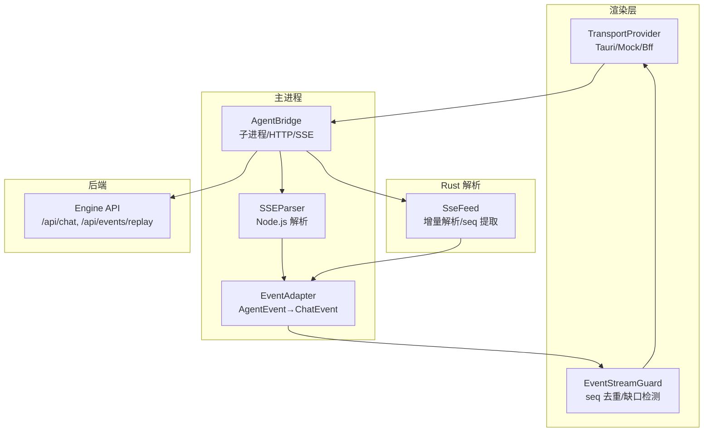
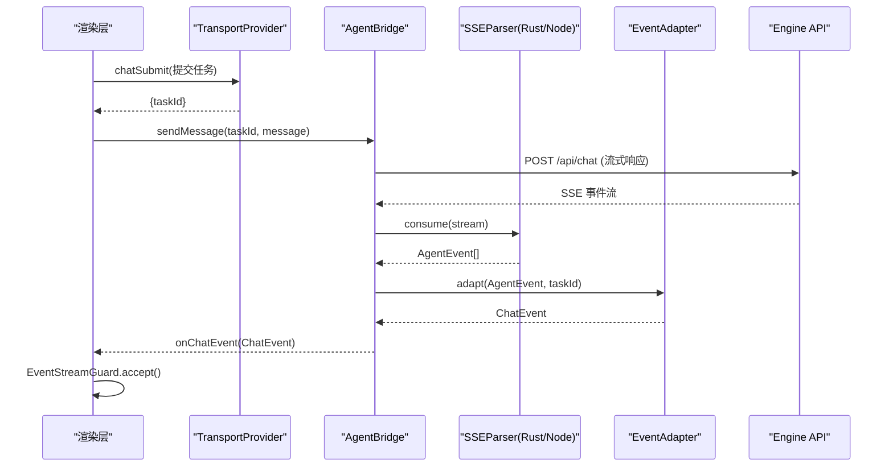
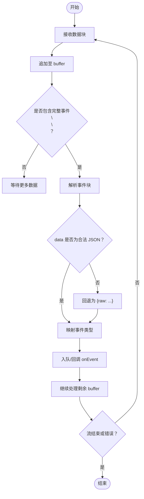
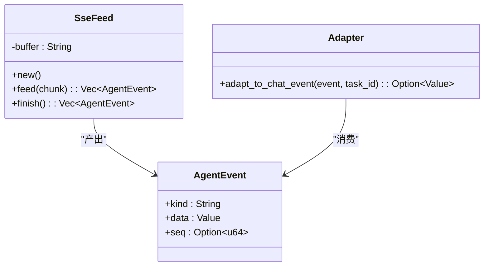
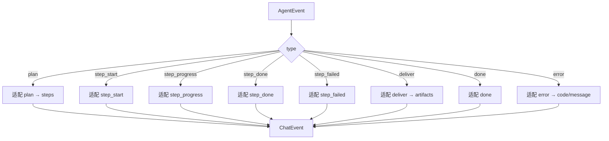
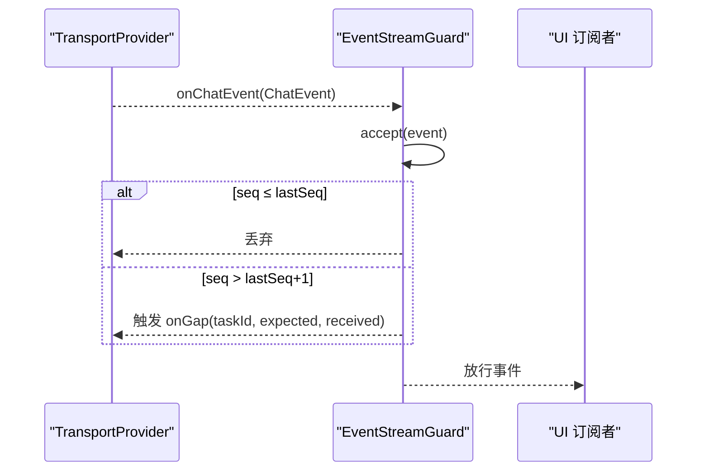
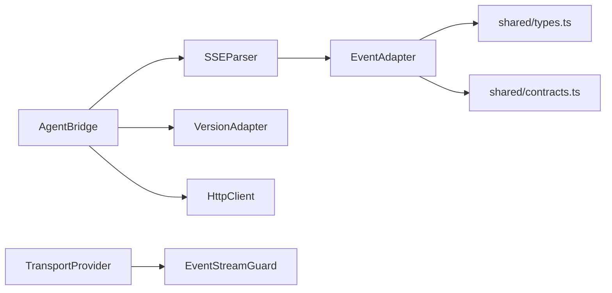

# SSE 事件流处理

<cite>
**本文引用的文件**
- [sse-parser.ts](file://tongtian-tauri/src/main/bridge/sse-parser.ts)
- [sse.rs](file://tongtian-tauri/src-tauri/src/bridge/sse.rs)
- [agent-bridge.ts](file://tongtian-tauri/src/main/bridge/agent-bridge.ts)
- [event-stream-guard.ts](file://tongtian-tauri/src/renderer/lib/event-stream-guard.ts)
- [transport.ts](file://tongtian-tauri/src/renderer/lib/transport.ts)
- [event-adapter.ts](file://tongtian-tauri/src/main/agent/event-adapter.ts)
- [types.ts](file://tongtian-tauri/src/shared/types.ts)
- [engine_sse_selftest.py](file://tongtian-tauri/tests/integration/engine_sse_selftest.py)
</cite>

## 目录
1. [简介](#简介)
2. [项目结构](#项目结构)
3. [核心组件](#核心组件)
4. [架构总览](#架构总览)
5. [详细组件分析](#详细组件分析)
6. [依赖关系分析](#依赖关系分析)
7. [性能考虑](#性能考虑)
8. [故障排查指南](#故障排查指南)
9. [结论](#结论)
10. [附录](#附录)

## 简介
本文件围绕 Server-Sent Events（SSE）事件流在本工程中的实现与使用，系统性说明连接建立、事件推送、断线重连与消息序列化机制；定义事件类型与数据格式规范；给出错误处理策略与性能优化建议；并提供事件流示例、客户端集成要点与调试方法。整体方案采用“解析器 + 适配器 + 守卫”的分层设计：底层负责按行解析 SSE 块并产出统一事件模型，中间层将引擎事件适配为前端契约事件，上层对事件进行去重、缺口检测与幂等控制，保障在断线与重放场景下的正确性与稳定性。

## 项目结构
SSE 相关代码横跨主进程桥接、Rust 解析库、渲染层传输与守卫以及后端自测脚本，形成端到端闭环：
- 主进程桥接：管理 Agent 子进程生命周期，发起 HTTP 流式请求，消费 SSE 并转发事件。
- Rust 解析器：增量式解析 SSE 块，支持多行 data、id 行 seq 提取、未知事件忽略与 JSON 回退。
- 事件适配器：将引擎事件映射为前端 ChatEvent 契约。
- 渲染层传输与守卫：统一传输抽象，提供事件重放接口；守卫保证 seq 单调、去重与状态幂等。
- 后端自测：验证 SSE 契约（seq 单调性、id 行、replay、取消、审阅与控制）。

图表来源
- [agent-bridge.ts:304-346](file://tongtian-tauri/src/main/bridge/agent-bridge.ts#L304-L346)
- [sse-parser.ts:40-229](file://tongtian-tauri/src/main/bridge/sse-parser.ts#L40-L229)
- [sse.rs:48-169](file://tongtian-tauri/src-tauri/src/bridge/sse.rs#L48-L169)
- [event-adapter.ts:43-166](file://tongtian-tauri/src/main/agent/event-adapter.ts#L43-L166)
- [event-stream-guard.ts:24-96](file://tongtian-tauri/src/renderer/lib/event-stream-guard.ts#L24-L96)
- [transport.ts:34-53](file://tongtian-tauri/src/renderer/lib/transport.ts#L34-L53)

章节来源
- [agent-bridge.ts:304-346](file://tongtian-tauri/src/main/bridge/agent-bridge.ts#L304-L346)
- [sse-parser.ts:40-229](file://tongtian-tauri/src/main/bridge/sse-parser.ts#L40-L229)
- [sse.rs:48-169](file://tongtian-tauri/src-tauri/src/bridge/sse.rs#L48-L169)
- [event-adapter.ts:43-166](file://tongtian-tauri/src/main/agent/event-adapter.ts#L43-L166)
- [event-stream-guard.ts:24-96](file://tongtian-tauri/src/renderer/lib/event-stream-guard.ts#L24-L96)
- [transport.ts:34-53](file://tongtian-tauri/src/renderer/lib/transport.ts#L34-L53)

## 核心组件
- SSE 解析器（Node.js）：从 IncomingMessage 流中增量读取并按 \n\n 分块，解析 event/data/id 行，JSON 失败回退 raw，输出 AgentEvent 并支持 AsyncIterable 消费。
- SSE 解析器（Rust）：SseFeed 增量 feed，支持多行 data、id 行 seq 提取（feature 开关）、未知事件忽略、JSON 失败回退 raw，并输出 AgentEvent。
- 事件适配器：将 AgentEvent 映射为 ChatEvent，补齐字段、标准化枚举与错误码。
- 传输层：统一 TransportProvider 接口，当前以 Tauri 为主路径，预留 BFF 云端占位。
- 事件流守卫：基于 seq 的去重、缺口检测与 status_change 幂等控制。
- 后端自测：验证 SSE 契约（seq 单调、id 行、replay、取消、审阅与控制）。

章节来源
- [sse-parser.ts:40-229](file://tongtian-tauri/src/main/bridge/sse-parser.ts#L40-L229)
- [sse.rs:48-169](file://tongtian-tauri/src-tauri/src/bridge/sse.rs#L48-L169)
- [event-adapter.ts:43-166](file://tongtian-tauri/src/main/agent/event-adapter.ts#L43-L166)
- [transport.ts:34-53](file://tongtian-tauri/src/renderer/lib/transport.ts#L34-L53)
- [event-stream-guard.ts:24-96](file://tongtian-tauri/src/renderer/lib/event-stream-guard.ts#L24-L96)
- [engine_sse_selftest.py:62-163](file://tongtian-tauri/tests/integration/engine_sse_selftest.py#L62-L163)

## 架构总览
SSE 事件流从后端 Engine 发出，经主进程桥接发起 HTTP 流式请求，由 Node/Rust 解析器增量解析为 AgentEvent，再适配为 ChatEvent，最终通过渲染层传输与守卫投递到 UI。

图表来源
- [agent-bridge.ts:304-346](file://tongtian-tauri/src/main/bridge/agent-bridge.ts#L304-L346)
- [sse-parser.ts:50-85](file://tongtian-tauri/src/main/bridge/sse-parser.ts#L50-L85)
- [sse.rs:60-85](file://tongtian-tauri/src-tauri/src/bridge/sse.rs#L60-L85)
- [event-adapter.ts:43-166](file://tongtian-tauri/src/main/agent/event-adapter.ts#L43-L166)
- [transport.ts:97-143](file://tongtian-tauri/src/renderer/lib/transport.ts#L97-L143)

## 详细组件分析

### SSE 解析器（Node.js）
- 流式消费：监听 data/end/error/close，累积 buffer，按 \n\n 切分完整事件块。
- 事件解析：逐行识别 event/data/id，data 多行拼接，JSON 解析失败回退为 raw。
- 事件映射：将原始 event 类型映射为内部 AgentEvent.type，未知类型忽略。
- 迭代消费：实现 Symbol.asyncIterator，支持 for await 与 collectAll 收集。

图表来源
- [sse-parser.ts:50-85](file://tongtian-tauri/src/main/bridge/sse-parser.ts#L50-L85)
- [sse-parser.ts:128-188](file://tongtian-tauri/src/main/bridge/sse-parser.ts#L128-L188)

章节来源
- [sse-parser.ts:40-229](file://tongtian-tauri/src/main/bridge/sse-parser.ts#L40-L229)

### SSE 解析器（Rust）
- 增量解析：SseFeed.feed 追加 chunk，按 \n\n 拆分，保留不完整部分于 buffer。
- 事件块解析：识别 event/data/id 行，data 多行累积，JSON 失败回退 raw。
- seq 提取：优先从 id 行末尾数字提取，其次从 data.seq 兜底；可通过 feature 开关控制。
- 事件适配：adapt_to_chat_event 将 AgentEvent 转为前端 ChatEvent，注入 seq/taskId。

图表来源
- [sse.rs:48-169](file://tongtian-tauri/src-tauri/src/bridge/sse.rs#L48-L169)
- [sse.rs:171-292](file://tongtian-tauri/src-tauri/src/bridge/sse.rs#L171-L292)

章节来源
- [sse.rs:48-169](file://tongtian-tauri/src-tauri/src/bridge/sse.rs#L48-L169)
- [sse.rs:171-292](file://tongtian-tauri/src-tauri/src/bridge/sse.rs#L171-L292)

### 事件适配器（Node.js）
- 类型映射：将 step 的 type 字符串映射为 StepType 枚举。
- 事件转换：plan/step_start/step_progress/step_done/step_failed/deliver/done/error 分别适配为 ChatEvent。
- 错误码归一：将 engine 返回的错误码映射为 ErrorCode。

图表来源
- [event-adapter.ts:43-166](file://tongtian-tauri/src/main/agent/event-adapter.ts#L43-L166)

章节来源
- [event-adapter.ts:43-166](file://tongtian-tauri/src/main/agent/event-adapter.ts#L43-L166)

### 传输层与事件守卫
- 传输层：TransportProvider 统一接口，当前以 TauriTransport 为主，预留 Mock/BFF。
- 事件守卫：按 taskId 维护 lastSeq，丢弃重复事件，检测 seq 缺口并触发 replay；status_change 同状态幂等。

图表来源
- [transport.ts:34-53](file://tongtian-tauri/src/renderer/lib/transport.ts#L34-L53)
- [event-stream-guard.ts:24-96](file://tongtian-tauri/src/renderer/lib/event-stream-guard.ts#L24-L96)

章节来源
- [transport.ts:34-53](file://tongtian-tauri/src/renderer/lib/transport.ts#L34-L53)
- [event-stream-guard.ts:24-96](file://tongtian-tauri/src/renderer/lib/event-stream-guard.ts#L24-L96)

### 后端 SSE 契约与自测
- 事件序列：plan → status_change → done（审阅阶段），或 error → done（空目标）。
- seq 单调递增，id 行格式 {task_id}:{seq}。
- replay 接口：按 from_seq 回放事件，windowExpired 指示窗口过期。
- 取消/审阅/控制：/api/chat/cancel、/api/chat/review、/api/chat/control。

章节来源
- [engine_sse_selftest.py:62-163](file://tongtian-tauri/tests/integration/engine_sse_selftest.py#L62-L163)

## 依赖关系分析
- AgentBridge 依赖 HttpClient 发起流式请求，依赖 SSEParser 解析事件，依赖 VersionAdapter 适配不同版本接口。
- SSEParser（Node/Rust）独立实现，均遵循相同 SSE 语义（event/data/id，\n\n 分隔）。
- EventAdapter 依赖 shared types 与 contracts，确保前后端契约一致。
- TransportProvider 屏蔽底层差异，EventStreamGuard 依赖 ChatEvent 的 seq/taskId/status 字段。

图表来源
- [agent-bridge.ts:304-346](file://tongtian-tauri/src/main/bridge/agent-bridge.ts#L304-L346)
- [event-adapter.ts:43-166](file://tongtian-tauri/src/main/agent/event-adapter.ts#L43-L166)
- [transport.ts:34-53](file://tongtian-tauri/src/renderer/lib/transport.ts#L34-L53)
- [event-stream-guard.ts:24-96](file://tongtian-tauri/src/renderer/lib/event-stream-guard.ts#L24-L96)

章节来源
- [agent-bridge.ts:304-346](file://tongtian-tauri/src/main/bridge/agent-bridge.ts#L304-L346)
- [event-adapter.ts:43-166](file://tongtian-tauri/src/main/agent/event-adapter.ts#L43-L166)
- [transport.ts:34-53](file://tongtian-tauri/src/renderer/lib/transport.ts#L34-L53)
- [event-stream-guard.ts:24-96](file://tongtian-tauri/src/renderer/lib/event-stream-guard.ts#L24-L96)

## 性能考虑
- 增量解析：Node/Rust 解析器均以流式方式处理，避免整段缓冲，降低内存占用。
- 事件队列与异步迭代：Node 解析器使用队列与 waitResolve 协调消费，减少阻塞。
- 最小化适配开销：Rust 侧直接产出结构化 Value，减少 JSON 往返与对象创建。
- 去重与幂等：前端守卫基于 seq 去重与 status_change 幂等，避免重复渲染与无效更新。
- 健康检查与超时：AgentBridge 定期健康检查，异常时快速降级并释放资源。

[本节为通用指导，不直接分析具体文件]

## 故障排查指南
- 流错误处理：Node 解析器在 error/close 时记录日志并通知回调；AgentBridge 在错误时将实例状态置为 ready 并上报。
- JSON 解析失败：解析器回退为 raw 字段，便于定位上游数据问题。
- 未知事件类型：忽略并记录调试日志，避免中断流程。
- seq 缺口：EventStreamGuard 触发 onGap，可调用 eventReplay 补齐缺失事件。
- 后端契约校验：使用 engine_sse_selftest.py 验证 seq 单调性、id 行、replay、取消与控制。

章节来源
- [sse-parser.ts:69-85](file://tongtian-tauri/src/main/bridge/sse-parser.ts#L69-L85)
- [agent-bridge.ts:318-346](file://tongtian-tauri/src/main/bridge/agent-bridge.ts#L318-L346)
- [event-stream-guard.ts:46-78](file://tongtian-tauri/src/renderer/lib/event-stream-guard.ts#L46-L78)
- [engine_sse_selftest.py:62-163](file://tongtian-tauri/tests/integration/engine_sse_selftest.py#L62-L163)

## 结论
本项目通过“解析器 + 适配器 + 守卫”的分层架构，实现了稳定可靠的 SSE 事件流处理。Node/Rust 双实现保证了跨平台一致性；适配器统一了前后端契约；守卫保障了断线与重放场景的正确性。配合后端自测脚本，可快速验证 SSE 契约与关键路径。建议在后续演进中持续完善云端 BFF 接入与监控指标，进一步提升可观测性与容错能力。

[本节为总结性内容，不直接分析具体文件]

## 附录

### 事件类型与数据格式规范
- 事件类型：plan、step_start、step_progress、step_done、step_failed、deliver、done、error、status_change、quota_warning、heartbeat。
- 数据格式：每条事件包含 event 行与 data 行（可为多行），可选 id 行用于 seq 提取；data 为 JSON，解析失败回退为 raw。
- seq 与 taskId：Rust 解析器优先从 id 行提取 seq，否则从 data.seq 兜底；适配器注入 taskId 供前端使用。

章节来源
- [sse.rs:34-46](file://tongtian-tauri/src-tauri/src/bridge/sse.rs#L34-L46)
- [sse.rs:125-143](file://tongtian-tauri/src-tauri/src/bridge/sse.rs#L125-L143)
- [sse.rs:171-292](file://tongtian-tauri/src-tauri/src/bridge/sse.rs#L171-L292)
- [types.ts:291-303](file://tongtian-tauri/src/shared/types.ts#L291-L303)

### 客户端集成指南
- 提交任务：通过 TransportProvider.chatSubmit 获取 taskId。
- 订阅事件：通过 TransportProvider.onChatEvent 注册回调，并由 EventStreamGuard 包装以保障 seq 单调与幂等。
- 重放事件：当检测到 seq 缺口时，调用 TransportProvider.eventReplay(taskId, fromSeq) 补齐。
- 取消任务：调用 TransportProvider.chatCancel(taskId)。

章节来源
- [transport.ts:34-53](file://tongtian-tauri/src/renderer/lib/transport.ts#L34-L53)
- [transport.ts:97-143](file://tongtian-tauri/src/renderer/lib/transport.ts#L97-L143)
- [event-stream-guard.ts:46-78](file://tongtian-tauri/src/renderer/lib/event-stream-guard.ts#L46-L78)

### 调试工具使用方法
- 运行后端自测：执行 tests/integration/engine_sse_selftest.py，验证 SSE 契约与关键路径。
- 观察日志：关注 bridge:sse 与 agent:event-adapter 日志，定位解析与适配问题。
- 本地联调：在渲染层启用 MockTransport 或注入自定义 provider，模拟事件流与重放。

章节来源
- [engine_sse_selftest.py:62-163](file://tongtian-tauri/tests/integration/engine_sse_selftest.py#L62-L163)
- [sse-parser.ts:164-188](file://tongtian-tauri/src/main/bridge/sse-parser.ts#L164-L188)
- [event-adapter.ts:71-74](file://tongtian-tauri/src/main/agent/event-adapter.ts#L71-L74)