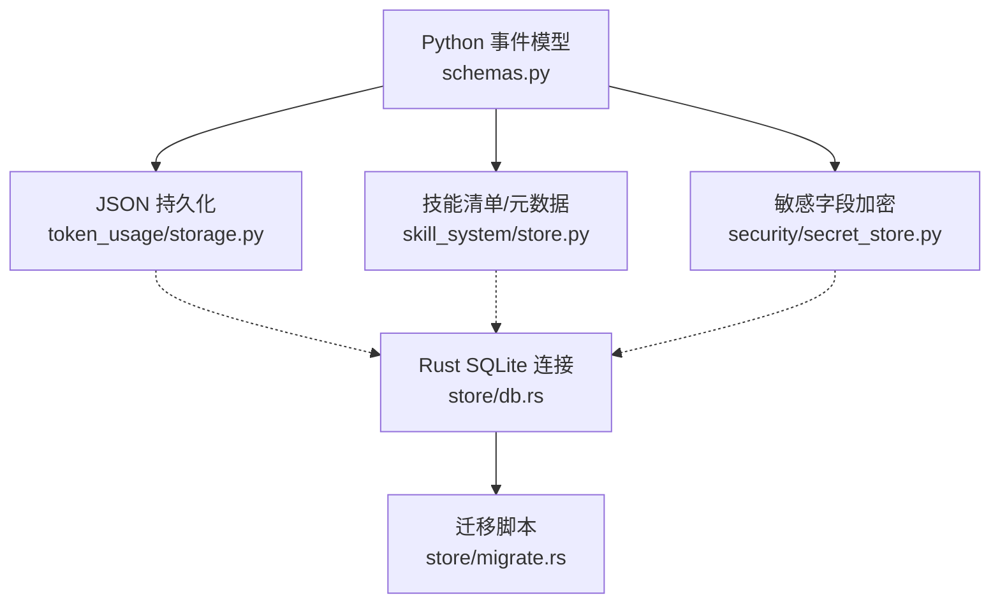
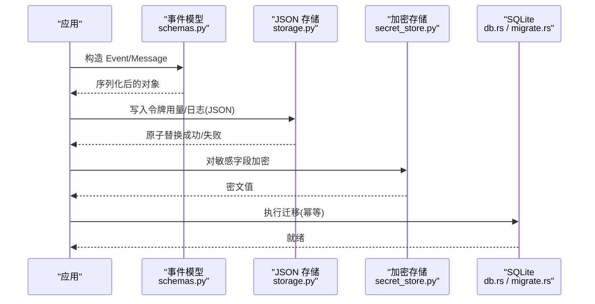
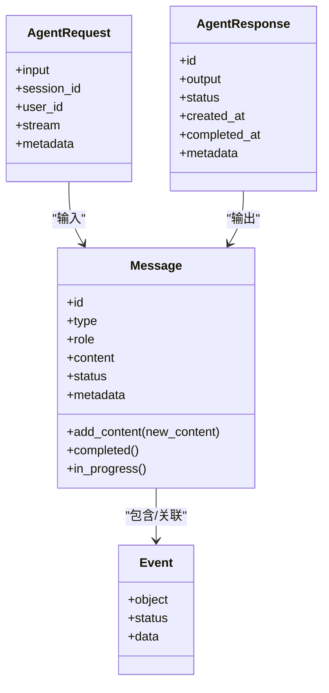
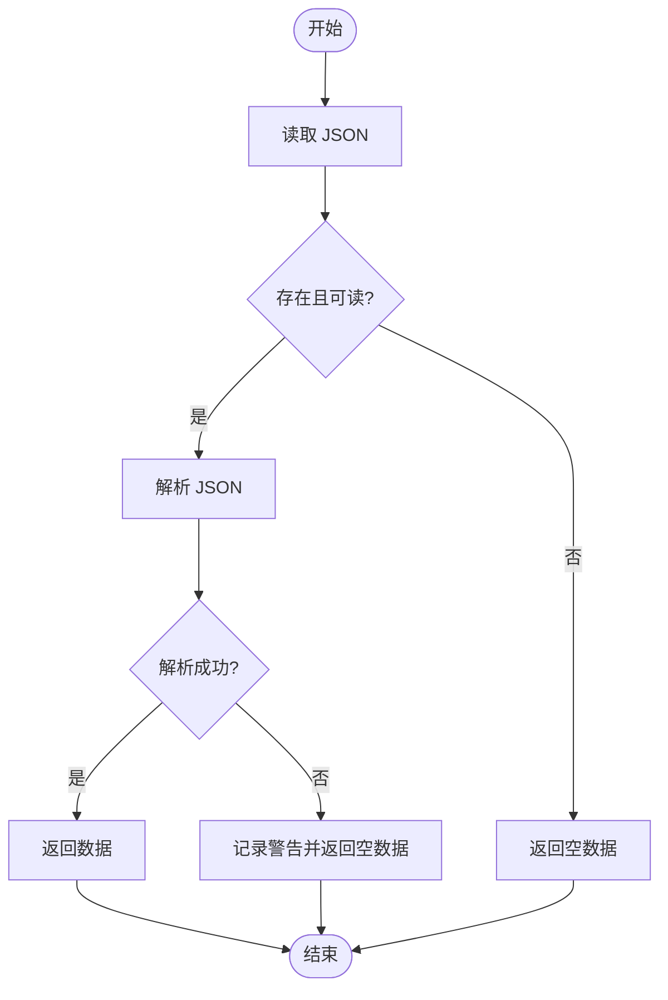
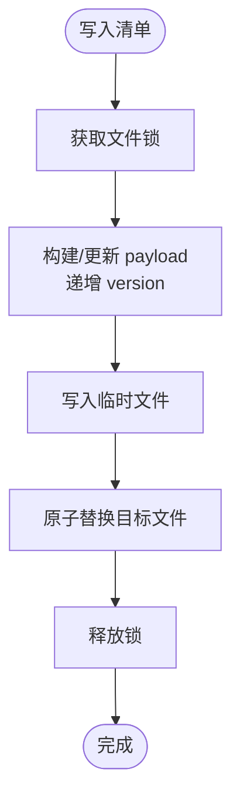
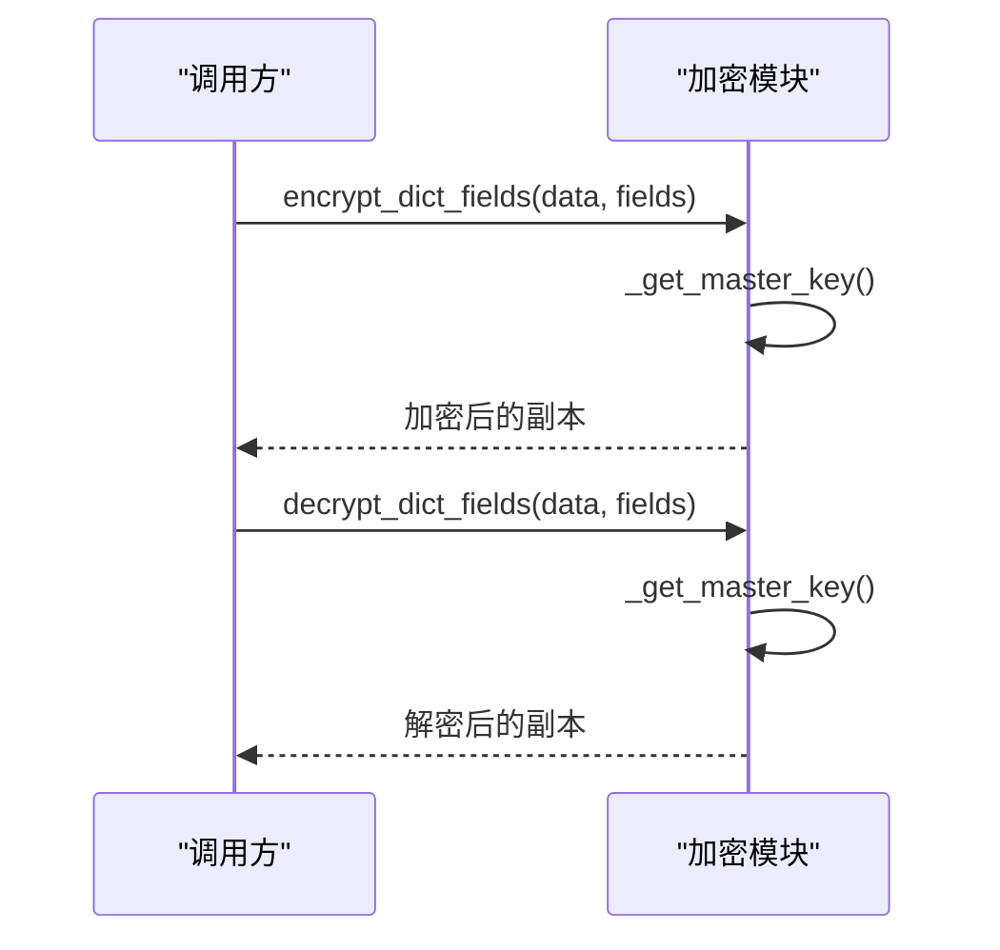
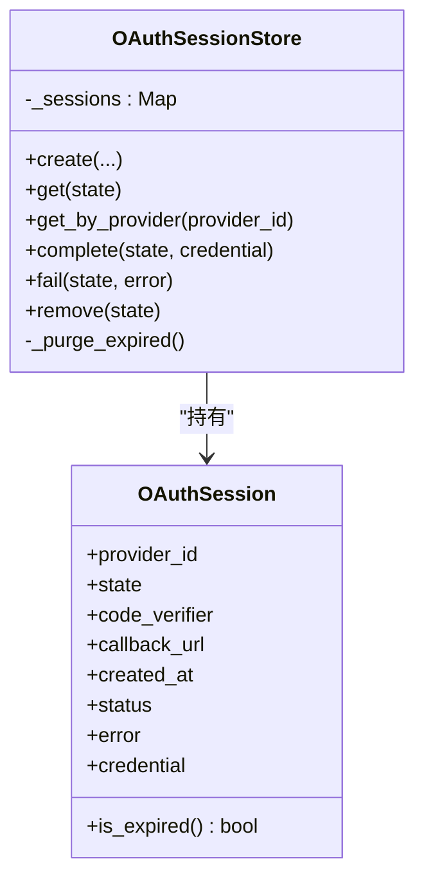
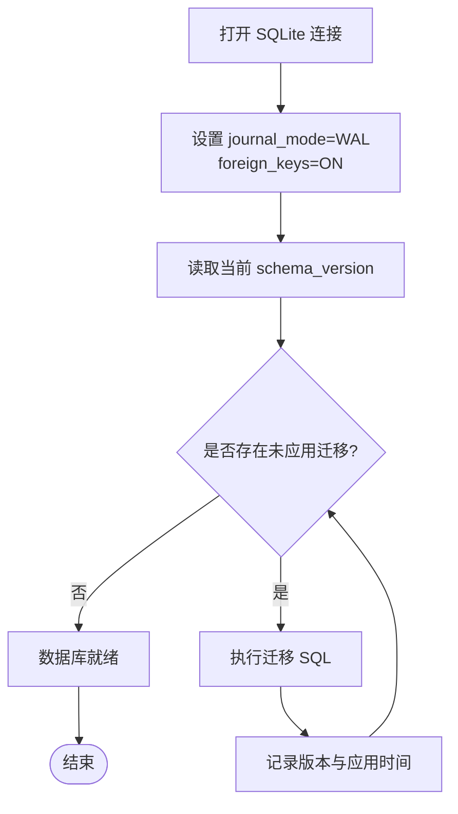
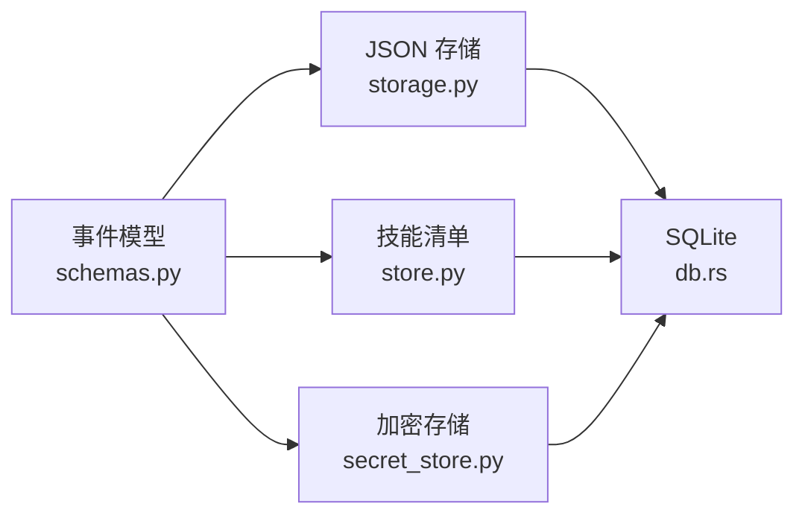

# 事件存储

<cite>
**本文引用的文件**
- [schemas.py](file://tongtian-tauri/src/agent/schemas.py)
- [storage.py](file://tongtian-tauri/src/agent/token_usage/storage.py)
- [store.py](file://tongtian-tauri/src/agent/agents/skill_system/store.py)
- [secret_store.py](file://tongtian-tauri/src/agent/security/secret_store.py)
- [session_store.py](file://tongtian-tauri/src/agent/providers/oauth/session_store.py)
- [db.rs](file://tongtian-tauri/src-tauri/src/store/db.rs)
- [migrate.rs](file://tongtian-tauri/src-tauri/src/store/migrate.rs)
</cite>

## 目录
1. [简介](#简介)
2. [项目结构](#项目结构)
3. [核心组件](#核心组件)
4. [架构总览](#架构总览)
5. [详细组件分析](#详细组件分析)
6. [依赖关系分析](#依赖关系分析)
7. [性能考虑](#性能考虑)
8. [故障恢复指南](#故障恢复指南)
9. [结论](#结论)
10. [附录](#附录)

## 简介
本文件围绕“事件存储”展开，聚焦事件数据的持久化机制与工程实践。内容涵盖：
- 事件序列化与反序列化（基于 Pydantic 的模型）
- 存储策略选择（SQLite WAL、JSON 原子写入、内存会话、加密密钥管理）
- 数据完整性保证（WAL、外键、原子替换、跨进程锁、迁移幂等）
- 查询优化（索引、缓存、mtime 缓存）
- 事件日志结构、备份恢复机制与数据迁移方案
- 存储配置示例、性能调优建议与故障恢复流程

## 项目结构
事件相关的数据流贯穿 Python 侧的事件模型与 Rust 侧的 SQLite 存储层：
- Python 侧负责事件模型定义、令牌用量等 JSON 文件的原子读写、技能清单的跨进程安全写入、敏感字段加密。
- Rust 侧提供 SQLite 连接、WAL 模式、外键约束以及版本化迁移脚本。

图表来源
- [schemas.py:199-273](file://tongtian-tauri/src/agent/schemas.py#L199-L273)
- [storage.py:15-65](file://tongtian-tauri/src/agent/token_usage/storage.py#L15-L65)
- [store.py:320-394](file://tongtian-tauri/src/agent/agents/skill_system/store.py#L320-L394)
- [secret_store.py:346-379](file://tongtian-tauri/src/agent/security/secret_store.py#L346-L379)
- [db.rs:16-25](file://tongtian-tauri/src-tauri/src/store/db.rs#L16-L25)
- [migrate.rs:44-73](file://tongtian-tauri/src-tauri/src/store/migrate.rs#L44-L73)

章节来源
- [schemas.py:199-273](file://tongtian-tauri/src/agent/schemas.py#L199-L273)
- [storage.py:15-65](file://tongtian-tauri/src/agent/token_usage/storage.py#L15-L65)
- [store.py:320-394](file://tongtian-tauri/src/agent/agents/skill_system/store.py#L320-L394)
- [secret_store.py:346-379](file://tongtian-tauri/src/agent/security/secret_store.py#L346-L379)
- [db.rs:16-25](file://tongtian-tauri/src-tauri/src/store/db.rs#L16-L25)
- [migrate.rs:44-73](file://tongtian-tauri/src-tauri/src/store/migrate.rs#L44-L73)

## 核心组件
- 事件模型与消息体：使用 Pydantic 定义 Message、Event、AgentRequest/Response 等，统一序列化/反序列化契约，支持扩展字段与类型校验。
- 令牌用量存储：异步读取 JSON，同步原子写入（临时文件 + 原子替换），异常时回退为空数据并记录日志。
- 技能清单与元数据：跨进程 JSON 写锁（fcntl/msvcrt）、原子写入、mtime 缓存、路径安全校验、冲突命名建议。
- 敏感信息存储：Fernet 加密/解密，主密钥优先从系统钥匙串获取，失败则回退到本地文件；提供字典字段级加解密工具。
- 会话存储：进程内内存存储，带 TTL 过期清理，用于 OAuth 短期状态。
- 数据库连接与迁移：SQLite 以 WAL 模式打开并启用外键；通过 schema_version 表驱动幂等迁移。

章节来源
- [schemas.py:199-273](file://tongtian-tauri/src/agent/schemas.py#L199-L273)
- [storage.py:15-65](file://tongtian-tauri/src/agent/token_usage/storage.py#L15-L65)
- [store.py:320-394](file://tongtian-tauri/src/agent/agents/skill_system/store.py#L320-L394)
- [secret_store.py:346-379](file://tongtian-tauri/src/agent/security/secret_store.py#L346-L379)
- [session_store.py:33-115](file://tongtian-tauri/src/agent/providers/oauth/session_store.py#L33-L115)
- [db.rs:16-25](file://tongtian-tauri/src-tauri/src/store/db.rs#L16-L25)
- [migrate.rs:44-73](file://tongtian-tauri/src-tauri/src/store/migrate.rs#L44-L73)

## 架构总览
事件在运行时被构造为结构化对象，随后按不同用途进行持久化：
- 事件消息与运行状态通过 Pydantic 模型序列化后，可写入 JSON 文件或进入数据库。
- 令牌用量等高频小文件采用原子写入保障一致性。
- 技能清单等共享元数据通过跨进程锁避免并发破坏。
- 敏感字段在落盘前加密，读取时透明解密。
- 数据库层以 WAL 模式提升并发读性能，并通过迁移脚本维护 schema 演进。

图表来源
- [schemas.py:199-273](file://tongtian-tauri/src/agent/schemas.py#L199-L273)
- [storage.py:15-65](file://tongtian-tauri/src/agent/token_usage/storage.py#L15-L65)
- [secret_store.py:346-379](file://tongtian-tauri/src/agent/security/secret_store.py#L346-L379)
- [db.rs:16-25](file://tongtian-tauri/src-tauri/src/store/db.rs#L16-L25)
- [migrate.rs:44-73](file://tongtian-tauri/src-tauri/src/store/migrate.rs#L44-L73)

## 详细组件分析

### 事件模型与序列化
- 事件与消息：使用 Pydantic 模型统一描述事件、消息、请求/响应，具备类型校验、默认值与扩展字段能力。
- 内容块：文本、图片、音频、视频、文件、数据、拒绝等类型，支持增量 delta 与状态标记。
- 序列化/反序列化：Pydantic 自动处理 JSON 编解码，确保下游消费端获得强类型对象。

图表来源
- [schemas.py:199-273](file://tongtian-tauri/src/agent/schemas.py#L199-L273)

章节来源
- [schemas.py:199-273](file://tongtian-tauri/src/agent/schemas.py#L199-L273)

### JSON 原子写入与容错
- 读取：异步读取 JSON，空或损坏时返回空字典并记录警告。
- 写入：同步写入临时文件，成功后原子替换目标文件，失败清理临时文件。
- 适用场景：令牌用量统计、轻量日志等小文件。

图表来源
- [storage.py:15-32](file://tongtian-tauri/src/agent/token_usage/storage.py#L15-L32)
- [storage.py:35-65](file://tongtian-tauri/src/agent/token_usage/storage.py#L35-L65)

章节来源
- [storage.py:15-65](file://tongtian-tauri/src/agent/token_usage/storage.py#L15-L65)

### 技能清单与跨进程安全写入
- 跨进程锁：基于 fcntl（Linux/macOS）或 msvcrt（Windows）的文件锁，序列化清单写入。
- 原子写入：先写入临时文件再 replace，避免部分写入导致清单损坏。
- 版本与缓存：写入时递增版本号；读取时使用 mtime 缓存减少重复 IO。
- 路径安全：严格校验相对路径，防止越界与符号链接风险。

图表来源
- [store.py:320-394](file://tongtian-tauri/src/agent/agents/skill_system/store.py#L320-L394)

章节来源
- [store.py:320-394](file://tongtian-tauri/src/agent/agents/skill_system/store.py#L320-L394)

### 敏感字段加密与主密钥管理
- 加密算法：Fernet（AES-128-CBC + HMAC-SHA256），密文带前缀以便识别。
- 主密钥来源：优先系统钥匙串，失败回退到本地文件；支持环境变量控制跳过 keyring。
- 热重载：支持从磁盘重新加载主密钥并同步钥匙串，便于备份恢复后生效。
- 字段级加解密：对指定字段集合进行浅拷贝加/解密，避免污染原数据。

图表来源
- [secret_store.py:346-379](file://tongtian-tauri/src/agent/security/secret_store.py#L346-L379)
- [secret_store.py:382-423](file://tongtian-tauri/src/agent/security/secret_store.py#L382-L423)

章节来源
- [secret_store.py:346-379](file://tongtian-tauri/src/agent/security/secret_store.py#L346-L379)
- [secret_store.py:382-423](file://tongtian-tauri/src/agent/security/secret_store.py#L382-L423)

### 会话存储（内存+TTL）
- 进程内字典存储 OAuth 会话，设置 TTL 并在访问时清理过期项。
- 支持按 provider 查找最新 pending 会话，兼容部分不提供 state 回调的提供商。

图表来源
- [session_store.py:14-115](file://tongtian-tauri/src/agent/providers/oauth/session_store.py#L14-L115)

章节来源
- [session_store.py:14-115](file://tongtian-tauri/src/agent/providers/oauth/session_store.py#L14-L115)

### 数据库连接与迁移
- 连接参数：WAL 模式提升并发读性能，开启外键约束保障引用完整性。
- 迁移机制：schema_version 表驱动，按顺序执行 SQL 脚本，幂等跳过已应用版本。
- 典型表：模型配置、任务、设置键值等，附带必要索引。

图表来源
- [db.rs:16-25](file://tongtian-tauri/src-tauri/src/store/db.rs#L16-L25)
- [migrate.rs:44-73](file://tongtian-tauri/src-tauri/src/store/migrate.rs#L44-L73)

章节来源
- [db.rs:16-25](file://tongtian-tauri/src-tauri/src/store/db.rs#L16-L25)
- [migrate.rs:44-73](file://tongtian-tauri/src-tauri/src/store/migrate.rs#L44-L73)

## 依赖关系分析
- 事件模型依赖 Pydantic，提供稳定序列化契约。
- JSON 存储依赖 aiofiles 与标准库，实现异步读取与同步原子写入。
- 技能清单依赖 frontmatter/yaml 与平台文件锁，确保多进程安全。
- 加密存储依赖 cryptography 与可选 keyring，提供主密钥管理与字段级加解密。
- 数据库层依赖 rusqlite，通过 pragma 与迁移脚本保障一致性与演进。

图表来源
- [schemas.py:199-273](file://tongtian-tauri/src/agent/schemas.py#L199-L273)
- [storage.py:15-65](file://tongtian-tauri/src/agent/token_usage/storage.py#L15-L65)
- [store.py:320-394](file://tongtian-tauri/src/agent/agents/skill_system/store.py#L320-L394)
- [secret_store.py:346-379](file://tongtian-tauri/src/agent/security/secret_store.py#L346-L379)
- [db.rs:16-25](file://tongtian-tauri/src-tauri/src/store/db.rs#L16-L25)

章节来源
- [schemas.py:199-273](file://tongtian-tauri/src/agent/schemas.py#L199-L273)
- [storage.py:15-65](file://tongtian-tauri/src/agent/token_usage/storage.py#L15-L65)
- [store.py:320-394](file://tongtian-tauri/src/agent/agents/skill_system/store.py#L320-L394)
- [secret_store.py:346-379](file://tongtian-tauri/src/agent/security/secret_store.py#L346-L379)
- [db.rs:16-25](file://tongtian-tauri/src-tauri/src/store/db.rs#L16-L25)

## 性能考虑
- 数据库层
  - 使用 WAL 模式提高并发读性能，适合事件回放与查询。
  - 为高频查询字段建立索引（如任务更新时间戳）。
- JSON 层
  - 小文件采用原子写入，避免部分写入导致的损坏与重试开销。
  - 使用 mtime 缓存减少频繁读取带来的 IO 压力。
- 加密层
  - 主密钥与 Fernet 实例进程内缓存，降低重复初始化成本。
  - 仅在必要时对敏感字段进行加解密，避免全量数据转换开销。
- 并发与锁
  - 跨进程清单写入使用文件锁，避免竞争条件。
  - 会话存储采用内存结构，TTL 清理避免无限增长。

[本节为通用性能建议，不直接分析具体文件]

## 故障恢复指南
- JSON 损坏恢复
  - 读取失败时记录警告并回退为空数据，避免中断流程。
  - 写入失败时清理临时文件，保持文件系统整洁。
- 清单损坏恢复
  - 遇到非法 JSON 时重置为默认清单，并记录警告。
  - 通过跨进程锁与原子写入降低损坏概率。
- 主密钥丢失或变更
  - 若解密失败，返回原始密文并记录警告，允许降级运行。
  - 备份恢复后调用重载接口刷新主密钥缓存并同步钥匙串。
- 数据库迁移失败
  - 迁移脚本幂等执行，失败时抛出明确错误码，便于定位问题。
  - 建议在迁移前后备份数据库文件。

章节来源
- [storage.py:15-65](file://tongtian-tauri/src/agent/token_usage/storage.py#L15-L65)
- [store.py:344-394](file://tongtian-tauri/src/agent/agents/skill_system/store.py#L344-L394)
- [secret_store.py:355-379](file://tongtian-tauri/src/agent/security/secret_store.py#L355-L379)
- [secret_store.py:382-423](file://tongtian-tauri/src/agent/security/secret_store.py#L382-L423)
- [migrate.rs:44-73](file://tongtian-tauri/src-tauri/src/store/migrate.rs#L44-L73)

## 结论
该事件存储体系通过强类型模型、原子写入、跨进程锁、加密与 WAL 数据库的组合，提供了高可靠、可扩展且易维护的持久化方案。结合幂等迁移与完善的错误回退机制，能够在生产环境中稳健运行。建议在生产部署中配合定期备份、监控与容量规划，以获得最佳可用性与性能。

[本节为总结性内容，不直接分析具体文件]

## 附录

### 存储配置示例
- SQLite 连接
  - 启用 WAL 模式与外键约束。
  - 参考：[db.rs:16-25](file://tongtian-tauri/src-tauri/src/store/db.rs#L16-L25)
- 迁移脚本
  - 使用 schema_version 表驱动，按顺序执行并记录版本。
  - 参考：[migrate.rs:44-73](file://tongtian-tauri/src-tauri/src/store/migrate.rs#L44-L73)
- JSON 原子写入
  - 异步读取、同步写入临时文件后原子替换。
  - 参考：[storage.py:15-65](file://tongtian-tauri/src/agent/token_usage/storage.py#L15-L65)
- 清单跨进程写入
  - 文件锁 + 原子替换 + mtime 缓存。
  - 参考：[store.py:320-394](file://tongtian-tauri/src/agent/agents/skill_system/store.py#L320-L394)
- 敏感字段加密
  - 主密钥优先钥匙串，失败回退本地文件；字段级加解密。
  - 参考：[secret_store.py:346-379](file://tongtian-tauri/src/agent/security/secret_store.py#L346-L379)

### 性能调优建议
- 数据库
  - 为常用查询列添加索引（例如任务更新时间）。
  - 合理设置 WAL 文件大小与检查点频率（根据负载调整）。
- JSON
  - 合并小批量写入，减少频繁 IO。
  - 利用 mtime 缓存与 LRU 缓存减少重复读取。
- 加密
  - 仅对必要字段加密，避免全量数据转换。
  - 预热主密钥与 Fernet 实例，减少冷启动延迟。
- 并发
  - 在高并发场景下评估文件锁粒度，必要时引入队列或分片。

[本节为通用建议，不直接分析具体文件]

### 备份与恢复流程
- 备份
  - 数据库：复制 WAL 相关文件（含 .wal/.shm）以确保一致性。
  - JSON：备份清单与令牌用量文件。
  - 密钥：备份主密钥文件与钥匙串条目（遵循平台安全策略）。
- 恢复
  - 数据库：停止服务后替换数据库文件，重启后执行迁移。
  - JSON：覆盖清单与用量文件，注意权限与格式。
  - 密钥：恢复主密钥后调用重载接口刷新缓存并同步钥匙串。

章节来源
- [secret_store.py:382-423](file://tongtian-tauri/src/agent/security/secret_store.py#L382-L423)
- [migrate.rs:44-73](file://tongtian-tauri/src-tauri/src/store/migrate.rs#L44-L73)