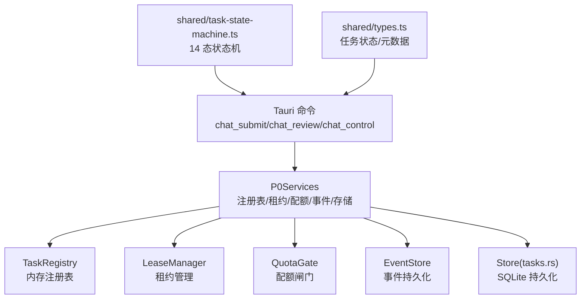
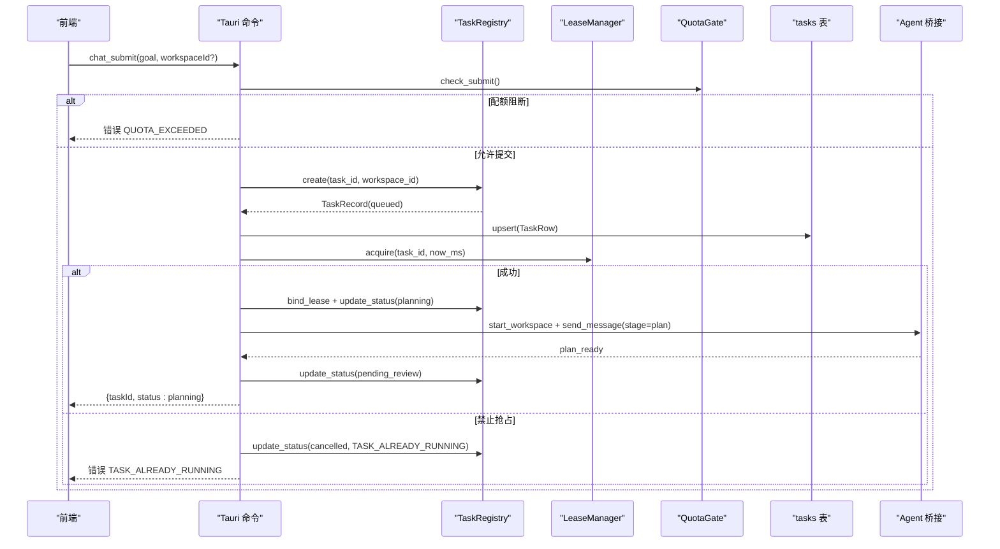
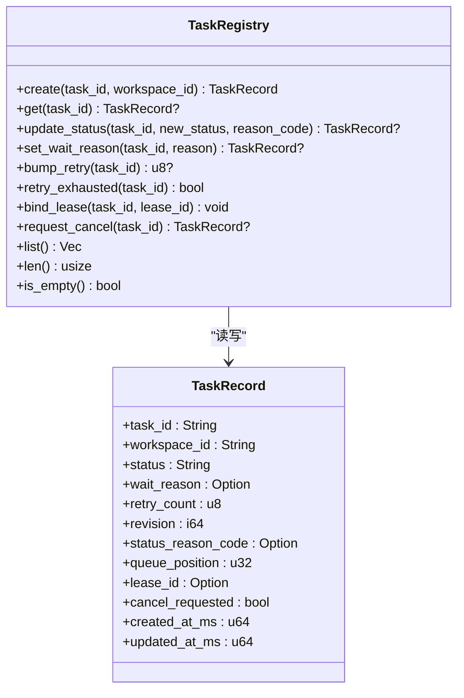
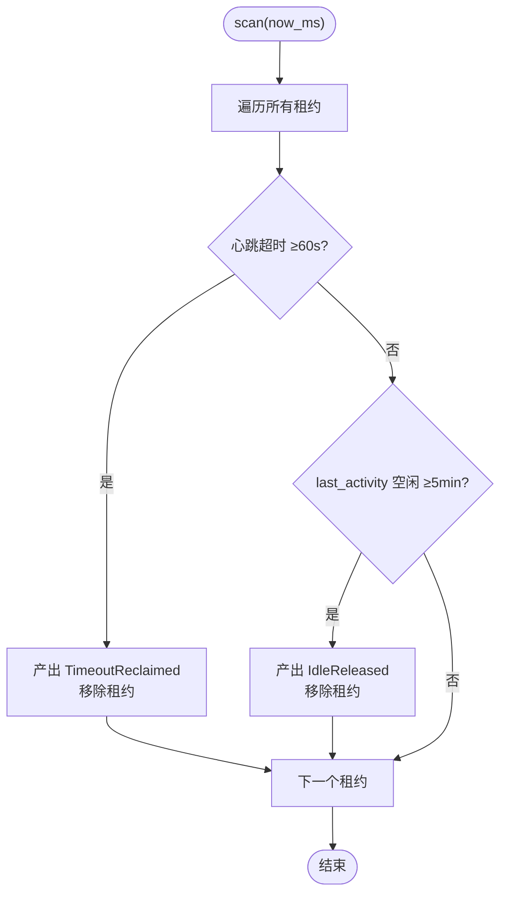
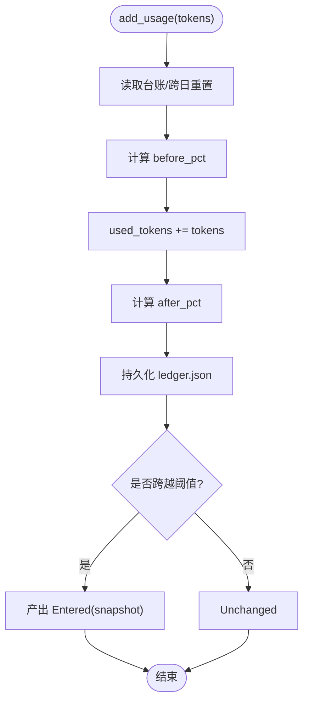
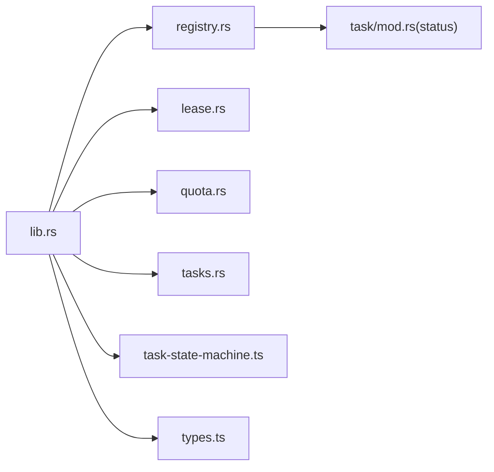

# 任务注册表

<cite>
**本文引用的文件**
- [registry.rs](file://tongtian-tauri/src-tauri/src/task/registry.rs)
- [mod.rs](file://tongtian-tauri/src-tauri/src/task/mod.rs)
- [lease.rs](file://tongtian-tauri/src-tauri/src/task/lease.rs)
- [quota.rs](file://tongtian-tauri/src-tauri/src/task/quota.rs)
- [tasks.rs](file://tongtian-tauri/src-tauri/src/store/tasks.rs)
- [lib.rs](file://tongtian-tauri/src-tauri/src/lib.rs)
- [task-state-machine.ts](file://tongtian-tauri/src/shared/task-state-machine.ts)
- [types.ts](file://tongtian-tauri/src/shared/types.ts)
</cite>

## 目录
1. [简介](#简介)
2. [项目结构](#项目结构)
3. [核心组件](#核心组件)
4. [架构总览](#架构总览)
5. [详细组件分析](#详细组件分析)
6. [依赖关系分析](#依赖关系分析)
7. [性能与并发](#性能与并发)
8. [故障排查指南](#故障排查指南)
9. [结论](#结论)
10. [附录：API 与扩展指南](#附录api-与扩展指南)

## 简介
本文件围绕“任务注册表”展开，系统性说明任务注册机制、任务发现与调度流程、任务类型定义、动态加载方式、优先级管理、并发控制策略与资源分配策略。同时提供任务注册的 API 接口定义与使用示例，并给出扩展新任务类型与优化调度性能的实践建议。

该子系统基于三层架构演进 P0，采用本地优先（local-first）的退化策略：队列入队即出队（<100ms），重试走本地退避；云端接入时仅替换存储层，状态机与转移契约保持不变。

## 项目结构
任务注册表位于 Rust 后端模块 task 下，包含注册表、租约、配额闸门等子模块，并通过 Tauri 命令暴露给前端。持久化通过 SQLite tasks 表完成，状态机由 TypeScript 侧统一维护，Rust 侧以字符串常量镜像对齐。

图表来源
- [lib.rs:125-237](file://tongtian-tauri/src-tauri/src/lib.rs#L125-L237)
- [registry.rs:44-183](file://tongtian-tauri/src-tauri/src/task/registry.rs#L44-L183)
- [lease.rs:62-207](file://tongtian-tauri/src-tauri/src/task/lease.rs#L62-L207)
- [quota.rs:60-220](file://tongtian-tauri/src-tauri/src/task/quota.rs#L60-L220)
- [tasks.rs:27-95](file://tongtian-tauri/src-tauri/src/store/tasks.rs#L27-L95)
- [task-state-machine.ts:63-133](file://tongtian-tauri/src/shared/task-state-machine.ts#L63-L133)
- [types.ts:4-25](file://tongtian-tauri/src/shared/types.ts#L4-L25)

章节来源
- [lib.rs:1-800](file://tongtian-tauri/src-tauri/src/lib.rs#L1-L800)
- [mod.rs:1-24](file://tongtian-tauri/src-tauri/src/task/mod.rs#L1-L24)

## 核心组件
- 任务记录 TaskRecord：承载任务 ID、工作区、状态、等待原因、重试次数、乐观锁版本、排队位次、租约 ID、取消标记、时间戳等字段，用于内存与持久化同步。
- 任务注册表 TaskRegistry：提供创建、查询、状态更新、重试计数、租约绑定、取消请求、列表与统计能力。
- 租约管理器 LeaseManager：负责心跳、租约有效期、超时回收、空闲释放、禁止抢占接管、单 interval 扫描。
- 配额闸门 QuotaGate：四档预警（70/85/95/100%），动作链降级→排队→阻断；支持本地台账持久化与云端来源 trait。
- 持久化 tasks 表：upsert 与按更新时间倒序列出，保证重启后历史可恢复。
- 状态机（TS）：14 态 + wait_reason 子态 + 35 条合法转移，前后端共享同一份转移表。

章节来源
- [registry.rs:12-183](file://tongtian-tauri/src-tauri/src/task/registry.rs#L12-L183)
- [lease.rs:14-207](file://tongtian-tauri/src-tauri/src/task/lease.rs#L14-L207)
- [quota.rs:15-220](file://tongtian-tauri/src-tauri/src/task/quota.rs#L15-L220)
- [tasks.rs:9-95](file://tongtian-tauri/src-tauri/src/store/tasks.rs#L9-L95)
- [task-state-machine.ts:1-223](file://tongtian-tauri/src/shared/task-state-machine.ts#L1-L223)
- [types.ts:4-61](file://tongtian-tauri/src/shared/types.ts#L4-L61)

## 架构总览
任务从提交到执行的关键路径如下：
- chat_submit 先经配额闸门检查，再在注册表中创建任务（queued），推送 status_change 事件并落库。
- 本地退化：queued 立即签发租约转 planning，随后启动工作区实例，后台执行计划生成流。
- 计划完成后进入 pending_review，等待审阅 approve/reject/modify。
- approve 后重新签发租约进入 executing，消费 step_* 事件，最终 deliver_done → done。
- 运行中受配额闸门影响可能转入 budget_paused（BUDGET_EXHAUSTED），或发生租约丢失回到 queued（LEASE_LOST）。
- 取消请求幂等标记，引擎终止后转为 cancelled。

图表来源
- [lib.rs:125-237](file://tongtian-tauri/src-tauri/src/lib.rs#L125-L237)
- [registry.rs:68-154](file://tongtian-tauri/src-tauri/src/task/registry.rs#L68-L154)
- [lease.rs:83-108](file://tongtian-tauri/src-tauri/src/task/lease.rs#L83-L108)
- [quota.rs:191-206](file://tongtian-tauri/src-tauri/src/task/quota.rs#L191-L206)
- [tasks.rs:27-59](file://tongtian-tauri/src-tauri/src/store/tasks.rs#L27-L59)

## 详细组件分析

### 任务注册表 TaskRegistry
- 职责：维护任务生命周期状态、重试计数、乐观锁版本、取消标记、等待原因、租约绑定。
- 关键方法：
  - create：新建任务并置为 queued，写入时间戳与初始 revision。
  - update_status：原子更新状态与成因码，非 executing 时清空 wait_reason，revision 递增。
  - set_wait_reason：executing 子态标注（限流/熔断等）。
  - bump_retry / retry_exhausted：累计重试次数，达到上限判定耗尽。
  - bind_lease：绑定执行租约 ID。
  - request_cancel：幂等标记取消请求。
  - list / len / is_empty：统计与视图。
- 并发模型：内部使用 RwLock<HashMap>，读多写少场景高效。
- 与状态机：调用方负责转移合法性校验，权威转移表在 TS 侧。

图表来源
- [registry.rs:12-183](file://tongtian-tauri/src-tauri/src/task/registry.rs#L12-L183)

章节来源
- [registry.rs:44-183](file://tongtian-tauri/src-tauri/src/task/registry.rs#L44-L183)

### 租约管理 LeaseManager
- 职责：心跳续约、租约有效期、超时回收、空闲释放、禁止抢占接管、单 interval 扫描。
- 关键参数：心跳间隔 10s、租约有效期 30s、超时回收阈值 60s、空闲自动释放 5min、扫描间隔 10s。
- 关键方法：
  - acquire：签发租约，若存在活跃其他 holder 则返回需确认的接管请求（禁止抢占）。
  - heartbeat：续约心跳。
  - touch：记录控制活动，推迟空闲释放。
  - release：终态显式释放。
  - takeover：接管请求，本地单端恒无需确认；云端语义需对端确认。
  - scan：单 interval 扫描，产出 TimeoutReclaimed / IdleReleased 事件。
- 并发模型：Mutex<HashMap>，O(n) 扫描适合桌面级任务规模。

图表来源
- [lease.rs:160-184](file://tongtian-tauri/src-tauri/src/task/lease.rs#L160-L184)

章节来源
- [lease.rs:14-207](file://tongtian-tauri/src-tauri/src/task/lease.rs#L14-L207)

### 配额闸门 QuotaGate
- 职责：四档预警（70/85/95/100%），动作链「降级→排队→阻断」；支持本地 JSON 台账与云端 RemoteQuotaSource trait。
- 关键方法：
  - evaluate：计算当前档位与动作。
  - add_usage：累计用量，跨日重置，跃迁去抖，持久化。
  - check_submit：100% 档阻断新提交，返回 QUOTA_EXCEEDED。
  - should_queue：≥95% 档应排队。
- 与状态机：运行中任务 100% 触发 budget_paused（转移 #17），错误码映射为 BUDGET_EXHAUSTED。

图表来源
- [quota.rs:158-189](file://tongtian-tauri/src-tauri/src/task/quota.rs#L158-L189)

章节来源
- [quota.rs:15-220](file://tongtian-tauri/src-tauri/src/task/quota.rs#L15-L220)

### 持久化 tasks 表
- 职责：upsert 任务摘要，按 updated_at_ms 倒序列出，供 chat_history 展示。
- 字段对齐：TaskRow 与 TaskSummary.meta 一致，含 wait_reason、retry_count、status_reason_code、queue_position 等。

章节来源
- [tasks.rs:9-95](file://tongtian-tauri/src-tauri/src/store/tasks.rs#L9-L95)

### 状态机与任务类型
- 14 态：idle、queued、planning、pending_review、executing、paused、budget_paused、retry_pending、delivering、done、failed、rolled_back、cancelled、archived。
- wait_reason 子态：rate_limited、circuit_break、quota_wait、budget_wait、lease_wait、user_pause、pending_review_ttl。
- 转移表：35 条合法转移，覆盖重试耗尽、预算暂停、租约丢失、审阅修改、归档等场景。
- 本地退化：queued 停留 <100ms；retry_pending 走本地退避。

章节来源
- [task-state-machine.ts:1-223](file://tongtian-tauri/src/shared/task-state-machine.ts#L1-L223)
- [types.ts:4-61](file://tongtian-tauri/src/shared/types.ts#L4-L61)
- [mod.rs:7-23](file://tongtian-tauri/src-tauri/src/task/mod.rs#L7-L23)

## 依赖关系分析
- lib.rs 作为入口，组合 P0Services（注册表、租约、配额、事件、存储），并通过 Tauri 命令暴露 API。
- registry.rs 依赖 status 常量（与 TS 对齐），不直接依赖持久化，但通过 lib.rs 中的 sync_task_to_db 与 tasks.rs 协作。
- lease.rs 与 quota.rs 被 lib.rs 在 chat_submit/chat_review/chat_control 等流程中调用，驱动状态转移与事件推送。
- 状态机在 TS 侧维护，Rust 侧通过字符串常量镜像，避免双源不一致。

图表来源
- [lib.rs:17-42](file://tongtian-tauri/src-tauri/src/lib.rs#L17-L42)
- [mod.rs:7-23](file://tongtian-tauri/src-tauri/src/task/mod.rs#L7-L23)

章节来源
- [lib.rs:17-42](file://tongtian-tauri/src-tauri/src/lib.rs#L17-L42)
- [mod.rs:1-24](file://tongtian-tauri/src-tauri/src/task/mod.rs#L1-L24)

## 性能与并发
- 注册表：RwLock<HashMap>，读多写少，create/update/list 均为 O(1)/O(n)。
- 租约扫描：单 interval 全量扫描 O(n)，桌面级任务数开销可忽略。
- 配额台账：JSON 文件写入，跨日重置；add_usage 内联计算 with_mutex，避免频繁 IO。
- 本地退化：queued 入队即出队，减少排队延迟；retry_pending 本地退避降低外部依赖压力。
- 事件与持久化：事件存储异步批量刷盘 + TTL 清理，降低主流程阻塞。

[本节为通用性能讨论，不直接分析具体文件]

## 故障排查指南
- 配额阻断：check_submit 返回 QUOTA_EXCEEDED，需检查 used_tokens 与 quota_tokens，必要时调整配额或等待跨日重置。
- 任务无法启动：TASK_ALREADY_RUNNING 表示存在活跃租约且禁止抢占，需等待超时回收或对端确认。
- 执行中断：LEASE_LOST 表示心跳超时 60s，任务回退至 queued，需检查引擎存活与心跳上报。
- 预算不足：BUDGET_EXHAUSTED 导致 budget_paused，需恢复预算或等待恢复后按 FIFO 继续。
- 重试耗尽：retry_count ≥ MAX_RETRY_COUNT 时路由到 failed，需人工干预或手动重试。
- 取消无效：确认 cancel_requested 已设置且引擎响应正常；终态不可取消。

章节来源
- [quota.rs:191-206](file://tongtian-tauri/src-tauri/src/task/quota.rs#L191-L206)
- [lease.rs:83-108](file://tongtian-tauri/src-tauri/src/task/lease.rs#L83-L108)
- [lib.rs:485-526](file://tongtian-tauri/src-tauri/src/lib.rs#L485-L526)

## 结论
任务注册表通过清晰的 14 态状态机、严格的租约与配额控制、以及本地优先的退化策略，实现了稳定可靠的本地任务调度。注册表与持久化解耦，便于后续云端接入与扩展。通过统一的转移表与常量镜像，前后端保持一致性，降低了维护成本。

[本节为总结，不直接分析具体文件]

## 附录：API 与扩展指南

### 任务注册 API（Tauri 命令）
- chat_submit
  - 功能：提交任务，经配额闸门检查，注册表受理（queued→planning），启动工作区，后台执行计划生成。
  - 输入：workspace_id（可选）、goal、attachments（可选）。
  - 输出：{taskId, workspaceId, status: planning, quota}。
  - 异常：QUOTA_EXCEEDED（配额阻断）、TASK_ALREADY_RUNNING（禁止抢占）。
- chat_review
  - 功能：审阅计划，approve→executing、reject→done(REJECTED)、modify→planning。
  - 输入：task_id、action、patch（可选）、workspace_id（可选）。
  - 输出：ok、taskId、status。
- chat_control
  - 功能：控制执行，pause/resume/rollback_to。
  - 输入：task_id、action、step_id（可选）、workspace_id（可选）。
  - 输出：ok、taskId、status。
- chat_cancel
  - 功能：取消任务，幂等标记取消请求，引擎终止后转 cancelled。
  - 输入：task_id、workspace_id（可选）。
  - 输出：taskId、cancelled、engine。
- chat_history
  - 功能：历史任务列表（tasks 表），按 updated_at_ms 倒序。
  - 输入：limit（可选）。
  - 输出：数组，含 id/title/status/workspaceId/createdAt/updatedAt/meta。
- task_state
  - 功能：查询任务 14 态状态（含 wait_reason、重试计数、租约、成因码）。
  - 输入：task_id。
  - 输出：TaskRecord JSON。
- quota_status
  - 功能：配额快照（四档预警）。
  - 输出：QuotaSnapshot JSON。
- lease_info / lease_takeover
  - 功能：查看活跃租约、接管请求（禁止抢占）。
  - 输出：holder、leases 或 TakeoverResult。

章节来源
- [lib.rs:125-599](file://tongtian-tauri/src-tauri/src/lib.rs#L125-L599)

### 任务类型与元数据
- 任务状态：见 types.ts 中 TaskStatus 枚举。
- 等待原因：WaitReason 子态，用于 expressing 限流/熔断/配额/租约等待等。
- 任务元数据：TaskMeta 包含 queuePosition、retryCount、leaseHolder、statusReasonCode、archivedAt、revision 等。

章节来源
- [types.ts:4-61](file://tongtian-tauri/src/shared/types.ts#L4-L61)

### 扩展新任务类型
- 新增步骤类型：在 StepType 中添加新值（如自定义工具调用），并在 Agent 桥接中处理对应事件。
- 新增状态转移：在 TRANSITIONS 中添加合法转移，确保 canTransition/transition 逻辑覆盖；Rust 侧保持 status 常量镜像。
- 动态加载：通过技能系统（skill_system）或 MCP 工具适配器进行运行时发现与注册，避免硬编码。

章节来源
- [task-state-machine.ts:63-133](file://tongtian-tauri/src/shared/task-state-machine.ts#L63-L133)
- [types.ts:83-94](file://tongtian-tauri/src/shared/types.ts#L83-L94)

### 优化调度性能
- 缩短 queued 停留：本地退化已实现 <100ms，可根据业务进一步调优。
- 租约扫描频率：SCAN_INTERVAL_MS 可按负载调整，平衡 CPU 与回收及时性。
- 配额台账 IO：高频 add_usage 场景可考虑批量化写入或内存缓存+定时落盘。
- 事件重放窗口：合理配置 TTL 与重放窗口，避免过大存储占用。

[本节为通用优化建议，不直接分析具体文件]