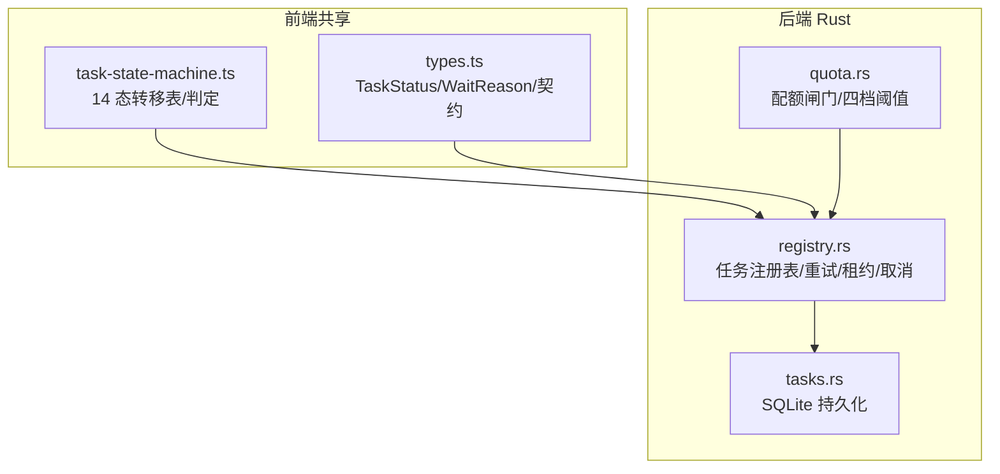
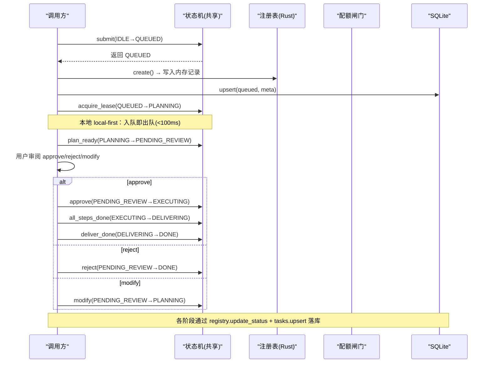
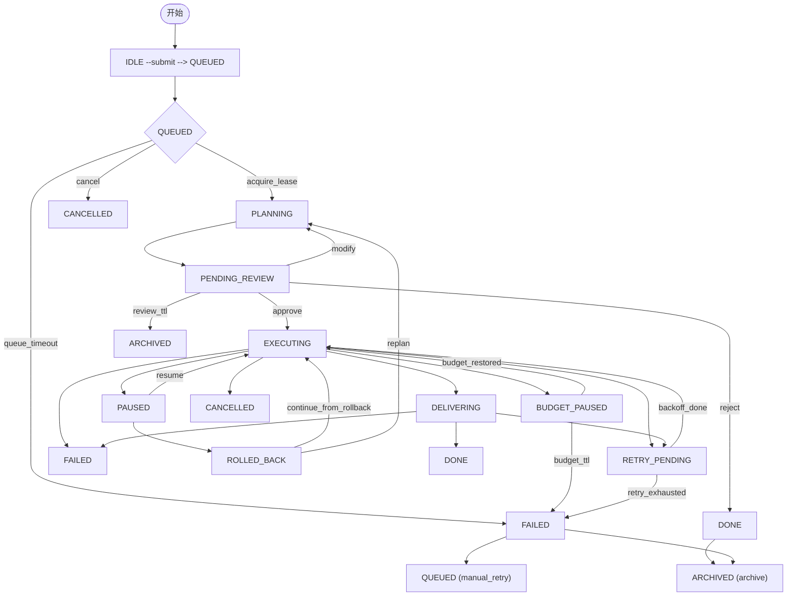
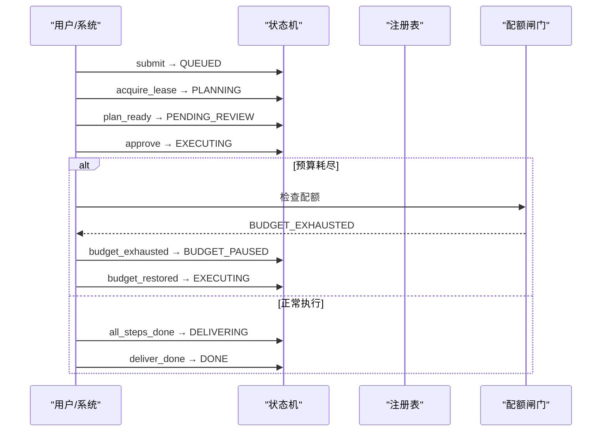
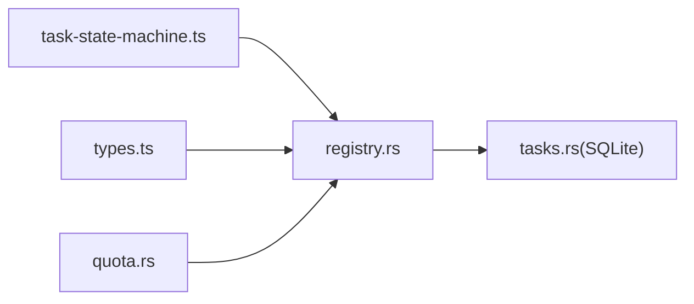

# 任务生命周期管理

<cite>
**本文引用的文件**
- [task-state-machine.ts](file://tongtian-tauri/src/shared/task-state-machine.ts)
- [types.ts](file://tongtian-tauri/src/shared/types.ts)
- [state-machine-14.test.ts](file://tongtian-tauri/tests/unit/agent/state-machine-14.test.ts)
- [registry.rs](file://tongtian-tauri/src-tauri/src/task/registry.rs)
- [quota.rs](file://tongtian-tauri/src-tauri/src/task/quota.rs)
- [tasks.rs](file://tongtian-tauri/src-tauri/src/store/tasks.rs)
- [state-machine.ts（Electron 遗留）](file://tongtian-tauri/src/main/agent/state-machine.ts)
</cite>

## 目录
1. [简介](#简介)
2. [项目结构](#项目结构)
3. [核心组件](#核心组件)
4. [架构总览](#架构总览)
5. [详细组件分析](#详细组件分析)
6. [依赖关系分析](#依赖关系分析)
7. [性能考量](#性能考量)
8. [故障排查指南](#故障排查指南)
9. [结论](#结论)
10. [附录](#附录)

## 简介
本文件围绕“任务生命周期管理”展开，聚焦于 14 态状态机的设计原理与实现细节，覆盖全部状态定义、转移规则、两阶段协议（计划生成→用户审阅→执行交付）、触发条件、异常处理与回滚策略，并提供可操作的监控与处理示例路径。该实现遵循“纯函数、零依赖、local-first 退化”的设计原则，确保前端、后端与 Rust 侧共享同一份转移表，便于演进与测试对齐。

## 项目结构
- 前端共享层：定义 14 态枚举、事件类型、转移表与判定函数，供渲染端与测试复用。
- 后端注册表：维护任务记录、重试计数、租约、取消标记等运行时状态，并持久化到 SQLite。
- 配额闸门：按四档阈值（70/85/95/100%）决定降级、排队或阻断行为，并与运行中任务的预算暂停联动。
- 持久化存储：SQLite 表保存任务摘要与元数据，支持按更新时间倒序查询。
- 历史兼容：Electron 遗留的状态机未参与 Tauri 构建，新实现以 shared 层为准。



图表来源
- [task-state-machine.ts:1-223](file://tongtian-tauri/src/shared/task-state-machine.ts#L1-L223)
- [types.ts:1-346](file://tongtian-tauri/src/shared/types.ts#L1-L346)
- [registry.rs:1-259](file://tongtian-tauri/src-tauri/src/task/registry.rs#L1-L259)
- [quota.rs:1-300](file://tongtian-tauri/src-tauri/src/task/quota.rs#L1-L300)
- [tasks.rs:1-168](file://tongtian-tauri/src-tauri/src/store/tasks.rs#L1-L168)

章节来源
- [task-state-machine.ts:1-223](file://tongtian-tauri/src/shared/task-state-machine.ts#L1-L223)
- [types.ts:1-346](file://tongtian-tauri/src/shared/types.ts#L1-L346)
- [registry.rs:1-259](file://tongtian-tauri/src-tauri/src/task/registry.rs#L1-L259)
- [quota.rs:1-300](file://tongtian-tauri/src-tauri/src/task/quota.rs#L1-L300)
- [tasks.rs:1-168](file://tongtian-tauri/src-tauri/src/store/tasks.rs#L1-L168)

## 核心组件
- 14 态状态机（shared）：定义 35 条合法转移、终态集合、非法转移错误、wait_reason 子态、可用事件查询等。
- 任务注册表（Rust）：创建任务置为 queued；更新状态时自动清理非 executing 的 wait_reason；维护 revision 乐观锁；累计 retry_count；绑定租约；幂等标记取消请求。
- 配额闸门（Rust）：四档阈值评估、新增用量、提交前检查、是否应排队；与运行中任务预算暂停联动。
- 持久化（Rust）：upsert 任务行，包含 status/wait_reason/retry_count/status_reason_code/queue_position 等字段。

章节来源
- [task-state-machine.ts:16-223](file://tongtian-tauri/src/shared/task-state-machine.ts#L16-L223)
- [registry.rs:68-183](file://tongtian-tauri/src-tauri/src/task/registry.rs#L68-L183)
- [quota.rs:16-220](file://tongtian-tauri/src-tauri/src/task/quota.rs#L16-L220)
- [tasks.rs:9-95](file://tongtian-tauri/src-tauri/src/store/tasks.rs#L9-L95)

## 架构总览
下图展示从任务提交到交付的两阶段协议及关键状态流转。



图表来源
- [task-state-machine.ts:63-133](file://tongtian-tauri/src/shared/task-state-machine.ts#L63-L133)
- [registry.rs:68-119](file://tongtian-tauri/src-tauri/src/task/registry.rs#L68-L119)
- [tasks.rs:27-95](file://tongtian-tauri/src-tauri/src/store/tasks.rs#L27-L95)

## 详细组件分析

### 14 态状态机与转移规则
- 状态集合：IDLE、QUEUED、PLANNING、PENDING_REVIEW、EXECUTING、PAUSED、BUDGET_PAUSED、RETRY_PENDING、DELIVERING、DONE、FAILED、ROLLED_BACK、CANCELLED、ARCHIVED。
- 转移总数：35 条合法转移，覆盖计划、审阅、执行、交付、预算、重试、归档、取消等全链路。
- 终态：CANCELLED、ARCHIVED（DONE 仅保留 archive 边）。
- 非法转移：抛出 IllegalTransitionError，不静默吞错。
- wait_reason 子态：仅在 EXECUTING 允许标注（如 rate_limited/circuit_break），离开 EXECUTING 自动清除。
- 重试上限：MAX_RETRY_COUNT=3；当 retryable_error 且 retryCount≥3 时路由到 FAILED（#7/#16/#33 兜底语义）。



图表来源
- [task-state-machine.ts:63-133](file://tongtian-tauri/src/shared/task-state-machine.ts#L63-L133)

章节来源
- [task-state-machine.ts:16-223](file://tongtian-tauri/src/shared/task-state-machine.ts#L16-L223)
- [state-machine-14.test.ts:18-166](file://tongtian-tauri/tests/unit/agent/state-machine-14.test.ts#L18-L166)

### 两阶段协议：计划生成→用户审阅→执行交付
- 第一阶段（计划）：
  - QUEUED→PLANNING：获取租约（本地立即成功，<100ms）。
  - PLANNING→PENDING_REVIEW：计划就绪，进入审阅。
  - 异常：retryable_error（≤2 次→RETRY_PENDING；≥3 次→FAILED），fatal_error→FAILED，cancel→CANCELLED。
- 第二阶段（审阅与执行）：
  - PENDING_REVIEW→EXECUTING：用户 approve。
  - 执行过程：
    - 正常完成：all_steps_done→DELIVERING→deliver_done→DONE。
    - 暂停：pause→PAUSED→resume→EXECUTING。
    - 预算耗尽：budget_exhausted→BUDGET_PAUSED→budget_restored→EXECUTING；超时→FAILED。
    - 租约丢失：lease_lost→QUEUED→acquire_lease→PLANNING 恢复。
    - 可重试错误：retryable_error→RETRY_PENDING→backoff_done→EXECUTING；超限→FAILED。
    - 不可重试错误：fatal_error→FAILED。
  - 审阅拒绝：reject→DONE（status_reason_code=REJECTED）。
  - 审阅超期：review_ttl→ARCHIVED。
  - 修改计划：modify→PLANNING。



图表来源
- [task-state-machine.ts:63-133](file://tongtian-tauri/src/shared/task-state-machine.ts#L63-L133)
- [quota.rs:158-206](file://tongtian-tauri/src-tauri/src/task/quota.rs#L158-L206)

章节来源
- [task-state-machine.ts:63-133](file://tongtian-tauri/src/shared/task-state-machine.ts#L63-L133)
- [quota.rs:16-220](file://tongtian-tauri/src-tauri/src/task/quota.rs#L16-L220)

### 触发条件与异常处理
- 触发事件：
  - 提交/受理：submit（IDLE→QUEUED）。
  - 计划：acquire_lease（QUEUED→PLANNING），plan_ready（PLANNING→PENDING_REVIEW）。
  - 审阅：approve/reject/modify（PENDING_REVIEW→...）。
  - 执行：all_steps_done/pause/budget_exhausted/lease_lost/cancel（EXECUTING→...）。
  - 暂停：resume/rollback_to（PAUSED→...）。
  - 回滚：continue_from_rollback/replan（ROLLED_BACK→...）。
  - 预算：budget_restored/budget_ttl（BUDGET_PAUSED→...）。
  - 重试：backoff_done/retry_exhausted（RETRY_PENDING→...）。
  - 交付：deliver_done（DELIVERING→DONE）。
  - 失败：manual_retry（FAILED→QUEUED）。
  - 归档：archive（DONE/FAILED→ARCHIVED）。
- 异常与边界：
  - 非法转移抛错（IllegalTransitionError）。
  - retryable_error 在 retryCount≥3 时直接路由到 FAILED。
  - wait_reason 仅在 EXECUTING 有效，离开后自动清除。
  - 终态无出边（CANCELLED、ARCHIVED）。

章节来源
- [task-state-machine.ts:147-223](file://tongtian-tauri/src/shared/task-state-machine.ts#L147-L223)
- [state-machine-14.test.ts:123-166](file://tongtian-tauri/tests/unit/agent/state-machine-14.test.ts#L123-L166)

### 回滚策略
- 暂停→回滚：PAUSED→ROLLED_BACK（rollback_to）。
- 从回滚续跑：ROLLED_BACK→EXECUTING（continue_from_rollback）。
- 重新规划：ROLLED_BACK→PLANNING（replan）。
- 取消触发回滚栈处置（CANCELLED 语义由上层协调）。

章节来源
- [task-state-machine.ts:103-111](file://tongtian-tauri/src/shared/task-state-machine.ts#L103-L111)

### 代码级类图（状态机与注册表）
```mermaid
classDiagram
class TaskStateMachine {
+canTransition(from,event,ctx) bool
+transition(from,event,ctx) TaskStatus
+applyWaitReason(status,reason) {status,waitReason}
+isTerminal(status) bool
+availableEvents(from) TransitionEvent[]
}
class TaskRegistry {
+create(task_id,workspace_id) TaskRecord
+update_status(task_id,new_status,reason_code) TaskRecord?
+set_wait_reason(task_id,reason) TaskRecord?
+bump_retry(task_id) u8?
+bind_lease(task_id,lease_id) void
+request_cancel(task_id) TaskRecord?
}
class QuotaGate {
+snapshot() QuotaSnapshot
+add_usage(tokens) TierTransition
+check_submit() Result
+should_queue() bool
}
TaskStateMachine <.. TaskRegistry : "使用"
TaskRegistry <.. QuotaGate : "配额决策"
```

图表来源
- [task-state-machine.ts:161-223](file://tongtian-tauri/src/shared/task-state-machine.ts#L161-L223)
- [registry.rs:61-183](file://tongtian-tauri/src-tauri/src/task/registry.rs#L61-L183)
- [quota.rs:119-220](file://tongtian-tauri/src-tauri/src/task/quota.rs#L119-L220)

## 依赖关系分析
- shared 层提供纯函数转移表，被前端与测试共用，避免多版本分歧。
- Rust 注册表负责运行时状态与持久化，严格遵循 shared 层的转移合法性（注释明确权威转移表在 shared）。
- 配额闸门与注册表协作：运行中任务遇 100% 配额时转入 BUDGET_PAUSED；新提交在 100% 时阻断。
- 持久化层统一写入任务摘要，保证重启后可恢复。



图表来源
- [task-state-machine.ts:1-223](file://tongtian-tauri/src/shared/task-state-machine.ts#L1-L223)
- [registry.rs:1-259](file://tongtian-tauri/src-tauri/src/task/registry.rs#L1-L259)
- [tasks.rs:1-168](file://tongtian-tauri/src-tauri/src/store/tasks.rs#L1-L168)
- [quota.rs:1-300](file://tongtian-tauri/src-tauri/src/task/quota.rs#L1-L300)

章节来源
- [registry.rs:1-259](file://tongtian-tauri/src-tauri/src/task/registry.rs#L1-L259)
- [quota.rs:1-300](file://tongtian-tauri/src-tauri/src/task/quota.rs#L1-L300)
- [tasks.rs:1-168](file://tongtian-tauri/src-tauri/src/store/tasks.rs#L1-L168)

## 性能考量
- local-first 退化：QUEUED 停留目标 <100ms，入队即出队，降低排队延迟。
- 重试退避：RETRY_PENDING 配合 backoff，避免雪崩。
- 配额闸门去抖：同档不重复触发 quota_warning 事件，减少噪声。
- 乐观锁 revision：每次状态更新递增，便于并发控制与审计。

[本节为通用指导，无需特定文件引用]

## 故障排查指南
- 非法转移：若出现 IllegalTransitionError，检查当前状态与事件是否在 35 条合法转移内。
- 重试耗尽：当 retryCount≥3 且仍发生 retryable_error，将路由至 FAILED，需人工介入或手动重试（累计不重置）。
- 预算暂停：若处于 BUDGET_PAUSED，检查配额闸门是否恢复到非 100% 档位；否则将因 budget_ttl 转为 FAILED。
- 租约丢失：EXECUTING 收到 lease_lost 会回到 QUEUED，随后 acquire_lease→PLANNING 恢复。
- 等待原因：确认 wait_reason 仅在 EXECUTING 设置；离开 EXECUTING 会自动清除。

章节来源
- [task-state-machine.ts:147-223](file://tongtian-tauri/src/shared/task-state-machine.ts#L147-L223)
- [registry.rs:100-129](file://tongtian-tauri/src-tauri/src/task/registry.rs#L100-L129)
- [quota.rs:191-206](file://tongtian-tauri/src-tauri/src/task/quota.rs#L191-L206)

## 结论
该任务生命周期管理以 14 态状态机为核心，结合注册表与配额闸门，实现了从计划生成、用户审阅到执行交付的完整两阶段协议。通过严格的转移表、重试上限、预算暂停与回滚机制，系统在可用性、可控性与可观测性方面具备良好基础。建议在生产环境中持续完善审计与告警，确保状态变更可追踪、可回溯。

[本节为总结，无需特定文件引用]

## 附录

### 状态与事件速查
- 状态：IDLE、QUEUED、PLANNING、PENDING_REVIEW、EXECUTING、PAUSED、BUDGET_PAUSED、RETRY_PENDING、DELIVERING、DONE、FAILED、ROLLED_BACK、CANCELLED、ARCHIVED。
- 事件：submit、acquire_lease、cancel、queue_timeout、plan_ready、retryable_error、fatal_error、approve、reject、modify、review_ttl、all_steps_done、pause、budget_exhausted、lease_lost、resume、rollback_to、continue_from_rollback、replan、budget_restored、budget_ttl、backoff_done、retry_exhausted、deliver_done、manual_retry、archive。

章节来源
- [task-state-machine.ts:16-133](file://tongtian-tauri/src/shared/task-state-machine.ts#L16-L133)
- [types.ts:4-41](file://tongtian-tauri/src/shared/types.ts#L4-L41)

### 监控与处理示例（路径指引）
- 监听状态变化：订阅 ChatEvent.status_change，携带 taskId、status、waitReason、statusReasonCode、queuePosition。
  - 参考：[ChatEvent 定义:291-303](file://tongtian-tauri/src/shared/types.ts#L291-L303)
- 判断转移合法性：使用 canTransition/availableEvents 动态渲染可用操作。
  - 参考：[canTransition/availableEvents:165-223](file://tongtian-tauri/src/shared/task-state-machine.ts#L165-L223)
- 处理预算暂停：当 statusReasonCode=BUDGET_EXHAUSTED 时，提示用户预算不足并等待恢复。
  - 参考：[配额闸门与预算暂停:191-206](file://tongtian-tauri/src-tauri/src/task/quota.rs#L191-L206)
- 重试与回滚：对 RETRY_PENDING 进行退避调度；对 PAUSED 支持 rollback_to 与 continue_from_rollback。
  - 参考：[重试与回滚转移:103-121](file://tongtian-tauri/src/shared/task-state-machine.ts#L103-L121)

章节来源
- [types.ts:291-303](file://tongtian-tauri/src/shared/types.ts#L291-L303)
- [task-state-machine.ts:165-223](file://tongtian-tauri/src/shared/task-state-machine.ts#L165-L223)
- [quota.rs:191-206](file://tongtian-tauri/src-tauri/src/task/quota.rs#L191-L206)