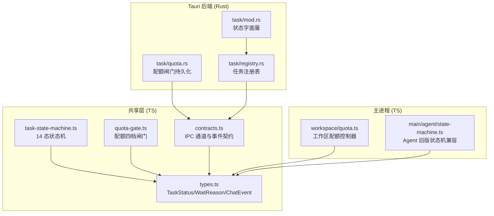
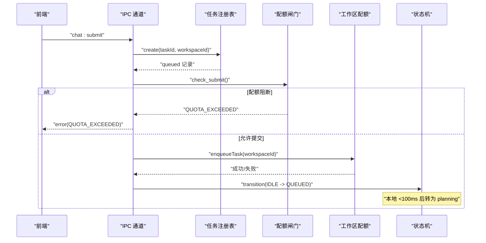
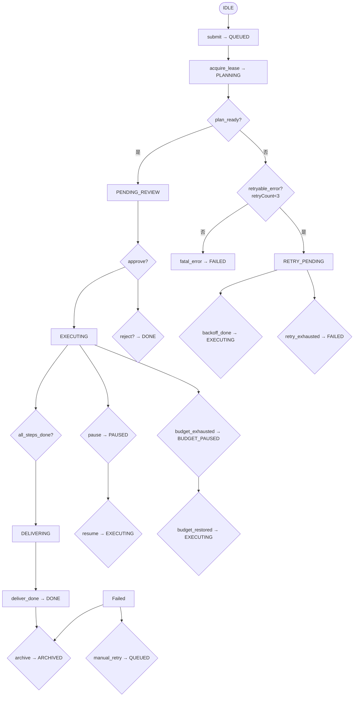
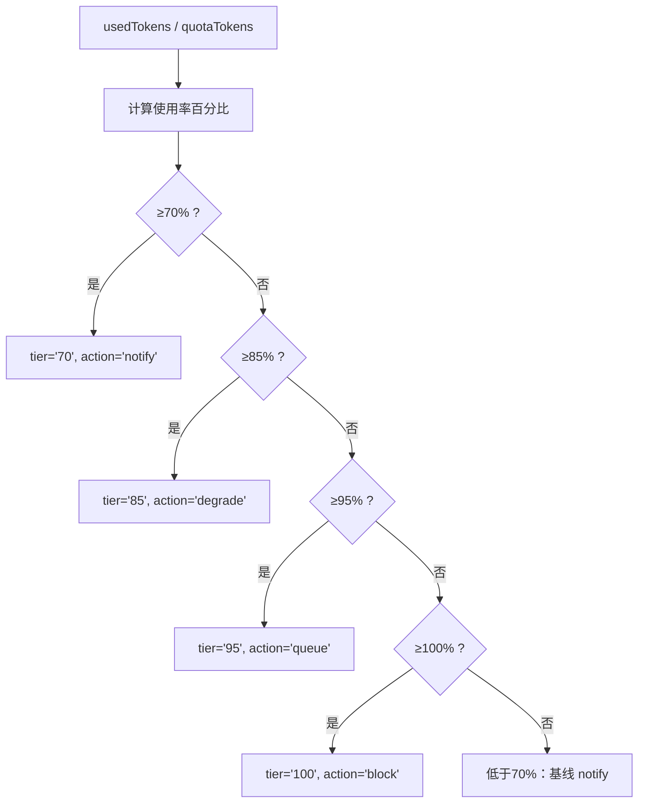
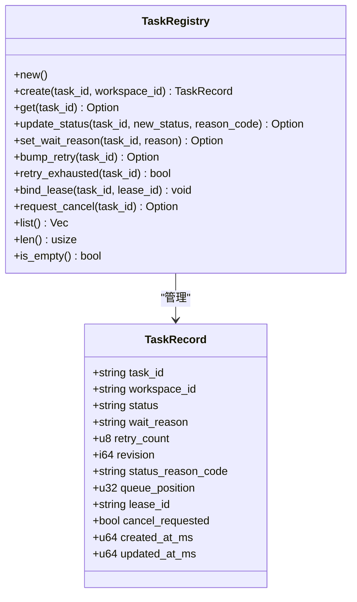
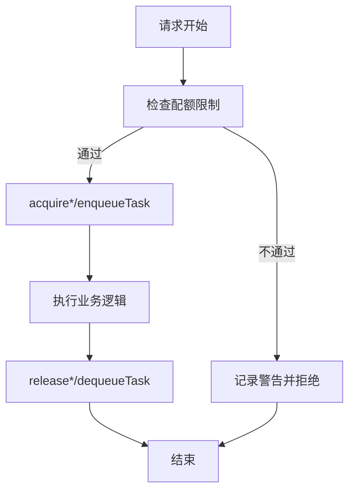
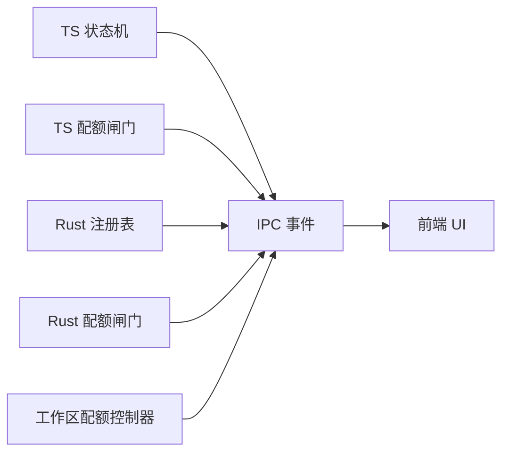

# 任务管理模块

<cite>
**本文引用的文件**
- [task-state-machine.ts](file://tongtian-tauri/src/shared/task-state-machine.ts)
- [quota-gate.ts](file://tongtian-tauri/src/shared/quota-gate.ts)
- [types.ts](file://tongtian-tauri/src/shared/types.ts)
- [contracts.ts](file://tongtian-tauri/src/shared/contracts.ts)
- [quota.ts](file://tongtian-tauri/src/main/workspace/quota.ts)
- [mod.rs](file://tongtian-tauri/src-tauri/src/task/mod.rs)
- [quota.rs](file://tongtian-tauri/src-tauri/src/task/quota.rs)
- [registry.rs](file://tongtian-tauri/src-tauri/src/task/registry.rs)
- [state-machine.ts](file://tongtian-tauri/src/main/agent/state-machine.ts)
</cite>

## 目录
1. [简介](#简介)
2. [项目结构](#项目结构)
3. [核心组件](#核心组件)
4. [架构总览](#架构总览)
5. [详细组件分析](#详细组件分析)
6. [依赖关系分析](#依赖关系分析)
7. [性能考量](#性能考量)
8. [故障恢复与排障指南](#故障恢复与排障指南)
9. [结论](#结论)
10. [附录：API 接口定义](#附录api-接口定义)

## 简介
本模块围绕“任务生命周期管理、配额控制、任务注册与调度”展开，提供一套跨前端（TS）与后端（Rust）一致的任务状态机、配额闸门与注册表能力。其设计目标包括：
- 明确的任务状态机（14 态 + wait_reason 子态），支持可重试、预算暂停、归档等完整生命周期。
- 四档配额闸门（70/85/95/100%），动作链为“降级→排队→阻断”，并产出预警事件。
- 任务注册表维护任务记录、租约绑定、重试计数、取消请求等元数据。
- 工作区级资源配额控制器，限制并发步骤、内存、模型调用与队列深度。
- 统一的 IPC 事件契约，便于前后端协同与监控指标采集。

## 项目结构
任务管理相关代码分布在三层：
- 共享契约与纯函数（TS）：状态机转移表、配额计算、类型与 IPC 契约。
- 主进程资源配额（TS）：工作区维度的并发、内存、队列等配额控制。
- Tauri 后端（Rust）：任务注册表、配额闸门持久化、状态字面量对齐。

图表来源
- [task-state-machine.ts:1-223](file://tongtian-tauri/src/shared/task-state-machine.ts#L1-L223)
- [quota-gate.ts:1-81](file://tongtian-tauri/src/shared/quota-gate.ts#L1-L81)
- [types.ts:1-346](file://tongtian-tauri/src/shared/types.ts#L1-L346)
- [contracts.ts:1-587](file://tongtian-tauri/src/shared/contracts.ts#L1-L587)
- [quota.ts:1-265](file://tongtian-tauri/src/main/workspace/quota.ts#L1-L265)
- [mod.rs:1-24](file://tongtian-tauri/src-tauri/src/task/mod.rs#L1-L24)
- [quota.rs:1-300](file://tongtian-tauri/src-tauri/src/task/quota.rs#L1-L300)
- [registry.rs:1-259](file://tongtian-tauri/src-tauri/src/task/registry.rs#L1-L259)

章节来源
- [task-state-machine.ts:1-223](file://tongtian-tauri/src/shared/task-state-machine.ts#L1-L223)
- [quota-gate.ts:1-81](file://tongtian-tauri/src/shared/quota-gate.ts#L1-L81)
- [types.ts:1-346](file://tongtian-tauri/src/shared/types.ts#L1-L346)
- [contracts.ts:1-587](file://tongtian-tauri/src/shared/contracts.ts#L1-L587)
- [quota.ts:1-265](file://tongtian-tauri/src/main/workspace/quota.ts#L1-L265)
- [mod.rs:1-24](file://tongtian-tauri/src-tauri/src/task/mod.rs#L1-L24)
- [quota.rs:1-300](file://tongtian-tauri/src-tauri/src/task/quota.rs#L1-L300)
- [registry.rs:1-259](file://tongtian-tauri/src-tauri/src/task/registry.rs#L1-L259)

## 核心组件
- 任务状态机（14 态）：定义合法转移、终态集合、wait_reason 子态、重试上限与本地队列退化策略。
- 配额闸门（四档）：计算使用率、判定档位与动作、是否阻断/排队、档位跃迁去抖。
- 任务注册表：创建任务、更新状态、绑定租约、重试计数、取消标记、列表查询。
- 工作区配额控制器：并发步骤、内存、模型调用、队列深度的获取与释放。
- IPC 事件契约：status_change、quota_warning、heartbeat 等事件用于监控与 UI 展示。

章节来源
- [task-state-machine.ts:1-223](file://tongtian-tauri/src/shared/task-state-machine.ts#L1-L223)
- [quota-gate.ts:1-81](file://tongtian-tauri/src/shared/quota-gate.ts#L1-L81)
- [registry.rs:1-259](file://tongtian-tauri/src-tauri/src/task/registry.rs#L1-L259)
- [quota.ts:1-265](file://tongtian-tauri/src/main/workspace/quota.ts#L1-L265)
- [contracts.ts:1-587](file://tongtian-tauri/src/shared/contracts.ts#L1-L587)

## 架构总览
任务从提交到完成的关键路径：
- 提交阶段：通过 IPC 通道 chat:submit 进入注册表，置为 queued；本地 local-first 下快速转入 planning。
- 规划阶段：生成计划后进入 pending_review；可被修改或拒绝。
- 执行阶段：批准后进入 executing；可能因限流/熔断/配额/预算而进入 wait_reason 或 budget_paused。
- 交付阶段：所有步骤完成后进入 delivering，产物入库成功后 done。
- 失败与重试：可重试错误进入 retry_pending，达到上限转 failed；用户可手动重试。
- 归档：done/failed 可归档，或自动归档。

图表来源
- [contracts.ts:480-584](file://tongtian-tauri/src/shared/contracts.ts#L480-L584)
- [registry.rs:68-90](file://tongtian-tauri/src-tauri/src/task/registry.rs#L68-L90)
- [quota.rs:191-206](file://tongtian-tauri/src-tauri/src/task/quota.rs#L191-L206)
- [quota.ts:154-173](file://tongtian-tauri/src/main/workspace/quota.ts#L154-L173)
- [task-state-machine.ts:63-133](file://tongtian-tauri/src/shared/task-state-machine.ts#L63-L133)

## 详细组件分析

### 任务状态机（14 态）
- 状态集：idle、queued、planning、pending_review、executing、paused、budget_paused、retry_pending、delivering、done、failed、rolled_back、cancelled、archived。
- 转移规则：35 条合法转移，覆盖创建、审批、执行、暂停、预算暂停、重试、交付、归档等。
- 重试上限：MAX_RETRY_COUNT=3；超过上限的 retryable_error 直接路由到 failed。
- wait_reason：在 executing 状态下以子态表达限流、熔断、配额等待等，避免状态爆炸。
- 终态：cancelled、archived；done 仅保留 archive 边。

图表来源
- [task-state-machine.ts:63-133](file://tongtian-tauri/src/shared/task-state-machine.ts#L63-L133)
- [task-state-machine.ts:147-223](file://tongtian-tauri/src/shared/task-state-machine.ts#L147-L223)
- [types.ts:3-41](file://tongtian-tauri/src/shared/types.ts#L3-L41)

章节来源
- [task-state-machine.ts:1-223](file://tongtian-tauri/src/shared/task-state-machine.ts#L1-L223)
- [types.ts:1-346](file://tongtian-tauri/src/shared/types.ts#L1-L346)

### 配额闸门（四档）
- 阈值：70%（notify）、85%（degrade）、95%（queue）、100%（block）。
- 动作链：降级→排队→阻断；新提交在 100% 时返回 QUOTA_EXCEEDED，运行中任务触发 budget_paused。
- 使用率计算：usagePercent(usedTokens, quotaTokens)，quota<=0 视为无限制。
- 档位跃迁去抖：仅在跨越阈值时发出 quota_warning 事件，避免风暴。
- Rust 镜像实现：evaluate() 与 add_usage() 保持与 TS 一致的边界语义，支持持久化台账与跨日重置。

图表来源
- [quota-gate.ts:9-81](file://tongtian-tauri/src/shared/quota-gate.ts#L9-L81)
- [quota.rs:15-117](file://tongtian-tauri/src-tauri/src/task/quota.rs#L15-L117)

章节来源
- [quota-gate.ts:1-81](file://tongtian-tauri/src/shared/quota-gate.ts#L1-L81)
- [quota.rs:1-300](file://tongtian-tauri/src-tauri/src/task/quota.rs#L1-L300)

### 任务注册表
- 任务记录字段：taskId、workspaceId、status、waitReason、retryCount、revision、statusReasonCode、queuePosition、leaseId、cancelRequested、时间戳。
- 关键操作：
  - create：新建任务并置为 queued（本地 <100ms 后转 planning）。
  - update_status：更新状态与原因码，非 executing 时清除 wait_reason，revision 单调递增。
  - set_wait_reason：设置 executing 的子态。
  - bump_retry/retry_exhausted：累计重试次数，达到上限判定耗尽。
  - bind_lease：绑定执行租约。
  - request_cancel：幂等标记取消请求。
  - list/len/is_empty：统计与查询。

图表来源
- [registry.rs:12-39](file://tongtian-tauri/src-tauri/src/task/registry.rs#L12-L39)
- [registry.rs:61-183](file://tongtian-tauri/src-tauri/src/task/registry.rs#L61-L183)

章节来源
- [registry.rs:1-259](file://tongtian-tauri/src-tauri/src/task/registry.rs#L1-L259)

### 工作区配额控制器
- 维度：并发步骤数、内存使用、并发模型调用、队列深度。
- 默认限制：maxConcurrentSteps=5、maxMemoryMb=2048、maxConcurrentModelCalls=3、maxQueueDepth=100。
- 方法：
  - canStartStep/canAcceptTask/canStartModelCall：检查是否可接受新资源。
  - acquire*/release*：获取与释放资源。
  - enqueueTask/dequeueTask：入队与出队任务。
  - updateMemoryUsage：更新内存使用并输出告警日志。
  - getStatus：汇总当前使用与警告信息。
  - updateLimits/destroyWorkspace：动态调整与清理。

图表来源
- [quota.ts:34-265](file://tongtian-tauri/src/main/workspace/quota.ts#L34-L265)

章节来源
- [quota.ts:1-265](file://tongtian-tauri/src/main/workspace/quota.ts#L1-L265)

### 事件与监控指标
- 事件类型：
  - status_change：任务状态变更，包含 waitReason、statusReasonCode、queuePosition。
  - quota_warning：配额档位变化，包含 level、action、usedTokens、quotaTokens。
  - heartbeat：心跳事件，用于健康检测。
- 指标建议：
  - 任务状态分布（各状态数量）。
  - 配额档位分布与跃迁频率。
  - 重试次数分布与耗尽比例。
  - 队列深度与平均等待时长。
  - 内存使用峰值与告警次数。

章节来源
- [types.ts:286-303](file://tongtian-tauri/src/shared/types.ts#L286-L303)
- [contracts.ts:146-158](file://tongtian-tauri/src/shared/contracts.ts#L146-L158)

## 依赖关系分析
- 共享层（TS）提供统一的状态机与配额计算，供前端与后端复用。
- 后端（Rust）实现持久化的配额闸门与任务注册表，保证状态一致性。
- 主进程（TS）负责工作区维度的资源配额控制，与后端协作形成双层配额体系。
- IPC 契约确保前后端事件一致，便于监控与调试。

图表来源
- [task-state-machine.ts:1-223](file://tongtian-tauri/src/shared/task-state-machine.ts#L1-L223)
- [quota-gate.ts:1-81](file://tongtian-tauri/src/shared/quota-gate.ts#L1-L81)
- [registry.rs:1-259](file://tongtian-tauri/src-tauri/src/task/registry.rs#L1-L259)
- [quota.rs:1-300](file://tongtian-tauri/src-tauri/src/task/quota.rs#L1-L300)
- [quota.ts:1-265](file://tongtian-tauri/src/main/workspace/quota.ts#L1-L265)
- [contracts.ts:480-584](file://tongtian-tauri/src/shared/contracts.ts#L480-L584)

章节来源
- [contracts.ts:1-587](file://tongtian-tauri/src/shared/contracts.ts#L1-L587)

## 性能考量
- 本地队列退化：queued 停留目标 <100ms，减少排队开销。
- 配额计算纯函数：避免锁竞争，提高吞吐。
- 重试退避：retry_pending 使用本地退避，降低重试风暴。
- 内存告警：接近限制时提前告警，避免 OOM。
- 事件去抖：配额档位跃迁去抖，防止事件风暴。

[本节为通用指导，无需具体文件引用]

## 故障恢复与排障指南
- 常见错误码：
  - QUOTA_EXCEEDED：配额 100% 阻断新提交。
  - BUDGET_EXHAUSTED：运行中任务预算耗尽，转入 budget_paused。
  - QUEUE_TIMEOUT：排队超时（可配）。
  - LEASE_LOST：租约丢失（心跳超时）。
  - TASK_PLAN_REJECTED/TASK_EXECUTION_FAILED：计划拒绝或执行失败。
- 恢复策略：
  - 预算耗尽：等待预算恢复后按 FIFO 恢复执行。
  - 租约丢失：从最后成功 step 恢复。
  - 重试耗尽：转 failed，支持手动重试。
  - 归档：done/failed 可归档，30 天自动归档。
- 排查步骤：
  - 查看 status_change 事件，确认状态与 waitReason。
  - 检查 quota_warning 事件，确认配额档位。
  - 核对注册表中的 retryCount、leaseId、cancelRequested。
  - 检查工作区配额状态，确认是否达到限制。

章节来源
- [contracts.ts:15-109](file://tongtian-tauri/src/shared/contracts.ts#L15-L109)
- [task-state-machine.ts:135-223](file://tongtian-tauri/src/shared/task-state-machine.ts#L135-L223)
- [registry.rs:100-183](file://tongtian-tauri/src-tauri/src/task/registry.rs#L100-L183)
- [quota.ts:175-236](file://tongtian-tauri/src/main/workspace/quota.ts#L175-L236)

## 结论
本任务管理模块通过一致的状态机、配额闸门与注册表，实现了健壮的任务生命周期管理。其设计兼顾了本地优先与云端扩展，提供了清晰的监控指标与故障恢复机制。建议在后续演进中：
- 完善云端 Runner 池与租约协议。
- 增强配额来源的可插拔性（RemoteQuotaSource）。
- 扩展监控指标与告警策略。

[本节为总结，无需具体文件引用]

## 附录：API 接口定义
- IPC 通道：
  - chat:submit/chat:review/chat:control/chat:history/chat:event
  - task:state/quota:status/lease:info/lease:takeover/event:replay
  - 其他模型、文件、工作区、技能、MCP、沙箱、审计、调度、合规、用量、系统、设置、钩子、感知、连接器、归档、计算机使用策略等通道。
- 事件契约：
  - plan/step_start/step_progress/step_done/step_failed/deliver/done/error
  - status_change/quota_warning/heartbeat
- 错误码：
  - MODEL_*、FILE_*、TASK_*、CONFIG_*、WORKSPACE_*、SKILL_*、MCP_*、SANDBOX_*、COMPLIANCE_*、BRIDGE_*、SCHEDULE_*、BUDGET_EXHAUSTED、QUEUE_TIMEOUT、LEASE_LOST、FILE_REJECTED、SYNC_CONFLICT、PAYMENT_GRACE、DATA_TIER_BLOCKED、INJECTION_BLOCKED、QUOTA_EXCEEDED、INTERNAL_ERROR、VALIDATION_ERROR。

章节来源
- [contracts.ts:480-584](file://tongtian-tauri/src/shared/contracts.ts#L480-L584)
- [contracts.ts:15-109](file://tongtian-tauri/src/shared/contracts.ts#L15-L109)
- [types.ts:286-303](file://tongtian-tauri/src/shared/types.ts#L286-L303)