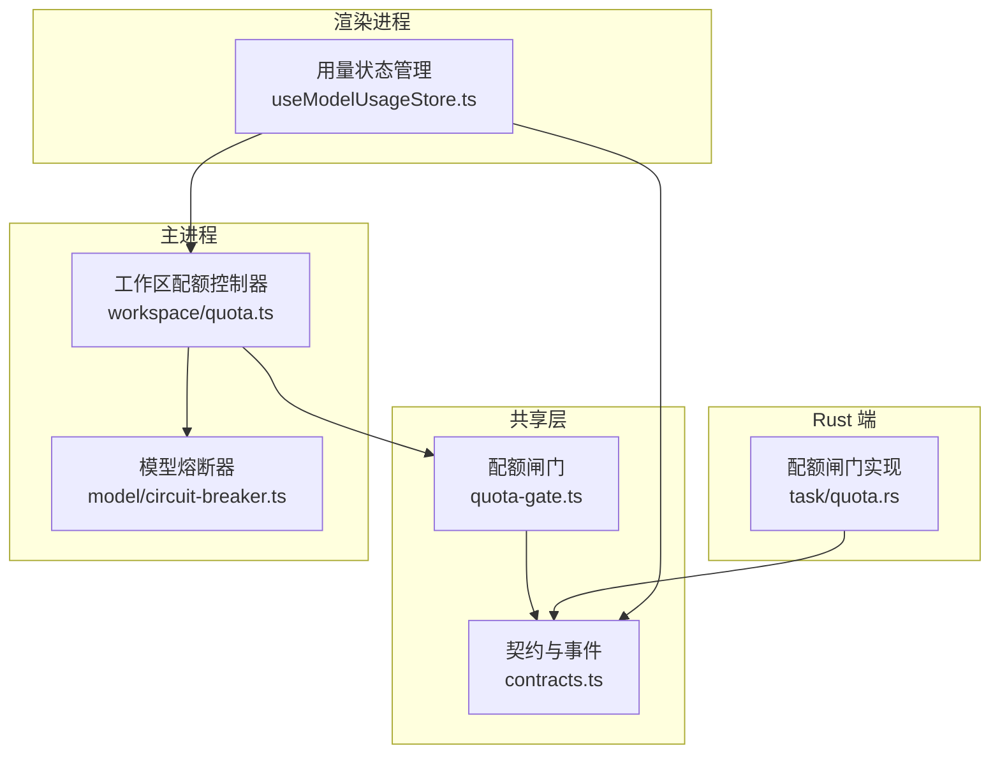
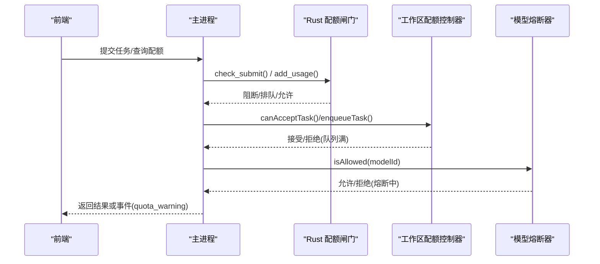
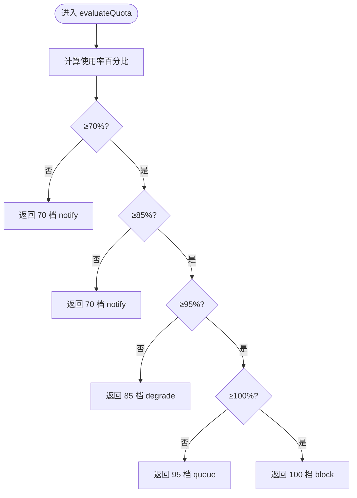
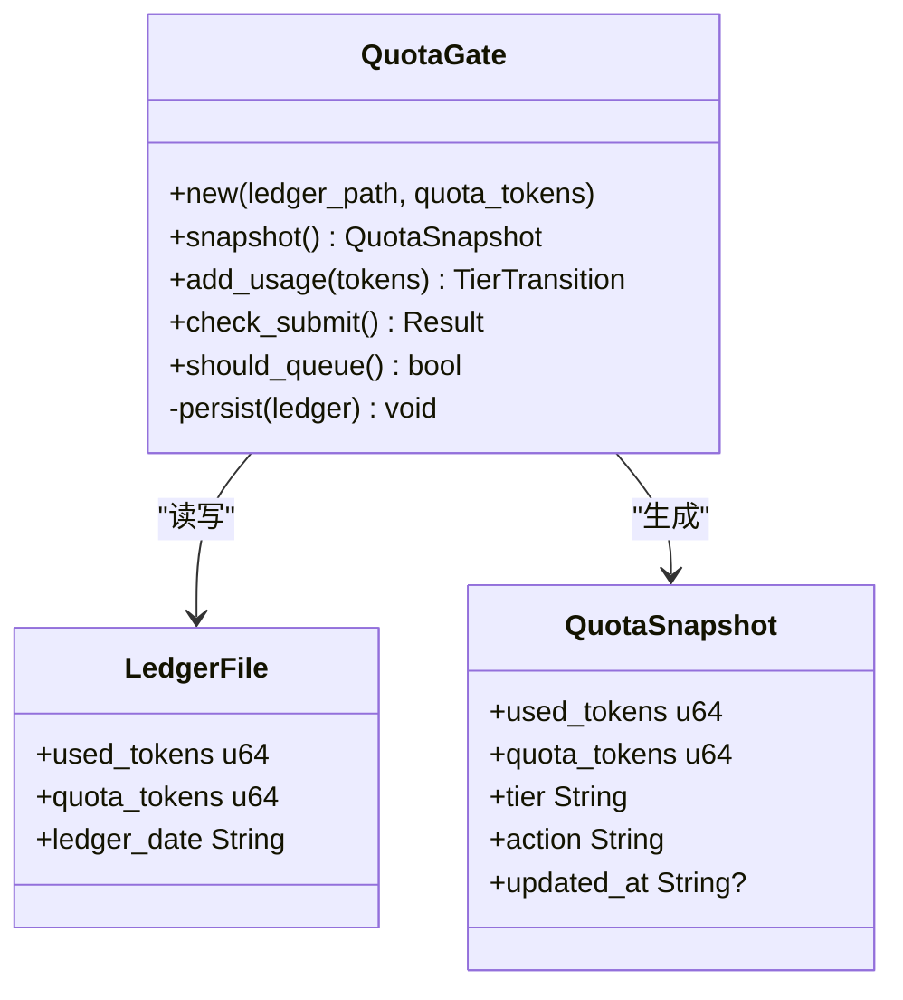
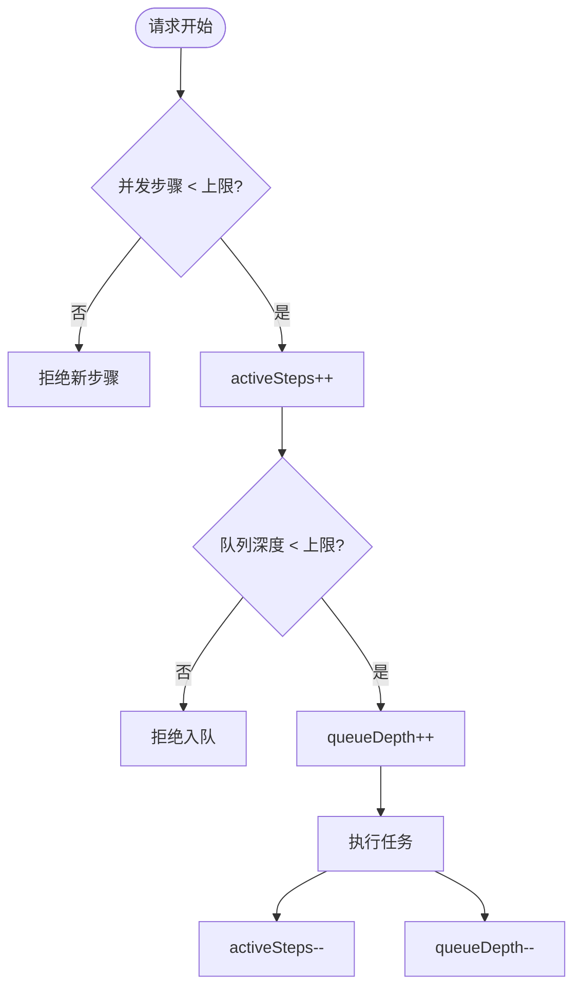
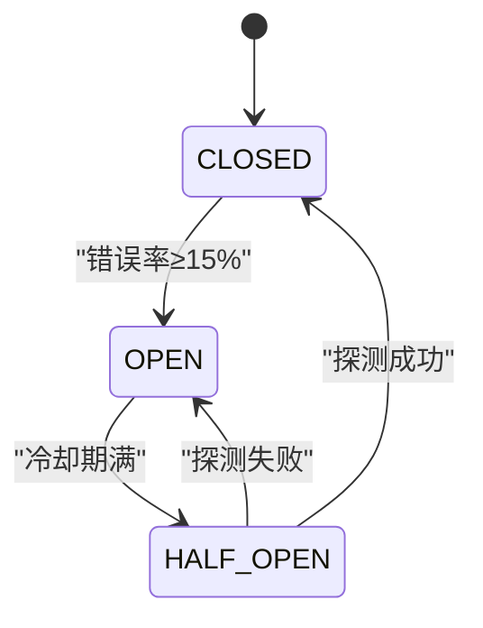
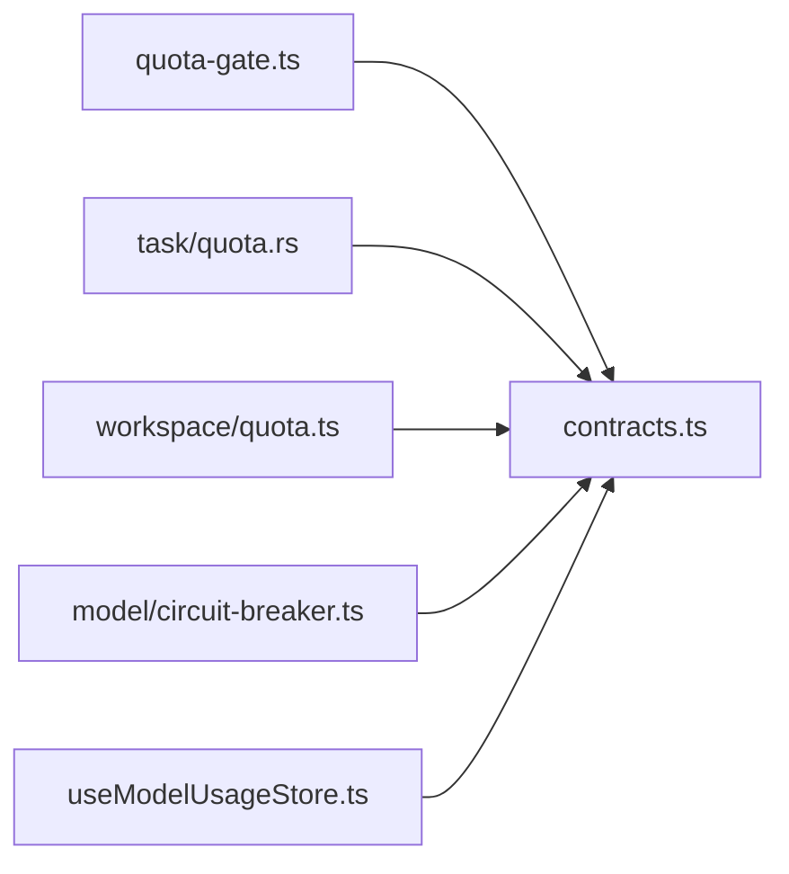

# 配额管理系统

<cite>
**本文引用的文件**
- [quota-gate.ts](file://tongtian-tauri/src/shared/quota-gate.ts)
- [quota.rs](file://tongtian-tauri/src-tauri/src/task/quota.rs)
- [quota.ts](file://tongtian-tauri/src/main/workspace/quota.ts)
- [circuit-breaker.ts](file://tongtian-tauri/src/main/model/circuit-breaker.ts)
- [contracts.ts](file://tongtian-tauri/src/shared/contracts.ts)
- [useModelUsageStore.ts](file://tongtian-tauri/src/renderer/stores/useModelUsageStore.ts)
- [quota-gate.test.ts](file://tongtian-tauri/tests/unit/model/quota-gate.test.ts)
</cite>

## 目录
1. [简介](#简介)
2. [项目结构](#项目结构)
3. [核心组件](#核心组件)
4. [架构总览](#架构总览)
5. [详细组件分析](#详细组件分析)
6. [依赖关系分析](#依赖关系分析)
7. [性能与容量规划](#性能与容量规划)
8. [故障排查指南](#故障排查指南)
9. [结论](#结论)
10. [附录：配置示例与恢复流程](#附录：配置示例与恢复流程)

## 简介
本系统提供端到端的配额管理与预算控制能力，覆盖“四档闸门”（70%/85%/95%/100%）的预警、降级、排队与阻断策略；同时提供工作区级资源配额控制器与模型熔断器，形成“配额闸门 + 资源配额 + 熔断降级”的三层防护体系。文档重点说明：
- 预算控制机制与配额计算规则
- 熔断与降级策略
- 配额闸门的工作原理（预算检查、预警、自动暂停）
- 配额配置选项、使用量统计与实时监控指标
- 具体配置示例与故障恢复指南（超限处理与策略调整）

## 项目结构
配额相关代码主要分布在以下位置：
- 共享纯函数与类型契约：src/shared/quota-gate.ts、src/shared/contracts.ts
- Rust 端配额闸门（持久化台账、阈值判定、事件去抖）：src-tauri/src/task/quota.rs
- 主进程工作区资源配额控制器：src/main/workspace/quota.ts
- 模型熔断器（错误率滑动窗口、半开探测、指数退避）：src/main/model/circuit-breaker.ts
- 前端用量状态管理：src/renderer/stores/useModelUsageStore.ts
- 单元测试用例：tests/unit/model/quota-gate.test.ts

图表来源
- [quota-gate.ts:1-81](file://tongtian-tauri/src/shared/quota-gate.ts#L1-L81)
- [quota.rs:1-300](file://tongtian-tauri/src-tauri/src/task/quota.rs#L1-L300)
- [quota.ts:1-265](file://tongtian-tauri/src/main/workspace/quota.ts#L1-L265)
- [circuit-breaker.ts:1-346](file://tongtian-tauri/src/main/model/circuit-breaker.ts#L1-L346)
- [contracts.ts:150-160](file://tongtian-tauri/src/shared/contracts.ts#L150-L160)
- [useModelUsageStore.ts:1-152](file://tongtian-tauri/src/renderer/stores/useModelUsageStore.ts#L1-L152)

章节来源
- [quota-gate.ts:1-81](file://tongtian-tauri/src/shared/quota-gate.ts#L1-L81)
- [quota.rs:1-300](file://tongtian-tauri/src-tauri/src/task/quota.rs#L1-L300)
- [quota.ts:1-265](file://tongtian-tauri/src/main/workspace/quota.ts#L1-L265)
- [circuit-breaker.ts:1-346](file://tongtian-tauri/src/main/model/circuit-breaker.ts#L1-L346)
- [contracts.ts:150-160](file://tongtian-tauri/src/shared/contracts.ts#L150-L160)
- [useModelUsageStore.ts:1-152](file://tongtian-tauri/src/renderer/stores/useModelUsageStore.ts#L1-L152)

## 核心组件
- 配额闸门（TS 纯函数）：定义四档阈值、使用率计算、动作链判定、档位变化检测与错误码映射。
- 配额闸门（Rust 实现）：本地台账持久化、跨日重置、阈值跨越去抖、提交阻断与排队判断。
- 工作区配额控制器：按工作区维度限制并发步骤、队列深度、模型调用并发与内存使用，并提供告警与状态查询。
- 模型熔断器：基于滑动窗口的错误率监控，支持 CLOSED/OPEN/HALF_OPEN 状态机与指数退避重试。
- 用量统计与展示：前端 store 维护模型用量、限额与使用百分比，并预留 IPC 接口对接后端。

章节来源
- [quota-gate.ts:1-81](file://tongtian-tauri/src/shared/quota-gate.ts#L1-L81)
- [quota.rs:1-300](file://tongtian-tauri/src-tauri/src/task/quota.rs#L1-L300)
- [quota.ts:1-265](file://tongtian-tauri/src/main/workspace/quota.ts#L1-L265)
- [circuit-breaker.ts:1-346](file://tongtian-tauri/src/main/model/circuit-breaker.ts#L1-L346)
- [useModelUsageStore.ts:1-152](file://tongtian-tauri/src/renderer/stores/useModelUsageStore.ts#L1-L152)

## 架构总览
配额闸门在 TS/Rust 两侧保持阈值语义一致，Rust 侧负责持久化与跨日重置，TS 侧提供纯函数用于渲染与主进程逻辑复用。工作区配额控制器对并发与队列进行细粒度限流，熔断器保障下游模型服务异常时的快速失败与自愈。

图表来源
- [quota.rs:191-206](file://tongtian-tauri/src-tauri/src/task/quota.rs#L191-L206)
- [quota.ts:94-166](file://tongtian-tauri/src/main/workspace/quota.ts#L94-L166)
- [circuit-breaker.ts:108-163](file://tongtian-tauri/src/main/model/circuit-breaker.ts#L108-L163)
- [contracts.ts:150-160](file://tongtian-tauri/src/shared/contracts.ts#L150-L160)

## 详细组件分析

### 配额闸门（TS 纯函数）
- 四档阈值：70%（提示）、85%（降级）、95%（排队）、100%（阻断）。
- 使用率计算：used/quota 百分比，quota<=0 视为无限制。
- 档位判定：从高到低匹配，低于 70% 以 70 档作为基线快照。
- 动作链：notify → degrade → queue → block。
- 档位变化检测：仅在档位跃迁时触发预警，避免事件风暴。
- 错误码映射：新提交阻断返回 QUOTA_EXCEEDED，运行中任务阻断返回 BUDGET_EXHAUSTED。

图表来源
- [quota-gate.ts:24-54](file://tongtian-tauri/src/shared/quota-gate.ts#L24-L54)

章节来源
- [quota-gate.ts:1-81](file://tongtian-tauri/src/shared/quota-gate.ts#L1-L81)
- [quota-gate.test.ts:15-117](file://tongtian-tauri/tests/unit/model/quota-gate.test.ts#L15-L117)

### 配额闸门（Rust 实现）
- 阈值与动作：与 TS 完全镜像，保证两端一致性。
- 台账持久化：JSON 文件存储 used_tokens/quota_tokens/ledger_date，跨日自动重置。
- 增量累计与去抖：add_usage 累计 token 使用，仅当跨越阈值时返回 Entered 事件。
- 提交阻断：check_submit 在 100% 档返回 QUOTA_EXCEEDED。
- 排队判断：should_queue 在 ≥95% 档返回 true。

图表来源
- [quota.rs:26-64](file://tongtian-tauri/src-tauri/src/task/quota.rs#L26-L64)
- [quota.rs:119-220](file://tongtian-tauri/src-tauri/src/task/quota.rs#L119-L220)

章节来源
- [quota.rs:1-300](file://tongtian-tauri/src-tauri/src/task/quota.rs#L1-L300)

### 工作区配额控制器
- 配额项：最大并发步骤、内存上限、最大并发模型调用、队列深度。
- 操作：acquire/release 步骤与模型调用、enqueue/dequeue 任务、更新内存使用。
- 告警：内存超阈、队列接近满载等警告。
- 状态查询：canAcceptNewStep/canAcceptNewTask 及 warnings 列表。

图表来源
- [quota.ts:86-173](file://tongtian-tauri/src/main/workspace/quota.ts#L86-L173)

章节来源
- [quota.ts:1-265](file://tongtian-tauri/src/main/workspace/quota.ts#L1-L265)

### 模型熔断器
- 状态机：CLOSED → OPEN → HALF_OPEN → CLOSED。
- 参数：滑动窗口 5 分钟、错误率阈值 15%、冷却期 3 分钟、指数退避 1s→2s→4s→8s（最多 4 次）。
- 行为：记录每次调用成功/失败与延迟，超过阈值则打开熔断；冷却后允许一次探测，成功则关闭。

图表来源
- [circuit-breaker.ts:24-40](file://tongtian-tauri/src/main/model/circuit-breaker.ts#L24-L40)
- [circuit-breaker.ts:108-163](file://tongtian-tauri/src/main/model/circuit-breaker.ts#L108-L163)
- [circuit-breaker.ts:284-338](file://tongtian-tauri/src/main/model/circuit-breaker.ts#L284-L338)

章节来源
- [circuit-breaker.ts:1-346](file://tongtian-tauri/src/main/model/circuit-breaker.ts#L1-L346)

### 用量统计与实时监控
- 前端 store 维护每个模型的 tokensUsed、tokensLimit、usagePercent、lastUsedAt，支持切换周期（日/月/总计）。
- 通过 IPC 通道 usage:stats/usage:report 获取后端统计数据（预留接口）。
- 配额事件：quota_warning 事件携带 level/action/usedTokens/quotaTokens，供前端实时展示。

章节来源
- [useModelUsageStore.ts:1-152](file://tongtian-tauri/src/renderer/stores/useModelUsageStore.ts#L1-L152)
- [contracts.ts:150-160](file://tongtian-tauri/src/shared/contracts.ts#L150-L160)

## 依赖关系分析
- TS 配额闸门与 Rust 配额闸门共享同一阈值与动作语义，确保前后端一致。
- 工作区配额控制器独立于配额闸门，专注于并发与队列限流。
- 熔断器与工作区配额控制器共同构成“资源级”保护，防止雪崩。
- 前端用量 store 依赖 contracts 中的事件与类型定义，便于统一展示与交互。

图表来源
- [quota-gate.ts:1-81](file://tongtian-tauri/src/shared/quota-gate.ts#L1-L81)
- [quota.rs:1-300](file://tongtian-tauri/src-tauri/src/task/quota.rs#L1-L300)
- [quota.ts:1-265](file://tongtian-tauri/src/main/workspace/quota.ts#L1-L265)
- [circuit-breaker.ts:1-346](file://tongtian-tauri/src/main/model/circuit-breaker.ts#L1-L346)
- [contracts.ts:150-160](file://tongtian-tauri/src/shared/contracts.ts#L150-L160)
- [useModelUsageStore.ts:1-152](file://tongtian-tauri/src/renderer/stores/useModelUsageStore.ts#L1-L152)

章节来源
- [contracts.ts:150-160](file://tongtian-tauri/src/shared/contracts.ts#L150-L160)

## 性能与容量规划
- 配额闸门为 O(1) 判定，Rust 侧持久化采用 JSON 写入，注意在高并发场景下的 I/O 压力。
- 工作区配额控制器使用内存 Map，适合单机多工作区场景；队列深度建议根据业务峰值评估。
- 熔断器滑动窗口默认 5 分钟，错误率阈值 15%，可根据模型稳定性调优。
- 建议结合监控指标（队列深度、内存使用、错误率、平均延迟）动态调整配额与熔断参数。

[本节为通用指导，不直接分析具体文件]

## 故障排查指南
- 配额超限（100% 阻断）
  - 现象：新提交返回 QUOTA_EXCEEDED；运行中任务可能转为 budget_paused 并返回 BUDGET_EXHAUSTED。
  - 排查：查看 Rust 台账是否达到配额；确认跨日重置是否正常；检查 add_usage 累计是否正确。
  - 恢复：降低使用量或提高配额；必要时临时放宽阈值或关闭配额限制（谨慎）。
- 排队（≥95%）
  - 现象：新任务被排队，等待配额释放。
  - 排查：观察队列深度与 activeSteps；确认是否有长耗时任务阻塞。
  - 恢复：扩容并发或优化任务时长；调整 maxQueueDepth。
- 降级（85%）
  - 现象：切换到备用模型或降低质量策略。
  - 排查：确认降级模型可用性（成功率基线≥80%）。
  - 恢复：提升配额或优化上游流量。
- 熔断打开
  - 现象：isAllowed 返回 false，调用被拒绝。
  - 排查：查看错误率是否超过阈值；检查下游模型健康度。
  - 恢复：等待冷却期结束；修复下游问题后自动恢复。

章节来源
- [quota.rs:191-206](file://tongtian-tauri/src-tauri/src/task/quota.rs#L191-L206)
- [quota-gate.ts:75-80](file://tongtian-tauri/src/shared/quota-gate.ts#L75-L80)
- [circuit-breaker.ts:303-338](file://tongtian-tauri/src/main/model/circuit-breaker.ts#L303-L338)

## 结论
本配额管理系统通过“四档闸门 + 工作区配额 + 熔断降级”的组合，实现了从预算控制到资源保护的闭环。TS/Rust 双端一致的阈值语义确保了策略执行的确定性；Rust 侧的台账持久化与跨日重置保障了计费的准确性；工作区配额控制器提供了细粒度的并发与队列控制；熔断器则在下游异常时快速隔离风险。配合用量统计与实时监控，可支撑高负载与高可用的生产环境。

[本节为总结性内容，不直接分析具体文件]

## 附录：配置示例与恢复流程

### 配额闸门配置要点
- 阈值：70%/85%/95%/100%，对应动作 notify/degrade/queue/block。
- 配额来源：Rust 侧默认每日 200,000 token（免费层），可通过 RemoteQuotaSource 接入云端组织预算。
- 错误码：新提交阻断返回 QUOTA_EXCEEDED；运行中任务阻断返回 BUDGET_EXHAUSTED。

章节来源
- [quota.rs:23-24](file://tongtian-tauri/src-tauri/src/task/quota.rs#L23-L24)
- [quota.rs:55-58](file://tongtian-tauri/src-tauri/src/task/quota.rs#L55-L58)
- [quota-gate.ts:75-80](file://tongtian-tauri/src/shared/quota-gate.ts#L75-L80)

### 工作区配额配置示例
- 默认限制：maxConcurrentSteps=5、maxMemoryMb=2048、maxConcurrentModelCalls=3、maxQueueDepth=100。
- 动态调整：updateLimits 可在工作运行时调整限额；getStatus 返回当前使用与告警。
- 内存告警：超过 80% 即产生警告，达到 100% 记录错误日志。

章节来源
- [quota.ts:34-42](file://tongtian-tauri/src/main/workspace/quota.ts#L34-L42)
- [quota.ts:240-249](file://tongtian-tauri/src/main/workspace/quota.ts#L240-L249)
- [quota.ts:177-202](file://tongtian-tauri/src/main/workspace/quota.ts#L177-L202)

### 熔断器配置示例
- 滑动窗口：5 分钟；错误率阈值：15%；冷却期：3 分钟；指数退避：1s→2s→4s→8s（最多 4 次）。
- 手动复位：reset/resetAll 可用于测试或紧急恢复。

章节来源
- [circuit-breaker.ts:24-40](file://tongtian-tauri/src/main/model/circuit-breaker.ts#L24-L40)
- [circuit-breaker.ts:220-239](file://tongtian-tauri/src/main/model/circuit-breaker.ts#L220-L239)

### 使用量统计与实时监控
- 前端 store：维护 tokensUsed/tokensLimit/usagePercent，支持切换周期。
- 事件：quota_warning 携带 level/action/usedTokens/quotaTokens，用于实时展示与告警。
- IPC：usage:stats/usage:report 用于拉取后端统计数据。

章节来源
- [useModelUsageStore.ts:17-43](file://tongtian-tauri/src/renderer/stores/useModelUsageStore.ts#L17-L43)
- [contracts.ts:150-160](file://tongtian-tauri/src/shared/contracts.ts#L150-L160)

### 配额超限处理与策略调整流程
- 立即措施：若处于 100% 阻断，优先降低新任务提交频率，启用排队；必要时切换备用模型（降级）。
- 中期调整：提高配额或优化任务效率；调整工作区并发与队列深度；评估熔断阈值。
- 长期优化：引入云端组织预算（RemoteQuotaSource），实现全局预算管控；完善监控与告警。

章节来源
- [quota-gate.ts:31-36](file://tongtian-tauri/src/shared/quota-gate.ts#L31-L36)
- [quota.rs:158-206](file://tongtian-tauri/src-tauri/src/task/quota.rs#L158-L206)
- [quota.ts:94-166](file://tongtian-tauri/src/main/workspace/quota.ts#L94-L166)