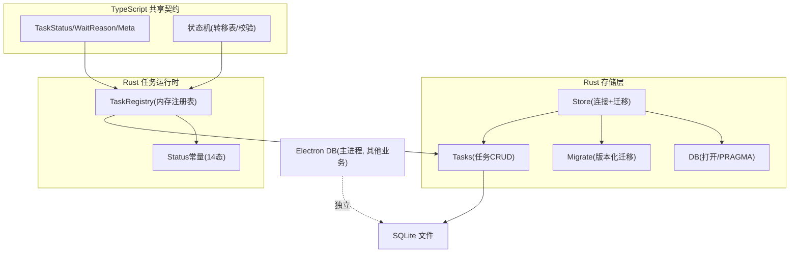
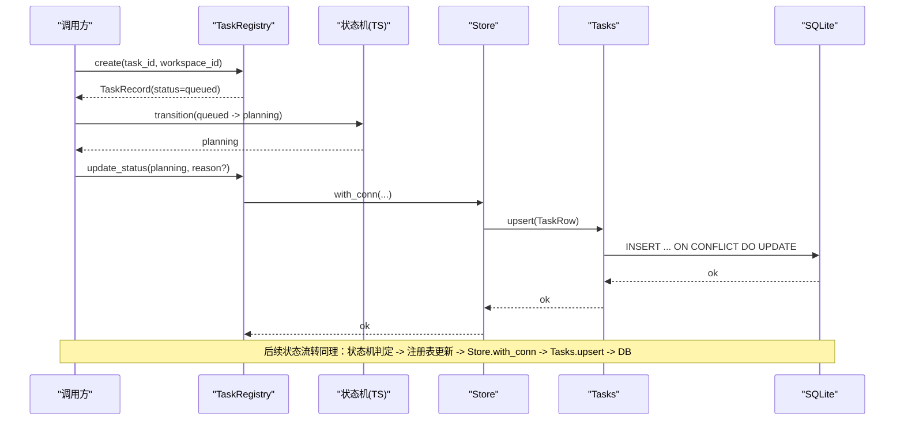
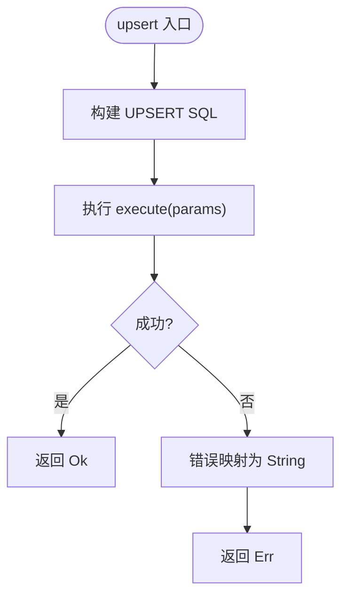
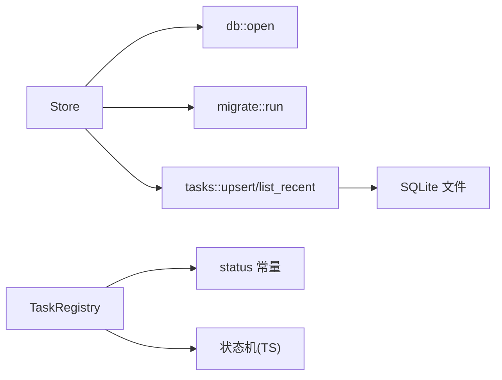

# 任务存储

<cite>
**本文引用的文件**
- [tasks.rs](file://tongtian-tauri/src-tauri/src/store/tasks.rs)
- [db.rs](file://tongtian-tauri/src-tauri/src/store/db.rs)
- [migrate.rs](file://tongtian-tauri/src-tauri/src/store/migrate.rs)
- [mod.rs（store）](file://tongtian-tauri/src-tauri/src/store/mod.rs)
- [registry.rs](file://tongtian-tauri/src-tauri/src/task/registry.rs)
- [task-state-machine.ts](file://tongtian-tauri/src/shared/task-state-machine.ts)
- [types.ts](file://tongtian-tauri/src/shared/types.ts)
- [db.ts（Electron主进程）](file://tongtian-tauri/src/main/store/db.ts)
</cite>

## 目录
1. [简介](#简介)
2. [项目结构](#项目结构)
3. [核心组件](#核心组件)
4. [架构总览](#架构总览)
5. [详细组件分析](#详细组件分析)
6. [依赖关系分析](#依赖关系分析)
7. [性能与索引优化](#性能与索引优化)
8. [故障排查指南](#故障排查指南)
9. [结论](#结论)
10. [附录：使用示例与最佳实践](#附录使用示例与最佳实践)

## 简介
本模块聚焦“任务存储”，涵盖任务数据的持久化机制、状态管理、历史记录与查询优化，并深入说明任务表结构设计、索引策略、分页与复杂条件搜索、增删改查、批量处理、数据同步与冲突解决。同时提供实际使用示例，展示如何高效管理任务生命周期、执行历史追踪与数据分析查询。

## 项目结构
任务存储由 Rust 侧的 SQLite 持久化层与 TypeScript 侧的状态机/类型定义共同构成，并通过内存注册表在进程内协调状态变更与落库。

图表来源
- [mod.rs（store）:18-52](file://tongtian-tauri/src-tauri/src/store/mod.rs#L18-L52)
- [db.rs:16-25](file://tongtian-tauri/src-tauri/src/store/db.rs#L16-L25)
- [migrate.rs:44-73](file://tongtian-tauri/src-tauri/src/store/migrate.rs#L44-L73)
- [tasks.rs:27-95](file://tongtian-tauri/src-tauri/src/store/tasks.rs#L27-L95)
- [registry.rs:44-183](file://tongtian-tauri/src-tauri/src/task/registry.rs#L44-L183)
- [task-state-machine.ts:63-133](file://tongtian-tauri/src/shared/task-state-machine.ts#L63-L133)
- [types.ts:3-25](file://tongtian-tauri/src/shared/types.ts#L3-L25)

章节来源
- [mod.rs（store）:18-52](file://tongtian-tauri/src-tauri/src/store/mod.rs#L18-L52)
- [db.rs:16-25](file://tongtian-tauri/src-tauri/src/store/db.rs#L16-L25)
- [migrate.rs:44-73](file://tongtian-tauri/src-tauri/src/store/migrate.rs#L44-L73)
- [tasks.rs:27-95](file://tongtian-tauri/src-tauri/src/store/tasks.rs#L27-L95)
- [registry.rs:44-183](file://tongtian-tauri/src-tauri/src/task/registry.rs#L44-L183)
- [task-state-machine.ts:63-133](file://tongtian-tauri/src/shared/task-state-machine.ts#L63-L133)
- [types.ts:3-25](file://tongtian-tauri/src/shared/types.ts#L3-L25)

## 核心组件
- Store：聚合数据库连接与密钥保管箱，负责运行目录解析、WAL 模式开启、外键约束启用、迁移执行，并提供 with_conn 短临界区访问。
- Migrate：基于 schema_version 的版本化迁移，幂等创建 tasks、model_configs、settings_kv 等表及索引。
- Tasks：任务表的 upsert 与按更新时间倒序列表查询（支持 limit）。
- TaskRegistry：进程内任务注册表，维护 14 态状态、重试计数、租约、取消标记、wait_reason 子态等，并在状态变更时触发落库。
- 状态机（TS）：集中定义 14 态与 35 条合法转移，提供 canTransition/transition/availableEvents 等纯函数能力，供前端与后端共用。
- 类型（TS）：TaskStatus、WaitReason、TaskMeta 等类型，保证前后端契约一致。

章节来源
- [mod.rs（store）:18-52](file://tongtian-tauri/src-tauri/src/store/mod.rs#L18-L52)
- [migrate.rs:4-41](file://tongtian-tauri/src-tauri/src/store/migrate.rs#L4-L41)
- [tasks.rs:9-95](file://tongtian-tauri/src-tauri/src/store/tasks.rs#L9-L95)
- [registry.rs:12-183](file://tongtian-tauri/src-tauri/src/task/registry.rs#L12-L183)
- [task-state-machine.ts:16-133](file://tongtian-tauri/src/shared/task-state-machine.ts#L16-L133)
- [types.ts:3-61](file://tongtian-tauri/src/shared/types.ts#L3-L61)

## 架构总览
任务从提交到归档的生命周期由状态机驱动，状态变更通过注册表记录，再同步至 SQLite 持久化。关键流程如下：

图表来源
- [registry.rs:68-119](file://tongtian-tauri/src-tauri/src/task/registry.rs#L68-L119)
- [task-state-machine.ts:157-201](file://tongtian-tauri/src/shared/task-state-machine.ts#L157-L201)
- [tasks.rs:27-59](file://tongtian-tauri/src-tauri/src/store/tasks.rs#L27-L59)
- [mod.rs（store）:43-47](file://tongtian-tauri/src-tauri/src/store/mod.rs#L43-L47)

## 详细组件分析

### 任务表结构与字段设计
- 表名：tasks
- 主键：task_id
- 关键字段：workspace_id、title、status、wait_reason、retry_count、status_reason_code、queue_position、created_at_ms、updated_at_ms
- 设计要点：
  - status 对齐 14 态；wait_reason 表达 executing 子态或排队成因；retry_count 用于重试上限控制；status_reason_code 记录状态成因码；queue_position 本地恒为 0（local-first 退化）。
  - created_at_ms/updated_at_ms 用于排序与审计。

章节来源
- [migrate.rs:22-34](file://tongtian-tauri/src-tauri/src/store/migrate.rs#L22-L34)
- [tasks.rs:9-25](file://tongtian-tauri/src-tauri/src/store/tasks.rs#L9-L25)
- [registry.rs:12-39](file://tongtian-tauri/src-tauri/src/task/registry.rs#L12-L39)
- [types.ts:3-61](file://tongtian-tauri/src/shared/types.ts#L3-L61)

### 状态管理与转移规则
- 14 态：idle、queued、planning、pending_review、executing、paused、budget_paused、retry_pending、delivering、done、failed、rolled_back、cancelled、archived。
- 35 条合法转移，覆盖重试耗尽、预算暂停、租约丢失、审阅超时、回滚续跑等场景。
- wait_reason 作为 executing 子态或排队成因，避免状态爆炸。
- 重试上限 MAX_RETRY_COUNT=3，超过后走失败路径。

章节来源
- [task-state-machine.ts:63-133](file://tongtian-tauri/src/shared/task-state-machine.ts#L63-L133)
- [task-state-machine.ts:141-201](file://tongtian-tauri/src/shared/task-state-machine.ts#L141-L201)
- [types.ts:3-61](file://tongtian-tauri/src/shared/types.ts#L3-L61)

### 持久化：Upsert 与最近列表
- upsert：INSERT ... ON CONFLICT(task_id) DO UPDATE，标题空值保护，其余字段覆盖更新，确保幂等与一致性。
- list_recent：ORDER BY updated_at_ms DESC，支持可选 limit 实现分页首屏。

图表来源
- [tasks.rs:27-59](file://tongtian-tauri/src-tauri/src/store/tasks.rs#L27-L59)

章节来源
- [tasks.rs:27-95](file://tongtian-tauri/src-tauri/src/store/tasks.rs#L27-L95)

### 数据同步：内存注册表与 DB 的一致性
- 注册表维护当前任务状态、重试次数、租约、取消标记、wait_reason 等。
- 每次状态变更会递增 revision 并更新时间戳，随后通过 Store.with_conn 调用 Tasks.upsert 落库。
- 重启后从 DB 恢复任务摘要（含 14 态 meta 字段），保证状态可恢复。

章节来源
- [registry.rs:68-183](file://tongtian-tauri/src-tauri/src/task/registry.rs#L68-L183)
- [tasks.rs:1-5](file://tongtian-tauri/src-tauri/src/store/tasks.rs#L1-L5)
- [mod.rs（store）:24-52](file://tongtian-tauri/src-tauri/src/store/mod.rs#L24-L52)

### 查询与分页
- 最近列表：list_recent(limit?) 按 updated_at_ms 倒序，适合聊天历史首屏。
- 分页建议：结合应用层 offset/limit 或基于 updated_at_ms 的分页游标（推荐时间游标以避免深分页开销）。
- 复杂条件搜索：可在应用层组合 WHERE 条件（如 status、workspace_id、updated_at_ms 范围），必要时增加复合索引。

章节来源
- [tasks.rs:61-95](file://tongtian-tauri/src-tauri/src/store/tasks.rs#L61-L95)

### 批量处理
- 当前实现以单行 upsert 为主。批量场景可通过事务包裹多次 upsert，减少提交开销。
- 建议在调用方封装 batch_upsert(tasks[])，统一事务边界与错误回滚。

[本节为通用指导，不直接分析具体文件]

### 数据同步与冲突解决
- 乐观锁：注册表中的 revision 单调递增，可用于检测并发写冲突（例如比较版本号后再更新）。
- 幂等性：upsert 基于 task_id 主键，重复写入不会破坏一致性。
- 本地优先：本地 queued 停留目标 <100ms，减少队列竞争；云端接入时可无缝切换。

章节来源
- [registry.rs:100-119](file://tongtian-tauri/src-tauri/src/task/registry.rs#L100-L119)
- [tasks.rs:27-59](file://tongtian-tauri/src-tauri/src/store/tasks.rs#L27-L59)
- [task-state-machine.ts:54-56](file://tongtian-tauri/src/shared/task-state-machine.ts#L54-L56)

### 历史记录与审计
- 任务表包含 created_at_ms/updated_at_ms，便于回溯。
- 若需更细粒度执行历史，可结合消息/步骤表（见 Electron 主进程 db.ts 中 messages/file_ops 等表）进行关联查询与分析。

章节来源
- [db.ts:68-280](file://tongtian-tauri/src/main/store/db.ts#L68-L280)

## 依赖关系分析
- Store 依赖 db::open 与 migrate::run，提供统一的连接与迁移入口。
- Tasks 依赖 Store 提供的 with_conn 执行 SQL。
- TaskRegistry 依赖状态常量与状态机（TS）的转移规则，保证状态合法性。
- 状态机与类型定义位于 shared，被 TS 与 Rust 侧契约文档复用，降低耦合。

图表来源
- [mod.rs（store）:18-52](file://tongtian-tauri/src-tauri/src/store/mod.rs#L18-L52)
- [tasks.rs:27-95](file://tongtian-tauri/src-tauri/src/store/tasks.rs#L27-L95)
- [registry.rs:44-183](file://tongtian-tauri/src-tauri/src/task/registry.rs#L44-L183)
- [task-state-machine.ts:63-133](file://tongtian-tauri/src/shared/task-state-machine.ts#L63-L133)

章节来源
- [mod.rs（store）:18-52](file://tongtian-tauri/src-tauri/src/store/mod.rs#L18-L52)
- [tasks.rs:27-95](file://tongtian-tauri/src-tauri/src/store/tasks.rs#L27-L95)
- [registry.rs:44-183](file://tongtian-tauri/src-tauri/src/task/registry.rs#L44-L183)
- [task-state-machine.ts:63-133](file://tongtian-tauri/src/shared/task-state-machine.ts#L63-L133)

## 性能与索引优化
- WAL 模式：提升并发读性能，减少写阻塞。
- 外键约束：保证引用完整性。
- 现有索引：
  - tasks.updated_at_ms 降序索引，加速最近列表。
  - 其他业务表索引（messages、audit_logs、workspaces 等）用于关联查询与筛选。
- 建议优化：
  - 针对高频查询增加复合索引，如 (workspace_id, status)、(workspace_id, updated_at_ms)。
  - 对大表采用时间游标分页替代 deep offset。
  - 批量写入使用事务包裹，减少提交次数。

章节来源
- [db.rs:16-25](file://tongtian-tauri/src-tauri/src/store/db.rs#L16-L25)
- [migrate.rs:34-34](file://tongtian-tauri/src-tauri/src/store/migrate.rs#L34-L34)
- [db.ts:263-280](file://tongtian-tauri/src/main/store/db.ts#L263-L280)

## 故障排查指南
- 常见错误：
  - STORE_OPEN_FAILED / STORE_PRAGMA_FAILED：检查数据库路径权限与 PRAGMA 设置。
  - STORE_MIGRATE_FAILED / STORE_MIGRATE_V*_FAILED：检查迁移脚本与 schema_version。
  - IllegalTransitionError：状态转移非法，检查 from/event/to 是否在 35 条转移表中。
- 定位方法：
  - 查看 Store.open_default 与 with_conn 的错误传播链。
  - 核对 TaskRegistry.update_status 与状态机 canTransition/transition 的输入参数。
  - 确认 upsert 的字段映射与类型转换是否正确。

章节来源
- [db.rs:16-25](file://tongtian-tauri/src-tauri/src/store/db.rs#L16-L25)
- [migrate.rs:44-73](file://tongtian-tauri/src-tauri/src/store/migrate.rs#L44-L73)
- [task-state-machine.ts:147-201](file://tongtian-tauri/src/shared/task-state-machine.ts#L147-L201)
- [tasks.rs:27-59](file://tongtian-tauri/src-tauri/src/store/tasks.rs#L27-L59)

## 结论
该任务存储模块以 SQLite 为核心，结合内存注册表与严格的状态机，实现了高可靠的任务生命周期管理。通过 WAL 模式、外键约束与版本化迁移，保证了并发性能与数据一致性。未来可按需扩展复合索引与批量接口，进一步提升查询与写入效率。

[本节为总结性内容，不直接分析具体文件]

## 附录：使用示例与最佳实践

- 创建任务并提交
  - 调用 TaskRegistry.create 生成 queued 记录，随后通过状态机转移到 planning/executing/delivering/done/failed/archived。
  - 每次状态变更调用 TaskRegistry.update_status，内部递增 revision 并触发 upsert 落库。

- 查询最近任务
  - 使用 list_recent(limit?) 获取按更新时间倒序的任务列表，适合聊天历史首屏。

- 分页与复杂搜索
  - 应用层组合 WHERE 条件（如 workspace_id、status、updated_at_ms 范围），必要时添加复合索引。
  - 推荐使用 updated_at_ms 作为游标进行分页，避免深分页。

- 批量处理
  - 将多次 upsert 放入同一事务，减少提交开销与不一致风险。

- 冲突解决
  - 利用 revision 进行乐观锁判断，避免覆盖最新状态。
  - 利用 upsert 的主键幂等特性，确保重复写入安全。

- 历史追踪与数据分析
  - 结合任务表的时间字段与消息/步骤表，构建执行历史视图。
  - 使用索引与合理查询计划，提高分析查询性能。

章节来源
- [registry.rs:68-183](file://tongtian-tauri/src-tauri/src/task/registry.rs#L68-L183)
- [tasks.rs:27-95](file://tongtian-tauri/src-tauri/src/store/tasks.rs#L27-L95)
- [task-state-machine.ts:63-133](file://tongtian-tauri/src/shared/task-state-machine.ts#L63-L133)
- [db.ts:263-280](file://tongtian-tauri/src/main/store/db.ts#L263-L280)