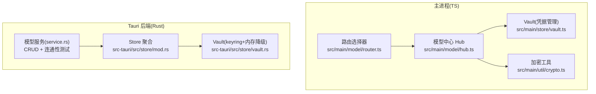
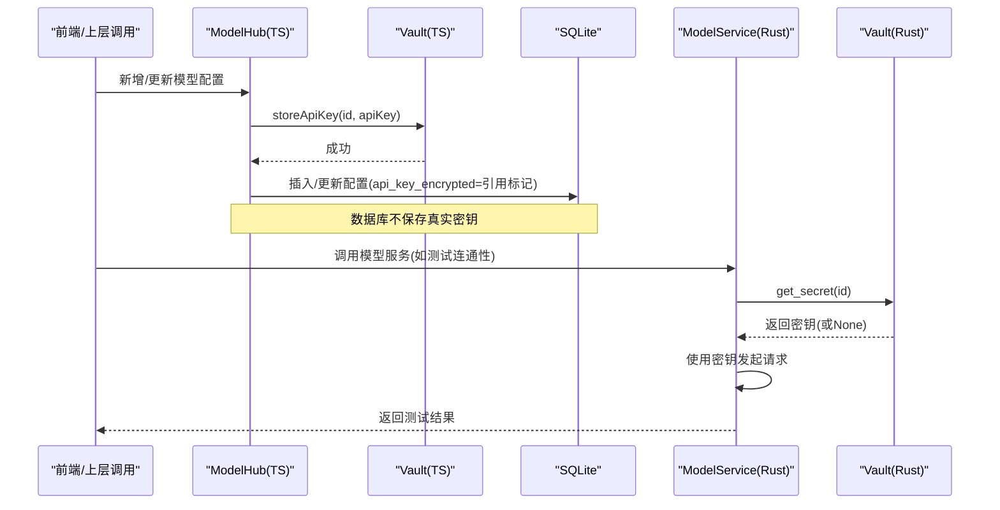
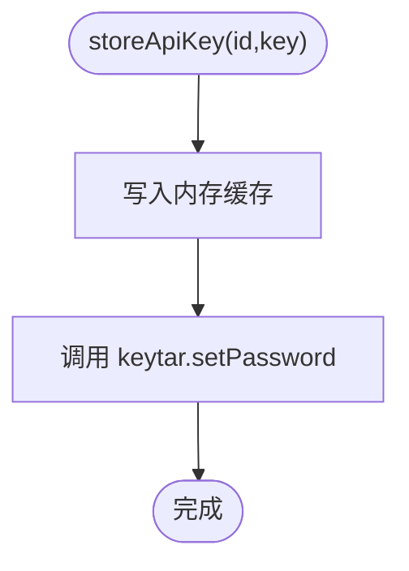
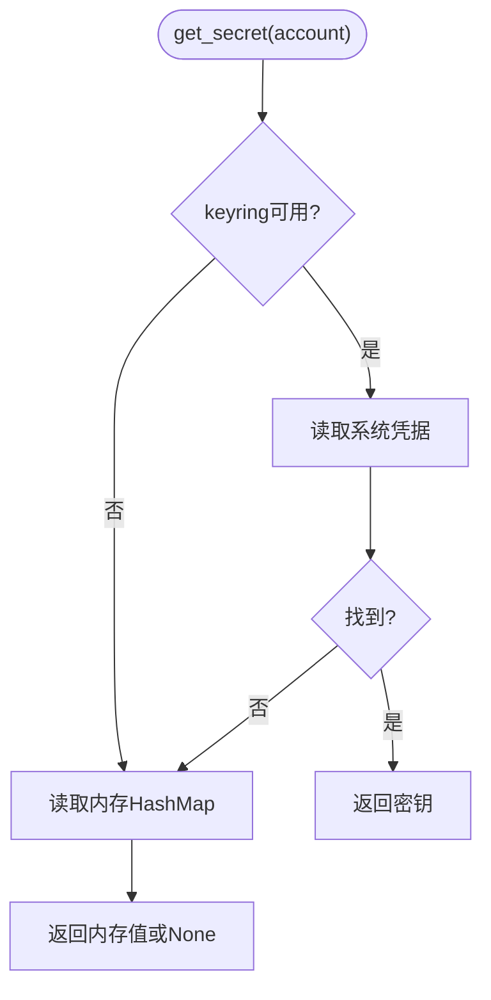
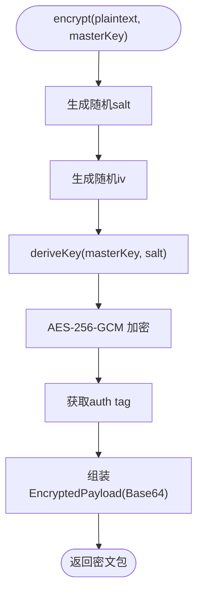
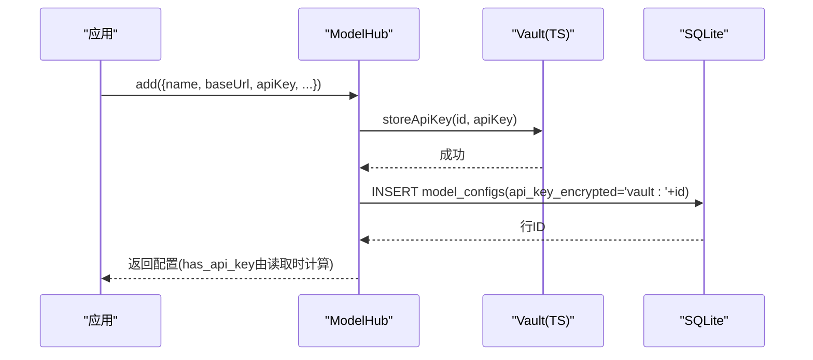
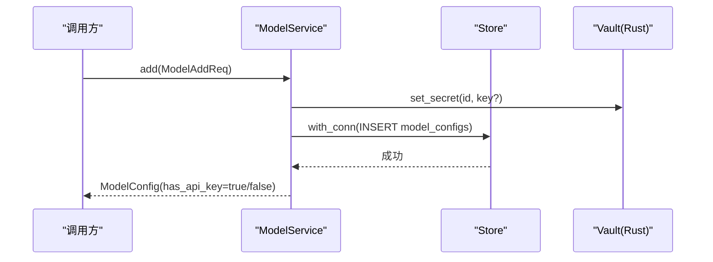
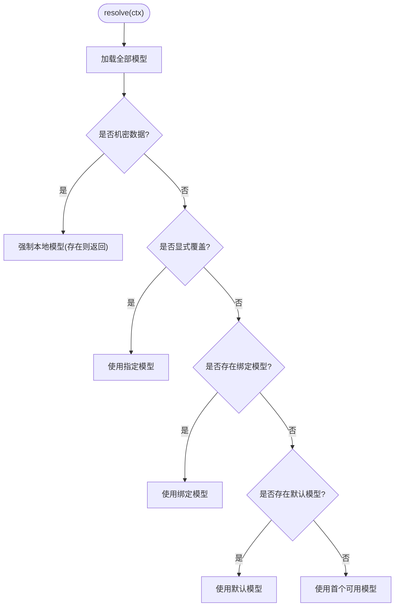
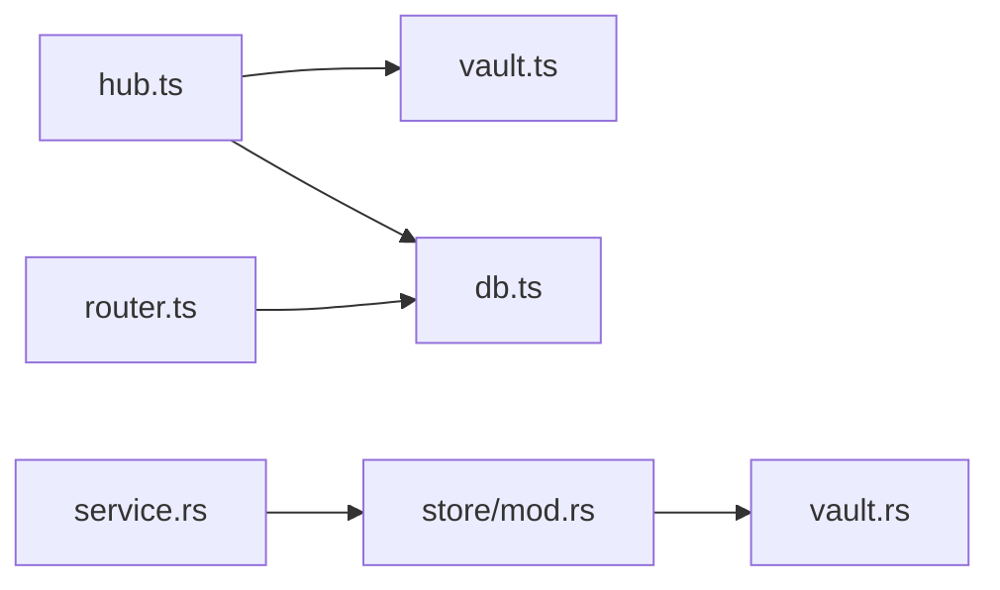

# 密钥保管箱

<cite>
**本文引用的文件**
- [vault.ts](file://tongtian-tauri/src/main/store/vault.ts)
- [crypto.ts](file://tongtian-tauri/src/main/util/crypto.ts)
- [hub.ts](file://tongtian-tauri/src/main/model/hub.ts)
- [router.ts](file://tongtian-tauri/src/main/model/router.ts)
- [service.rs](file://tongtian-tauri/src-tauri/src/model/service.rs)
- [vault.rs](file://tongtian-tauri/src-tauri/src/store/vault.rs)
- [mod.rs](file://tongtian-tauri/src-tauri/src/store/mod.rs)
</cite>

## 目录
1. [简介](#简介)
2. [项目结构](#项目结构)
3. [核心组件](#核心组件)
4. [架构总览](#架构总览)
5. [详细组件分析](#详细组件分析)
6. [依赖关系分析](#依赖关系分析)
7. [性能与安全考量](#性能与安全考量)
8. [故障排查指南](#故障排查指南)
9. [结论](#结论)
10. [附录：API 与使用示例](#附录api-与使用示例)

## 简介
本模块提供“密钥保管箱”能力，用于安全地存储和访问敏感信息（如 API Key）。其设计遵循以下原则：
- 敏感数据不落库、不落盘：通过操作系统级密钥环（keyring）或内存降级进行保护。
- 最小暴露面：仅在进程运行时持有明文密钥，进程退出即清理。
- 可审计与可回滚：对增删改操作进行日志记录；支持密钥轮换与撤销。
- 加密工具层：提供 AES-256-GCM 加解密与 scrypt 密钥派生，便于未来扩展备份加密等场景。

## 项目结构
密钥保管箱横跨前端主进程（TypeScript）与 Tauri Rust 后端，形成双端一致的密钥管理策略：
- TypeScript 侧：基于 keytar 的凭据管理器，提供内存缓存与 mock 降级。
- Rust 侧：基于 keyring 的凭据管理器，提供内存降级与统一 Store 聚合。
- 模型服务：在 CRUD 过程中将 API Key 写入/读取 vault，并在数据库中仅保存引用标记或空占位。
- 加密工具：提供 AES-256-GCM 加解密与 scrypt 密钥派生，供后续备份/迁移使用。

图表来源
- [vault.ts:1-137](file://tongtian-tauri/src/main/store/vault.ts#L1-L137)
- [crypto.ts:1-105](file://tongtian-tauri/src/main/util/crypto.ts#L1-L105)
- [hub.ts:1-374](file://tongtian-tauri/src/main/model/hub.ts#L1-L374)
- [router.ts:1-318](file://tongtian-tauri/src/main/model/router.ts#L1-L318)
- [mod.rs:1-105](file://tongtian-tauri/src-tauri/src/store/mod.rs#L1-L105)
- [vault.rs:1-119](file://tongtian-tauri/src-tauri/src/store/vault.rs#L1-L119)
- [service.rs:1-612](file://tongtian-tauri/src-tauri/src/model/service.rs#L1-L612)

章节来源
- [vault.ts:1-137](file://tongtian-tauri/src/main/store/vault.ts#L1-L137)
- [crypto.ts:1-105](file://tongtian-tauri/src/main/util/crypto.ts#L1-L105)
- [hub.ts:1-374](file://tongtian-tauri/src/main/model/hub.ts#L1-L374)
- [router.ts:1-318](file://tongtian-tauri/src/main/model/router.ts#L1-L318)
- [mod.rs:1-105](file://tongtian-tauri/src-tauri/src/store/mod.rs#L1-L105)
- [vault.rs:1-119](file://tongtian-tauri/src-tauri/src/store/vault.rs#L1-L119)
- [service.rs:1-612](file://tongtian-tauri/src-tauri/src/model/service.rs#L1-L612)

## 核心组件
- 凭据管理器（TS Vault）
  - 封装 keytar 调用，提供 set/get/delete/clear 接口。
  - 维护进程内内存缓存，减少系统凭据管理器开销。
  - 支持 MOCK_VAULT=true 时以内存 Map 替代，便于测试与无头环境。
- 凭据管理器（Rust Vault）
  - 优先使用 OS keyring，失败时自动降级到内存 HashMap。
  - 提供 set/get/delete 语义，保证“密钥不落库”。
- 加密工具（AES-256-GCM + scrypt）
  - 提供 deriveKey、encrypt、decrypt 函数。
  - 随机 salt/iv/tag，确保相同明文每次加密结果不同。
- 模型中心（Hub）
  - 负责模型配置的 CRUD，并将 API Key 存入 TS Vault。
  - 数据库字段 api_key_encrypted 仅保存引用标记（如 vault:id），不存真实密钥。
- 模型服务（Rust service）
  - 在 add/update/delete 中同步更新 vault 中的密钥。
  - 列表/查询返回 has_api_key 标志，指示是否已配置密钥。
- 路由选择器（Router）
  - 根据敏感度、绑定关系、默认模型选择目标模型，为后续调用链提供上下文。

章节来源
- [vault.ts:1-137](file://tongtian-tauri/src/main/store/vault.ts#L1-L137)
- [vault.rs:1-119](file://tongtian-tauri/src-tauri/src/store/vault.rs#L1-L119)
- [crypto.ts:1-105](file://tongtian-tauri/src/main/util/crypto.ts#L1-L105)
- [hub.ts:1-374](file://tongtian-tauri/src/main/model/hub.ts#L1-L374)
- [service.rs:1-612](file://tongtian-tauri/src-tauri/src/model/service.rs#L1-L612)
- [router.ts:1-318](file://tongtian-tauri/src/main/model/router.ts#L1-L318)

## 架构总览
下图展示了从上层业务到凭据管理的完整调用链，以及 TS/Rust 两侧如何协同实现“密钥不落库”的策略。

图表来源
- [hub.ts:125-161](file://tongtian-tauri/src/main/model/hub.ts#L125-L161)
- [vault.ts:75-117](file://tongtian-tauri/src/main/store/vault.ts#L75-L117)
- [service.rs:177-215](file://tongtian-tauri/src-tauri/src/model/service.rs#L177-L215)
- [vault.rs:38-69](file://tongtian-tauri/src-tauri/src/store/vault.rs#L38-L69)

## 详细组件分析

### 凭据管理器（TS Vault）
- 功能要点
  - 通过 keytar 访问系统凭据管理器；若不可用则启用内存 mock。
  - 进程内缓存 id→apiKey，降低频繁系统调用成本。
  - 提供 clearAll 清理所有凭据，进程退出时清理内存缓存。
- 安全要点
  - 仅以 id 作为账户名存取密钥，避免明文落库。
  - 支持环境变量控制 mock，便于 CI/无头环境测试。
- 复杂度
  - 单次存取 O(1)，clearAll 遍历当前服务名下凭据条目。

图表来源
- [vault.ts:75-81](file://tongtian-tauri/src/main/store/vault.ts#L75-L81)

章节来源
- [vault.ts:1-137](file://tongtian-tauri/src/main/store/vault.ts#L1-L137)

### 凭据管理器（Rust Vault）
- 功能要点
  - 优先使用 keyring::Entry 读写系统凭据；失败时降级到内存 HashMap。
  - 提供 set/get/delete 三态操作，并记录 keyring 不可用状态以避免重复告警。
- 安全要点
  - 明确“密钥不落库”，DB 仅保存 has_api_key 引用标记。
- 复杂度
  - 单次存取 O(1)，错误路径快速降级。

图表来源
- [vault.rs:55-69](file://tongtian-tauri/src-tauri/src/store/vault.rs#L55-L69)

章节来源
- [vault.rs:1-119](file://tongtian-tauri/src-tauri/src/store/vault.rs#L1-L119)
- [mod.rs:18-51](file://tongtian-tauri/src-tauri/src/store/mod.rs#L18-L51)

### 加密工具（AES-256-GCM + scrypt）
- 算法选择
  - 对称加密：AES-256-GCM（提供机密性与完整性校验）。
  - 密钥派生：scrypt（N=16384, r=8, p=1），抵御暴力破解。
- 数据结构
  - EncryptedPayload 包含 encrypted/iv/salt/tag，全部 Base64 编码。
- 使用建议
  - 每次加密生成随机 salt/iv，tag 用于验证完整性。
  - masterKey 应来自高熵源（如用户口令或硬件密钥），不应硬编码。

图表来源
- [crypto.ts:27-75](file://tongtian-tauri/src/main/util/crypto.ts#L27-L75)

章节来源
- [crypto.ts:1-105](file://tongtian-tauri/src/main/util/crypto.ts#L1-L105)

### 模型中心（Hub）与数据库约定
- 职责
  - 新增/更新时将 API Key 写入 TS Vault；数据库字段 api_key_encrypted 仅保存引用标记（如 vault:id）。
  - 删除时同时清理 Vault 中的密钥。
- 数据流
  - 创建流程：生成 UUID → 写入 Vault → 插入 DB（引用标记）→ 返回配置。
  - 更新流程：可选覆盖密钥 → 动态更新其他字段 → 返回配置。
  - 删除流程：先删 Vault → 再删 DB 记录。

图表来源
- [hub.ts:125-161](file://tongtian-tauri/src/main/model/hub.ts#L125-L161)
- [hub.ts:166-218](file://tongtian-tauri/src/main/model/hub.ts#L166-L218)
- [hub.ts:220-241](file://tongtian-tauri/src/main/model/hub.ts#L220-L241)

章节来源
- [hub.ts:1-374](file://tongtian-tauri/src/main/model/hub.ts#L1-L374)

### 模型服务（Rust service）
- 职责
  - 在 add/update/delete 中同步更新 Rust Vault 中的密钥。
  - 列表/查询时通过 vault.get_secret 判断 has_api_key。
  - 提供连通性测试（OpenAI 兼容 /chat/completions），带超时与错误分类。
- 关键行为
  - 添加时：若有 api_key 则写入 vault；否则不改变。
  - 更新时：空串表示清除密钥；非空则覆盖。
  - 删除时：删除 DB 记录后，调用 vault.delete_secret。

图表来源
- [service.rs:177-215](file://tongtian-tauri/src-tauri/src/model/service.rs#L177-L215)
- [service.rs:261-329](file://tongtian-tauri/src-tauri/src/model/service.rs#L261-L329)

章节来源
- [service.rs:1-612](file://tongtian-tauri/src-tauri/src/model/service.rs#L1-L612)

### 路由选择器（Router）
- 职责
  - 根据内容敏感度、Agent 绑定、全局默认选择模型。
  - 为后续调用提供明确的决策原因与审计事件。
- 与密钥保管箱的关系
  - 路由本身不直接访问密钥，但所选模型的配置可能关联 vault 中的密钥，由上层在调用时按需取用。

图表来源
- [router.ts:139-247](file://tongtian-tauri/src/main/model/router.ts#L139-L247)

章节来源
- [router.ts:1-318](file://tongtian-tauri/src/main/model/router.ts#L1-L318)

## 依赖关系分析
- TS 侧
  - hub.ts 依赖 vault.ts（凭据）、db.ts（持久化）、logger.ts（日志）。
  - router.ts 依赖 db.ts 与类型定义，决定模型选择策略。
- Rust 侧
  - service.rs 依赖 store/mod.rs（聚合 Store）与 store/vault.rs（凭据）。
  - store/mod.rs 组合 SQLite 连接与 Vault，提供统一访问入口。
- 外部依赖
  - TS：keytar（系统凭据），Node crypto（加密工具）。
  - Rust：keyring（系统凭据），rusqlite（SQLite）。

图表来源
- [hub.ts:1-374](file://tongtian-tauri/src/main/model/hub.ts#L1-L374)
- [router.ts:1-318](file://tongtian-tauri/src/main/model/router.ts#L1-L318)
- [service.rs:1-612](file://tongtian-tauri/src-tauri/src/model/service.rs#L1-L612)
- [mod.rs:1-105](file://tongtian-tauri/src-tauri/src/store/mod.rs#L1-L105)

章节来源
- [hub.ts:1-374](file://tongtian-tauri/src/main/model/hub.ts#L1-L374)
- [router.ts:1-318](file://tongtian-tauri/src/main/model/router.ts#L1-L318)
- [service.rs:1-612](file://tongtian-tauri/src-tauri/src/model/service.rs#L1-L612)
- [mod.rs:1-105](file://tongtian-tauri/src-tauri/src/store/mod.rs#L1-L105)

## 性能与安全考量
- 性能
  - 进程内缓存减少系统凭据管理器调用频率。
  - Rust 侧 keyring 不可用时快速降级到内存，避免阻塞。
  - 连通性测试设置超时，防止长尾阻塞。
- 安全
  - 密钥不落库：数据库仅保存引用标记或空占位。
  - 最小暴露：仅在需要时从 vault 读取明文，用完即释放。
  - 加密工具：AES-256-GCM + scrypt，适合未来备份/迁移加密。
  - 权限控制：通过模型绑定与敏感度检测限制敏感数据的处理路径。
- 运维
  - 支持 MOCK_VAULT 环境变量，便于无头环境与测试。
  - 进程退出时清理内存缓存，避免残留明文。

[本节为通用指导，无需具体文件来源]

## 故障排查指南
- 无法访问系统凭据管理器
  - 现象：TS 侧 keytar 加载失败或 Rust 侧 keyring 报错。
  - 处理：启用 MOCK_VAULT=true（TS）或自动降级到内存（Rust）；确认运行环境具备凭据管理服务。
- 密钥未生效
  - 现象：has_api_key=false 或调用鉴权失败。
  - 处理：检查 add/update 是否传入 api_key；确认 vault 中对应 id 的密钥已写入；必要时执行 clearAll 重新配置。
- 连通性测试失败
  - 现象：test 返回连接失败或认证失败。
  - 处理：核对 base_url 与 api_key；检查网络与代理；查看错误码区分 401/403 与连接问题。
- 数据不一致
  - 现象：DB 有记录但 vault 无密钥，或反之。
  - 处理：通过 delete 清理后重新 add；或在 update 中显式传入空串清除密钥。

章节来源
- [vault.ts:17-25](file://tongtian-tauri/src/main/store/vault.ts#L17-L25)
- [vault.rs:30-52](file://tongtian-tauri/src-tauri/src/store/vault.rs#L30-L52)
- [service.rs:347-421](file://tongtian-tauri/src-tauri/src/model/service.rs#L347-L421)

## 结论
本密钥保管箱模块通过“系统凭据优先 + 内存降级”的双保险机制，实现了敏感信息的本地安全存储与最小化暴露。结合 AES-256-GCM 与 scrypt 的加密工具层，为未来的备份加密与灾难恢复提供了坚实基础。上层模型管理与路由策略确保了敏感数据处理的合规性与可审计性。

[本节为总结，无需具体文件来源]

## 附录：API 与使用示例
以下为典型操作流程的代码片段路径，便于快速定位实现细节：

- 新增模型并安全存储 API Key
  - 参考路径：[新增模型（TS）:125-161](file://tongtian-tauri/src/main/model/hub.ts#L125-L161)
  - 参考路径：[新增模型（Rust）:177-215](file://tongtian-tauri/src-tauri/src/model/service.rs#L177-L215)
- 更新/轮换密钥
  - 参考路径：[更新模型（TS）:166-218](file://tongtian-tauri/src/main/model/hub.ts#L166-L218)
  - 参考路径：[更新模型（Rust）:261-316](file://tongtian-tauri/src-tauri/src/model/service.rs#L261-L316)
- 撤销/删除密钥
  - 参考路径：[删除模型（TS）:220-241](file://tongtian-tauri/src/main/model/hub.ts#L220-L241)
  - 参考路径：[删除模型（Rust）:318-329](file://tongtian-tauri/src-tauri/src/model/service.rs#L318-L329)
- 读取密钥（按 ID）
  - 参考路径：[读取密钥（TS）:83-98](file://tongtian-tauri/src/main/store/vault.ts#L83-L98)
  - 参考路径：[读取密钥（Rust）:55-69](file://tongtian-tauri/src-tauri/src/store/vault.rs#L55-L69)
- 清空所有密钥
  - 参考路径：[清空凭据（TS）:108-117](file://tongtian-tauri/src/main/store/vault.ts#L108-L117)
- 加密/解密（备份/迁移）
  - 参考路径：[加密:55-75](file://tongtian-tauri/src/main/util/crypto.ts#L55-L75)
  - 参考路径：[解密:87-104](file://tongtian-tauri/src/main/util/crypto.ts#L87-L104)

章节来源
- [hub.ts:125-241](file://tongtian-tauri/src/main/model/hub.ts#L125-L241)
- [service.rs:177-329](file://tongtian-tauri/src-tauri/src/model/service.rs#L177-L329)
- [vault.ts:83-117](file://tongtian-tauri/src/main/store/vault.ts#L83-L117)
- [vault.rs:55-69](file://tongtian-tauri/src-tauri/src/store/vault.rs#L55-L69)
- [crypto.ts:55-104](file://tongtian-tauri/src/main/util/crypto.ts#L55-L104)