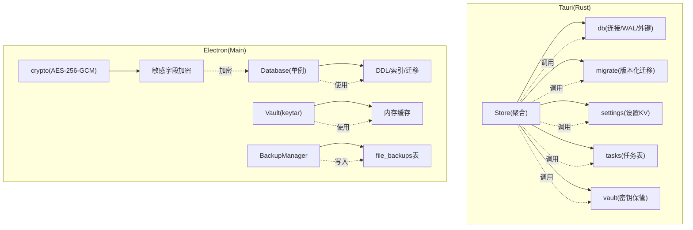
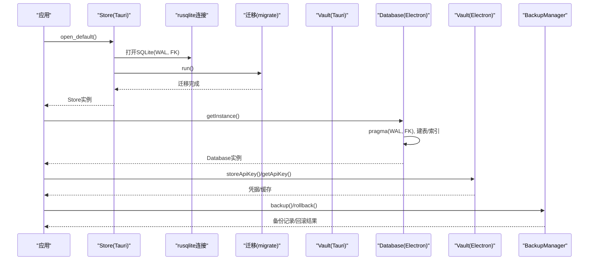
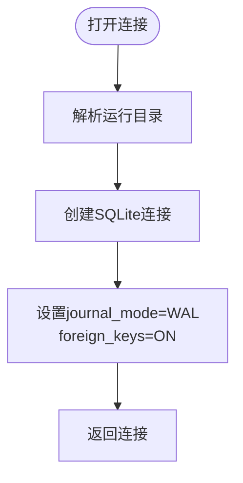
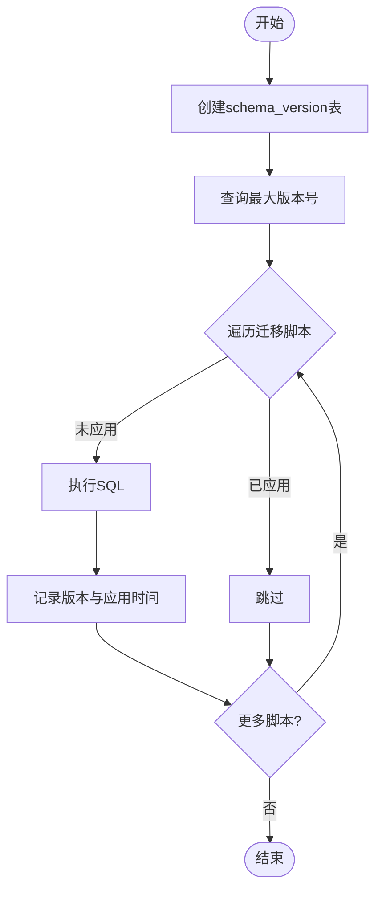
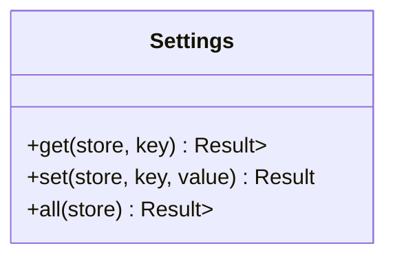
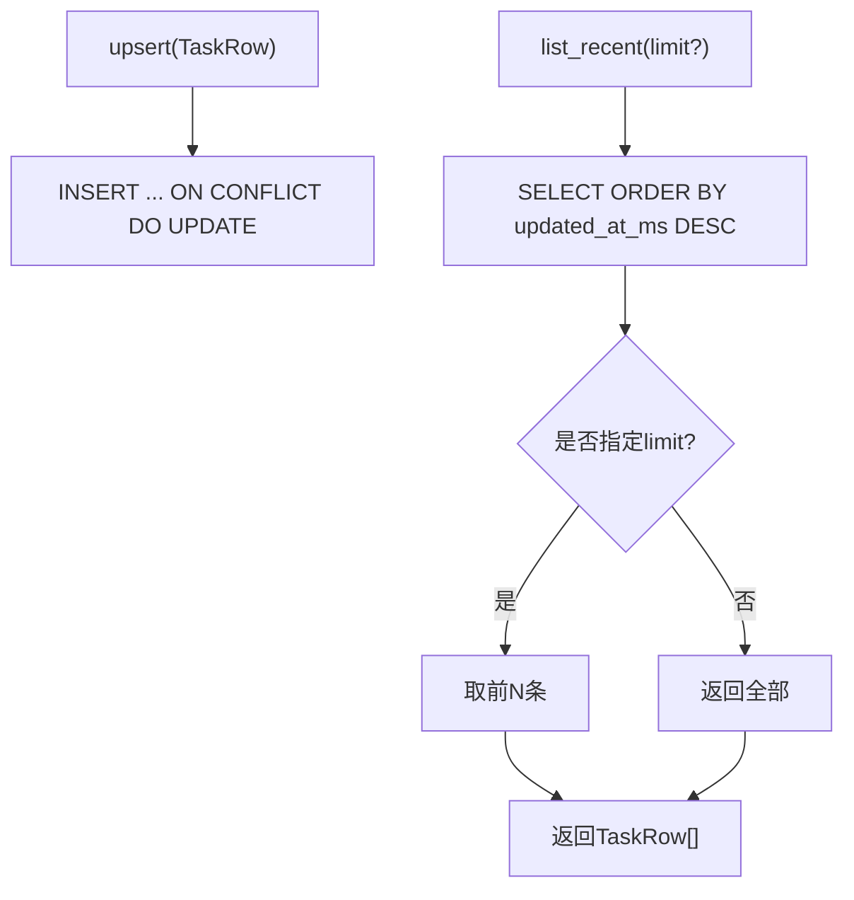
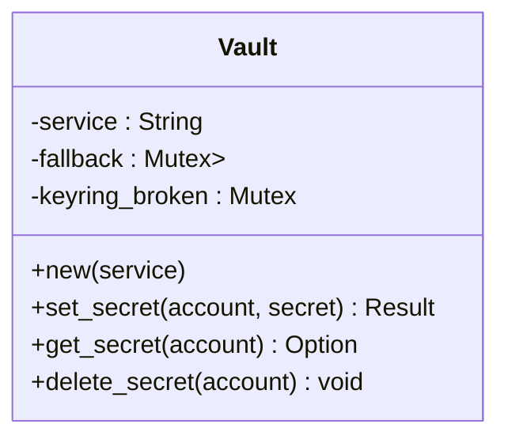
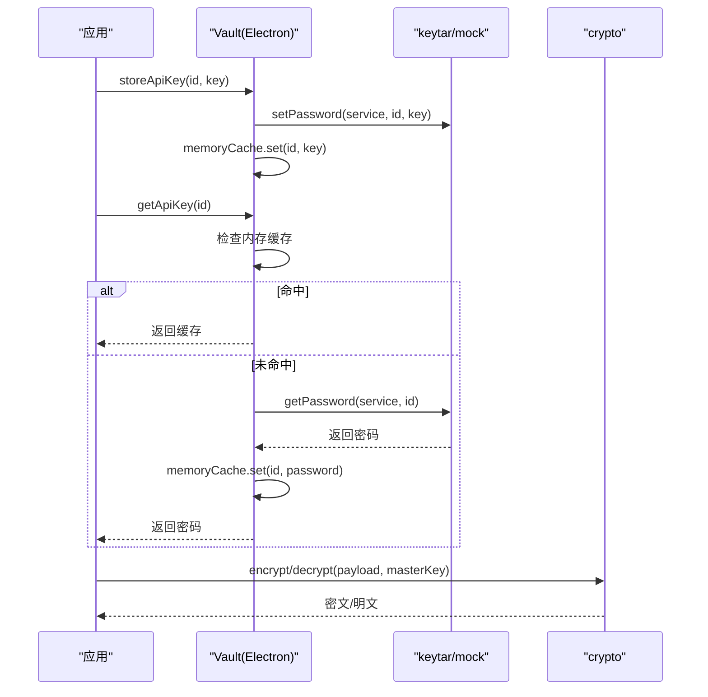
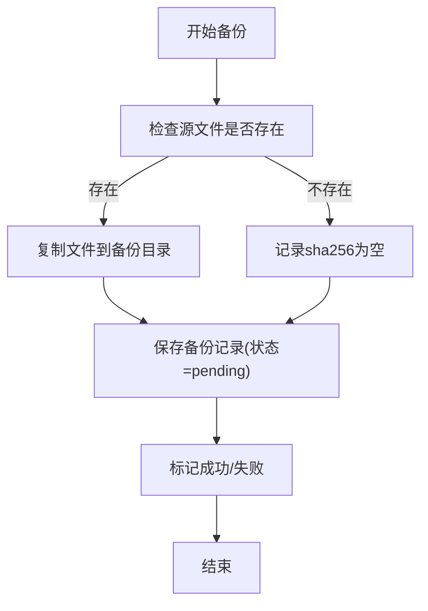
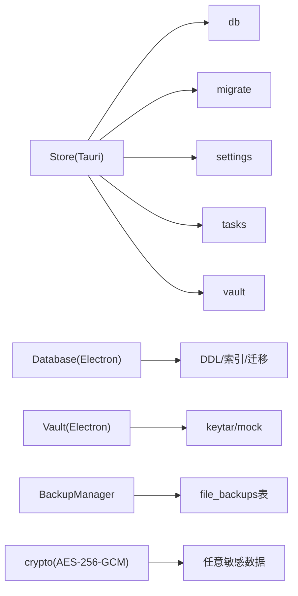

# 数据存储模块

<cite>
**本文引用的文件**
- [src-tauri/src/store/mod.rs](file://tongtian-tauri/src-tauri/src/store/mod.rs)
- [src-tauri/src/store/db.rs](file://tongtian-tauri/src-tauri/src/store/db.rs)
- [src-tauri/src/store/migrate.rs](file://tongtian-tauri/src-tauri/src/store/migrate.rs)
- [src-tauri/src/store/settings.rs](file://tongtian-tauri/src-tauri/src/store/settings.rs)
- [src-tauri/src/store/tasks.rs](file://tongtian-tauri/src-tauri/src/store/tasks.rs)
- [src-tauri/src/store/vault.rs](file://tongtian-tauri/src-tauri/src/store/vault.rs)
- [src/main/store/db.ts](file://tongtian-tauri/src/main/store/db.ts)
- [src/main/store/vault.ts](file://tongtian-tauri/src/main/store/vault.ts)
- [src/main/util/crypto.ts](file://tongtian-tauri/src/main/util/crypto.ts)
- [src/main/file/backup.ts](file://tongtian-tauri/src/main/file/backup.ts)
</cite>

## 目录
1. [简介](#简介)
2. [项目结构](#项目结构)
3. [核心组件](#核心组件)
4. [架构总览](#架构总览)
5. [详细组件分析](#详细组件分析)
6. [依赖关系分析](#依赖关系分析)
7. [性能考虑](#性能考虑)
8. [故障排查指南](#故障排查指南)
9. [结论](#结论)
10. [附录](#附录)

## 简介
本模块围绕 SQLite 持久化、版本化迁移、密钥保管与加密存储，提供跨进程（Rust Tauri 与 Electron main）的数据存取能力。重点覆盖：
- 数据库设计与表结构
- 索引优化与查询路径
- 事务管理与并发访问控制
- 数据备份与恢复机制
- 密钥安全存储方案（系统凭据管理器 + 内存降级）
- 性能调优建议（WAL、外键、连接锁、批量操作等）

## 项目结构
存储相关代码分布在两条技术栈中：
- Rust Tauri 侧：以 rusqlite 为核心，提供 Store 聚合、迁移、设置与任务表读写、密钥保管箱。
- Electron main 侧：以 better-sqlite3 为核心，提供完整 DDL、索引、备份管理、AES-GCM 加密工具与 keytar 凭据存储。



图表来源
- [src-tauri/src/store/mod.rs:18-51](file://tongtian-tauri/src-tauri/src/store/mod.rs#L18-L51)
- [src-tauri/src/store/db.rs:16-25](file://tongtian-tauri/src-tauri/src/store/db.rs#L16-L25)
- [src-tauri/src/store/migrate.rs:43-73](file://tongtian-tauri/src-tauri/src/store/migrate.rs#L43-L73)
- [src-tauri/src/store/settings.rs:5-30](file://tongtian-tauri/src-tauri/src/store/settings.rs#L5-L30)
- [src-tauri/src/store/tasks.rs:27-95](file://tongtian-tauri/src-tauri/src/store/tasks.rs#L27-L95)
- [src-tauri/src/store/vault.rs:9-85](file://tongtian-tauri/src-tauri/src/store/vault.rs#L9-L85)
- [src/main/store/db.ts:284-328](file://tongtian-tauri/src/main/store/db.ts#L284-L328)
- [src/main/store/vault.ts:60-125](file://tongtian-tauri/src/main/store/vault.ts#L60-L125)
- [src/main/file/backup.ts:39-182](file://tongtian-tauri/src/main/file/backup.ts#L39-L182)
- [src/main/util/crypto.ts:29-104](file://tongtian-tauri/src/main/util/crypto.ts#L29-L104)

章节来源
- [src-tauri/src/store/mod.rs:1-51](file://tongtian-tauri/src-tauri/src/store/mod.rs#L1-L51)
- [src/main/store/db.ts:284-328](file://tongtian-tauri/src/main/store/db.ts#L284-L328)

## 核心组件
- Store（Rust）：聚合数据库连接与 Vault，负责运行目录解析、打开数据库、执行迁移、提供 with_conn 短临界区访问。
- db（Rust）：打开 SQLite 并启用 WAL 模式与外键约束。
- migrate（Rust）：基于 schema_version 表的幂等迁移，按声明顺序执行 SQL。
- settings（Rust）：settings_kv 的 get/set/all 接口。
- tasks（Rust）：tasks 表的 upsert 与按更新时间倒序列表。
- vault（Rust）：优先使用系统 keyring，不可用时内存降级。
- Database（Electron）：better-sqlite3 单例，初始化 WAL/外键、建表与索引、版本迁移。
- Vault（Electron）：keytar 凭据存储 + 内存缓存，支持清空与清理。
- crypto（Electron）：AES-256-GCM 加解密，scrypt 派生密钥。
- BackupManager（Electron）：文件级备份与回滚，记录到 file_backups 表，定时清理过期备份。

章节来源
- [src-tauri/src/store/mod.rs:18-51](file://tongtian-tauri/src-tauri/src/store/mod.rs#L18-L51)
- [src-tauri/src/store/db.rs:16-25](file://tongtian-tauri/src-tauri/src/store/db.rs#L16-L25)
- [src-tauri/src/store/migrate.rs:43-73](file://tongtian-tauri/src-tauri/src/store/migrate.rs#L43-L73)
- [src-tauri/src/store/settings.rs:5-48](file://tongtian-tauri/src-tauri/src/store/settings.rs#L5-L48)
- [src-tauri/src/store/tasks.rs:27-95](file://tongtian-tauri/src-tauri/src/store/tasks.rs#L27-L95)
- [src-tauri/src/store/vault.rs:9-85](file://tongtian-tauri/src-tauri/src/store/vault.rs#L9-L85)
- [src/main/store/db.ts:284-328](file://tongtian-tauri/src/main/store/db.ts#L284-L328)
- [src/main/store/vault.ts:60-125](file://tongtian-tauri/src/main/store/vault.ts#L60-L125)
- [src/main/util/crypto.ts:29-104](file://tongtian-tauri/src/main/util/crypto.ts#L29-L104)
- [src/main/file/backup.ts:39-182](file://tongtian-tauri/src/main/file/backup.ts#L39-L182)

## 架构总览
下图展示从应用启动到数据存取的关键流程：Tauri 侧通过 Store::open_default 打开数据库并执行迁移；Electron 侧通过 Database 单例初始化表结构与索引，并使用 Vault 与 BackupManager 完成密钥与备份。



图表来源
- [src-tauri/src/store/mod.rs:24-51](file://tongtian-tauri/src-tauri/src/store/mod.rs#L24-L51)
- [src-tauri/src/store/db.rs:16-25](file://tongtian-tauri/src-tauri/src/store/db.rs#L16-L25)
- [src-tauri/src/store/migrate.rs:43-73](file://tongtian-tauri/src-tauri/src/store/migrate.rs#L43-L73)
- [src/main/store/db.ts:284-328](file://tongtian-tauri/src/main/store/db.ts#L284-L328)
- [src/main/store/vault.ts:75-125](file://tongtian-tauri/src/main/store/vault.ts#L75-L125)
- [src/main/file/backup.ts:86-182](file://tongtian-tauri/src/main/file/backup.ts#L86-L182)

## 详细组件分析

### 数据库连接与运行目录（Rust）
- 运行目录解析：优先读取环境变量，否则回退到桥接基目录。
- 连接配置：开启 WAL 模式与外键约束，提升并发读性能与数据一致性。
- 测试覆盖：内存库与文件库均验证可用。



图表来源
- [src-tauri/src/store/db.rs:5-25](file://tongtian-tauri/src-tauri/src/store/db.rs#L5-L25)

章节来源
- [src-tauri/src/store/db.rs:5-25](file://tongtian-tauri/src-tauri/src/store/db.rs#L5-L25)

### 版本化迁移（Rust）
- 迁移脚本集中声明，按顺序编号执行。
- 使用 schema_version 表记录已应用版本，保证幂等与增量升级。
- 首次运行自动创建必要表（model_configs、tasks、settings_kv）。



图表来源
- [src-tauri/src/store/migrate.rs:43-73](file://tongtian-tauri/src-tauri/src/store/migrate.rs#L43-L73)

章节来源
- [src-tauri/src/store/migrate.rs:1-73](file://tongtian-tauri/src-tauri/src/store/migrate.rs#L1-L73)

### 设置项存储（Rust）
- settings_kv 表提供键值对存储。
- get/set/all 封装了查询与插入/更新逻辑，使用 ON CONFLICT 实现幂等写入。



图表来源
- [src-tauri/src/store/settings.rs:5-48](file://tongtian-tauri/src-tauri/src/store/settings.rs#L5-L48)

章节来源
- [src-tauri/src/store/settings.rs:1-48](file://tongtian-tauri/src-tauri/src/store/settings.rs#L1-L48)

### 任务表持久化（Rust）
- TaskRow 映射 tasks 表字段，upsert 支持空标题不覆盖原值。
- list_recent 按 updated_at_ms 倒序，支持 limit 限制返回条数。
- 索引 idx_tasks_updated 加速排序查询。



图表来源
- [src-tauri/src/store/tasks.rs:27-95](file://tongtian-tauri/src-tauri/src/store/tasks.rs#L27-L95)
- [src-tauri/src/store/migrate.rs:22-35](file://tongtian-tauri/src-tauri/src/store/migrate.rs#L22-L35)

章节来源
- [src-tauri/src/store/tasks.rs:1-95](file://tongtian-tauri/src-tauri/src/store/tasks.rs#L1-L95)
- [src-tauri/src/store/migrate.rs:1-41](file://tongtian-tauri/src-tauri/src/store/migrate.rs#L1-L41)

### 密钥保管箱（Rust）
- 优先使用系统 keyring 存储 API Key，失败时降级到进程内 HashMap。
- 仅标记 has_api_key 在数据库中，密钥本体不落库。
- 提供 set/get/delete 统一接口，内部处理错误与降级。



图表来源
- [src-tauri/src/store/vault.rs:9-85](file://tongtian-tauri/src-tauri/src/store/vault.rs#L9-L85)

章节来源
- [src-tauri/src/store/vault.rs:1-85](file://tongtian-tauri/src-tauri/src/store/vault.rs#L1-L85)

### 数据库初始化与迁移（Electron）
- 单例 Database：确保全局唯一连接，初始化时启用 WAL 与外键。
- 全量 DDL：包含任务、消息、文件操作、审计日志、工作区、技能、MCP、沙箱策略、计划任务、模型用量、应用设置、感知档案、记忆条目、连接器状态、归档任务、钩子配置等。
- 索引：为高频查询列建立索引，如 messages.task_id、audit_logs.timestamp/event/model_id、workspaces.status、skills.source/enabled、mcp_servers.status、model_usage.model_id/created_at、schedule_tasks.enabled、memory_entries.source、archived_tasks.workspace_id。
- 迁移：维护 schema_version，从旧版本升级到新版本时重新执行 DDL（幂等）。

```mermaid
sequenceDiagram
participant App as "应用"
participant DB as "Database"
App->>DB : getInstance()
DB->>DB : pragma journal_mode=WAL; foreign_keys=ON
DB->>DB : exec(TABLES_SQL); exec(INDEXES_SQL)
DB->>DB : 检查schema_version
alt 无或低于目标版本
DB->>DB : migrate(fromVersion)
end
DB-->>App : 返回Database实例
```

图表来源
- [src/main/store/db.ts:284-328](file://tongtian-tauri/src/main/store/db.ts#L284-L328)

章节来源
- [src/main/store/db.ts:64-328](file://tongtian-tauri/src/main/store/db.ts#L64-L328)

### 密钥存储与安全访问（Electron）
- Vault：基于 keytar 的系统凭据存储，支持内存缓存以提升读取性能；提供 store/get/delete/clearAll 接口。
- 加密：AES-256-GCM 配合 scrypt 派生密钥，输出包含 encrypted/iv/salt/tag 的结构体，用于敏感字段加密。



图表来源
- [src/main/store/vault.ts:75-125](file://tongtian-tauri/src/main/store/vault.ts#L75-L125)
- [src/main/util/crypto.ts:29-104](file://tongtian-tauri/src/main/util/crypto.ts#L29-L104)

章节来源
- [src/main/store/vault.ts:1-137](file://tongtian-tauri/src/main/store/vault.ts#L1-L137)
- [src/main/util/crypto.ts:1-105](file://tongtian-tauri/src/main/util/crypto.ts#L1-L105)

### 备份与恢复（Electron）
- BackupManager：为文件操作创建备份记录，计算 SHA256 指纹，支持回滚与失败标记。
- 清理：定时清理超过保留期的备份文件与记录。
- 持久化：备份元数据写入 file_backups 表，便于追踪与审计。



图表来源
- [src/main/file/backup.ts:86-142](file://tongtian-tauri/src/main/file/backup.ts#L86-L142)

章节来源
- [src/main/file/backup.ts:1-336](file://tongtian-tauri/src/main/file/backup.ts#L1-L336)

## 依赖关系分析
- Tauri Store 依赖 db、migrate、settings、tasks、vault 四个子模块，形成高内聚低耦合的聚合层。
- Electron Database 依赖 DDL/索引定义与迁移逻辑，Vault 与 BackupManager 作为横向能力被上层业务调用。
- 加密模块 crypto 独立于存储，可被任意需要敏感数据保护的模块复用。



图表来源
- [src-tauri/src/store/mod.rs:18-51](file://tongtian-tauri/src-tauri/src/store/mod.rs#L18-L51)
- [src/main/store/db.ts:284-328](file://tongtian-tauri/src/main/store/db.ts#L284-L328)
- [src/main/store/vault.ts:60-125](file://tongtian-tauri/src/main/store/vault.ts#L60-L125)
- [src/main/file/backup.ts:39-182](file://tongtian-tauri/src/main/file/backup.ts#L39-L182)
- [src/main/util/crypto.ts:29-104](file://tongtian-tauri/src/main/util/crypto.ts#L29-L104)

章节来源
- [src-tauri/src/store/mod.rs:1-51](file://tongtian-tauri/src-tauri/src/store/mod.rs#L1-L51)
- [src/main/store/db.ts:284-328](file://tongtian-tauri/src/main/store/db.ts#L284-L328)

## 性能考虑
- 并发与一致性
  - 启用 WAL 模式，提高读并发与整体吞吐。
  - 开启外键约束，保证引用完整性。
  - Tauri 侧通过 Mutex 保护 rusqlite 连接，with_conn 保持短临界区，避免长事务阻塞。
- 索引优化
  - tasks.updated_at_ms 倒序索引，加速最近任务列表。
  - Electron 侧为消息、审计、工作区、技能、MCP、模型用量、计划任务、记忆条目、归档任务等高频查询列建立索引。
- 迁移与初始化
  - 幂等迁移减少重复开销；首次启动一次性建表与索引。
- 密钥访问
  - 内存缓存降低频繁读取开销；系统凭据管理器提供安全存储。
- 备份与清理
  - 定时清理过期备份，控制磁盘占用。

[本节为通用指导，无需特定文件来源]

## 故障排查指南
- 连接与权限
  - 若无法创建运行目录或打开数据库，检查环境变量与路径权限。
  - 确认 WAL 与外键 pragma 设置成功。
- 迁移失败
  - 查看 schema_version 当前版本与迁移脚本顺序，定位具体版本失败原因。
- 密钥不可用
  - keyring 不可用时会自动降级到内存；检查降级告警与进程退出后缓存清理。
- 备份异常
  - 检查备份目录权限与磁盘空间；核对 file_backups 记录状态与 SHA256 校验。

章节来源
- [src-tauri/src/store/db.rs:16-25](file://tongtian-tauri/src-tauri/src/store/db.rs#L16-L25)
- [src-tauri/src/store/migrate.rs:43-73](file://tongtian-tauri/src-tauri/src/store/migrate.rs#L43-L73)
- [src-tauri/src/store/vault.rs:30-52](file://tongtian-tauri/src-tauri/src/store/vault.rs#L30-L52)
- [src/main/file/backup.ts:147-182](file://tongtian-tauri/src/main/file/backup.ts#L147-L182)

## 结论
本数据存储模块通过双栈实现（Tauri 与 Electron），在安全性、一致性与性能之间取得平衡：
- 安全性：密钥不落库，使用系统凭据与 AES-GCM 加密；外键约束保障数据完整性。
- 一致性：WAL 与外键开启，幂等迁移确保多版本兼容。
- 性能：合理索引与短临界区访问，内存缓存与定时清理优化资源使用。
- 可运维：备份与回滚机制完善，便于故障恢复与审计。

[本节为总结性内容，无需特定文件来源]

## 附录
- 关键表概览（Electron 侧）
  - tasks：任务主表，含状态、计划与时间戳。
  - messages：任务消息，关联 task_id。
  - file_ops：文件操作流水，含备份路径。
  - file_backups：备份记录，含 SHA256 与状态。
  - model_configs：模型配置，含加密 API Key 字段。
  - audit_logs：审计日志，多维索引。
  - workspaces：工作区配置。
  - skills：技能清单。
  - mcp_servers：MCP 服务器状态。
  - sandbox_policies：沙箱策略。
  - schedule_tasks：计划任务。
  - model_usage：模型用量统计。
  - app_settings：应用设置。
  - awareness_profiles：感知档案。
  - memory_entries：记忆条目。
  - connector_states：连接器状态。
  - archived_tasks：归档任务。
  - hook_configs：钩子配置。

[本节为概念性说明，无需特定文件来源]