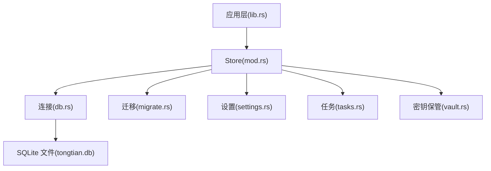
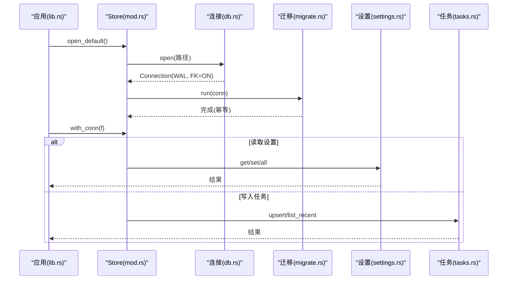
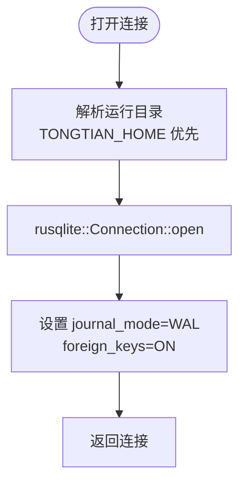
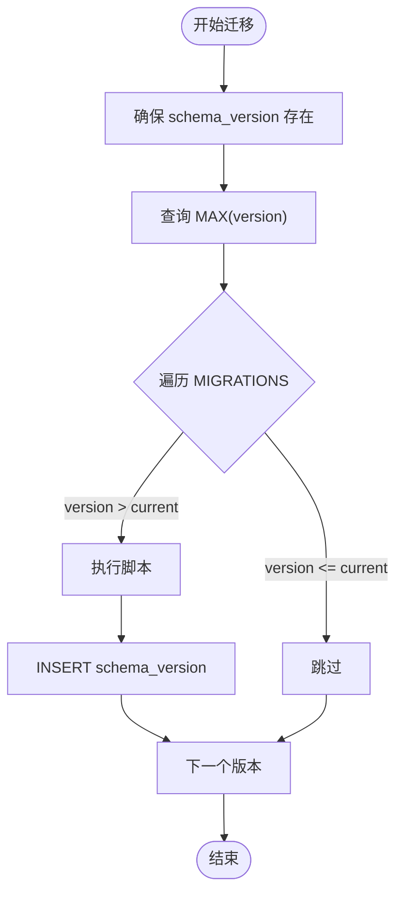
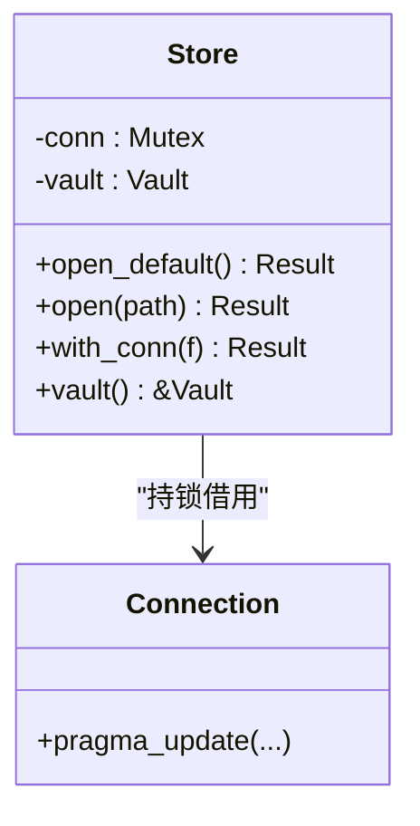
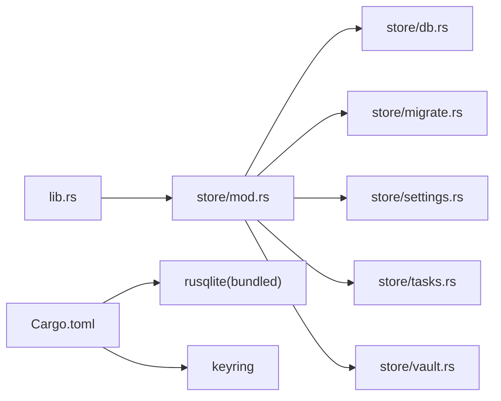

# 数据库核心

<cite>
**本文引用的文件**
- [db.rs](file://tongtian-tauri/src-tauri/src/store/db.rs)
- [migrate.rs](file://tongtian-tauri/src-tauri/src/store/migrate.rs)
- [mod.rs](file://tongtian-tauri/src-tauri/src/store/mod.rs)
- [settings.rs](file://tongtian-tauri/src-tauri/src/store/settings.rs)
- [tasks.rs](file://tongtian-tauri/src-tauri/src/store/tasks.rs)
- [vault.rs](file://tongtian-tauri/src-tauri/src/store/vault.rs)
- [Cargo.toml](file://tongtian-tauri/Cargo.toml)
- [lib.rs](file://tongtian-tauri/src-tauri/src/lib.rs)
</cite>

## 目录
1. [简介](#简介)
2. [项目结构](#项目结构)
3. [核心组件](#核心组件)
4. [架构总览](#架构总览)
5. [详细组件分析](#详细组件分析)
6. [依赖分析](#依赖分析)
7. [性能考虑](#性能考虑)
8. [故障排查指南](#故障排查指南)
9. [结论](#结论)
10. [附录：使用示例与最佳实践](#附录使用示例与最佳实践)

## 简介
本模块为本地 SQLite 数据持久化核心，提供连接管理、版本化迁移、并发控制、查询优化与错误处理。通过 WAL 模式与外键约束保障并发与一致性；通过 schema_version 表驱动幂等迁移；通过 keyring 优先的密钥保管箱实现“密钥不落库”的安全策略。运行时目录支持环境变量覆盖，便于多实例与测试隔离。

## 项目结构
存储子模块位于 src-tauri/src/store，包含以下职责划分：
- db.rs：运行目录解析、SQLite 连接打开与 PRAGMA 配置（WAL、外键）
- migrate.rs：基于 schema_version 的版本化迁移执行器
- mod.rs：Store 聚合（连接 + Vault），统一打开/迁移/连接借用
- settings.rs：settings_kv 键值对读写
- tasks.rs：任务记录 upsert 与按更新时间倒序查询
- vault.rs：keyring 优先的密钥保管箱，不可用时内存降级

图表来源
- [mod.rs:18-52](file://tongtian-tauri/src-tauri/src/store/mod.rs#L18-L52)
- [db.rs:16-25](file://tongtian-tauri/src-tauri/src/store/db.rs#L16-L25)
- [migrate.rs:43-73](file://tongtian-tauri/src-tauri/src/store/migrate.rs#L43-L73)
- [settings.rs:6-30](file://tongtian-tauri/src-tauri/src/store/settings.rs#L6-L30)
- [tasks.rs:27-95](file://tongtian-tauri/src-tauri/src/store/tasks.rs#L27-L95)
- [vault.rs:17-85](file://tongtian-tauri/src-tauri/src/store/vault.rs#L17-L85)

章节来源
- [mod.rs:1-52](file://tongtian-tauri/src-tauri/src/store/mod.rs#L1-L52)
- [db.rs:1-49](file://tongtian-tauri/src-tauri/src/store/db.rs#L1-L49)
- [migrate.rs:1-118](file://tongtian-tauri/src-tauri/src/store/migrate.rs#L1-L118)
- [settings.rs:1-100](file://tongtian-tauri/src-tauri/src/store/settings.rs#L1-L100)
- [tasks.rs:1-168](file://tongtian-tauri/src-tauri/src/store/tasks.rs#L1-L168)
- [vault.rs:1-119](file://tongtian-tauri/src-tauri/src/store/vault.rs#L1-L119)

## 核心组件
- Store：封装 rusqlite::Connection 与 Vault，提供 open_default/open/with_conn 等能力，确保连接生命周期与迁移执行。
- 连接管理：open 函数统一开启 WAL 与外键约束，保证并发读与数据完整性。
- 迁移系统：schema_version 表驱动，按顺序执行且幂等，避免重复创建表或索引。
- 数据访问：settings_kv 与 tasks 表的增删改查，采用参数化 SQL 与批量映射。
- 密钥保管：keyring 优先，失败时自动降级到进程内内存，避免密钥落盘。

章节来源
- [mod.rs:18-52](file://tongtian-tauri/src-tauri/src/store/mod.rs#L18-L52)
- [db.rs:16-25](file://tongtian-tauri/src-tauri/src/store/db.rs#L16-L25)
- [migrate.rs:43-73](file://tongtian-tauri/src-tauri/src/store/migrate.rs#L43-L73)
- [vault.rs:17-85](file://tongtian-tauri/src-tauri/src/store/vault.rs#L17-L85)

## 架构总览
下图展示从应用入口到存储层的调用链：应用层初始化服务集合，创建 Store 并打开默认数据库路径，随后在业务命令中通过 with_conn 获取连接执行具体操作。

图表来源
- [lib.rs:35-42](file://tongtian-tauri/src-tauri/src/lib.rs#L35-L42)
- [mod.rs:24-52](file://tongtian-tauri/src-tauri/src/store/mod.rs#L24-L52)
- [db.rs:16-25](file://tongtian-tauri/src-tauri/src/store/db.rs#L16-L25)
- [migrate.rs:43-73](file://tongtian-tauri/src-tauri/src/store/migrate.rs#L43-L73)
- [settings.rs:6-48](file://tongtian-tauri/src-tauri/src/store/settings.rs#L6-L48)
- [tasks.rs:27-95](file://tongtian-tauri/src-tauri/src/store/tasks.rs#L27-L95)

## 详细组件分析

### 连接管理与运行目录
- 运行目录：优先使用环境变量 TONGTIAN_HOME，否则回退到桥接模块提供的 base_dir。
- 连接打开：以文件路径打开 SQLite，启用 WAL 与外键约束，提升并发读与数据一致性。
- 测试覆盖：包含内存数据库与临时目录文件数据库的打开用例。

图表来源
- [db.rs:5-25](file://tongtian-tauri/src-tauri/src/store/db.rs#L5-L25)
- [mod.rs:24-36](file://tongtian-tauri/src-tauri/src/store/mod.rs#L24-L36)

章节来源
- [db.rs:5-25](file://tongtian-tauri/src-tauri/src/store/db.rs#L5-L25)
- [mod.rs:24-36](file://tongtian-tauri/src-tauri/src/store/mod.rs#L24-L36)

### 版本化迁移（幂等）
- 迁移脚本集中声明，按数组顺序作为版本号。
- 首次启动创建 schema_version 表，查询当前最大版本，跳过已应用脚本。
- 每个脚本执行后记录 version 与 applied_at，保证可追溯与幂等。

图表来源
- [migrate.rs:43-73](file://tongtian-tauri/src-tauri/src/store/migrate.rs#L43-L73)

章节来源
- [migrate.rs:1-118](file://tongtian-tauri/src-tauri/src/store/migrate.rs#L1-L118)

### 并发控制与事务
- 并发模型：单连接 + Mutex 串行化访问，避免 SQLite 多写冲突。
- 事务建议：将多个写操作包裹在同一 with_conn 闭包内，由上层业务自行 begin/commit/rollback，以减少锁持有时间。
- WAL 优势：提高并发读性能，减少写阻塞。

图表来源
- [mod.rs:18-52](file://tongtian-tauri/src-tauri/src/store/mod.rs#L18-L52)
- [db.rs:16-25](file://tongtian-tauri/src-tauri/src/store/db.rs#L16-L25)

章节来源
- [mod.rs:18-52](file://tongtian-tauri/src-tauri/src/store/mod.rs#L18-L52)
- [db.rs:16-25](file://tongtian-tauri/src-tauri/src/store/db.rs#L16-L25)

### 查询优化
- 索引：tasks.updated_at_ms 建立降序索引，加速最近任务列表查询。
- 参数化：所有 SQL 使用参数绑定，避免注入与编译开销。
- 分页限制：list_recent 支持 limit 参数，减少不必要的数据传输。

章节来源
- [migrate.rs:22-39](file://tongtian-tauri/src-tauri/src/store/migrate.rs#L22-L39)
- [tasks.rs:61-95](file://tongtian-tauri/src-tauri/src/store/tasks.rs#L61-L95)

### 错误处理机制
- 统一错误前缀：STORE_OPEN_FAILED、STORE_PRAGMA_FAILED、STORE_MIGRATE_*、STORE_MKDIR_FAILED 等，便于日志定位。
- 迁移失败：携带版本信息，快速定位问题脚本。
- 密钥保管：keyring 不可用时降级内存并仅告警一次，避免刷屏。

章节来源
- [db.rs:17-25](file://tongtian-tauri/src-tauri/src/store/db.rs#L17-L25)
- [migrate.rs:43-73](file://tongtian-tauri/src-tauri/src/store/migrate.rs#L43-L73)
- [vault.rs:30-36](file://tongtian-tauri/src-tauri/src/store/vault.rs#L30-L36)

### 数据完整性保证
- 外键约束：连接时强制 foreign_keys=ON，确保引用完整性。
- WAL 模式：崩溃恢复更可靠，降低数据损坏风险。
- 幂等迁移：避免重复建表/索引导致的结构不一致。

章节来源
- [db.rs:16-25](file://tongtian-tauri/src-tauri/src/store/db.rs#L16-L25)
- [migrate.rs:43-73](file://tongtian-tauri/src-tauri/src/store/migrate.rs#L43-L73)

## 依赖分析
- 运行时依赖：rusqlite（bundled）、keyring、serde/serde_json、tauri 插件等。
- 模块耦合：Store 聚合连接与 Vault；settings/tasks 依赖 Store；迁移独立于业务表。
- 外部集成：lib.rs 通过 P0Services 暴露 Store，供命令层调用。

图表来源
- [lib.rs:35-42](file://tongtian-tauri/src-tauri/src/lib.rs#L35-L42)
- [mod.rs:18-52](file://tongtian-tauri/src-tauri/src/store/mod.rs#L18-L52)
- [Cargo.toml:21-33](file://tongtian-tauri/Cargo.toml#L21-L33)

章节来源
- [Cargo.toml:21-33](file://tongtian-tauri/Cargo.toml#L21-L33)
- [lib.rs:35-42](file://tongtian-tauri/src-tauri/src/lib.rs#L35-L42)

## 性能考虑
- WAL 模式：显著提升并发读性能，适合 UI 频繁刷新场景。
- 索引设计：updated_at_ms 降序索引用于最近任务列表，避免全表扫描。
- 短临界区：with_conn 应尽快执行并返回，避免长时间持锁。
- 批量操作：必要时合并多次写为单次事务提交，减少 I/O 次数。
- 构建优化：release 开启 LTO、strip、opt-level=s，减小体积并提升运行效率。

[本节为通用性能建议，不直接分析特定文件]

## 故障排查指南
- 无法打开数据库：检查 STORE_OPEN_FAILED 错误，确认路径权限与磁盘空间。
- PRAGMA 失败：关注 STORE_PRAGMA_FAILED，确认 SQLite 版本与平台兼容性。
- 迁移失败：根据 STORE_MIGRATE_Vn_FAILED 定位具体脚本，检查 SQL 语法与表结构。
- 目录创建失败：STORE_MKDIR_FAILED 提示运行目录不可写，检查 TONGTIAN_HOME 或默认目录权限。
- 密钥不可用：观察 vault 降级日志，确认 keyring 可用性或接受内存降级行为。

章节来源
- [db.rs:17-25](file://tongtian-tauri/src-tauri/src/store/db.rs#L17-L25)
- [migrate.rs:43-73](file://tongtian-tauri/src-tauri/src/store/migrate.rs#L43-L73)
- [mod.rs:24-36](file://tongtian-tauri/src-tauri/src/store/mod.rs#L24-L36)
- [vault.rs:30-36](file://tongtian-tauri/src-tauri/src/store/vault.rs#L30-L36)

## 结论
该数据库核心模块以简洁可靠的 SQLite 为基础，结合 WAL、外键约束与幂等迁移，提供了稳定、安全、易扩展的本地持久化能力。通过统一的 Store 抽象与 with_conn 模式，既保证了并发安全，又便于上层业务聚焦领域逻辑。配合 keyring 优先的密钥保管策略，实现了“密钥不落库”的安全目标。

[本节为总结性内容，不直接分析特定文件]

## 附录：使用示例与最佳实践
- 初始化与打开默认数据库
  - 调用 Store::open_default()，内部会创建运行目录并打开 tongtian.db，随后执行迁移。
  - 参考路径：[open_default:24-31](file://tongtian-tauri/src-tauri/src/store/mod.rs#L24-L31)

- 指定路径打开（测试推荐）
  - 调用 Store::open(PathBuf)，便于注入临时目录进行单元测试。
  - 参考路径：[open:33-41](file://tongtian-tauri/src-tauri/src/store/mod.rs#L33-L41)

- 执行事务操作（示例流程）
  - 使用 with_conn 获取连接，在闭包内执行多条写操作，并在需要时显式 begin/commit/rollback。
  - 参考路径：[with_conn:43-47](file://tongtian-tauri/src-tauri/src/store/mod.rs#L43-L47)

- 写入设置项
  - 使用 settings::set(key, value) 进行覆盖写入，支持 INSERT ... ON CONFLICT 更新。
  - 参考路径：[settings set:19-30](file://tongtian-tauri/src-tauri/src/store/settings.rs#L19-L30)

- 读取设置项
  - 使用 settings::get(key) 获取单个值，或 settings::all() 获取全部键值对。
  - 参考路径：[settings get/all:6-48](file://tongtian-tauri/src-tauri/src/store/settings.rs#L6-L48)

- 任务记录 upsert
  - 使用 tasks::upsert(row) 插入或更新任务摘要，title 为空时保留既有值。
  - 参考路径：[tasks upsert:27-59](file://tongtian-tauri/src-tauri/src/store/tasks.rs#L27-L59)

- 查询最近任务
  - 使用 tasks::list_recent(limit?) 按 updated_at_ms 倒序获取任务列表。
  - 参考路径：[tasks list_recent:61-95](file://tongtian-tauri/src-tauri/src/store/tasks.rs#L61-L95)

- 密钥保管
  - 使用 store.vault().set_secret/get_secret/delete_secret 管理 API Key，keyring 不可用时自动降级内存。
  - 参考路径：[vault 接口:38-85](file://tongtian-tauri/src-tauri/src/store/vault.rs#L38-L85)

- 运行目录配置
  - 通过环境变量 TONGTIAN_HOME 覆盖默认数据根目录，便于多实例与 CI 隔离。
  - 参考路径：[runtime_home:5-14](file://tongtian-tauri/src-tauri/src/store/db.rs#L5-L14)

- 迁移扩展
  - 新增迁移脚本时，追加至 MIGRATIONS 数组末尾，保持幂等与顺序一致。
  - 参考路径：[MIGRATIONS:4-41](file://tongtian-tauri/src-tauri/src/store/migrate.rs#L4-L41)

章节来源
- [mod.rs:24-52](file://tongtian-tauri/src-tauri/src/store/mod.rs#L24-L52)
- [settings.rs:6-48](file://tongtian-tauri/src-tauri/src/store/settings.rs#L6-L48)
- [tasks.rs:27-95](file://tongtian-tauri/src-tauri/src/store/tasks.rs#L27-L95)
- [vault.rs:38-85](file://tongtian-tauri/src-tauri/src/store/vault.rs#L38-L85)
- [db.rs:5-14](file://tongtian-tauri/src-tauri/src/store/db.rs#L5-L14)
- [migrate.rs:4-41](file://tongtian-tauri/src-tauri/src/store/migrate.rs#L4-L41)