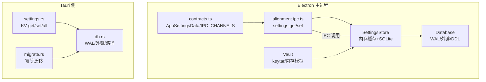
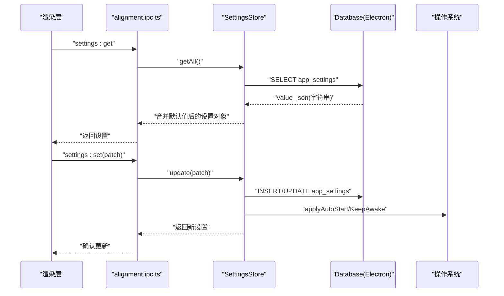
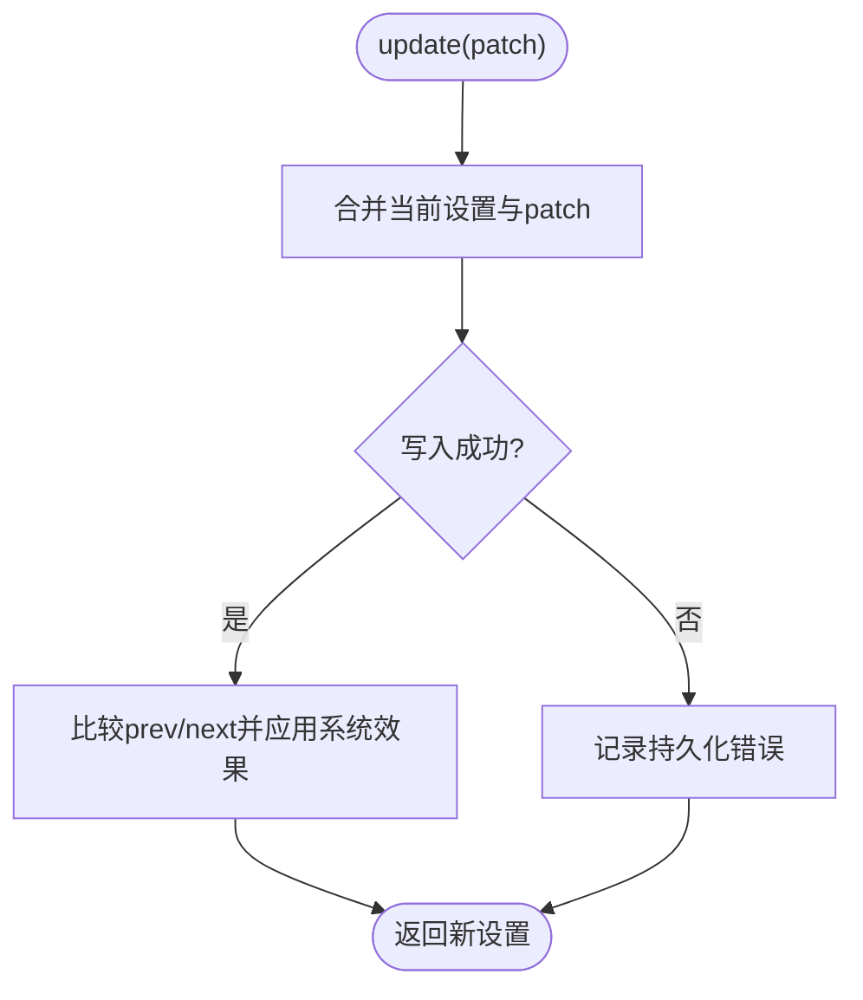
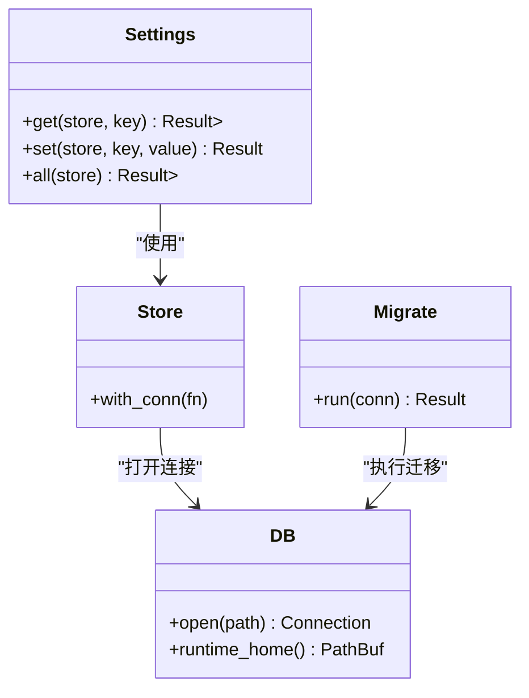
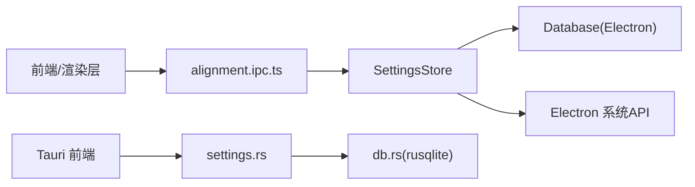

# 设置存储

<cite>
**本文引用的文件**
- [settings-store.ts](file://tongtian-tauri/src/main/store/settings-store.ts)
- [db.ts](file://tongtian-tauri/src/main/store/db.ts)
- [alignment.ipc.ts](file://tongtian-tauri/src/main/ipc/alignment.ipc.ts)
- [contracts.ts](file://tongtian-tauri/src/shared/contracts.ts)
- [settings.rs](file://tongtian-tauri/src-tauri/src/store/settings.rs)
- [db.rs](file://tongtian-tauri/src-tauri/src/store/db.rs)
- [migrate.rs](file://tongtian-tauri/src-tauri/src/store/migrate.rs)
- [vault.ts](file://tongtian-tauri/src/main/store/vault.ts)
</cite>

## 目录
1. [简介](#简介)
2. [项目结构](#项目结构)
3. [核心组件](#核心组件)
4. [架构总览](#架构总览)
5. [详细组件分析](#详细组件分析)
6. [依赖关系分析](#依赖关系分析)
7. [性能考量](#性能考量)
8. [故障排查指南](#故障排查指南)
9. [结论](#结论)
10. [附录：使用示例与最佳实践](#附录使用示例与最佳实践)

## 简介
本模块提供应用“设置”的键值对持久化、默认值管理、配置验证、系统行为联动（如开机自启动、保持唤醒）、跨平台兼容（Electron/Tauri）以及数据迁移能力。它同时覆盖 Electron 主进程侧的集中式设置存储，以及 Tauri 侧轻量 KV 存储，确保在两种运行时下均可安全读写配置。

## 项目结构
- Electron 主进程侧
  - 设置存储：SettingsStore（内存缓存 + SQLite 持久化 + 系统行为落地）
  - 数据库：Database（WAL 模式、外键开启、表结构定义与迁移）
  - IPC 接入：alignment.ipc.ts（暴露 settings:get / settings:set 等通道）
  - 类型契约：contracts.ts（AppSettingsData、IPC_CHANNELS）
  - 密钥保险库：Vault（keytar 或内存模拟，用于敏感信息）
- Tauri 侧
  - KV 存储：settings.rs（get/set/all）
  - 数据库连接：db.rs（WAL、外键、运行目录解析）
  - 迁移：migrate.rs（幂等版本化迁移）

图表来源
- [settings-store.ts:43-133](file://tongtian-tauri/src/main/store/settings-store.ts#L43-L133)
- [db.ts:284-328](file://tongtian-tauri/src/main/store/db.ts#L284-L328)
- [alignment.ipc.ts:70-77](file://tongtian-tauri/src/main/ipc/alignment.ipc.ts#L70-L77)
- [contracts.ts:448-476](file://tongtian-tauri/src/shared/contracts.ts#L448-L476)
- [settings.rs:6-48](file://tongtian-tauri/src-tauri/src/store/settings.rs#L6-L48)
- [db.rs:16-25](file://tongtian-tauri/src-tauri/src/store/db.rs#L16-L25)
- [migrate.rs:43-73](file://tongtian-tauri/src-tauri/src/store/migrate.rs#L43-L73)

章节来源
- [settings-store.ts:43-133](file://tongtian-tauri/src/main/store/settings-store.ts#L43-L133)
- [db.ts:284-328](file://tongtian-tauri/src/main/store/db.ts#L284-L328)
- [alignment.ipc.ts:70-77](file://tongtian-tauri/src/main/ipc/alignment.ipc.ts#L70-L77)
- [contracts.ts:448-476](file://tongtian-tauri/src/shared/contracts.ts#L448-L476)
- [settings.rs:6-48](file://tongtian-tauri/src-tauri/src/store/settings.rs#L6-L48)
- [db.rs:16-25](file://tongtian-tauri/src-tauri/src/store/db.rs#L16-L25)
- [migrate.rs:43-73](file://tongtian-tauri/src-tauri/src/store/migrate.rs#L43-L73)

## 核心组件
- SettingsStore（Electron）
  - 职责：读取/合并默认值与持久化设置；增量更新并落盘；启动时恢复系统行为；变更时触发系统级效果（开机自启动、保持唤醒）。
  - 关键特性：单例、内存缓存、SQLite 持久化、错误回退到默认值。
- Database（Electron）
  - 职责：打开 SQLite（WAL、外键），创建表与索引，处理 schema_version 迁移。
  - 关键特性：单例、路径解析（userData/data.db）、降级 Mock 支持。
- alignment.ipc.ts（Electron）
  - 职责：注册 settings:get / settings:set 等 IPC 通道，统一校验与日志。
- contracts.ts（共享类型）
  - 职责：定义 AppSettingsData 字段、IPC_CHANNELS 常量，保证前后端一致。
- Tauri KV 存储（settings.rs, db.rs, migrate.rs）
  - 职责：提供 settings_kv 表的 get/set/all 操作；WAL 模式与外键；幂等迁移。
- Vault（Electron）
  - 职责：以 keytar（或内存模拟）保存 API Key 等敏感信息，带进程退出清理。

章节来源
- [settings-store.ts:43-133](file://tongtian-tauri/src/main/store/settings-store.ts#L43-L133)
- [db.ts:284-328](file://tongtian-tauri/src/main/store/db.ts#L284-L328)
- [alignment.ipc.ts:70-77](file://tongtian-tauri/src/main/ipc/alignment.ipc.ts#L70-L77)
- [contracts.ts:448-476](file://tongtian-tauri/src/shared/contracts.ts#L448-L476)
- [settings.rs:6-48](file://tongtian-tauri/src-tauri/src/store/settings.rs#L6-L48)
- [db.rs:16-25](file://tongtian-tauri/src-tauri/src/store/db.rs#L16-L25)
- [migrate.rs:43-73](file://tongtian-tauri/src-tauri/src/store/migrate.rs#L43-L73)
- [vault.ts:60-124](file://tongtian-tauri/src/main/store/vault.ts#L60-L124)

## 架构总览
设置读写在 Electron 与 Tauri 两条路径上实现：
- Electron 路径：渲染层通过 IPC 调用 settings:get / settings:set → alignment.ipc.ts → SettingsStore → Database（app_settings 表，JSON 序列化整体设置对象）。
- Tauri 路径：前端通过 tauri invoke 调用 settings_get / settings_set → Rust settings.rs → SQLite（settings_kv 表，逐条 KV）。

图表来源
- [alignment.ipc.ts:70-77](file://tongtian-tauri/src/main/ipc/alignment.ipc.ts#L70-L77)
- [settings-store.ts:55-92](file://tongtian-tauri/src/main/store/settings-store.ts#L55-L92)
- [db.ts:217-221](file://tongtian-tauri/src/main/store/db.ts#L217-L221)

章节来源
- [alignment.ipc.ts:70-77](file://tongtian-tauri/src/main/ipc/alignment.ipc.ts#L70-L77)
- [settings-store.ts:55-92](file://tongtian-tauri/src/main/store/settings-store.ts#L55-L92)
- [db.ts:217-221](file://tongtian-tauri/src/main/store/db.ts#L217-L221)

## 详细组件分析

### SettingsStore（Electron）
- 数据结构
  - 内存缓存：避免重复 IO，首次加载后常驻内存。
  - 持久化：app_settings 表以 JSON 字符串存储完整设置对象，键固定为单一记录。
- 默认值与合并
  - 启动时从数据库读取已保存部分，与内置 DEFAULT_SETTINGS 合并，缺失字段自动补全。
- 生命周期
  - 应用启动：applyOnStartup 根据 autoStart/keepAwake 恢复系统行为。
  - 运行时：update(patch) 增量合并、落盘、触发系统行为变化。
- 热重载机制
  - 通过 applySystemEffects 对比 prev/next 差异，仅当 autoStart/keepAwake 变化时调用系统接口，实现“热生效”。
- 错误处理
  - 读失败：记录错误并使用默认值，保障可用性。
  - 写失败：记录错误但不中断流程，后续读取仍可用。
- 复杂度
  - getAll：O(1) 缓存命中；未命中时为 O(1) 单次查询 + JSON 解析。
  - update：O(1) 合并 + O(1) 写入 + O(1) 系统回调。

图表来源
- [settings-store.ts:73-92](file://tongtian-tauri/src/main/store/settings-store.ts#L73-L92)
- [settings-store.ts:103-132](file://tongtian-tauri/src/main/store/settings-store.ts#L103-L132)

章节来源
- [settings-store.ts:15-41](file://tongtian-tauri/src/main/store/settings-store.ts#L15-L41)
- [settings-store.ts:55-92](file://tongtian-tauri/src/main/store/settings-store.ts#L55-L92)
- [settings-store.ts:94-132](file://tongtian-tauri/src/main/store/settings-store.ts#L94-L132)

### Database（Electron）
- 路径与初始化
  - 数据目录：userData/data.db；不存在则创建。
  - WAL 模式与外键开启，提升并发读性能与一致性。
- 表结构与迁移
  - 包含 tasks/messages/file_ops/model_configs/audit_logs/workspaces/skills/mcp_servers/sandbox_policies/schedule_tasks/model_usage/app_settings 等表。
  - schema_version 控制迁移；v1→v2 新增千问对标整改相关表。
- 降级策略
  - 若 better-sqlite3 不可用，使用内存 Mock 实现，便于测试与无原生环境运行。

章节来源
- [db.ts:48-62](file://tongtian-tauri/src/main/store/db.ts#L48-L62)
- [db.ts:68-261](file://tongtian-tauri/src/main/store/db.ts#L68-L261)
- [db.ts:301-328](file://tongtian-tauri/src/main/store/db.ts#L301-L328)
- [db.ts:24-44](file://tongtian-tauri/src/main/store/db.ts#L24-L44)

### IPC 接入（Electron）
- 通道
  - settings:get：返回完整设置对象（含默认值合并）。
  - settings:set：接收 Partial<AppSettingsData> 增量更新。
- 校验与日志
  - 使用 safeHandler 统一捕获异常并记录日志。
  - 其他通道（hooks/awareness/connector/archive/computer-use）复用同一注册模式。

章节来源
- [alignment.ipc.ts:70-77](file://tongtian-tauri/src/main/ipc/alignment.ipc.ts#L70-L77)
- [alignment.ipc.ts:26-36](file://tongtian-tauri/src/main/ipc/alignment.ipc.ts#L26-L36)

### 类型契约（共享）
- AppSettingsData
  - 包含语言、主题、字体、预览模式、通知、代理、隐私、语音、快照、快捷选择、电脑使用策略、安全环境、工作台模式、实验开关等。
  - 支持扩展字段 [key: string]: unknown。
- IPC_CHANNELS
  - 定义 settings:get / settings:set 等通道名，供前后端共用。

章节来源
- [contracts.ts:448-476](file://tongtian-tauri/src/shared/contracts.ts#L448-L476)
- [contracts.ts:556-557](file://tongtian-tauri/src/shared/contracts.ts#L556-L557)

### Tauri 设置 KV（Rust）
- 功能
  - get(key)：读取单个设置项。
  - set(key, value)：写入（覆盖）单个设置项。
  - all()：读取全部设置项为 HashMap。
- 存储
  - settings_kv 表（key/value TEXT），通过 rusqlite 访问。
- 数据库与迁移
  - db.rs：WAL 模式、外键开启、运行目录解析（优先环境变量）。
  - migrate.rs：幂等版本化迁移，按顺序执行脚本并记录 schema_version。

图表来源
- [settings.rs:6-48](file://tongtian-tauri/src-tauri/src/store/settings.rs#L6-L48)
- [db.rs:16-25](file://tongtian-tauri/src-tauri/src/store/db.rs#L16-L25)
- [migrate.rs:43-73](file://tongtian-tauri/src-tauri/src/store/migrate.rs#L43-L73)

章节来源
- [settings.rs:6-48](file://tongtian-tauri/src-tauri/src/store/settings.rs#L6-L48)
- [db.rs:16-25](file://tongtian-tauri/src-tauri/src/store/db.rs#L16-L25)
- [migrate.rs:43-73](file://tongtian-tauri/src-tauri/src/store/migrate.rs#L43-L73)

### 密钥保险库（Vault）
- 功能
  - storeApiKey/getApiKey/deleteApiKey/clearAll/clearMemoryCache。
- 存储后端
  - 优先 keytar（系统钥匙串），不可用时回退到内存模拟。
- 进程退出清理
  - 监听 exit/SIGINT/SIGTERM 清理内存缓存，防止泄露。

章节来源
- [vault.ts:60-124](file://tongtian-tauri/src/main/store/vault.ts#L60-L124)
- [vault.ts:127-134](file://tongtian-tauri/src/main/store/vault.ts#L127-L134)

## 依赖关系分析
- 耦合度
  - SettingsStore 依赖 Database（SQLite）与 Electron 系统能力（app、powerSaveBlocker）。
  - IPC 层仅依赖 SettingsStore 与 contracts，解耦良好。
- 外部依赖
  - better-sqlite3（Electron）与 rusqlite（Tauri）分别负责两端持久化。
  - keytar（Electron）用于系统级密钥存储。
- 循环依赖
  - 未发现循环依赖；IPC → Store → DB 单向依赖。

图表来源
- [alignment.ipc.ts:70-77](file://tongtian-tauri/src/main/ipc/alignment.ipc.ts#L70-L77)
- [settings-store.ts:55-92](file://tongtian-tauri/src/main/store/settings-store.ts#L55-L92)
- [settings.rs:6-48](file://tongtian-tauri/src-tauri/src/store/settings.rs#L6-L48)
- [db.rs:16-25](file://tongtian-tauri/src-tauri/src/store/db.rs#L16-L25)

章节来源
- [alignment.ipc.ts:70-77](file://tongtian-tauri/src/main/ipc/alignment.ipc.ts#L70-L77)
- [settings-store.ts:55-92](file://tongtian-tauri/src/main/store/settings-store.ts#L55-L92)
- [settings.rs:6-48](file://tongtian-tauri/src-tauri/src/store/settings.rs#L6-L48)
- [db.rs:16-25](file://tongtian-tauri/src-tauri/src/store/db.rs#L16-L25)

## 性能考量
- 读性能
  - 内存缓存避免重复 IO；WAL 模式提升并发读。
- 写性能
  - 批量更新建议合并为一次 update(patch)，减少多次落盘。
- 可靠性
  - 读失败回退默认值；写失败记录日志不影响后续读取。
- 迁移
  - 幂等迁移避免重复执行；按版本顺序增量升级。

[本节为通用指导，不直接分析具体文件]

## 故障排查指南
- 常见问题
  - 设置未持久化：检查 write 日志与 SQLite 权限；确认 WAL 模式启用。
  - 系统行为未生效：确认 autoStart/keepAwake 是否变化；查看系统 API 调用日志。
  - Tauri KV 读取为空：确认 settings_kv 表是否存在且已迁移；检查 key 是否正确。
- 定位方法
  - 查看 IPC handler 日志与 SettingsStore 日志。
  - 检查 Database 初始化与迁移是否成功。
  - 在 Tauri 侧使用单元测试验证 get/set/all 行为。

章节来源
- [settings-store.ts:66-90](file://tongtian-tauri/src/main/store/settings-store.ts#L66-L90)
- [db.ts:301-328](file://tongtian-tauri/src/main/store/db.ts#L301-L328)
- [settings.rs:65-98](file://tongtian-tauri/src-tauri/src/store/settings.rs#L65-L98)
- [migrate.rs:83-116](file://tongtian-tauri/src-tauri/src/store/migrate.rs#L83-L116)

## 结论
该设置存储模块在 Electron 与 Tauri 双运行时下提供了健壮的键值对持久化能力：Electron 侧采用整体 JSON 存储并联动系统行为，Tauri 侧提供轻量 KV 存储与幂等迁移。通过内存缓存、WAL 模式、默认值合并与错误回退，保证了高可用与高性能。配合 IPC 与共享类型契约，实现了前后端一致的配置读写体验。

[本节为总结性内容，不直接分析具体文件]

## 附录：使用示例与最佳实践
- 读取设置
  - Electron：通过 IPC channels.settings:get 获取完整设置对象。
  - Tauri：通过 settings_get 获取所有 KV。
- 更新设置
  - Electron：通过 IPC channels.settings:set 传入 Partial<AppSettingsData> 进行增量更新。
  - Tauri：通过 settings_set 设置单个 key/value。
- 批量更新
  - 将多个字段合并为一个 patch 一次性提交，减少落盘次数。
- 数据迁移
  - Electron：依赖 schema_version 与 DDL 幂等执行；新增字段通过默认值合并。
  - Tauri：通过 migrate.rs 的版本化脚本逐步演进。
- 冲突解决
  - Electron：以最后一次 update(patch) 为准；Tauri：同 key 覆盖写入。
- 备份与恢复
  - 建议定期备份 data.db（Electron）与 Tauri 数据库文件；恢复时确保 schema_version 一致。
- 跨平台兼容
  - Electron：better-sqlite3 不可用时回退 Mock；keytar 不可用时回退内存模拟。
  - Tauri：通过环境变量 TONGTIAN_HOME 指定数据根目录。

章节来源
- [alignment.ipc.ts:70-77](file://tongtian-tauri/src/main/ipc/alignment.ipc.ts#L70-L77)
- [settings-store.ts:55-92](file://tongtian-tauri/src/main/store/settings-store.ts#L55-L92)
- [settings.rs:6-48](file://tongtian-tauri/src-tauri/src/store/settings.rs#L6-L48)
- [db.rs:7-14](file://tongtian-tauri/src-tauri/src/store/db.rs#L7-L14)
- [vault.ts:17-25](file://tongtian-tauri/src/main/store/vault.ts#L17-L25)