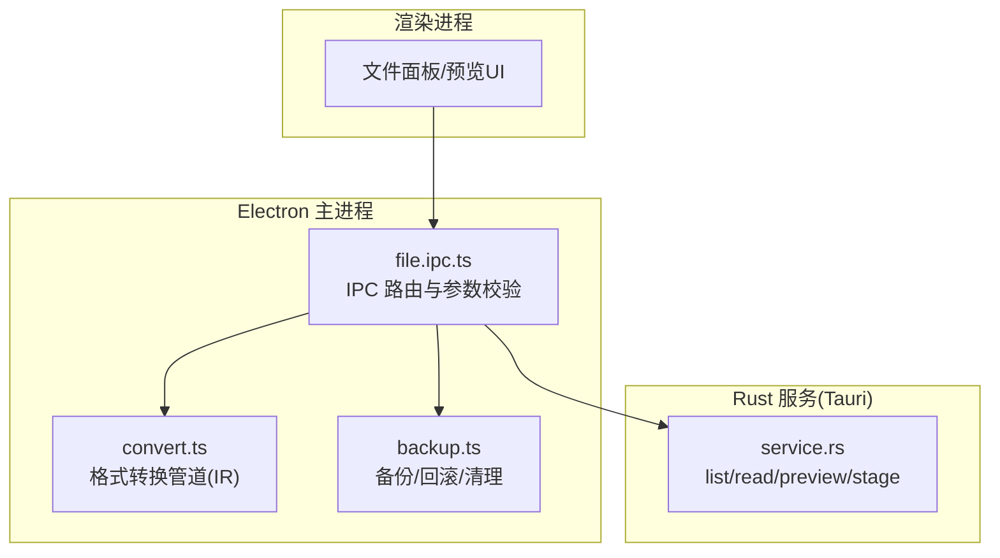
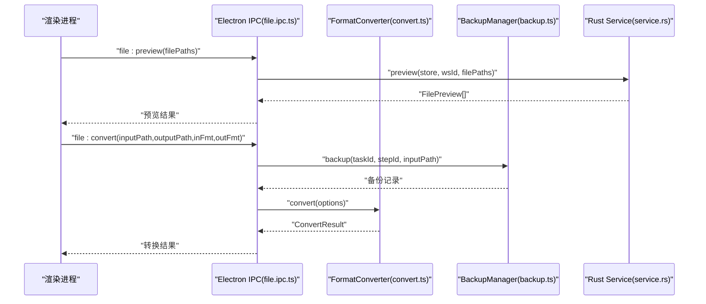
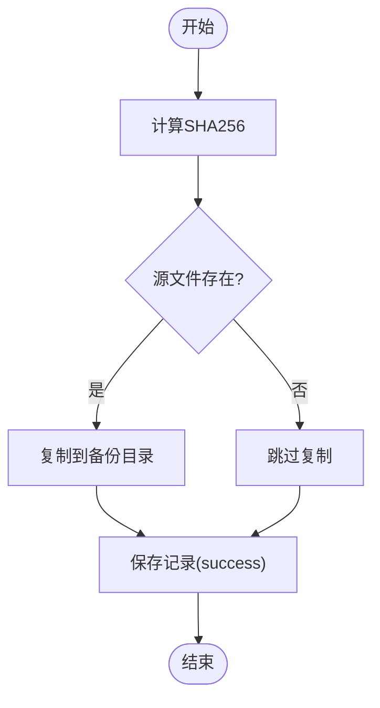
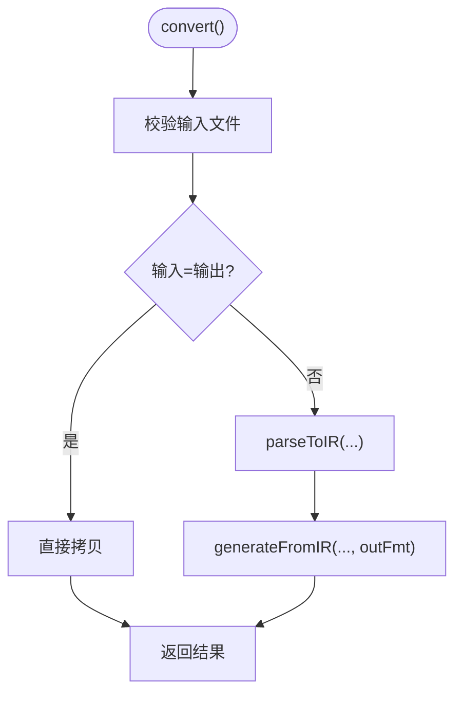
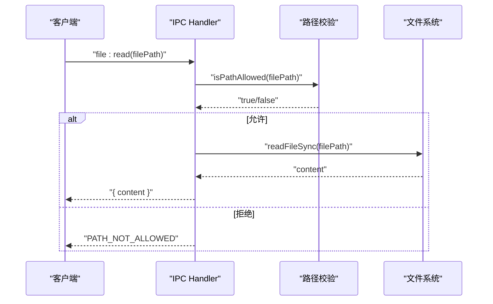
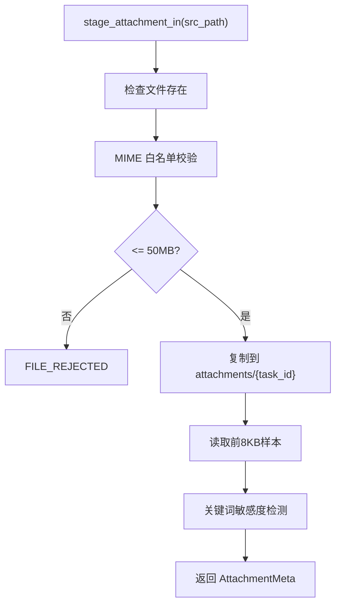
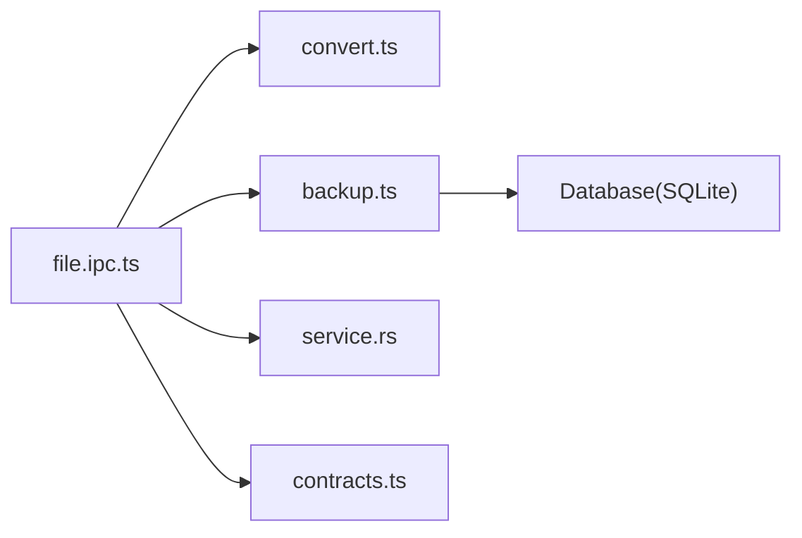

# 文件操作模块

<cite>
**本文引用的文件**
- [backup.ts](file://tongtian-tauri/src/main/file/backup.ts)
- [convert.ts](file://tongtian-tauri/src/main/file/convert.ts)
- [file.ipc.ts](file://tongtian-tauri/src/main/ipc/file.ipc.ts)
- [contracts.ts](file://tongtian-tauri/src/shared/contracts.ts)
- [service.rs](file://tongtian-tauri/src-tauri/src/file/service.rs)
- [mod.rs](file://tongtian-tauri/src-tauri/src/file/mod.rs)
- [spec.md](file://docs/changes/qwenpaw-integration/specs/file-processing/spec.md)
</cite>

## 目录
1. [简介](#简介)
2. [项目结构](#项目结构)
3. [核心组件](#核心组件)
4. [架构总览](#架构总览)
5. [详细组件分析](#详细组件分析)
6. [依赖关系分析](#依赖关系分析)
7. [性能考虑](#性能考虑)
8. [故障排查指南](#故障排查指南)
9. [结论](#结论)
10. [附录：API 接口与使用示例](#附录api-接口与使用示例)

## 简介
本模块提供文件系统的安全访问、格式转换与备份恢复能力，面向 Electron/Tauri 双端（主进程与 Rust 服务）统一暴露 IPC 接口。重点覆盖：
- 文件系统抽象封装：统一的浏览、读取、预览、转换入口
- 安全访问控制：路径白名单校验、大小限制、MIME 类型检测、附件暂存与数据分级
- 格式转换：基于中间表示（IR）的文本类文件格式互转管道
- 备份恢复：写入前自动备份、失败回滚、定时清理过期备份
- 并发与错误处理：IPC 层异常包装、结构化日志、可观测的错误码

## 项目结构
文件操作相关代码分布在三个层次：
- 前端/渲染层：通过 IPC 通道调用主进程能力
- 主进程（Electron）：实现文件浏览、读取、预览、转换等逻辑，并集成备份管理
- Rust 服务（Tauri）：提供工作区内的文件列表、读取、预览、附件暂存等能力，内置严格白名单与大小限制

图表来源
- [file.ipc.ts:100-235](file://tongtian-tauri/src/main/ipc/file.ipc.ts#L100-L235)
- [convert.ts:93-153](file://tongtian-tauri/src/main/file/convert.ts#L93-L153)
- [backup.ts:86-182](file://tongtian-tauri/src/main/file/backup.ts#L86-L182)
- [service.rs:137-256](file://tongtian-tauri/src-tauri/src/file/service.rs#L137-L256)

章节来源
- [file.ipc.ts:1-250](file://tongtian-tauri/src/main/ipc/file.ipc.ts#L1-L250)
- [contracts.ts:478-584](file://tongtian-tauri/src/shared/contracts.ts#L478-L584)

## 核心组件
- 备份管理器（BackupManager）
  - 职责：计算 SHA256、创建备份、回滚、查询备份记录、定时清理过期备份
  - 持久化：SQLite（通过 Database 单例），记录任务ID、步骤ID、原路径、备份路径、状态、时间戳
  - 关键常量：备份目录名、清理间隔、保留时长
- 格式转换器（FormatConverter）
  - 职责：将多种文本类格式解析为中间表示 IRDocument，再根据目标格式生成文件
  - 支持：txt/md/csv 完整读写；xlsx/docx/pdf 解析/生成待实现（占位抛出）
  - 输出：ConvertResult（成功/失败、耗时、输出路径）
- IPC 处理器（file.ipc.ts）
  - 职责：注册 file:browse / file:read / file:preview / file:convert 等通道，参数校验（Zod）、路径白名单校验、调用具体服务
  - 安全：路径规范化、禁止“..”穿越、仅允许绝对路径（后续可扩展工作区白名单）
- Rust 文件服务（service.rs）
  - 职责：工作区文件列表、读取、批量预览、附件暂存与敏感度检测
  - 安全：白名单根目录（工作区 files + 可选 allowlist）、路径规范化校验、大小上限（读取 2MB，附件 50MB）
  - 数据分级：关键词匹配返回 public/internal/confidential

章节来源
- [backup.ts:39-333](file://tongtian-tauri/src/main/file/backup.ts#L39-L333)
- [convert.ts:76-493](file://tongtian-tauri/src/main/file/convert.ts#L76-L493)
- [file.ipc.ts:100-235](file://tongtian-tauri/src/main/ipc/file.ipc.ts#L100-L235)
- [service.rs:137-345](file://tongtian-tauri/src-tauri/src/file/service.rs#L137-L345)

## 架构总览
文件操作采用“IPC 路由 → 业务服务 → 系统 IO”的分层设计，并通过白名单与大小限制保障安全。

图表来源
- [file.ipc.ts:158-235](file://tongtian-tauri/src/main/ipc/file.ipc.ts#L158-L235)
- [convert.ts:93-153](file://tongtian-tauri/src/main/file/convert.ts#L93-L153)
- [backup.ts:86-182](file://tongtian-tauri/src/main/file/backup.ts#L86-L182)
- [service.rs:213-256](file://tongtian-tauri/src-tauri/src/file/service.rs#L213-L256)

## 详细组件分析

### 备份与回滚（BackupManager）
- 备份流程
  - 计算源文件 SHA256（不存在时为空串）
  - 确保备份目录存在（按 taskId/stepId 组织）
  - 复制文件到备份路径，记录状态 pending→success
  - 失败则标记 failed 并抛出错误
- 回滚流程
  - 根据 backupId 查找记录
  - 若备份存在则覆盖原文件；若原文件之前不存在则删除当前文件
  - 更新状态为 rolled_back
- 清理策略
  - 定时任务每小时执行一次
  - 删除超过 24 小时的备份文件及数据库记录

图表来源
- [backup.ts:67-142](file://tongtian-tauri/src/main/file/backup.ts#L67-L142)

章节来源
- [backup.ts:60-333](file://tongtian-tauri/src/main/file/backup.ts#L60-L333)

### 格式转换管道（FormatConverter）
- 转换流程
  - 校验输入文件存在
  - 同格式直接拷贝
  - 解析输入为 IRDocument（txt/md/csv 已实现；xlsx/docx/pdf 待实现）
  - 从 IR 生成目标格式（txt/md/csv 已实现；xlsx/docx/pdf 待实现）
  - 记录耗时与结果
- 中间表示（IR）
  - 文档包含元数据与内容数组（段落、标题、表格、列表、代码块）
  - 各格式解析器/生成器围绕 IR 进行双向映射

图表来源
- [convert.ts:93-153](file://tongtian-tauri/src/main/file/convert.ts#L93-L153)
- [convert.ts:157-322](file://tongtian-tauri/src/main/file/convert.ts#L157-L322)

章节来源
- [convert.ts:93-493](file://tongtian-tauri/src/main/file/convert.ts#L93-L493)

### IPC 路由与安全（file.ipc.ts）
- 注册通道：file:browse / file:read / file:preview / file:convert
- 参数校验：使用 Zod 对请求体进行强类型校验
- 路径安全：
  - 规范化路径，禁止“..”穿越
  - 仅允许绝对路径（后续可扩展工作区白名单）
- MIME 类型检测：用于预览时的文本/二进制区分
- 错误处理：统一包装异常并记录日志

图表来源
- [file.ipc.ts:59-154](file://tongtian-tauri/src/main/ipc/file.ipc.ts#L59-L154)

章节来源
- [file.ipc.ts:1-250](file://tongtian-tauri/src/main/ipc/file.ipc.ts#L1-L250)

### Rust 文件服务（service.rs）
- 白名单机制
  - 默认根：workspaces/{ws}/files
  - 扩展根：settings_kv 中 sandbox.file_allowlist.{ws} 配置的路径
  - 路径规范化后校验是否位于任一白名单根之下
- 能力函数
  - list_dir：列出目录内容（目录优先、名称排序）
  - read_file：读取文本文件（限制 2MB）
  - preview：批量预览（文本直读，非文本标注不支持）
  - stage_attachment：附件暂存至 attachments/{task_id}，限制 50MB，格式白名单，敏感度检测
- 测试覆盖：白名单放行/拒绝、大文件拒绝、二进制预览提示、附件暂存路径与敏感度

图表来源
- [service.rs:272-345](file://tongtian-tauri/src-tauri/src/file/service.rs#L272-L345)

章节来源
- [service.rs:1-478](file://tongtian-tauri/src-tauri/src/file/service.rs#L1-L478)
- [mod.rs:1-4](file://tongtian-tauri/src-tauri/src/file/mod.rs#L1-L4)

## 依赖关系分析
- 主进程依赖
  - Electron IPC：注册与分发消息
  - Node.js fs/path/crypto：文件与哈希操作
  - SQLite（Database 单例）：备份记录持久化
  - Logger：结构化日志
- Rust 服务依赖
  - std::fs/std::path：文件系统与路径操作
  - Store/settings：读取沙箱白名单配置
  - serde_json：序列化/反序列化配置
- 共享契约
  - contracts.ts：定义 IPC 通道名、错误码、数据结构（FileInfo/FilePreview 等）

图表来源
- [file.ipc.ts:100-235](file://tongtian-tauri/src/main/ipc/file.ipc.ts#L100-L235)
- [backup.ts:293-319](file://tongtian-tauri/src/main/file/backup.ts#L293-L319)
- [contracts.ts:478-584](file://tongtian-tauri/src/shared/contracts.ts#L478-L584)

章节来源
- [file.ipc.ts:1-250](file://tongtian-tauri/src/main/ipc/file.ipc.ts#L1-L250)
- [backup.ts:1-336](file://tongtian-tauri/src/main/file/backup.ts#L1-L336)
- [service.rs:1-478](file://tongtian-tauri/src-tauri/src/file/service.rs#L1-L478)
- [contracts.ts:1-587](file://tongtian-tauri/src/shared/contracts.ts#L1-L587)

## 性能考虑
- 转换优化
  - 同格式直接拷贝，避免重复解析
  - 文本类格式流式读取/写入（当前实现为一次性读取，适合中小文件）
- I/O 限制
  - 读取限制 2MB，防止大文件导致内存压力
  - 附件暂存限制 50MB，避免磁盘占用过大
- 备份清理
  - 定时清理过期备份，释放磁盘空间
- 建议
  - 对超大文件引入分块读取/写入
  - 转换过程增加进度回调与取消机制
  - 缓存常用格式的解析结果（如 CSV 表头）

[本节为通用指导，不直接分析具体文件]

## 故障排查指南
- 常见错误码（来自 contracts.ts）
  - FILE_NOT_FOUND：文件或目录不存在
  - FILE_ACCESS_DENIED：路径不在白名单或权限不足
  - FILE_WRITE_FAILED：写入失败
  - FILE_CONVERSION_FAILED：转换失败
  - FILE_TOO_LARGE：超出大小限制
  - FILE_BACKUP_FAILED：备份失败
- 定位步骤
  - 查看 IPC 层日志（file.ipc.ts 中的 safeHandler 会记录错误堆栈）
  - 检查路径白名单与工作区布局（service.rs 的 allowed_roots_in）
  - 核对文件大小与格式白名单（service.rs 的 size 与 mime 校验）
  - 检查备份记录状态（backup.ts 的 getRecord/getTaskBackups）
- 典型问题
  - 路径穿越被拒：确认传入路径为绝对路径且不含“..”
  - 二进制文件无法预览：当前仅支持文本类预览，需等待转换能力落地
  - 附件被拒：检查格式是否在允许列表，以及是否超过 50MB

章节来源
- [file.ipc.ts:44-57](file://tongtian-tauri/src/main/ipc/file.ipc.ts#L44-L57)
- [service.rs:173-193](file://tongtian-tauri/src-tauri/src/file/service.rs#L173-L193)
- [service.rs:272-345](file://tongtian-tauri/src-tauri/src/file/service.rs#L272-L345)
- [contracts.ts:15-109](file://tongtian-tauri/src/shared/contracts.ts#L15-L109)

## 结论
本模块通过 IPC 路由、白名单校验、大小限制与备份回滚，构建了安全的文件操作闭环。格式转换以 IR 为中心，便于扩展新格式。Rust 服务提供高性能与强约束的文件能力，Electron 主进程负责用户交互与流程编排。未来可继续完善 xlsx/docx/pdf 的解析与生成，并增强大文件处理与并发控制。

[本节为总结性内容，不直接分析具体文件]

## 附录：API 接口与使用示例

### IPC 通道与数据类型
- 通道定义（部分）
  - file:browse：浏览目录
  - file:read：读取文本文件
  - file:preview：批量预览
  - file:convert：格式转换
- 数据结构
  - FileInfo：name/path/isDirectory/size/modifiedAt
  - FilePreview：path/content/mimeType
  - ConvertOptions：inputPath/outputPath/inputFormat/outputFormat
  - ConvertResult：success/outputPath/error/durationMs

章节来源
- [contracts.ts:323-335](file://tongtian-tauri/src/shared/contracts.ts#L323-L335)
- [contracts.ts:478-584](file://tongtian-tauri/src/shared/contracts.ts#L478-L584)
- [convert.ts:13-25](file://tongtian-tauri/src/main/file/convert.ts#L13-L25)

### 使用示例（概念性）
- 浏览目录
  - 调用 file:browse，传入 dirPath
  - 返回 FileInfo[]，用于渲染树形目录
- 读取文件
  - 调用 file:read，传入 filePath
  - 返回 { content }，用于编辑器展示
- 预览文件
  - 调用 file:preview，传入 filePaths[]
  - 返回 FilePreview[]，文本类直接显示，二进制显示占位
- 格式转换
  - 调用 file:convert，传入 inputPath/outputPath/inputFormat/outputFormat
  - 返回 outputPath 与 durationMs，可用于下载或打开

章节来源
- [file.ipc.ts:105-235](file://tongtian-tauri/src/main/ipc/file.ipc.ts#L105-L235)

### 安全与权限
- 路径白名单
  - Electron：禁止“..”，仅允许绝对路径（可扩展工作区白名单）
  - Rust：工作区 files + 可选 allowlist，规范化后校验
- 大小限制
  - 读取：2MB
  - 附件：50MB
- 格式白名单
  - 附件暂存仅允许 txt/md/csv/json/docx/xlsx/pdf
- 数据分级
  - 基于关键词检测 public/internal/confidential，用于后续策略控制

章节来源
- [file.ipc.ts:59-96](file://tongtian-tauri/src/main/ipc/file.ipc.ts#L59-L96)
- [service.rs:71-132](file://tongtian-tauri/src-tauri/src/file/service.rs#L71-L132)
- [service.rs:272-345](file://tongtian-tauri/src-tauri/src/file/service.rs#L272-L345)

### 规范对齐
- 文件处理能力复用 QwenPaw 基础工具，并在通天办公侧增强格式转换与安全备份
- 写入前执行 L0 备份，失败自动回滚
- 提供 FilePanel 页面进行浏览与预览

章节来源
- [spec.md:1-97](file://docs/changes/qwenpaw-integration/specs/file-processing/spec.md#L1-L97)