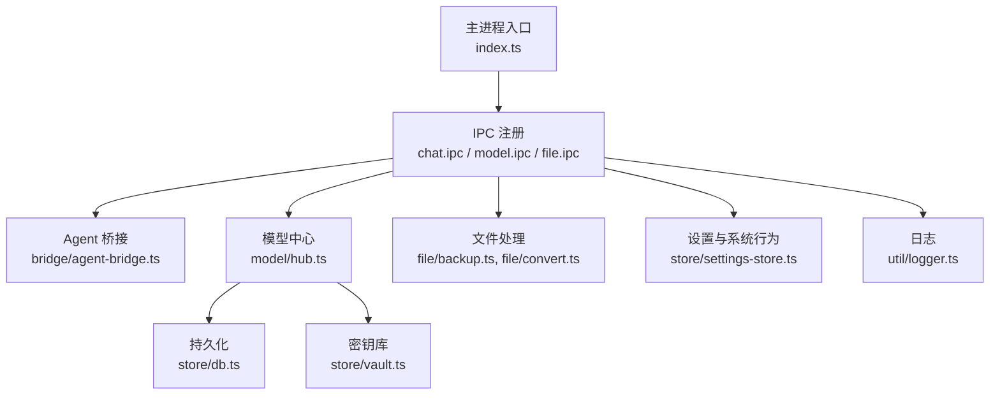
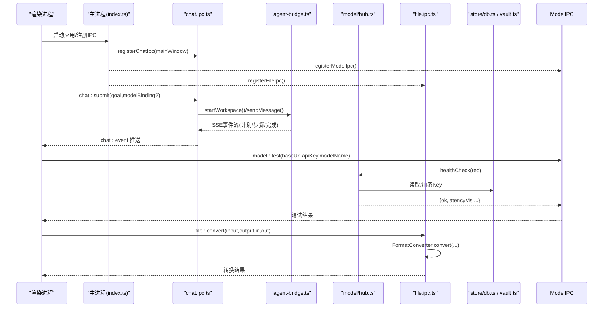
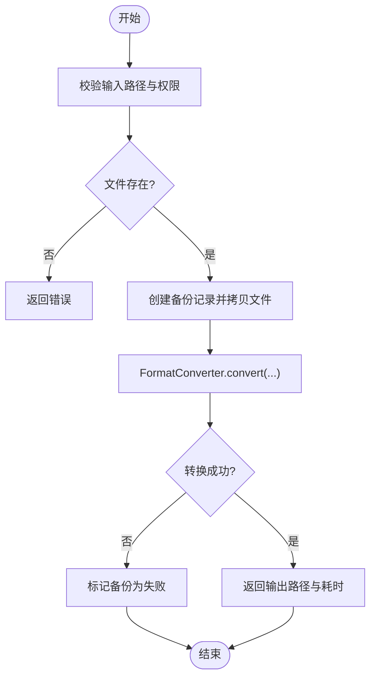
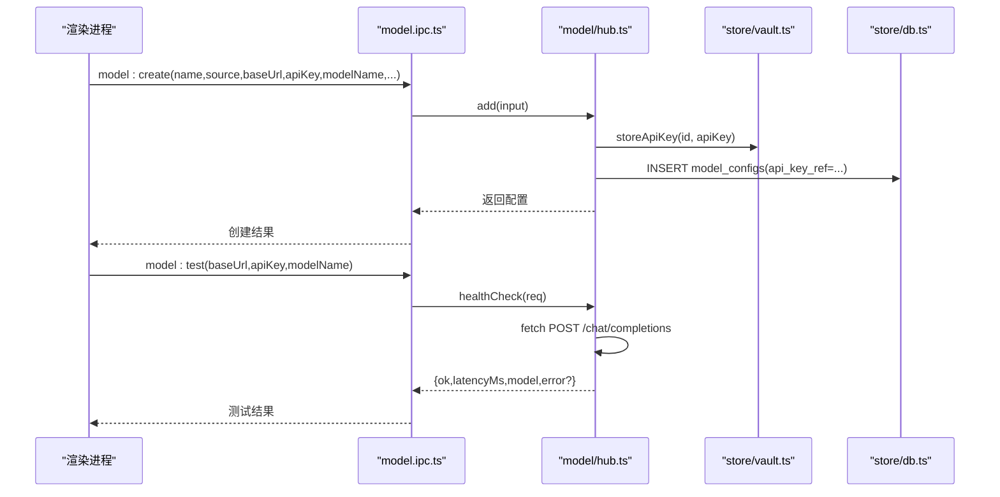
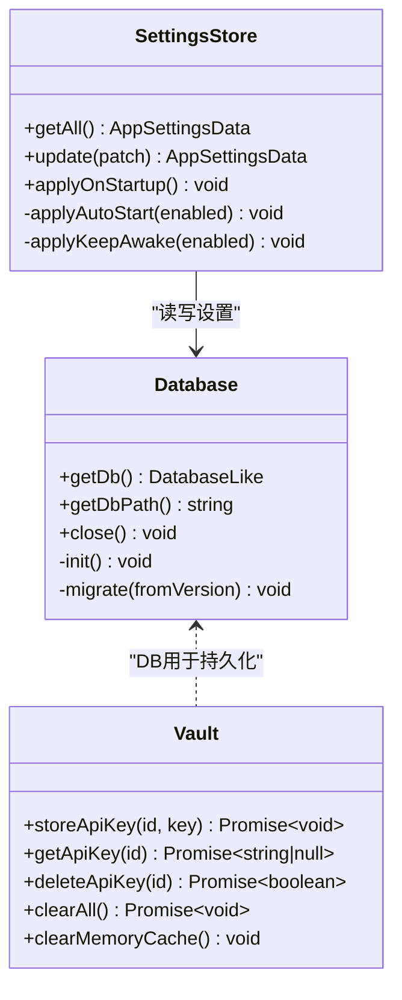
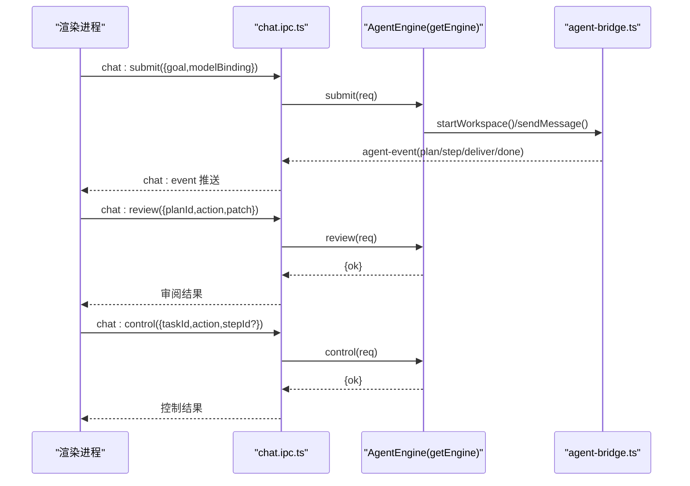
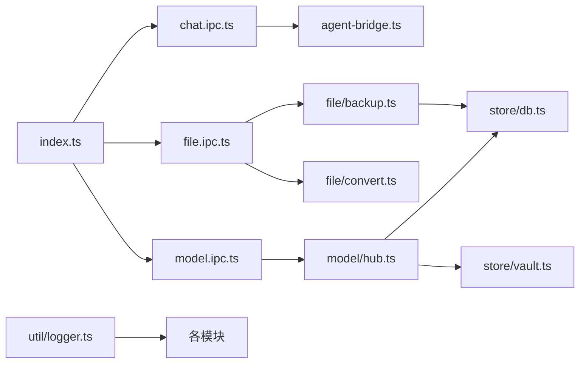

# 模块设计

<cite>
**本文引用的文件**   
- [index.ts](file://tongtian-tauri/src/main/index.ts)
- [agent-bridge.ts](file://tongtian-tauri/src/main/bridge/agent-bridge.ts)
- [chat.ipc.ts](file://tongtian-tauri/src/main/ipc/chat.ipc.ts)
- [model.ipc.ts](file://tongtian-tauri/src/main/ipc/model.ipc.ts)
- [file.ipc.ts](file://tongtian-tauri/src/main/ipc/file.ipc.ts)
- [hub.ts](file://tongtian-tauri/src/main/model/hub.ts)
- [db.ts](file://tongtian-tauri/src/main/store/db.ts)
- [settings-store.ts](file://tongtian-tauri/src/main/store/settings-store.ts)
- [vault.ts](file://tongtian-tauri/src/main/store/vault.ts)
- [backup.ts](file://tongtian-tauri/src/main/file/backup.ts)
- [convert.ts](file://tongtian-tauri/src/main/file/convert.ts)
- [contracts.ts](file://tongtian-tauri/src/shared/contracts.ts)
- [types.ts](file://tongtian-tauri/src/shared/types.ts)
- [logger.ts](file://tongtian-tauri/src/main/util/logger.ts)
</cite>

## 目录
1. [引言](#引言)
2. [项目结构](#项目结构)
3. [核心组件](#核心组件)
4. [架构总览](#架构总览)
5. [详细组件分析](#详细组件分析)
6. [依赖分析](#依赖分析)
7. [性能考虑](#性能考虑)
8. [故障排查指南](#故障排查指南)
9. [结论](#结论)
10. [附录](#附录)

## 引言
本设计文档围绕通天办公的“桥接（bridge）—文件（file）—模型（model）—存储（store）—任务（task）”五大模块展开，系统阐述各模块的职责边界、接口规范、数据流向与通信协议。重点覆盖：
- 模块初始化顺序与资源管理策略
- 错误传播机制与统一错误码
- 扩展点设计与解耦最佳实践
- 典型调用示例与跨进程通信流程

## 项目结构
本项目采用 Electron 主进程 + 渲染进程 + 共享契约的结构：
- 主进程入口负责窗口、托盘、IPC 注册与应用生命周期
- IPC 层按领域划分（chat、model、file 等），使用 Zod 校验输入并转发到业务模块
- 业务模块包括 Agent 桥接、模型中心、文件处理、持久化与密钥库
- 共享契约集中定义类型、事件与错误码，保证前后端一致性



**图表来源** 
- [index.ts:152-178](file://tongtian-tauri/src/main/index.ts#L152-L178)
- [chat.ipc.ts:122-189](file://tongtian-tauri/src/main/ipc/chat.ipc.ts#L122-L189)
- [model.ipc.ts:105-219](file://tongtian-tauri/src/main/ipc/model.ipc.ts#L105-L219)
- [file.ipc.ts:100-247](file://tongtian-tauri/src/main/ipc/file.ipc.ts#L100-L247)
- [agent-bridge.ts:94-126](file://tongtian-tauri/src/main/bridge/agent-bridge.ts#L94-L126)
- [hub.ts:85-161](file://tongtian-tauri/src/main/model/hub.ts#L85-L161)
- [db.ts:284-328](file://tongtian-tauri/src/main/store/db.ts#L284-L328)
- [vault.ts:60-125](file://tongtian-tauri/src/main/store/vault.ts#L60-L125)
- [backup.ts:39-63](file://tongtian-tauri/src/main/file/backup.ts#L39-L63)
- [convert.ts:76-153](file://tongtian-tauri/src/main/file/convert.ts#L76-L153)
- [logger.ts:109-168](file://tongtian-tauri/src/main/util/logger.ts#L109-L168)

**章节来源**
- [index.ts:152-178](file://tongtian-tauri/src/main/index.ts#L152-L178)
- [contracts.ts:480-584](file://tongtian-tauri/src/shared/contracts.ts#L480-L584)

## 核心组件
- 桥接（bridge）：Agent 子进程生命周期管理、端口分配、健康检查、SSE 事件流转发、工具调用适配
- 文件（file）：文件浏览/读取/预览/转换、备份与回滚、路径安全校验
- 模型（model）：模型配置 CRUD、默认模型设置、连通性自测、用量观测
- 存储（store）：SQLite 单例、DDL/索引、迁移、Vault 密钥库（keytar/mock）、应用设置持久化
- 任务（task）：通过 chat IPC 驱动引擎提交/审阅/控制/历史查询，事件流推送至渲染进程

关键职责与交互要点：
- bridge 与 engine（Python sidecar）通过 HTTP+SSE 通信；提供版本适配与工具调用封装
- model hub 通过 vault 存取 API Key，通过 db 持久化配置与健康测试
- file 模块在读写前进行备份，支持格式转换管道（IR 中间表示）
- store 提供统一的 DB/Vault/Settings 访问，确保幂等与可迁移
- task 由 chat IPC 驱动，事件经 ipcMain 推送到 renderer

**章节来源**
- [agent-bridge.ts:94-126](file://tongtian-tauri/src/main/bridge/agent-bridge.ts#L94-L126)
- [file.ipc.ts:100-247](file://tongtian-tauri/src/main/ipc/file.ipc.ts#L100-L247)
- [hub.ts:85-161](file://tongtian-tauri/src/main/model/hub.ts#L85-L161)
- [db.ts:284-328](file://tongtian-tauri/src/main/store/db.ts#L284-L328)
- [vault.ts:60-125](file://tongtian-tauri/src/main/store/vault.ts#L60-L125)
- [settings-store.ts:43-92](file://tongtian-tauri/src/main/store/settings-store.ts#L43-L92)
- [chat.ipc.ts:122-189](file://tongtian-tauri/src/main/ipc/chat.ipc.ts#L122-L189)

## 架构总览
整体采用“主进程编排 + IPC 路由 + 领域服务”的分层模式：
- 主进程负责窗口、托盘、IPC 注册与全局生命周期
- IPC 层承担参数校验、错误包装、事件转发
- 领域服务实现具体业务能力（bridge/model/file/store）
- 共享契约保障类型一致性与错误码统一



**图表来源** 
- [index.ts:152-178](file://tongtian-tauri/src/main/index.ts#L152-L178)
- [chat.ipc.ts:122-189](file://tongtian-tauri/src/main/ipc/chat.ipc.ts#L122-L189)
- [agent-bridge.ts:304-346](file://tongtian-tauri/src/main/bridge/agent-bridge.ts#L304-L346)
- [model.ipc.ts:157-171](file://tongtian-tauri/src/main/ipc/model.ipc.ts#L157-L171)
- [hub.ts:282-358](file://tongtian-tauri/src/main/model/hub.ts#L282-L358)
- [file.ipc.ts:207-235](file://tongtian-tauri/src/main/ipc/file.ipc.ts#L207-L235)
- [db.ts:284-328](file://tongtian-tauri/src/main/store/db.ts#L284-L328)
- [vault.ts:78-98](file://tongtian-tauri/src/main/store/vault.ts#L78-L98)

## 详细组件分析

### 桥接（bridge）模块
职责：
- 检测 Python/Agent 环境，按工作区隔离启动子进程
- 端口分配与释放、健康检查与失败计数
- SSE 事件流解析与转发、工具调用适配
- 优雅关闭与异常退出处理

关键点：
- 健康检查间隔与最大失败次数阈值
- 版本适配器对请求路径与负载结构的兼容
- 事件状态机：starting → ready/busy → stopped/error

```mermaid
classDiagram
class AgentBridge {
+initialize() Promise~void~
+startWorkspace(workspaceId, config) Promise~AgentInstance~
+stopWorkspace(workspaceId) Promise~void~
+sendMessage(workspaceId, message) AsyncIterable~AgentEvent~
+callTool(workspaceId, toolName, params) Promise~ToolResult~
+healthCheck(workspaceId) Promise~{ok,latencyMs}~
+updateConfig(workspaceId, config) Promise~boolean~
+shutdownAll() Promise~void~
-getInstance(workspaceId) AgentInstance
-setInstanceStatus(instance, status) void
-waitForReady(httpClient) Promise~void~
-startHealthCheck(workspaceId) void
-stopHealthCheck(workspaceId) void
-handleProcessExit(workspaceId, code, signal) void
-cleanupInstance(workspaceId) void
}
class HttpClient {
+stream(path, payload) Stream
+post(path, payload, opts) Response
+healthCheck(timeout) Promise~{ok,latencyMs}~
}
class VersionAdapter {
+getChatPath() string
+adaptChatRequest(message) object
+getToolCallPath(toolName) string
+adaptToolCallRequest(params) object
+isCompatible() boolean
}
AgentBridge --> HttpClient : "HTTP/SSE通信"
AgentBridge --> VersionAdapter : "版本适配"
```

**图表来源** 
- [agent-bridge.ts:94-126](file://tongtian-tauri/src/main/bridge/agent-bridge.ts#L94-L126)
- [agent-bridge.ts:304-346](file://tongtian-tauri/src/main/bridge/agent-bridge.ts#L304-L346)
- [agent-bridge.ts:351-394](file://tongtian-tauri/src/main/bridge/agent-bridge.ts#L351-L394)
- [agent-bridge.ts:469-514](file://tongtian-tauri/src/main/bridge/agent-bridge.ts#L469-L514)

**章节来源**
- [agent-bridge.ts:108-126](file://tongtian-tauri/src/main/bridge/agent-bridge.ts#L108-L126)
- [agent-bridge.ts:131-247](file://tongtian-tauri/src/main/bridge/agent-bridge.ts#L131-L247)
- [agent-bridge.ts:253-299](file://tongtian-tauri/src/main/bridge/agent-bridge.ts#L253-L299)
- [agent-bridge.ts:304-346](file://tongtian-tauri/src/main/bridge/agent-bridge.ts#L304-L346)
- [agent-bridge.ts:351-394](file://tongtian-tauri/src/main/bridge/agent-bridge.ts#L351-L394)
- [agent-bridge.ts:407-413](file://tongtian-tauri/src/main/bridge/agent-bridge.ts#L407-L413)
- [agent-bridge.ts:418-422](file://tongtian-tauri/src/main/bridge/agent-bridge.ts#L418-L422)
- [agent-bridge.ts:427-439](file://tongtian-tauri/src/main/bridge/agent-bridge.ts#L427-L439)

### 文件（file）模块
职责：
- 文件浏览/读取/预览/转换
- 备份与回滚（SHA256 指纹、定时清理）
- 路径白名单校验与 MIME 类型识别

关键点：
- 转换管道基于 IR（段落/表格/标题/列表/代码块）
- 备份记录持久化，支持按任务/步骤维度查询
- 路径安全校验防止遍历攻击



**图表来源** 
- [file.ipc.ts:100-247](file://tongtian-tauri/src/main/ipc/file.ipc.ts#L100-L247)
- [backup.ts:86-142](file://tongtian-tauri/src/main/file/backup.ts#L86-L142)
- [convert.ts:93-153](file://tongtian-tauri/src/main/file/convert.ts#L93-L153)

**章节来源**
- [file.ipc.ts:100-247](file://tongtian-tauri/src/main/ipc/file.ipc.ts#L100-L247)
- [backup.ts:39-63](file://tongtian-tauri/src/main/file/backup.ts#L39-L63)
- [backup.ts:86-142](file://tongtian-tauri/src/main/file/backup.ts#L86-L142)
- [backup.ts:232-271](file://tongtian-tauri/src/main/file/backup.ts#L232-L271)
- [convert.ts:76-153](file://tongtian-tauri/src/main/file/convert.ts#L76-L153)

### 模型（model）模块
职责：
- 模型配置 CRUD、默认模型设置
- 连通性自测（轻量 chat/completions 请求）
- 用量统计与观测（observer 集成于 IPC）

关键点：
- API Key 通过 Vault 存储，DB 仅存引用标记
- 健康检查带超时与错误信息聚合
- 默认模型设置需清空其他默认标记



**图表来源** 
- [model.ipc.ts:118-129](file://tongtian-tauri/src/main/ipc/model.ipc.ts#L118-L129)
- [hub.ts:129-161](file://tongtian-tauri/src/main/model/hub.ts#L129-L161)
- [vault.ts:78-98](file://tongtian-tauri/src/main/store/vault.ts#L78-L98)
- [hub.ts:282-358](file://tongtian-tauri/src/main/model/hub.ts#L282-L358)

**章节来源**
- [model.ipc.ts:105-219](file://tongtian-tauri/src/main/ipc/model.ipc.ts#L105-L219)
- [hub.ts:85-161](file://tongtian-tauri/src/main/model/hub.ts#L85-L161)
- [hub.ts:249-274](file://tongtian-tauri/src/main/model/hub.ts#L249-L274)
- [hub.ts:282-358](file://tongtian-tauri/src/main/model/hub.ts#L282-L358)
- [vault.ts:60-125](file://tongtian-tauri/src/main/store/vault.ts#L60-L125)

### 存储（store）模块
职责：
- SQLite 单例：WAL 模式、外键启用、DDL/索引、迁移
- Vault：系统密钥库（keytar）或内存 Mock，带运行时缓存
- Settings：应用设置持久化与系统行为落地（开机自启、保持唤醒）

关键点：
- 数据库路径与用户数据目录分离，容错 fallback
- 迁移幂等（IF NOT EXISTS），版本号控制
- Vault 内存缓存加速读取，进程退出清理



**图表来源** 
- [db.ts:284-328](file://tongtian-tauri/src/main/store/db.ts#L284-L328)
- [vault.ts:60-125](file://tongtian-tauri/src/main/store/vault.ts#L60-L125)
- [settings-store.ts:43-92](file://tongtian-tauri/src/main/store/settings-store.ts#L43-L92)

**章节来源**
- [db.ts:284-328](file://tongtian-tauri/src/main/store/db.ts#L284-L328)
- [vault.ts:60-125](file://tongtian-tauri/src/main/store/vault.ts#L60-L125)
- [settings-store.ts:43-92](file://tongtian-tauri/src/main/store/settings-store.ts#L43-L92)

### 任务（task）模块（通过 chat IPC 驱动）
职责：
- 提交任务（goal、可选 modelBinding、附件）
- 审阅计划（approve/reject/modify）
- 控制执行（pause/resume/rollback_to）
- 查询历史与事件流推送

关键点：
- 所有输入经 Zod 校验，错误统一包装为 ErrorCode
- 事件流从引擎经 ipcMain 推送到渲染进程
- 清理函数在窗口关闭时移除监听器



**图表来源** 
- [chat.ipc.ts:122-189](file://tongtian-tauri/src/main/ipc/chat.ipc.ts#L122-L189)
- [agent-bridge.ts:304-346](file://tongtian-tauri/src/main/bridge/agent-bridge.ts#L304-L346)

**章节来源**
- [chat.ipc.ts:122-189](file://tongtian-tauri/src/main/ipc/chat.ipc.ts#L122-L189)
- [contracts.ts:121-158](file://tongtian-tauri/src/shared/contracts.ts#L121-L158)

## 依赖分析
- 主进程入口依赖 IPC 注册与各模块单例
- IPC 层依赖 shared 契约与业务模块
- 模型模块依赖存储（DB/Vault）
- 文件模块依赖存储（DB）与文件系统
- 桥接模块依赖网络（HTTP/SSE）与进程管理



**图表来源** 
- [index.ts:152-178](file://tongtian-tauri/src/main/index.ts#L152-L178)
- [chat.ipc.ts:122-189](file://tongtian-tauri/src/main/ipc/chat.ipc.ts#L122-L189)
- [model.ipc.ts:105-219](file://tongtian-tauri/src/main/ipc/model.ipc.ts#L105-L219)
- [file.ipc.ts:100-247](file://tongtian-tauri/src/main/ipc/file.ipc.ts#L100-L247)
- [hub.ts:85-161](file://tongtian-tauri/src/main/model/hub.ts#L85-L161)
- [backup.ts:39-63](file://tongtian-tauri/src/main/file/backup.ts#L39-L63)
- [convert.ts:76-153](file://tongtian-tauri/src/main/file/convert.ts#L76-L153)
- [logger.ts:109-168](file://tongtian-tauri/src/main/util/logger.ts#L109-L168)

**章节来源**
- [contracts.ts:480-584](file://tongtian-tauri/src/shared/contracts.ts#L480-L584)

## 性能考虑
- SQLite WAL 模式提升并发读性能，外键约束保证数据一致性
- 健康检查间隔与失败阈值避免频繁探测与误判
- SSE 流式传输减少首字节延迟，适合长任务实时反馈
- 文件转换采用 IR 中间表示，便于扩展新格式且降低耦合
- 日志按级别过滤与脱敏，避免敏感信息泄露与磁盘膨胀

[本节为通用指导，不直接分析具体文件]

## 故障排查指南
- 统一错误码：VALIDATION_ERROR、INTERNAL_ERROR、BRIDGE_*、MODEL_*、FILE_* 等
- IPC 层 safeHandler 捕获异常并包装为结构化错误
- 日志模块自动脱敏（API Key、Bearer Token、邮箱、电话）
- 桥接模块健康检查失败计数与进程退出信号处理
- 文件操作失败时备份记录标记 failed，支持回滚

**章节来源**
- [contracts.ts:15-109](file://tongtian-tauri/src/shared/contracts.ts#L15-L109)
- [chat.ipc.ts:63-83](file://tongtian-tauri/src/main/ipc/chat.ipc.ts#L63-L83)
- [model.ipc.ts:82-101](file://tongtian-tauri/src/main/ipc/model.ipc.ts#L82-L101)
- [file.ipc.ts:44-57](file://tongtian-tauri/src/main/ipc/file.ipc.ts#L44-L57)
- [logger.ts:66-82](file://tongtian-tauri/src/main/util/logger.ts#L66-L82)
- [agent-bridge.ts:481-514](file://tongtian-tauri/src/main/bridge/agent-bridge.ts#L481-L514)
- [backup.ts:187-193](file://tongtian-tauri/src/main/file/backup.ts#L187-L193)

## 结论
本设计以清晰的模块边界与统一的 IPC/契约规范，实现了桥接、文件、模型、存储与任务的协同工作。通过健康检查、备份回滚、密钥库与结构化日志，保障了稳定性与可维护性。后续可扩展更多文件格式、模型源与工作区编排能力，同时保持现有接口的向后兼容。

[本节为总结，不直接分析具体文件]

## 附录
- 初始化顺序建议：
  1) 主进程入口创建窗口与托盘
  2) 注册 IPC handlers
  3) 初始化 SettingsStore.applyOnStartup()
  4) 按需初始化 Bridge.initialize()
- 资源管理策略：
  - 子进程优雅关闭（SIGTERM→超时→SIGKILL）
  - 端口分配与释放集合管理
  - 定时器清理（健康检查、备份清理）
- 扩展点设计：
  - 新增文件转换器：实现 parse/generateFromIR 分支
  - 新增模型源：在 hub.healthCheck 中复用 fetch 逻辑
  - 新增 IPC 通道：在 contracts 中声明并在对应 .ipc.ts 注册

[本节为补充说明，不直接分析具体文件]