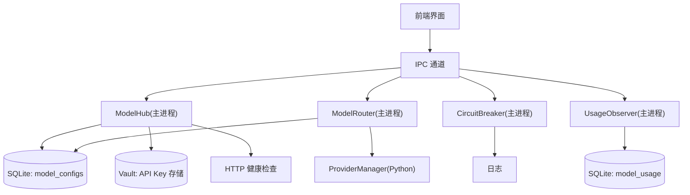
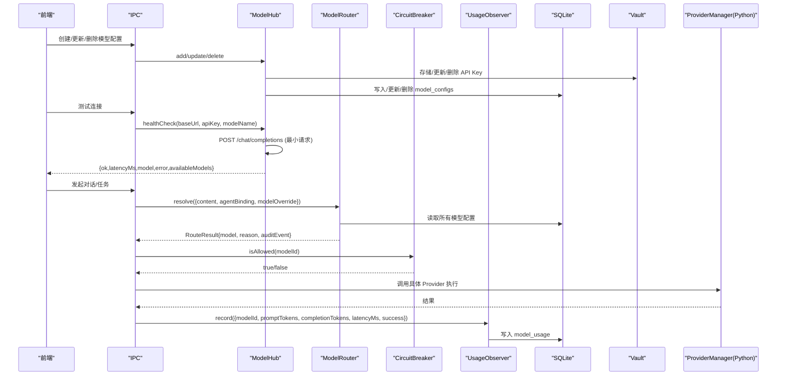
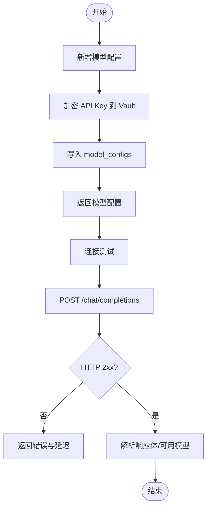
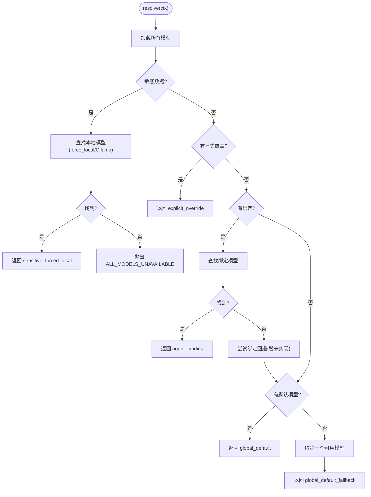
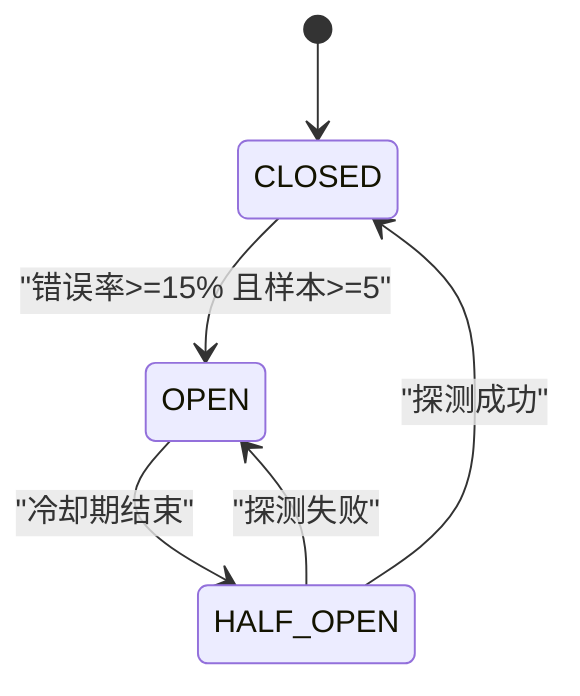
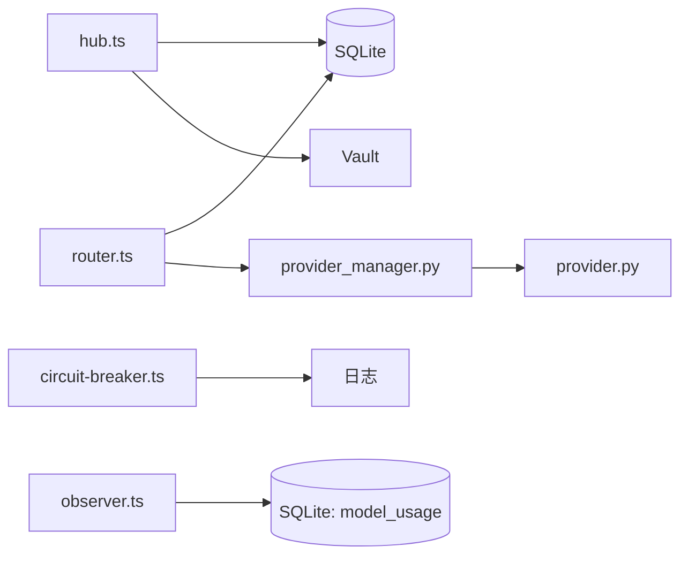

# 模型管理模块

<cite>
**本文引用的文件**
- [provider_manager.py](file://tongtian-tauri/src/agent/providers/provider_manager.py)
- [provider.py](file://tongtian-tauri/src/agent/providers/provider.py)
- [hub.ts](file://tongtian-tauri/src/main/model/hub.ts)
- [router.ts](file://tongtian-tauri/src/main/model/router.ts)
- [circuit-breaker.ts](file://tongtian-tauri/src/main/model/circuit-breaker.ts)
- [observer.ts](file://tongtian-tauri/src/main/model/observer.ts)
- [types.ts](file://tongtian-tauri/src/shared/types.ts)
- [contracts.ts](file://tongtian-tauri/src/shared/contracts.ts)
- [config.py](file://tongtian-tauri/src/agent/config/config.py)
</cite>

## 目录
1. [简介](#简介)
2. [项目结构](#项目结构)
3. [核心组件](#核心组件)
4. [架构总览](#架构总览)
5. [详细组件分析](#详细组件分析)
6. [依赖关系分析](#依赖关系分析)
7. [性能与可用性](#性能与可用性)
8. [故障排查指南](#故障排查指南)
9. [结论](#结论)
10. [附录：扩展新模型提供商指南](#附录：扩展新模型提供商指南)

## 简介
本模块提供 AI 模型的统一接入与管理能力，覆盖模型注册、配置持久化、连接测试、健康检查、请求路由（含敏感数据强制本地）、负载均衡与故障转移（熔断器）、以及使用量与成本统计。前端通过 IPC 通道调用主进程服务，后端 Python 侧提供多厂商 Provider 抽象与内置模型清单，实现“多源模型”的统一编排。

## 项目结构
- 主进程（TypeScript）
  - 模型中心 Hub：负责模型配置的增删改查、默认模型设置、连接测试（发送最小请求并测量延迟）。
  - 路由器 Router：三层路由策略（敏感数据→绑定模型→全局默认），支持显式覆盖与审计事件。
  - 熔断器 CircuitBreaker：按模型维度维护滑动窗口错误率，自动 OPEN/HALF_OPEN/CLOSED 状态切换与指数退避重试。
  - 观测器 Observer：记录每次调用的 token 用量、延迟、成功失败，并提供日/周/月聚合统计与成本估算。
- Agent 侧（Python）
  - Provider 抽象与实现：统一的 Provider 接口，内置 OpenAI/DashScope/Gemini/Ollama/LMStudio/OpenRouter 等，集中维护各厂商模型清单与能力元信息。
  - ProviderManager：统一管理内置与自定义 Provider，暴露列出、添加/移除、获取详情等能力。
  - 配置模型：基于 Pydantic 的强类型配置，包含模型槽位、上下文窗口、生成参数等。

图表来源
- [hub.ts:85-367](file://tongtian-tauri/src/main/model/hub.ts#L85-L367)
- [router.ts:92-318](file://tongtian-tauri/src/main/model/router.ts#L92-L318)
- [circuit-breaker.ts:82-346](file://tongtian-tauri/src/main/model/circuit-breaker.ts#L82-L346)
- [observer.ts:77-260](file://tongtian-tauri/src/main/model/observer.ts#L77-L260)
- [provider_manager.py:1-800](file://tongtian-tauri/src/agent/providers/provider_manager.py#L1-L800)

章节来源
- [hub.ts:85-367](file://tongtian-tauri/src/main/model/hub.ts#L85-L367)
- [router.ts:92-318](file://tongtian-tauri/src/main/model/router.ts#L92-L318)
- [circuit-breaker.ts:82-346](file://tongtian-tauri/src/main/model/circuit-breaker.ts#L82-L346)
- [observer.ts:77-260](file://tongtian-tauri/src/main/model/observer.ts#L77-L260)
- [provider_manager.py:1-800](file://tongtian-tauri/src/agent/providers/provider_manager.py#L1-L800)

## 核心组件
- ModelHub：单例，负责模型配置的 CRUD、默认模型设置、API Key 加密存储、连接测试（向 /chat/completions 发送最小请求，返回 ok/latency/可用模型列表）。
- ModelRouter：单例，三层路由策略：
  1) 敏感数据检测 → 强制本地模型（优先 force_local，其次 Ollama）
  2) 工作区/Agent 绑定模型 → 若不可用则回退
  3) 全局默认模型 → 若无则取首个可用模型
  输出包含路由原因与审计事件。
- CircuitBreaker：按模型维度的熔断器，滑动窗口（5分钟）、错误率阈值（15%）、冷却期（3分钟）、半开探测、指数退避重试（1s→2s→4s→8s，最多4次）。
- UsageObserver：记录每次调用 token 用量、延迟、成功失败，提供日/周/月聚合统计与成本估算。
- ProviderManager + Provider：Python 侧统一抽象，内置多种厂商 Provider 与模型清单，支持连接检查、模型发现、能力探测、生成参数合并等。

章节来源
- [hub.ts:85-367](file://tongtian-tauri/src/main/model/hub.ts#L85-L367)
- [router.ts:92-318](file://tongtian-tauri/src/main/model/router.ts#L92-L318)
- [circuit-breaker.ts:82-346](file://tongtian-tauri/src/main/model/circuit-breaker.ts#L82-L346)
- [observer.ts:77-260](file://tongtian-tauri/src/main/model/observer.ts#L77-L260)
- [provider.py:281-672](file://tongtian-tauri/src/agent/providers/provider.py#L281-L672)
- [provider_manager.py:1-800](file://tongtian-tauri/src/agent/providers/provider_manager.py#L1-L800)

## 架构总览

图表来源
- [hub.ts:129-358](file://tongtian-tauri/src/main/model/hub.ts#L129-L358)
- [router.ts:139-247](file://tongtian-tauri/src/main/model/router.ts#L139-L247)
- [circuit-breaker.ts:108-163](file://tongtian-tauri/src/main/model/circuit-breaker.ts#L108-L163)
- [observer.ts:101-128](file://tongtian-tauri/src/main/model/observer.ts#L101-L128)
- [provider_manager.py:1-800](file://tongtian-tauri/src/agent/providers/provider_manager.py#L1-L800)

## 详细组件分析

### 模型注册与配置管理（ModelHub）
- 功能要点
  - 新增/更新/删除模型配置；API Key 通过 Vault 加密存储，数据库仅保存引用标记。
  - 设置全局默认模型；清除默认模型。
  - 连接测试：向目标 baseUrl 的 /chat/completions 发送最小请求，返回是否成功、延迟、可用模型列表。
- 数据结构
  - 模型配置行映射为 ModelConfig（包含 id/name/source/baseUrl/apiKeyEncrypted/modelName/contextWindow/isDefault/agentBinding/forceLocal/createdAt 等）。
- 关键流程
  - 新增：生成 UUID → 存入 Vault → 插入 model_configs → 返回配置。
  - 更新：可选更新 API Key → 动态构建 UPDATE 语句 → 返回最新配置。
  - 删除：从 Vault 删除密钥 → 删除数据库记录。
  - 健康检查：POST 最小请求，捕获 HTTP 状态与异常，计算延迟并返回结构化响应。

图表来源
- [hub.ts:129-241](file://tongtian-tauri/src/main/model/hub.ts#L129-L241)
- [hub.ts:282-358](file://tongtian-tauri/src/main/model/hub.ts#L282-L358)

章节来源
- [hub.ts:85-367](file://tongtian-tauri/src/main/model/hub.ts#L85-L367)

### 请求路由与负载均衡（ModelRouter）
- 路由策略（优先级从高到低）
  1) 敏感数据检测：若内容被判定为机密且存在本地模型（优先 force_local，其次 Ollama），强制走本地。
  2) 显式覆盖：若传入 modelOverride 且存在，直接使用该模型。
  3) 绑定模型：根据 agentBinding 查找绑定的模型；若不可用，尝试同绑定下的回退模型（当前未实现专用回退逻辑，将进入下一层）。
  4) 全局默认：选择 isDefault=true 的模型；若无默认，取第一个可用模型。
- 输出
  - RouteResult：包含 resolved 模型、路由原因（如 sensitive_forced_local/agent_binding/global_default/explicit_override 等）、审计事件字符串。
- 复杂度
  - 查询全部模型 O(N)，逐层匹配 O(N)。

图表来源
- [router.ts:139-247](file://tongtian-tauri/src/main/model/router.ts#L139-L247)

章节来源
- [router.ts:92-318](file://tongtian-tauri/src/main/model/router.ts#L92-L318)

### 健康检查与连接测试（ModelHub.healthCheck）
- 机制
  - 构造最小请求至 /chat/completions，携带 model 与短消息，限制 max_tokens。
  - 超时控制：AbortController 在固定超时后中止请求。
  - 返回字段：ok、latencyMs、model、error、availableModels（若响应体包含）。
- 适用场景
  - 用户在前端输入新模型配置后即时验证连通性。
  - 批量健康巡检时快速筛选可用模型。

章节来源
- [hub.ts:282-358](file://tongtian-tauri/src/main/model/hub.ts#L282-L358)

### 熔断与故障转移（CircuitBreaker）
- 状态机
  - CLOSED：正常，记录调用结果并评估错误率。
  - OPEN：拒绝调用，等待冷却期结束后进入 HALF_OPEN。
  - HALF_OPEN：允许一次探测调用，成功则回到 CLOSED，失败则重新 OPEN。
- 参数
  - 滑动窗口：5 分钟；最小评估样本：5 次；错误率阈值：15%；冷却期：3 分钟；指数退避：1s→2s→4s→8s（最多4次）。
- 指标
  - 每模型统计：总调用数、成功/失败次数、错误率、平均延迟、OPEN 时间等。

图表来源
- [circuit-breaker.ts:82-346](file://tongtian-tauri/src/main/model/circuit-breaker.ts#L82-L346)

章节来源
- [circuit-breaker.ts:82-346](file://tongtian-tauri/src/main/model/circuit-breaker.ts#L82-L346)

### 使用量与成本统计（UsageObserver）
- 记录
  - 每次调用记录 modelId、workspaceId、promptTokens、completionTokens、latencyMs、success。
- 统计
  - 按日/周/月聚合：总提示词/补全词 Token、调用次数、平均延迟、成功率。
  - 成本估算：基于预设单价（OpenAI 兼容默认值，本地模型免费）。
- 查询
  - 获取某模型指定周期的原始记录与汇总。

章节来源
- [observer.ts:77-260](file://tongtian-tauri/src/main/model/observer.ts#L77-L260)

### 多厂商 Provider 抽象与内置模型清单（Python）
- Provider 抽象
  - 定义 check_connection/fetch_models/check_model_connection/get_chat_model_instance 等接口。
  - 支持模型能力探测（多模态）、上下文窗口解析、生成参数合并、思考/推理参数注入等。
- 内置模型清单
  - 集中声明多个厂商的模型元信息（id/name/支持图像/视频/是否免费/最大 token/上下文窗口/思考参数风格等）。
- ProviderManager
  - 统一管理内置与自定义 Provider，提供列出、添加/移除、获取详情等能力。

章节来源
- [provider.py:20-672](file://tongtian-tauri/src/agent/providers/provider.py#L20-L672)
- [provider_manager.py:1-800](file://tongtian-tauri/src/agent/providers/provider_manager.py#L1-L800)

## 依赖关系分析
- 主进程 TypeScript 模块
  - hub.ts 依赖 Database/Vault/Logger，对外暴露模型配置管理与连接测试。
  - router.ts 依赖 Database/Logger，实现路由决策与审计。
  - circuit-breaker.ts 独立维护每模型的状态与统计。
  - observer.ts 依赖 Database/Logger，持久化使用量并聚合统计。
- Agent 侧 Python 模块
  - provider.py 定义 Provider 抽象与 ModelInfo/ProviderInfo。
  - provider_manager.py 集中内置模型清单与各 Provider 导入，提供统一管理能力。
  - config.py 提供强类型配置模型（如 ModelSlotConfig、ActiveModelsInfo 等）。

图表来源
- [hub.ts:85-367](file://tongtian-tauri/src/main/model/hub.ts#L85-L367)
- [router.ts:92-318](file://tongtian-tauri/src/main/model/router.ts#L92-L318)
- [circuit-breaker.ts:82-346](file://tongtian-tauri/src/main/model/circuit-breaker.ts#L82-L346)
- [observer.ts:77-260](file://tongtian-tauri/src/main/model/observer.ts#L77-L260)
- [provider_manager.py:1-800](file://tongtian-tauri/src/agent/providers/provider_manager.py#L1-L800)
- [provider.py:281-672](file://tongtian-tauri/src/agent/providers/provider.py#L281-L672)

章节来源
- [types.ts:201-232](file://tongtian-tauri/src/shared/types.ts#L201-L232)
- [contracts.ts:169-182](file://tongtian-tauri/src/shared/contracts.ts#L169-L182)

## 性能与可用性
- 健康检查
  - 最小请求 + 超时控制，避免阻塞；建议批量测试时分片并发。
- 路由
  - 三层策略保证敏感数据不出网；绑定模型提升隔离性与可观测性。
- 熔断
  - 滑动窗口错误率保护系统免受雪崩；半开探测恢复服务可用性。
- 统计
  - 异步记录使用量，聚合查询降低热点压力；成本估算用于预算预警。
- 扩展性
  - Provider 抽象使新增厂商成本低；内置模型清单便于前端展示与选择。

## 故障排查指南
- 连接测试失败
  - 检查 baseUrl 与 apiKey 是否正确；确认远端 /chat/completions 可达；查看健康检查返回的错误信息与延迟。
- 路由不到模型
  - 确认是否存在默认模型或绑定模型；若内容为机密且无本地模型，会抛出 ALL_MODELS_UNAVAILABLE。
- 频繁触发熔断
  - 观察对应模型的错误率与延迟；检查上游限流或认证失败；必要时手动重置熔断器。
- 用量统计缺失
  - 确认调用链路中已记录 UsageObserver；检查 model_usage 表是否有写入。
- 常见错误码
  - MODEL_NOT_FOUND/MODEL_CONNECTION_FAILED/MODEL_AUTH_FAILED/MODEL_RATE_LIMITED/MODEL_CONTEXT_OVERFLOW 等，参考错误码定义定位问题。

章节来源
- [contracts.ts:15-109](file://tongtian-tauri/src/shared/contracts.ts#L15-L109)
- [hub.ts:282-358](file://tongtian-tauri/src/main/model/hub.ts#L282-L358)
- [router.ts:306-310](file://tongtian-tauri/src/main/model/router.ts#L306-L310)
- [circuit-breaker.ts:303-319](file://tongtian-tauri/src/main/model/circuit-breaker.ts#L303-L319)
- [observer.ts:135-172](file://tongtian-tauri/src/main/model/observer.ts#L135-L172)

## 结论
该模块以“主进程服务 + Python Provider”的分层设计，实现了模型配置的集中管理、安全存储、连通性验证、智能路由、熔断降级与用量统计。通过 Provider 抽象与内置模型清单，系统具备良好的可扩展性与可维护性，能够支撑多厂商、多模型的复杂场景。

## 附录：扩展新模型提供商指南
- 步骤概览
  1) 新建 Provider 类：继承 Provider，实现 check_connection/fetch_models/check_model_connection/get_chat_model_instance。
  2) 定义模型清单：在 provider_manager.py 中添加新的 ModelInfo 列表（id/name/能力/上下文窗口/思考参数等）。
  3) 注册 Provider：在管理器中注册新 Provider，使其可被发现与使用。
  4) 适配生成参数：如需支持 thinking/reasoning_effort 等，覆写 _apply_thinking_config 等方法。
  5) 测试与验证：使用 ModelHub.healthCheck 进行连通性测试；在路由层验证绑定与默认策略。
- 最佳实践
  - 明确区分云端与本地 Provider（is_local），以便路由层正确识别本地模型。
  - 合理设置 context_window 与 max_tokens，避免上下文溢出。
  - 对鉴权方式（api_key/auth_token）与头部定制（custom_headers）进行清晰配置。
  - 为每个模型标注 probe_source（documentation/probed），便于前端展示可信度。
  - 在 Provider 中实现能力探测（多模态/上下文窗口），提高前端展示的准确性。

章节来源
- [provider.py:281-672](file://tongtian-tauri/src/agent/providers/provider.py#L281-L672)
- [provider_manager.py:1-800](file://tongtian-tauri/src/agent/providers/provider_manager.py#L1-L800)
- [config.py:57-69](file://tongtian-tauri/src/agent/config/config.py#L57-L69)