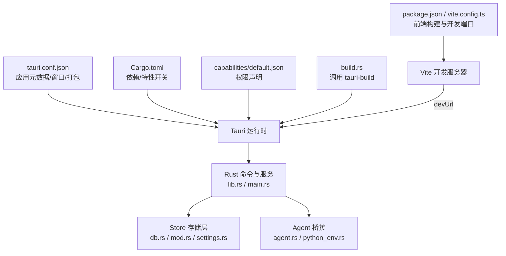
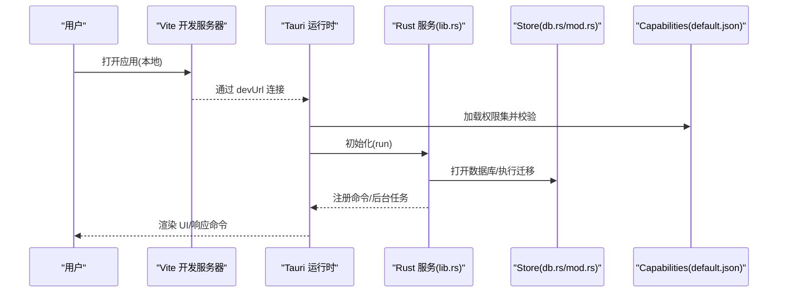
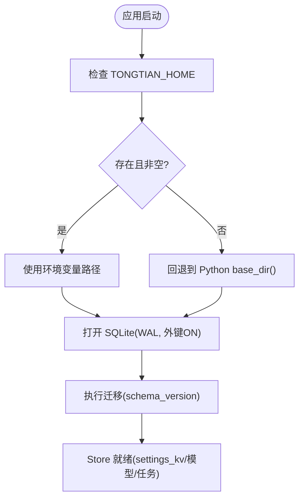
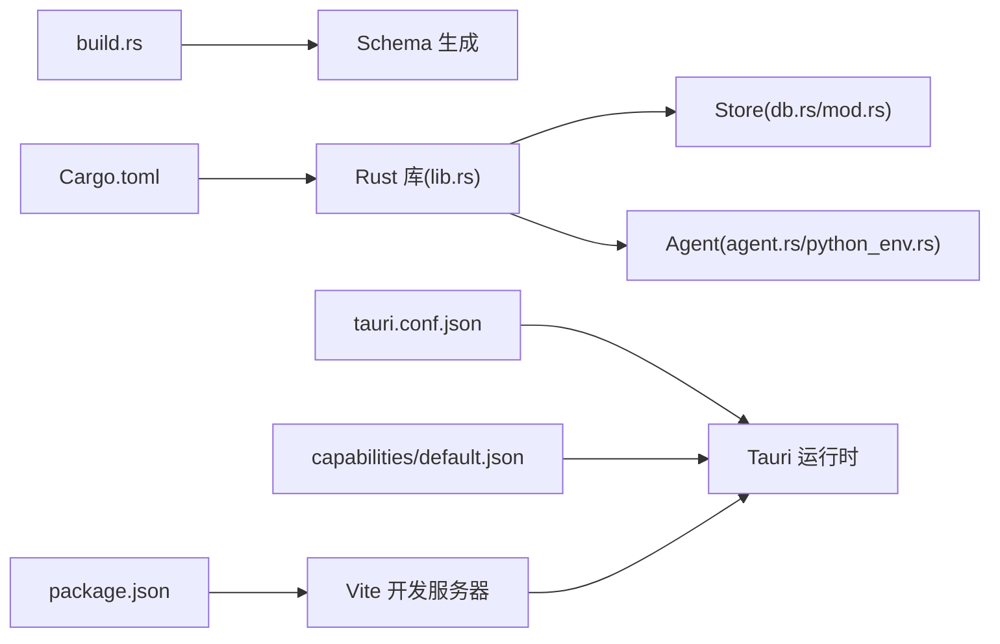

# 配置管理

<cite>
**本文引用的文件**   
- [tauri.conf.json](file://tongtian-tauri/src-tauri/tauri.conf.json)
- [Cargo.toml](file://tongtian-tauri/src-tauri/Cargo.toml)
- [default.json](file://tongtian-tauri/src-tauri/capabilities/default.json)
- [build.rs](file://tongtian-tauri/src-tauri/build.rs)
- [package.json](file://tongtian-tauri/package.json)
- [vite.config.ts](file://tongtian-tauri/vite.config.ts)
- [lib.rs](file://tongtian-tauri/src-tauri/src/lib.rs)
- [main.rs](file://tongtian-tauri/src-tauri/src/main.rs)
- [db.rs](file://tongtian-tauri/src-tauri/src/store/db.rs)
- [mod.rs（store）](file://tongtian-tauri/src-tauri/src/store/mod.rs)
- [settings.rs](file://tongtian-tauri/src-tauri/src/store/settings.rs)
- [agent.rs](file://tongtian-tauri/src-tauri/src/bridge/agent.rs)
- [python_env.rs](file://tongtian-tauri/src-tauri/src/bridge/python_env.rs)
</cite>

## 目录
1. [简介](#简介)
2. [项目结构](#项目结构)
3. [核心组件](#核心组件)
4. [架构总览](#架构总览)
5. [详细组件分析](#详细组件分析)
6. [依赖关系分析](#依赖关系分析)
7. [性能考量](#性能考量)
8. [故障排查指南](#故障排查指南)
9. [结论](#结论)
10. [附录](#附录)

## 简介
本文件面向通天办公 Tauri 应用的“配置管理”，系统性说明以下方面：
- tauri.conf.json 主配置、capabilities 权限配置、Cargo.toml 依赖与特性开关
- 环境变量与运行时配置解析策略
- 安全策略（CSP、能力权限）与不同环境（开发/构建/打包）的差异
- 配置验证机制、热重载支持、配置迁移策略、以及配置安全管理
- 具体配置示例、环境变量设置、权限声明、部署最佳实践

## 项目结构
Tauri 应用由前端（Vite + React）、Rust 后端（Tauri 命令与服务）、Python Agent 桥接组成。配置分布在多处：
- 应用元数据与窗口/打包：tauri.conf.json
- Rust 依赖与编译特性：Cargo.toml
- 能力与权限：src-tauri/capabilities/*.json
- 前端构建与开发服务器：package.json、vite.config.ts
- 运行时路径与数据库位置：Rust store 模块与环境变量
- 构建脚本：build.rs

图表来源 
- [tauri.conf.json:1-40](file://tongtian-tauri/src-tauri/tauri.conf.json#L1-L40)
- [Cargo.toml:1-40](file://tongtian-tauri/src-tauri/Cargo.toml#L1-L40)
- [default.json:1-8](file://tongtian-tauri/src-tauri/capabilities/default.json#L1-L8)
- [build.rs:1-4](file://tongtian-tauri/src-tauri/build.rs#L1-L4)
- [package.json:1-45](file://tongtian-tauri/package.json#L1-L45)
- [vite.config.ts:1-25](file://tongtian-tauri/vite.config.ts#L1-L25)
- [lib.rs:747-800](file://tongtian-tauri/src-tauri/src/lib.rs#L747-L800)
- [main.rs:1-6](file://tongtian-tauri/src-tauri/src/main.rs#L1-L6)

章节来源
- [tauri.conf.json:1-40](file://tongtian-tauri/src-tauri/tauri.conf.json#L1-L40)
- [Cargo.toml:1-40](file://tongtian-tauri/src-tauri/Cargo.toml#L1-L40)
- [default.json:1-8](file://tongtian-tauri/src-tauri/capabilities/default.json#L1-L8)
- [build.rs:1-4](file://tongtian-tauri/src-tauri/build.rs#L1-L4)
- [package.json:1-45](file://tongtian-tauri/package.json#L1-L45)
- [vite.config.ts:1-25](file://tongtian-tauri/vite.config.ts#L1-L25)

## 核心组件
- Tauri 主配置（tauri.conf.json）
  - 定义产品名称、版本、标识符、构建前后命令、前端输出目录、窗口尺寸与安全策略（CSP）
- 能力与权限（capabilities/default.json）
  - 声明默认权限集，包含 core:default、opener:default、dialog:default，并绑定到 main 窗口
- Rust 依赖与特性（Cargo.toml）
  - 引入 tauri、插件、序列化、网络、异步运行时、SQLite、系统密钥环等；通过 features 控制行为
- 前端构建与开发（package.json、vite.config.ts）
  - 定义 dev/build/preview 脚本、Vite 插件、别名、输出目录、开发服务器端口
- 运行时配置与持久化（store 模块）
  - 通过环境变量 TONGTIAN_HOME 覆盖运行目录；SQLite WAL 模式、外键开启；settings_kv 键值对持久化
- 构建脚本（build.rs）
  - 调用 tauri_build::build() 生成 schema 与类型

章节来源
- [tauri.conf.json:1-40](file://tongtian-tauri/src-tauri/tauri.conf.json#L1-L40)
- [default.json:1-8](file://tongtian-tauri/src-tauri/capabilities/default.json#L1-L8)
- [Cargo.toml:1-40](file://tongtian-tauri/src-tauri/Cargo.toml#L1-L40)
- [package.json:1-45](file://tongtian-tauri/package.json#L1-L45)
- [vite.config.ts:1-25](file://tongtian-tauri/vite.config.ts#L1-L25)
- [mod.rs（store）:1-105](file://tongtian-tauri/src-tauri/src/store/mod.rs#L1-L105)
- [db.rs:1-49](file://tongtian-tauri/src-tauri/src/store/db.rs#L1-L49)
- [settings.rs:1-100](file://tongtian-tauri/src-tauri/src/store/settings.rs#L1-L100)
- [build.rs:1-4](file://tongtian-tauri/src-tauri/build.rs#L1-L4)

## 架构总览
Tauri 应用启动流程与配置加载顺序如下：
- 入口 main.rs 调用 lib.rs 的 run()
- build.rs 在构建期生成 schema，供 capabilities 校验使用
- tauri.conf.json 决定构建/运行时的前端地址、窗口与安全策略
- capabilities/default.json 声明权限，限制命令访问
- Rust 侧初始化 Store、事件存储、任务注册表、配额门限等
- 前端通过 Vite 开发服务器提供页面，Tauri 通过 devUrl 连接

图表来源 
- [main.rs:1-6](file://tongtian-tauri/src-tauri/src/main.rs#L1-L6)
- [lib.rs:747-800](file://tongtian-tauri/src-tauri/src/lib.rs#L747-L800)
- [build.rs:1-4](file://tongtian-tauri/src-tauri/build.rs#L1-L4)
- [tauri.conf.json:1-40](file://tongtian-tauri/src-tauri/tauri.conf.json#L1-L40)
- [default.json:1-8](file://tongtian-tauri/src-tauri/capabilities/default.json#L1-L8)
- [db.rs:1-49](file://tongtian-tauri/src-tauri/src/store/db.rs#L1-L49)
- [mod.rs（store）:1-105](file://tongtian-tauri/src-tauri/src/store/mod.rs#L1-L105)

## 详细组件分析

### Tauri 主配置（tauri.conf.json）
- 作用域
  - 应用元数据：productName、version、identifier
  - 构建：beforeDevCommand、devUrl、beforeBuildCommand、frontendDist
  - 应用窗口：title、尺寸、最小尺寸、可调整大小、居中
  - 安全：csp（当前为 null）
  - 打包：targets、icon 列表
- 关键要点
  - 开发时通过 devUrl 指向 Vite 开发服务器（端口 7173）
  - CSP 为空表示不启用严格内容安全策略，生产建议配置 CSP
  - 打包目标 all 将生成多平台产物

章节来源
- [tauri.conf.json:1-40](file://tongtian-tauri/src-tauri/tauri.conf.json#L1-L40)

### 能力与权限（capabilities/default.json）
- 作用域
  - identifier：权限集标识
  - windows：绑定窗口（main）
  - permissions：core:default、opener:default、dialog:default
- 关键要点
  - 仅声明必要权限，遵循最小权限原则
  - 若需更多系统能力（如文件系统），应新增或扩展权限集并在 Tauri 中引用

章节来源
- [default.json:1-8](file://tongtian-tauri/src-tauri/capabilities/default.json#L1-L8)

### Rust 依赖与特性（Cargo.toml）
- 依赖
  - tauri 及插件（opener、dialog）
  - serde/serde_json 用于序列化
  - tokio 异步运行时（进程、网络、时间、IO、同步、宏、多线程 RT）
  - reqwest HTTP 客户端（JSON、流式）
  - rusqlite（bundled）作为 SQLite 引擎
  - keyring 系统密钥环
  - uuid 生成唯一 ID
- 特性
  - default = ["tt-enable-seq"] 控制序列号/重放契约兼容
- 发布优化
  - lto、codegen-units=1、opt-level=s、strip=true

章节来源
- [Cargo.toml:1-40](file://tongtian-tauri/src-tauri/Cargo.toml#L1-L40)

### 前端构建与开发（package.json、vite.config.ts）
- package.json
  - scripts：dev/build/preview/tauri/typecheck/test
  - 依赖：@tauri-apps/api、plugin-dialog、React、Zod、Zustand 等
- vite.config.ts
  - root: src/renderer
  - outDir: ../../dist
  - server.port: 7173
  - alias：@shared、@renderer

章节来源
- [package.json:1-45](file://tongtian-tauri/package.json#L1-L45)
- [vite.config.ts:1-25](file://tongtian-tauri/vite.config.ts#L1-L25)

### 运行时配置与持久化（store 模块）
- 运行目录解析
  - runtime_home() 优先读取 TONGTIAN_HOME 环境变量，否则回退到 Python 环境 base_dir()
- 数据库连接
  - open() 以 WAL 模式打开，开启外键约束
- Store 聚合
  - open_default() 在运行目录创建 tongtian.db，并执行迁移
  - with_conn() 短临界区访问连接
  - vault() 暴露密钥保管箱（API Key 不落库）
- settings_kv
  - get/set/all 实现键值对的读写与全量获取

图表来源 
- [db.rs:1-49](file://tongtian-tauri/src-tauri/src/store/db.rs#L1-L49)
- [mod.rs（store）:1-105](file://tongtian-tauri/src-tauri/src/store/mod.rs#L1-L105)
- [settings.rs:1-100](file://tongtian-tauri/src-tauri/src/store/settings.rs#L1-L100)

章节来源
- [db.rs:1-49](file://tongtian-tauri/src-tauri/src/store/db.rs#L1-L49)
- [mod.rs（store）:1-105](file://tongtian-tauri/src-tauri/src/store/mod.rs#L1-L105)
- [settings.rs:1-100](file://tongtian-tauri/src-tauri/src/store/settings.rs#L1-L100)

### 环境变量与运行时配置
- TONGTIAN_HOME
  - 覆盖运行目录（数据库、事件存储等）
- TT_AGENT_MOCK、TT_ENGINE
  - 控制 Agent 桥接行为（模拟模式、引擎选择）
- LOCALAPPDATA、APPDATA、USERPROFILE/HOME
  - 用于确定跨平台应用数据目录
- 其他
  - 构建期常量：env!("CARGO_PKG_VERSION") 注入版本信息

章节来源
- [db.rs:1-49](file://tongtian-tauri/src-tauri/src/store/db.rs#L1-L49)
- [agent.rs:148-149](file://tongtian-tauri/src-tauri/src/bridge/agent.rs#L148-L149)
- [python_env.rs:72-136](file://tongtian-tauri/src-tauri/src/bridge/python_env.rs#L72-L136)
- [lib.rs:55-57](file://tongtian-tauri/src-tauri/src/lib.rs#L55-L57)

### 安全策略配置
- CSP（Content Security Policy）
  - tauri.conf.json 中 security.csp 当前为 null，建议在生产环境启用并严格配置
- 能力权限
  - capabilities/default.json 限定 opener/dialog/core 能力，避免不必要权限
- 密钥管理
  - API Key 通过 keyring 保管，不在数据库中明文存储

章节来源
- [tauri.conf.json:24-26](file://tongtian-tauri/src-tauri/tauri.conf.json#L24-L26)
- [default.json:1-8](file://tongtian-tauri/src-tauri/capabilities/default.json#L1-L8)
- [mod.rs（store）:39-41](file://tongtian-tauri/src-tauri/src/store/mod.rs#L39-L41)

### 配置验证机制
- 构建期 Schema 生成
  - build.rs 调用 tauri_build::build()，生成 desktop-schema.json 等
- 权限校验
  - capabilities/default.json 引用 schema，Tauri 运行时按权限集校验命令访问

章节来源
- [build.rs:1-4](file://tongtian-tauri/src-tauri/build.rs#L1-L4)
- [default.json:1-8](file://tongtian-tauri/src-tauri/capabilities/default.json#L1-L8)

### 热重载支持
- 开发模式
  - tauri.conf.json 的 devUrl 指向 Vite 开发服务器（7173）
  - package.json 的 dev 脚本启动 Vite
- 前端热更新
  - Vite 自动刷新页面，Tauri 无需重启即可看到变更

章节来源
- [tauri.conf.json:6-11](file://tongtian-tauri/src-tauri/tauri.conf.json#L6-L11)
- [package.json:7-13](file://tongtian-tauri/package.json#L7-L13)
- [vite.config.ts:20-24](file://tongtian-tauri/vite.config.ts#L20-L24)

### 配置迁移策略
- 数据库迁移
  - Store::open_default() 打开后执行 migrate::run()，确保 schema_version 与表结构一致
- 幂等性
  - 多次打开不会重复执行破坏性操作，保证升级平滑

章节来源
- [mod.rs（store）:26-41](file://tongtian-tauri/src-tauri/src/store/mod.rs#L26-L41)

### 配置安全管理
- 敏感信息
  - API Key 通过 keyring 保管，DB 仅存引用标记
- 权限最小化
  - 仅启用必要的 opener/dialog/core 能力
- 运行目录隔离
  - 通过 TONGTIAN_HOME 隔离数据目录，便于备份与清理

章节来源
- [mod.rs（store）:39-41](file://tongtian-tauri/src-tauri/src/store/mod.rs#L39-L41)
- [default.json:1-8](file://tongtian-tauri/src-tauri/capabilities/default.json#L1-L8)
- [db.rs:1-14](file://tongtian-tauri/src-tauri/src/store/db.rs#L1-L14)

## 依赖关系分析
- 构建期
  - build.rs -> tauri-build -> 生成 schema
- 运行期
  - tauri.conf.json -> Tauri 运行时 -> capabilities/default.json -> 权限校验
  - Cargo.toml -> Rust 依赖 -> SQLite、keyring、tokio、reqwest
  - package.json -> Vite -> 前端资源与脚本
- 运行时交互
  - lib.rs 初始化 Store、事件存储、任务注册表、配额门限
  - agent.rs 与 python_env.rs 负责 Python 环境与代理通信

图表来源 
- [build.rs:1-4](file://tongtian-tauri/src-tauri/build.rs#L1-L4)
- [tauri.conf.json:1-40](file://tongtian-tauri/src-tauri/tauri.conf.json#L1-L40)
- [default.json:1-8](file://tongtian-tauri/src-tauri/capabilities/default.json#L1-L8)
- [Cargo.toml:1-40](file://tongtian-tauri/src-tauri/Cargo.toml#L1-L40)
- [package.json:1-45](file://tongtian-tauri/package.json#L1-L45)
- [lib.rs:747-800](file://tongtian-tauri/src-tauri/src/lib.rs#L747-L800)
- [db.rs:1-49](file://tongtian-tauri/src-tauri/src/store/db.rs#L1-L49)
- [mod.rs（store）:1-105](file://tongtian-tauri/src-tauri/src/store/mod.rs#L1-L105)
- [agent.rs:148-149](file://tongtian-tauri/src-tauri/src/bridge/agent.rs#L148-L149)
- [python_env.rs:72-136](file://tongtian-tauri/src-tauri/src/bridge/python_env.rs#L72-L136)

章节来源
- [build.rs:1-4](file://tongtian-tauri/src-tauri/build.rs#L1-L4)
- [tauri.conf.json:1-40](file://tongtian-tauri/src-tauri/tauri.conf.json#L1-L40)
- [default.json:1-8](file://tongtian-tauri/src-tauri/capabilities/default.json#L1-L8)
- [Cargo.toml:1-40](file://tongtian-tauri/src-tauri/Cargo.toml#L1-L40)
- [package.json:1-45](file://tongtian-tauri/package.json#L1-L45)
- [lib.rs:747-800](file://tongtian-tauri/src-tauri/src/lib.rs#L747-L800)
- [db.rs:1-49](file://tongtian-tauri/src-tauri/src/store/db.rs#L1-L49)
- [mod.rs（store）:1-105](file://tongtian-tauri/src-tauri/src/store/mod.rs#L1-L105)
- [agent.rs:148-149](file://tongtian-tauri/src-tauri/src/bridge/agent.rs#L148-L149)
- [python_env.rs:72-136](file://tongtian-tauri/src-tauri/src/bridge/python_env.rs#L72-L136)

## 性能考量
- SQLite WAL 模式提升并发写入性能
- 短临界区访问数据库连接，减少锁竞争
- 发布优化：LTO、单 codegen unit、strip 减小体积
- 事件存储后台任务批量刷盘与 TTL 清理，降低 IO 压力

章节来源
- [db.rs:17-25](file://tongtian-tauri/src-tauri/src/store/db.rs#L17-L25)
- [mod.rs（store）:44-47](file://tongtian-tauri/src-tauri/src/store/mod.rs#L44-L47)
- [Cargo.toml:35-40](file://tongtian-tauri/src-tauri/Cargo.toml#L35-L40)

## 故障排查指南
- 数据库无法打开
  - 检查 TONGTIAN_HOME 是否可写；查看 WAL 与外键 pragma 是否成功
- 权限不足
  - 确认 capabilities/default.json 已包含所需权限；检查 Tauri 版本与 schema 一致性
- Agent 桥接异常
  - 检查 TT_AGENT_MOCK、TT_ENGINE 环境变量；确认 Python 环境与路径
- 前端无法连接
  - 确认 devUrl 与 Vite 端口一致（7173）；检查 beforeDevCommand 是否正确执行

章节来源
- [db.rs:17-25](file://tongtian-tauri/src-tauri/src/store/db.rs#L17-L25)
- [default.json:1-8](file://tongtian-tauri/src-tauri/capabilities/default.json#L1-L8)
- [agent.rs:148-149](file://tongtian-tauri/src-tauri/src/bridge/agent.rs#L148-L149)
- [tauri.conf.json:6-11](file://tongtian-tauri/src-tauri/tauri.conf.json#L6-L11)
- [vite.config.ts:20-24](file://tongtian-tauri/vite.config.ts#L20-L24)

## 结论
通天办公 Tauri 应用的配置管理围绕 tauri.conf.json、capabilities、Cargo.toml、环境变量与 Store 持久化展开。通过构建期 schema 生成与权限校验、WAL 数据库与密钥保管、以及 Vite 热重载，实现了安全、可扩展且易维护的配置体系。生产部署时应启用 CSP、最小权限、合理设置 TONGTIAN_HOME，并结合发布优化提升性能与安全性。

## 附录
- 环境变量清单
  - TONGTIAN_HOME：覆盖运行目录
  - TT_AGENT_MOCK：Agent 模拟模式开关
  - TT_ENGINE：Agent 引擎选择
  - LOCALAPPDATA/APPDATA/USERPROFILE/HOME：平台数据目录解析
- 权限声明建议
  - 仅启用 opener/dialog/core；如需文件系统能力，新增专用权限集
- 部署最佳实践
  - 启用 CSP；使用 release profile；隔离数据目录；定期备份 tongtian.db 与 events 目录

章节来源
- [db.rs:1-14](file://tongtian-tauri/src-tauri/src/store/db.rs#L1-L14)
- [agent.rs:148-149](file://tongtian-tauri/src-tauri/src/bridge/agent.rs#L148-L149)
- [python_env.rs:72-136](file://tongtian-tauri/src-tauri/src/bridge/python_env.rs#L72-L136)
- [default.json:1-8](file://tongtian-tauri/src-tauri/capabilities/default.json#L1-L8)
- [tauri.conf.json:24-26](file://tongtian-tauri/src-tauri/tauri.conf.json#L24-L26)
- [Cargo.toml:35-40](file://tongtian-tauri/src-tauri/Cargo.toml#L35-L40)