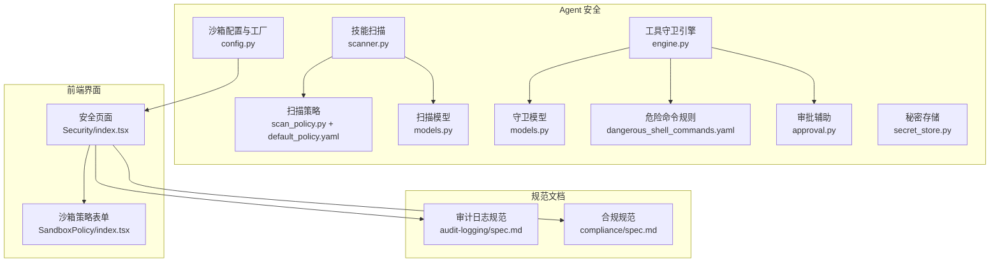
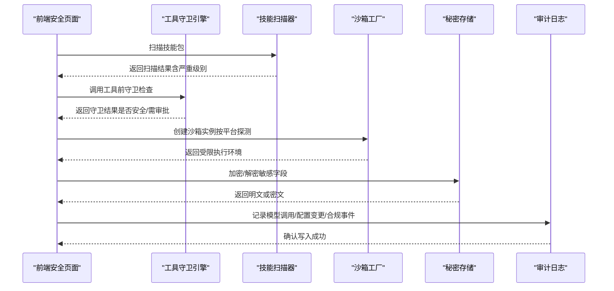
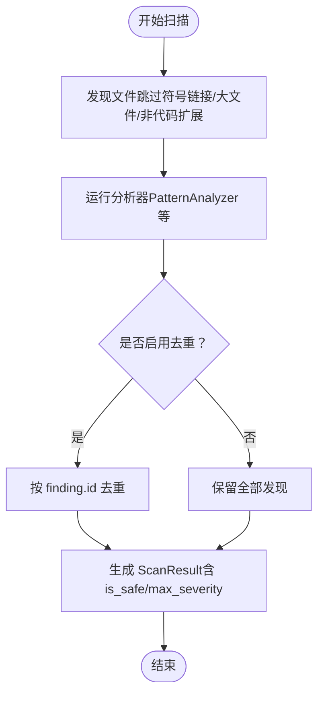
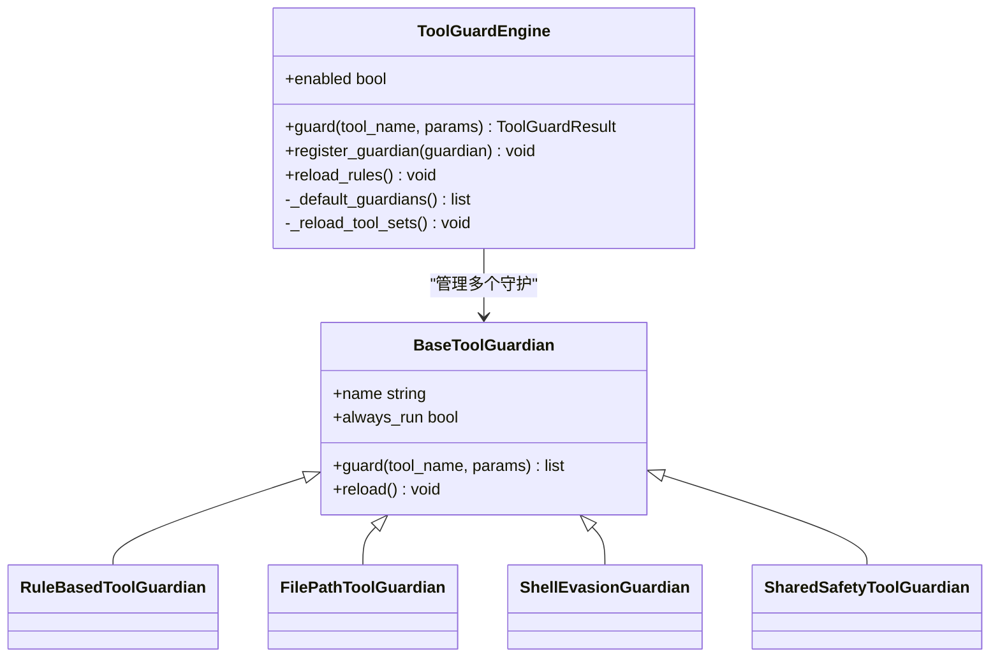
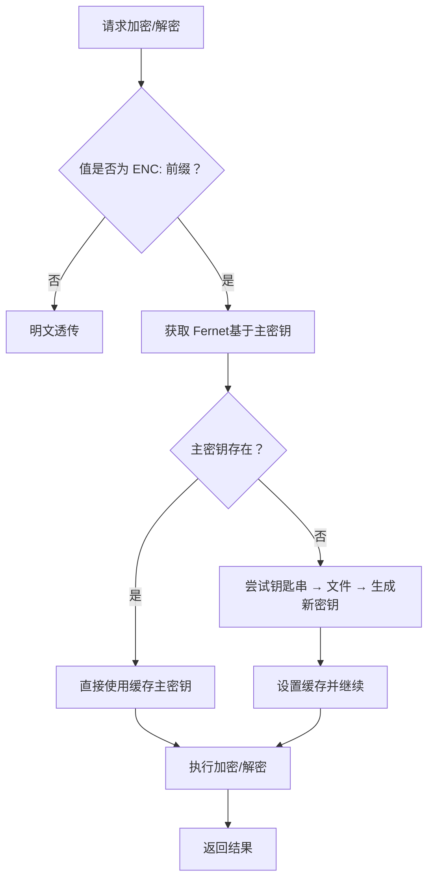
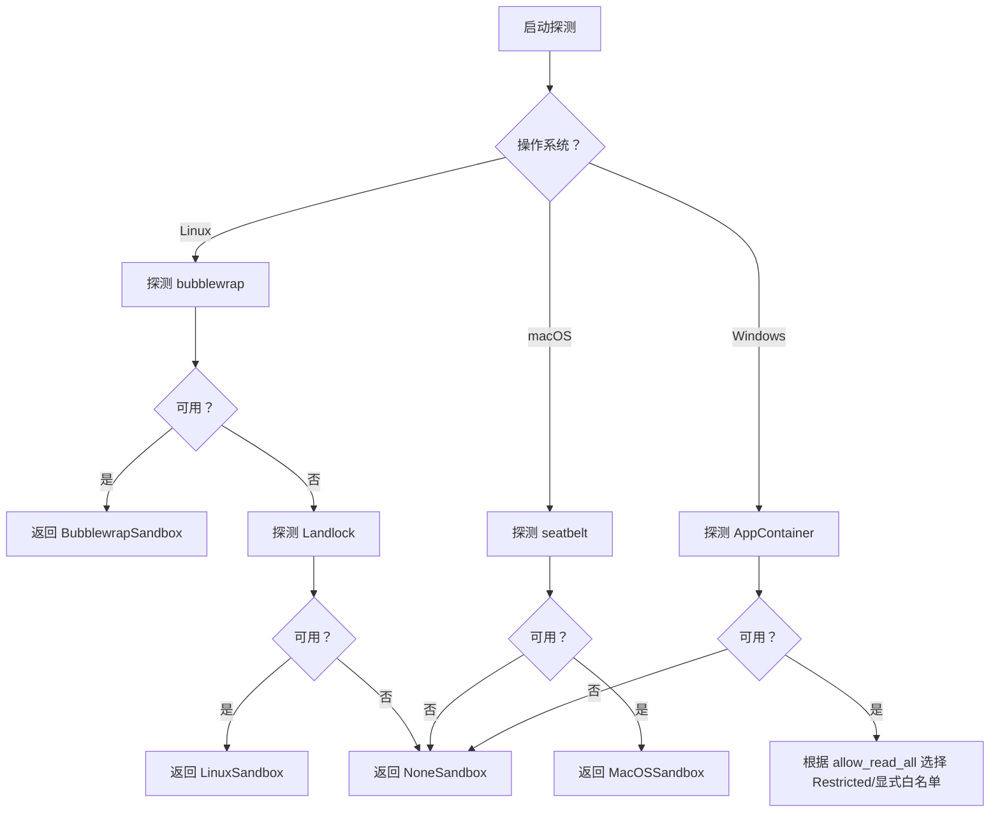
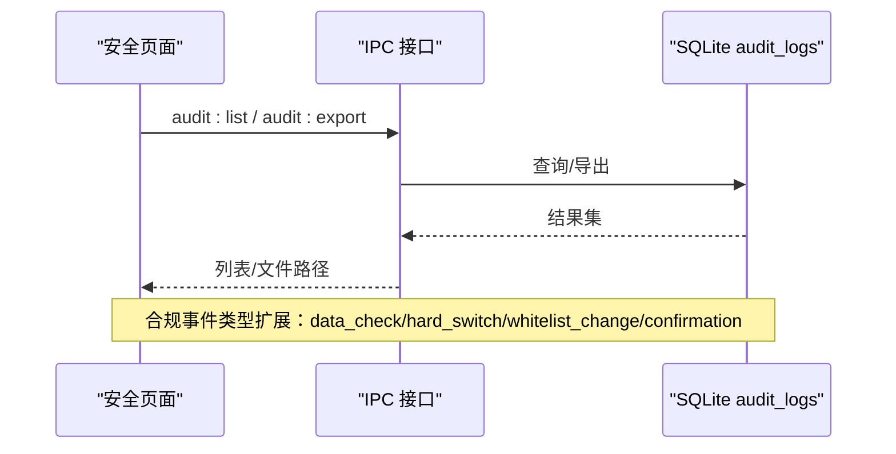
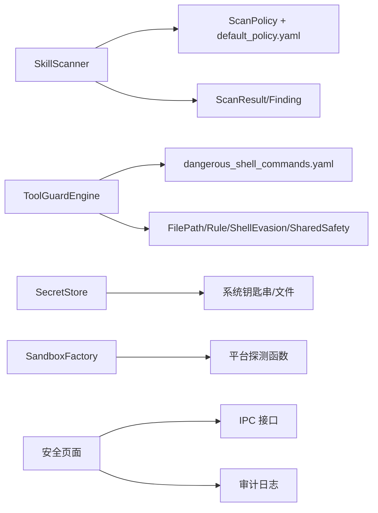

# 安全框架

<cite>
**本文引用的文件**   
- [scanner.py](file://tongtian-tauri/src/agent/security/skill_scanner/scanner.py)
- [models.py（技能扫描）](file://tongtian-tauri/src/agent/security/skill_scanner/models.py)
- [scan_policy.py](file://tongtian-tauri/src/agent/security/skill_scanner/scan_policy.py)
- [default_policy.yaml](file://tongtian-tauri/src/agent/security/skill_scanner/data/default_policy.yaml)
- [engine.py（工具守卫引擎）](file://tongtian-tauri/src/agent/security/tool_guard/engine.py)
- [models.py（工具守卫模型）](file://tongtian-tauri/src/agent/security/tool_guard/models.py)
- [dangerous_shell_commands.yaml](file://tongtian-tauri/src/agent/security/tool_guard/rules/dangerous_shell_commands.yaml)
- [approval.py](file://tongtian-tauri/src/agent/security/tool_guard/approval.py)
- [secret_store.py](file://tongtian-tauri/src/agent/security/secret_store.py)
- [config.py（沙箱配置与探测）](file://tongtian-tauri/src/agent/sandbox/config.py)
- [index.tsx（安全页面）](file://tongtian-tauri/src/renderer/pages/Security/index.tsx)
- [SandboxPolicy/index.tsx](file://tongtian-tauri/src/renderer/components/SandboxPolicy/index.tsx)
- [audit-logging/spec.md](file://docs/changes/qwenpaw-integration/specs/audit-logging/spec.md)
- [compliance/spec.md](file://docs/changes/qwenpaw-integration/specs/compliance/spec.md)
</cite>

## 目录
1. [简介](#简介)
2. [项目结构](#项目结构)
3. [核心组件](#核心组件)
4. [架构总览](#架构总览)
5. [详细组件分析](#详细组件分析)
6. [依赖关系分析](#依赖关系分析)
7. [性能考量](#性能考量)
8. [故障排查指南](#故障排查指南)
9. [结论](#结论)
10. [附录](#附录)

## 简介
本安全框架围绕“多层防护、最小权限、可审计、可合规”的目标，提供以下能力：
- 沙箱隔离：跨平台（Windows/macOS/Linux）自动探测并选择最佳隔离模式，限制文件系统、网络、进程与资源。
- 权限控制：基于白名单/黑名单与执行等级（L0/L1/L2）的细粒度访问控制。
- 工具守卫：在工具调用前进行参数级安全检查，支持规则匹配、自动拒绝与人工审批。
- 技能扫描：对技能包进行静态扫描，识别注入、硬编码密钥、数据外泄等风险。
- 秘密存储：使用系统钥匙串或受保护文件持久化主密钥，透明加密敏感字段。
- 审计日志：全量记录关键操作，支持查询与导出。
- 合规策略：数据分级检测、出域白名单、硬开关、合规告知与审计联动。

## 项目结构
安全相关代码主要分布在 agent 层的 security 与 sandbox 模块，以及前端渲染层的安全页面与组件。后端通过 Python 实现核心逻辑，前端通过 React 提供可视化配置与审计查看。

图表来源
- [scanner.py:1-319](file://tongtian-tauri/src/agent/security/skill_scanner/scanner.py#L1-L319)
- [scan_policy.py:1-476](file://tongtian-tauri/src/agent/security/skill_scanner/scan_policy.py#L1-L476)
- [default_policy.yaml:1-243](file://tongtian-tauri/src/agent/security/skill_scanner/data/default_policy.yaml#L1-L243)
- [engine.py:1-280](file://tongtian-tauri/src/agent/security/tool_guard/engine.py#L1-L280)
- [models.py（工具守卫模型）:1-185](file://tongtian-tauri/src/agent/security/tool_guard/models.py#L1-L185)
- [dangerous_shell_commands.yaml:1-321](file://tongtian-tauri/src/agent/security/tool_guard/rules/dangerous_shell_commands.yaml#L1-L321)
- [approval.py:1-115](file://tongtian-tauri/src/agent/security/tool_guard/approval.py#L1-L115)
- [secret_store.py:1-467](file://tongtian-tauri/src/agent/security/secret_store.py#L1-L467)
- [config.py:1-523](file://tongtian-tauri/src/agent/sandbox/config.py#L1-L523)
- [index.tsx:1-229](file://tongtian-tauri/src/renderer/pages/Security/index.tsx#L1-L229)
- [SandboxPolicy/index.tsx:1-339](file://tongtian-tauri/src/renderer/components/SandboxPolicy/index.tsx#L1-L339)
- [audit-logging/spec.md:1-89](file://docs/changes/qwenpaw-integration/specs/audit-logging/spec.md#L1-L89)
- [compliance/spec.md:1-131](file://docs/changes/qwenpaw-integration/specs/compliance/spec.md#L1-L131)

章节来源
- [scanner.py:1-319](file://tongtian-tauri/src/agent/security/skill_scanner/scanner.py#L1-L319)
- [engine.py:1-280](file://tongtian-tauri/src/agent/security/tool_guard/engine.py#L1-L280)
- [secret_store.py:1-467](file://tongtian-tauri/src/agent/security/secret_store.py#L1-L467)
- [config.py:1-523](file://tongtian-tauri/src/agent/sandbox/config.py#L1-L523)
- [index.tsx:1-229](file://tongtian-tauri/src/renderer/pages/Security/index.tsx#L1-L229)

## 核心组件
- 技能扫描器（SkillScanner）：发现技能包文件，运行多个分析器（默认 PatternAnalyzer），聚合结果并去重，输出 ScanResult。
- 扫描策略（ScanPolicy）：组织级策略覆盖，包含隐藏文件白名单、规则作用域、凭据占位符、文件分类、阈值与禁用规则。
- 工具守卫引擎（ToolGuardEngine）：在工具调用前执行多守护检查（路径、规则、Shell 规避等），支持自动拒绝与审批流程。
- 秘密存储（SecretStore）：Fernet 加密，主密钥优先从系统钥匙串读取，回退到受限文件；提供字典字段加解密。
- 沙箱（Sandbox）：跨平台能力探测与工厂创建，按 OS 选择 Seatbelt/bubblewrap/Landlock/AppContainer/None 模式，限制 I/O、网络、进程与资源。
- 审计与合规：前端统一入口，集成数据分级、出域白名单、硬开关与审计日志查询导出。

章节来源
- [scanner.py:1-319](file://tongtian-tauri/src/agent/security/skill_scanner/scanner.py#L1-L319)
- [scan_policy.py:1-476](file://tongtian-tauri/src/agent/security/skill_scanner/scan_policy.py#L1-L476)
- [engine.py:1-280](file://tongtian-tauri/src/agent/security/tool_guard/engine.py#L1-L280)
- [secret_store.py:1-467](file://tongtian-tauri/src/agent/security/secret_store.py#L1-L467)
- [config.py:1-523](file://tongtian-tauri/src/agent/sandbox/config.py#L1-L523)

## 架构总览
安全框架采用“前置扫描 + 运行时守卫 + 沙箱隔离 + 审计合规”的分层设计。技能包在安装/更新时进行静态扫描；工具调用前由守卫引擎拦截；执行环境由沙箱约束；所有关键事件写入审计日志，并由合规策略驱动决策。

图表来源
- [scanner.py:148-242](file://tongtian-tauri/src/agent/security/skill_scanner/scanner.py#L148-L242)
- [engine.py:211-268](file://tongtian-tauri/src/agent/security/tool_guard/engine.py#L211-L268)
- [config.py:436-523](file://tongtian-tauri/src/agent/sandbox/config.py#L436-L523)
- [secret_store.py:346-375](file://tongtian-tauri/src/agent/security/secret_store.py#L346-L375)
- [audit-logging/spec.md:18-48](file://docs/changes/qwenpaw-integration/specs/audit-logging/spec.md#L18-L48)

## 详细组件分析

### 技能扫描器与安全策略
- 扫描流程：发现文件 → 过滤符号链接与大文件 → 运行分析器 → 去重 → 生成 ScanResult。
- 策略覆盖：可通过 YAML 自定义规则作用域、文件分类、阈值、禁用规则与严重级别覆盖。
- 结果解读：is_safe 表示无 CRITICAL/HIGH 发现；max_severity 给出最高严重级别；可按类别/严重级别筛选。

图表来源
- [scanner.py:248-299](file://tongtian-tauri/src/agent/security/skill_scanner/scanner.py#L248-L299)
- [scanner.py:148-242](file://tongtian-tauri/src/agent/security/skill_scanner/scanner.py#L148-L242)
- [scan_policy.py:194-231](file://tongtian-tauri/src/agent/security/skill_scanner/scan_policy.py#L194-L231)
- [models.py（技能扫描模型）:186-210](file://tongtian-tauri/src/agent/security/skill_scanner/models.py#L186-L210)

章节来源
- [scanner.py:148-242](file://tongtian-tauri/src/agent/security/skill_scanner/scanner.py#L148-L242)
- [scan_policy.py:260-334](file://tongtian-tauri/src/agent/security/skill_scanner/scan_policy.py#L260-L334)
- [default_policy.yaml:157-225](file://tongtian-tauri/src/agent/security/skill_scanner/data/default_policy.yaml#L157-L225)
- [models.py（技能扫描模型）:168-210](file://tongtian-tauri/src/agent/security/skill_scanner/models.py#L168-L210)

### 工具守卫引擎与规则
- 守卫范围：支持全局守卫或仅 always_run 守护（如路径检查）。
- 默认守护：共享安全/系统电源检查、文件路径守卫、基于规则的守卫、Shell 规避守卫。
- 规则集：危险 Shell 命令规则（删除、格式化磁盘、fork bomb、管道执行、反向 shell、提权、服务重启等）。
- 自动拒绝：命中配置的 auto-deny 规则直接阻断；否则进入审批流程。

图表来源
- [engine.py:57-183](file://tongtian-tauri/src/agent/security/tool_guard/engine.py#L57-L183)
- [engine.py:211-268](file://tongtian-tauri/src/agent/security/tool_guard/engine.py#L211-L268)
- [models.py（工具守卫模型）:103-176](file://tongtian-tauri/src/agent/security/tool_guard/models.py#L103-L176)

章节来源
- [engine.py:1-280](file://tongtian-tauri/src/agent/security/tool_guard/engine.py#L1-L280)
- [models.py（工具守卫模型）:1-185](file://tongtian-tauri/src/agent/security/tool_guard/models.py#L1-L185)
- [dangerous_shell_commands.yaml:1-321](file://tongtian-tauri/src/agent/security/tool_guard/rules/dangerous_shell_commands.yaml#L1-L321)

### 秘密存储（加密与主密钥管理）
- 主密钥来源优先级：进程缓存 → 系统钥匙串 → 本地文件（0o600 权限）→ 生成新密钥并回写。
- 兼容性与超时：在无桌面环境的 Linux/容器/CI 中跳过 keyring 访问，避免阻塞。
- 透明加解密：ENC: 前缀标识密文；字典字段批量加解密，便于 Provider/Auth 配置。

图表来源
- [secret_store.py:346-375](file://tongtian-tauri/src/agent/security/secret_store.py#L346-L375)
- [secret_store.py:287-321](file://tongtian-tauri/src/agent/security/secret_store.py#L287-L321)
- [secret_store.py:93-131](file://tongtian-tauri/src/agent/security/secret_store.py#L93-L131)

章节来源
- [secret_store.py:1-467](file://tongtian-tauri/src/agent/security/secret_store.py#L1-L467)

### 沙箱隔离与平台策略
- 平台探测：Linux 优先 bubblewrap，其次 Landlock；macOS 使用 seatbelt；Windows 使用 AppContainer。
- 工厂创建：根据 SandboxMode 与 allow_read_all 选择具体实现（Restricted/显式白名单）。
- 资源限制：进程数、内存上限、超时、环境变量注入模式、端口与域名策略。

图表来源
- [config.py:436-523](file://tongtian-tauri/src/agent/sandbox/config.py#L436-L523)
- [config.py:169-286](file://tongtian-tauri/src/agent/sandbox/config.py#L169-L286)
- [config.py:288-370](file://tongtian-tauri/src/agent/sandbox/config.py#L288-L370)
- [config.py:372-433](file://tongtian-tauri/src/agent/sandbox/config.py#L372-L433)

章节来源
- [config.py:1-523](file://tongtian-tauri/src/agent/sandbox/config.py#L1-L523)

### 审计日志与合规
- 审计采集：模型调用、文件操作、配置变更、合规事件均记录，支持分页查询与 CSV 导出。
- 脱敏处理：API Key、用户名等敏感信息自动脱敏。
- 合规策略：数据分级（PUBLIC/INTERNAL/CONFIDENTIAL）、出域白名单、硬开关、首次外发确认弹窗。

图表来源
- [audit-logging/spec.md:68-89](file://docs/changes/qwenpaw-integration/specs/audit-logging/spec.md#L68-L89)
- [compliance/spec.md:80-131](file://docs/changes/qwenpaw-integration/specs/compliance/spec.md#L80-L131)

章节来源
- [audit-logging/spec.md:1-89](file://docs/changes/qwenpaw-integration/specs/audit-logging/spec.md#L1-L89)
- [compliance/spec.md:1-131](file://docs/changes/qwenpaw-integration/specs/compliance/spec.md#L1-L131)

### 前端安全页面与沙箱策略配置
- 安全页面：整合数据分级、出域控制、审计日志、沙箱策略四个标签页。
- 沙箱策略表单：支持执行等级（L0/L1/L2）、CPU/内存/磁盘配额、文件白名单/黑名单管理。

章节来源
- [index.tsx:1-229](file://tongtian-tauri/src/renderer/pages/Security/index.tsx#L1-L229)
- [SandboxPolicy/index.tsx:1-339](file://tongtian-tauri/src/renderer/components/SandboxPolicy/index.tsx#L1-L339)

## 依赖关系分析
- 技能扫描器依赖扫描策略与默认策略 YAML，分析器通过策略决定作用域与阈值。
- 工具守卫引擎依赖规则 YAML 与守护实现，支持动态重载与自动拒绝。
- 秘密存储依赖系统钥匙串库与文件权限控制，确保主密钥安全。
- 沙箱工厂依赖平台探测函数，按 OS 能力选择最佳隔离方案。
- 前端安全页面依赖 IPC 接口与本地存储，呈现审计与策略配置。

图表来源
- [scanner.py:148-242](file://tongtian-tauri/src/agent/security/skill_scanner/scanner.py#L148-L242)
- [engine.py:88-121](file://tongtian-tauri/src/agent/security/tool_guard/engine.py#L88-L121)
- [secret_store.py:287-321](file://tongtian-tauri/src/agent/security/secret_store.py#L287-L321)
- [config.py:436-523](file://tongtian-tauri/src/agent/sandbox/config.py#L436-L523)

章节来源
- [scanner.py:1-319](file://tongtian-tauri/src/agent/security/skill_scanner/scanner.py#L1-L319)
- [engine.py:1-280](file://tongtian-tauri/src/agent/security/tool_guard/engine.py#L1-L280)
- [secret_store.py:1-467](file://tongtian-tauri/src/agent/security/secret_store.py#L1-L467)
- [config.py:1-523](file://tongtian-tauri/src/agent/sandbox/config.py#L1-L523)

## 性能考量
- 扫描性能：限制最大文件数量与单文件大小，跳过二进制/归档扩展，减少 IO 与解析开销。
- 守卫性能：仅 always_run 守护在受限场景下执行；规则匹配使用正则且长度受限，避免回溯灾难。
- 秘密存储：主密钥与 Fernet 实例进程内缓存，避免重复加载；keyring 访问带超时保护。
- 沙箱探测：能力探测结果缓存，避免重复系统调用；超时与异常快速失败。

[本节为通用指导，不直接分析具体文件]

## 故障排查指南
- 技能扫描失败：检查策略 YAML 语法、正则长度与禁用规则；查看 analyzers_failed 列表定位失败分析器。
- 工具守卫误报/漏报：核对 dangerous_shell_commands.yaml 规则与 exclude_patterns；必要时添加 auto-deny 规则。
- 秘密存储解密失败：确认主密钥未更换或损坏；若恢复备份，调用 reload_master_key_from_disk 同步钥匙串。
- 沙箱不可用：确认平台能力（bubblewrap/seatbelt/Landlock/AppContainer）与依赖工具是否在 PATH；查看 probe_sandbox_support 返回原因。
- 审计日志缺失：检查 IPC 通道与 SQLite 表结构；确认事件类型与索引是否正确。

章节来源
- [scanner.py:203-213](file://tongtian-tauri/src/agent/security/skill_scanner/scanner.py#L203-L213)
- [engine.py:252-268](file://tongtian-tauri/src/agent/security/tool_guard/engine.py#L252-L268)
- [secret_store.py:382-423](file://tongtian-tauri/src/agent/security/secret_store.py#L382-L423)
- [config.py:436-466](file://tongtian-tauri/src/agent/sandbox/config.py#L436-L466)
- [audit-logging/spec.md:68-89](file://docs/changes/qwenpaw-integration/specs/audit-logging/spec.md#L68-L89)

## 结论
该安全框架通过“扫描—守卫—沙箱—审计—合规”的多层机制，有效降低技能包与工具调用的安全风险，并提供跨平台的隔离能力与企业级合规支持。建议在生产环境中：
- 启用严格扫描策略与自动拒绝规则，结合人工审批闭环。
- 配置最小权限沙箱与资源配额，限制网络与文件系统访问。
- 使用系统钥匙串管理主密钥，定期轮换与备份。
- 完善审计与合规策略，确保数据流向可追溯与可控。

[本节为总结性内容，不直接分析具体文件]

## 附录
- 安全配置示例
  - 技能扫描策略：通过 default_policy.yaml 调整 file_limits、disabled_rules、severity_overrides。
  - 工具守卫规则：在 dangerous_shell_commands.yaml 新增/修改规则，配合 auto-deny 提升阻断率。
  - 沙箱策略：在前端 SandboxPolicy 表单设置执行等级与配额，结合文件白/黑名单。
- 漏洞扫描结果解读
  - 关注 max_severity 与 is_safe；按类别筛选高风险项；结合 remediation 修复。
- 安全事件响应流程
  - 触发守卫/扫描告警 → 自动拒绝或提示审批 → 记录审计日志 → 合规策略评估 → 通知管理员处置。

[本节为概念性内容，不直接分析具体文件]