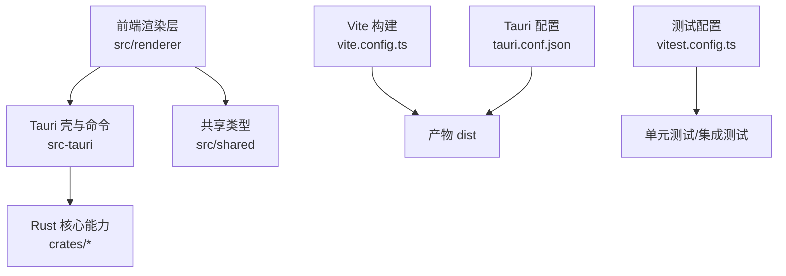
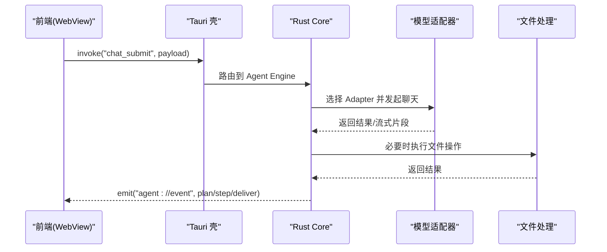
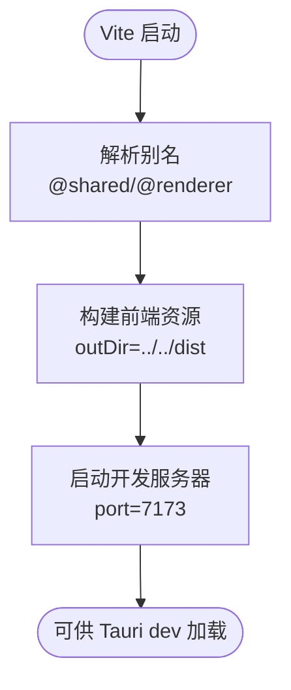
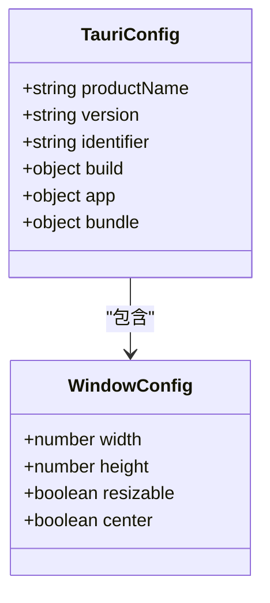
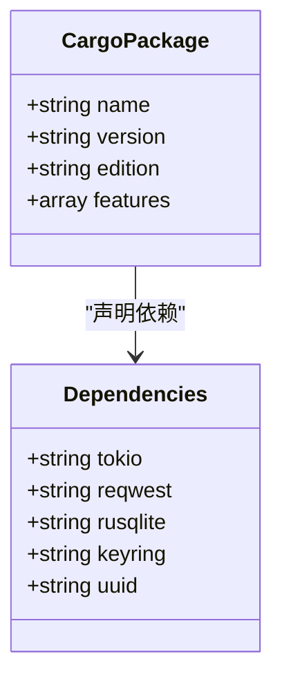
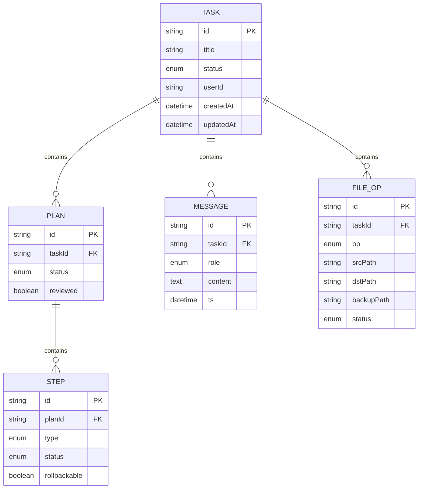
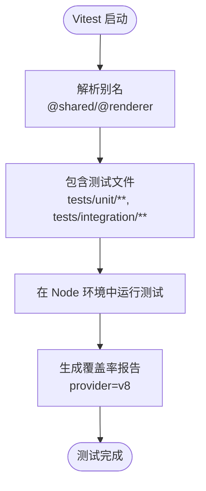
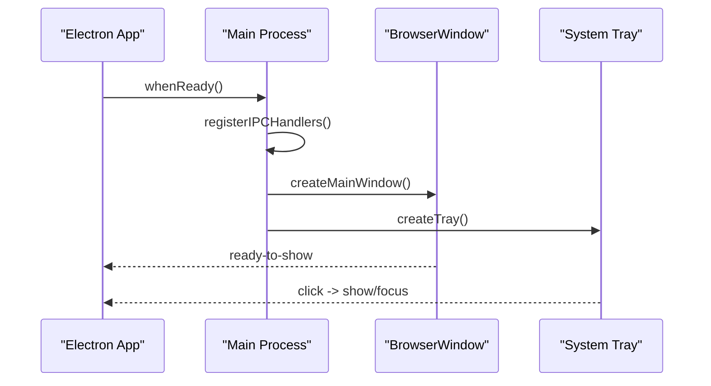
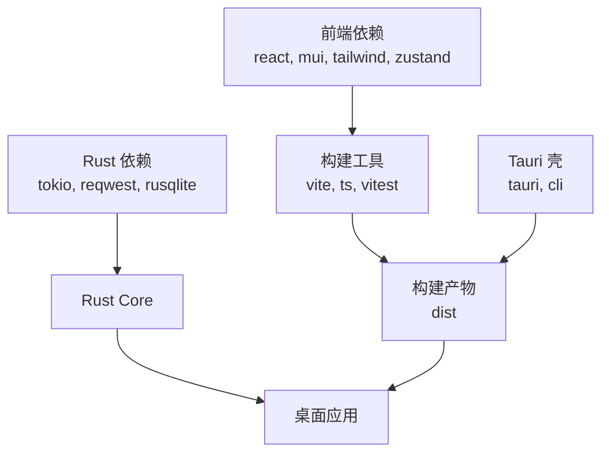

# 开发指南

<cite>
**本文引用的文件**   
- [package.json](file://tongtian-tauri/package.json)
- [tsconfig.json](file://tongtian-tauri/tsconfig.json)
- [vite.config.ts](file://tongtian-tauri/vite.config.ts)
- [Cargo.toml](file://tongtian-tauri/src-tauri/Cargo.toml)
- [tauri.conf.json](file://tongtian-tauri/src-tauri/tauri.conf.json)
- [vitest.config.ts](file://tongtian-tauri/vitest.config.ts)
- [index.ts](file://tongtian-tauri/src/main/index.ts)
- [types.ts](file://tongtian-tauri/src/shared/types.ts)
- [setup-env.ps1](file://.tools/setup-env.ps1)
- [compile-all.ps1](file://.tools/compile-all.ps1)
- [start-product.ps1](file://.tools/start-product.ps1)
- [test-engine-smoke.ps1](file://.tools/test-engine-smoke.ps1)
- [通天办公 MVP 设计文档](file://tongtian-office-mvp-design.md)
- [Electron → Tauri 演进方案](file://docs/spec/spec-通天办公-qwenpaw-改造方案.md)
</cite>

## 目录
1. [简介](#简介)
2. [项目结构](#项目结构)
3. [核心组件](#核心组件)
4. [架构总览](#架构总览)
5. [详细组件分析](#详细组件分析)
6. [依赖分析](#依赖分析)
7. [性能与内存优化](#性能与内存优化)
8. [调试与排障](#调试与排障)
9. [代码规范与命名约定](#代码规范与命名约定)
10. [分支管理与提交规范](#分支管理与提交规范)
11. [工具链与 IDE 配置](#工具链与-ide-配置)
12. [团队协作与贡献流程](#团队协作与贡献流程)
13. [结论](#结论)

## 简介
本指南面向参与“通天办公”项目的开发者，覆盖开发环境搭建、代码规范、提交规范、分支管理策略、项目结构与命名约定、模块化设计原则、调试技巧、性能分析与内存泄漏检测、常见问题排查、IDE 设置与团队协作最佳实践，以及贡献代码的流程与审查标准。项目采用 Tauri 2.x + Rust 后端 + React/TS 前端，配合 Vite 构建与 Vitest 测试；同时保留 Electron 主进程入口用于兼容与过渡。

## 项目结构
- 前端（React + TS + Vite）：位于 tongtian-tauri/src/renderer，通过 Vite 构建输出到 dist，Tauri 打包时引用。
- 共享类型（shared）：位于 tongtian-tauri/src/shared，统一前后端契约类型定义。
- Tauri/Rust 后端：位于 tongtian-tauri/src-tauri，使用 Cargo workspace 组织 crate，提供命令与事件通道。
- 脚本与工具：根目录 .tools 下包含环境初始化、编译、启动、冒烟测试等脚本。
- 文档：docs/spec 与 docs/changes 存放架构演进与设计说明。

**图表来源** 
- [vite.config.ts:1-25](file://tongtian-tauri/vite.config.ts#L1-L25)
- [tauri.conf.json:1-40](file://tongtian-tauri/src-tauri/tauri.conf.json#L1-L40)
- [vitest.config.ts:1-29](file://tongtian-tauri/vitest.config.ts#L1-L29)

**章节来源**
- [package.json:1-45](file://tongtian-tauri/package.json#L1-L45)
- [tsconfig.json:1-29](file://tongtian-tauri/tsconfig.json#L1-L29)
- [vite.config.ts:1-25](file://tongtian-tauri/vite.config.ts#L1-L25)
- [tauri.conf.json:1-40](file://tongtian-tauri/src-tauri/tauri.conf.json#L1-L40)
- [vitest.config.ts:1-29](file://tongtian-tauri/vitest.config.ts#L1-L29)

## 核心组件
- 前端应用入口与路由：React + Vite，页面与组件位于 src/renderer，状态管理使用 Zustand，异步请求建议结合 React Query。
- Tauri 命令与事件：Rust 侧暴露 command（如 chat_submit、model_test），事件通过 agent://event 推送至前端。
- 共享类型：src/shared/types.ts 定义任务、计划、步骤、消息、文件操作等实体与枚举，确保前后端契约一致。
- 构建与测试：Vite 负责前端构建，Vitist 运行单元测试与集成测试，覆盖率统计针对 shared 层。

**章节来源**
- [index.ts:1-217](file://tongtian-tauri/src/main/index.ts#L1-L217)
- [types.ts:1-200](file://tongtian-tauri/src/shared/types.ts#L1-L200)
- [vitest.config.ts:1-29](file://tongtian-tauri/vitest.config.ts#L1-L29)

## 架构总览
整体架构遵循“前端 WebView + Tauri 壳 + Rust Core”的三层模式：
- 前端通过 @tauri-apps/api 调用 Rust 命令，订阅事件流。
- Rust Core 承载 Agent 引擎、Model Hub、文件处理、存储等能力。
- 安全模型基于 capability 白名单，默认拒绝制，限制 WebView 直接访问系统 API。

**图表来源** 
- [tauri.conf.json:1-40](file://tongtian-tauri/src-tauri/tauri.conf.json#L1-L40)
- [Cargo.toml:1-40](file://tongtian-tauri/src-tauri/Cargo.toml#L1-L40)

## 详细组件分析

### 前端构建与路径别名
- Vite 配置将 root 指向 src/renderer，构建输出到 ../../dist，启用 sourcemap 便于调试。
- 路径别名 @shared 与 @renderer 指向对应目录，统一模块导入。
- 开发服务器端口固定为 7173，严格端口避免冲突。

**图表来源** 
- [vite.config.ts:1-25](file://tongtian-tauri/vite.config.ts#L1-L25)

**章节来源**
- [vite.config.ts:1-25](file://tongtian-tauri/vite.config.ts#L1-L25)

### Tauri 壳与命令事件
- tauri.conf.json 指定产品名称、版本、标识符、窗口尺寸、安全策略、打包图标等。
- 开发模式下 beforeDevCommand 执行 npm run dev，devUrl 指向本地 Vite 服务。
- 生产构建前执行 npm run build，前端产物位于 ../dist。

**图表来源** 
- [tauri.conf.json:1-40](file://tongtian-tauri/src-tauri/tauri.conf.json#L1-L40)

**章节来源**
- [tauri.conf.json:1-40](file://tongtian-tauri/src-tauri/tauri.conf.json#L1-L40)

### Rust 后端与特性开关
- Cargo.toml 定义包名、版本、edition、lib crate 类型、features（如 tt-enable-seq）。
- 依赖包括 tokio、reqwest、rusqlite、keyring、uuid 等，release profile 开启 LTO 与 strip。

**图表来源** 
- [Cargo.toml:1-40](file://tongtian-tauri/src-tauri/Cargo.toml#L1-L40)

**章节来源**
- [Cargo.toml:1-40](file://tongtian-tauri/src-tauri/Cargo.toml#L1-L40)

### 共享类型与契约
- types.ts 定义 TaskStatus、PlanStatus、StepStatus、Role、ModelSource、FileOpType 等枚举与实体接口。
- 新增字段保持可选以维持契约兼容，支持三层架构演进增量。

**图表来源** 
- [types.ts:1-200](file://tongtian-tauri/src/shared/types.ts#L1-L200)

**章节来源**
- [types.ts:1-200](file://tongtian-tauri/src/shared/types.ts#L1-L200)

### 测试配置与用例范围
- vitest.config.ts 设置别名、测试包含路径、环境为 node、超时与覆盖率统计范围。
- 测试覆盖 src/shared 契约与纯逻辑层，unit 与 integration 用例分离。

**图表来源** 
- [vitest.config.ts:1-29](file://tongtian-tauri/vitest.config.ts#L1-L29)

**章节来源**
- [vitest.config.ts:1-29](file://tongtian-tauri/vitest.config.ts#L1-L29)

### Electron 主进程入口（兼容与过渡）
- index.ts 作为 Electron main 进程入口，创建窗口、托盘、注册 IPC 处理器。
- 开发模式加载本地 Vite 服务，生产模式加载打包后的 HTML。
- 安全策略禁止外部导航与新窗口打开，最小化到托盘而非退出。

**图表来源** 
- [index.ts:1-217](file://tongtian-tauri/src/main/index.ts#L1-L217)

**章节来源**
- [index.ts:1-217](file://tongtian-tauri/src/main/index.ts#L1-L217)

## 依赖分析
- 前端依赖：React、MUI、Tailwind、Zustand、@tauri-apps/api 等。
- 构建与测试：Vite、TypeScript、Vitest。
- Rust 依赖：tokio、reqwest、rusqlite、keyring、uuid 等。
- Tauri 配置与 CLI：tauri 2.x、tauri-cli。

**图表来源** 
- [package.json:1-45](file://tongtian-tauri/package.json#L1-L45)
- [Cargo.toml:1-40](file://tongtian-tauri/src-tauri/Cargo.toml#L1-L40)

**章节来源**
- [package.json:1-45](file://tongtian-tauri/package.json#L1-L45)
- [Cargo.toml:1-40](file://tongtian-tauri/src-tauri/Cargo.toml#L1-L40)

## 性能与内存优化
- 构建优化：Vite 启用 sourcemap，Tauri release profile 开启 LTO、strip、opt-level="s"，减小二进制体积。
- 运行时优化：Rust 侧使用 tokio 异步运行时，reqwest 支持 SSE 流式传输，减少内存占用与延迟。
- 前端优化：按需加载组件与路由，合理使用 Zustand 全局状态，避免不必要的重渲染。
- 缓存与降级：Model Hub 实现熔断与降级策略，提升稳定性与用户体验。

[本节为通用指导，不直接分析具体文件]

## 调试与排障
- 前端调试：Vite 开发服务器端口 7173，浏览器 DevTools 查看网络与状态。
- Rust 调试：cargo test 与 cargo run，tracing 日志输出到用户数据目录。
- 冒烟测试：.tools/test-engine-smoke.ps1 验证引擎健康与错误降级。
- 常见问题：
  - 端口冲突：修改 vite.config.ts 中 server.port。
  - 权限不足：检查 tauri.conf.json 的 capabilities 白名单。
  - 类型不同步：确保 shared/types.ts 与 Rust ts-rs 导出一致。

**章节来源**
- [vite.config.ts:1-25](file://tongtian-tauri/vite.config.ts#L1-L25)
- [tauri.conf.json:1-40](file://tongtian-tauri/src-tauri/tauri.conf.json#L1-L40)
- [test-engine-smoke.ps1:1-23](file://.tools/test-engine-smoke.ps1#L1-L23)

## 代码规范与命名约定
- Rust 命名：模块/函数 snake_case，类型 PascalCase，crate 命名 tongtian-{域}。
- 前端组件：PascalCase（如 PlanView.tsx），工具/模块 kebab-case。
- Tauri command：统一 domain_action（如 chat_submit、model_test），event 统一 domain://name（如 agent://event）。
- 状态管理：前端 Zustand 管 UI 状态，React Query 管异步；Rust core 状态经 AppState 持有单例。
- 错误处理与日志：统一错误结构，敏感信息脱敏，关键操作留审计日志。
- 配置存储：模型 Key 经 keyring/系统密钥库加密，SQLite 仅存 api_key_ref 引用名。

**章节来源**
- [types.ts:1-200](file://tongtian-tauri/src/shared/types.ts#L1-L200)
- [通天办公 MVP 设计文档:377-391](file://tongtian-office-mvp-design.md#L377-L391)

## 分支管理与提交规范
- 分支策略：
  - main：稳定发布分支。
  - develop：集成开发分支。
  - feature/*：功能分支。
  - fix/*：修复分支。
  - hotfix/*：紧急修复分支。
- 提交规范：
  - 格式：type(scope): subject
  - 类型：feat、fix、docs、style、refactor、test、chore
  - 示例：feat(agent): 实现计划审阅流程
- 代码审查：
  - PR 需包含变更说明、测试用例、影响评估。
  - 至少一名维护者审查通过后合并。

[本节为通用指导，不直接分析具体文件]

## 工具链与 IDE 配置
- 环境初始化：.tools/setup-env.ps1 解压 JDK/Maven，验证安装。
- 编译脚本：.tools/compile-all.ps1 设置 JAVA_HOME 与 PATH，批量编译 Java 服务。
- 启动脚本：.tools/start-product.ps1 执行 mvn install 与 spring-boot:run。
- IDE 推荐：
  - VS Code：安装 Rust Analyzer、ESLint、Prettier、Tailwind CSS IntelliSense。
  - IntelliJ IDEA：安装 Rust 插件、Vue.js/React 插件。
  - 配置 tsconfig.json 与 vite.config.ts 路径别名。

**章节来源**
- [setup-env.ps1:1-43](file://.tools/setup-env.ps1#L1-L43)
- [compile-all.ps1:1-41](file://.tools/compile-all.ps1#L1-L41)
- [start-product.ps1:1-23](file://.tools/start-product.ps1#L1-L23)

## 团队协作与贡献流程
- 贡献流程：
  - Fork 仓库，创建 feature 分支。
  - 提交代码，编写测试用例。
  - 发起 PR，描述变更与影响。
  - 代码审查通过后合并至 develop/main。
- 协作最佳实践：
  - 定期同步上游分支，避免冲突。
  - 使用 Issue 跟踪问题与需求。
  - 文档与代码同步更新。

[本节为通用指导，不直接分析具体文件]

## 结论
本指南提供了通天办公项目的完整开发指南，涵盖环境搭建、代码规范、分支管理、调试排障、性能优化与团队协作。遵循本指南可提升开发效率与代码质量，确保项目稳定演进。

[本节为总结性内容，不直接分析具体文件]