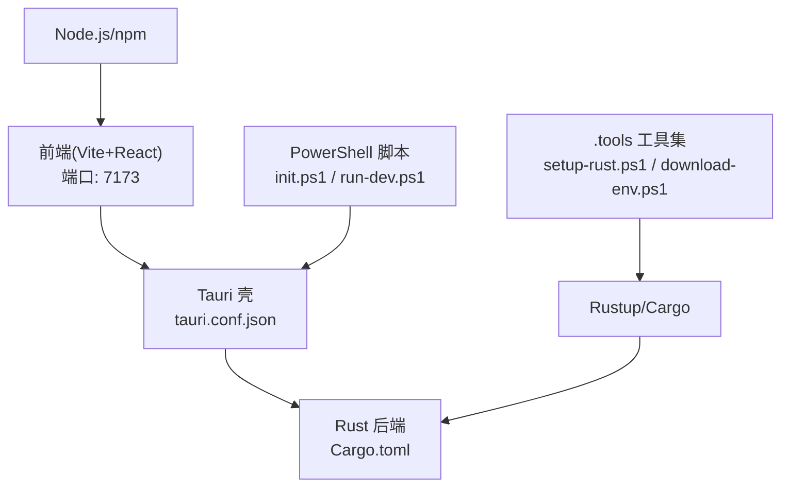
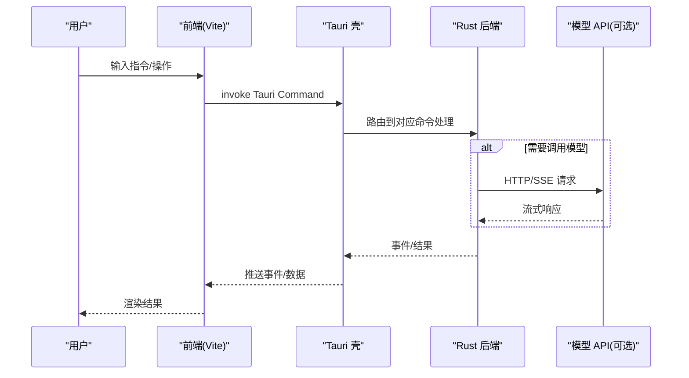
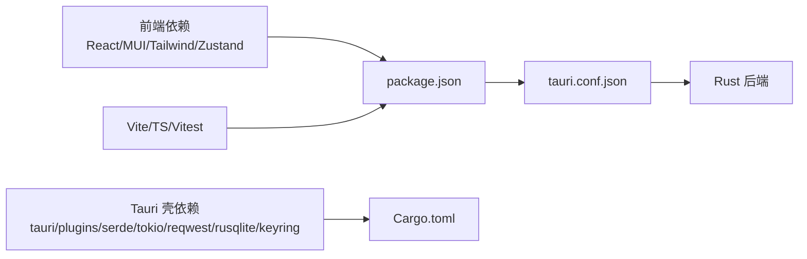

# 快速开始

<cite>
**本文引用的文件**   
- [package.json](file://tongtian-tauri/package.json)
- [vite.config.ts](file://tongtian-tauri/vite.config.ts)
- [tauri.conf.json](file://tongtian-tauri/src-tauri/tauri.conf.json)
- [Cargo.toml](file://tongtian-tauri/src-tauri/Cargo.toml)
- [init.ps1](file://tongtian-tauri/init.ps1)
- [run-dev.ps1](file://tongtian-tauri/run-dev.ps1)
- [setup-rust.ps1](file://.tools/setup-rust.ps1)
- [download-env.ps1](file://.tools/download-env.ps1)
- [setup-env.ps1](file://.tools/setup-env.ps1)
- [start-product.ps1](file://.tools/start-product.ps1)
- [通天办公 MVP 设计文档](file://tongtian-office-mvp-design.md)
</cite>

## 目录
1. [简介](#简介)
2. [项目结构](#项目结构)
3. [核心组件](#核心组件)
4. [架构总览](#架构总览)
5. [详细组件分析](#详细组件分析)
6. [依赖关系分析](#依赖关系分析)
7. [性能注意事项](#性能注意事项)
8. [故障排除指南](#故障排除指南)
9. [结论](#结论)
10. [附录](#附录)

## 简介
本快速开始指南面向首次接触“通天办公（Tauri 版）”的开发者，目标是在最短时间内完成环境搭建、项目初始化与运行。本项目采用 Tauri 2.x + Rust 后端 + Vite + React 前端，支持 Mock 模式快速验证，也支持真实模型接入。通过脚本化安装与一键启动，降低上手门槛。

## 项目结构
- 前端工程位于 tongtian-tauri，使用 Vite + React + TypeScript，开发端口默认 7173。
- Tauri 壳工程位于 tongtian-tauri/src-tauri，Rust 后端通过 Cargo 管理，构建产物由 tauri.conf.json 控制。
- 工具脚本位于 .tools，提供 Rust 工具链安装、JDK/Maven 下载与环境检测等能力。
- 根目录包含 MVP 设计文档，用于理解整体架构与演进方向。

图表来源 
- [vite.config.ts:1-25](file://tongtian-tauri/vite.config.ts#L1-L25)
- [tauri.conf.json:1-40](file://tongtian-tauri/src-tauri/tauri.conf.json#L1-L40)
- [Cargo.toml:1-40](file://tongtian-tauri/src-tauri/Cargo.toml#L1-L40)
- [init.ps1:1-54](file://tongtian-tauri/init.ps1#L1-L54)
- [run-dev.ps1:1-13](file://tongtian-tauri/run-dev.ps1#L1-L13)

章节来源
- [package.json:1-45](file://tongtian-tauri/package.json#L1-L45)
- [vite.config.ts:1-25](file://tongtian-tauri/vite.config.ts#L1-L25)
- [tauri.conf.json:1-40](file://tongtian-tauri/src-tauri/tauri.conf.json#L1-L40)
- [Cargo.toml:1-40](file://tongtian-tauri/src-tauri/Cargo.toml#L1-L40)

## 核心组件
- 前端：Vite 开发服务器、React 应用、TypeScript 类型与状态管理。
- Tauri 壳：窗口配置、安全策略、打包与图标、前后端桥接。
- Rust 后端：异步运行时、HTTP/SSE 客户端、本地存储与系统密钥库集成。
- 脚本工具：一键初始化、Mock 模式切换、Rust/JDK/Maven 环境准备。

章节来源
- [package.json:1-45](file://tongtian-tauri/package.json#L1-L45)
- [tauri.conf.json:1-40](file://tongtian-tauri/src-tauri/tauri.conf.json#L1-L40)
- [Cargo.toml:1-40](file://tongtian-tauri/src-tauri/Cargo.toml#L1-L40)

## 架构总览
下图展示了从用户操作到 Rust 后端的调用链路，以及开发模式下前端与 Tauri 的协作方式。

图表来源 
- [tauri.conf.json:1-40](file://tongtian-tauri/src-tauri/tauri.conf.json#L1-L40)
- [Cargo.toml:1-40](file://tongtian-tauri/src-tauri/Cargo.toml#L1-L40)
- [vite.config.ts:1-25](file://tongtian-tauri/vite.config.ts#L1-L25)

## 详细组件分析

### 环境要求与依赖
- Node.js：用于前端开发与构建。
- Rust 工具链：cargo/rustc，用于编译 Rust 后端。
- PowerShell：Windows 环境下执行脚本。
- JDK/Maven（可选）：若需启动 Java 服务，可通过 .tools 脚本获取。

章节来源
- [init.ps1:1-54](file://tongtian-tauri/init.ps1#L1-L54)
- [setup-rust.ps1:1-33](file://.tools/setup-rust.ps1#L1-L33)
- [download-env.ps1:1-39](file://.tools/download-env.ps1#L1-L39)
- [setup-env.ps1:1-43](file://.tools/setup-env.ps1#L1-L43)
- [start-product.ps1:1-23](file://.tools/start-product.ps1#L1-L23)

### 环境搭建步骤
- 安装 Node.js（如未安装）。
- 安装 Rust 工具链：
  - 执行 .tools\setup-rust.ps1，自动安装 rustup 并配置国内镜像。
- 安装 JDK/Maven（可选，仅当需要 Java 服务时）：
  - 执行 .tools\download-env.ps1 下载压缩包；
  - 执行 .tools\setup-env.ps1 解压并校验路径；
  - 使用 .tools\start-product.ps1 设置 JAVA_HOME 并启动服务。

章节来源
- [setup-rust.ps1:1-33](file://.tools/setup-rust.ps1#L1-L33)
- [download-env.ps1:1-39](file://.tools/download-env.ps1#L1-L39)
- [setup-env.ps1:1-43](file://.tools/setup-env.ps1#L1-L43)
- [start-product.ps1:1-23](file://.tools/start-product.ps1#L1-L23)

### 项目初始化与运行
- 进入 tongtian-tauri 目录。
- 运行初始化脚本：
  - powershell -ExecutionPolicy Bypass -File init.ps1
  - 该脚本会检查 Node.js、安装 npm 依赖，并根据是否检测到 Rust 决定启动完整桌面应用或浏览器 Mock 模式。
- 开发模式（推荐）：
  - 直接运行 run-dev.ps1，将注入环境变量 TT_AGENT_MOCK 与 TT_ENGINE，并调用 npx tauri dev。
  - 前端开发服务器监听 http://localhost:7173。
- 生产构建：
  - 在 tongtian-tauri 目录下执行 npm run build，输出至 dist；随后通过 Tauri 打包生成安装包。

章节来源
- [init.ps1:1-54](file://tongtian-tauri/init.ps1#L1-L54)
- [run-dev.ps1:1-13](file://tongtian-tauri/run-dev.ps1#L1-L13)
- [package.json:1-45](file://tongtian-tauri/package.json#L1-L45)
- [vite.config.ts:1-25](file://tongtian-tauri/vite.config.ts#L1-L25)
- [tauri.conf.json:1-40](file://tongtian-tauri/src-tauri/tauri.conf.json#L1-L40)

### 开发模式与生产版本
- 开发模式：
  - 前端：Vite 热更新，端口 7173。
  - 后端：Tauri 进程加载 Rust 二进制，Command/Event 通道打通。
- 生产版本：
  - 前端构建产物输出到 dist；
  - Tauri 打包启用 LTO、strip 等优化，减小体积。

章节来源
- [vite.config.ts:1-25](file://tongtian-tauri/vite.config.ts#L1-L25)
- [Cargo.toml:35-40](file://tongtian-tauri/src-tauri/Cargo.toml#L35-L40)
- [tauri.conf.json:6-11](file://tongtian-tauri/src-tauri/tauri.conf.json#L6-L11)

### 环境变量与配置
- 前端 Mock 开关：
  - 设置 VITE_MOCK=false 可关闭 Mock，进入真实模式（由 init.ps1 判断并提示）。
- Agent 引擎模式：
  - TT_AGENT_MOCK=1：纯模拟事件，无需模型配置。
  - TT_ENGINE=qwenpaw：使用 qwenpaw（需已安装）。
  - 默认 agentscope：自研引擎（需项目根 .env 配置 API Key）。
- 其他：
  - 端口由 vite.config.ts 固定为 7173，确保严格占用。

章节来源
- [init.ps1:1-54](file://tongtian-tauri/init.ps1#L1-L54)
- [run-dev.ps1:1-13](file://tongtian-tauri/run-dev.ps1#L1-L13)
- [vite.config.ts:20-23](file://tongtian-tauri/vite.config.ts#L20-L23)

### 命令行示例与预期输出
- 初始化并启动（Mock 模式）：
  - 命令：powershell -ExecutionPolicy Bypass -File init.ps1
  - 预期：显示前端地址 http://localhost:7173，运行模式为 Mock 模式，启动 Tauri 或浏览器预览。
- 启动开发模式（完整桌面应用）：
  - 命令：.\run-dev.ps1
  - 预期：输出 TT_AGENT_MOCK 与 TT_ENGINE 的值，然后启动 Tauri 开发流程。
- 构建生产版本：
  - 命令：npm run build
  - 预期：前端构建输出到 dist，无错误提示。

章节来源
- [init.ps1:1-54](file://tongtian-tauri/init.ps1#L1-L54)
- [run-dev.ps1:1-13](file://tongtian-tauri/run-dev.ps1#L1-L13)
- [package.json:7-14](file://tongtian-tauri/package.json#L7-L14)

## 依赖关系分析
- 前端依赖：React、MUI、Tailwind、Zustand、@tauri-apps/api。
- Tauri 壳依赖：tauri、tauri-plugin-*、serde、tokio、reqwest、rusqlite、keyring。
- 构建与开发：Vite、TypeScript、Vitest、Tauri CLI。

图表来源 
- [package.json:15-43](file://tongtian-tauri/package.json#L15-L43)
- [Cargo.toml:21-34](file://tongtian-tauri/src-tauri/Cargo.toml#L21-L34)
- [tauri.conf.json:1-40](file://tongtian-tauri/src-tauri/tauri.conf.json#L1-L40)

章节来源
- [package.json:15-43](file://tongtian-tauri/package.json#L15-L43)
- [Cargo.toml:21-34](file://tongtian-tauri/src-tauri/Cargo.toml#L21-L34)

## 性能注意事项
- 前端构建开启 sourcemap，便于调试；生产构建建议保留 source map 以便定位问题。
- Rust 发布配置启用 LTO、opt-level=s、strip，显著减小二进制体积。
- 开发模式使用 Vite 热更新，避免全量刷新，提升迭代效率。

章节来源
- [vite.config.ts:9-13](file://tongtian-tauri/vite.config.ts#L9-L13)
- [Cargo.toml:35-40](file://tongtian-tauri/src-tauri/Cargo.toml#L35-L40)

## 故障排除指南
- 未检测到 Node.js：
  - 现象：init.ps1 报错退出。
  - 解决：安装 Node.js 并确保 PATH 正确。
- 未检测到 Rust：
  - 现象：init.ps1 降级为浏览器 Mock 模式。
  - 解决：执行 .tools\setup-rust.ps1 安装 Rust 工具链。
- 端口占用：
  - 现象：Vite 启动失败。
  - 解决：修改 vite.config.ts 中的端口或释放占用。
- Java/Maven 相关：
  - 现象：Java 服务无法启动。
  - 解决：执行 .tools\download-env.ps1 与 setup-env.ps1，再使用 start-product.ps1 启动。

章节来源
- [init.ps1:14-24](file://tongtian-tauri/init.ps1#L14-L24)
- [setup-rust.ps1:1-33](file://.tools/setup-rust.ps1#L1-L33)
- [vite.config.ts:20-23](file://tongtian-tauri/vite.config.ts#L20-L23)
- [download-env.ps1:1-39](file://.tools/download-env.ps1#L1-L39)
- [setup-env.ps1:1-43](file://.tools/setup-env.ps1#L1-L43)
- [start-product.ps1:1-23](file://.tools/start-product.ps1#L1-L23)

## 结论
通过本快速开始指南，您可以在 Windows 环境下快速完成通天办公（Tauri 版）的环境搭建与运行。推荐使用 init.ps1 进行一次性初始化，并使用 run-dev.ps1 进行日常开发。如需真实模型接入，请根据环境变量与 .env 配置调整。

## 附录
- 架构与设计参考：通天办公 MVP 设计文档提供了整体架构、任务分解与实现建议，有助于深入理解项目结构与演进路线。

章节来源
- [通天办公 MVP 设计文档:1-409](file://tongtian-office-mvp-design.md#L1-L409)