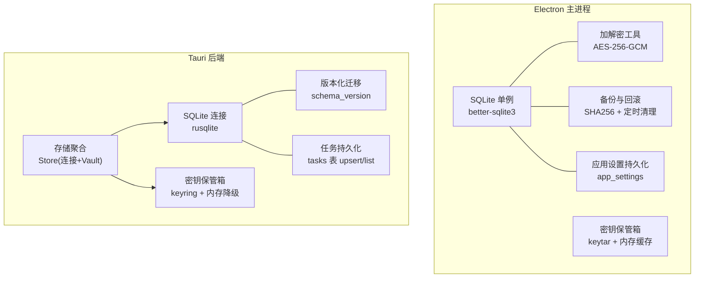
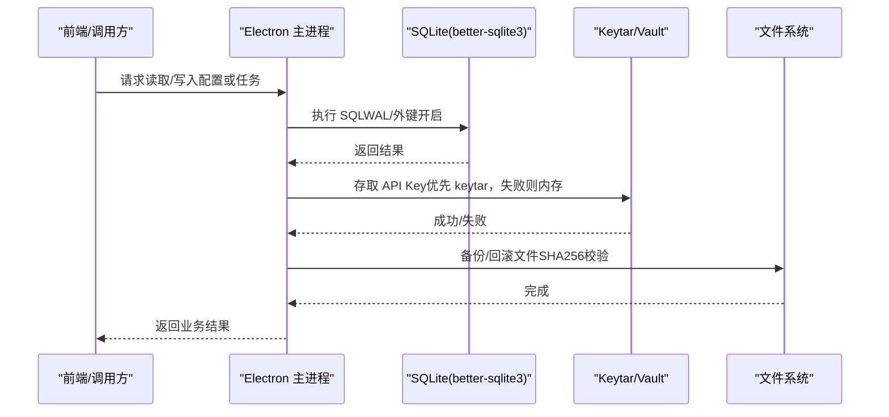
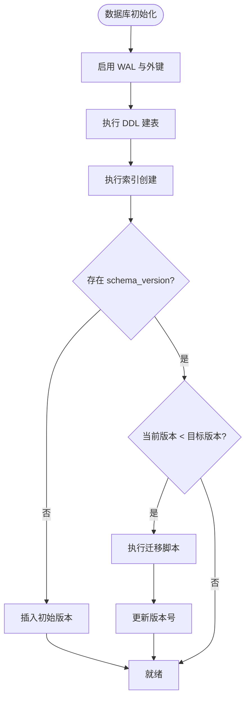
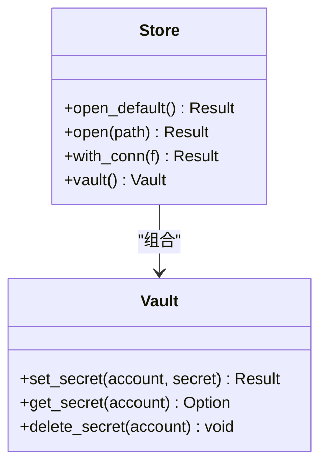
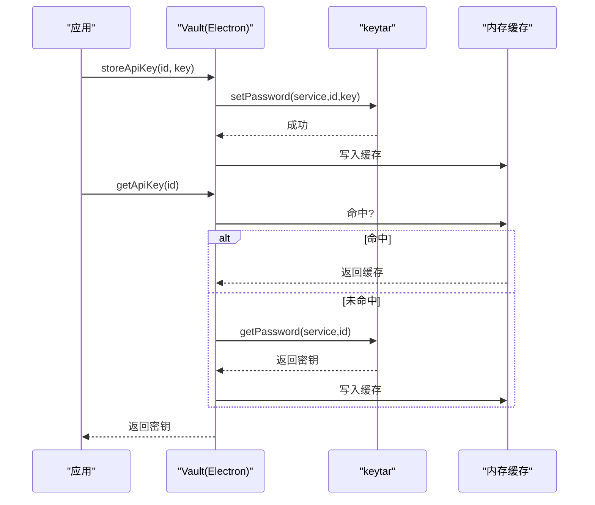
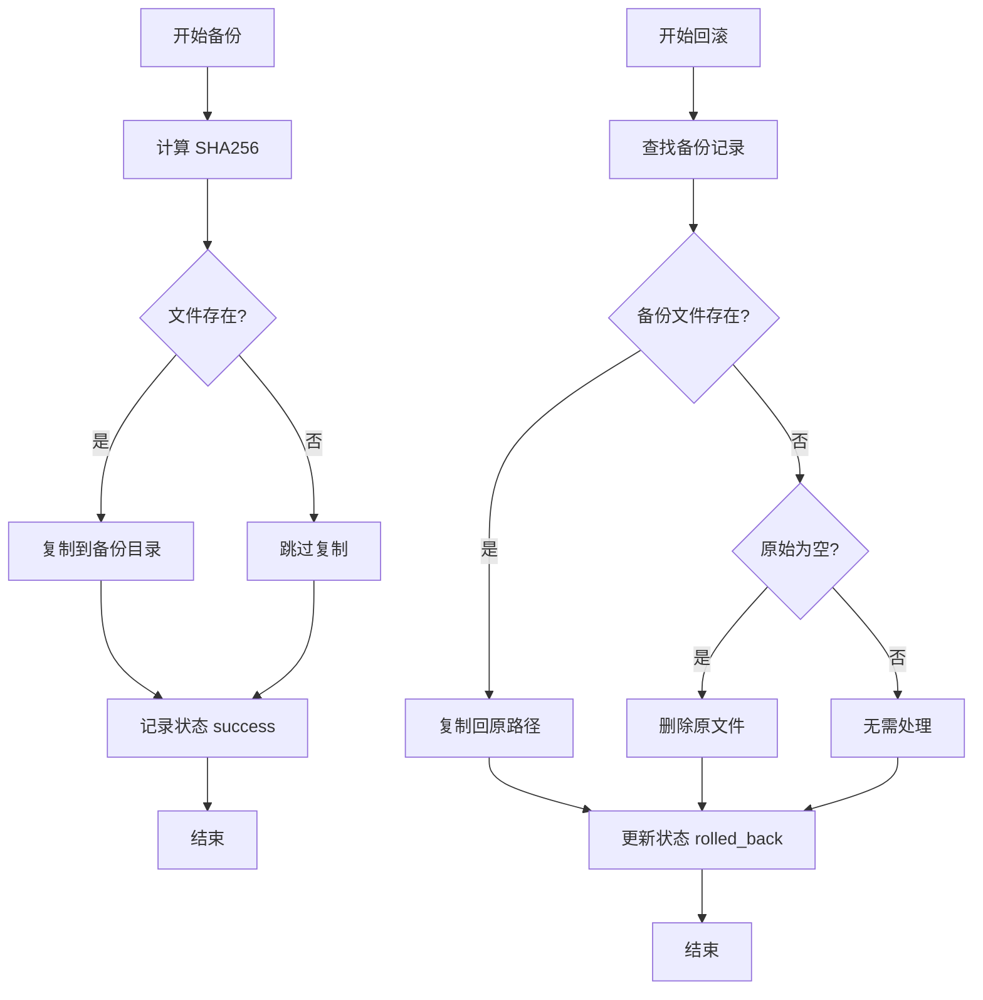
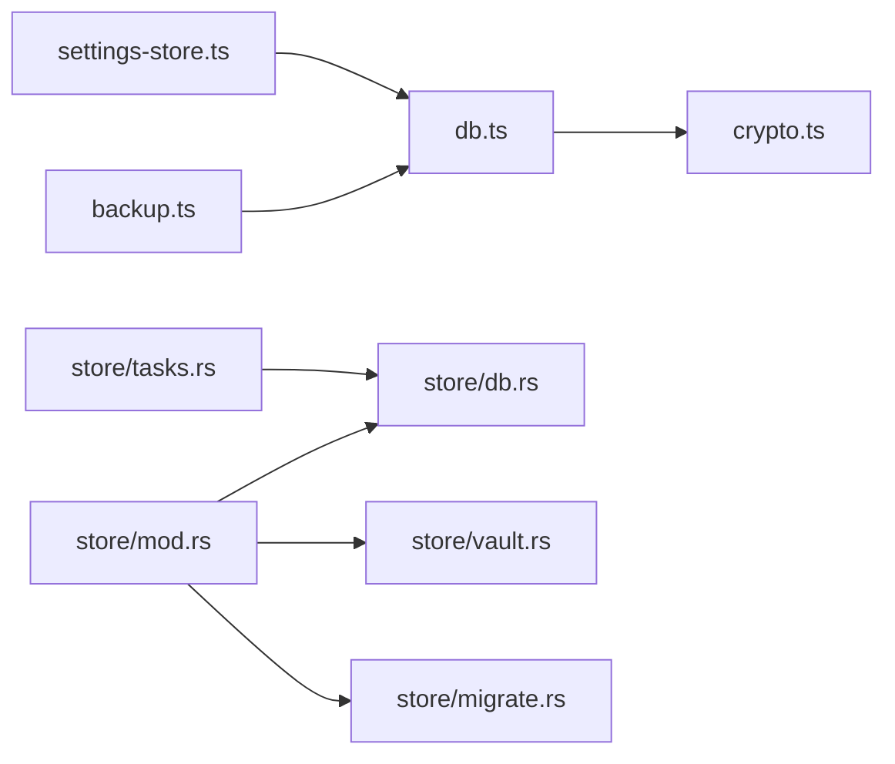

# 数据存储

<cite>
**本文引用的文件**   
- [db.ts](file://tongtian-tauri/src/main/store/db.ts)
- [vault.ts](file://tongtian-tauri/src/main/store/vault.ts)
- [crypto.ts](file://tongtian-tauri/src/main/util/crypto.ts)
- [backup.ts](file://tongtian-tauri/src/main/file/backup.ts)
- [settings-store.ts](file://tongtian-tauri/src/main/store/settings-store.ts)
- [db.rs](file://tongtian-tauri/src-tauri/src/store/db.rs)
- [vault.rs](file://tongtian-tauri/src-tauri/src/store/vault.rs)
- [migrate.rs](file://tongtian-tauri/src-tauri/src/store/migrate.rs)
- [tasks.rs](file://tongtian-tauri/src-tauri/src/store/tasks.rs)
- [mod.rs](file://tongtian-tauri/src-tauri/src/store/mod.rs)
</cite>

## 目录
1. [简介](#简介)
2. [项目结构](#项目结构)
3. [核心组件](#核心组件)
4. [架构总览](#架构总览)
5. [详细组件分析](#详细组件分析)
6. [依赖关系分析](#依赖关系分析)
7. [性能考虑](#性能考虑)
8. [故障排查指南](#故障排查指南)
9. [结论](#结论)
10. [附录：数据库操作示例与最佳实践](#附录数据库操作示例与最佳实践)

## 简介
本文件面向“数据存储系统”的完整说明，覆盖 SQLite 数据库设计（表结构、索引策略、查询优化）、密钥管理系统（Vault）实现（加密算法、密钥轮换、访问控制）、数据迁移策略、备份恢复机制、数据一致性保证，以及数据安全与隐私保护措施。文档同时提供可操作的维护与管理指南和性能调优建议，帮助读者在开发与运维中高效使用与维护该存储子系统。

## 项目结构
本项目包含两套存储实现：
- Electron 主进程侧（TypeScript）：基于 better-sqlite3 的本地 SQLite 单例数据库、系统凭据管理器 keytar 的 Vault、AES-256-GCM 加解密工具、文件备份与回滚管理器等。
- Tauri 侧（Rust）：基于 rusqlite 的连接与迁移、keyring 凭据保管、任务持久化等。

图表来源
- [db.ts:1-363](file://tongtian-tauri/src/main/store/db.ts#L1-L363)
- [vault.ts:1-137](file://tongtian-tauri/src/main/store/vault.ts#L1-L137)
- [crypto.ts:1-105](file://tongtian-tauri/src/main/util/crypto.ts#L1-L105)
- [backup.ts:1-336](file://tongtian-tauri/src/main/file/backup.ts#L1-L336)
- [settings-store.ts:1-136](file://tongtian-tauri/src/main/store/settings-store.ts#L1-L136)
- [db.rs:1-49](file://tongtian-tauri/src-tauri/src/store/db.rs#L1-L49)
- [vault.rs:1-119](file://tongtian-tauri/src-tauri/src/store/vault.rs#L1-L119)
- [migrate.rs:1-118](file://tongtian-tauri/src-tauri/src/store/migrate.rs#L1-L118)
- [tasks.rs:1-168](file://tongtian-tauri/src-tauri/src/store/tasks.rs#L1-L168)
- [mod.rs:1-105](file://tongtian-tauri/src-tauri/src/store/mod.rs#L1-L105)

章节来源
- [db.ts:1-363](file://tongtian-tauri/src/main/store/db.ts#L1-L363)
- [mod.rs:1-105](file://tongtian-tauri/src-tauri/src/store/mod.rs#L1-L105)

## 核心组件
- SQLite 数据库（Electron）
  - 单例模式封装 better-sqlite3，启用 WAL 模式与外键约束，DDL/索引集中定义，支持 schema_version 驱动的迁移。
- SQLite 数据库（Tauri）
  - 通过 rusqlite 打开连接并设置 PRAGMA；运行目录由环境变量或默认路径决定。
- 密钥管理系统（Vault）
  - Electron：keytar 优先，不可用时内存降级；进程内缓存 API Key。
  - Tauri：keyring 优先，不可用时内存降级；DB 仅保存 has_api_key 引用标记。
- 加解密工具
  - AES-256-GCM，scrypt 派生密钥，随机 IV/Salt，Base64 编码输出。
- 备份与回滚
  - 文件级备份记录 SHA256，支持按任务/步骤维度查询，定时清理过期备份。
- 应用设置
  - app_settings 表以 JSON 存储，支持增量更新与系统行为联动（开机自启、保持唤醒）。

章节来源
- [db.ts:64-328](file://tongtian-tauri/src/main/store/db.ts#L64-L328)
- [db.rs:1-49](file://tongtian-tauri/src-tauri/src/store/db.rs#L1-L49)
- [vault.ts:1-137](file://tongtian-tauri/src/main/store/vault.ts#L1-L137)
- [vault.rs:1-119](file://tongtian-tauri/src-tauri/src/store/vault.rs#L1-L119)
- [crypto.ts:1-105](file://tongtian-tauri/src/main/util/crypto.ts#L1-L105)
- [backup.ts:1-336](file://tongtian-tauri/src/main/file/backup.ts#L1-L336)
- [settings-store.ts:1-136](file://tongtian-tauri/src/main/store/settings-store.ts#L1-L136)

## 架构总览
下图展示 Electron 与 Tauri 两条存储路径的关键交互与职责边界。

图表来源
- [db.ts:284-328](file://tongtian-tauri/src/main/store/db.ts#L284-L328)
- [vault.ts:60-125](file://tongtian-tauri/src/main/store/vault.ts#L60-L125)
- [backup.ts:86-182](file://tongtian-tauri/src/main/file/backup.ts#L86-L182)

## 详细组件分析

### SQLite 数据库设计与索引策略（Electron）
- 表结构要点
  - tasks/messages/file_ops/file_backups/model_configs/audit_logs/workspaces/skills/mcp_servers/sandbox_policies/schedule_tasks/model_usage/app_settings/awareness_profiles/memory_entries/connector_states/archived_tasks/hook_configs 等。
  - 关键字段含时间戳、JSON 扩展字段、外键关联（如 messages.task_id、file_ops.task_id、model_usage.model_id 等）。
- 索引策略
  - 针对高频查询列建立索引，例如消息/操作的任务维度、审计日志的时间/事件/工作区/模型维度、工作区状态、技能来源/启用、MCP 服务器状态、沙箱策略工作区、模型用量模型/日期、计划任务启用、记忆来源、归档工作区等。
- 初始化与迁移
  - 启动时启用 WAL 与外键，创建 DDL/索引，检查 schema_version 并执行迁移（v1→v2 新增表幂等重建）。
- 查询优化建议
  - 使用预编译语句与参数绑定，避免注入与重复解析。
  - 对大表查询增加 LIMIT、分页与排序字段选择合适索引。
  - 批量写入采用事务包裹，减少磁盘同步开销。
  - 合理拆分 JSON 字段为独立列以提升过滤效率。

图表来源
- [db.ts:284-328](file://tongtian-tauri/src/main/store/db.ts#L284-L328)

章节来源
- [db.ts:64-328](file://tongtian-tauri/src/main/store/db.ts#L64-L328)

### SQLite 数据库设计与迁移（Tauri）
- 连接与 PRAGMA
  - 打开 rusqlite 连接后设置 journal_mode=WAL、foreign_keys=ON。
- 版本化迁移
  - 通过 schema_version 表驱动，按顺序执行 MIGRATIONS 数组中的 SQL 片段，幂等跳过已应用版本。
- 任务持久化
  - tasks 表 upsert 与按更新时间倒序列表，支持 limit。

图表来源
- [mod.rs:19-52](file://tongtian-tauri/src-tauri/src/store/mod.rs#L19-L52)
- [vault.rs:17-85](file://tongtian-tauri/src-tauri/src/store/vault.rs#L17-L85)

章节来源
- [db.rs:16-25](file://tongtian-tauri/src-tauri/src/store/db.rs#L16-L25)
- [migrate.rs:44-73](file://tongtian-tauri/src-tauri/src/store/migrate.rs#L44-L73)
- [tasks.rs:28-95](file://tongtian-tauri/src-tauri/src/store/tasks.rs#L28-L95)
- [mod.rs:24-52](file://tongtian-tauri/src-tauri/src/store/mod.rs#L24-L52)

### 密钥管理系统（Vault）实现
- 设计原则
  - API Key 永不落库/落盘（Electron/Tauri 均遵循），DB 仅保存引用标记（has_api_key）。
- 存储后端
  - Electron：keytar（系统凭据管理器）优先，不可用则内存 Map 降级；进程内缓存提升读取性能。
  - Tauri：keyring 优先，不可用则内存 HashMap 降级；错误探测与告警避免重复打印。
- 访问控制
  - 以 service/account 命名空间隔离密钥；提供 set/get/delete/clear 能力。
- 密钥轮换
  - 通过覆盖写入新值实现轮换；建议在应用层记录轮换时间与审计日志。

图表来源
- [vault.ts:60-125](file://tongtian-tauri/src/main/store/vault.ts#L60-L125)

章节来源
- [vault.ts:1-137](file://tongtian-tauri/src/main/store/vault.ts#L1-L137)
- [vault.rs:1-119](file://tongtian-tauri/src-tauri/src/store/vault.rs#L1-L119)

### 加密算法与数据安全
- 算法与参数
  - AES-256-GCM 对称加密，scrypt 派生密钥，随机 IV/Salt，Base64 编码输出。
- 安全特性
  - GCM 提供认证标签防止篡改；scrypt 提高暴力破解成本。
- 使用建议
  - 主密钥（masterKey）应来自用户口令或安全的密钥管理服务；定期轮换 masterKey 并重加密历史数据。

章节来源
- [crypto.ts:1-105](file://tongtian-tauri/src/main/util/crypto.ts#L1-L105)

### 备份与恢复机制
- 备份流程
  - 计算源文件 SHA256，复制至 .tongtian-backups/{taskId}/{stepId}/，记录 file_backups 表（状态 pending→success/failed）。
- 回滚流程
  - 根据 backupId 定位记录，若存在备份则覆盖原文件；若原始不存在则删除；更新状态为 rolled_back。
- 清理策略
  - 定时清理超过保留期（默认 24h）的备份文件与记录。

图表来源
- [backup.ts:86-182](file://tongtian-tauri/src/main/file/backup.ts#L86-L182)

章节来源
- [backup.ts:1-336](file://tongtian-tauri/src/main/file/backup.ts#L1-L336)

### 应用设置与系统行为联动
- 存储结构
  - app_settings 表以 JSON 存储全部设置项，支持 ON CONFLICT 覆盖更新。
- 系统行为
  - 开机自启动（setLoginItemSettings）、保持唤醒（powerSaveBlocker）随设置变化即时生效。
- 启动恢复
  - 应用启动时加载设置并恢复系统行为。

章节来源
- [settings-store.ts:1-136](file://tongtian-tauri/src/main/store/settings-store.ts#L1-L136)

## 依赖关系分析
- Electron 侧
  - db.ts 作为单例被 settings-store.ts、backup.ts 等模块依赖。
  - vault.ts 依赖 keytar（或 mock），提供 API Key 存取。
  - crypto.ts 提供通用加解密能力。
- Tauri 侧
  - mod.rs 聚合 Store（连接+Vault），migrate.rs 负责迁移，tasks.rs 负责任务持久化。
  - db.rs 提供连接与 PRAGMA 设置。

图表来源
- [settings-store.ts:1-136](file://tongtian-tauri/src/main/store/settings-store.ts#L1-L136)
- [backup.ts:1-336](file://tongtian-tauri/src/main/file/backup.ts#L1-L336)
- [db.ts:1-363](file://tongtian-tauri/src/main/store/db.ts#L1-L363)
- [mod.rs:1-105](file://tongtian-tauri/src-tauri/src/store/mod.rs#L1-L105)
- [db.rs:1-49](file://tongtian-tauri/src-tauri/src/store/db.rs#L1-L49)
- [vault.rs:1-119](file://tongtian-tauri/src-tauri/src/store/vault.rs#L1-L119)
- [migrate.rs:1-118](file://tongtian-tauri/src-tauri/src/store/migrate.rs#L1-L118)
- [tasks.rs:1-168](file://tongtian-tauri/src-tauri/src/store/tasks.rs#L1-L168)

章节来源
- [db.ts:1-363](file://tongtian-tauri/src/main/store/db.ts#L1-L363)
- [mod.rs:1-105](file://tongtian-tauri/src-tauri/src/store/mod.rs#L1-L105)

## 性能考虑
- WAL 模式
  - 提升并发读性能，减少写锁竞争；确保定期 checkpoint 避免 wal 文件过大。
- 索引优化
  - 针对高频过滤与排序字段建立索引；避免过多冗余索引影响写入。
- 批量与事务
  - 将多条写入放入同一事务，减少磁盘同步次数。
- 连接复用
  - 使用单例连接（Electron）或 Mutex 保护连接（Tauri），避免频繁打开关闭。
- JSON 字段
  - 尽量将需要过滤/排序的字段拆分为独立列，提升查询效率。
- 备份清理
  - 合理设置保留周期与清理间隔，避免磁盘占用增长。

[本节为通用指导，不直接分析具体文件]

## 故障排查指南
- 数据库无法打开/PRAGMA 失败
  - 检查路径权限、磁盘空间与 SQLite 版本兼容性。
- 迁移失败
  - 查看 schema_version 当前版本与迁移脚本是否一致；确认 DDL 幂等性。
- 密钥读取失败
  - 检查 keytar/keyring 可用性；必要时启用内存降级并验证缓存命中。
- 备份/回滚异常
  - 核对 file_backups 记录状态与文件路径；确认备份目录权限与磁盘空间。
- 设置未生效
  - 检查 app_settings 记录是否存在；确认系统 API（开机自启/电源管理）调用是否被拦截。

章节来源
- [db.rs:16-25](file://tongtian-tauri/src-tauri/src/store/db.rs#L16-L25)
- [migrate.rs:44-73](file://tongtian-tauri/src-tauri/src/store/migrate.rs#L44-L73)
- [vault.ts:60-125](file://tongtian-tauri/src/main/store/vault.ts#L60-L125)
- [backup.ts:232-280](file://tongtian-tauri/src/main/file/backup.ts#L232-L280)
- [settings-store.ts:103-132](file://tongtian-tauri/src/main/store/settings-store.ts#L103-L132)

## 结论
本存储子系统通过双栈实现（Electron/Tauri）提供了稳健的本地数据持久化、安全的密钥管理与完善的备份恢复能力。借助 WAL、索引与事务优化，系统在读写性能与一致性之间取得平衡；Vault 的设计确保敏感信息不落库，降低泄露风险。结合合理的迁移策略与清理机制，系统具备良好的可维护性与可扩展性。

[本节为总结性内容，不直接分析具体文件]

## 附录：数据库操作示例与最佳实践

- 初始化与连接
  - Electron：通过 Database.getInstance() 获取单例连接，自动启用 WAL 与外键。
  - Tauri：Store::open_default() 或 Store::open(path) 打开连接并执行迁移。
- 常用 SQL 模式
  - 预编译语句与参数绑定；批量写入使用事务；分页查询使用 LIMIT/OFFSET。
- 索引使用
  - 为高频过滤/排序字段添加索引；监控慢查询并调整索引。
- 备份与恢复
  - 在执行可能破坏数据的操作前调用备份；失败时按 backupId 回滚。
- 密钥管理
  - 使用 Vault 存取 API Key；定期轮换并记录审计日志；禁用明文落盘。
- 设置管理
  - 使用 settings-store 进行增量更新；启动时恢复系统行为。

章节来源
- [db.ts:284-328](file://tongtian-tauri/src/main/store/db.ts#L284-L328)
- [mod.rs:24-52](file://tongtian-tauri/src-tauri/src/store/mod.rs#L24-L52)
- [backup.ts:86-182](file://tongtian-tauri/src/main/file/backup.ts#L86-L182)
- [vault.ts:60-125](file://tongtian-tauri/src/main/store/vault.ts#L60-L125)
- [settings-store.ts:55-92](file://tongtian-tauri/src/main/store/settings-store.ts#L55-L92)