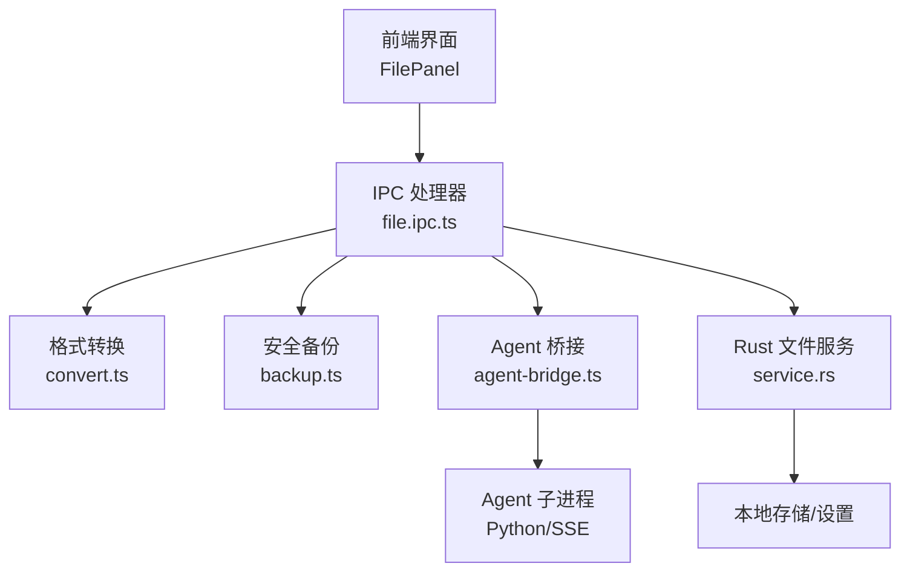
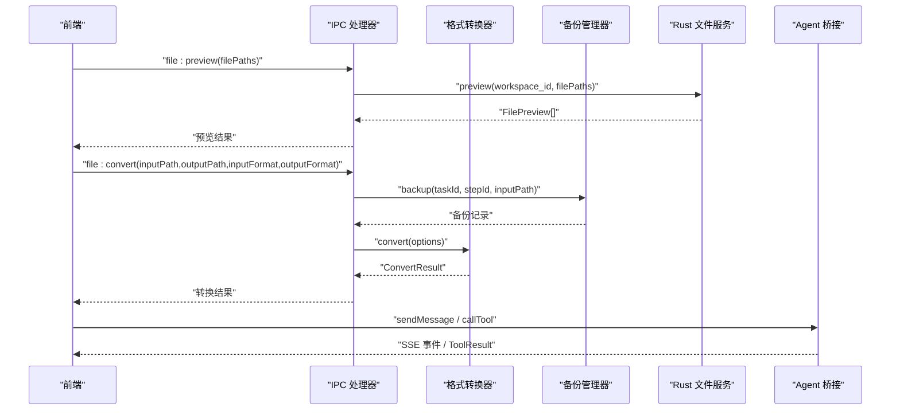
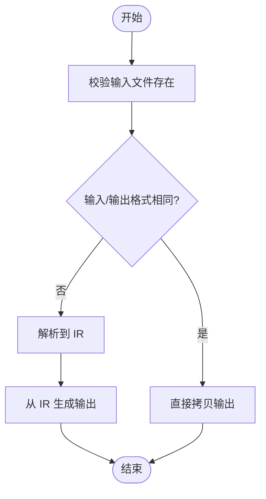
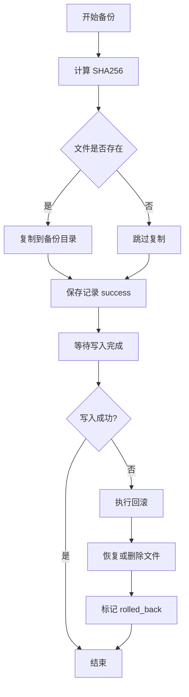
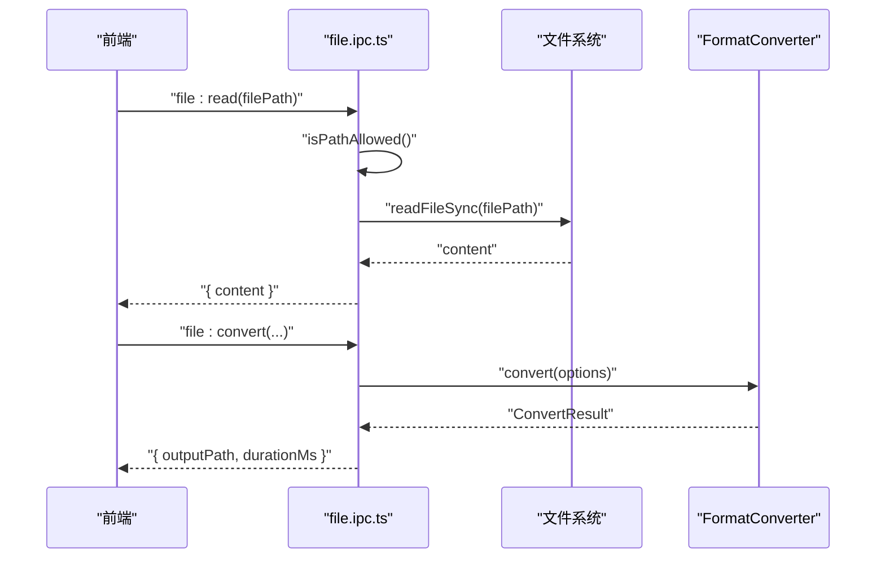
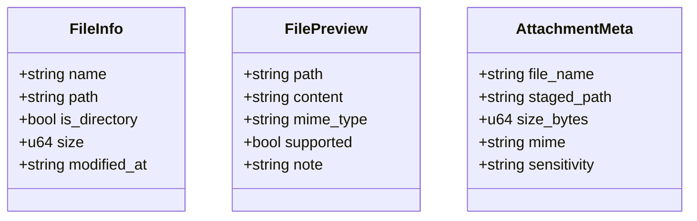
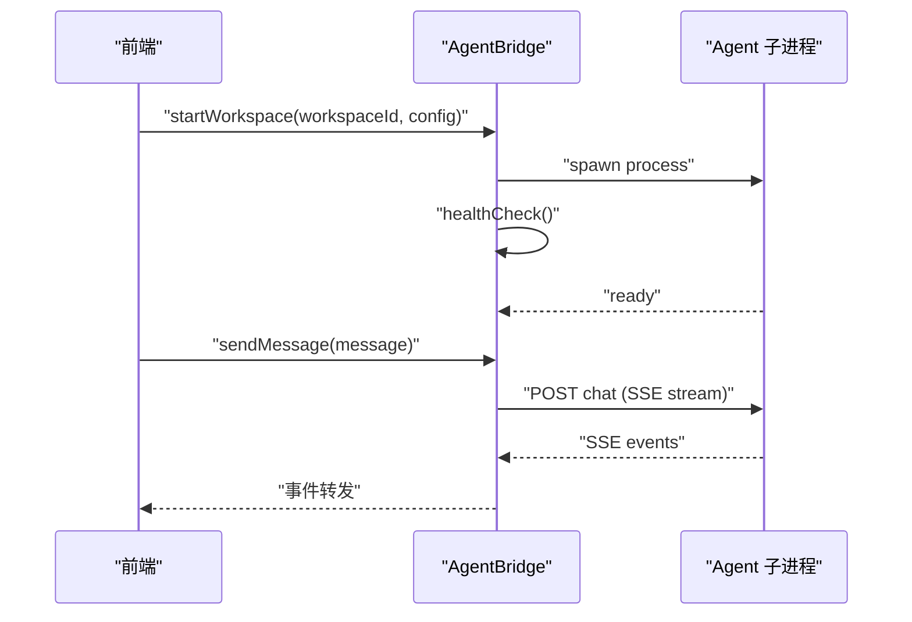
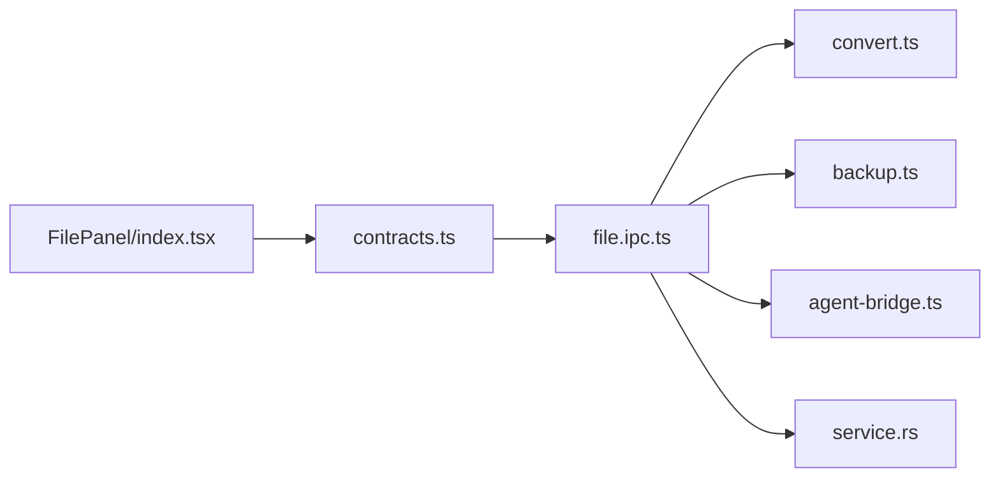

# 文件处理系统

<cite>
**本文引用的文件**   
- [spec.md](file://docs/changes/qwenpaw-integration/specs/file-processing/spec.md)
- [convert.ts](file://tongtian-tauri/src/main/file/convert.ts)
- [backup.ts](file://tongtian-tauri/src/main/file/backup.ts)
- [file.ipc.ts](file://tongtian-tauri/src/main/ipc/file.ipc.ts)
- [service.rs](file://tongtian-tauri/src-tauri/src/file/service.rs)
- [contracts.ts](file://tongtian-tauri/src/shared/contracts.ts)
- [index.tsx](file://tongtian-tauri/src/renderer/components/FilePanel/index.tsx)
- [agent-bridge.ts](file://tongtian-tauri/src/main/bridge/agent-bridge.ts)
- [config.py](file://tongtian-tauri/src/agent/sandbox/config.py)
</cite>

## 目录
1. [简介](#简介)
2. [项目结构](#项目结构)
3. [核心组件](#核心组件)
4. [架构总览](#架构总览)
5. [详细组件分析](#详细组件分析)
6. [依赖关系分析](#依赖关系分析)
7. [性能考虑](#性能考虑)
8. [故障排查指南](#故障排查指南)
9. [结论](#结论)
10. [附录：API 接口与数据模型](#附录api-接口与数据模型)

## 简介
本文件系统面向 Agent 引擎与桌面端应用，提供统一、安全、可审计的文件读取、写入、预览、转换与组织等能力。系统在 QwenPaw 基础文件工具之上增强格式转换与安全备份机制，并通过 IPC 通道为前端和上层模块暴露稳定接口。同时，Rust 侧服务提供白名单访问控制、大小限制与附件暂存等能力，确保在受限环境下的安全性与稳定性。

## 项目结构
- 主进程（Node.js）负责：
  - 文件浏览、读取、预览、转换的 IPC 路由与校验
  - 格式转换管道（IR 中间表示 + 解析器/生成器）
  - 安全备份与回滚（SHA256 指纹、定时清理）
  - 与 Agent 子进程的桥接管理（启动、健康检查、SSE 事件）
- Rust 侧服务负责：
  - 工作区文件白名单校验、读取上限、批量预览
  - 附件暂存与敏感度检测
- 前端渲染层提供 FilePanel 展示文件操作记录与状态

**图表来源** 
- [file.ipc.ts:1-250](file://tongtian-tauri/src/main/ipc/file.ipc.ts#L1-L250)
- [convert.ts:1-496](file://tongtian-tauri/src/main/file/convert.ts#L1-L496)
- [backup.ts:1-336](file://tongtian-tauri/src/main/file/backup.ts#L1-L336)
- [agent-bridge.ts:1-573](file://tongtian-tauri/src/main/bridge/agent-bridge.ts#L1-L573)
- [service.rs:1-478](file://tongtian-tauri/src-tauri/src/file/service.rs#L1-L478)

**章节来源**
- [spec.md:1-97](file://docs/changes/qwenpaw-integration/specs/file-processing/spec.md#L1-L97)
- [file.ipc.ts:1-250](file://tongtian-tauri/src/main/ipc/file.ipc.ts#L1-L250)
- [convert.ts:1-496](file://tongtian-tauri/src/main/file/convert.ts#L1-L496)
- [backup.ts:1-336](file://tongtian-tauri/src/main/file/backup.ts#L1-L336)
- [service.rs:1-478](file://tongtian-tauri/src-tauri/src/file/service.rs#L1-L478)
- [agent-bridge.ts:1-573](file://tongtian-tauri/src/main/bridge/agent-bridge.ts#L1-L573)
- [config.py:1-523](file://tongtian-tauri/src/agent/sandbox/config.py#L1-L523)

## 核心组件
- 格式转换器（FormatConverter）
  - 支持 txt/md/csv/xlsx/docx/pdf 的 IR 中间表示与解析/生成管线
  - 当前已实现文本类格式的解析与生成；xlsx/docx/pdf 的部分解析/生成待接入第三方库
- 安全备份管理器（BackupManager）
  - 写入前计算 SHA256、复制至 .tongtian-backups/{taskId}/{stepId}/
  - 失败自动回滚，定时清理过期备份（默认 24h）
- IPC 文件处理器（file.ipc.ts）
  - file:browse / file:read / file:preview / file:convert 等通道
  - 路径白名单校验、MIME 类型识别、错误码统一
- Rust 文件服务（service.rs）
  - 工作区白名单校验、读取上限 2MB、批量预览、附件暂存 50MB
  - 敏感词检测（public/internal/confidential）
- Agent 桥接（agent-bridge.ts）
  - 子进程生命周期管理、健康检查、SSE 事件流、工具调用适配

**章节来源**
- [convert.ts:1-496](file://tongtian-tauri/src/main/file/convert.ts#L1-L496)
- [backup.ts:1-336](file://tongtian-tauri/src/main/file/backup.ts#L1-L336)
- [file.ipc.ts:1-250](file://tongtian-tauri/src/main/ipc/file.ipc.ts#L1-L250)
- [service.rs:1-478](file://tongtian-tauri/src-tauri/src/file/service.rs#L1-L478)
- [agent-bridge.ts:1-573](file://tongtian-tauri/src/main/bridge/agent-bridge.ts#L1-L573)

## 架构总览
系统采用“前端 → 主进程 IPC → 转换/备份/Rust 服务”的分层架构，Agent 通过桥接独立运行，避免阻塞主线程。

**图表来源** 
- [file.ipc.ts:150-235](file://tongtian-tauri/src/main/ipc/file.ipc.ts#L150-L235)
- [convert.ts:93-153](file://tongtian-tauri/src/main/file/convert.ts#L93-L153)
- [backup.ts:86-142](file://tongtian-tauri/src/main/file/backup.ts#L86-L142)
- [service.rs:212-256](file://tongtian-tauri/src-tauri/src/file/service.rs#L212-L256)
- [agent-bridge.ts:304-346](file://tongtian-tauri/src/main/bridge/agent-bridge.ts#L304-L346)

## 详细组件分析

### 格式转换（FormatConverter）
- 设计要点
  - 使用 IRDocument 作为中间表示，解耦输入/输出格式
  - 解析器将不同格式转为 IR，生成器从 IR 写出目标格式
  - 短路径优化：同格式直接拷贝
- 复杂度与扩展性
  - 解析/生成均为 O(n) 线性扫描（文本类）
  - 表格/列表等结构化内容以数组形式处理，便于扩展
- 未实现项
  - xlsx/docx/pdf 的解析/生成需引入对应库（SheetJS、mammoth、pdf-parse/pdf-lib）

**图表来源** 
- [convert.ts:93-153](file://tongtian-tauri/src/main/file/convert.ts#L93-L153)

**章节来源**
- [convert.ts:1-496](file://tongtian-tauri/src/main/file/convert.ts#L1-L496)

### 安全备份与回滚（BackupManager）
- 关键流程
  - 写入前计算 SHA256 并复制文件至备份目录
  - 记录备份状态（pending/success/failed/rolled_back）
  - 失败时根据备份恢复原文件或删除新建文件
  - 定时清理超过保留期的备份（默认 24h）
- 原子性保证
  - 通过“先备份后写入”的策略，结合失败回滚，达到近似原子性
  - 建议配合事务型写入（如临时文件+原子替换）进一步提升可靠性

**图表来源** 
- [backup.ts:86-182](file://tongtian-tauri/src/main/file/backup.ts#L86-L182)

**章节来源**
- [backup.ts:1-336](file://tongtian-tauri/src/main/file/backup.ts#L1-L336)

### IPC 文件处理器（file.ipc.ts）
- 功能覆盖
  - file:browse：列出目录内容（FileInfo[]）
  - file:read：读取文本文件（content）
  - file:preview：批量预览（text/json 直读，二进制返回占位）
  - file:convert：调用 FormatConverter 进行转换
- 安全策略
  - 路径白名单校验（防路径遍历）
  - MIME 类型识别，限制文本预览范围
- 错误处理
  - 统一错误码（FILE_NOT_FOUND、PATH_NOT_ALLOWED、CONVERSION_FAILED 等）

**图表来源** 
- [file.ipc.ts:136-235](file://tongtian-tauri/src/main/ipc/file.ipc.ts#L136-L235)
- [convert.ts:93-153](file://tongtian-tauri/src/main/file/convert.ts#L93-L153)

**章节来源**
- [file.ipc.ts:1-250](file://tongtian-tauri/src/main/ipc/file.ipc.ts#L1-L250)
- [contracts.ts:478-584](file://tongtian-tauri/src/shared/contracts.ts#L478-L584)

### Rust 文件服务（service.rs）
- 能力清单
  - list_dir：目录列表（白名单校验）
  - read_file：文本读取（2MB 上限）
  - preview：批量预览（text/json 直读，其他标注不支持）
  - stage_attachment：附件暂存（50MB 上限，敏感度检测）
- 白名单机制
  - 基于工作区根目录与 settings_kv 中的 allowlist
  - 越界访问返回 FILE_ACCESS_DENIED
- 测试覆盖
  - 单元测试验证白名单、大小限制、预览行为、附件暂存路径与敏感度

**图表来源** 
- [service.rs:21-53](file://tongtian-tauri/src-tauri/src/file/service.rs#L21-L53)

**章节来源**
- [service.rs:1-478](file://tongtian-tauri/src-tauri/src/file/service.rs#L1-L478)

### 与 Agent 引擎集成（agent-bridge.ts）
- 子进程管理
  - 按工作区隔离实例，分配端口，健康检查，优雅关闭
- 通信协议
  - HTTP + SSE 事件流，工具调用适配版本兼容
- 文件相关
  - 通过 QwenPaw 内置文件工具（read/write/edit/append/grep/glob）
  - 通天办公侧增强转换与备份，不经过 QwenPaw

**图表来源** 
- [agent-bridge.ts:131-247](file://tongtian-tauri/src/main/bridge/agent-bridge.ts#L131-L247)
- [agent-bridge.ts:304-346](file://tongtian-tauri/src/main/bridge/agent-bridge.ts#L304-L346)

**章节来源**
- [agent-bridge.ts:1-573](file://tongtian-tauri/src/main/bridge/agent-bridge.ts#L1-L573)
- [spec.md:18-58](file://docs/changes/qwenpaw-integration/specs/file-processing/spec.md#L18-L58)

### 沙箱与权限控制（config.py）
- 多平台沙箱模式
  - macOS Seatbelt、Linux bubblewrap/Landlock、Windows AppContainer、None
- 配置项
  - 挂载点读写/执行控制、网络域名/端口规则、资源限制、超时与环境注入
- 能力探测
  - 启动时探测平台能力并缓存，决定可用模式

**章节来源**
- [config.py:1-523](file://tongtian-tauri/src/agent/sandbox/config.py#L1-L523)

## 依赖关系分析
- 主进程依赖
  - convert.ts：格式转换（Node.js fs、Logger）
  - backup.ts：备份与回滚（fs、crypto、Electron app.getPath、Database）
  - file.ipc.ts：IPC 路由（zod 校验、fs、path、Logger、FormatConverter）
  - agent-bridge.ts：子进程管理（child_process、net、http-client、sse-parser）
- Rust 服务依赖
  - service.rs：路径白名单、settings_kv、文件系统、序列化
- 前端依赖
  - contracts.ts：IPC 通道名与错误码定义
  - FilePanel：展示文件操作记录与状态

**图表来源** 
- [contracts.ts:478-584](file://tongtian-tauri/src/shared/contracts.ts#L478-L584)
- [file.ipc.ts:1-250](file://tongtian-tauri/src/main/ipc/file.ipc.ts#L1-L250)
- [convert.ts:1-496](file://tongtian-tauri/src/main/file/convert.ts#L1-L496)
- [backup.ts:1-336](file://tongtian-tauri/src/main/file/backup.ts#L1-L336)
- [agent-bridge.ts:1-573](file://tongtian-tauri/src/main/bridge/agent-bridge.ts#L1-L573)
- [service.rs:1-478](file://tongtian-tauri/src-tauri/src/file/service.rs#L1-L478)
- [index.tsx:1-247](file://tongtian-tauri/src/renderer/components/FilePanel/index.tsx#L1-L247)

**章节来源**
- [contracts.ts:1-587](file://tongtian-tauri/src/shared/contracts.ts#L1-L587)
- [file.ipc.ts:1-250](file://tongtian-tauri/src/main/ipc/file.ipc.ts#L1-L250)
- [convert.ts:1-496](file://tongtian-tauri/src/main/file/convert.ts#L1-L496)
- [backup.ts:1-336](file://tongtian-tauri/src/main/file/backup.ts#L1-L336)
- [agent-bridge.ts:1-573](file://tongtian-tauri/src/main/bridge/agent-bridge.ts#L1-L573)
- [service.rs:1-478](file://tongtian-tauri/src-tauri/src/file/service.rs#L1-L478)
- [index.tsx:1-247](file://tongtian-tauri/src/renderer/components/FilePanel/index.tsx#L1-L247)

## 性能考虑
- 格式转换
  - 文本类解析/生成 O(n)，适合大文件流式处理（未来可扩展）
  - 同格式短路径拷贝减少 CPU 与 IO
- 备份
  - SHA256 计算与文件复制为 IO 密集，建议在异步队列中执行，避免阻塞主线程
  - 定时清理降低磁盘占用
- IPC
  - 批量预览合并请求，减少多次往返
  - 路径校验与 MIME 判断前置，快速失败
- Rust 服务
  - 白名单与大小限制前置，避免无效 IO
  - 附件暂存一次性复制，避免重复读取

[本节为通用指导，无需源码引用]

## 故障排查指南
- 常见错误码
  - FILE_NOT_FOUND：文件不存在
  - PATH_NOT_ALLOWED：路径不在白名单
  - FILE_TOO_LARGE：超出读取/附件大小限制
  - FILE_CONVERSION_FAILED：转换失败（依赖缺失或格式不支持）
  - FILE_BACKUP_FAILED：备份失败（权限或磁盘问题）
- 排查步骤
  - 检查路径是否绝对且不含 “..”
  - 确认工作区白名单与 settings_kv 配置
  - 查看备份目录是否存在及权限
  - 检查依赖库是否安装（xlsx/docx/pdf）
  - 查看日志模块（Logger）输出定位具体错误

**章节来源**
- [file.ipc.ts:44-57](file://tongtian-tauri/src/main/ipc/file.ipc.ts#L44-L57)
- [service.rs:173-197](file://tongtian-tauri/src-tauri/src/file/service.rs#L173-L197)
- [convert.ts:139-153](file://tongtian-tauri/src/main/file/convert.ts#L139-L153)

## 结论
本文件系统通过“主进程 IPC + 转换/备份 + Rust 服务 + Agent 桥接”的分层设计，实现了安全、可靠、可扩展的文件处理能力。当前已覆盖文本类格式的读取、预览与转换，xlsx/docx/pdf 的完整转换链路将在后续迭代中补齐。建议在生产环境中启用严格白名单、开启备份与回滚、并监控转换与备份的性能指标。

[本节为总结，无需源码引用]

## 附录：API 接口与数据模型
- IPC 通道（部分）
  - file:browse：{ dirPath: string } → FileInfo[]
  - file:read：{ filePath: string } → { content: string }
  - file:preview：{ filePaths: string[] } → FilePreview[]
  - file:convert：{ inputPath, outputPath, inputFormat, outputFormat } → { outputPath, durationMs }
- 错误码（部分）
  - FILE_NOT_FOUND、FILE_ACCESS_DENIED、FILE_WRITE_FAILED、FILE_CONVERSION_FAILED、FILE_TOO_LARGE、FILE_BACKUP_FAILED
- 数据模型（部分）
  - FileInfo：name、path、isDirectory、size、modifiedAt
  - FilePreview：path、content、mimeType
  - AttachmentMeta：fileName、stagedPath、sizeBytes、mime、sensitivity

**章节来源**
- [contracts.ts:323-335](file://tongtian-tauri/src/shared/contracts.ts#L323-L335)
- [contracts.ts:478-584](file://tongtian-tauri/src/shared/contracts.ts#L478-L584)
- [service.rs:21-53](file://tongtian-tauri/src-tauri/src/file/service.rs#L21-L53)